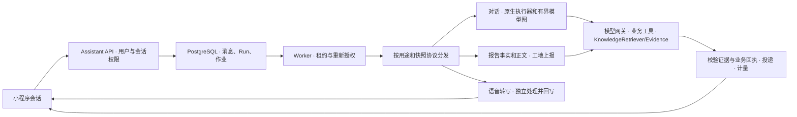
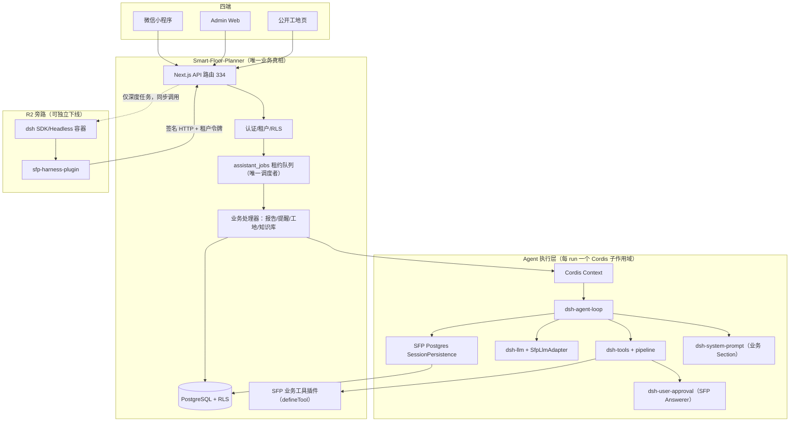

# DeepSeek Harness 源码复用独立复核

2026-11-19 · Smart-Floor-Planner / 小K Agent

## 决策

**业主施工日报保留现有执行路径。** 方案 D 的业务对照测了 `construction.report.compose`。同请求复测中，两路的正文、恢复结果和模型用量一致，Harness 旁路正常投递读回多用 2.09 秒。复用小K的 PostgreSQL 回执已能恢复这项作业。[业务对照](#方案-d-业务对照业主施工日报)

**巡检路线采用小K现有 PostgreSQL 分段回执的方案。** 两台开发机的真实天地图对照证明，换机接管会跳过已写回执的段。已收到响应但还未写回执时只补查该段，天地图成功请求多 1 次，小K应用预留多 1 次。工作区巡检 API 与 WebView 已接入数据库时钟、同请求续跑和读回鉴权。HTTPS 测试入口已验真实算路，微信开发预览包已编译。[跨机接管与未写回执](#postgresql-跨机接管与未写回执) · [接入验证](../../tmp/inspection-route-preview-20261119/api-verification.json)

**采用方案 D 的按需组件复用，当前结论是“旁路可用、主链不动”。** R1 已实证文件版 Workflow Store 跨进程加锁可阻止丢写；但官方原子写入不含 `fsync`，断电持久性不在合同内。其接入条件仍是确有同主机多写者场景，并先解决接管标记残留与版本归一化。R2 已用官方 SDK 在 Windows 与本机 Linux 容器各跑通一套合成验收（14/14 检查），证明独立 Agent 旁路的生命周期、白名单工具、会话恢复、审批拒绝和超时未决可用。两项结果都只覆盖对应边界，**0 个模块已证明可直接替换小K生产主链**。

**R2 支持“有明确业务收益时启用 SDK 旁路”，不支持据此进入 R3。** 启用前须固定四项：自建精简 bundle（不使用 shipped `sdk-minimal`，关闭文件/终端/MCP/`session-title` 等入口）、专用 `DSH_HOME` 与工作目录、白名单工具加服务端重新鉴权的一次性审批、显式调大的 `initializeTimeoutMs`（默认 10 秒在 Linux bind mount 冷启动实测不足：17.7 秒；Windows 通常约 1 秒，但同机曾观测 10.1 秒慢启动）。其中自建 `@sfp/dsh-r2-minimal` 已在 Windows/Linux 各 14/14 复验，审批拒绝路径已打通；服务端重新鉴权仍未实测。合成任务、假 provider 与单机容器均不构成生产接入证据。当前不排期生产接入，保留探针与证据；确有独立 Agent 业务时再按上述条件做隔离试点。

**R3 主链替换另行立项，但隔离兼容性已验证。** 进程内 Cordis/AgentLoop/Tools/Session 装配 14/14；Next standalone 只有在 `serverExternalPackages` 外置 DSH 包并复制完整依赖闭包后才可用，直接打包会因 `worker.ts`/`rrule` 失败，只复制直接外部包会缺 `cosmokit` 等传递依赖。管理端镜像、多租户 Session、生产 PG provider、真实模型、队列租约与计量仍未验证；PG Session 存储合同已用隔离原型验证 10/10（未接 AgentLoop）。R2 旁路通过不自动触发 R3。R4 已删除 `tools/loop.ts` + `web-search/workflow.ts` 共 342 行生产死代码，并把可保留的 ToolExecutor/Web 工具测试迁移到新文件；其余候选仍有生产调用者。

**首轮报告的源码导航和“业务权限、队列、知识证据由小K持有”可以沿用。** 影响决策的误差集中在版本对应关系、删除范围和持久化适配。即使只换对话图，待人工复核的历史事务、模型和工具回执、按轮计量及当前来源权限都仍需正常工作。[复核图](../../admin/src/lib/assistant/core/review-graph.ts#L9) · [对话运行时](../../admin/src/lib/assistant/agent/runtime.ts#L94) · [队列恢复](../../admin/src/lib/assistant/infrastructure/job-queue.ts#L63)

## 证据基线

| 来源 | 核对结果 |
|---|---|
| 原始任务 | 已读分享页的完整要求和首轮答复。此处补充独立证据和修订结论。[TRAE 分享](https://share.traecontent.cn/share/7EM6IJBQNXZ63O?enter_from=pc) |
| 小K | `codex/xiaok-integration`，HEAD `bc834f43f7dc018c195886fdd0b076f284cbc43d`。审计对象是当前实际工作树，收尾时有 148 条已跟踪变动、30 条未跟踪条目（目录按 Git 汇总），暂存区为空。审计期间另有施工摄像头检查脚本改动，未进入本轮验证输入。`codex/xiaok-native-workflow` 和 `codex/xiaok-public-site-lifecycle` 的本地尖端均为 HEAD 祖先。工作树行为与部署状态分别取证。 |
| Harness | 官网仓库默认分支 `master` 为 `2e39e70496aa02986ca6a820c5d497e816b69d7e`。发布标签 `dsh-v0.2.2-rc.5` 的提交是 `9c2670d3bce5275e0d1610272958121af87787bb`。抽查 tarball 中 9 个源码或配置文件，全部匹配发布标签，其中 6 个在 `master` 已有差异，涉及 profile boot、SDK Server、工具 pipeline、`sdk-minimal`、Cordis 和原子写入。[默认分支快照][dsh-main] · [发布标签][dsh-release] |
| Cordis | `cordiverse/cordis` 的 `main` 为 `d6de1c0e39c3290d07de1f6db88c28a3c31a1b6e`。`4.0.0-rc.12` 是 vendoring 的历史上游基线。`@deepseek-ai/cordis@4.1.0` 的 `src/fiber.ts` 与 Harness 发布标签内的 vendored 文件一致，发布物已有 V6 里禁止在卸载中注册 effect 等措施。[Cordis 上游](https://github.com/cordiverse/cordis/tree/d6de1c0e39c3290d07de1f6db88c28a3c31a1b6e) · [vendoring 记录][dsh-vendor] · [4.1.0 发布元数据][npm-cordis] |
| 核验方式 | 按固定提交读实现、装配和测试，核查 npm 精确版本。校验 13 个发布包的 SHA-512 integrity 与所查入口。使用项目已有 TypeScript `5.9.3` 解析其中 74 个 `.d.ts`，语法诊断 0。该检查覆盖声明语法；完整依赖解析、全量类型检查和 admin 镜像内的 Next standalone 仍待实测，R3 已用最小 App Router 应用验证 standalone 的外部化与闭包复制要求。 |
| R1 目标卷 | Linux Docker named volume 上 Store 探针 **9/10**（1 项 Windows-only 跳过）；`strace` 只观察到 `rename`，无 `fsync`/`fdatasync`/`sync`/`syncfs`；断电持久性不保证，生产卷与真实断电未执行。[TAP](../../tmp/r2-harness-sdk-20261119-P7Qm2/evidence/r1-linux-target.tap) · [syscall 跟踪](../../tmp/r2-harness-sdk-20261119-P7Qm2/evidence/r1-linux-syscalls.log) |
| R2 验证 | `sdk-minimal` + 本机假 Messages provider，Windows Node `24.9.0` 与 `node:24-bookworm-slim`（Node `24.22.3`）各 **14/14**；覆盖启动/关闭、白名单工具、恢复、审批拒绝与超时未决。另以自建 `@sfp/dsh-r2-minimal` 在两端各复验一次。合成 `echo` 工具与假 provider，不涉及生产工具、真实模型或管理端镜像。[Windows TAP](../../tmp/r2-harness-sdk-20261119-P7Qm2/evidence/r2-sdk.tap) · [Linux TAP](../../tmp/r2-harness-sdk-20261119-P7Qm2/evidence/r2-sdk-linux.tap) · [bundle TAP](../../tmp/r2-harness-sdk-20261119-P7Qm2/evidence/r2-sdk-bundle.tap) · [回执](../../tmp/r2-harness-sdk-20261119-P7Qm2/evidence/receipt.json) |
| R3 隔离验证 | 进程内官方核心包装配 **14/14**；Next `16.4.6` + Turbopack 最小 App Router 构建、路由与仓库外 standalone 启动；闭包复制后 200。未接管理端主链、PG provider、真实模型或生产队列。[进程内 TAP](../../tmp/r2-harness-sdk-20261119-P7Qm2/evidence/r3-inprocess.tap) · [Next 回执](../../tmp/r2-harness-sdk-20261119-P7Qm2/evidence/r3-next-standalone.json) · [缺依赖日志](../../tmp/r2-harness-sdk-20261119-P7Qm2/evidence/r3-next-standalone-missing-deps.log) |
| R4 核查 | 扫描 `admin/src` 与 `admin/scripts` 共 2,199 个文件；已删除 `tools/loop.ts` + `web-search/workflow.ts`（342 行），其余候选仍有生产调用者。删除后定向回归 **68/68**，变更文件 `tsc` 0 错误。[调用者清单](../../tmp/r2-harness-sdk-20261119-P7Qm2/evidence/r4-callers.json) · [删除后 TAP](../../tmp/r2-harness-sdk-20261119-P7Qm2/evidence/r4-tests-after-delete.tap) |
| R4 PG 合同 | 隔离 `postgres:17` + 最小 provider 原型 **10/10**；覆盖单写者 fencing、连续 seq、重启恢复与 close；未挂载为官方 `SessionPersistence` 服务，也未接 AgentLoop 或多租户。[TAP](../../tmp/r2-harness-sdk-20261119-P7Qm2/evidence/r4-pg-session.tap) · [回执](../../tmp/r2-harness-sdk-20261119-P7Qm2/evidence/r4-pg-session.json) |

## 影响决策的纠正

| 首轮判断 | 独立复核 |
|---|---|
| 17 个包能直接嵌入小K | 多个核心包确有 ESM 导出，`AgentLoop` 和 `ToolsService` 仍要装配 Cordis 服务、作用域和 Session。CLI 自身有 91 个直接 `dependencies`，官方 `sdk-client` 直接依赖同版本 CLI。`@deepseek-ai/dsh-session-persistence-sqlite@0.2.2-rc.5` 只在源码中有该版本号，npm 的 `next` 为 `0.1.1-rc.2`。选包须分别核验版本、出口和闭包。[CLI 包][npm-dsh] · [SDK Client 包][npm-sdk] · [SQLite 发布记录][npm-sqlite] · [AgentLoop 注入项][dsh-loop] |
| 官方入口一律要求独立进程 | 默认 `DeepSeekHarness` / `HarnessClient` 的确用 `spawn` + stdio，默认解析的 SDK 与 CLI 版本须一致。另有已发布的 `@deepseek-ai/dsh/profile-boot`、导出的 `HarnessSdkJsonRpcServer` 和可传入自有流的传输类。`runProfile` 会设置进程环境、全局代理及信号处理，Server 依赖 Agent 等 Cordis 服务。它们是可编程装配入口，作为小K进程内多租户服务仍需自行承担生命周期和兼容性。[启动解析][dsh-launch] · [profile boot][dsh-profile] · [Server 装配][dsh-server] · [线协议][dsh-transport] |
| LangGraph 可随对话 loop 退役 | 对话图 `.compile()` 无框架 checkpointer，应用显式保存业务检查点。需求复核和人工接管共用 `reviewGraph`，使用 `PostgresSaver`、`interrupt` 和 `assistant_requirement_workflow`。`@langchain/core` 还被两种百炼路径的 SSE 解析和业务工具消费。卸载三项依赖涉及数条独立的调用链和历史审批恢复。[对话 runtime](../../admin/src/lib/assistant/agent/runtime.ts#L94) · [复核图](../../admin/src/lib/assistant/core/review-graph.ts#L27) · [Responses SSE](../../admin/src/lib/ai/providers/bailian-responses.ts#L2) |
| 直接替换工具层和 JSON Schema | `runToolLoop()` 有仓内调用者 `runWebResearch()`，后者目前只查到测试入口。实际对话联网走 `dialogueWebResearch` 与 `createWebToolRegistry`。`ToolRegistry`、`ToolExecutor`、`tool-protocol` 有多个产品调用方。Harness 的 schema 子集与现有约束存在具体差异，例为 `additionalNeeds/minItems/maxItems`，可选项与合法值域须在原业务校验中执行。[联网实验 helper](../../admin/src/lib/assistant/web-search/workflow.ts#L99) · [对话联网](../../admin/src/lib/assistant/agent/web-tool-runtime.ts#L104) · [小K 工具约束](../../admin/src/lib/assistant/agent/worker.ts#L139) · [Harness JSON Schema][dsh-json-schema] |
| `assistant_run_steps` 可直接承载会话事件，数据库迁移近零 | 小K会对固定 `step_seq=1000` 的检查点执行 upsert。Harness Session 要求单写者、连续事件序号、append/flush 可见性、fork 前缀和恢复语义。将调试事件映射到 Run Step 成本较低。把同一张表作为 Harness 持久存储需要重新设计数据合同、故障恢复和版本迁移。[现有 upsert](../../admin/src/lib/assistant/agent/native-executor.ts#L1316) · [SessionPersistence][dsh-persistence] · [SessionHandle][dsh-handle] |
| 主应用要升级 Node 24，原生依赖必须 glibc | 本机为 `v24.9.0`，当前 Admin Dockerfile 的依赖、构建和运行层均已用 `node:24-alpine`。`package.json` 的最低承诺仍为 `22.13.0`。`tsconfig.json` 使用 `esnext/bundler`，应按真实导出和 Next 文件追踪验证 ESM。已确认 Linux x64 系统 addon 的发布包带 glibc 和 musl 两份 `system.node`，完整的 `koffi`、压缩后端、文件锁和产物追踪仍需在目标镜像运行。[Dockerfile](../../admin/Dockerfile#L4) · [tsconfig](../../admin/tsconfig.json#L14) · [系统 addon 发布物][npm-native] |
| FastGPT Agent V2 应作为当前运行时保留 | 当前工作树的部署绑定只接受 `langgraph-v1`，历史 V2 配置标识仍可见。FastGPT 知识检索及工作流能力按各自入口审查，继续作为现有业务依赖处理。[运行时绑定](../../admin/src/lib/assistant/fastgpt/agent-v2/config.ts#L6) · [FastGPT 检索](../../admin/src/lib/assistant/knowledge/retrieval.ts#L19) |

## 小K的真实调用链和状态归属



- 对话入口是 `POST /api/miniprogram/assistant/conversations/:id/messages`。服务校验会话与幂等键，再写消息、Run 和 `chat_turn` 作业。内部 Worker 确认租约，按用途分发。普通答复还按绑定的快照协议选择原生、RAG 或其他已配置路径，未知协议会拒绝。`runRenovationAgent()` 也被报告正文和 `agent/worker.ts` 调用。[HTTP](../../admin/src/lib/assistant/application/http.ts#L147) · [会话写入](../../admin/src/lib/assistant/core/conversation.ts#L271) · [Run 分发](../../admin/src/lib/assistant/application/worker.ts#L11) · [答复分支](../../admin/src/lib/assistant/infrastructure/answer-worker.ts#L162) · [报告正文](../../admin/src/lib/construction/report-body-worker.ts#L329)
- 对话图运行的是有界模型轮、逐批工具配对、权限复核、终稿门禁和一次有界修复。模型派发和回执分别持久化，失联且结局未知时保留未知状态。`operationKey`、业务幂等、租约与身份版本控制外部动作。进程中的 tool correlation token 或取消请求各有用途，业务重放仍需上述事实。[Agent 端口](../../admin/src/lib/assistant/agent/runtime.ts#L14) · [工具执行器](../../admin/src/lib/assistant/tools/executor.ts#L78) · [队列恢复](../../admin/src/lib/assistant/infrastructure/job-queue.ts#L63)
- 来源以当前租户、会话、角色、版本和发布状态读取，沿 `KnowledgeRetriever/Evidence` 供上下文与终稿核验。百炼 Chat Completions 与 Responses 的 tool call、finish reason、reasoning、用量、原件 Evidence 和请求 ID 必须在适配后的模型边界继续区分。`generate()` 的整包结果转成事件时，须继续把 provider 回执和实际成功、失败、未知计量记录在业务侧。[知识端口](../../admin/src/lib/assistant/knowledge/retriever.ts#L4) · [模型合同](../../admin/src/lib/assistant/contracts/model.ts#L29) · [Responses Evidence](../../admin/src/lib/ai/providers/bailian-responses-evidence.ts#L68)
- 日报/周报、阶段提醒、公开工地、工人上报和人工接管各有业务状态。工人原话和照片通过 `site.record` 交整理 Worker，发布、退回、版本及可见性由 Construction 服务判断。定时选槽、获权事实、角色投递和委派检查点沿既有 `native-workflow`、Construction 和 XiaoK 服务。PostgreSQL 权限、持久化任务、原会话/history 及计费台账是业务状态所有者。[工地记录](../../admin/src/lib/construction/site-chat.ts#L333) · [报告 Worker](../../admin/src/lib/construction/report-worker.ts#L65) · [Worker 调度](../../admin/src/lib/assistant/infrastructure/jobs-tick.ts#L101) · [集成合同](../xiaok-integration-contract.md)

## 上游模块和复用清单

Harness 由 `dsh` profile 经 Cordis 加载器启动，`AgentLoop` 注入 Agent Registry、Session、LLM、Tools、System Prompt 和 Session Projection。它从收件箱取得输入，按步解析工具和提示词，调用 `LlmRuntime.stream()`，执行工具并追加 Session 事件。SDK 对这条链提供 stdio 请求、回复与事件。Harness 的构建由 workspace 内的 `scripts/build.ts` 和 Vitest 驱动，官方 SDK/Agent/Tools 测试值得复用为契约参考。[CLI 装配][dsh-profile] · [Agent 运行步骤][dsh-turn] · [上游脚本和测试][dsh-scripts] · [SDK 测试][dsh-sdk-tests]

下表沿用 A 直接依赖、B SDK/协议、C 源码复用、D 自研适配。Harness 包以仓库 `deepseek-ai/deepseek-harness`、源码提交 `9c2670d…`、npm `0.2.2-rc.5` 精确版本及 lockfile integrity 为候选基线。Cordis 同族组件单独核对 peer/依赖版本。此基线属于预发布版，版本升级须重新核对实际导出、装配和恢复合同。移植源码前核对同一快照的依赖和许可证。

| 能力 | 官方公开入口及装配 | 小K处置 |
|---|---|---|
| Cordis 运行时、服务容器、插件注册 | `@deepseek-ai/cordis@4.1.0` 导出 Context、Service、Fiber；scope 用于插件/Session 生命周期。可进程内装配。[Cordis][dsh-cordis] · [scope][dsh-scope] | A 条件候选，作为其他 DSH 插件的闭包引入。服务端继续签发与核验 tenant、actor、project 权限。装配和跨作用域隔离成本高。 |
| Plugin Manager、发布及动态装配 | `dsh-plugin-manager` 导出 registry/operations 等。`runProfilePnpm()` 可从 profile 执行安装操作。[插件操作][dsh-plugins] | 复用离线依赖固定和构建时装配方式。应用运行路径的固定插件表由部署产物提供。 |
| Agent 抽象和 Agent Loop | `dsh-agent` / `dsh-agent-loop` 发布了插件入口。循环在 Cordis 服务中运行，并与 Session 事件配套。[Agent Registry][dsh-agent] · [AgentLoop][dsh-loop] | B 优先用于独立任务。R2 已用 `sdk-minimal` 实测独立任务链；生产接入仍需 A 加 D，并复现有界预算、成对工具结果、旧检查点和终稿验证，成本高。 |
| Tool Registry、参数校验与执行器 | `dsh-tools`、`dsh-tool-executor-native` 有公开出口，支持审批、guard、输出检查和投影。`json-schema.ts` 还引用 `dsh-llm` 与 `dsh-util-values`。[ToolsService][dsh-tools] · [执行管线][dsh-pipeline] · [schema 子集][dsh-json-schema] | D 在需要接入 SDK 时包装一两个真实工具。R2 已用一个合成工具验证注册与往返；接口验证、幂等、读权限刷新和写后回执仍交现有服务。C 仅对明确兼容的独立校验子集有意义。 |
| 模型 Adapter、重试和 token | `dsh-llm` 的 `LlmAdapter.stream()` / `PreparedLlmCall` 及独立 provider/retry/token-meter 插件。[LLM 入口][dsh-llm] | D 保留百炼路由和应用记账，候选使用同一模型网关。模型 ID、usage 为零和未知、Responses 引用、tool call ID、流终止与重试边界必须做契约验证。 |
| Session 事件、投影和压缩 | `dsh-session-format`、`dsh-session-format-catalog`、版本迁移模块、`session-projection`、`compaction-*`。迁移读写的是 DSH Session 格式。[事件格式][dsh-format] · [投影][dsh-projection] | C 可参考迁移器与裁剪测试。小K压缩/上下文保留来源、权限及当前会话的合同，事件迁移需明确消费方。 |
| Session Persistence、检查点 | `dsh-session-persistence` 定义单写者和 flush，官方 profile 主要用 JSONL。SQLite 源码及旧 npm 版本存在，旧发布版本的许可证为 BSD-3-Clause，当前源码 manifest 为 MIT。[存储接口][dsh-persistence] · [JSONL 发布元数据][npm-jsonl] | B 隔离试验可直接用临时 Session；R2 已用独立 `DSH_HOME` 的 JSONL Session 验证恢复。D 主链须证明 PG 持久层、重复执行防护、历史读取与销毁语义，工作量高。 |
| Subagent / 多 Agent | `dsh-subagent` 与 fork/spawn、外部 SDK 等插件。fork 继承父 Session 上下文，spawn 有独立上下文。[Subagent][dsh-subagent] · [进程内 fork][dsh-fork] | 现有业务委派、工地和报告工作流由小K驱动。出现明确的隔离、只读子任务时再评估 B，按授权信息最小化传入。 |
| Sandbox / Approval | `dsh-sandbox-local`、policy 和平台插件处理进程/文件；`dsh-user-approval` 使用 `ask/never` 策略和 Session 投影，`never` 会拒绝要求审批的调用。[Sandbox][dsh-sandbox] · [Approval][dsh-approval] | D 保留产品授权、审批、数据源撤回和回执核验。R2 已验证 `approval/request` 到客户端并被拒绝的路径；审批允许仍需通过服务端授权。 |
| Telemetry | `dsh-otel` / `dsh-session-telemetry-otel`。base 默认反馈模式并配置厂商采集端。[base profile][dsh-base] | 现有 provider attempt、用量和业务审计由小K负责。独立试验的日志只含合成数据和必要指标。 |
| JS SDK、SDK Server 与传输 | `DeepSeekHarness.run()`、`session()`、`resumeSession()` 和通知，底层支持 `initialize`、`session/prompt/query/resume/wait`、目录及 shutdown。工具在 runtime 的插件端注册，SDK 请求表没有通用的调用方工具注册 RPC。[SDK API][dsh-sdk-api] · [请求表][dsh-request-map] | B 的首选入口。R2 已实测 stdio 生命周期、`session/resume`、审批桥接与 `session/wait` 本地超时；shipped `sdk-minimal` 需换自建精简 bundle，`@sfp/dsh-r2-minimal` 已复验。现有服务用官方 transport/SDK，与可信工具回调连接时由持租约的服务端重新鉴权。 |
| Headless、ACP、Web | Headless 是覆盖 base 的一次调用 CLI，可输出 JSON。ACP 为 stdio 上的独立协议服务。Web profile 是自己的 GUI/Host 和认证入口。[Headless][dsh-headless] · [ACP][dsh-acp] · [Web profile][dsh-web] | Headless 可做 B 的离线基线，ACP 仅在有标准客户端场景时采用。小K继续使用现有 Mini Program/HTTP 权限和 UI。 |

### 可落到具体文件的复用

- **`dsh-atomic-write`。** 发布产物导出 `writeFileAtomic` 和 `withFileLock`，本轮实测覆盖写入替换、三个并发临界区和临时文件清理。编译后的模块只引入 Node 内置模块，直接复制 TypeScript 源文件还需处理 `HarnessError`，npm manifest 仍声明 Cordis peer。若要用于小K，首选验证文件版 Workflow Store 的 `writeRecord`，连同权限、按版本更新、错误处理一起比较。原子替换可见性和断电后的持久性是不同的合同，该工具源文件明确把 fsync 放在范围外。[官方工具][dsh-atomic] · [发布元数据][npm-atomic] · [当前文件存储](../../admin/src/lib/native-workflow/store/file-store.ts#L84)
- **`dsh-sdk-protocol`。** 已用发布物在两个进程内流之间完成 UTF-8 往返；R2 已在 `sdk-client`/CLI 的 stdio 链路上跑通初始化、prompt、resume 与 shutdown。主动取消本地等待后，接收方处理仍完成。用于后续 SDK 边界时，采用官方封包组件，业务侧通过可查回执区分“本地停止等待”和“已停止执行”。超时后的未知写入仍走稳定幂等键和恢复策略。[传输实现][dsh-transport] · [发布元数据][npm-protocol]
- **许可证。** Harness 和 vendored Cordis 代码按 MIT 条款保留版权和许可文本。发布物闭包逐包核对，系统 addon 声明 BSD-3-Clause，ACP SDK 声明 Apache-2.0，LibreOffice Kit 声明 MPL-2.0，Claude SDK 等保留各自条款。`dsh-tool-testkit` 有精确版本可供测试候选参考，适配时连同 peers 核对。[LICENSE][dsh-mit] · [THIRD_PARTY_NOTICES][dsh-notices] · [测试工具包][npm-testkit]

## 四案权衡

| 方案 | 实际复用与工作量 | 部署、性能和升级 | 对多租户和回归的影响 |
|---|---|---|---|
| A 完整移入 Harness | 通用能力覆盖最高。业务工具、审批、知识、鉴权、计量、Session 和工作流需插件化或重新接入，适配面最大。 | 单独引入大范围 CLI/runtime 闭包。跨版本须同步 SDK、运行时、插件和存储迁移。 | 影响四端以及所有持久动作，须证明整个业务权限和数据生命周期。 |
| B 独立 SDK | 直接使用官方对话、工具调用、事件、Session 和恢复能力。仍需可信工具边界、结果消费、运行管理。 | 独立子进程增加启停、IPC、故障恢复和资源占用。R2 实测冷启动 0.85–1.1s（Windows；曾观测 10.1s）/15.6–17.7s（Linux bind mount），close 22–133ms，默认 10s 初始化超时不足；客户端可持有进程并承载多会话，启动频率仍按真实业务生命周期测量。 | 最容易用单一合成任务界定影响。业务租约及证据权限归后端。 |
| C 进程内核心包 | 可复用核心插件，需维护 Cordis composition、模型 Adapter、工具适配和 PG Session。现有 LangGraph 复核与 SSE 解析另有调用者。 | 跨进程开销较少；R3 隔离已验证进程内装配。Next standalone 必须外置 DSH 包并复制完整依赖闭包，直接打包会因 `worker.ts`/`rrule` 失败。依赖和插件一起固定版本。 | 应用进程内的权限、数据、泄漏和释放都由应用证明。主链回归面大。 |
| D 按需混合复用 | 履行明确复用点，优先采用小组件或单任务 SDK，以现有服务直接实现其余合同。 | 文件组件改动小，独立 runtime 采用 B 的部署成本（R2 实测同上）。各自按可测收益决定纳入。 | 保持每个 Run 唯一的执行与发布责任，可单独停止候选任务。推荐。 |

原报告把 `runtime.ts`、四个 `tools/*` 文件和 `tool-protocol.ts` 的总行数作为可省代码。本工作树对应范围为 1,032 行，其中 191 行是实验 loop，剩余包含实际调用的产品契约。**R4 已删除 `tools/loop.ts` + `web-search/workflow.ts` 共 342 行，生产净删减为 342 行；其余候选仍有生产调用者。** 两个单体组件可减少特定本地文件和协议代码的重复开发。SDK 候选的工具、模型和任务/结果三个接缝已由 R2 合成任务打通（白名单工具、假 provider、结果与恢复），R3 又验证了它们可在同一进程内组合；PG Session 存储合同已有隔离原型 10/10，但生产 provider 未接，真实工具和真实模型仍未验证；Next standalone 必须外置包并复制完整依赖闭包。主链替换还新增 Session、终稿、人工审批恢复及上线回退成本。后续以真实删除代码减适配与新增维护、相同模型的实际调用量、P95、内存和失败回收做对照；冷启动已有单机/容器数量级（10–18s），但未在生产镜像测量。首轮的 `1.5–2 万行当量` 和 `99% 文本一致率` 缺乏对应测量。

## 从 R1 到是否扩大复用

1. **R1 单点证明已完成。** 已用保存草稿的真实服务入口验证官方组件，结论及采用条件见下文。
2. **R2 独立 Agent 实验已完成。** 从同版本 SDK 起步，用专用 profile、白名单工具、专用工作目录/`DSH_HOME` 和必要的 env，使用合成输入和可计数的假 provider，验收了真实 SDK 生命周期、工具调用、结果/恢复、拒绝和超时未决状态，并在 Windows、本机 Linux 容器以及自建精简 bundle 上验证产物。结论、边界与证据见下文 R2 小节。生产 `construction.report.compose`、真实模型、`Next standalone` 与管理端镜像仍不在本轮范围。[SDK 默认启动参数][dsh-launch] · [sdk-minimal 装配][dsh-minimal]
3. **R3 按证据决定主链替换。** 需要证明现有方案难以达到的业务收益，以及一个 Run 进入队列时固化 executor/version、原租约 Worker 独占投递和记账、旧 Run 由旧合同读回。客户端正常请求、真写/回读、响应终稿、跨租户拒绝、撤权、超时或崩溃未知结果、防重复写和防重复计量须保持默认入口可验证。对照用固定的合成数据与假回执或获准隔离实模，按用例验证结果和副作用合同。线上的同一个 Run 绑定单一执行器，旧执行未决时由原回执判定后续操作。隔离前置已完成：进程内装配 14/14，Next standalone 需外置包并复制闭包；生产主链的租约、记账、灰度与回滚验收未做。
4. **R4 收尾按调用者。** 仅删除在实际调用图中已无入口的代码，继续验证百炼 SSE 解析、需求审批及接管历史状态。PostgreSQL Session 存储合同已在隔离原型验证 10/10；生产 provider 接入仍需单独验证单写者 fencing、连续事件、恢复与清退，按运行时合同审查相应模块文档。R4 已完成删除与测试迁移：`tools/loop.ts` + `web-search/workflow.ts` 共 342 行，测试 891→549 行；其余候选保留。主链替换仍保留为另行立项。

### R1 文件版 Workflow Store 验证（已完成）

选择平台后台保存草稿的 `WorkflowService.saveDraft → FileWorkflowStore.saveDraft → writeRecord`。以仓库的阶段提醒模板在独立临时目录生成数据。三份隔离构建分别使用当前实现、只换官方 `writeFileAtomic`、同时把共用的读改写锁换成 `withFileLock`。两项官方函数来自 `@deepseek-ai/dsh-atomic-write@0.2.2-rc.5` 的已校验 ESM 发布物。候选实验使用 1.5 秒等锁预算、`0o600` 写入模式。覆盖的是服务入口和实际文件写入，HTTP 鉴权与生产环境在本轮范围外。[后台入口](../../admin/src/app/api/native-workflow/definitions/%5BdefinitionId%5D/draft/route.ts#L14) · [保存草稿](../../admin/src/lib/native-workflow/store/file-store.ts#L147)

| 场景 | Windows / Node 24.9.0 实测 |
|---|---|
| 两个 Node 进程都用 `draftRevision=1` 保存 | 原实现和只换原子写入均两次成功，先落盘的修改被覆盖。加文件锁后，一次成功、一次 `draft_conflict` 409，剩下一份修订 2。读者在写入暂停时读取完整旧记录。 |
| 两个进程同时发布同一个版本 | 一次生成正式版本 1，另一次返回 `version_conflict` 409。重新走发布服务复用已存在版本。 |
| 发布领先，草稿随后保存 | 已发布版本与新草稿都保留。服务层预读仍可能让新草稿的 `definition.revision` 保持 1，此时 `basePublishedRevision=1`。正常顺序下接着保存得到 `definition.revision=2`。版本归一化涉及服务层读取边界。 |
| 注入重命名错误 | 注入 `EIO` 后旧字节完整，临时文件和锁释放，重试成功。注入一次 Windows `EBUSY` 时，原实现报 500，官方原子写入第二次重命名成功。 |
| 写进程在重命名前后被终止 | 重命名前旧记录可读，后续进程接管锁，遗留一个不可见于列表的 `.tmp`。重命名后已提交的记录可重读，旧修订重试收到 409，按新修订可以继续保存。 |
| 接管进程也在移除旧锁前终止 | 遗留 `.lock.takeover-*` 阻塞后续写入，返回 `store_error` 500，原文件仍完整。在两进程确认退出后移除本轮生成的接管标记，写入恢复。 |

**采用判断。** 同一主机和 PID 命名空间内确有多个文件写者时，跨进程锁值得复用，须覆盖同一文件的所有写入口及版本判断。当前暂缓直接接包。接入时应先解决接管标记残留和发布、保存的版本归一化。只换原子写入的可见收益是 Windows 短暂重命名失败重试。跨容器或多主机共享写入应沿数据库事务和条件版本更新。崩溃验证覆盖进程终止；Linux Docker 目标卷 9/10（1 项 Windows-only 跳过），syscall trace 只有 `rename`、没有 `fsync`/`fdatasync`，断电持久性不在该组件合同内，生产卷和真实断电未执行。[官方锁契约][dsh-atomic]

隔离用例 **10/10**，现有 Store 和 Service 回归 **10/10**。两组分别保留 TAP，验证回执核对 102 个输入、3 份构建及发布物哈希。可从证据目录执行 `node --test --test-reporter=tap probe.mjs` 重跑，数据写入新建的隔离目录。[隔离日志](../../tmp/r1-harness-workflow-store-20261119-fIJIEx/probe.tap) · [原有回归](../../tmp/r1-harness-workflow-store-20261119-fIJIEx/store-service.tap) · [验证回执](../../tmp/r1-harness-workflow-store-20261119-fIJIEx/verification.json)

#### R1 目标卷与断电合同复核（已完成可安全执行部分）

在隔离 Linux Docker named volume 上重跑同一套 Store 探针：**9 通过，0 失败，1 跳过**（跳过的是仅 Windows 的 `EBUSY` 重试用例），覆盖原子替换、并发锁、重命名前后终止、遗留临时文件与接管。随后用 `strace` 跟踪官方 `writeFileAtomic`，只观察到 `rename`，没有 `fsync`/`fdatasync`/`sync`/`syncfs`；源码注释也明确“Crash durability (fsync) is out of scope”。因此：**进程崩溃的旧/新可见性成立，断电持久性不保证**。真实宿主断电和生产部署卷未在本机执行，需在目标 VM/硬件上复验。[Linux 目标卷 TAP](../../tmp/r2-harness-sdk-20261119-P7Qm2/evidence/r1-linux-target.tap) · [syscall 跟踪](../../tmp/r2-harness-sdk-20261119-P7Qm2/evidence/r1-linux-syscalls.log)

### R2 独立 Agent SDK 合成验证（已完成）

**shipped profile 基线。** 用 `@deepseek-ai/dsh@0.2.2-rc.5` 与同版本 `dsh-sdk-client` 启动 `sdk-minimal` profile，通过 `--patch` 覆盖：指向本机可计数假 Messages provider、关闭文件/Shell/终端/MCP 工具与 `session-title`、只保留一个合成 `echo` 工具并启用 `dsh-user-approval`。每次运行使用独立 `DSH_HOME`、工作目录和 session id。假 provider 只在 `127.0.0.1` 监听并逐条记录请求、工具名、是否携带 tool result；其余装配按发布物加载。组合后的 profile dump 中 8 个无关入口为 `disabled: true`，运行时首轮请求的 `tools` 只有 `echo`。[SDK 客户端][npm-sdk] · [sdk-minimal 装配][dsh-minimal]

| 场景 | Windows / Node 24.9.0 | Linux 容器 / Node 24.22.3 |
|---|---|---|
| SDK 初始化与 `close()` | 初始化 1.0s（另一次冷启动曾达 10.1s）；close 39–133ms | 初始化 17.7s；close 22ms |
| 模型可见工具白名单 | 只有 `echo` | 只有 `echo` |
| 工具调用往返 | `tool_use → execute → tool_result → 终稿 tool-ok` | 同左 |
| 会话恢复 | `resumeSession` 后模型可见上一轮文本 | 同左 |
| 审批拒绝 | `approval/request` 到达客户端，回 `rejected`，工具报错且未执行残留动作 | 同左 |
| 超时未决 | `session/wait` 800ms 本地超时；provider 稍后完成；恢复后可见该轮已持久化 | 同左 |

**自建精简 bundle 复验。** 建立 profile-local 包 `@sfp/dsh-r2-minimal`，取代 shipped `sdk-minimal`：只保留 SDK 传输、Agent 内核、JSONL Session、投影、审批与合成 `echo` 工具，共 21 行；文件/终端/MCP/`session-title`/压缩/图片入口不出现在树上，也没有运行时 `disabled` 行。同一套 14 项在 Windows 与 Linux 各再通过一次；首轮模型请求仍只有 `echo`。[bundle 装配](../../tmp/r2-harness-sdk-20261119-P7Qm2/bundle/cordis.patch.yml) · [组合后 dump](../../tmp/r2-harness-sdk-20261119-P7Qm2/evidence/profile-dump-bundle.yml)

| 项 | shipped `sdk-minimal` | 自建 `@sfp/dsh-r2-minimal` |
|---|---|---|
| 装配方式 | 8 个入口运行时 `disabled` + 2 个 insert | 21 行完整树，无 `disabled` |
| 工具面 | 文件/终端/MCP/标题入口被禁用 | 这些入口不存在，只注册 `echo` |
| 初始化（Windows） | 1.0s / 10.1s | 0.85s |
| 初始化（Linux bind mount） | 17.7s | 15.6s |
| close | 39–133ms | 23–121ms |
| 验收 | 14/14 | 14/14 |

**采用判断。** SDK 旁路的最小合同成立：专用 profile、白名单工具、独立 home 与工作目录可以跑通；审批、恢复和“本地超时≠远端取消”都有可观察回执。默认 `initializeTimeoutMs` 为 10 秒，Linux bind mount 冷启动实测 17.7 秒（自建 bundle 15.6 秒），Windows 通常约 1 秒但曾观测 10.1 秒，必须显式调大并区分冷/热启动。shipped `sdk-minimal` 的 `session-title`、文件/终端工具会产生额外模型请求或多余工具面；自建 `@sfp/dsh-r2-minimal` 已复验，可作为生产旁路的装配基线。服务端重新鉴权、真实业务工具、真实模型和 PG Session 仍未验证。

隔离验收 **14/14**：shipped 与自建 bundle 在 Windows、Linux 均各通过一次。可从证据目录执行 `node run-r2.mjs`（shipped）或 `node run-r2.mjs --bundle` 重跑，每次运行写入新的 `runs/<runId>`。[Windows TAP](../../tmp/r2-harness-sdk-20261119-P7Qm2/evidence/r2-sdk.tap) · [Linux TAP](../../tmp/r2-harness-sdk-20261119-P7Qm2/evidence/r2-sdk-linux.tap) · [Windows bundle TAP](../../tmp/r2-harness-sdk-20261119-P7Qm2/evidence/r2-sdk-bundle.tap) · [Linux bundle TAP](../../tmp/r2-harness-sdk-20261119-P7Qm2/evidence/r2-sdk-bundle-linux.tap) · [回执](../../tmp/r2-harness-sdk-20261119-P7Qm2/evidence/receipt.json) · [合成 provider 请求](../../tmp/r2-harness-sdk-20261119-P7Qm2/evidence/provider-requests.jsonl)

### R3 进程内与 Next standalone 兼容性验证（隔离部分已完成）

**进程内装配。** 用 `@deepseek-ai/cordis` 直接挂载 `LlmRuntime`、`SessionStore`、`SessionProjection`、`SystemPrompt`、`ToolsService`、`AgentRegistry`、`AgentLoop`、JSONL persistence、checkpoint、approval、retry 等 16 个官方服务，注册自建 `GatewayAdapter`（把整包 `generate()` 响应转成官方 `StreamChunk`）、一个合成 `echo` 工具和业务 prompt section。**14/14**：工具往返为 1 turn / 2 steps 且 tool result 持久化；section 与 `{{tenant}}` 变量进入首轮 system；审批拒绝由进程内 answerer 返回且工具未执行；JSONL `stat`/`list` 为 `current`；在新 Context 中重挂同一 session root 后 `agents.resume()` 恢复上一轮，网关请求包含上一轮文本。[进程内探针](../../tmp/r2-harness-sdk-20261119-P7Qm2/r3/probe.mjs) · [自建 Adapter](../../tmp/r2-harness-sdk-20261119-P7Qm2/r3/fake-adapter.mjs) · [TAP](../../tmp/r2-harness-sdk-20261119-P7Qm2/evidence/r3-inprocess.tap) · [网关请求](../../tmp/r2-harness-sdk-20261119-P7Qm2/evidence/r3-gateway-requests.jsonl)

**Next standalone。** Next `16.4.6` + Turbopack，最小 App Router 路由静态导入 `cordis`、`dsh-llm`、`dsh-tools`、`dsh-agent`、`dsh-agent-loop`、`dsh-session-persistence-jsonl`：

| 步骤 | 结果 |
|---|---|
| 直接打包 DSH 包 | 失败：`dsh-session-persistence-jsonl` 的 `new URL('./worker.ts', import.meta.url)` 与 `import.meta.resolve('tsx/...')` 无法解析；`dsh-util-time` 引用的 `rrule` ESM 无默认导出。[构建日志](../../tmp/r2-harness-sdk-20261119-P7Qm2/evidence/r3-next-bundle-failure.log) |
| `serverExternalPackages` 外置 DSH 包 | 构建通过；原地启动 `/api/probe` 返回 200。[构建日志](../../tmp/r2-harness-sdk-20261119-P7Qm2/evidence/r3-next-build.log) |
| 复制 standalone 到仓库外启动 | 失败：Next 只追踪直接外部包，`@deepseek-ai/cosmokit` 等传递依赖缺失。[错误日志](../../tmp/r2-harness-sdk-20261119-P7Qm2/evidence/r3-next-standalone-missing-deps.log) |
| 复制完整依赖闭包（未裁剪）后 | 仓库外启动并返回 200；未裁剪闭包约 1.1 GB。[回执](../../tmp/r2-harness-sdk-20261119-P7Qm2/evidence/r3-next-standalone.json) |

**采用判断。** 进程内核心包装配和 Next 路由导入均可工作，但部署必须显式外置 DSH 包并复制其完整依赖闭包：不能依赖 Turbopack 直接打包，也不能只复制 `serverExternalPackages` 列出的直接包。管理端镜像、多租户 Session、PG provider、真实模型、队列租约/记账和灰度回滚仍未验证；本结果不改变“不排期生产接入”的决策。[Next 配置](../../tmp/r2-harness-sdk-20261119-P7Qm2/r3/next-app/next.config.mjs)

### R4 调用者核查（只读，已完成）

扫描 `admin/src` 与 `admin/scripts` 共 2,199 个文件，按生产/测试/脚本分类，并执行删除与测试迁移：[调用者清单（删除前快照）](../../tmp/r2-harness-sdk-20261119-P7Qm2/evidence/r4-callers.json)

| 候选 | 生产调用者 | 测试 / 脚本 | 结论 |
|---|---|---|---|
| `tools/loop.ts` + `web-search/workflow.ts` | 仅互相引用；`runToolLoop`、`planWebResearch`、`runWebResearch` 无外部生产入口 | 2 / 0 | 已删除 342 行；`tool-engine.test.ts`（409 行）删除，新增 `tool-executor.test.ts`（204 行）保留 ToolExecutor 覆盖；`web-search-engine.test.ts` 482→345 行，保留 Web 工具/trust 用例。 |
| `tools/registry.ts` | 10 个文件（含 2 个死代码文件）；存活入口含 worker、web-tool-runtime、rag-tools、memory/agent、native-workflow delegation | 3 / 0 | 保留 |
| `tools/executor.ts` | 9 个文件（含 1 个死代码文件）；存活入口含 worker、web-tool-runtime、memory/agent、native-workflow durable tool | 6 / 0 | 保留 |
| `agent/tool-protocol.ts` | 14 个文件，含百炼 provider、construction report、portfolio、runtime、executor | 19 / 3 | 保留 |
| `agent/runtime.ts` | `agent/worker.ts` 回退、`native-executor.ts`、`report-body-worker.ts` | 27 / 2 | 保留；LangGraph 仍在主链回退与报告正文中 |
| `core/review-graph.ts` + `requirements/workflow.ts` + `handoff/workflow.ts` | `assistantHttp` API 路由、worker、review-tools、portfolio catalog、followup | 0–1 / 4–11 | 保留；`interrupt`、`PostgresSaver` 与 `assistant_requirement_workflow` 历史检查点仍在用 |
| `@langchain/core` | `bailian-offline.ts`、`bailian-responses.ts`（SSE 解析）、`tool-protocol.ts`、`review-tools.ts` | 1 / 3 | 不能移除依赖 |
| `@langchain/langgraph` / `-checkpoint-postgres` | `runtime.ts`、复核工作流 / `review-graph.ts` | 0 / 5、0 / 4 | 不能移除依赖 |

**采用判断。** 首轮“约 1,000 行可直接删除”不成立：`registry.ts`、`executor.ts`、`runtime.ts`、`tool-protocol.ts` 均有生产调用者。已删除的只有 `tools/loop.ts` + `web-search/workflow.ts` 这一对 342 行，并清理 `tools/contract.ts` 中的 loop 专用常量；测试从 891 行降到 549 行（净减 342），保留 ToolExecutor 与 Web 工具覆盖。百炼 SSE、需求审批、接管历史三条链路都在生产入口上，不能随 LangGraph 依赖一起退役。删除后定向回归 **68 通过，0 失败，0 跳过**；eslint 通过；`tsc --noEmit` 的 9 个错误均在未改动的既有测试文件，变更文件 0 错误。[删除后 TAP](../../tmp/r2-harness-sdk-20261119-P7Qm2/evidence/r4-tests-after-delete.tap) · [类型检查日志](../../tmp/r2-harness-sdk-20261119-P7Qm2/evidence/r4-typecheck-after-delete.log)

### R4 PostgreSQL Session 存储合同验证（原型，已完成）

用隔离 `postgres:17` 容器和一个最小 PG provider 原型验证：`create`/`open`/`read`/`append`/`close`/`stat`/`list`；同一实例第二写者拒绝（`SessionAlreadyOwnedError`）；第二连接无法取得 advisory lock；seq 缺口拒绝且不落部分行；`close` 释放锁；关闭句柄拒绝；重启后恢复 4 条事件且 `stat` 为 `current`。**10/10**。边界：未实现官方 `SessionPersistence` 的 live event routing 与 Service 挂载，未接 AgentLoop，也未覆盖多租户 schema、迁移、销毁审计；不能视为生产 provider。[探针](../../tmp/r2-harness-sdk-20261119-P7Qm2/r4/pg-probe.mjs) · [TAP](../../tmp/r2-harness-sdk-20261119-P7Qm2/evidence/r4-pg-session.tap) · [回执](../../tmp/r2-harness-sdk-20261119-P7Qm2/evidence/r4-pg-session.json)

### 方案 D 业务对照：业主施工日报

`construction.report.compose` 是独立后台作业。两路从隔离的 PostgreSQL 模板克隆同一份输入，在原来的权限、队列、网关、正文校验和投递服务下执行。输入来自微云 `1454` 的合成住宅工地。通过现场服务发布了两条业主可见的水电记录，另建一条内部对照。本次关闭企业知识，模型负责生成两条通用提醒，原记录保留进展和待确认项。Harness 使用官方 SDK `0.2.2-rc.5` 和精简 profile，模型调用仍由小K网关执行。[固定试验范围](../../tmp/dsh-daily-report-ab-20261119-u7Iekf/run-scope.json)

百炼先因隔离配置重复 `/v1` 返回 `404`，修正后生成接口返回 `403 access_denied`。本机硅基流动配置的凭据未能解密，未向其发请求。两路改用本机 Ollama `0.31.2` 的 `qwen3:4b-instruct`，固定模型摘要 `0edcdef34593`。百炼失败回执仍待业务对账，线上 DeepSeek 表现、账单和管理端生产镜像均未验证。[百炼路径失败](../../tmp/dsh-daily-report-ab-20261119-u7Iekf/initial-endpoint-rejection/dsh_native_1-normal.json) · [百炼权限失败](../../tmp/dsh-daily-report-ab-20261119-u7Iekf/generation-permission-rejection/dsh_native_1-normal.json) · [模型版本](../../tmp/dsh-daily-report-ab-20261119-u7Iekf/local-model.json)

首批实模发现旁路漏传原执行器的收尾指令，旁路两份原稿均编造阀门手柄高度，被原校验以 `unsupported_model_commitment` 拒绝。旁路复用原有 `finalTurnInstructions` 后重跑两对。四次发送的请求字节和事实快照完全相同，均包含两条记录的进展与待确认项，内部对照未进入模型或业主读回。两路都通过正文校验，投递一次且可读回，四份正文的提醒一致。提醒里都出现未附出处的“标准要求……符合人体工学”，完成状态不能代替文案质检。[首批原稿](../../tmp/dsh-daily-report-ab-20261119-u7Iekf/first-local-run-prompt-mismatch/first-drafts.json) · [模型请求回执](../../tmp/dsh-daily-report-ab-20261119-u7Iekf/model-wire.jsonl)

| 同请求复测 | 现有执行路径 | Harness 旁路 |
|---|---:|---:|
| 正常从领取到投递读回 | 3.668 秒 | 5.753 秒 |
| 回执落库后中断，重新领取到投递读回 | 2.529 秒 | 3.048 秒 |
| 中断前执行加重领后执行，扣除模拟租约等待及新 Worker 启动 | 5.073 秒 | 6.016 秒 |
| 每份日报实际模型用量 | 1 次，1,132 输入 + 99 输出 token | 1 次，1,132 输入 + 99 输出 token |

两路在成功模型回执已保存且正文未保存时退出。模拟租约到期后走原领取服务，模型、用量、投递各只有一条有效回执。恢复依赖小K的 PostgreSQL 模型记录；本试验未使用 Harness 本地 Session 回放恢复。四次单机实模中模型响应为 0.744–0.778 秒，Harness 正常进程初始化为 1.631 秒。区间仅描述该配置和样本，配额保留均处于 `reconciling`，外部费用未验证。试验未改动小K主链、业务配置或线上数据。[验收汇总](../../tmp/dsh-daily-report-ab-20261119-u7Iekf/verified-comparison.json) · [源码哈希清单](../../tmp/dsh-daily-report-ab-20261119-u7Iekf/source-binding.json)

### 方案 D 一期巡检路线和待办

从微云 `1454` 的隔离 PostgreSQL 快照克隆真实一期场景。三名测试业主、三套合成住宅和各自的施工记录通过现有工地服务建立。三个待办来自工人自然语言的现场上报和已配置的封闭前必到工序。两路复用 `inspectionStops`、定向车程入口、车程 XML 解析和 `planInspectionRoute` 的确定性排序。旁路只在车程提供端接入官方 `dsh-session`、`dsh-session-persistence-jsonl@0.2.2-rc.5`，按当前人员、项目版本、入口、待办和请求绑定结果。用已核对的方向时长夹具替代天地图真实响应。[夹具](../../tmp/dsh-multistep-ab-20261119/v1-fixture.json)

| 三站路线对照 | 现有路径 | Harness Session 旁路 |
|---|---:|---:|
| 正常路线及待办读回 | 2.426 秒 | 2.335 秒 |
| 中断前响应已确认 / 已派发 | 2 / 5 段 | 2 / 5 段 |
| 重启至路线和待办读回 | 1.844 秒 | 1.720 秒 |
| 重启后地图请求 / 重查已完成段 | 9 / 2 段 | 7 / 0 段 |
| 中断前后实际派发 / 本地预留额度 | 14 / 18 段 | 12 / 16 段 |

两路均返回望江府→东湖里→春和苑，三条待办及方向累计 145 秒一致。旁路先对两条回执执行 `flush()`。由父进程终止 Worker 后，新进程打开同一 Session，从已确认车程续跑。此前已派发但未知的三段仍允许重取，实际天地图对未知结果的计费没有验证。归档其中一个项目后旁路返回 `inspection_route_changed`，未发出车程调用。算路模型调用为零。时间为单机小样本并包含受控车程等待。适配首轮误把 Session 标记当成业务回执，内联退出首轮触发 Windows libuv 异常。修正后整组重跑，保留原批结果。实验只证明局部持久化和复用，旁路使用的 Session 插件记录接口仍属实验性，生产多 Worker、共享存储和天地图账号未验证。[有效对照](../../tmp/dsh-multistep-ab-20261119/route-ab-verified.json) · [初次适配](../../tmp/dsh-multistep-ab-20261119/route-initial-setup/dsh_route_harness_normal-normal.json) · [原中断日志](../../tmp/dsh-multistep-ab-20261119/route-initial-interruption/dsh_route_harness_crash-interrupt.log)

上报整理沿现有 `site.record` Worker，两组各处理三条获权原话。同版本 `qwen3:4b-instruct`（摘要 `0edcdef34593`）的三对模型请求哈希一致。下载超时后沿已下载 blob 恢复，GPU 预热超时后两组均用 CPU。六份首稿均保存为待人工审核，正确保留已施工和待到场核对的原话。三对草稿字段一致，审核建议均为到场，一对理由措辞不同。现有路径用量为 2,482 输入 / 226 输出 token，旁路组为 2,482 / 227。两组整理后用真实 `inspectionStops` 重读的授权、站点和待办摘要与路线试验一致。原自动核对遗漏“核一下”的自然说法，复核原稿后纠正检查条件，保存初次误判，未重跑模型。[原始草稿](../../tmp/dsh-multistep-ab-20261119/site-model-ab.json) · [实测质量与用量](../../tmp/dsh-multistep-ab-20261119/v1-function-comparison.json) · [最终待办读回](../../tmp/dsh-multistep-ab-20261119/site-drafts-route-eligibility.json)

现有一期路径控制已核对水电阶段自然问句及其他业主拒绝，按正式提醒排期投递三条业主提醒，重复投递零条；另七条提醒记录为 `no_inbox`。业主、设计师、老板和施工人员分别生成、投递并重进日／周报事实 8/8。业主及设计师各看本项目，老板及施工人员可看各自获权的三站。该控制用的是 `facts_only` 正常分支，未测试这些功能的 Harness 旁路、四端模型正文、通用开放问答或小程序真机。[一期服务读回](../../tmp/dsh-multistep-ab-20261119/v1-scope-verified.json)

### 方案 D 巡检分段续跑与多 Worker 接管

复用微云 `1454` 的同一份三站获权夹具和三条现场待办，两路使用同一版本的巡检服务、算路与 PostgreSQL 任务租约。每路启动三个独立 Worker。首 Worker 确认两段后由父进程强制终止，其他段尚未发出。两个备用 Worker 在租约有效时都领不到任务，到期后竞争只有一个成功。旧租约提交被 `durable_task_lease_lost` 拒绝。旁路用官方 Session JSONL 恢复两段已刷盘回执。[受控对照](../../tmp/tianditu-inspection-takeover-20261119/control-verification.json) · [固定源码清单](../../tmp/tianditu-inspection-takeover-20261119/control-source-binding.json)

| 受控响应 | 现有路径 | Harness 旁路 |
|---|---:|---:|
| 接管后查段 / 重查已完成段 | 9 / 2 | 7 / 0 |
| 两次尝试实际派发 / 应用预留额度 | 11 / 18 | 9 / 16 |
| 接管后出路线 | 1.876 秒 | 1.092 秒 |

两路均保持站序 `2→3→1` 和三条待办。通过 `ConstructionService` 撤销原负责人对第三站的权限后，原负责人仍可读另两站，读旧路线被 `inspection_route_changed`（409）拦截。重新鉴权发生在读回缓存之前，此次拒绝未派发新车程请求或预留额度。单机用例覆盖已确认且刷盘的路段，供应商已响应但回执尚未落盘、跨主机共享存储及断电恢复仍未验证。

初次受控批在首 Worker 的启动握手上超时，未调用路线服务。延长启动窗口并依次启动 Worker 后，保留同时抢占租约的对照。[初次启动失败](../../tmp/tianditu-inspection-takeover-20261119/control-initial-startup-timeout/dsh_tdt_native_control-failure.json)

首次真实 `/drive` 试跑和诊断均返回 HTTP 403 / `301012`「权限类型错误」。更换服务端 Key 后，从同一三站夹具重新建隔离库，两路按 1 QPS 完成对照。真实运行时间为北京时间 21:32–21:34。两侧的两段均确认完成后才终止 Worker。[首次拒绝](../../tmp/tianditu-inspection-takeover-20261119/live-initial-rights-denied/dsh_tdt_native_live-failure.json) · [真实算路回执](../../tmp/tianditu-inspection-takeover-20261119/live-verification.json) · [源码绑定](../../tmp/tianditu-inspection-takeover-20261119/live-source-binding.json)

| 真实天地图 | 现有路径 | Harness 旁路 |
|---|---:|---:|
| 接管后成功调用 / 重查已完成段 | 9 / 2 | 7 / 0 |
| 中断前后成功调用 | 11 | 9 |
| 两次尝试的应用预留额度 | 18 | 16 |
| 接管到路线写入完成 | 7.786 秒 | 5.881 秒 |
| 中断到接管取得租约 | 30.088 秒 | 30.149 秒 |

真实 `/drive` 20 次响应均为 HTTP 200，均经原解析器确认。两路读回的站序、轨迹与待办一致，站序为春和苑→东湖里→望江府。撤销原负责人对东湖里的权限后，两路都拒绝读回旧路线，未发出请求或预留额度。官方控制台按本次获权 Key 对应应用显示当日 20 次调用，与本批请求合计一致。页面没有驾车逐笔扣额或按两路拆分的账单。本轮接管来自现有 PostgreSQL 租约，撤权检查来自 `inspectionStops`，Session 提供已完成路段回执。该轮为单机一对实测。[路线与额度核对](../../tmp/tianditu-inspection-takeover-20261119/live-route-and-quota-verification.json)

### PostgreSQL 跨机接管与未写回执

2026-11-19 北京时间 22:10–22:12，沿用微云 `1454` 的三站获权夹具、原路线算法和天地图 `/drive`，使用 PostgreSQL Durable Task 的租约和 `checkpoint` 驱动分段回执。相同 SHA-256 的 Worker 在本机和已批准的远端开发机运行，经独立回环 SSH 转发访问同一隔离数据库。每种断点首先只发送两段，收到并解析 HTTP 200 后强制终止首 Worker。两个远端 Worker 在租约有效时都不能领取，到期后只有一个领取成功，旧租约提交被拒绝。[两主机真接口回执](../../tmp/inspection-pg-takeover-20261119/live-verification.json) · [源码绑定](../../tmp/inspection-pg-takeover-20261119/bundle-binding.json)

| 中断时 PostgreSQL 状态 | 两段已写回执 | 第二段已返回、未写回执 |
|---|---:|---:|
| 接管后跳过 / 重查已响应段 | 2 / 0 | 1 / 1 |
| 接管后成功请求 | 7 | 8 |
| 两次尝试成功请求 | 9 | 10 |
| 两次尝试应用预留 | 9 + 7 = 16 | 9 + 8 = 17 |
| 取得租约到路线写入 | 9.771 秒 | 10.325 秒 |

两组的站序、轨迹及待办 `2/4/6` 完全一致。撤销原负责人对东湖里的资格后，远端两个 Worker 的读回均被 `inspection_route_changed`（409）拦截，其余两站仍可读。新增天地图请求和应用预留均为 0。天地图控制台匹配本次测试 Key 的应用今日调用总量从 20 到 39，与 19 次实际成功请求吻合，控制台未按断点拆分。应用以每次计划缺失段数预留，首轮预留的 9 次不因进程退出而冲销。第二段未写回执时，接管者只能把它作为缺失段补查。[额度前后读数](../../tmp/inspection-pg-takeover-20261119/vendor-quota-comparison.json)

受控首批发现远端时钟领先约 1.4–1.8 秒，按 Worker 时钟过早回收收到 `durable_task_conflict`。确认数据库 `clock_timestamp()` 已超过 `lease_until` 后，两组受控与真实测试均完成。[首次回收冲突](../../tmp/inspection-pg-takeover-20261119/first-recovery-clock-skew/written-control-failure.json) · [时钟观测](../../tmp/inspection-pg-takeover-20261119/recovery-clock-observation.json)

正常巡检算路入口已复用这些边界。WebView 以同一个会话请求标识续跑，按数据库时钟判断租约，读回前重新核权。微云隔离 API 两组分别补查 7 段和 8 段，应用预留为 16 和 17，撤权后返回 409 且没有新请求。现有 `/camera-test-api/inspection-preview/` 命名空间使用独立预览库，公网测试账号成功算路并同请求读回。微信包通过官方开发预览编译，真机交给获权测试者核验。[接口验收](../../tmp/inspection-route-preview-20261119/api-verification.json) · [公网证据](../../tmp/inspection-route-preview-20261119/public-preview-verification.json) · [预览编译](../../tmp/inspection-route-preview-20261119/wechat-preview-build.json)

### 剩余未完成（按当前隔离边界）

- **生产 PostgreSQL provider 接入**：存储合同已用隔离原型验证 10/10；仍未作为 Cordis `SessionPersistence` 服务接入 AgentLoop，也未验证多租户 schema/迁移/运维与 Run 绑定。
- **Admin 镜像内的 Next standalone / 全量类型检查**：R3 只验证了最小 App Router 应用；admin 的 Next 16 standalone、原生依赖追踪和全量 `tsc` 未跑。
- **百炼生产路径**尚未验证。日报对照已获取本地模型的实际 tool call 和 usage，百炼生成、Responses 引用与费用仍待获权验证。
- **生产主链**：Run 入队固化 executor/version、租约独占投递/记账、旧 Run 回读、灰度与回滚未验证。
- **服务端重新鉴权**：审批拒绝已通，但真实回调的短期令牌与权限库复核未实测。
- **R1 生产部署卷与真实断电**：合同结论已明确（无 `fsync`，不保证断电持久性）；Linux Docker 目标卷已跑 9/10，生产卷和真实断电仍未执行。

## 源码复核验证结果

- npm 只读核验所列包的精确版本、出口和 tarball。13 个 tarball 的 SHA-512 校验通过。9 个发布文件逐一与 `dsh-v0.2.2-rc.5` 及 `master` 比对。74 个声明文件用项目 TypeScript 解析通过。
- Windows / Node `v24.9.0` 从已校验的官方 ESM 执行两个隔离组件探针。原子写入覆盖替换、串行并发更新与清理。JSON-RPC 覆盖中文往返与本地取消后的远端完成。
- 用仓库已有依赖执行 `agent-runtime.test.ts`、`tool-executor.test.ts`、`web-search-engine.test.ts`、`dialogue-web-tools.test.ts`、`agent-binding.test.ts`，**68 通过，0 失败，0 跳过**。删除前 `tool-engine.test.ts` 的 65 项覆盖已迁移为 ToolExecutor 直测；覆盖重放、撤权、工具配对、超时、模型协议和绑定回归。此结果对应当前本地源码和测试夹具。
- 交付范围为审计文档与四组隔离探针。R1 在 Linux Docker 目标卷上 9/10（1 项 Windows-only 跳过），`strace` 确认无 `fsync`，断电持久性不保证；R2 已覆盖完整 Harness 启动（`sdk-minimal` 与自建 `@sfp/dsh-r2-minimal`）、依赖安装/原生加载、SDK 生命周期、工具往返、恢复、审批拒绝与超时未决，Windows 与 Linux 容器均 **14/14**；R3 已完成进程内装配 **14/14** 与 Next standalone 条件验证（外置 DSH 包 + 复制完整依赖闭包）；R4 已删除 342 行生产死代码并迁移测试，定向回归 **68/68**，另用隔离 Postgres 原型验证 Session 存储合同 **10/10**。管理端镜像、生产 PG provider、隔离服务业务回归、真实模型、生产状态与容量仍待实测。

[dsh-main]: https://github.com/deepseek-ai/deepseek-harness/tree/2e39e70496aa02986ca6a820c5d497e816b69d7e
[dsh-release]: https://github.com/deepseek-ai/deepseek-harness/tree/9c2670d3bce5275e0d1610272958121af87787bb
[dsh-vendor]: https://github.com/deepseek-ai/deepseek-harness/blob/2e39e70496aa02986ca6a820c5d497e816b69d7e/vendor/README.md
[dsh-cordis]: https://github.com/deepseek-ai/deepseek-harness/blob/9c2670d3bce5275e0d1610272958121af87787bb/vendor/cordis/src/index.ts
[dsh-scope]: https://github.com/deepseek-ai/deepseek-harness/tree/9c2670d3bce5275e0d1610272958121af87787bb/packages/core/scope
[dsh-launch]: https://github.com/deepseek-ai/deepseek-harness/blob/9c2670d3bce5275e0d1610272958121af87787bb/packages/sdk/client/src/launch.ts
[dsh-profile]: https://github.com/deepseek-ai/deepseek-harness/blob/9c2670d3bce5275e0d1610272958121af87787bb/apps/cli/src/profile-boot.ts
[dsh-server]: https://github.com/deepseek-ai/deepseek-harness/blob/9c2670d3bce5275e0d1610272958121af87787bb/packages/sdk/server/src/index.ts
[dsh-transport]: https://github.com/deepseek-ai/deepseek-harness/blob/9c2670d3bce5275e0d1610272958121af87787bb/packages/sdk/protocol/src/transport.ts
[dsh-sdk-api]: https://github.com/deepseek-ai/deepseek-harness/blob/9c2670d3bce5275e0d1610272958121af87787bb/packages/sdk/client/src/api.ts
[dsh-request-map]: https://github.com/deepseek-ai/deepseek-harness/blob/9c2670d3bce5275e0d1610272958121af87787bb/packages/sdk/protocol/src/types.ts
[dsh-sdk-tests]: https://github.com/deepseek-ai/deepseek-harness/tree/9c2670d3bce5275e0d1610272958121af87787bb/packages/sdk/client/tests
[dsh-scripts]: https://github.com/deepseek-ai/deepseek-harness/blob/9c2670d3bce5275e0d1610272958121af87787bb/package.json
[dsh-plugins]: https://github.com/deepseek-ai/deepseek-harness/blob/9c2670d3bce5275e0d1610272958121af87787bb/packages/boot/plugin-manager/src/operations.ts
[dsh-agent]: https://github.com/deepseek-ai/deepseek-harness/blob/9c2670d3bce5275e0d1610272958121af87787bb/packages/core/agent/src/index.ts
[dsh-loop]: https://github.com/deepseek-ai/deepseek-harness/blob/9c2670d3bce5275e0d1610272958121af87787bb/packages/core/agent-loop/src/index.ts
[dsh-turn]: https://github.com/deepseek-ai/deepseek-harness/blob/9c2670d3bce5275e0d1610272958121af87787bb/packages/core/agent-loop/src/agent.ts
[dsh-tools]: https://github.com/deepseek-ai/deepseek-harness/blob/9c2670d3bce5275e0d1610272958121af87787bb/packages/core/tools/src/index.ts
[dsh-pipeline]: https://github.com/deepseek-ai/deepseek-harness/blob/9c2670d3bce5275e0d1610272958121af87787bb/packages/core/tools/src/pipeline.ts
[dsh-json-schema]: https://github.com/deepseek-ai/deepseek-harness/blob/9c2670d3bce5275e0d1610272958121af87787bb/packages/core/tools/src/json-schema.ts
[dsh-llm]: https://github.com/deepseek-ai/deepseek-harness/blob/9c2670d3bce5275e0d1610272958121af87787bb/packages/llm/llm/src/index.ts
[dsh-format]: https://github.com/deepseek-ai/deepseek-harness/tree/9c2670d3bce5275e0d1610272958121af87787bb/packages/session/session-format
[dsh-projection]: https://github.com/deepseek-ai/deepseek-harness/blob/9c2670d3bce5275e0d1610272958121af87787bb/packages/session/session-projection/src/index.ts
[dsh-persistence]: https://github.com/deepseek-ai/deepseek-harness/blob/9c2670d3bce5275e0d1610272958121af87787bb/packages/session/session-persistence/src/index.ts
[dsh-handle]: https://github.com/deepseek-ai/deepseek-harness/blob/9c2670d3bce5275e0d1610272958121af87787bb/packages/session/session-persistence/src/handle.ts
[dsh-subagent]: https://github.com/deepseek-ai/deepseek-harness/tree/9c2670d3bce5275e0d1610272958121af87787bb/packages/subagent/subagent
[dsh-fork]: https://github.com/deepseek-ai/deepseek-harness/blob/9c2670d3bce5275e0d1610272958121af87787bb/packages/subagent/subagent-fork-in-process/src/index.ts
[dsh-sandbox]: https://github.com/deepseek-ai/deepseek-harness/tree/9c2670d3bce5275e0d1610272958121af87787bb/packages/sandbox
[dsh-approval]: https://github.com/deepseek-ai/deepseek-harness/blob/9c2670d3bce5275e0d1610272958121af87787bb/packages/interaction/user-approval/src/index.ts
[dsh-base]: https://github.com/deepseek-ai/deepseek-harness/blob/9c2670d3bce5275e0d1610272958121af87787bb/packages/bundle/base/cordis.patch.yml
[dsh-minimal]: https://github.com/deepseek-ai/deepseek-harness/blob/9c2670d3bce5275e0d1610272958121af87787bb/packages/bundle/sdk-minimal/cordis.patch.yml
[dsh-headless]: https://github.com/deepseek-ai/deepseek-harness/blob/9c2670d3bce5275e0d1610272958121af87787bb/packages/bundle/headless/cordis.patch.yml
[dsh-acp]: https://github.com/deepseek-ai/deepseek-harness/blob/9c2670d3bce5275e0d1610272958121af87787bb/packages/acp/acp/src/index.ts
[dsh-web]: https://github.com/deepseek-ai/deepseek-harness/blob/2e39e70496aa02986ca6a820c5d497e816b69d7e/packages/bundle/web-app/cordis.patch.yml
[dsh-atomic]: https://github.com/deepseek-ai/deepseek-harness/blob/9c2670d3bce5275e0d1610272958121af87787bb/packages/util/atomic-write/src/index.ts
[dsh-mit]: https://github.com/deepseek-ai/deepseek-harness/blob/9c2670d3bce5275e0d1610272958121af87787bb/LICENSE
[dsh-notices]: https://github.com/deepseek-ai/deepseek-harness/blob/9c2670d3bce5275e0d1610272958121af87787bb/THIRD_PARTY_NOTICES.md
[npm-cordis]: https://registry.npmjs.org/@deepseek-ai%2fcordis/4.1.0
[npm-dsh]: https://registry.npmjs.org/@deepseek-ai%2fdsh/0.2.2-rc.5
[npm-sdk]: https://registry.npmjs.org/@deepseek-ai%2fdsh-sdk-client/0.2.2-rc.5
[npm-sqlite]: https://registry.npmjs.org/@deepseek-ai%2fdsh-session-persistence-sqlite
[npm-native]: https://registry.npmjs.org/@deepseek-ai%2fnode-addon-system-linux-x64/0.1.2
[npm-jsonl]: https://registry.npmjs.org/@deepseek-ai%2fdsh-session-persistence-jsonl/0.2.2-rc.5
[npm-atomic]: https://registry.npmjs.org/@deepseek-ai%2fdsh-atomic-write/0.2.2-rc.5
[npm-protocol]: https://registry.npmjs.org/@deepseek-ai%2fdsh-sdk-protocol/0.2.2-rc.5
[npm-testkit]: https://registry.npmjs.org/@deepseek-ai%2fdsh-tool-testkit/0.2.2-rc.5

---

> 以下为 TRAE 首轮审计原文。复用决策和验证范围以上面的独立复核为准。

# DeepSeek Harness 官方源码复用审计

> 审计对象：Smart-Floor-Planner（家客来 / 小K Agent）
> 审计类型：只读源码审计 + 复用方案设计。**本次未修改任何业务源码、未改数据库、未改环境变量、未安装依赖、未提交 Git。**

---

## 0. 元信息与证据边界

### 0.1 被审计的两个仓库

| 项目 | 仓库 | 分支 | HEAD SHA | 版本 |
|---|---|---|---|---|
| 官方 Harness | `https://github.com/deepseek-ai/deepseek-harness` | `master`（默认） | `2e39e70496aa02986ca6a820c5d497e816b69d7e` | `0.2.2-rc.5`（提交时间 2026-11-18） |
| 官方底层框架 | `https://github.com/cordiverse/cordis` | 默认分支 | `d6de1c0e39c3290d07de1f6db88c28a3c31a1b6e` | — |
| 当前业务项目 | `https://github.com/zmc1212/Smart-Floor-Planner.git` | `codex/xiaok-integration` | `bc834f43f7dc018c195886fdd0b076f284cbc43d` | `admin@0.1.0` |

Harness 仓库根 `package.json` 关键事实（`package.json:1-19`）：

- `"name": "@deepseek-ai/dsh-root"`、`"version": "0.2.2-rc.5"`、`"private": true`、`"type": "module"`
- `engines.node: ">=24.9.0"`、`packageManager: "pnpm@11.28.5"`
- `workspaces`: `vendor/*`、`packages/*/*`、`native/system`、`apps/*`、`benchmarks`、`website`、`python/sdk-runtime`
- 根 `devDependencies.typescript: "^6.0.3"`

`pnpm-workspace.yaml` 额外事实：Cordis 与其基础库（cosmokit / schemastery / cordis / loader / include / group / timer / hmr / logger-console）**不通过 npm 依赖，而是源码 vendored 进 `vendor/` 并重发布为 `@deepseek-ai` scope**；`vendor/README.md:3-21` 记录上游版本与 commit，`vendor/README.md:27-51` 记录 20+ 条本地改动（V1–V30），其中 V6 是对 Cordis `fiber.ts` 生命周期回收缺陷的本地加固。

### 0.2 本次审计的证据边界（重要）

- 已完成：两个仓库的完整浅克隆（`--depth 50`）、目录结构、package.json、核心源码逐文件阅读、npm registry 只读元数据查询。
- **未完成**：未执行 `pnpm install`、未构建 Harness、未运行其测试、未在本地启动 `dsh`。因此所有“能否安装成功 / 运行时行为”的结论均为**基于源码与包元数据的静态推断**，报告中已逐条标注。
- 官方仓库没有 README 之外的“对外集成承诺”；其对外稳定面是 npm 包 + `cordis.patch.yml` 插件装配，而非 HTTP/SDK 服务器 API。
- 当前业务仓库工作区**存在大量未提交改动**（`git status` 显示数十个 `M`/`D`，含 `admin/drizzle/meta/_journal.json`、`admin/package.json` 等）。本次审计未触碰、未暂存、未回滚这些改动。

### 0.3 术语

- **Harness / dsh**：DeepSeek 官方 Agent 运行时（`@deepseek-ai/dsh` CLI + `@deepseek-ai/dsh-*` 包族）。
- **Cordis**：dsh 的插件/服务容器内核（Service、Context、Fiber 生命周期）。
- **PTC**：Programmatic Tool Calling，dsh 的“模型写代码调用工具”模式（`tool-executor-ptc`）。
- **小K**：本项目面向装修业务的 Agent（四端：业主、老板、设计师、施工人员）。

---

## A. 官方源码架构总览

### A.1 仓库分层

```
deepseek-harness/
├── vendor/                  # 源码内置的 Cordis 框架（重发布为 @deepseek-ai scope）
├── packages/
│   ├── core/                # agent / agent-loop / scope / session / system-prompt / tools / tool-executor-*
│   ├── llm/                 # 抽象层 dsh-llm + 具体 adapter（deepseek / pi-ai）+ retry + token-meter
│   ├── session/             # 事件日志格式、持久化、投影、检查点、标题、统计、telemetry
│   ├── sdk/                 # JSON-RPC over stdio 的 client / protocol / server
│   ├── acp/                 # Agent Client Protocol 服务端（@agentclientprotocol/sdk）
│   ├── bundle/              # 产品装配层：base / headless / sdk-app / sdk-minimal / acp-app / web-app
│   ├── boot/                # app-boot / plugin-manager / plugin-market / hmr / cmdline
│   ├── subagent/ team/      # 子代理与多代理协作
│   ├── sandbox/ shell/ fs/  # 沙箱、shell、文件系统工具
│   ├── interaction/         # 审批、权限预设、用户提问
│   ├── jobs/ schedule/ workflow/ goal/ plan/ todo/ skill/ mcp/ lsp/ web/
│   └── ...                  # 约 60 个能力域、250+ 个 workspace package
├── apps/                    # cli / desktop / desktop-host / web / plugin-market-generator
├── native/system/           # 原生扩展（Landlock、Windows ACL、Node addon）
├── python/sdk-runtime       # Python SDK 部署根
└── docs/                    # 含 docs/subsystems/*.zh.md、docs/user/develop/*（插件开发权威文档）
```

源码规模（`*.ts`，排除 `lib/` 构建产物与 `node_modules`，含测试文件）：

| 目录 | 文件数 | 行数 |
|---|---:|---:|
| `packages/core` | 142 | 45,632 |
| `packages/llm` | 177 | 40,629 |
| `packages/session` | 268 | 55,226 |
| `packages/sdk` | 43 | 9,834 |
| `packages/bundle` | 35 | 5,289 |
| `packages/acp` | 19 | 4,934 |
| `vendor/cordis` | 9 | 2,630 |

### A.2 装配方式：一切皆插件

`packages/bundle/base/cordis.patch.yml` 是理解全仓的钥匙：base profile 用**一份 YAML** 声明式挂载了约 80 个插件行，例如：

```yaml
- id: llm
  name: '@deepseek-ai/dsh-llm'
- id: session
  name: '@deepseek-ai/dsh-session'
- id: tools
  name: '@deepseek-ai/dsh-tools'
- id: tool-executor-native
  name: '@deepseek-ai/dsh-tool-executor-native'
- id: agent-loop
  name: '@deepseek-ai/dsh-agent-loop'
  config:
    agents: []
- id: approval
  name: '@deepseek-ai/dsh-user-approval'
  config:
    policy: !!js "(process.env.DSH_PERMISSION_MODE ?? 'workspace-write') === 'danger-full-access' ? 'never' : 'ask'"
```

没有任何“应用主函数”把 Agent 串起来——**服务可用性驱动的依赖注入**决定激活顺序（文件头注释原文：*Row order carries no load semantics (activation is service-availability driven)*）。

### A.3 运行时形态

| 形态 | 入口 | 说明 |
|---|---|---|
| CLI 交互 | `apps/cli/src/bin.ts` | `dsh` 主入口，多 profile |
| Headless 单次任务 | `packages/bundle/headless/src/startup.ts` | `dsh --profile headless "task"`，输出到 stdout，`--json` 输出事件流 |
| SDK | `@deepseek-ai/dsh-sdk-client` → spawn `dsh` 子进程 → JSON-RPC over stdio | 进程边界，非进程内库 |
| ACP | `packages/acp/acp/src/index.ts` | JSON-RPC stdio，基于 `@agentclientprotocol/sdk`，注释明确 “Automation-only” |
| Web | `packages/bundle/web-app` + `packages/host/webserver` | 自带 Web GUI（`dsh web`，默认 127.0.0.1:3080） |
| Desktop | `apps/desktop`（Electron） | 桌面壳 |

**关键结论：官方没有提供“把 Agent 作为进程内库嵌入第三方 Node 后端”的公开入口。** 唯一被官方文档承认的扩展方式是“写一个 Cordis 插件包，然后被 `cordis.yml` 装配”。

---

## B. 官方核心模块与依赖关系

### B.1 Agent 与 Agent Loop

| 模块 | 包名 | 关键文件 | 主要导出 |
|---|---|---|---|
| Agent 抽象 | `@deepseek-ai/dsh-agent` | `packages/core/agent/src/index.ts`、`types.ts`、`dispatch.ts`、`model-selection.ts` | `Agent`、`AgentRegistry`（`ctx.agents`）、`AgentSetup`、`AgentSetupCommit` |
| Agent Loop | `@deepseek-ai/dsh-agent-loop` | `packages/core/agent-loop/src/index.ts`、`agent.ts`、`inbox.ts`、`assistant-stream.ts` | `AgentLoop`（`Service` + `AgentFactory`），`Config = { agents, maxParallelToolCalls }` |

`@deepseek-ai/dsh-agent` 的 `package.json` 依赖（源码 `packages/core/agent/package.json:39-49`）：`@deepseek-ai/cordis`、`dsh-llm`、`dsh-scope`、`dsh-session`、`dsh-system-prompt`、`dsh-workspace`、`dsh-util-values`、`dsh-typert-protocol`、`dsh-session-projection`。

**Agent Loop 真实执行流程**（`packages/core/agent-loop/src/agent.ts`）：

1. `preStep()`（L289-323）：从 inbox 认领输入 → 读 `model.current()` → `loopCtx.tools.resolve({agent, modelSelection, signal})` 解析本步可用工具 → `systemPrompt.assemble()` 组装提示词 → 触发 `agent/pre-step` waterfall，返回 `enter` / `reject`。
2. `turn()`（L333-439）：写 `turn/start` → 循环 `step` → 异常时把已产生的 tool result 补记为 `tool/result` → 写 `turn/end`。
3. `step()`（L441-520）：`prepareRequest()` → `systemPrompt.refreshContext()` → 创建 assistant stream → `ctx.llm.stream(...)` → 解析 tool calls → 执行 → 回填。
4. 会话事件全程 `this.session.append('turn/start' | 'step/start' | 'tool/result' | 'turn/end', ...)` —— **Session 事件日志就是运行时状态机本身**。

> 内部证据：`packages/core/agent-loop/src/index.ts:L289-306` 显示 `AgentLoop extends Service`，`static Config` 用 schemastery 校验；`L328-369` 显示它把自身注册为 `ctx.agents` factory 并以配置启动/恢复 agents。

### B.2 Tool Registry 与执行管线

| 模块 | 包名 | 文件 | 说明 |
|---|---|---|---|
| Tool 定义与注册表 | `@deepseek-ai/dsh-tools` | `src/index.ts`（`ToolsService`）、`src/contracts.ts`、`src/schema.ts`（`defineTool`）、`src/pipeline.ts`、`src/json-schema.ts` | 核心能力 |
| Native 执行器 | `@deepseek-ai/dsh-tool-executor-native` | `packages/core/tool-executor-native` | 直接 dispatch |
| PTC 执行器 | `@deepseek-ai/dsh-tool-executor-ptc` | `packages/core/tool-executor-ptc` | 模型写代码调用 |
| 展示投影 | `@deepseek-ai/dsh-agent-tool-presentation` | — | UI 卡片 |

真实 API 签名（`packages/core/tools/src/index.ts:128`）：

```ts
register(definition: ToolDefinition, options: ToolRegistrationOptions = {}): () => void
```

`ToolDefinition` 的硬约束（`packages/core/tools/src/contracts.ts:27-103`）：

```ts
export interface ToolDefinition extends ToolSchema {
  readonly output: {
    readonly schema: JsonSchemaNode
    render(args: unknown, value: JsonValue): ContentBlock[]
    presentationMeta?(args: unknown, value: JsonValue): JsonValue
  }
  execute(args: unknown, exec: ToolRunContext): Promise<unknown>
  projectContent?(...): ContentBlock[] | undefined
  finalizeContent?(...): ContentBlock[] | undefined
  timeoutMs?: number
  isConcurrencySafe?(args: unknown): boolean
  presentCall?(args: unknown): ToolCallView | undefined
  presentResult?(args: unknown, result: ToolResult): ToolResultView | undefined
}
```

执行管线（`packages/core/tools/src/pipeline.ts:191-234` 与 `263-336`）：

`解析工具 → 调用方取消检查 → tools/pre-execute 事件 → 审批（ask/deny/cancel/allow）→ guard 守卫 → dispatch → tool.execute() → 输出 schema 校验 → tools/post-execute → 规范化结果`

也就是说：**审批、策略、超时、并发安全、结果裁剪都是管线内建能力，不需要业务侧再写一遍。**

### B.3 模型适配层

`packages/llm/llm/src/index.ts`：

- `abstract class LlmAdapter`（L190-285）：唯一必须实现的是 `stream(options): AsyncIterable<StreamChunk>`；可选 `providerInfo`、`providerRetryPolicy`、`imageRequestPricing`、`imageRequestTarget`、`listModels`、`resolveModel`、`prepareCall`。
- `PreparedLlmCall`（L151-174）：`config`、`retryPolicy`、`context`、`inputModalities`、`adapterDefaults`、`stream()`。
- `LlmRuntime`（L332-412）：`registerAdapter(providers, adapter)`，重复注册校验、路由原子替换、dispose。
- 具体适配器：`@deepseek-ai/dsh-llm-deepseek`、`dsh-llm-deepseek-api-key`、`dsh-llm-deepseek-account`、`dsh-llm-pi-ai`（多供应商）。
- `@deepseek-ai/dsh-llm-retry`、`@deepseek-ai/dsh-token-meter` 作为独立插件在 base 中挂载。

**注意：官方适配层是流式 chunk 协议（`StreamChunk`），与业务侧“一次 `generate()` 返回 `ModelTurnOutput`”的请求/响应协议不同。** 这是适配层的主要工作量来源。

### B.4 Session 事件日志与持久化

| 包 | 文件 | 事实 |
|---|---|---|
| `@deepseek-ai/dsh-session-format` | `src/types.ts`、`catalog.ts`、`chain.ts`、`json.ts` | 逻辑格式：`SessionFormatHeader { version, id, createdAt, cwd?, parentSession?, isSeeded, origin?, delegationDepth, agentPreset? }`；事件 `{ type, seq, time, data }`；支持 v0→v4 逐级迁移，catalog 强制版本连续 |
| `@deepseek-ai/dsh-session-persistence` | `src/index.ts` | **append-only、seq 从 0 连续、不重写**；torn tail 截断；`append`/`flush` 定义 durability barrier |
| `-jsonl` | `src/index.ts:97-124` | 配置 `root`、`compression`（默认 zstd）、`listConcurrency`；依赖 `koffi@3.1.1` + `@deepseek-ai/node-addon-system`（**原生依赖**） |
| `-sqlite` | `src/index.ts:18-34` | 继承 JSONL 配置，新增 `frameEvents` |
| `@deepseek-ai/dsh-session-projection` | `src/index.ts:75-133` | `ProjectionDefinition`：纯同步 `apply(state, event)`，由 committed event 驱动；支持 client view 与 state version |

**没有 Postgres 后端。** 官方持久化是本地 JSONL / SQLite 文件。

### B.5 SDK / ACP / Headless

- `packages/sdk/client/src/client.ts:183-192` 原文注释：*“JSON-RPC client for the DeepSeek Harness SDK runtime over subprocess stdio. The subprocess starts lazily on start...”*
- `start()`（L221-270）执行 `spawn(this.runtime.command, this.runtime.args, { stdio: ['pipe','pipe','pipe'] })`。
- `launch.ts:55-66` 要求 **SDK client 与被启动的 `@deepseek-ai/dsh` 版本完全一致**，否则抛错。
- `packages/sdk/protocol/src/transport.ts:30-49`：`request(method, params)` / `notify(method, params)`。
- `packages/sdk/server/src/server.ts:87-120`：`HarnessSdkJsonRpcServer` 订阅 session/agent/subagent 事件。
- `packages/acp/acp/src/index.ts:1-10` 原文：*“Automation-only Agent Client Protocol server over JSON-RPC stdio.”*；`inject = ['agents','llm','sessionPersistence','sessions']`。
- `packages/bundle/headless/src/startup.ts:53-75`：headless 是一个 **commander CLI**，参数 `--json`、`--session-id`、`--permission-mode`、`--approval-policy`、`--add-dir`；`cordis.patch.yml` 明确“不挂载 Host/HTTP server/Web runtime/browser plugin”。

### B.6 审批 / 沙箱 / 遥测 / 子代理

| 能力 | 包 | 关键事实 |
|---|---|---|
| 审批 | `@deepseek-ai/dsh-user-approval` | `ApprovalPolicy = 'ask' \| 'never'`；结果 `allowed-once \| rejected \| cancelled \| unavailable`；**缺少 answerer 时 fail-closed**；策略写入 session 事件 `approval/policy`（`src/index.ts:25-72`） |
| 权限预设 | `@deepseek-ai/dsh-permission-presets` | `read-only / workspace-write / danger-full-access` 三档，映射 sandbox + approval |
| 沙箱 | `dsh-sandbox` / `-local` / `-policy` / `-windows-acl` | 面向文件系统与 shell；Windows 用 ACL；与业务权限无关 |
| 遥测 | `@deepseek-ai/dsh-otel`、`dsh-session-telemetry-otel` | OpenTelemetry，`FEEDBACK_ONLY` 默认模式，导出到 `dsh-otel-collector.deepseeksvc.com`（base 配置 L219-233） |
| 子代理 | `dsh-subagent` + 6 个 provider | `subagent` / `subagent-acp` / `subagent-claude-code` / `subagent-codex` / `subagent-dsh-sdk` / `subagent-fork-in-process` / `subagent-spawn-in-process` |

### B.7 包依赖关系（核心闭包）

```
cordis (vendored @deepseek-ai/cordis 4.0.0-rc.12)
  ↑
dsh-scope ── dsh-util-values ── dsh-brand ── schemastery
  ↑
dsh-llm ── dsh-session ── dsh-system-prompt ── dsh-session-projection
  ↑                ↑
dsh-agent ────────┘
  ↑
dsh-tools (+ dsh-tool-executor-native)
  ↑
dsh-agent-loop
  ↑
bundle/base (装配 80 行插件) → bundle/headless | sdk-app | acp-app | web-app
```

### B.8 npm 发布状态（只读 registry 查询）

| 包 | `latest` | `next` |
|---|---|---|
| `@deepseek-ai/dsh` | `0.2.2-rc.1` | **`0.2.2-rc.5`** |
| `@deepseek-ai/dsh-agent` | `0.1.0-rc.6` | `0.2.2-rc.5` |
| `@deepseek-ai/dsh-tools` | `0.0.1-rc.1` | `0.2.2-rc.5` |
| `@deepseek-ai/dsh-session-format` | `0.1.3-alpha.2` | `0.2.2-rc.5` |
| `@deepseek-ai/dsh-headless` | `0.0.1-rc.1` | `0.2.2-rc.5` |
| `@deepseek-ai/cordis` | `4.1.0` | `4.0.6-alpha.2` |
| `@deepseek-ai/dsh-telemetry` | 未发布（实际包名为 `dsh-otel`） | — |

**结论：`0.2.2-rc.5` 全部发布在 `next` tag 下，可以用精确版本安装。但 `latest` 是远落后于仓库的旧版本，任何“装 latest”的做法都会拿到错误版本。**

`@deepseek-ai/dsh-agent@0.2.2-rc.5` 的 peer 要求 `@deepseek-ai/cordis: ~4.1.0`，而仓库 vendored 的是 `4.0.0-rc.12` 基础上的本地加固版 —— 这意味着**npm 安装路径拿不到 Harness 自己的 Cordis 补丁（V6/V15/V22 等）**，存在语义漂移风险。

### B.9 许可证

- Harness 根 `LICENSE`：MIT，`Copyright (c) 2026 DeepSeek`。
- `THIRD_PARTY_NOTICES.md`（327 行，由脚本生成）明确：vendored Cordis 全家桶均 MIT；运行时依赖中包含 **`@agentclientprotocol/sdk` (Apache-2.0)**、**`@botiverse/oar` (Apache-2.0)**、**`@anthropic-ai/claude-agent-sdk` (SEE LICENSE IN README.md)**、**`@deepseek-ai/libreoffice-kit` (MPL-2.0)**、`@anthropic-ai/sdk` (MIT)、`@browserbasehq/stagehand` (MIT) 等。
- **MIT 只覆盖 Harness 自身代码，不覆盖其第三方依赖。** 若只引入 `core/llm/session/tools` 闭包，实际涉及的第三方主要是 `zod`、`schemastery`、`cosmokit`、`koffi`、`@standard-schema/spec` 等（均 MIT/Apache-2.0 友好）；一旦引入 ACP 就会带入 Apache-2.0 的 `@agentclientprotocol/sdk`，引入 `subagent-claude-code` 会带入 Anthropic 的自定义许可。

---

## C. 小K现有架构总览

### C.1 技术栈（`admin/package.json` 实测）

| 项 | 值 |
|---|---|
| 框架 | Next.js `16.4.6`（App Router）、React `19.2.4` |
| 语言 | TypeScript `^5`；**无 `"type": "module"`（CJS 基线）** |
| 引擎 | `node >= 22.13.0` |
| 包管理 | **npm + `package-lock.json`**（非 pnpm workspace） |
| ORM/DB | `drizzle-orm ^0.45.2` + `pg ^8.22.0` |
| 校验 | `zod 4.3.6` |
| Agent 图 | `@langchain/core 1.2.18`、`@langchain/langgraph 1.5.0`、`@langchain/langgraph-checkpoint-postgres 1.1.2` |
| 模型接入 | 百炼（Chat Completions + Responses API）、`@google/generative-ai`、自建 provider registry |

### C.2 规模（`admin/src` 实测行数）

| 目录 | 文件 | 行数 |
|---|---:|---:|
| `admin/src` 全量 | 1,686 | 265,725 |
| `lib/assistant` | 379 | 48,014 |
| `lib/assistant/agent` | 84 | 15,574 |
| `lib/assistant/tools` | 4 | 626 |
| `lib/assistant/__tests__` | 140 | 15,146 |
| `lib/ai` | 105 | 18,493 |
| `lib/ai/providers` | 19 | 2,243 |
| `lib/xiaok-v1` | 43 | 6,744 |
| `lib/native-workflow` | 143 | 43,904 |
| API route（`route.ts`） | 334 | — |

### C.3 现有 Agent 执行链（真实调用关系）

```
POST /api/miniprogram/ai/...            (334 个 route.ts 之一)
  └─ assistant_runs / assistant_jobs     (Postgres，租约式任务队列)
      └─ /api/internal/... worker tick → processAssistantRun()   (application/worker.ts:11)
          ├─ construction.report.facts  → processConstructionReport
          ├─ construction.report.compose→ processReportComposition
          │                             └─ runRenovationAgent()  ← LangGraph StateGraph
          ├─ speech.transcribe          → processSpeech
          ├─ site.record / site.action  → site-worker / site-action-worker
          └─ 其他                        → processAnswer() → processNativeAgentAnswer()
                                          └─ assistant/agent/native-executor.ts (1,507 行)
```

**关键实测结论：**

1. **LangGraph 确实在用**，但只用了 4 个文件：`lib/assistant/agent/runtime.ts`、`lib/assistant/requirements/workflow.ts`、`lib/assistant/handoff/workflow.ts`、`lib/assistant/core/review-graph.ts`。`runtime.ts:94` 注释明确：*“Postgres owns persistence/recovery; no LangGraph checkpointer or tracing exporter”* —— **没有使用 LangGraph 的持久化/恢复/追踪能力，LangGraph 只被当作一个内存状态机壳。**
2. `runToolLoop()`（`lib/assistant/tools/loop.ts`，172 行）目前**只被测试引用**，生产链路尚未接入。
3. 生产主链实际跑的是 `native-executor.ts`（1,507 行）+ `agent/worker.ts`（3,050 行）—— 这是业务专用 Agent 编排层。

### C.4 自研工具管线

`lib/assistant/tools/` 只有 4 个文件：

| 文件 | 行数 | 职责 |
|---|---:|---|
| `contract.ts` | — | `ToolDefinition`、`toModelTool`、`toolEngineLimits` |
| `registry.ts` | 58 | 每 run 独立 `ToolRegistry`，无进程级单例（租户隔离） |
| `executor.ts` | 243 | 执行、授权、幂等、记录 |
| `loop.ts` | 172 | provider-neutral 工具循环（`AgentModelGateway` 是唯一模型依赖） |

`registry.ts:5-12` 原文：*“There is deliberately no process-wide singleton: a business surface builds its own registry from the caller's authorized capabilities, so one tenant/run can never see another's tools.”*

### C.5 模型网关

`lib/assistant/contracts/model.ts:79-82`：

```ts
export interface AgentModelGateway {
  readonly capabilities: ModelCapabilities;
  generate(input: Omit<ModelTurnInput, 'model'>): Promise<ModelTurnOutput & { attemptId: string }>;
}
```

`lib/assistant/infrastructure/model-gateway.ts`（19 行）只是 `executePostgresText` 的薄包装，真正实现在 `lib/ai/providers/`（2,243 行，含百炼 Chat Completions / Responses API 双协议、观测、定价）。

### C.6 持久化与租户隔离

`admin/src/db/assistant-schema.ts` 实测表：

`assistant_media`、`assistant_speech_assets`、`assistant_enterprise_settings`、`assistant_conversations`、`assistant_requirement_summaries`、`assistant_participants`、`assistant_context_bindings`、`assistant_messages`、`assistant_runs`、`assistant_jobs`、`assistant_run_steps`、`domain_event_outbox`、`domain_event_deliveries`、`assistant_usage_records`、`assistant_idempotency_records`、`assistant_quota_reservations`、`assistant_cost_reviews`。

事务封装：`withTenantTransaction(enterpriseId, ...)`（`db/transaction.ts`）+ PostgreSQL RLS（项目记忆与既有验收记录一致）。**这是 Harness 完全没有的能力。**

### C.7 更新、提醒、报告

- `lib/xiaok-v1/`：`stage-agent-runtime.ts`（十阶段共享运行时）、`stage-reminder-worker.ts`、`weekly-report-service.ts`、`pilot-*` 系列。
- `lib/construction/`：`report-worker.ts`、`report-body-worker.ts`（使用 `runRenovationAgent`）。
- `lib/native-workflow/`：自研工作流引擎（`advance.ts`、`compile.ts`、`validate.ts`、`definition-io.ts`）+ `live/` 下的 durable task / delegation / period report 体系（60+ 文件）。

---

## D. 官方源码与小K逐模块映射

复用方式代号：
**A** 直接依赖（npm 包）｜**B** SDK/协议集成｜**C** 源码复用（MIT，保留版权声明）｜**D** 自研适配｜**X** 不采用

| # | 能力 | Harness 官方模块 | 小K现有模块 | 复用方式 | 是否替换 | 优先级 |
|---|---|---|---|---|---|---|
| 1 | 插件运行时 | `@deepseek-ai/cordis`（vendor/cordis） | 无 | A | 新增为地基 | P2 |
| 2 | 服务容器/依赖注入 | `cordis` Service/Context/Fiber | 手工装配 + 函数参数注入 | A | 不替换业务装配 | P2 |
| 3 | Agent 抽象 | `dsh-agent`（`AgentRegistry`） | `AgentRuntimePorts`（runtime.ts:14-38） | D | R3 替换 | P1 |
| 4 | Agent Loop | `dsh-agent-loop` | `runRenovationAgent`（LangGraph，287 行）+ `runToolLoop`（172 行） | A/C | R3 替换 | P1 |
| 5 | Tool 定义 | `dsh-tools` `defineTool` | `tools/contract.ts` | A | 替换 | P1 |
| 6 | Tool Registry | `dsh-tools` `ToolsService.register` | `tools/registry.ts`（58 行） | A | 替换 | P1 |
| 7 | Tool 执行管线 | `dsh-tools/src/pipeline.ts` + `dsh-tool-executor-native` | `tools/executor.ts`（243 行） | A | 替换 | P1 |
| 8 | Tool schema 校验 | `dsh-tools/src/json-schema.ts` | 自定义 `toolDefinitionIssue` | A/C | 替换 | P1 |
| 9 | 工具超时策略 | `dsh-tool-call-timeout-policy` | 散落在各 executor | A | 引入 | P2 |
| 10 | 重复工具调用抑制 | `dsh-repeat-tool-reminder` | 无 | A | 引入 | P3 |
| 11 | 模型适配抽象 | `dsh-llm` `LlmAdapter`/`PreparedLlmCall` | `AgentModelGateway` + `providers/` | D | 写 SFP Adapter | P2 |
| 12 | DeepSeek 适配器 | `dsh-llm-deepseek*` | 不适用（用百炼） | X | 否 | — |
| 13 | 重试策略 | `dsh-llm-retry` | 自研 `provider_attempt` | A | 可选引入 | P3 |
| 14 | Token/成本计量 | `dsh-token-meter` | `assistant_usage_records` / credits | D | 保留业务计量 | P3 |
| 15 | Session 事件日志 | `dsh-session-format` + `dsh-session` | `assistant_runs` + `assistant_run_steps` | C | 概念对齐，不替换存储 | P2 |
| 16 | Session 持久化 | `dsh-session-persistence` / `-jsonl` / `-sqlite` | Postgres（RLS） | D | 保留 Postgres，写 Provider | P3 |
| 17 | Session 投影 | `dsh-session-projection` | 自研读模型/投影 | C | 参考 | P4 |
| 18 | 检查点策略 | `dsh-session-checkpoint-policy` | `AgentCheckpoint`（runtime.ts:12） | C | R3 采用 | P2 |
| 19 | 压缩/裁剪 | `dsh-compaction-basic`、`dsh-compaction-tool-result-pruner` | `agent/context-budget.ts` | C | 引入 | P2 |
| 20 | 系统提示词 | `dsh-system-prompt` | `conversation-prompt.ts` / `context.ts` | D | 适配为 Section Provider | P2 |
| 21 | 子代理 | `dsh-subagent` + 6 providers | `native-workflow` delegation-* | D | 业务委派保留 | P3 |
| 22 | 多代理协作 | `dsh-agent-team` | 无 | X | 否 | — |
| 23 | 审批策略 | `dsh-user-approval` | 业务授权位 + durable operation ports | D | 概念对齐 | P2 |
| 24 | 权限预设 | `dsh-permission-presets` | 角色体系（owner/manager/staff） | X | 否（语义不同） | — |
| 25 | 沙箱 | `dsh-sandbox*` | 无（不需要执行代码） | X | 否 | — |
| 26 | Shell/FS 工具 | `dsh-tool-bash` / `dsh-tool-fs` | 无 | X | 否 | — |
| 27 | 遥测 | `dsh-otel`、`dsh-session-telemetry-otel` | 无统一埋点 | A | 可引入 | P3 |
| 28 | SDK | `dsh-sdk-client/protocol/server` | 无 | B | 旁路使用 | P2 |
| 29 | Headless | `dsh-headless` | 无 | B | 旁路使用 | P3 |
| 30 | ACP | `dsh-acp` | 无 | B | 可选 | P4 |
| 31 | 插件管理器 | `dsh-plugin-manager` | 无 | X | 否（运行时 pnpm 安装） | — |
| 32 | MCP | `dsh-mcp-client/manager/resources` | 无 | A | 可选 | P4 |
| 33 | 定时/后台任务 | `dsh-jobs-local`、`dsh-schedule` | `assistant_jobs` 租约队列 | X | 保留现有 | — |
| 34 | 工作流 | `dsh-workflow` / `workflow-ptc` | `native-workflow`（43,904 行） | X | 保留现有 | — |
| 35 | 用户提问 | `dsh-user-questions` | 无 | A | 可选 | P4 |
| 36 | Web 搜索 | `dsh-web` / `dsh-tool-web` | `assistant/web-search/` | X | 保留现有 | — |
| 37 | Skill | `dsh-skill` / `dsh-tool-skill` | `skills/` + `assistant/capabilities` | D | 保留业务 | P4 |

---

## E. 可以直接复用的官方代码清单（C 类：源码复用）

| 官方文件 | 行数量级 | 复用价值 | 约束 |
|---|---:|---|---|
| `packages/session/session-format/src/catalog.ts` + `chain.ts` + `v0-to-v1 … v3-to-v4` | ~2,000 | 事件日志版本迁移器，可直接照搬实现 SFP 的 run-event 版本演进 | 需保留 MIT 头与 `Copyright (c) 2026 DeepSeek` |
| `packages/core/tools/src/json-schema.ts` | ~600 | 受支持的 JSON Schema 子集校验器，替换 SFP 手写校验 | 与 schemastery 无耦合 |
| `packages/util/atomic-write` | ~200 | 无依赖的原子落盘（Windows 兼容） | 零依赖，最安全 |
| `packages/core/scope/src/*` | ~1,200 | 分层作用域（租户/会话/子代理）思想与实现 | 依赖 cordis |
| `packages/test-support/tool-testkit` | — | 工具契约测试工具 | 仅测试用 |

**明确不建议源码复制的部分**：`agent-loop`、`tools/pipeline`、`session-persistence-jsonl`、`sandbox*`、`subagent-*`。原因：它们与 Cordis 生命周期、Session 事件、typert 协议深度耦合，复制等于把整个运行时搬过来，维护成本高于直接依赖。

---

## F. 可以直接使用的 SDK 与 Packages 清单（A/B 类）

### F.1 可作为 npm 依赖直接引入（进程内）

以下包均已在 npm 发布 `0.2.2-rc.5`（`next` tag），且 `package.json` 为 ESM：

| 包 | 用途 | 引入前置 |
|---|---|---|
| `@deepseek-ai/cordis` | 插件/服务容器 | 需 Cordis 根 Context |
| `@deepseek-ai/dsh-agent` | Agent 注册表 | 依赖 cordis + llm + session + scope + system-prompt |
| `@deepseek-ai/dsh-agent-loop` | Agent 循环 | 同上 + tools |
| `@deepseek-ai/dsh-tools` | 工具注册/管线 | 依赖 system-prompt、user-approval |
| `@deepseek-ai/dsh-llm` | 模型抽象 | 需实现 `LlmAdapter` |
| `@deepseek-ai/dsh-session` | 会话服务 | — |
| `@deepseek-ai/dsh-session-format` | 事件格式 | — |
| `@deepseek-ai/dsh-session-projection` | 投影 | — |
| `@deepseek-ai/dsh-session-checkpoint-policy` | 检查点 | 依赖 session |
| `@deepseek-ai/dsh-system-prompt` | 提示词装配 | — |
| `@deepseek-ai/dsh-user-approval` | 审批 | 依赖 session/projection |
| `@deepseek-ai/dsh-compaction-basic` / `-tool-result-pruner` | 压缩 | — |
| `@deepseek-ai/dsh-tool-call-timeout-policy` | 超时 | — |
| `@deepseek-ai/dsh-repeat-tool-reminder` | 去重提醒 | — |
| `@deepseek-ai/dsh-token-meter` | 计量 | — |
| `@deepseek-ai/dsh-otel` | 遥测 | — |
| `@deepseek-ai/dsh-user-questions` | 提问 | — |

**共 17 个可直接 install 的进程内包。**

### F.2 必须通过进程/协议使用（B 类）

| 能力 | 包/入口 | 形态 | 嵌入式可行性 |
|---|---|---|---|
| SDK 客户端 | `@deepseek-ai/dsh-sdk-client` | spawn `dsh` + JSON-RPC stdio | ❌ 不能进程内 |
| SDK 服务端 | `@deepseek-ai/dsh-sdk-jsonrpc-server` | 在 dsh 进程内 | 仅 dsh 内 |
| SDK 协议 | `@deepseek-ai/dsh-sdk-protocol` | `request/notify` 线协议 | 可复用类型 |
| CLI | `@deepseek-ai/dsh`（`bin: lib/bin.js`） | 独立可执行 | 需部署 |
| Headless | `@deepseek-ai/dsh-headless` | CLI profile | 需部署 |
| ACP | `@deepseek-ai/dsh-acp` | JSON-RPC stdio（Apache-2.0 SDK） | 独立进程 |

---

## G. 需要适配的模块清单（D 类）

| 适配层 | 官方契约 | 小K实现要点 | 风险 |
|---|---|---|---|
| `SfpLlmAdapter` | `LlmAdapter.stream(): AsyncIterable<StreamChunk>` | 把 `AgentModelGateway.generate()` 的整包响应改写成 chunk 流；保留百炼双协议、观测、定价 | 流式语义差异；工具调用 chunk 组装 |
| `PostgresSessionPersistence` | `SessionPersistence`（append-only、seq 连续） | 用 `assistant_run_steps` 或新增 append-only 表实现；RLS 由 `enterprise_id` 强制 | 与现有 run/checkpoint 双写一致性 |
| `SfpApprovalAnswerer` | `ApprovalService` answerer（返回 `allowed-once/rejected/...`） | 把业务授权位（owner/manager/staff）映射为一次性授权；不允许“记住授权” | 授权语义不可放宽 |
| `SfpSystemPromptSections` | `systemPrompt` Section Provider | 把 `conversation-prompt.ts` / `context.ts` 的业务段落注册为 section | 提示词顺序影响输出质量 |
| `SfpToolPlugin` | `defineTool()` 插件包 | 把现有业务工具（记录需求、查工地、发提醒、出报告）注册为 dsh 工具 | 参数 schema 需改写为 `ParameterSchemaSpec` |
| `TenantContextBridge` | 无（Harness 无租户概念） | 每个 run 一个 Cordis 子作用域，工具闭包捕获 `enterpriseId/actor` | **最高风险项**，必须服务端绑定 |
| `UsageBridge` | `token-meter` / usage | 把 chunk usage 汇总写 `assistant_usage_records` | 重复计费 |
| `BusinessEventBridge` | Session 事件 | 把 `turn/step/tool` 事件映射到 `domain_event_outbox` | 事件风暴 |

---

## H. 必须保留的小K业务模块

| 模块 | 理由 |
|---|---|
| `admin/src/db/*` + `withTenantTransaction` + RLS | Harness 无多租户、无 RLS、无业务事务 |
| `assistant_jobs` / 租约队列 / `jobs-tick` | 唯一任务状态管理者；Harness 的 jobs 是本地进程内 |
| `lib/native-workflow/*`（43,904 行） | 装修业务编排（委派、周期报告、durable task），官方 workflow 无对应业务语义 |
| `lib/xiaok-v1/*` | 十阶段 Agent、提醒引擎、周报、试点范围 |
| `lib/construction/*` | 工地生命周期、报告、摄像头、业主投影 |
| `lib/ai/providers/*` | 百炼 Chat Completions + Responses API、观测、定价、citations |
| `assistant/knowledge/*` + `fastgpt/*` | 企业知识库、RAG、FastGPT Agent V2 |
| `assistant/agent/{citation-*,formal-*,report-*}` | 引用门禁、正式事实约束、报告口径 —— **这些是小K质量护城河，Harness 完全不提供** |
| `miniprogram/` | 微信小程序四端交互 |
| 权限体系（`auth.ts`、`tenant-context.ts`、`admin-user-roles.ts`） | 角色与租户边界 |

---

## I. 应当停止重复开发 / 逐步淘汰的模块

| 模块 | 现状 | 处置 |
|---|---|---|
| `lib/assistant/tools/loop.ts`（172 行） | 只被测试引用，未上生产 | **停止扩展**；R3 由 `dsh-agent-loop` 取代，直接删除 |
| `lib/assistant/tools/registry.ts`（58 行） | 与 `ToolsService` 高度同构 | R3 替换后删除 |
| `lib/assistant/tools/executor.ts`（243 行） | 与 `tools/pipeline` 同构（缺审批/guard/超时/并发安全） | R3 替换后保留“业务幂等”薄包装 |
| `lib/assistant/agent/runtime.ts`（287 行，LangGraph） | 只当内存状态机，未用 checkpointer | R4 退役 LangGraph 依赖 |
| `lib/assistant/agent/tool-protocol.ts`（43 行） | 官方管线内建 | R3 后删除 |
| `@langchain/core` / `@langchain/langgraph` / `-checkpointer-postgres` | 只 4 文件使用，未用持久化 | R4 移除依赖（约 3 个包） |
| 自研 compaction / context budget | 与 `dsh-compaction-*` 重叠 | 先保留（业务提示词差异大），R4 再评估 |

**不要动的**：`native-executor.ts`、`agent/worker.ts`。它们是业务编排与质量门禁，不是通用 Agent 基建。

---

## J. 四种集成方案对比及最终推荐

| 维度 | A 完整采用 Harness Runtime | B Harness SDK 集成 | C 直接复用核心 Packages | D 混合架构 |
|---|---|---|---|---|
| 代码重复 | 最低（几乎全用官方） | 高（业务侧仍要写工具宿主） | 中（仅 agent 层复用） | 中低（分层复用） |
| 架构复杂度 | 极高（两套持久化/两套权限） | 高（跨进程 + 回调鉴权） | 高（Cordis 全量装配进 Next） | 中（按层引入） |
| 开发成本 | 极高（等于重写业务为插件） | 中高 | 高 | 中 |
| 性能 | 中（每次会话进程/文件 IO） | 中（IPC + HTTP 回调） | 高（进程内） | 高（主链不变） |
| 部署成本 | 极高（dsh 运行时 + Node24 + 原生依赖） | 高（sidecar 容器） | 中高（Next 需 ESM/native 兼容） | 中（R2 一个 sidecar） |
| 运行稳定性 | 低（0.2.2-rc 预发布 + 业务重写） | 中（旁路，失败可隔离） | 中（主链被替换） | 高（主链不动） |
| 多租户安全 | 不可接受（无租户模型） | 尚可（仅按令牌回调） | 高风险（同进程易越权） | 可控（租户只在业务侧） |
| 维护成本 | 低（跟官方） | 中 | 中高（自己维护装配） | 低-中 |
| 升级兼容性 | 高（官方主版本） | 高（协议稳定） | 低（内部包 API 频繁） | 中 |
| 回归风险 | 极高（四端全受影响） | 低（旁路） | 高（主链） | 低→中（分阶段） |

### 推荐：**方案 D（混合架构），并按 D → C 收敛**

理由（不是“保守”，而是三点硬约束决定的）：

1. **Harness 没有租户模型。** 全仓 `tenant` 命中 113 处/30 文件，但集中在 `experimental/liveshare-protocol`（共享身份 `tenantId`）与少量注释/文案，**没有租户级数据隔离、RLS 或租户作用域服务**；默认 token 认证创建的 peer 固定为 `principal: { kind: 'owner' }`（`packages/host/authentication-token/src/index.ts:35`）。让小K 的 Postgres 业务库被一个无租户概念的同进程运行时访问，是安全架构上的倒退。
2. **Harness 的 Session 是文件（JSONL/SQLite）且单用户。** 小K 需要 Postgres 行级隔离、334 个 API 路由、后台 Worker、审计与配额；方案 A/B/C 都要维护“两套真相”。
3. **真正可替换的代码量很小，真正缺的能力很大。** 小K 自研 Agent 循环只有 ~900 行（runtime 287 + tools 626），而 48,014 行的 assistant 里绝大部分是引用门禁、正式事实约束、报告口径等业务护城河。**用 900 行去换一次全链路重写不划算；但用 0 行去换官方 45,632 行的 core 能力同样浪费。**

因此 D 的具体形态是：**主链继续由小K 的 Postgres 任务队列唯一调度；先旁路接入官方运行时（R2）验证价值；再把通用 Agent Loop/工具管线替换为官方包（R3）；最后才退役 LangGraph（R4）。** 这样每个阶段都可回滚，且始终只有一个 Agent Loop 在跑。

---

## K. 目标架构图及完整调用链

### K.1 目标架构（R4 完成态）



### K.2 完整调用链（R3 后的单次问答）

1. 小程序 → `POST /api/miniprogram/ai/chat`（现有路由不变）。
2. `withTenantTransaction(enterpriseId)` → 写 `assistant_runs` + `assistant_jobs`（**不进入 Cordis**）。
3. Worker `processAssistantRun()` 领取租约（唯一调度者）。
4. 构造 `Cordis Root` → `ctx.plugin(AgentLoop, { agents: [...] })` → 创建每 run 子 Context，注入 `{ enterpriseId, actor, projectId }` 只读快照。
5. `dsh-agent-loop` 的 `preStep()` → `tools.resolve()` → `systemPrompt.assemble()`（业务 Section Provider 提供阶段/工地/权限上下文）。
6. `SfpLlmAdapter.stream()` → 百炼（Chat Completions 或 Responses）→ `StreamChunk` 回传。
7. 模型返回 tool call → `tools/pipeline`：`tools/pre-execute` → `dsh-user-approval`（SFP Answerer 读业务授权位）→ `guard` → `SFP 业务工具.execute()`（内部走现有 `withTenantTransaction` + 幂等键）→ 输出 schema 校验。
8. 每次 `turn/start`、`step/start`、`tool/result`、`turn/end` 经 `PostgresSessionPersistence` 写入 append-only 事件表（与 `assistant_run_steps` 对齐）。
9. 终态 → 写 `assistant_messages` → 提交事务 → 释放 Cordis 子作用域（**不残留后台定时器**）。

**唯一状态管理者：`assistant_runs`/`assistant_jobs`。唯一 Session 所有者：SFP Postgres。唯一执行控制者：Cordis 子作用域（生命周期与 run 绑定）。**

---

## L. 数据库、Session、事件和工作流迁移方案

| 对象 | 现状 | 目标 | 迁移策略 |
|---|---|---|---|
| 业务表 | Postgres + RLS（17 张 assistant 表） | 不变 | **零迁移** |
| Agent 运行记录 | `assistant_runs` + `assistant_run_steps` | 不变 | R3 中把 step 语义映射到 `turn/step` |
| Session 事件 | 无独立事件表 | 可选新增 append-only 表 `assistant_agent_events(enterprise_id, run_id, seq, type, time, data)` | 新表需迁移评审；先以 `assistant_run_steps` 承载，不够再拆 |
| LangGraph checkpoint | 未启用（`runtime.ts:94`） | 无 | 无迁移 |
| dsh Session 文件 | 不使用 | 不使用 | R2 旁路容器内可用 JSONL，**不落主机卷** |
| 工具调用 | `assistant_run_steps` + `assistant_idempotency_records` | 不变 | 官方管线产出的事件写回现有表 |
| 工作流 | `native-workflow` 自有表与 store | 不变 | 不迁移 |
| 提醒/报告 | `stage-reminder-worker` / `report-worker` | 不变 | 不迁移 |

**结论：本方案的数据库迁移风险接近于零。** 这是相对 A/B/C 的核心优势。

---

## M. 安全、部署、性能和升级风险

### M.1 安全

| 风险 | 事实依据 | 处置 |
|---|---|---|
| 无租户概念 | 无租户服务/RLS；`tenantId` 仅见于 `experimental/liveshare-protocol` 共享身份；默认认证 principal 固定 `owner` | Cordis 子作用域闭包捕获租户；业务工具内部强制 `withTenantTransaction` |
| 工具越权 | Harness 的 `ask/never` 是“用户审批”，不是“业务 RBAC” | SFP Answerer 必须查现有权限表；拒绝“记住本次授权” |
| 跨进程回调伪造 | SDK 仅 stdio，无内置 mTLS | R2 中 sidecar 回调使用短期 JWT + 服务端会话校验；禁用公网监听 |
| 提示词注入 | Harness 会挂载 fs/shell 工具 | **绝不挂载 `tool-bash`/`tool-fs`/`sandbox*`**；自定义 bundle 只保留业务工具 |
| 密钥 | `dsh-credentials-local` 读 `$DSH_HOME/.credentials.yaml` | 不使用；模型密钥留在 SFP 现有配置 |

### M.2 部署

| 项 | 事实 | 影响 |
|---|---|---|
| Node 版本 | Harness `engines.node >= 24.9.0`；SFP `>=22.13.0`，本机 v24.9.0 | 主应用升级到 24 LTS 才可进程内复用 |
| 模块体系 | Harness 全 ESM（`"type": "module"`）；SFP 为 CJS 基线 Next 应用 | Next 需 `serverExternalPackages` + 动态 import；构建期 bundling 风险高 |
| TypeScript | Harness dev `^6.0.3`；SFP `^5` | `.d.ts` 可能用到 TS6 语法；需 `skipLibCheck` 或升级 TS |
| 原生依赖 | `dsh-session-persistence-jsonl` 依赖 `koffi@3.1.1` + `@deepseek-ai/node-addon-system` | Next standalone 打包需 externalize；Docker 基础镜像需 glibc 兼容 |
| 包管理 | Harness 用 pnpm workspace；SFP 用 npm | 只消费发布包，不引入 workspace |
| Windows | `sandbox-windows-acl`、`tool-pwsh` 存在 | 只用于旁路 CLI，不影响主链 |
| Docker | SFP 为 Linux 容器（`admin` 3005、独立 worker 容器） | R2 新增 sidecar 容器，独立网络与卷 |
| 镜像体积 | `bundle/sdk-minimal` 闭包含 fs/shell/terminal/sandbox | 只用 `dsh` CLI 会带入大量无关能力 → 建议自建精简 bundle |

### M.3 性能

- 进程内复用：Cordis 启动成本远低于 spawn（预估），但 **未实测**。
- 旁路 SDK：每次 run spawn 一个 Node 进程，冷启动 + 模块加载是主要成本，**未实测**。
- 工具管线增加审批/guard 回调，若 Answerer 查库会引入额外事务；需批量/缓存。

### M.4 升级风险

- `0.2.2-rc.5` 是 **release candidate**，仓库一周内多次 rc 迭代（`docs/upgrade-guide/` 有 12 个版本目录）。
- `latest` tag 严重落后（`dsh-agent` latest 仍是 `0.1.0-rc.6`），**必须锁定精确版本 + `next` tag**。
- 源码 vendored 的 Cordis 与 npm `@deepseek-ai/cordis@4.1.0` 不是同一份 → 进程内自建装配可能遇到官方未测试的组合。
- 缓解：R1 建立“官方版本升级闸门”（锁版本、订阅 upgrade-guide、升级前跑契约测试）。

---

## N. R1～R4 详细实施计划

### R1 —— 契约对齐与可复用资产提取（不改运行时）

**目标**：在不改变任何生产行为的前提下，把“未来要复用的边界”变成可测试的代码。

交付物：

1. `docs/architecture/` 下补充 `HARNESS-BOUNDARY.md`：工具契约、事件词汇、审批语义三份映射表。
2. 业务工具 JSON Schema 导出器：把现有 `ToolDefinition` 导出为标准 JSON Schema（供未来 `defineTool` 复用）。
3. `assistant_agent_events` 事件词汇对齐（**只定义类型，不建表**）。
4. 版本闸门配置：在文档中固定 `2e39e704… / 0.2.2-rc.5`。

不做：不安装任何官方包、不改 `package.json`、不改业务代码逻辑。

### R2 —— Harness 旁路 Sidecar（可独立下线）

**目标**：用官方 SDK 跑“深度任务”（如方案文档生成、图纸说明整理），主链零改动。

交付物：

1. 独立容器 `sfp-harness`：`@deepseek-ai/dsh@0.2.2-rc.5` + 自定义精简 bundle（<u>不挂载</u> bash/fs/sandbox/web）。
2. `sfp-harness-plugin`：只注册 3–5 个只读业务工具，全部通过带租户 JWT 的 HTTPS 回调访问现有 API。
3. `admin/src/lib/assistant/harness/sidecar-client.ts`：同步调用 + 超时 + 熔断，默认 `HARNESS_SIDECAR_ENABLED=0`。
4. 调用只发生在 `construction.report.compose` 之类非实时路径。

### R3 —— 主链 Agent Loop 迁移（特性开关灰度）

**目标**：用官方 `dsh-agent-loop` + `dsh-tools` + `dsh-llm` 替换 LangGraph runtime 与自研 loop，**同一时刻只允许一个 loop 运行**。

交付物：

1. `SfpLlmAdapter`（实现 `LlmAdapter`）。
2. `PostgresSessionPersistence`（实现官方 `SessionPersistence`）。
3. `SfpApprovalAnswerer`（实现审批 answerer，复用现有权限判断）。
4. `SfpSystemPromptSections`。
5. `SfpToolPlugin`（`defineTool` 包装现有业务工具）。
6. 影子模式：同一 run 双跑新旧 loop，仅记录差异，不双写业务。
7. 开关：`AGENT_RUNTIME=dsh|legacy`，按企业灰度。

### R4 —— 退役与清理

**目标**：删除重复实现，收敛依赖。

交付物：

1. 删除 `lib/assistant/tools/loop.ts`、`registry.ts`、`executor.ts`、`agent/tool-protocol.ts`。
2. 删除 `lib/assistant/agent/runtime.ts`（LangGraph）及 `@langchain/*` 三个依赖（若 `requirements/workflow.ts`、`handoff/workflow.ts`、`review-graph.ts` 一并迁移）。
3. 更新 `docs/admin-system-modules.md` 与 `AGENTS.md` 的模块清单（按仓库规范）。

---

## O. 各阶段工作量、验收标准与回归测试方案

> 工作量以**代码面/文件面**计量（不提供日历估算）。

| 阶段 | 工作量（代码面） | 验收标准 | 回归测试 |
|---|---|---|---|
| R1 | 新增 2 份文档 + 1 个导出器（~200 行）+ 类型定义（~150 行）；0 行生产逻辑改动 | 导出器对 100% 现有工具产出合法 JSON Schema；`tsc` 通过；无运行时 diff | 现有 `npm run test:assistant*` 全绿；`git diff` 仅新增文件 |
| R2 | 1 个容器 + 1 个插件包（~600–900 行）+ 1 个客户端（~150 行） | sidecar 关闭时主链 P95 无变化；sidecar 故障时任务降级为现有模板；回调令牌 5 分钟内过期且绑定 run | 现有四端冒烟；sidecar 断网演练；无新增写库路径 |
| R3 | 5 个适配器（~1,500–2,500 行）+ 影子对比（~300 行） | 同一批 200 条真实会话，新旧 loop 的工具调用序列、最终文本、引用集合一致率 ≥ 99%；差异全部可解释；任一时刻仅一个 loop 执行（以 `assistant_run_steps` 审计） | `test:assistant`（140 文件/15,146 行）+ 现有 E2E；新增契约测试；灰度回滚演练 |
| R4 | 删除 ~1,000–1,500 行 + 3 个依赖 | `rg "langgraph|runRenovationAgent"` 仅剩历史文档；构建产物体积下降；无死代码 | 全量 `npm run lint`、`npm run build`、四端验收清单 |

**R3 的“单一 Loop”强制校验（必须实现）**：在 `assistant_run_steps` 中记录 `runtime=legacy|dsh` 与 `loop_instance_id`，任何 run 同时出现两个 runtime 即视为失败并告警。

---

## P. 可执行的源码复用清单

| # | 官方仓库 | commit / 版本 | 官方包名 | 具体源码路径 | 版本固定策略 | 引入方式 | 替换的小K模块 | 兼容性处理 | 许可证要求 |
|---|---|---|---|---|---|---|---|---|---|
| 1 | deepseek-harness | `2e39e704…` / `0.2.2-rc.5` | `@deepseek-ai/cordis` | `vendor/cordis/src/*`（npm 为 `@deepseek-ai/cordis@4.1.0`） | `~4.1.0` | npm | 无（新增地基） | ESM；Node≥24 | MIT，保留 NOTICE |
| 2 | 同上 | 同上 | `@deepseek-ai/dsh-agent` | `packages/core/agent/src/` | `0.2.2-rc.5` 精确 | npm | `AgentRuntimePorts` | peer 需 cordis | MIT |
| 3 | 同上 | 同上 | `@deepseek-ai/dsh-agent-loop` | `packages/core/agent-loop/src/` | 精确 | npm | `runtime.ts` + `tools/loop.ts` | 需 Session/SystemPrompt | MIT |
| 4 | 同上 | 同上 | `@deepseek-ai/dsh-tools` | `packages/core/tools/src/` | 精确 | npm | `tools/registry.ts`、`executor.ts` | `defineTool` 重写参数 | MIT |
| 5 | 同上 | 同上 | `@deepseek-ai/dsh-tool-executor-native` | `packages/core/tool-executor-native` | 精确 | npm | 执行器 | — | MIT |
| 6 | 同上 | 同上 | `@deepseek-ai/dsh-llm` | `packages/llm/llm/src/` | 精确 | npm | `AgentModelGateway`（适配） | 流式 chunk | MIT |
| 7 | 同上 | 同上 | `@deepseek-ai/dsh-session` | `packages/core/session/src/` | 精确 | npm | `AgentCheckpoint` | — | MIT |
| 8 | 同上 | 同上 | `@deepseek-ai/dsh-session-format` | `packages/session/session-format/src/` | 精确 | npm | 事件格式 | v0–v4 迁移 | MIT |
| 9 | 同上 | 同上 | `@deepseek-ai/dsh-session-persistence` | `packages/session/session-persistence/src/` | 精确 | npm | 新增 Postgres Provider | 需自实现 | MIT |
| 10 | 同上 | 同上 | `@deepseek-ai/dsh-session-projection` | `packages/session/session-projection/src/` | 精确 | npm | 读模型 | — | MIT |
| 11 | 同上 | 同上 | `@deepseek-ai/dsh-session-checkpoint-policy` | `packages/session/session-checkpoint-policy` | 精确 | npm | 检查点 | — | MIT |
| 12 | 同上 | 同上 | `@deepseek-ai/dsh-system-prompt` | `packages/core/system-prompt/src/` | 精确 | npm | `conversation-prompt.ts`（部分） | Section 适配 | MIT |
| 13 | 同上 | 同上 | `@deepseek-ai/dsh-user-approval` | `packages/interaction/user-approval/src/` | 精确 | npm | 审批语义 | answerer 适配 | MIT |
| 14 | 同上 | 同上 | `@deepseek-ai/dsh-compaction-basic` | `packages/compaction/compaction-basic` | 精确 | npm | `context-budget.ts`（部分） | — | MIT |
| 15 | 同上 | 同上 | `@deepseek-ai/dsh-compaction-tool-result-pruner` | `packages/compaction/compaction-tool-result-pruner` | 精确 | npm | 工具结果裁剪 | — | MIT |
| 16 | 同上 | 同上 | `@deepseek-ai/dsh-tool-call-timeout-policy` | `packages/guard/timeout-policy` | 精确 | npm | 超时 | — | MIT |
| 17 | 同上 | 同上 | `@deepseek-ai/dsh-repeat-tool-reminder` | `packages/guard/repeat-tool-reminder` | 精确 | npm | 重复调用抑制 | — | MIT |
| 18 | 同上 | 同上 | `@deepseek-ai/dsh-token-meter` | `packages/llm/token-meter` | 精确 | npm | 计量（桥接） | 写回现有 usage 表 | MIT |
| 19 | 同上 | 同上 | `@deepseek-ai/dsh-otel` | `packages/telemetry/otel` | 精确 | npm | 新增埋点 | 自建 collector | MIT |
| 20 | 同上 | 同上 | `@deepseek-ai/dsh`（CLI） | `apps/cli/src/` | 精确 `next` tag | 独立容器 | 无（旁路） | Node≥24 | MIT |
| 21 | 同上 | 同上 | `@deepseek-ai/dsh-sdk-client` | `packages/sdk/client/src/` | 精确 | npm | R2 客户端 | 版本必须与 dsh 一致 | MIT |
| 22 | 同上 | 同上 | `@deepseek-ai/dsh-sdk-protocol` | `packages/sdk/protocol/src/` | 精确 | npm | R2 协议 | — | MIT |
| 23 | 同上 | 同上 | `@deepseek-ai/dsh-sdk-jsonrpc-server` | `packages/sdk/server/src/` | 精确 | dsh 内 | R2 | — | MIT |
| 24 | 同上 | 同上 | `@deepseek-ai/dsh-headless` | `packages/bundle/headless/src/` | 精确 | CLI profile | R2 | — | MIT |
| 25 | 同上 | 同上 | `@deepseek-ai/dsh-acp` | `packages/acp/acp/src/` | 精确 | 独立进程 | 可选 | Apache-2.0 传递依赖 | MIT + Apache-2.0 声明 |
| 26 | 同上 | 同上 | `@deepseek-ai/dsh-user-questions` | `packages/interaction/user-questions` | 精确 | npm | 可选 | — | MIT |
| 27 | 同上 | 同上 | —（源码） | `packages/session/session-format/src/catalog.ts`、`chain.ts`、`v*-to-v*` | 跟随 commit | 源码复制 | 事件迁移器 | 保留版权头 | MIT + 声明 |
| 28 | 同上 | 同上 | —（源码） | `packages/core/tools/src/json-schema.ts` | 跟随 commit | 源码复制 | 工具参数校验 | 去除 schemastery 耦合 | MIT + 声明 |
| 29 | 同上 | 同上 | —（源码） | `packages/util/atomic-write` | 跟随 commit | 源码复制 | 原子落盘 | 零依赖 | MIT + 声明 |
| 30 | cordis | `d6de1c0e…`（vendor 上游 `01b39624…` / 4.0.0-rc.12） | `@deepseek-ai/cordis` / 上游 `cordis` | `vendor/cordis/src/fiber.ts`、`service.ts`、`context.ts`、`registry.ts` | 见第 1 行 | npm | — | 见 M.4 | MIT |

> **固定策略统一要求**：`package.json` 写精确版本（`0.2.2-rc.5`，不带 `^`/`~` 用于 dsh 包族），提交 `package-lock.json`，并在 CI 增加版本断言脚本。

---

## 最终输出

### 1. 当前项目真实架构

Next.js 16 App Router（334 个 API 路由）+ Drizzle + PostgreSQL（RLS）+ 自研租约式任务队列（`assistant_jobs`/`assistant_runs`）+ 自研业务 Agent 编排（`native-executor.ts` 1,507 行 / `agent/worker.ts` 3,050 行）+ LangGraph 1.5.0 作为**仅内存状态机**（4 个文件，未用 checkpointer）+ 自研工具循环（`tools/` 4 文件 626 行，其中 `loop.ts` 尚未上生产）+ 百炼双协议模型网关（`providers/` 2,243 行）+ 自研工作流引擎（`native-workflow` 43,904 行）+ 微信小程序四端。总计 `admin/src` 265,725 行。

### 2. 官方可直接复用的模块数量与清单

30 项能力评估结果：

- **A 直接依赖（17 个 npm 包）**：`cordis`、`dsh-agent`、`dsh-agent-loop`、`dsh-tools`、`dsh-tool-executor-native`、`dsh-llm`、`dsh-session`、`dsh-session-format`、`dsh-session-persistence`、`dsh-session-projection`、`dsh-session-checkpoint-policy`、`dsh-system-prompt`、`dsh-user-approval`、`dsh-compaction-basic`、`dsh-compaction-tool-result-pruner`、`dsh-tool-call-timeout-policy`、`dsh-token-meter`（另 `dsh-repeat-tool-reminder`、`dsh-otel`、`dsh-user-questions` 为可选）。
- **C 源码复用（4 处，MIT）**：session-format 迁移链、`json-schema.ts`、`atomic-write`、`core/scope`。
- **X 明确不采用（6 类）**：插件管理器、沙箱、shell/fs 工具、多代理团队、权限预设、官方 jobs/schedule/workflow。

### 3. 可通过 SDK 直接接入的能力

5 项：`@deepseek-ai/dsh` CLI、`dsh-sdk-client`、`dsh-sdk-protocol`、`dsh-sdk-jsonrpc-server`、`dsh-headless`；外加 `dsh-acp`（可选）。**均为独立进程，不能进程内嵌。**

### 4. 可以停止重复开发的模块

`tools/loop.ts`（172 行，未上生产）、`tools/registry.ts`（58 行）、`tools/executor.ts`（243 行）、`agent/runtime.ts`（287 行 LangGraph 壳）、`agent/tool-protocol.ts`（43 行），以及 `@langchain/*` 三个依赖。合计约 **800–1,000 行**可直接由官方包取代。

### 5. 必须保留的小K业务能力

17 张 assistant 表与 RLS、租约队列、`native-workflow` 全部、`xiaok-v1` 全部、`construction` 全部、百炼 provider 与引用门禁、企业知识库/RAG、FastGPT Agent V2、四端小程序、权限与租户体系。

### 6. 最推荐的整体集成方案

**方案 D（混合架构），按 R1→R2→R3→R4 收敛到 C。** 主链不动，先旁路验证，再替换通用 Agent 层，最后退役 LangGraph。理由见第 J 节：Harness 无租户模型、Session 为文件且单用户、可替换代码量仅约 1,000 行，而业务护城河不可替换。

### 7. 预计可减少的重复代码与开发工作量

**估算依据（全部为实测行数，非推测）：**

| 项 | 数值 | 依据 |
|---|---:|---|
| 可直接删除的重复实现 | ~1,000 行 | `runtime.ts` 287 + `tools/*` 626 + `tool-protocol.ts` 43 |
| 因此减少的测试维护 | 约占 assistant 测试的 5–8%（约 800–1,200 行） | `assistant/__tests__` 15,146 行中 loop/runtime 相关比例 |
| 免于自研的官方能力 | ~45,000 行 core + ~40,000 行 llm + ~20,000 行 session 关键部分 | `packages/core` 45,632 / `packages/llm` 40,629 / `packages/session` 55,226 |
| 免于自研的具体能力 | 审批管线、工具超时/并发/裁剪、compaction、token 计量、OTel、ACP、SDK | 官方已有现成实现 |

**诚实结论：LOC 层面的重复代码减少有限（约 1,000 行，占 265,725 行的 0.4%）；真正的收益是“不必自己造 6 类通用基建”（约 1.5–2 万行当量）与“Agent Loop 正确性由官方维护”。不应把本方案包装成大规模代码瘦身。**

### 8. R1 第一阶段具体改造计划

1. 新建 `docs/architecture/HARNESS-BOUNDARY.md`：工具契约映射（`ToolDefinition` → `defineTool`）、事件词汇映射（`turn/step/tool` → `assistant_run_steps`）、审批语义映射（业务授权 → `allowed-once`）。
2. 新增只读导出脚本 `admin/scripts/xiaok-tool-schema-export.ts`：把现有工具定义导出为 JSON Schema，输出到 `docs/architecture/`（**不进入运行时**）。
3. 在 `docs/architecture/` 固定官方版本：commit `2e39e70496aa02986ca6a820c5d497e816b69d7e`、包版本 `0.2.2-rc.5`、`next` tag 策略。
4. 定义 `assistant_agent_events` 类型（仅 TypeScript，不建表、不迁移）。
5. 不修改 `package.json`、不改任何业务逻辑、不装依赖。

**R1 验收**：`git diff` 仅包含 `docs/architecture/` 与一个只读脚本；`npm run test:assistant` 全绿；导出脚本对全部现有工具输出合法 JSON Schema。

### 9. Git 分支、HEAD SHA、工作区状态

- 分支：`codex/xiaok-integration`
- HEAD：`bc834f43f7dc018c195886fdd0b076f284cbc43d`
- 工作区：**存在大量未提交改动**（数十个 `M`/`D`，含 `admin/package.json`、`admin/drizzle/meta/_journal.json`、多个 `admin/scripts/fastgpt/*.mts` 删除）。
- 本次审计：**未提交、未暂存、未回滚、未修改任何业务文件**；仅新增本报告 `docs/architecture/DEEPSEEK_HARNESS_SOURCE_REUSE_AUDIT.md`。

---

## 附录：本次审计未能验证的事项

| 事项 | 原因 | 影响 |
|---|---|---|
| 官方包能否在 Next.js 16 standalone 构建中正常打包 | 禁止安装依赖，未执行构建 | R3 的最大未知项 |
| `@deepseek-ai/cordis@4.1.0` 与仓库 vendored `4.0.0-rc.12` 的 API 差异 | 未做逐行 diff | 进程内自建装配的行为差异风险 |
| dsh 运行时启动耗时 / 内存占用 | 未运行 | R2 容量规划需实测 |
| SDK JSON-RPC 方法全清单 | 未完整枚举 `packages/sdk/protocol` | R2 接口设计需补 |
| 现有 140 个 assistant 测试对 loop 替换的真实覆盖度 | 未运行测试 | R3 回归范围需实测确定 |
| `@deepseek-ai/dsh-telemetry` 是否存在 | npm 404，实际为 `dsh-otel` | 已按实测包名修正 |
