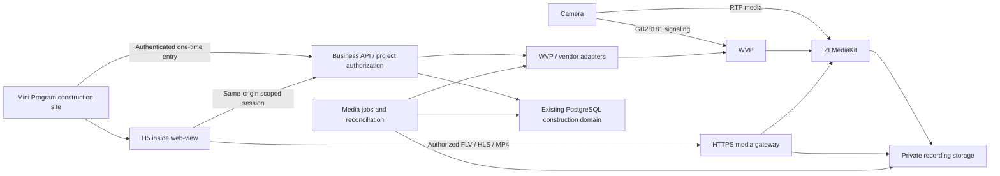

# Frozen history: cloud-video plan before simplification (2026-11-05)

> Historical lookup only, not a task queue, additional acceptance gate or renewed authorization. Use the [current plan section 2](../cloud-construction-video-plan.md#2-current-delivery).
> Original bytes below; SHA-256: `2fd7c34dcec7bac8e146edf927c9a96004e260b310f60ef9f332d171040e231e`. Historical relative paths resolve from the original `docs/` directory. Read only for a specific question.

<!-- BEGIN ORIGINAL BYTES -->
# Cloud construction video development plan

**Historical actual-soak terminal:FAILED,not24/72h accepted.** Run `2026-10-23T07-33-15-912Z` ended2026-10-23T13:27:40.462Z after5.8866h/350 observations. Its original error is `camera_service_auth_failed` with policy state `error` instead of `recording`;passed/soakPassed=false,milestones empty. The5 completed hourly sealed private playbacks returned206 and anonymous401. Earlier safe-G-stop/smoke and independent feature results remain separate.

- Automatic owned cleanup disabled policy39 asversion40,enabled=false/state=stopped. `tmp/cloud-camera/soak-terminal-2026-10-23T14-05-39-367Z.json` independently confirms actual ZLM MP4=false,6 indexed sealed clips including the tail and47 before/after bindings without drift. The final MP4 was sealed at13:27:37.713Z;no hidden active MP4 remained. Shared WVP/ZLM/probe/Redis/MySQL remain running and were not restarted at the failure.46 original source/config files and3 pinned image/mount identities stayed unchanged;F storage was healthy,not a space failure.
- Read-only discrimination reproduced the exact adapter behavior using a fake transport:one401 clears the cached token and fails that call;the next separate call logs in again. No live WVP login,plan/camera mutation or recorder restart was used. This confirms the immediate-recovery gap;the upstream reason the credential became invalid (expiry or another cause) remains unverified. This monitor did not repair the frozen adapter. The diagnostic's initial module-resolution setup failure occurred before any DB/network calls;the corrected verification passed and is not long-soak acceptance.
- The original `soak.json`,timestamped run receipt and failure/process logs are preserved. Recordings remain under the approved F path and normal private retention;the old G run is still excluded. Earlier feature receipts describing policy39/running are scoped pre-terminal observations;this current terminal supersedes their current-state wording.24h,72h,natural expiry and final continuous coverage remain unpassed. No clock acceleration or automatic rerun. Stop automation-4 after recording this terminal;next delivery is bounded authentication recovery followed by a new acceptance batch.

### 1.8 Read-only recording cleanup details (Implemented)

- Verified gap/entry: retention preview exposed cleanup counts but no affected recordings. Owners now open `清理记录` in the existing project video tab. The bilingual Admin Ant/refactor contract and activity modal are the design source:760px Modal/Table/Alert/Empty, internal body/table scrolling and visible footer. Mini/H5 and artwork remain unchanged.
- GET `/api/construction/video-cleanup/projects/:projectId/bindings/:bindingId` reuses tenant transaction/camera access. Only enterprise_admin/admin/super_admin, including selected-enterprise platform managers without employment/membership, may read an active enabled binding. Manager/member, foreign project/tenant/binding, retired/disabled binding and Mini bearer impersonation are denied. Optional `beforeId` is a positive signed-bigint cursor; malformed IDs, unknown/duplicate queries422,POST405,no-store.
- Read existing `app.construction_recordings` deleting/deleted/missing rows by descending registration ID,20 plus one lookahead;exclude ready footage. Return source times, exact decimal bytes, saved state, recorded completion only for deleted, and safe failure categories. Never return upstream IDs, paths or raw errors. Display Asia/Shanghai and B/KB/MB/GB. This is a current-state view, not a deletion-event timeline, retry-count inference or fresh physical-file check; missing alone does not prove this module deleted a file. No schema, policy/record/audit write, WVP call, worker change or manual deletion/retry action.
- Existing loading/empty/error/retry,refresh and newest-page reentry; failed older pages retain rows and retry appends. Close aborts pending reads; project/binding keys isolate state. Source/error filtering and existing actual writer/cleanup mechanisms are preserved.
- Final evidence:`tmp/cloud-camera/cleanup-check-2026-10-23T11-52-29-939Z.{json,log}`:9/9,57 stable bindings in isolated `cloud_camera_cleanup_eval`;labelled writes/readback/cleanup,two populated tenants,all three owners,permission/revocation/RLS,equal-time pagination/reentry,actual empty binding and policy/record/audit immutability. `cleanup-http.json`:11/11 actual3018 HTTP,54 stable bindings,policy enabled/3days/version39 unchanged. Final49-root typing/scoped lint pass. `cleanup-validation-final.json`:1155 source/config bindings stable; full lint retains161 errors only in pinned hls/mpegts distributions; build compiled then retained the existing `AiDesignerLegacyPage` export type blocker. Neither is a full pass. The earlier build attempt timed out during typing and is separately retained.
- `cleanup-ui.json`:10 checks/57 stable bindings. Normal UI reads two actual previously deleted retention fixtures,14.3/14.2MB. Empty/25-row status and pagination responses are explicitly client-only fixtures, not physical deletion or soak evidence; real service pagination/empty are covered in the isolated database. Older-page failure retains20 rows, retry appends5. At1280×720 long-body460/footer bottom656;663×892 body632/footer836,table700 within584;no page overflow. Screenshots:`admin-recording-cleanup.jpg`,`admin-recording-cleanup-error.jpg`,`admin-recording-cleanup-empty.jpg`,`admin-recording-cleanup-narrow.jpg`. Temporary Fetch/network/viewport overrides cleared,actual two-row reentry restored,tab closed. Initial GB rounding and browser locator/close-animation/interception observations remain in the receipt. Browser bytes are JPEG; extensions are verified/corrected. The initial pre-paint empty frame is retained as `admin-recording-cleanup-empty-before-paint.jpg` and excluded. The supplemental `emptyRecheck` confirms ready refresh/visible empty state and recaptures after a separate settled DOM observation, with stable source bindings. Supplemental empty JPEG is1920×863; settled narrow recapture is663×892 with two actual rows/footer506. The25-row scrolling bounds above remain from the original client-fixture DOM receipt. The initial663×373 narrow frame is retained as `admin-recording-cleanup-narrow-before-paint.jpg` and excluded; `narrowRecheck` records the replacement and stable source binding.
- Repeat from admin:`node scripts/construction-camera-cleanup-check.mjs`;existing real fixture HTTP:`node --import tsx scripts/construction-camera-cleanup-http.ts`. Same74h controller,46 frozen recording files,policy39/period33,F mount and recorder/probe configuration unchanged. Four hourly private playbacks206/anonymous401;24/72h/natural expiry pending. Existing automation-4 remains on the original acceptance chat. Next is the actual soak checkpoints,then remaining CV-04 dependencies after its stable boundary. SD/production paused.

### 1.7 Read-only daily recording coverage (Implemented)

- Verified gap/outcome: owners could read policy/storage events but could not inspect daily indexed coverage and internal gaps. The existing video tab now opens `录像覆盖`, reusing the approved Ant Design Modal/Table/DatePicker/Alert/Empty direction and the activity modal's760px/body-scroll treatment. No Mini/H5, artwork or restoration-ledger changes.
- GET `/api/construction/video-coverage/projects/:projectId/bindings/:bindingId?day=YYYY-MM-DD` uses the existing tenant transaction and camera access. Only enterprise_admin/admin/super_admin, including selected-enterprise platform management without employment/membership, may read an active enabled binding. Manager/member,foreign project/tenant/binding,retired/disabled binding and Mini bearer impersonation are denied. Exactly one day parameter is required;unknown/duplicate/invalid queries or IDs return422,POST405,no-store.
- The day is Asia/Shanghai; intervals use source timestamps, as private playback does. Read only ready sealed records for the exact binding and the existing conservative clock-offset retention rule. Include and clip midnight-crossing files;merge overlap/adjacency without double-counting,retain millisecond precision,and report only gaps between known ranges. No inferred day-edge gap,downtime cause,current unsealed coverage,physical-file availability or long-soak pass. Read at most1001 rows,show the first1000 with an explicit partial-statistics warning when bounded. Return only date/times/counts/durations,never paths,upstream IDs,credentials or raw errors. No schema/migration,policy/WVP call or worker change.
- Loading,empty,error/retry,date change,refresh and reentry use existing controls. Close aborts pending reads;project/binding keys isolate state. Reentry selects today;refresh/date change reset pagination to page1. Short viewports keep the footer visible and scroll the body/table internally.
- Final evidence: `tmp/cloud-camera/coverage-check-2026-10-23T11-29-30-832Z.{json,log}`10/10 with59 stable bindings in isolated `cloud_camera_coverage_eval`;labelled real writes/readback/cleanup,both tenants populated,all three owners,denials,midnight/overlap/gaps/clock-expiry,empty/reentry,1000-row partial bounds and policy/record immutability. The final fixture refinement verifies the foreign row exists under platform access before testing RLS invisibility;no product bytes changed. `coverage-http-2026-10-23T11-25-43-644Z.json`11/11 actual3018 HTTP checks,55 stable bindings,policy enabled/3days/version39 unchanged. Final42-root typing and scoped lint pass. Full-lint attempt retains161 errors only in pinned hls/mpegts distributions;build attempt compiled then retained the existing `AiDesignerLegacyPage` export type blocker. These are not full-suite passes;final formatting is covered by the final scoped checks/HTTP/UI.
- UI:`coverage-ui.json`,5 checks/51 stable bindings;actual23 segments→21 ranges,3h20m35.055s covered and2h11m13.678s internal gaps across this day's prior tests,not the soak's continuity result.1280×720 modal width760/body460/footer bottom656/modal bottom676,no page overflow;663×892 footer bottom836/modal bottom856,table650px scrolls inside584px. Screenshots:`admin-recording-coverage.png`,`admin-recording-coverage-empty.png`,`admin-recording-coverage-error.png`,`admin-recording-coverage-narrow.png`;failure/retry,empty,close/reentry and page2→refresh1 verified. Temporary request block/viewport cleared,tab closed. Original Bun runner failure remains in11-14-36 log/receipt;explicit Node reruns pass. Initial fractional-only timestamp rendering was repaired with explicit hour/minute/second fields;the UI receipt retains the observation and driver close-animation retry separately.
- Repeat from `admin`: `node scripts/construction-camera-coverage-check.mjs`; actual fixture read-only HTTP:`node --import tsx scripts/construction-camera-coverage-http.ts`. Same74h controller,46 frozen files,policy39/period33 and recorder/probe configuration remain unchanged. Three hourly private playbacks206/anonymous401;24/72h/natural expiry pending. Existing hourly automation-4 stays ACTIVE on its original recording-acceptance chat;no duplicate/retargeting. SD and production remain paused. Next remains the actual soak checkpoints,then the remaining CV-04 dependencies after its stable boundary.

### 1.6 Read-only recording activity (Implemented)

- Verified gap/outcome: the existing video tab exposed current recording/storage state but no persisted owner history. Its new `运行记录` button reuses the approved Ant Design Table/Modal/Alert/Empty controls; no new visual direction or Mini/H5 changes. Owners can read policy intent, storage-level changes, timestamps, safe source labels and older records, refresh and reenter.
- GET `/api/construction/video-activity/projects/:projectId/bindings/:bindingId` reads existing `app.construction_audits`; optional `beforeId` is a positive signed-bigint cursor. Only owner-management roles,including admin/super_admin in the selected enterprise without employment/membership,can read. The shared tenant/project access plus active enabled camera binding are required. Manager/member,foreign project/binding and retired bindings are denied. Unknown/duplicate query keys or malformed IDs fail422;POST405;responses no-store.
- Filter by tenant/project/exact binding and six existing action types:recording.configure and storage.ok/warning/critical/blocked/unavailable. Descending audit ID pages20 with one lookahead remain stable for equal timestamps;no total from other bindings. Expose only ID/time,admin/system/unknown source,validated enabled/1..30 retention,0..100 percentage and whitelisted reason. No raw snapshot,actor identity,path or error detail. Unknown historical fields stay unknown;unavailable percentages are labelled last-known. These events record intended policy/protection judgments,not confirmed recorder stop/restart receipts. No new history is fabricated and no schema/migration,policy write,WVP call or worker is added.
- State/recovery: existing loading/Empty/error Alert/retry;failed older-page reads retain loaded rows. Closing aborts pending reads;project/binding keys discard the old view. Reentry starts at the newest page. The only new entry sits beside owner recording settings;standard Ant short-viewport body scrolling retains the footer.
- Evidence:`tmp/cloud-camera/activity-check-2026-10-23T09-34-02-438Z.{json,log}`:8/8 in isolated `cloud_camera_activity_eval`,57 stable bindings;synthetic writes/readback/cleanup,two tenants,all three owner roles,manager/member denial,ID ties/pagination,reentry,empty/malformed fields and policy/audit immutability. `activity-http-2026-10-23T09-34-42-937Z.json`:11/11 actual3018 HTTP checks,54 stable bindings,policy enabled/3days/version39 unchanged.35-root typing and scoped lint pass. Full lint retains161 pinned-vendor errors;isolated build compiled then existing `AiDesignerLegacyPage` export blocked type validation. The final last-known-value formatter adjustment was covered by the final tests/type/lint/HTTP runs;unchanged Mini/H5/native scope reuses prior evidence.
- UI:`tmp/cloud-camera/admin-recording-activity.png`,1280×720,width760,scrolling body460,footer bottom656/modal bottom700,no horizontal overflow. Actual20→40 rows stayed unique and first20 were retained;close/reentry restored20.663×892 also kept the footer inside the viewport,with table horizontal scrolling for long content. Mini restoration ledgers unchanged. Repeat from `admin`: `node scripts/construction-camera-activity-check.mjs`;actual fixture read-only checks:`node --import tsx scripts/construction-camera-activity-http.ts`.
- The same74h controller continues;46 frozen source/config files and policy39/period33 unchanged. First2 hourly sealed segments passed private206/anonymous401;24/72h/natural expiry remain pending. SD/reboot/format and production remain paused. Remaining work that changes frozen recording dependencies waits for the stable acceptance boundary.

### 1.5 Read-only retention capacity preview (Implemented, independent of the running soak)

- Entry/design: existing `/construction-projects` → project Drawer → video → recording settings; reuse approved Ant Design Modal/Form/Alert. Only the body scrolls at short viewports; width520,1280×720 footer bottom656 and modal bottom700, no horizontal overflow. Mini/H5 markup, assets, routes and restoration ledgers are unchanged.
- GET `/api/construction/video-capacity/projects/:projectId/bindings/:bindingId` uses the shared tenant transaction and existing camera access. Only enterprise-owner management roles, including admin/super_admin in the selected enterprise, can read; manager/member, foreign project/binding and retired binding are denied. Query arguments are rejected; no mutation endpoint, WVP calls, schema or migration.
- Rate uses up to12 latest ready sealed segments in the last24h for the active binding, summed bytes divided by summed actual durations; require60s. Stale/future/missing/deleted/deleting samples do not supply bitrate. Unknown is null. Integer-safe decimal GB/day and selected1..30-day budget include a separate25% planning reserve. The UI retains this node's existing1..7-day saving bound; preview changes do not save or enforce a quota. Indexed stock and pending/failed deletion counts are read-only; no raw media paths/errors are exposed. This is not a prediction of remaining recording duration.
- Evidence: `tmp/cloud-camera/capacity-check-2026-10-23T08-48-34-399Z.{json,log}`:9/9 in isolated `cloud_camera_capacity_eval`,57 stable source/config bindings. `capacity-http-2026-10-23T08-49-51-910Z.json`:6/6 actual HTTP checks,54 stable bindings, policy before/after enabled/3days/version39.28-root typing and feature lint pass. Full lint still fails only pinned hls/mpegts distributions (161 errors); build compiled then existing `AiDesignerLegacyPage` export blocked type validation. Original effect-reset lint failure was fixed; the HTTP helper's first default-import attempt failed before requests and its named-import run passed.
- UI evidence: `tmp/cloud-camera/admin-capacity-estimate-3days.png` and `admin-capacity-estimate-7days.png`; actual0.910Mbps/~9.8GB/day,3days29.5GB/36.9GB with reserve,7-day unsaved preview68.8GB/86.1GB. Cancel/reentry restored3; loading/insufficient/error-retry use the same Alert and do not disable existing saving. A snapshot, not a fixed future bitrate.
- The running74h run's46 frozen source/config files, writer policy39/period33, F-drive mount and recorder/probe images remain unchanged. First hourly sealed private playback returned206 and anonymous401;24/72h/natural expiry remain pending. The readonly feature's new files are outside that binding. Keep SD operations paused; remaining writer/defaults/grants/snapshot-retention work that changes frozen dependencies waits for a stable acceptance boundary.

Chinese mirror: [cloud-construction-video-plan.zh-CN.md](./cloud-construction-video-plan.zh-CN.md)

Updated2026-11-03. CV-02 defaults/homeowner grants and CV-03 automatic snapshot retention have bounded implementation evidence,see§1.10–1.12. Preserve failed74h evidence. Next is CV-04 fixed execution-source preparation/new soak;overall Limited.24/72h/natural expiry,physical WeChat/public4G and production remain unverified. Section1 is the sole current scheduling record.

## 1. Current delivery

| Field | Value |
| --- | --- |
| Current delivery / user outcome | CV-04 Limited;the actual long recording WAS stopped at the user request and never auto-resumed (that boundary was lifted by the user’s explicit 2026-11-05 decision to resume physical recording;the original stop facts stay below). User confirmed “I requested the stop;keep it stopped”. Run2026-11-03T09-03-04-699Z began09:05:51.567Z and retained4 observations,last09:08:54.182Z;stop marker09:08:56.913Z (17:08:56 +08:00). Original terminal stays failed/Soak interrupted by an explicit stop request,not a new SDK failure or24/72h/natural-expiry pass. Expected finish is cancelled. The unfinished cloud-plan long acceptance is on hold until explicit user resumption. This continuation completes only the non-recording remote prerequisite inside CV-04,bounded Implemented;overall remains Limited. New remote preparation/read-only preflight pass;“continue” was not inferred to resume physical recording,and the stop boundary remains. On2026-11-05 the3 storage/failure-injection/recovery live drivers were bound to the approved remote deployment (§1.13,§1.2 item7),which clears the harness-readiness blocker;every remaining CV-04 item depends on an explicit user decision to resume physical recording,and that round ran no recording or policy-write scenario. After the 2026-11-05 resumption decision every CV-04 recording class except the 74-hour run is now verified on the approved remote deployment (context sfp-remote-dev,recording host D:/Smart-Floor-Planner-Dev/migrated-services-20261103/record) with the real WVP/ZLM stack and real media bytes:real short recording plus private 206/ftyp playback and anonymous 401 and stop-sealed segments,controlled single-stream loss self-healing in 6691ms with the WVP writer uninterrupted across a gateway process restart,synthetic expiry really deleting physical bytes and the WVP index without reconciliation resurrecting them,capacity warning/critical/low-space write stop/hysteresis/probe-unavailable transitions,and confirmed-policy controller exit cleaned by the independent supervisor in one attempt (lastExit 0). CV-04 stays Limited:the named 74-hour run has just started,so 24/72-hour milestones and natural three-day expiry are undecided,and these short-window results are not physical-device,public-4G or production acceptance. The §7 CV-04 “documentation/rollback plan” item is now written up as a document in §9.1,which grants no deployment authority. |
| Completed predecessor / reuse | CV-02 enterprise defaults/homeowner grants and CV-03 snapshot retention remain bounded Implemented,see§1.10–1.12. Against inherited2284 bindings mapped to the physical copy only construction-camera-soak.ts changed;new execution helper/tests are added,outside-copy drift0. Camera service/H5/Mini entry source is unchanged. Reuse prior78 compatibility/9 snapshot/Stable5 plus entry-host3 scopes only;no physical-WeChat pass. |
| Workspace / local commit | Same G:/workspace/向总/Smart-Floor-Planner,codex/xiaok-public-site-lifecycle. Camera implementation commit11c75b5fc6273bdcc92bc104846f5293bec07e40,parent independent public-live d45bc65229d60f248d86edc1ded3815df6985f1e;11 paths committed using an isolated index/CAS,shared changes preserved. Current user-stop documentation is updated in the same bilingual plan/inventory entries. Code3 sampling paths match frozen05,and trace v2/test bindings remain valid. Original handoff snapshot/success-draft scripts remain historical/unexecuted. No clean worktree/Mini copy or parallel cloud owner. This work starts at2e5a13031a045b583eeef3df9eae247b383ca04d. Only6 harness/test paths and bilingual camera operations contracts belong to the related local commit;final commit/file bindings are in tmp/cloud-camera-remote-preflight-20261103-01/completion.json. Same workspace/branch;other modules’ dirty changes/index are preserved. The2026-11-05 round starts at9db8c4db (after the timestamp-revocation fix) on the same workspace/branch;only5 camera harness/test paths (construction-camera-environment.mjs and its test,plus storage/recovery/retention live drivers) and the bilingual video plan §1/§1.2/§1.13 belong to one local commit. Other modules’ dirty changes,index and XiaoK/public-live work stay untouched;nothing pushed. This round adds commits 2c02f1a9 (live drivers take the stream identity from the fixture policy and accept both approved isolated test enterprises per the existing soak rule) and e0c21c84 (shared ownedGateway identity so the ownership guard accepts both the harness-relative and the sealed-batch absolute launch form);the bilingual plan update itself lands in its own local commit and its hash is recorded in the next required documentation update. |
| Fixed execution / configuration | Historical frozen05/F configuration/failures remain evidence for old runs only;never edit or reuse them as a new remote environment. New frozen06:tmp/cloud-camera-operations-20261103-06/execution-manifest.json,SHA25618b4b5ef697eb579de83ef23c841e5c6bcb5e17f6bd523d466bf38c06ab11e2a,85333 files/1140199084bytes,83498 installed dependencies. Explicit prepare --context sfp-remote-dev sets CAMERA_DOCKER_CONTEXT and D:/Smart-Floor-Planner-Dev/migrated-services-20261103/record in the private runtime. camera-environment.json binds3 complete container IDs/images/start times/mounts,native capacity/probe/SSH before and after preparation. Seven external pins cover Node/Python/SSH/Docker executables,SSH config/known_hosts and Docker-context metadata;no private-key reads/copies. Source/dependencies/external resources remain stable;no gateway/Next/controller was started in that round. Current fixed execution is frozen09:tmp/cloud-camera-operations-20261105-09/,sealed HEAD e0c21c84,manifest df7b4a0e187dd23b1bf094790542dcb7d6f4aeb9cd17a1a614de737b4be39a20,85362 files/1140608239 bytes/83498 installed dependencies,deep before/after stable and the same 7 external pins (private key never read or copied). Frozen06 and batches07/08 remain original-batch evidence only:07 carries the passing recording-live,08 carries the recovery-live check-3 original failure,09 carries recovery/retention/storage/crash plus the running 74-hour batch. |
| Executed / source-bound checks | Frozen05 offline unit5/compatibility80/type62 roots0/scoped lint0 and85324 deep stability remain valid;cadence02 60/0/max6174ms retains original15s/capacity guards,and cadence01 60/17 stays failed. v2 trace4/4+lint0 has2-file before/after binding;provider-trace-cold-dependencies.json adds4/4 with12 explicit Node/test/preload/esbuild JS/native/package bindings and exact frozen-copy equivalence,drift[]. Main recording v1:183.792s/18 observations,private206/anonymous401,zero sealed gaps,85324/3 images stable. v2 parent-loss02:confirmed policy then actual process exit87/one observation;watcher599116 cleaned in2 guarded attempts,lastExit0;SD/off/stopped/version43,MP4=false/all duties0/controllers[] independently confirmed,and85324 after-deep stable. short-evidence-summary.json independently verifies current3 media image/mount identities and unchanged main-thread transport. New frozen Next serves H5 entryHTTP200 only as readiness;unchanged Mini/H5/Stable scopes are reused,not a new native or physical-phone pass. New frozen06 scoped JS18/18,existing cleanup guards4/4,62-root typing0 and6-file lint0 pass. Preparation deep verification and final85333-file deep verification,7 external pins and validation/read-state driver bindings remain stable. Read-only remote physical-preflight02/final recheck pass:native total1403827589120bytes,exact D path,matching RW/RO overlays,15s probe freshness and anonymous401. Evidence:tmp/cloud-camera-remote-preflight-20261103-01/validation-06.json. Prior evidence remains scoped to unchanged dependencies;no new UI/native/physical-recording acceptance. The2026-11-05 scoped run passes: node --test environment+execution22/22 (including4 new live-batch counter-case tests plus the source-level driver guard),node --import tsx --test soak-recovery4/4,npm run check:camera62 roots/0 errors,and ESLint0 on the5 changed files. The read-only remote proof tmp/cloud-camera-driver-remote-ready-20261105/driver-remote-ready.json records3 running containers,physical-D RW/RO same-source overlays,three byte-identical consecutive captures,11 read-only calls only,zero host-disk probe/probe requests and zero source drift. No --storage-check/--recovery-check/--retention-check ran,that round claimed no remote capacity freshness,real playback or long-run acceptance. Resumption round (all bindings drift [] and image sets identical before/after):frozen09 gateway 51108 was started through the execution tool and passed the “deployment equals prepared batch” gate;recovery-live 4/4 from 09:17:05.127Z for 64.678s (worker started the saved policy with no driver reconciliation,source_started_at 09:17:15+00,clock offset -391..707ms;single owned-stream close_stream code/result 0 then recording recovered in 6691ms;SIGKILL of gateway 44900 kept the WVP writer recording while 18620 resumed durable reconciliation after 10381ms;stop sealed segments 29154/1,640,795B and 29159/3,859,698B with private 206+ftyp and anonymous 401,prior 28631 still listed;deadlocks 1→1);retention-live pass from 09:19:44.374Z for 4.620s;storage-live 6/6 from 09:20:18.281Z for 69.587s (real media-volume metrics with independent worker start at version 53,simulated 85%/92% only downgrade to warning/critical while recording continues,96% really stops the writer with afterLiveProtection.providerPlan null while private playback stays 206+ftyp and live FLV reads its first bytes with historyCount 5 and recordingNotice camera_storage_low,93% held and 88% resumed the original intent with unchangedVersion true,probe outage yields camera_storage_unavailable,saved off stays stopped/retention 3 after the real probe recovers;the physical disk is never filled);soak-crash observed exit 87 as injected,cleanup supervisor 57104 status cleaned/attempts 1/lastExit 0 inside 12.398s;read-only soak-preflight then independently confirmed cloud/enabled false/retention 3/version 56,real remote availableBytes 959,226,798,080,three container ids/start times/mounts unchanged,deep execution identity with gateway 51108,drift [] and databaseReadFailures []. Offline guards on this tree:node --test environment+execution 24/24,npm run check:camera 62 files/0 errors,ESLint 0 on the 5 changed scripts. |
| Real cleanup / normal smoke | Preserve original05 five-observation camera_invalid_response failure and all prior failures. Separate normal v1 run2026-11-03T08-17-06-957Z passes183.792s/18 observations,private206/anonymous401,zero sealed gaps and85324/3 media identities stable;its failed extra final read remains,with separate4731ms untraced cleanup confirmation. v2 parent-loss02 passes actual exit87/one observation,2 guarded cleanup attempts,lastExit0,SD/off/version43/MP4=false/all duties0 and85324 final binding;first attempt detail remains unknown. The new actual74h01 is user-interrupted after4 observations:cleanupConfirmed=true/originalModeRestored=true,terminal09:12:49.403Z,SD/off/stopped/version46. Supervisor136004 already-clean/0 attempts,finished09:12:50.062Z.85324 deep before/after/3 images stable,DB-read failures[],max observed gap60009.954ms,no exceptional SDK HTTP/ack traces. Independent09:17:51 read and final fresh release read confirm MP4=false/all SD/view/PTZ/writer duties0/controllers[]. User stop never resets earlier failure counts or completes long acceptance. This new-environment scope performs two read-only state checks only:SD/off/stopped46,actualMP4=false,all four duties0/controllers[]. The database storage-health row remains unavailable because the gateway stays stopped;that is not new Worker freshness or continuous-recording acceptance. Resumption-round cleanup is real and self-closing:recovery-live leaves its own policy enabled=false/state=stopped after reconciliation;retention-live ages only the labelled record 28631 (16,774,230 bytes,source_id 54) by 4 days,then really deletes it (recordingFileStatus 206→404,WVP cloudPath null) and reconcileRecordings keeps it deleted,so 28631’s media bytes no longer exist even though its recording-live receipt stays valid evidence;storage-live closes its session by heartbeat,refuses to overwrite a human policy change through the ownedVersion guard,stops only its own fixture gateway,restores the real probe gateway (restoredGatewayPid 38316) and waits for ok/stopped with no cleanupError or gatewayCleanupError. |
| Original failures / persistent counts | Storage mechanism repair1;its first real normal journey failed1. Preserve the original frozen04 stale-health9-observation failure and earlier auth5.8866h/350,5-observation DB/inline-cleanup failure,8h blind interval,old SD/whole-day UNKNOWN,preparations01/02,ANSI03/conhost guard/missing-tsx/HTTP01 expectation failures. CIM mechanism repair1 remains. Cadence harness correction1:original60/17 startup-stale rows stays failed,post-readiness60/0/max6174ms passes with unchanged15s guard. Diagnostic44-observation/65s timeout and pre-I/O CJS setup error remain diagnostic,not acceptance. Model/image/paid calls/cost0;the exact failed camera endpoint/acknowledgement during the new failure is still unknown,although current stop/ownership state is confirmed. Never replay an unknown write or reset persistent counts in another chat. Optional-trace startup repair1:old v1 actual parent-loss preparation never reached a write/observation and remains failed preparation;first wrapper extra read null and shell Core Utility/encoding preparation errors remain separately retained. New v2 worker exclusion4/4 is engineering evidence,not a reset of storage/CIM/auth/normal-run failures. Preserve physical-preflight01 fetch failed separately:the existing local eight-port SSH supervisor was absent/ports free while remote containers were still running. Restoring the original supervisor lets unchanged-code physical-preflight02 pass;this is not a new recording-SDK failure/repair iteration or a reset of prior counts. The earlier PowerShell brace-search parser setup failure preceded any reads/service I/O and remains in this evidence. Two harness-side repair counts are added by the resumption round (neither touches product source nor counts as a camera SDK failure):count 2 for recovery-live batch08 failing check 3 “gateway process restart” because the ownership guard only recognized the relative launch form and refused the execution-tool gateway started from the sealed copy — receipt recovery-live-2026-11-05T09-04-08-467Z.json stays as-is (checks 1–2 PASS,cleanup enabled=false/stopped,drift [],deadlocks 1→1) and e0c21c84 moves the decision to the shared ownedGateway pattern accepting both forms with offline counter-cases,batch09 then passing the same scenario (44900→18620);and the fixture-targeting fix 2c02f1a9 for the four live drivers still bound to the now-offline enterprise-3 camera,which adopts soak’s existing dual approved isolated test enterprise rule and removes hardcoded device ids instead of deleting rows or inventing data. The 2026-11-03 user-stopped run keeps its failed terminal state and 4 observations;resuming recording clears no persistent count. |
| Database / deployment | Application databases still use existing55432→approved remote15433/cloud_camera_eval;115 ledger rows after0116,independent0114 unapplied. This infrastructure move applied no schema migration and did not change the existing primary/vector databases or their credentials/forwards. The separately authorized2026-11-03 migration moved8 Docker dependencies and their data to192.168.10.54 and added a dedicated8-port SSH supervisor;do not describe Docker volumes/placement as unchanged. Local Docker/Desktop WSL stay stopped,default context=sfp-remote-dev. Current remote recording host path is D:/Smart-Floor-Planner-Dev/migrated-services-20261103/record. Prior backups/RLS evidence remain;full primary/evaluation restore drill and production deployment remain unverified/unauthorized. |
| Owned resources / fixture | No active soak/controller/cleanup owner;camera-soak:9 was released. The original stopped launcher428972/controller325984/supervisor136004 and gateway558544/Next521868 were released with identity/physical-state proof in actual-74h-01/user-stop-owned-release.json. Migration verification temporarily used gateway587200/Next47552/owned child106660,then released them;3017/3018 were not listening at handoff,original3006 PID540892 remained. These are recorded past identities,not permission to seize a current PID. Fixture stays 微云1454/project12/camera8/binding9,SD/off/stopped46,MP4=false/all duties0,original3days. Eight dependencies now run remotely;the original5 remote containers and separate database/Embedding tunnels were preserved. Local F/old volumes/VHD are rollback copies;current recordings/probe share remote physical D. Only camera SIP destination changed to192.168.10.54. No native/browser lock,no new recording/automation. Current placement,53 file hashes/private206/anonymous401/liveFLV70358bytes/8180ms SSH reconnect and ownership:docs/remote-development.md and tmp/docker-remote-migration-20261103-01/completion.json. This continuation starts neither3017/3018 nor recording. Original dependency SSH supervisor443384/child350404 was restored;all eight ports belong to that SSH and remain available beyond test cleanup. Shared3006 PID540892,local Docker process count0 and remote IDs/start times/full mounts are preserved. No shared-service restart,device/policy/database/automation change. A further read-only check on2026-11-05 (no writes):binding9 policy stays enabled=false/state=stopped/version46/mode sd with stop marker2026-11-03T09:09:52.811Z,19 sealed rows remain ready with newest started_at2026-11-03T09:05:49Z,open sessions0,and remote physical D reports1307.4GiB total/893.4GiB free (Windows host reports inode counts0/0,handled under the existing rule). Evidence:tmp/cloud-camera-driver-remote-ready-20261105/remote-read-only-check-01.json and driver-remote-ready.json. 3017 ownership ledger for this round (only session-started gateways are released,by identity;no foreign process was seized;local Docker stays 0 processes;shared 3006 PID 540892 and the 8-port SSH supervisor 21684 were not restarted):batch07 gateway 24572 released,batch08 gateway 39256 released through tmp/release-batch-gateway-20261105.mjs matching the recorded PID plus the batch’s ASCII script suffix (the PowerShell console code page mangles the Chinese workspace segment),batch09 gateway 44900 started by the execution tool then killed by recovery-live check 3 and respawned by that driver as 18620,storage-live releasing 18620 for fixture gateway 35112 and its own cleanup gateway 38316,38316 released through tmp/release-owned-gateway-20261105.mjs and replaced by sealed gateway 51108 for the crash/preflight/soak sequence. At handoff the only active long run is the named 74-hour batch runId 2026-11-05T09-28-48-024Z (controller PID 28324,sealed copy,policy version 57,expectedFinish 2026-11-08T11:28:59.576Z) with its independent cleanup supervisor waiting-parent;3018 was never started and automation-4 stays paused. The earlier “no active soak/controller,camera-soak:9 released” wording describes the 2026-11-03 stopped state only. |
| Build / native / physical limits | No product route/schema/UI change;no new whole-build claim. Prior full build compiled then failed at unrelated xiaok-manual-fixture.ts:43 state.keys unknown;retain generated-type drift receipts. Mini entry/markup/assets unchanged,prior Stable scopes reused only there. One approved camera;multichannel throughput,physical PTZ/WeChat/public4G and production remain unverified. The2026-11-05 round changes only operations scripts,their offline tests and the bilingual video plan:no runtime route/API/permission/data-contract/UI change,so docs/admin-system-modules.md and docs/miniprogram-system-modules.md need no entry update (documentation gate checked). The resumption commits likewise touch only operations drivers and their offline tests plus this bilingual plan: no new route/API/permission/data-contract/UI or Mini entry change and no whole-bundle build claim. The ~80-test admin database suite was not replayed this round;reason:zero product-source change inside the affected scope,proved by identical before/after hashes against the sealed batch (drift [],images identical) while every assertion in this round executes directly against real services through the live drivers. That is not a pass for that suite;its historical results stay scoped as recorded. The physical disk was never filled (the storage scenario uses a one-shot read-only fixture probe);multi-stream throughput,physical PTZ,real WeChat devices,public 4G and production remain unverified. |
| Exact next action | The remote prepare/read-only-capacity prerequisite and the remote deployment binding of all3 live acceptance drivers are complete. KEEP CLOUD RECORDING STOPPED;the only remaining CV-04 precondition is an explicit user decision to resume physical recording,so no new soak/controller,old stop-marker removal or automation create/resume. After resumption,prepare a brand-new fixed batch first (driver sources changed;frozen06 and its receipts stay original-batch evidence),then refresh policy/duties/remote evidence and run the necessary remote short recording/private playback/stop/SD restoration and confirmed-policy parent-loss cleanup before a named new74h run. Never continue/relabel the interrupted run completed.24/72h/natural expiry and the old exact SDK cause remain unverified;no production,persistence/deadline/receipt/tenant-guard changes. Blocker evidence(2026-11-05 read-only):construction-camera-retention-live.ts:25 requires a ready segment started within24h and the newest existing one is2026-11-03T09:05:49Z,recovery-live and storage-live themselves start/stop the owned recording and replace the gateway,and the harness only offers --playback-only combined with --recording-check,so no playback path exists that avoids recording. Without resumed physical recording these three live scenarios have no executable route;only read-only stopped-state verification could continue. That blocker entry describes the state before the 2026-11-05 resumption decision and is kept as historical fact;the user then explicitly authorized resuming physical recording and recovery/retention/storage/crash all passed on frozen09. Sole remaining action:let the named 74-hour batch 2026-11-05T09-28-48-024Z run to its own expectedFinish 2026-11-08T11:28:59.576Z and be judged by the soak’s own assertions (24h/72h milestones,per-minute observations with 120s bound,max worker freshness/actual MP4,≤2s seal gap,hourly private 206 and anonymous 401,natural three-day physical 404/410 with the WVP index gone). Mid-run observations or hourly checks are never reported as a pass. If this batch is explicitly stopped or lost,the original batch stays failed and is neither resumed nor relabelled completed,and any changed driver source needs a brand-new fixed batch first. Still forbidden:new device plan/format/reboot/PTZ actions,public 4G,paid calls,production deployment,parallel owners or a second recording controller. Every non-device-dependent CV-04 item listed in §7 is now closed (§9.1 deployment and rollback readiness);what remains depends entirely on that74-hour run finishing. |
| Authority / serial context handoff | The user-confirmed17:08:56 stop and explicit keep-stopped decision remain authoritative. The later request authorized the completed remote development-infrastructure migration and necessary bounded link checks;it did not resume cloud recording or automation. Local Docker remains off,automation-4 paused. This plan update only aligns the existing delivery/environment contract and pending harness work;it starts no service/test/controller. Preserve the sole cloud owner,source/failure/count/cost evidence and serial context handoff;creating a successor chat does not restore recording authority. No XiaoK/public-live feature takeover,parallel owner/worktree,format,reboot,device-plan/public4G/paid/production action. This continuation covers the non-recording remote prerequisite and original forwarding recovery;it does not lift the existing physical-recording stop boundary. No automation,gateway or Next create/resume. The2026-11-05 round stays inside operations-script source,offline tests,read-only remote identity checks and the bilingual plan:3017/3018,controllers and automation were not started,no shared service was restarted,and no device/policy/database/schema/UI change was made. Local Docker remains off;remote inspection uses only the existing approved SSH context. On 2026-11-05,asked explicitly how the remaining recording-class acceptance should be handled (with the stop decision still in force and “continue” not inferred as resumption),the user chose “恢复物理录制 (resume physical recording)”. That decision supersedes the 2026-11-03 keep-stopped instruction and authorizes exactly the bounded sequence offered with it:brand-new fixed batch for the changed driver sources,then remote short recording/private playback/stop/SD restoration,then confirmed-policy parent-loss cleanup,then a named new 74-hour batch. It does not authorize production deployment,device format/reboot/PTZ actions,public 4G or real-device claims,and it keeps local Docker off,the private key unread,other modules’ dirty changes preserved and automation-4 paused. The 2026-11-03 stopped batch and its terminal state stay recorded and no persistent failure count is cleared by resuming. |

Design/implementation source: the user approved single-video H5/cloud-site palette,selection,snapshot history/PTZ and removal of source/diagnostics on2026-10-22,initially excluding recording. On2026-10-23 they explicitly approved live/playback selection below the player,date,actual segments,return-to-live and existing empty/error feedback. Preserve that hierarchy/palette,no screenshot slicing/new artwork;Admin uses the bilingual Ant Design/refactor contract. Empty queries/APIs alone do not prove SD support.

**Context-capacity handoff:** When development approaches the chat context limit, checkpoint this section's single current delivery record with user decisions, completed/remaining work, exact next action, workspace/branch/commit/relevant dirty files, test commands/results/evidence and reusable scope, persistent failure counts, unknown outcomes/costs, running jobs/resources/locks and approval/deployment boundaries. Leave room for a bounded operation and handoff; do not invent a remaining percentage. Under the standing root AGENTS.md authorization, create one fresh successor chat in the same project and actual workspace, verify that workspace, and transfer ownership serially. The old chat only verifies handoff and stops development; do not copy saturated history or rely solely on automatic compaction. If creation fails, leave a complete checkpoint and ready continuation prompt here without claiming success. This does not authorize parallel work, new designs or production rollout.

### 1.1 Current implementation contract (overrides the unimplemented full proposal below)

- Admin `/construction-projects` video Drawer: platform managers allocate verified WVP channels in the selected enterprise;owners/managers bind/unbind,capture and use enabled PTZ;only owner-management roles save PTZ/recording settings,including inherited admin/super_admin without employment/project membership. Ordinary active members view;explicit homeowner video/capture/PTZ grants are implemented under§1.11 and do not grant public-live consent.
- Mini `packages/construction/projects/projects` → `packages/construction/camera/camera` → H5 `/construction-camera`.30s single-use entry;independent HttpOnly/SameSite=Strict cookie/CSRF same-origin session,60s session/view leases,20s heartbeat,4h absolute. Hidden/exit closes this viewer;reentry obtains fresh entry,late entries discarded.
- Staff APIs: Admin `/api/construction/video`,Mini `/api/miniprogram/construction/video`,`register`,`inventory`,`projects/:id/{inventory,cameras,binding,configure,recording,entry,retention-default,customer-grant}`. POST recording is owner-management only,versioned/idempotent for identical settings,default off/3days,integer1..node maximum(current7),never beyond WVP retention;managers/members cannot start continuous uploads. Keep4G continuous cloud recording off;bounded product SD playback is implemented under§1.9 with current trusted-clock/ownership/STOP guards.
- H5 `/api/construction-camera/{exchange,state,heartbeat,stop,live,snapshots,ptz,recordings/query,playback}`,private `/snapshots/:id`;live gateway `/camera-media/:generation/*`,private MP4 `/camera-recording/:generation/:recordingId.mp4`,single Range/HEAD,no source URL/path/credentials. Every request/every5s of transfer rechecks project/lease/generation/retention;revocation,stop/switch invalidate old media.
- 0090 owns six forced-RLS camera/binding/entry/session/snapshot/STOP tables;0091 adds policy/sealed-record tables and composite session recording_id FK. Import belongs to the original binding/enabled interval;history remains in the original project after camera moves,cross-binding files are quarantined,retired policies do not interfere with the next writer,and foreign plans are preserved.
- 0092 adds forced-RLS recording periods and durable index sweep cursors. Reenabling creates a new owned period;previous periods remain queryable and disabled gaps are excluded. Incremental scans use source start times;every10min a full retained-window sweep resumes its saved snapshot/page,at most2×100 records/tick. Late/out-of-order files are recovered;duplicates/deleted records are never resurrected. Policy saves and the worker take the same advisory lock before binding row locks,preventing the observed lock inversion.
- 0093 separates direct private ZLM HTTP-Date/source time from database business time. Sample bounded clock offsets before starting/after confirmed stop;only calibrated periods can claim new files. Binding checks use conservative offset bounds,access expires at the earliest possible start and deletion waits for the latest possible end. Overlapping same-binding periods retain the full possible offset range;no arbitrary tolerance crosses project bindings. Missing/untrusted clock evidence or offsets beyond60s fail closed. Legacy uncalibrated periods cannot be backfilled by guessing;already indexed history remains available,and an open legacy recorder must be disabled/confirmed stopped then reenabled to obtain calibration.
- Disable removes this module's owned plan before clock/index diagnostics. A clock outage still leaves the policy error visible and blocks unverified imports/stop confirmation;once calibration recovers,the worker confirms stop/closes the period. This diagnostic dependency must not keep an unwanted writer running;foreign plans remain untouched.
- CV-04 capacity implementation:0094 platform-only forced-RLS node health plus tenant-policy health level/transition audits. A private Python statvfs probe mounts the actual existing ZLM media volume read-only;no Docker socket/source-file API.80% warns,90% critical,95% or available<5GiB or reported free inodes<128 pauses owned writers;resume below90%,available≥8GiB and reported free inodes≥512. Unknown/stale/invalid metrics fail closed. Preserve saved intent,foreign plans,live/private history and valid retention;explicit off remains off after recovery. Admin reuses its approved Ant Design Alert/status,only owner-management roles receive raw metrics;H5 reuses existing recording feedback with tenant-scoped confirmed-pause notice. Protection depends on the running reconciliation worker;it is not a hardware disk watchdog.
- Pinned WVP2.7.4 commit3fcd3ae80c30c95aeb82ef830af439a835257067: [RecordPlanServiceImpl](https://github.com/648540858/wvp-GB28181-pro/blob/3fcd3ae80c30c95aeb82ef830af439a835257067/src/main/java/com/genersoft/iot/vmp/service/impl/RecordPlanServiceImpl.java) keeps streams with readers; [PlayServiceImpl](https://github.com/648540858/wvp-GB28181-pro/blob/3fcd3ae80c30c95aeb82ef830af439a835257067/src/main/java/com/genersoft/iot/vmp/gb28181/service/impl/PlayServiceImpl.java) reuses ready streams. Plan linkage alone cannot prove MP4 start/stop. Reconfirm owned plan membership,then private ZLM startRecord/stopRecord(type1,exact app/stream),validate result=true and actual isRecording. Live startup uses the same locked writer guard. Foreign plans are preserved;capacity protection never closes the whole live stream.
- Independent5s reconciliation recovers desired recording;only actual ZLM confirmation produces recording/stopped. Disable/confirm stopped before unbinding. Every10min claims expired sealed records,deleting→physical404/410 plus missing WVP index→deleted;failure retains error/retry,active view leases prevent removal. Tenant cleanup refuses unfinished recording/media cleanup;paused projects retaining enabled intent need management restored and explicit disable before deletion.
- Actual node MP4 maximum3600s differs from the later5min proposal. Whole files crossing access cutoff are unavailable,removed after whole-file expiry,with one segment of granularity;max30 cleanup candidates/scan,failures can backlog. Date queries cap300;only≤1s continuous intervals auto-advance,gaps require selection,no timeline/cross-date auto-navigation. Project choices persist in localStorage,no autoplay on reentry. Enterprise defaults/camera overrides are implemented under§1.10;SD and historical bindings preserve their saved history-retention days.
- Private JPEG bytea≤4MiB with durable pending/ready/failed/expired/idempotency and per-read authorization,latest30 retained captures;§1.12 enforces saved camera-policy expiry and automatic byte cleanup. PTZ defaults off,directions/STOP only,300ms pulse,2s durable obligation,independent500ms watchdog retries unknown STOP;800ms HTTP timeout is not physical-stop proof. Physical movement/zoom unverified.

- 2026-11-03 bounded authentication recovery: only explicitly allowlisted reads (channels,plan membership/list/details,cloud-recording list/path) may clear their rejected token on HTTP401, share one new login and replay once. A late old401 cannot evict a newer token. Control/start/capture/plan writes/deletion never replay automatically; transport failures,timeouts,403 and5xx do not retry. Existing per-HTTP deadlines remain.14 adapter checks and49-root typing pass. The configured local WVP drill first reads normally, injects exactly one synthetic401, then performs actual login/read/cloud-index recovery:2 logins/1 injection,no device writes,stable binding;tmp/cloud-camera-continue-20261103/auth-live-01.json. This explicit synthetic fault is not natural-expiry or24/72h evidence. Pinned upstream:[JwtAuthenticationFilter](https://github.com/648540858/wvp-GB28181-pro/blob/3fcd3ae80c30c95aeb82ef830af439a835257067/src/main/java/com/genersoft/iot/vmp/conf/security/JwtAuthenticationFilter.java).

### 1.2 Configuration and repeatable checks

**Current execution environment (2026-11-03):** the remote development migration is complete;this section governs that remote deployment and is subordinate to the current state in section1 (the user explicitly resumed physical recording on2026-11-05 and the named74-hour batch`2026-11-05T09-28-48-024Z` is running;the 2026-11-03 stop facts and terminal state stay in section1). Local Docker must remain stopped. Use the approved remote context,independent loopback forwards and physical D path from [remote development](./remote-development.md). The verified legacy-harness gap is recorded in section1/1.13;do not treat old local commands as an already adapted remote workflow. Historical F-path test evidence remains under its original scope. This plan update starts no services,recording or automation.

1. Apply0090–0094 only to an authorized database;Next/separate Node-tsx gateway share DATABASE_URL,`cd admin && npm run camera:gateway`;not added to production Docker. Dedicated cloud_camera_eval and cloud_camera_unit_eval use the existing127.0.0.1:55432→approved remote evaluation PostgreSQL15433 forwarding (remote-development pair);these are isolated databases,not a physically local PostgreSQL service. Next3018/gateway3017 preserve3006/production. Apply the recovery/clock migrations with recording off;do not invent calibration for legacy intervals.
2. Server-only CAMERA_WVP_ORIGIN,CAMERA_MEDIA_ORIGIN,CAMERA_WVP_USERNAME/PASSWORD,CAMERA_PUBLIC_ORIGIN,CAMERA_APP_ORIGIN. Production public origin requiresHTTPS;gateway defaults127.0.0.1:3017. Reverse proxy without buffering,keep raw WVP/ZLM internal,register Mini HTTPS business domain;not deployed.
3. Recording uses the retained private CAMERA_ZLM_SECRET,CAMERA_MEDIA_SERVER_ID=wvp-zlm-01,CAMERA_RECORDING_ROOT=/opt/media/www/record and CAMERA_NODE_RETENTION_DAYS=7. Docker/media now run on approved192.168.10.54;application origins remain loopback through the dedicated SSH forwards. Startup must retain api.downloadRoot=/opt/media/www/record,never broaden it or hot-modify ZLM. The earlier external start.sh/local rebuild is historical repair evidence;the migrated image content and active download root were verified. Current maintenance uses SSH and remote D:/Smart-Floor-Planner-Dev/migrated-services-20261103/deployment.private.json,not a local G: compose path or local Docker rebuild.
4. `construction-camera-check.mjs` now creates `cloud_camera_unit_eval_<timestamp>_<PID>`,migrates it and runs42 checks serially. Drop only the controller-created passing database;retain failures and preserve any existing explicitly selected `--database cloud_camera_unit_eval...`. Never share this unit database with the real STOP watchdog. `--runtime-schema` still migrates only original `cloud_camera_eval` and refuses a unit override. `npm run check:camera` now covers49 roots/0 errors. `construction-camera-local.mjs` retains the authorized local WVP environment loader via CAMERA_LOCAL_WVP_ENV;credentials stay ignored.
5. `--recording-check` records then disables in finally;`--playback-only` retries existing playback only.`--retention-check` accelerates/deletes the oldest sealed fixture,retains a newer segment,and refuses other databases.`--recovery-check` requires the labelled isolated fixture/no active viewers,closes only its owned media stream,restarts only the verified3017 process,checks actual writer/worker/file playback and always disables in finally;no SD action or driver reconciliation in its normal checks. It binds source/media image and checks no new database deadlock.`construction-camera-native.mjs` follows Stable single-controller/lock/exact-project/secondary-monitor rules. Physical PTZ scripts are for authorized devices only;drain STOP before shutdown,do not delete history as rollback.
6. Current capacity truth is the read-only remote probe and native Windows D: metrics obtained on192.168.10.54,not local statfs or Docker VHD free space. Recorder /opt/media/www/record and probe /media/record must share D:/Smart-Floor-Planner-Dev/migrated-services-20261103/record;retain token/node checks,15s freshness,capacity/inode/fail-closed rules and private/anonymous401 boundaries. The local-only construction-camera-storage-local.mjs explicitly forces desktop-linux and local fs.statfsSync;it is not a valid deployment/verification entry for this remote runtime until adapted. Current networks/mounts come from the protected remote deployment and migration manifests;do not recreate them from the old172.16.82.0/24 local example or expose a Docker socket/host-file API.
7. Remote readiness for the storage/failure-injection drivers is now complete at source level (bounded Implemented): all three live drivers bind through `cameraLiveDeployment(process.env)` in construction-camera-environment.mjs, so an explicit context, the SSH endpoint, the remote containers' full mounts and the end-of-batch recheck must agree, and every local `docker inspect` call is gone with a source-level test guarding it. That proves batch binding and deployment-identity verification only, not remote capacity freshness. Existing --storage-check/--ui-hold contracts preserve real feedback/recovery and finally restore the real probe/gateway and close owned policy. Do not fill disks,alter shared persistence or weaken guards. Any scenario that starts recording or writes policy remains subject to the current user stop decision;this round ran none of --storage-check/--recovery-check/--retention-check.
8. Historical --soak-check --smoke uses3 actual minutes and --background starts74h;these are capabilities,not a generic start instruction;on2026-11-05 the user lifted the stop boundary and this item was followed exactly:freeze batch09 first,then start the named74-hour run,with bindings and receipts in section1 and §9.1. The interrupted run stays stopped and automation-4 stays paused;do not create/resume automation. After explicit recording resumption and remote-harness adaptation,bind actual source/dependencies/configuration,remote container/image/full mount identities,SSH endpoints and physical-D capacity before/after a named new batch;old46-source/3-image counts are evidence for their original batches,not a new binding template. Preserve PID/fixture/version/orphan guards,each-minute observations(max120s),fresh Worker/actual writer,≤2s sealed gaps,hourly private206/anonymous401,24/72h coverage and natural3day bytes/index expiry. Keep required local Node/SSH controllers and the remote computer/Docker/services running;local Docker stays OFF. No clock acceleration or automatic resumption.
9. Current media placement is remote physical D:/Smart-Floor-Planner-Dev/migrated-services-20261103/record;approved application paths and logical volume names are retained. ZLM mounts it writable and the probe readonly;the migration proved native capacity and a unique physical write/hash/cleanup. Local F:/SmartFloorPlannerCamera/media/record,old media volumes and VHD are retained rollback copies only. Do not merge local compose overlays,run up -d on local Docker,or remove the remote overlay as routine development. Manage the actual remote compose through SSH. Rollback requires owned recording stopped,drained duties,fresh remote database/media backups and complete hash/index reconciliation of post-cutover writes before any deliberate return to local storage;never infer current capacity from an old F/VHD receipt.

10. SD server configuration:CAMERA_SD_PYTHON,CAMERA_SD_VENDOR_ADAPTER (verified vendor core.py directory),CAMERA_SD_DEVICES_FILE (restricted JSON keyed by deviceId/channelId with ip/port/username/password/serial). Read-only serial verification precedes frmIotRecordCfg/frmDeviceTimeCtrl,with12s bound and no writes. Missing reachable trusted time fails closed;the LAN adapter is not verified public4G clock access. Pinned primary sources:[deterministic playback names](https://github.com/648540858/wvp-GB28181-pro/blob/3fcd3ae80c30c95aeb82ef830af439a835257067/src/main/java/com/genersoft/iot/vmp/service/impl/RtpServerServiceImpl.java),[DeviceStatus returns Online only](https://github.com/648540858/wvp-GB28181-pro/blob/3fcd3ae80c30c95aeb82ef830af439a835257067/src/main/java/com/genersoft/iot/vmp/gb28181/transmit/event/request/impl/message/response/cmd/DeviceStatusResponseMessageHandler.java).
11. New soaks optionally use CAMERA_TEST_OUTPUT and pre-fixed CAMERA_SOAK_BINDING_MANIFEST.files. `--soak-check --preflight` saves no policy/device setting and refuses mismatched approved recorder/probe overlays. Require labelled 微云1454/GB0005/0006 or historical labelled enterprise;deny active/unconfirmed writers or pending SD. PG connection reads retry at most3 times/20s;never replay saves,starts or control. After a confirmed policy receipt,independent construction-camera-soak-watch.ts follows parent loss through existing PID/fixture/version orphan guards,retaining duty until physical stop/original-SD restoration. `--smoke --cleanup-recovery-check` injects actual abrupt exit;CAMERA_SOAK_REPORT selects only the exact run file in this output directory. Unknown initial enable commits or loss before watcher startup are never replayed or presumed owned;actual-state resolution remains necessary. Test-driver change only,no new product API/UI/role.

### 1.3 Evidence,original failures and limits

- verification.json(07:12:51–07:15:33UTC):219 stable bindings,37 service/adapter,19 Mini,21 typing roots/0 diagnostics,scoped lint/H5 syntax and then2 probe tests pass. The only later source impact is explicit Windows-bind inode evidence in server.py/host compose/test:3 targeted probe tests pass;no JS/tenant/ownership behavior changed. native.json(07:22:59–07:23:43UTC):227 stable bindings,5 Stable2.02.2608080/SDK0.13/base3.17.2 checks pass;new ready/denial captures inspected,logical390×844/PNG348×752. Entry/feedback evidence,not WeChat-device H5 decode. Guarded orphan cleanup separately confirms stopped MP4 and preserves external policy intent.
- Existing commits c1956a90(live),f4830650(cloud recording),0606b960(SD evidence),814e5cf3(recovery);reuse unchanged scoped evidence. Full webpack build compiled in50s then failed on existing AiDesignerLegacyPage invalid route export(build-2026-10-23T06-54-21-925Z.log). Full lint initially scanned isolated build artifacts and was stopped;rerun excluding only .next-camera/.next-camera-build completed with161 errors in unchanged pinned hls/mpegts vendor bundles,2366 warnings(source-lint-20261023-145828.log);changed authored source has no errors. Scoped lint/types pass;no full-lint/build success claimed.
- `recovery-live-2026-10-23T05-28-02-460Z.json`/`recovery-live.json`:4 real checks pass,210 source/config/image bindings without drift,DB deadlocks1→1,cleanup off/stopped/3days. Only the owned rtp stream was closed;automatic recovery4431ms,gateway replacement10060ms while WVP kept writing;new media starts05:28:09 and05:28:25UTC,private Range206/MP4 bytes and anonymous401,older owned history remains. Normal checks used the independent worker;direct reconciliation was cleanup-only,no SD requests.
- Preserve original recovery attempts separately:05:01 driver omitted required schema,05:03 actual save/index deadlock (recovery-deadlock.txt),05:10 premature gateway-readiness observation,05:13 DB/media-clock skew excluding the first sealed file. Fixes respectively pin schema/result0,unify advisory-before-row lock order,wait for health/fresh server checked_at,and calibrate source periods instead of widening binding boundaries. The initial clock test also exposed ambiguous same-binding overlap;retain conservative min/max bounds. Failures are not pooled into the final passing run.
- The final stop-order safeguard adds the28th service regression:missing clock evidence cannot prevent unlinking an owned disabled writer,then healthy retry confirms stop. `recovery-live-2026-10-23T05-37-17-277Z.json` is the final4-check/210-binding run after that change:stream recovery6256ms,gateway10165ms,new files05:37:22/05:37:38UTC,private206/anonymous401,deadlocks1→1,cleanup off/stopped/3days. The05:28 passing batch is retained for the earlier clock mechanism and browser clip;its measured recovery times were4431ms/10060ms.
- `recording-live-2026-10-23T04-07-26-578Z.json` proves actual start,120s without viewers(beyond former90s no-reader timeout),disable/seal;its playback failure remains. After download-root repair,`recording-live.json` separately passes playback-only Range206/MP4 bytes/anonymous401;do not pool as a failure-free whole run. Millisecond times,0..1440-minute plans,mandatory planId membership and specific absent-stream replies have regressions. Later GC fixes do not alter validated start/stop methods,so120s evidence is reused.
- `retention-live.json` accelerates one labelled fixture timestamp,then proves physical404,missing WVP index and no resurrection;not natural3day operation. Tests cover three management roles/platform without employment,member denial,tenant RLS,version/idempotency,revocation/generations,original ownership,failed cleanup retry/rebind isolation.
- Authenticated isolated IAB Admin saved3→2days,reopened/read2,restored3/off with shared feedback.390×844 H5 decoded1920×1080/125.409s,currentTime13.399→26.164;date/segment/mode persisted without autoplay,empty dates disable play,return-to-live decoded1920×1080. Evidence:h5-playback.png,h5-playback-empty.png,admin-recording.png;approved layout,no horizontal overflow.
- Current recovered H5 file13:28:25–13:28:53 local time decodes1920×1080/28.138s at390×844,currentTime10.386160→22.544381,readyState4/playing and no horizontal overflow;h5-recovery-playback.png inspected. Admin1280×720 shows confirmed stopped/3days in admin-recovery.png. Existing approved layout/palette and shared states retained;the browser viewport was reset and the test viewer closed.
- Preserve shared-DB STOP watchdog failures in verification-20261023-shared-db-failure.json/checks-20261023-shared-db-failure.log;dedicated unitDB resolves the race. Old WXML/minimized-window/wrong-launch captures are invalid;pre-repair synthetic-expiry failure,verification-before-final-recording-fixes.json source drift and all timestamped recording-live attempts remain excluded from final passes.
- Earlier capacity storage-live-2026-10-23T06-40-55-994Z.json:6/6,217 stable bindings.85/92% alerts,96% actual stop with live/private history usable,93% hysteresis hold/88% unchanged-intent resume,probe outage protection and explicit off confirmed. Original06:18 resume and06:31 reader-kept-writer failures/intermediate attempts remain separate;repair explicit owned MP4 start/stop/live guard,not assertions. Later actual F-drive evidence below supersedes the virtual-volume capacity placement.
- Visual QA preserves approved Ant/H5 sources. Admin1280×720 real healthy capacity/recording/3days in admin-storage-recording.png inspected;simulated admin-storage-protection.png has a polling-spinner row,supplemental only. H5390×844 shows confirmed pause/14 real segments and plays private1920×1080/125.409s,currentTime24.998→50.709 with actual writer false;h5-storage-paused.png/h5-storage-playback.png inspected,no overflow. Temporary viewer closed,viewport reset.
- soak-smoke-2026-10-23T06-49-58-570Z.json:18 actual observations,183.839s sealed coverage,final206/401,42 bindings/3 images unchanged,off/stopped cleanup;driverSmokePassed=true,soakPassed=false. soak-control-verify.json is an explicitly synthetic orphan-controller test:foreign fixture denied,absent controller and actual stopped writer confirmed;not long-soak evidence.
- Original soak-2026-10-23T07-00-32-665Z safely interrupted07:07:48UTC,off/stopped confirmed,not passed. Native Windows resolved the VHD to G:/AppData/Local/Docker/wsl/disk/docker_data.vhdx with≈19GiB physical free despite810GiB internal;74h≈28.3GiB was unsafe. User chose F. media-host-verification.json(07:14:44UTC) confirms20 SHA256-identical original files,old volume retained,ZLM writable/probe readonly same host source,actual physical total/free. ZLM image unchanged;final probe image sha256:768ad57e37971c24ca4d145b4392e9c1558dac545cdac826d10fa9a2c515cece.
- F-drive07:18 attempt retained failed/off:Windows bind statvfs reports synthetic inode999/1000000,correctly rejected. Explicit Windows-host override reports inode evidence unavailable(0/0);byte/percentage measurements match native F capacity. Linux reported inode checks stay strict. Final storage-live-2026-10-23T07-22-54-594Z.json(to07:24:00UTC):6/6 real MP4/live/private checks,220 stable bindings/final probe image,restored real F metrics/off/stopped.
- F-driver smoke07:24 sealed188.291s/private206/401 but failed because Docker reordered unchanged WVP mounts. Saved complete mount/image comparison proves identity unchanged;sort by destination/name while retaining every field.21-root typing/scoped driver lint pass. Final soak-smoke-2026-10-23T07-29-25-548Z.json(to07:32:40UTC):driverSmokePassed=true,soakPassed=false,183.641s own sealed file/private206/anonymous401,46 source/config bindings and3 complete image/mount snapshots stable,off/stopped. Original failed smoke remains excluded.
- retention-live.json(07:32:57–07:33:02UTC)/retention-host.json:accelerated only one isolated old fixture;ZLM404,WVP index absent,no resurrection,Windows F file actually missing and newer F file retained. Original pre-F receipt is retention-live-before-host-mount.json. This confirms deletion mechanism,not natural3day success.
- Actual run soak-2026-10-23T07-33-15-912Z.json/soak.json:PID564360,policy39/period33,2026-10-23 07:33:22UTC→expected2026-10-26 09:33:22UTC,46 bindings/3 image-mount identities;automation-4 ACTIVE/hourly. Actual writer/physical F health normal at start.24/72h,natural expiry and final coverage pending;multichannel/camera power/network/WVP restart and production remain unverified.

- 2026-11-05 frozen09 evidence: `tmp/cloud-camera-operations-20261105-09/` (HEAD e0c21c84,manifest df7b4a0e187dd23b1bf094790542dcb7d6f4aeb9cd17a1a614de737b4be39a20,85362 files/1140608239 bytes,deep stable before/after). Per-scenario receipts under `tmp/cloud-camera/`: `recovery-live-2026-11-05T09-17-05-127Z.json` (4/4,drift [],deadlocks 1→1,gateway 44900→18620,new segments 29154/29159),`retention-live-2026-11-05T09-19-44-374Z.json` (record 28631 really returns physical404 with the WVP index cleared and no reconciliation resurrection),`storage-live-2026-11-05T09-20-18-281Z.json` (6/6;writer started at version 53,low space really stopped writing,hysteresis resumed the original intent,probe outage,saved off). The crash injection is `soak-crash-2026-11-05T09-25-05-236Z.log.json` (real exit87) with `soak-cleanup-2026-11-05T09-25-06-654Z.json` (cleaned/attempts1/lastExit0),and the later read-only `soak-preflight-2026-11-05T09-26-33-443Z.json` independently confirms cloud/enabled false/version 56,real availableBytes 959,226,798,080,three container identities and the deep execution identity including gateway 51108.
- Original failure retained: batch08 `recovery-live-2026-11-05T09-04-08-467Z.json` failed check 3 because the ownership guard did not recognize the gateway the execution tool started from the sealed absolute path (checks 1–2 PASS,cleanup enabled=false/stopped,drift []);e0c21c84 moved the decision to the shared `ownedGateway` and the same scenario then passed. Batches 07/08 and their receipts stay original-batch evidence and are not the binding template for batch 09.
- Fact correction: the physical bytes of record 28631 (16,774,230 bytes), produced by recording-live the same day, were really deleted afterwards by retention-live’s synthetic expiry, so “28631 is still playable now” is false; recording-live’s playback conclusion holds only inside its own receipt window.
- Offline evidence (bound to e0c21c84): `node --test scripts/construction-camera-environment.test.mjs scripts/construction-camera-execution.test.mjs` 24/24,`npm run check:camera` 62 files/0 errors,ESLint 0 on the5 changed scripts. These are driver-guard evidence,not a whole-product build or real-recording pass.

### 1.4 Shared states and recovery

| Trigger | Visible feedback/actions | Reentry/boundary |
| --- | --- | --- |
| Save switch/days | Shared success/failure notification;actual pending/recording/stopped/error | Persisted Admin readback,owner-management writes only,identical settings idempotent |
| Query/empty/failure | Loading,actual count or empty/error copy;disable empty/failed playback,retry query | Remember date/selection,no fabricated segments/autoplay |
| Play/end/gap | Existing player status,actual playback;auto-next only≤1s continuous,gaps require selection | Stop own generation before switch/return-live;members read media only |
| Revoked/session or retention expiry | Existing error feedback,stop media,reenter from project | Per-request/in-transfer rechecks,no old-generation/expired-file resurrection |
| Delete failure | Retain deleting/last_error and retry | Owned sealed files only;deleted requires missing bytes and source index |
| Recording/recovery | Bound-camera health/status refresh every5s;owner-only capacity Alert,shared structured operation feedback | Ignore late project replies;off remains off,approved layout/palette |
| Capacity/protection/recovery |80/90% warnings;95%/low bytes/inodes/unavailable metrics protect owned MP4;H5 confirmed-pause notice,live/history usable | Persist intent/transition audit,confirm actual stop;hysteresis recovery,explicit off/foreign plans preserved |
| Clock/index unavailable | Existing error/retry feedback;retain desired policy and durable scan snapshot/page | Do not claim an unverified interval,skip a failed page or move history to the current binding |
| Daily coverage | Existing Ant date/table/loading/Empty/error-retry;partial warning beyond1000 sealed records | Owner-only active binding,read-only retained index;no day-edge downtime or physical-playability claim;close aborts,reentry today,refresh resets page |

### 1.9 CV-02 dual-mode integration contract (bounded software Implemented, overall Limited)

Serial takeover of `475168874dc80b78d0e7d2a4e7dcb47df450810d` is verified in the same workspace with existing dirty changes preserved. Users select wired cloud/local4G SD in existing recording settings and use approved H5 camera/date/segment/return-live controls. SD time ownership,revocation and durable stopping have scoped software acceptance/review evidence in section1;do not repeat passed hardware probes.

- Mode saves retain owner/version/idempotency boundaries. SD never changes device recording or uploads continuously. Confirm the owned cloud writer stopped before SD access;preserve foreign plans and cloud history. SD capacity/overwrite promises no three-day physical deletion.
- Pinned WVP status returns Online,not device time. Reuse the verified vendor read-only authentication adapter and private physical-serial mapping for clock/card reads;unreachable trusted time fails closed. Claim only calibrated windows after binding/SD activation;maximum sampling gap120s/absolute offset60s,with new windows after gaps/jumps and no retrospective claims. New bindings cannot read old-site SD;retired bindings cannot remotely access SD.
- Query one selected camera/date at most one hour per request,reusing the query button for earlier windows. Clip actual returned ranges to calibrated ownership and at most five-minute segments. Short-lived indexes are not cloud backups;revalidate permission/device index before start. Overwrite/offline uses existing failure/refresh feedback;timeouts remain unknown,never zero rows.
- Pinned upstream shares streams deterministically by device/channel/start/end. Persist exact ownership/STOP before starting;business viewers share leases and only the final valid viewer's exit/revocation stops the stream. Unknown starts never replay;durable cleanup waits beyond upstream startup and confirms media absence. Preserve other streams,live/cloud recording and generation/in-transfer checks.
- Complete scoped service/adapter/RLS/isolated-migration checks,labelled 微云1454 actual save/reentry/SD query/decode/exit/revocation,cloud compatibility,approved H5/Admin rendering and serial Stable entry. No new soak until source stabilizes,no automation create/resume. Preserve original74h failure and unverified public4G/real-WeChat/production scope.

### 1.10 Enterprise retention defaults and camera overrides (Implemented)

**CV-02 enterprise retention defaults and overrides: Implemented.** Existing `/construction-projects` video Tab/Ant forms expose an enterprise default and per-camera inherit/explicit choice, using the bilingual Admin refactor contract and existing feedback. POST Admin/Mini `video/projects/:id/retention-default` accepts integer `retentionDays` within 1..node maximum (currently7) and `expectedVersion`; cameras GET returns `retentionDefault` (days/version/affected count, management only) and effective days/nullable `retention_override_days`. POST recording adds `retentionSource=enterprise|camera`; omitted source preserves legacy explicit settings. Forced-RLS migration0113 adds `construction_camera_retention_defaults` and backfills every existing policy as an explicit override without changing writers/history. New unsaved cameras show the enterprise default (initial3, capped by node), recording remains off. Enterprise default saves atomically update only active cloud bindings with inherited policies, including disabled policies without enabling them; explicit overrides, SD cloud history and retired bindings retain saved days. Switching SD back to cloud resolves inheritance afresh. Three management roles retain existing project/tenant checks; manager/member cannot change defaults. Shared advisory locks/versioned retries/audits protect propagation and camera saves; storage denial rolls the entire save back. The cleanup claim rechecks current effective retention after candidate selection; durable deleting files continue retrying and cannot be restored by extending retention. No customer/public grant is introduced. Evidence `tmp/cloud-camera-defaults-20261103/`: compatibility57/57, defaults5/5 (also after shared-cleanup change),55-root types0 and scoped lint0,2132 stable bindings per batch; real Mini/service/H5 six checks, private206/anonymous401, Admin save/reentry/inherit/conflict/draft/recovery. Actual IAB1103×621:520px modals, bottoms493/577,no overflow; screenshots/admin-ui.json confirm existing Ant language, no Mini markup/artwork/ledger change. Reuse prior Stable5/5 only for unchanged entry, not physical playback. Initial storage-cache/fixture-lead cleanup test errors and transient accessible-button-name preparation failures remain; one lint batch drifted and is invalid. Full lint command returned0 as an unfrozen diagnostic; build compiled then the existing external `scripts/xiaok-manual-fixture.ts:43` type error remained. Model/image/paid calls0. Homeowner grants and snapshot automatic retention are implemented in the later deliveries; full24/72h/natural expiry remains unfinished; see the plan's single current record.

### 1.11 Explicit homeowner video grants (bounded Implemented, overall Limited)

**CV-02 explicit homeowner private video: Implemented in the authorized development scope.** `/construction-projects` video Tab reuses Ant Modal/Form/Switch to save `POST /api/construction/video/projects/:id/customer-grant` (also staff Mini video API): `userId`, `enabled`, `captureEnabled`, `ptzEnabled`, `expectedVersion`. Only enterprise_admin and selected-enterprise admin/super_admin may save; managers/members cannot. Migration0115 adds forced-RLS `construction_camera_customer_grants`, independent of report `customer_access` and public-live consent. Each single-use entry captures its customer/context/grant version; every API/media check and the SD stop worker revalidate current ownership, lifecycle and grant. Reenabling never revives old entries/sessions. Lead-owner change/archive and project pause revoke grants. Customer captures have separate `actor_user_id` FK/idempotency; existing staff captures remain intact. Capture/history and PTZ default off and require independent grants. Customer GET Mini `construction/video/customer-projects/:leadId` returns only granted own projects; the user-approved service-archive existing-style “工地视频” button opens the existing camera host/H5. No new artwork/styles or XiaoK runtime changes. Evidence: video plan§1.11 and `tmp/cloud-camera-customer-20261103/`: compatibility69/69, Mini26/26, 60-root types/scoped lint0, real services5/5 (live revocation4274ms with staff unaffected, privateMP4 206/anonymous401, actual1920×1080 capture, confirmed final SD stop), Admin save/reentry/actual409 draft/recovery, Stable5/5 plus visible-entry/host3/3 without drift. H5 actualSD1920×1080 advances23.779→129.803s. Full lint0; build compiles79s then fails on unrelated public-live-native-diagnostic.ts:12 `wx`. Snapshot automatic retention is implemented in CV-03 below; fresh24/72h/natural-expiry, physical WeChat/public4G and production remain unverified. No paid/model/image calls.

Design mapping: on2026-11-03 the user explicitly selected and authorized the existing-style service-archive text action; reuse V4 booking-secondary and existing camera/H5 permission states. Admin follows the bilingual Ant/refactor contract. Actual Admin615×769,~520px modal bottom682.52/footer662.53,no overflow. Native390×844 button[14,673.17,362,45],sticky footer top749,gap30.83px;capsule[296,51,87,32],full1700×960 host checked. First Stable5/5 is functional evidence;its top screenshot omitted the entry,so scoped class/dataset geometry and scrolled capture supplement it. Preserve the attribute-selector null and CUA FrameArrived preparation failures;the approved window.ps1 Capture supplies the final host. Native entry does not establish physical-WeChat playback.

The same online Weiyun 1454 camera (project12/binding9/camera8 v2) delivered an authorized HLS segment and decoded 41 frames over 4.095 seconds at 1920×1080 on both private entry and reentry. The existing H5 player advanced from 27.4086 to 31.3789 seconds and from 137 to 157 decoded frames with viewer-only controls. The synthetic homeowner grant returned to disabled at v16. `tmp/public-live-package/{v104-goal-private01,v104-goal-h5-01,v104-goal-public01,v104-goal-feedback01,v104-goal-feedback02,v104-goal-feedback03,v104-goal-feedback04}/`

### 1.12 Automatic private snapshot retention (Implemented)

**CV-03 private snapshot retention: Implemented in the authorized development scope.** Existing H5 snapshot GET/history enforce current saved camera retention; cameras without a policy use the enterprise default (initial3, capped by node). Saved cloud/SD/retired policy semantics remain unchanged. Expired images return404 and are excluded from history before the worker runs. Migration0116 permits terminal `expired` with null data and adds a ready-image age index; forced tenant RLS and both author idempotency keys remain. The independent gateway timer cleans at most100 ready images per minute without a WVP/storage call. It follows default→camera policy lock order and rechecks each candidate, preserving a concurrently extended valid window. Cleanup nulls bytea, retains original IDs/principals/request keys/capture metadata and emits one `camera.snapshot.expire` system audit. Cleaned images cannot revive by extending retention; retrying the original key returns404 without another capture. A late provider response writes only a still-pending row, so watchdog-failed requests cannot reappear or receive a false saved audit. Customer capture/history grants, project/tenant/session checks and anonymous denial remain. H5 markup/styles/assets/copy are unchanged: the approved existing history empty/error/retry and reentry paths render filtered service data. No Mini route or restoration-ledger change; prior Stable5/5 plus visible-entry/host3/3 is reused only after entry-function and packaged-source comparison. Evidence `tmp/cloud-camera-snapshot-20261103/`: snapshot9/9, compatibility78/78,62-root types0,scoped lint0,2284 stable bindings; serial full lint0 errors/29 existing warnings with7486 stable bindings. Actual Mini customer entry/capture/retry/reentry saved1920×1080 JPEG ID14/73836 bytes; anonymous401. Aging only this labelled new image produced private404/history omission before cleanup, same-key404, automatic null bytes in35051ms and one expiry audit; prior image13/policy25/SD-off/default3 remained unchanged. Chrome390×844 verifies decoded fresh history, failed-read row retention/retry and expired reentry with no overflow; screenshots/h5-ui.json and stable2290/2291 bindings. The unavailable IAB fell back to the available Chrome; a full-page screenshot timeout was retained and a settled viewport capture succeeded. Initial race-observation/fixture-cleanup and generated-next-env lint drift are retained, not product passes. Build compiled52s then existing external `scripts/xiaok-manual-fixture.ts:43` `state.keys` typing failed; its generated-next-env drift is retained, so no whole-build pass. Gateway/Next/bridge and temporary identity/grants are released; capture14 remains an expired private receipt. PostgreSQL frees old physical pages through its normal vacuum lifecycle; this is logical byte removal, not secure disk erasure. Actual natural expiry/new24/72h,physical WeChat/public4G and production remain unverified. Model/image/paid calls0.

Repeat from admin:`node scripts/construction-camera-check.mjs --snapshots-only`(9 cases),or omit the flag for78 compatibility cases;`node scripts/construction-camera-typecheck.mjs` checks62 roots. Real-service/browser receipts remain under the evidence directory above;aged fixtures do not establish natural expiry.

### 1.13 CV-04 fixed execution and operations contract (Limited; remote prerequisite and recording-class acceptance verified; named 74-hour soak in progress)

- Optional provider diagnostics: preload `admin/scripts/construction-camera-provider-trace.mjs` only for a named bound trial with CAMERA_PROVIDER_TRACE_DIR. Application-main-thread-only new per-process JSONL files preserve normalized endpoint,request/header/body phases,HTTP/code/boolean result/status and limited shapes. No URL/query/header/body/token/raw-message logging,no replay,deadline/response/success-guard changes. Response-body observation is capped at2MiB/1s and asynchronous;unknown/truncated observations remain unknown. Bind this preload and its environment before/after execution;it is not a default product logger or proof of recording recovery.
- Independent storage sampling: the gateway starts a5s non-overlapping sampler outside the serial recording/index reconciliation and drains its pending read before closing the database. Existing15s freshness/capacity/fail-closed rules remain unchanged;sampling failure never converts unknown evidence to healthy. Frozen04 failed on stale health while direct probes were fresh;that failed receipt stays immutable. Reopening requires the named mechanism repair and scoped fixed-source checks,not another unchanged74h attempt.
- `admin/scripts/construction-camera-execution.mjs` prepares a new ignored,restricted-ACL batch under `tmp/cloud-camera-operations-*`:physical copies of current dirty Admin source/configuration,installed Node dependencies,approved vendor read-only adapter and private fixture/configuration. The manifest maps original→execution paths/SHA256/bytes,pins Node/Python and rechecks inputs before sealing. No Git checkout,Mini project copy,migration,provider call or device setup. Existing batches are never overwritten. Windows dependency copying is copy-only `robocopy /E /MT:16`,without mirror/purge/move/delete;failed preparation evidence/partial files remain.
- Gateway,optional Next and controller execute the same physical Admin copy/saved private environment,only on existing55432/cloud_camera_eval and3017/3018. Working-tree changes cannot hot-update it. Startup/final checks verify copied dependencies with bounded concurrent hashing outside the observed recording window;minute checks verify source/configuration and gateway PID,creation time,interpreter/exact snapshot path. Observation work counts toward each scheduled interval. Next-generated `next-env.d.ts`/`.next-camera/` are declared mutable before execution,their original mapping retained. Historical receipts/bindings stay unchanged.
- Remote acceptance prerequisite is bounded Implemented:construction-camera-environment.mjs shares explicit-context/native-capacity/image/mount/SSH checks. Prepare requires `--context sfp-remote-dev` (or an explicit local rollback context);the private runtime records CAMERA_DOCKER_CONTEXT/exact host path,and soak image reads use it rather than a hardcoded local engine. `construction-camera-storage-local.mjs --context sfp-remote-dev --check --output <new JSON under tmp>` is read-only. Missing context,remote deployment requests,wrong SSH host/identity/host checks,mismatched mounts and stale/unknown/native-D-mismatched capacity fail closed,without starting/falling back to local Docker. SSH reads physical D on the approved Windows host;exact recorder/probe source,RW/RO and media-volume identity remain required. Bind complete container IDs/start times/images/all mount fields(sorted only),SSH/Docker public configuration and executables;never read/copy a private key. Capacity failure is not a new prerequisite for soak-control cleanup;fixture/version/orphan guards remain. New frozen06 preparation,scoped JS18/cleanup4/type62/lint0 and85333 deep before/after checks pass;see tmp/cloud-camera-remote-preflight-20261103-01/validation-06.json. Preserve missing-forwarding preflight01 failure;original eight-port supervisor restoration enables02/final physical checks. No camera writes,new Worker-health or long-recording pass;old frozen05/receipts/failures remain unchanged. Local rollback deployment requires explicit `--context desktop-linux --deploy-local`;there is no implicit deployment.
- Remote live-batch binding is bounded Implemented: `cameraLiveDeployment(env, command)` in construction-camera-environment.mjs requires an explicit CAMERA_DOCKER_CONTEXT, asserts CAMERA_RECORDING_HOST_PATH equals that context's host path, reads cameraTransport, and wraps cameraImages+assertCameraMounts into a repeatable `capture()` for the end-of-batch recheck;any change to full container IDs/images/start times/mount fields,RW/RO orientation or the SSH endpoint fails the batch. construction-camera-storage-live.ts/recovery-live.ts/retention-live.ts previously ran `execFileSync('docker', ...)` against whichever local engine answered and silently bound the batch to it;they now use the shared binding,record deployment/recordingHostPath/transport/imagesBefore in the receipt,compare imagesAfter byte-for-byte in `finally`,and bind construction-camera-environment.mjs instead of the migrated-away external `start.sh`. construction-camera-soak.ts keeps its existing explicit-context binding. Counter-cases all refuse:implicit context,an F path with the remote context,a probe overlay switched to writable,and a container replaced under the same names;plus a source-level test requiring `cameraLiveDeployment(process.env)` and no `execFileSync('docker'`. The read-only proof tmp/cloud-camera-driver-remote-ready-20261105/driver-remote-ready.json shows3 remote containers running,recorder and probe sharing physical D:/Smart-Floor-Planner-Dev/migrated-services-20261103/record,three consecutive `capture()` calls byte-identical,all11 subprocess calls read-only(4 `docker context inspect`,4 `ssh -G`,3 `docker --context sfp-remote-dev inspect`),no `-EncodedCommand` host probe,no probe request and zero source drift. This is batch-binding engineering evidence: no policy/device/database write and no claim of capacity freshness,playback or long-run acceptance. Frozen05/06 and their original failures stay unchanged.
- Only after the user explicitly resumes physical recording,and after the remote-harness prerequisites above are implemented and bound,changed-driver acceptance includes the necessary real short recording/private playback/stop/SD restoration and confirmed-policy parent-loss cleanup before a named new74h batch. Reuse valid unchanged scoped evidence;do not replay a whole suite for this documentation update. The cleanup owner acknowledges the exact parent before observations and retains duty through existing fixture/version/orphan guards and bounded read recovery. Unknown initial saves are not replayed or assumed owned;request-stop/orphan guards and every original first failure remain. No command in this contract resumes the current stopped batch. On 2026-11-05 this prerequisite was lifted by the user’s explicit “恢复物理录制” decision and executed exactly under this bullet: freeze a brand-new batch for the changed driver sources first (frozen09,HEAD e0c21c84,manifest df7b4a0e…39a20,85362 files,deep stable),then run on the real remote WVP/ZLM recovery-live 4/4,retention-live (synthetic expiry of 28631 then real physical 404 plus null WVP cloudPath and no reconciliation resurrection),storage-live 6/6 and soak-crash (injected exit 87 then supervisor attempts=1/lastExit=0,independently confirmed by the read-only preflight at cloud/56 with real availableBytes 959,226,798,080),and only then start the named 74-hour batch 2026-11-05T09-28-48-024Z (PID 28324,expectedFinish 2026-11-08T11:28:59.576Z). Resumption changes no other boundary in this contract: no production deployment,no parallel owner,no clearing of original failures or the 2026-11-03 stopped terminal state.
- A74h pass still requires real elapsed time,minute observations(max120s),fresh Worker/actual MP4,≤2s sealed gaps,hourly private206/anonymous401,24/72h coverage and natural three-day physical404/410 plus missing WVP index. Smoke,aged fixtures,synthetic401,remote migration checks and old failed/unknown runs cannot substitute. Terminal cleanup confirms MP4=false,off/stopped,original SD restored and no live SD/view/PTZ/writer duties before releasing only identity-verified owned services. Preserve shared3006,the remote WVP/ZLM/probe and D media,all separate SSH supervisors,and local F/old-volume rollback copies. Automation-4 stays paused,no create/resume. One camera is not multichannel/PTZ/WeChat/public4G acceptance. Product UI/API/role/artwork are unchanged;current results stay in section1.
- Production deployment remains unauthorized;the separate2026-11-03 remote development-infrastructure migration was explicitly authorized and completed. Future approved production deployment must pin the actual target images/recording overlay,keep raw services private,configure HTTPS/same-origin proxy/Mini business domain and run Next plus independent gateway/Worker on the same authorized database/configuration. Do not replay the mixed full journal or assume0114 exists. Before rollback stop only owned recording,confirm physical stop/drain SD/view/PTZ duties,then stop verified owned runtime;preserve metadata and valid private bytes. Current remote-D rollback needs fresh backups and full hash/index reconciliation of post-cutover media before a deliberate mount/camera-endpoint change;old F/volumes alone are not lossless rollback. Never automatically start local Docker,overwrite the existing remote primary/vector databases or treat archive verification as a full restore drill.

## 2. Evidence and existing roadmap relationship

- [添加摄像头到 WVP](codex://threads/01a16235-d88b-73e3-81af-e01333b5f8bd) records LAN discovery, shared-credential batch onboarding, persistent numbering and successful one-channel playback for `192.168.10.80`. Batches support up to 100 devices, currently NZ-compatible firmware. That is not a video concurrency benchmark.
- [梳理摄像头对接文档](codex://threads/01a151c3-85dd-7e21-868f-dfaffd8d6368) records the user's lack of `live-player` permission, selection of H5 + `web-view`, and enterprise/individual-business subject confirmation. `G:/workspace/向总/camera/test/README.md` records actual desktop FLV/native-HLS playback and switching at 1920×1080 on 2026-10-19. WeChat physical-device playback and HTTPS business domains remained unverified. The latest historical message records stopping WVP; this task did not restart media acceptance.
- Reuse `G:/workspace/向总/camera/test/h5/{index.html,player.js,style.css}`, locally distributed `vendor/mpegts-1.8.2.js` and its license, and the test project's `miniprogram/pages/webview/` shell. Pin source hashes and dependencies before integration; remove hardcoded LAN URLs and testing diagnostics. The test player is not production authorization or an approved product visual design.
- WVP lives at `G:/workspace/向总/wvp`, pinned to commit `3fcd3ae80c30c95aeb82ef830af439a835257067`, image `wvp-stack/wvp:2.7.4-3fcd3ae`. Its `scripts/versions.psd1` pins ZLM by digest. Historical server-side JPEG capture exists; continuous recording, cleanup and PTZ have no acceptance evidence under this plan.
- Current `config/application.yml` sets `record-sip` and `record-push-live` false and `record-day: ${RECORD_DAYS:7}`. The latter is a media-node setting. **Retention configuration neither starts continuous recording nor implements per-camera policy.**
- The product already has `/construction-projects`, `packages/construction/projects/projects`, construction chat and public photo sites. Actual construction persistence is PostgreSQL/Drizzle with tenant transactions/RLS, as shown by `admin/src/db/construction-schema.ts`; do not create another MongoDB camera domain because older general instructions mention Mongoose. WVP retains its own MySQL/Redis.
- This plan details the video portion of XiaoK roadmap P4C. Rental orders, historical prices, deposits, 90-day service periods, refunds and after-sales do not enter this scope automatically. **Three-day recording retention is separate from service duration.** D7 milestones ①–③ now record managed cloud-site service orders, quote versions, installation-point acceptance and the repair/extension/exit lifecycle in the Admin project drawer, with fees and deposit disposition settled offline; exit requires every active camera binding to be cleared, and a terminal order refuses new bindings until a new confirmed order exists. That record-only service is documented in the development plan and Admin module inventory and does not change camera recording, retention or billing behavior here. No Agent tool, automatic model ingestion of video or expansion of P4B public sites is included.

### 2.1 Current SD-card verification

**Replacement SD capability verified (2026-11-03; protocol/decoding only, not product integration):** On2026-11-02 the user confirmed replacement and authorized testing. Pin physical serial`0383000200efd2aea3ff`, management`192.168.10.100`, GB device`34020000001320000005`/video channel`34020000001320000006`. SDStatus=1/SDInfo=59126/SDFreeSpace=52230 and existing continuous local recording are readable. Both a historical30s interval and fresh2026-11-03 00:09:41–00:10:11 interval return nonempty WVP device indexes and actual1920×1080/50-frame decoding through WVP playback, with5.015/5.014s progression. Each owned view is stopped in finally; the fresh batch independently confirms its media is absent. Source bindings are stable per batch. No formatting, reboot, recording-plan change or manual Record/StopRecord was sent; the fresh interval observes existing continuous SD recording. Evidence:tmp/cloud-camera-sd/replacement-playback-20261102T160613Z.json,replacement-playback-20261102T161040Z.json and their decode.log files. This proves only this device on the LAN, not public4G, WeChat H5, precise seek, speed or a product entry. Retain the first whole-day30s timeout as unknown, not zero; narrower verified video-channel queries succeed.

Original-device user direction (historical):the user confirmed on2026-10-27 that the installed card is newly purchased64GB and explicitly authorized formatting, following the earlier `TF20` description. They subsequently confirmed powering the camera off and seating the card fully;the camera is online again. Brand/full model remain unknown. SD verification has resumed;retain all original failures and this authorization. Cloud recording/controlled media-loss evidence stays separate from SD capability.

Latest insertion retry (2026-10-30 09:57–09:59 Shanghai): the established SIP peer was 192.168.10.93 and the original physical serial was verified. Direct firmware reads reported SDStatus=-1/SDInfo=0/SDFreeSpace=0. WVP login then timed out after 35 seconds before the device-recording query; this attempt has no recording-count result and must not be reported as zero recordings. One direct device reboot was acknowledged; the camera reconnected at 192.168.10.94 with the same verified serial and a fresh direct read still returned the same no-card/zero-capacity state. Evidence: `tmp/cloud-camera-sd/probe-20261030T015659Z.json` and `tmp/cloud-camera-sd/recheck-20261030T015835Z.json`; the latter binds the temporary driver, unchanged SD probe and onboarding adapter before/after with sourceStable=true. The user reported the card inserted again; its actual capacity remains unreadable. No format, factory reset, recording-plan change, manual recording, playback session or cloud-soak restart was performed. SD recognition still blocks short-recording/nonempty-query/decoded-playback acceptance; the separate WVP timeout also blocks that service path. Direct card-reader recognition/capacity/partition/filesystem inspection and device compatibility remain the next discriminating checks; no card/slot fault or incompatibility is established. Product route/API/permission/UI and cloud-recording contracts are unchanged.

Previous power-off/reseat retry(2026-10-27 11:29 Shanghai):after the user's physical action,the established SIP peer remained192.168.10.90 and the original serial was verified. A read-only probe still returnedSDStatus=-1/SDInfo=0/SDFreeSpace=0 and0 WVP device recordings. Evidence:`tmp/cloud-camera-sd/probe-20261027T032903Z.json`,with the unchanged probe SHA256`7e9367f2e59070cc99140ece792827a27485e8a38222d7f27666505d5179d06f`. No further format,reboot,factory reset,recording-plan change,manual recording or playback session was performed. Preserve the earlier format rejection below;successful communication does not pass SD recognition. Direct card-reader inspection of recognition,actual capacity,partition and filesystem is now the discriminating dependency;no reader evidence exists yet. Card/device fault or incompatibility remains unproven. No product route/API/permission/UI or cloud-recorder change;module inventory status remains unchanged and actual SD recording/playback remains blocked.

Previous authorized format retry(2026-10-27 11:20–11:23 Shanghai):the original serial at192.168.10.90 was verified before each write. The existing probe sent `frmHDFormat`/Type1/FormatList:[1] and reported failure;`tmp/cloud-camera-sd/probe-20261027T032024Z.json` records sdFormatAccepted=false/cardFormatted=false and0 WVP device recordings. Because the adapter discards firmware error details, one further authorized request captured the raw response through the same authentication adapter:HTTP200/Result=-655361/Data=null,formatAcceptedByFirmware=false. The actual frontend distinguishes permission-specific -655365;the earlier generic permission message therefore does not establish a permissions cause. Its exact format request matches the probe;frontend SHA256`3932366f170a2450d05dbd082d80e5bd319997641d5fb42113c0cb2067e3200c`.

Supplemental evidence:`tmp/cloud-camera-sd/format-diagnostic-20261027T032259Z.json`;driver `tmp/cloud-camera-sd/inspect-format.py` SHA256`d980621b7e62c4c7d41cf9f2981e8a83b1ca5cae711bcfc788585c4a326fab17`,existing onboarding adapter SHA256`37b44367da591235c009c02ea095485a5dba551326f050c0d85cfe16d3110985`. Dedicated `frmIotRecordCfg` reads before/after remainSDStatus=-1/SDInfo=0/SDFreeSpace=0. Firmware is `ipc_iot4g_dome`/V4.3.GN00047.H54G.20260528;capabilities report SDCard=0 but AppSpecial.IotRecord=1,so the generic capability flag alone does not prove absence of SD support. `frmGetHDInfo` returns an empty object and `frmGetHDStatus` returns-9. Formatting did not complete;no further reboot,factory reset,recording-plan change,manual recording or playback followed. Card seating/reader recognition/compatibility remain unresolved;do not repeat identical format attempts without a changed condition. No product route/API/permission/UI or cloud-recorder behavior changed;module inventories retain their functional status,and actual SD query/playback remains unverified.

Earlier insertion retry(2026-10-27 11:14–11:15 Shanghai):the actual established SIP peer was192.168.10.86 and the original serial was verified before reading. Initial `frmIotRecordCfg` returnedSDStatus=-1/SDInfo=0/SDFreeSpace=0;today's WVP device-recording query returned0 entries. One GB reboot was accepted;the re-registered actual SIP peer192.168.10.90 matched the original serial and returned the same SD values and0 recording entries. Evidence:`tmp/cloud-camera-sd/probe-20261027T031423Z.json`,`probe-20261027T031457Z.json`;both bind probe SHA256`7e9367f2e59070cc99140ece792827a27485e8a38222d7f27666505d5179d06f`. Successful reads/reboot acknowledgement are not SD recognition or playback acceptance. No formatting,factory reset,recording-plan change,manual recording or playback session was performed in that retry. No product route/API/permission/UI or cloud-recorder change;module inventories retain their existing functional status. Card recognition blocked the short-recording/nonempty-query/decoded-playback checks. Card capacity was not yet known;the later64GB confirmation/format authorization and results above supersede that missing-input state. This does not establish a bad card/slot or lack of SD support.

Previous replacement-card retry(2026-10-23 12:37–12:38 Shanghai):initial read and one GB reboot both report SDStatus=-1/SDInfo=0/SDFreeSpace=0. Re-registered SIP peer192.168.10.84 matches the original serial. The previously authorized SD format was rejected again,cardFormatted=false,device history0;no extra reboot/factory reset/recording-plan change. Evidence:`tmp/cloud-camera-sd/probe-20261023T043713Z.json`,`probe-20261023T043734Z.json`,`probe-20261023T043842Z.json`. Current device frontend confirms-1 means no SD and frmHDFormat/Type1/FormatList:[1] is the format operation;the adapter's generic configuration-permission error does not diagnose permissions. Failure after replacement alone does not prove a bad card/slot;new-card capacity/brand/model was requested. No product route/API/permission/UI or validated cloud-recording change;SD remains unverified.

The user's condition is: **verify actual SD query/playback through WVP, then adopt cloud recording on wired networks and SD recording on4G.** The replacement now satisfies this capability gate through nonempty queries and actual decoding;the original device failures remain unchanged. Empty history/control acknowledgements still prove neither support nor absence of support.

Preserve the2026-10-22 no-card evidence in `tmp/cloud-camera-sd/verification.json`. On2026-10-23 the user confirmed this camera has a card but had not rebooted. `frmIotRecordCfg` reported `SDStatus=-1/SDInfo=0/SDFreeSpace=0`; clock was correct. One `frmDeviceReboot` was accepted and the camera re-registered at11:17. DHCP moved its management address from `192.168.10.80` to `192.168.10.81`. Its actual SIP TCP peer and original serial identity were checked; no channel or binding was recreated.

After the user reseated the card,a GB reboot and actual SIP TCP peer identify192.168.10.83 with the same serial;SDStatus remains-1/capacity0. The authorized frmHDFormat/Type1/FormatList:[1] request was rejected again;formatting did not complete,no extra reboot/factory reset followed. Latest evidence:tmp/cloud-camera-sd/probe-20261023T034117Z.json and probe-20261023T035245Z.json. Preserve all earlier reboot,15s Record/finally StopRecord,zero GB-history and first-format probes. Protocol acknowledgement/new cloud files do not prove SD writes/playback;card detection still blocks SD.

`admin/scripts/construction-camera-sd-probe.py` reuses local onboarding authentication and requires the original serial identity before device reboot/formatting. `--camera-ip` selects the DHCP address already identified from the actual SIP connection. Default is read-only. Explicit test actions are `--reboot`, `--record-seconds 5..60` with finally StopRecord, and `--format-sd` only after explicit user authorization. Credentials stay in ignored storage. Once hardware is readable, create a short recording, query a nonempty interval, start playback, verify decoded frames/time advancement and stop the owned session. No user playback hand-test is required; seek/speed remain separate checks.

The verified replacement now satisfies the original conditional capability gate. The bilingual plan adopts the authorized dual-mode target: **wired sites keep continuous cloud recording with configurable three-day retention;4G uses continuous local SD recording,uploading media only during live/playback viewing and stopping the owned playback/relay on exit.** Independently save snapshots/necessary clips. SD availability follows actual device indexes/card capacity,not cloud three-day physical deletion. Offline local recording does not imply remote access. SD mode/configuration/playback/durable STOP now have scoped real-service,H5/Admin and Stable entry evidence under§1.9;full build retains its external blocker and the overall delivery stays Limited. Public4G/WeChat still need separate verification. Preserve the failed cloud74h run and every original-device failure.

## 3. Scope and proposed defaults

| Capability | First release | Completion |
| --- | --- | --- |
| Live | Project camera list, single-camera video, switching, mute, fullscreen, reconnect and online state in H5 | Actual playback for authorized users; IDs and stale URLs do not grant unauthorized access |
| Recording/playback | Continuous server ingestion, segmented MP4, date/time lookup, seeking, segment continuation and return to live | Records without viewers; survives reentry; gaps are truthful; expired segments become inaccessible and are deleted |
| Snapshot | Server-generated current-stream image, timestamp/camera identity, private project persistence and history | Actual fresh decoded image, not a phone screenshot or stale thumbnail; recoverable, idempotent writes |
| PTZ | Supported directions/stop and verified zoom | Real action and stopping, with leases for page exit, lost connection and competing operators |

Proposed defaults: once recording is enabled, run continuously, retain a rolling **72 hours**, use **5-minute** segments and run cleanup every **10 minutes**. Show actual playable ranges; do not promise pre-enable footage or recovery of disconnected periods.

Policy is enterprise default plus optional camera override. Proposed initial bounds are integer 1–30 days, default 3, constrained by platform capacity; these bounds can be adjusted before implementation. Increasing retention cannot restore deleted files. Reducing it displays the affected scope before an explicit save. Recording enablement is separate; 0 must not mean both off and forever.

Delete only expired, finalized segments. Boundary segments may be retained to preserve valid frames; target physical deletion lag is one segment plus one scan interval, approximately 15 minutes by default. Playback authorization still enforces the retention window. Permanent retention, large exports, scheduled snapshots, patrol, intercom, AI analysis and anonymous live viewing are out of the first release.

## 4. Architecture and H5 integration

### 4.1 Viewing flow

1. Staff use Mine → construction sites → project → cameras. Customers use their own authorized project entry. Knowing an ID is not authorization; do not turn existing staff-only construction APIs into unrestricted customer endpoints.
2. Proposed Mini shell: `packages/construction/camera/camera`; proposed H5 route: `/construction-camera`, outside the Admin login layout and using its own scoped camera session. These names are proposals, not existing routes.
3. Mini uses its bearer identity to obtain a short-lived, single-use entry code bound to user, enterprise, project, camera/binding revision and purpose. H5 exchanges it through POST. Never place the long-lived Mini JWT, camera credentials, WVP token or ZLM secret in URLs.
4. Prefer one HTTPS origin for H5, related APIs and media. Pass the entry code in a URL fragment and remove it after exchange; no third-party analytics scripts; `Referrer-Policy: no-referrer`. Use Secure/HttpOnly cookies, Origin/CSRF checks for mutations and no reuse as an Admin session.
5. Reuse verified capability detection: mpegts.js 1.8.2 for FLV with supported MSE live playback, optional native HLS where supported. Reconnect/switch with explicit bounded behavior, never infinite retries or silent duplicate streams. Do not assume identical iOS/Android WeChat support. A player replacement or hls.js addition is not a prerequisite.
6. Put camera switching, playback timeline, snapshots, PTZ and feedback inside H5, without relying on native controls over `web-view`. Use `postMessage` only for non-realtime notifications; controls call H5-authenticated APIs directly. Refresh, reentry and identity/enterprise changes revalidate access. Page inactivity releases viewing leases and stops PTZ.
7. Protect FLV, HLS manifests and every segment, MP4 Range and snapshot images, not merely the H5 page. Block origin bypass, anonymous listing and cache leaks. Revalidate long-lived access and terminate the affected viewer connection after revocation; proposed propagation target ≤30 seconds, without stopping other viewers or recording.
8. Proposed entry-code lifetime: 30 seconds; playback token: 60 seconds, finalized in CV-01. Reentry obtains fresh authorization. Account/project disablement, binding moves and access revocation invalidate subsequent access. Already delivered bytes cannot be remotely recalled.

### 4.2 WVP and vendor responsibilities

Prefer APIs verified in the pinned WVP source. These are upstream candidates, never unrestricted client proxies:

| Purpose | WVP / ZLM source interface |
| --- | --- |
| Inventory | `/api/device/query/devices`, `/api/device/query/devices/{deviceId}/channels` |
| Live | `/api/play/start/{deviceId}/{channelId}`; stop only after checking recording and other viewer leases |
| Recording plans | `/api/record/plan/{add,link,get,query,update}`; assign all-day channel plans |
| Cloud recordings | `/api/cloud/record/{date/list,list,play/path,loadRecord,seek,speed}` |
| Snapshot | WVP `/api/play/snap` or ZLM `/index/api/getSnap`, with freshness/output validation |
| PTZ | `/api/front-end/ptz/{deviceId}/{channelId}`, mapped against pinned source and actual firmware |
| Recording events | ZLM `startRecord`, `isRecording`, `on_record_mp4`; prefer WVP plans and avoid a competing start/stop loop |

The supplied [Slink IPC documentation](https://www.eolink.com/share/inside/98608ece654780d9b0b46bb615ccb020/api/-1) was opened and inspected:

- [Capture `/CaptureV2`](https://www.eolink.com/share/inside/98608ece654780d9b0b46bb615ccb020/api/2767966/detail/52909562) includes `Type/Ch/Dev/Data`, binary/base64 `DataType`, and main/substream `StreamNo`. Use as a supplemental path only when device HTTP is reachable and verified.
- [PTZ `/frmPTZControl`](https://www.eolink.com/share/inside/98608ece654780d9b0b46bb615ccb020/api/2767990/detail/52909734) includes `Cmd`, `IsStop`, and `Speed` documented as 1–10. Step/preset/capability APIs also exist. Do not infer all directional codes from a sample number; confirm command mapping and firmware behavior.
- [Digest example](https://www.eolink.com/share/inside/98608ece654780d9b0b46bb615ccb020/doc/-1/detail/684449) documents `/digest/frmUserLogin` and a specific User-Agent. Existing onboarding also supports X-Digest and `goform/` firmware paths. Reuse verified adapters; keep credentials server-side.
- GB28181 registration does not make a camera's private HTTP/RTSP reachable from the cloud. Prefer GB28181 for public/4G operation; vendor HTTP requires an available gateway/VPN or established vendor relay. SD-card `/frmVideoRecordsQuery` is not the server-side three-day recorder.

Preserve existing WVP ZLM Hooks. Add reliable event forwarding/reconciliation when needed; do not replace callbacks and break WVP lifecycle/indexing. Gateway/ZLM transport media; Next.js does not proxy every video byte.

## 5. Data, authorization and services

Proposed construction-domain records; allocate migration numbers at implementation time:

| Record | Important fields |
| --- | --- |
| `construction_cameras` | Enterprise, media node, WVP device/channel IDs, serial reference, name, last online time, verified capabilities; credentials referenced from server configuration |
| `construction_camera_bindings` | Enterprise/project/camera, binding start/end/revision; only one active project binding per channel |
| `construction_camera_policies` | Enterprise default/camera override, recording switch, retention days, revision and applied/error state |
| `construction_recordings` | Immutable binding ID, stream generation, upstream record ID, start/end, private storage key, bytes, verification, ready/deleting/deleted/missing state |
| `construction_camera_snapshots` | Binding, idempotency key, capture/acquisition time, actor, media-asset reference and state |
| Sessions/jobs/audits | Viewing/PTZ leases, one-time entry, idempotency and retry/unknown outcomes, reusing durable-task/audit patterns without the model Worker |

Use tenant transactions/RLS and composite enterprise/project relationships. Admin uses `withTenantRoute` and `isEnterpriseManagementRole`; Mini uses current signed identity and construction authorization. Selected-enterprise admin/super_admin inherit owner management rights without requiring project employment.

Proposed permission defaults, finalized with the business/design contract:

| Actor | Live/playback | Snapshot | PTZ | Binding/policy |
| --- | --- | --- | --- | --- |
| Enterprise owner, selected-enterprise admin/super_admin | Enterprise-authorized devices | Yes | If supported | Yes, for devices assigned to the enterprise |
| Current project manager | Managed projects | Yes | If supported | Project placement only; no enterprise transfer or retention-limit change |
| Current designer/construction member | Active member projects | Explicit project grant | Off by default; separate grant | No |
| Customer | Own project with video access enabled | Off by default; separate grant | Off by default; separate grant | No |
| Public/guest | No | No | No | No |

Platform provisioning assigns devices to enterprises first; an arbitrary WVP ID cannot claim another tenant's camera. Moving a camera revokes old sessions/control, finalizes the active segment, increments binding epoch and creates the new binding. Old recordings/snapshots remain with the original project; late callbacks cannot attach them to the new project.

### 5.1 Recording and deletion

- WVP plans keep channels streaming continuously. Reconciliation checks online/media/recording state and latest finalized segment. Verify actual `on_stream_none_reader`/`mp4_as_player` behavior, not just parameter names.
- Restore intended recordings after restarts with backoff and explicit outage intervals. Closing a viewer only releases its lease. Distinguish enabled, recording and interrupted; accepted configuration is not proof of recording.
- WVP/ZLM create media; the business index owns tenant/history/retention authorization. Deduplicate reordered callbacks and reconcile missing events/files. Store no video blobs in SQL, `design-references/` or public uploads.
- **One physical-deletion owner.** Per-camera policy uses a business cleanup worker for claimed, finalized records through verified WVP deletion APIs, synchronizing upstream indexes. Disable node cleanup or set a ceiling that cannot delete earlier than any valid policy; verify the meaning of 0 first. Do not alter unrelated shared-node retention; isolate a node/volume when necessary.
- Claim → deleting → physical removal → deleted must be retryable/idempotent. Database expiry is not file deletion. Check finalization, valid playback leases and allowed storage roots, including temporary/HLS derived files. Expose deletion backlog and failures.
- Proposed capacity alerts: 80%/90%; critical space stops new recording with visible failure instead of silently deleting promised-window footage. Estimate capacity before policy saves; audit interruptions, recovery and gaps.
- Store UTC, display Asia/Shanghai, and distinguish camera clock/source timestamp/server time. Handle midnight, keyframe seeking offsets, gaps and segment boundaries truthfully.

### 5.2 Snapshots and PTZ

Capture primarily from the current stream and validate device/channel, decoding and freshness after the request. A temporary controlled live lease can be used when no stream exists, then release only that lease. Persist private media before returning a durable ID; reenter unknown requests by their existing task. Proposed snapshot retention follows camera policy. Future explicit promotion to a construction record creates an independent asset governed by that record's publication/retention contract; never publish automatically.

One short PTZ lease per camera; sequence and deadline each command, reject stale movement and prioritize STOP. Stop on `pointerup/pointercancel`, blur, hiding and exit; the server also sends STOP after client heartbeat loss (proposed ≤2 seconds, fixed after actual testing). An unreachable device/WVP link cannot establish physical stopping: report unknown and send STOP first on recovery. Prefer bounded steps/device motion timeouts where supported, and clear expired control leases first after a service restart. STOP cannot wait behind ordinary jobs. Timeout is unknown, not a blind movement retry. Expose only verified capabilities; fixed cameras have no actionable PTZ. Presets/zoom require separate capability validation.

## 6. Proposed API and code locations

These are proposed names, not existing endpoints:

- Extend `/construction-projects` with camera management and `/api/construction/projects/:projectId/cameras` for bindings/policy. Platform configuration owns media nodes and enterprise allocation. Use revision checks, idempotency and shared operation feedback.
- Mini entry: `POST /api/miniprogram/construction/projects/:projectId/cameras/:cameraId/entry`. Resolve staff/customer contexts explicitly using their existing scopes; preserve staff-only boundaries elsewhere.
- H5: `POST /api/construction-camera/session/exchange`; scoped `cameras`, `live-sessions`, `recordings?from=&to=`, `playback-sessions`, `snapshots`, `ptz/lease`, `ptz/command`, `ptz/stop`. Resolve enterprise/binding server-side; never trust client-supplied upstream URLs/channels/paths.
- Media gateway accepts opaque authorized resource IDs and handles FLV/HLS/MP4/images, Range, content types, Origin/CORS and caches. Exiting cancels only the caller's viewing/control session.
- Implement in `admin/src/lib/construction/`, dedicated WVP/Slink adapters, `admin/src/db/` migrations, Admin project camera area, independent H5 page, Mini `web-view` shell and durable media reconciliation process.

## 7. Delivery stages and acceptance

| Stage | Usable outcome | Bounded checks | Estimate |
| --- | --- | --- | --- |
| CV-00 Baseline/design | Verified player/capability foundation, H5 designs/shared states and authorization contract | Pin versions, inspect PTZ/recording capabilities, register domain/HTTPS status, deletion ownership and design mapping | 1–2 person-days |
| CV-01 Binding/live | Admin binds devices; Mini opens authorized project H5 for viewing/switching/reentry | Real binding readback, single-use exchange/replay rejection, FLV/HLS playback/switching, offline recovery, tenant/revocation/stale-link denial, independent viewers | 3–5 person-days |
| CV-02 Recording/playback | Record without viewers; date/time playback and configurable three-day retention | Finalized files/indexes, cross-segment/day/gaps, worker/media restart, 72-hour policy and overrides, staged deletion/failure, Mini entry/feedback/reentry | 4–6 person-days |
| CV-03 Snapshot/PTZ | H5 snapshot history and authorized supported control | Fresh persistent image/idempotency/reentry, offline/permission failure, PTZ start/stop/blur/network/competition/stale commands, unsupported capability branch | 3–5 person-days |
| CV-04 Operations/handoff | Visible recording/online/storage health and recoverable failures | Single/multiple streams, real soak recordings, cleanup/alerts, disconnect/restart, end-to-end authorization, H5 and Stable entry regression, docs/deployment rollback plan | 2–4 person-days plus passive observation |

Serial estimate: **13–22 engineering person-days**, assuming reuse and supported devices, excluding passive waits for design/domain/network and actual 72-hour observation. This is not a delivery-date commitment. Live can ship as a development stage before rental/payment/after-sales.

Use labelled synthetic enterprises/projects/members and dedicated test bindings in approved development databases. Actual footage stays private. Every user-facing stage includes a Mini entry, real service writes/readback, visible feedback, persisted reentry, permissions and recovery. Stable DevTools uses the existing single controller, lock and verified window workflow, never a copied temporary Mini project.

Reuse valid FLV/HLS evidence; test changed H5 sessions, media authorization, playback and control. Browser automation establishes H5 playback; Stable establishes entry/routes/sessions/business states. Missing WeChat-container, iOS/Android, public-network/4G evidence remains explicitly unverified: **no routine user hand-test requirement or blocker for independent development, and no release claim**. Accelerated-clock/aged-fixture retention checks and actual recorder soak evidence are distinct.

Bind source/tests/drivers/media versions/configuration/firmware before and after runs. Keep failures and unknown outcomes. Observe at least 24 hours of recording; only actual evidence can establish the complete 72-hour continuous window and natural expiry, not a short smoke test. Continue authorized stages after their checks without a manual screenshot approval gate.

## 8. Capacity

Using actual average bitrate, decimal GB, excluding additional audio/container/redundancy: `GB/day = Mbps × 10.8`; `GB/three days = Mbps × 32.4`.

| Per-camera bitrate | One day | Three days | Three days +25% |
| --- | --- | --- | --- |
| 1 Mbps | 10.8 GB | 32.4 GB | 40.5 GB |
| 2 Mbps | 21.6 GB | 64.8 GB | 81 GB |
| 4 Mbps | 43.2 GB | 129.6 GB | 162 GB |

Five 1 Mbps cameras need about 162 GB of three-day footage, roughly 203 GB with reserve; five 2 Mbps cameras about 405 GB with reserve. Continuous 1 Mbps upload consumes about 324 GB per 30 days regardless of keeping only three days. Site upstream is the sum of all recording streams; server viewing egress additionally scales with concurrent viewers, plus protocol/variation reserve.

Start with verified H.264. Device/approved service policy determines bitrate; do not silently reconfigure encoding. Historical P4C's maximum two streams at ≤1 Mbps is not a server benchmark or the aggregate budget for recording every camera continuously. Size CPU/RAM/storage after CV-00 measurements; avoid transcoding unless incompatibility justifies its cost.

## 9. Design, documentation and deployment boundaries

- The existing approved site mapping uses `design-references/construction-workflow/cloud-site/manager.png`, with `owner.png` as the customer reference. Both prompts explicitly exclude CCTV/live-stream UI. Inherit branding/navigation, not a false approval for video controls.
- Add one H5 live main design, a material playback variant and shared snapshot/PTZ/error/revocation states. Calibrate the 390×844/source canvas relationship and actual `web-view` viewport; single portrait stream with responsive/fullscreen treatment. No screen-per-error requirement or automatic four/nine-camera wall.
- Future implementation uses draw-ui after reading calibration/implementation references. Generate independent artwork if required; never slice composite screenshots. Reuse test media logic, while obtaining explicit product design source and implementation authorization.
- Update both Admin/Mini module inventory languages each stage. Update the single current restoration-ledger row once affected visible routes are implemented, and the bilingual Admin refactor contract when applicable. Unfinished capabilities remain Limited/Placeholder.
- The original planning change added only bilingual documents;current implementation,route/API/data/permission/UI and inventory/ledger changes are in section1. Exclude unrelated dirty work.
- Read the bilingual remote-development contract before remote work. Production H5 business-domain/HTTPS and same-origin media checks cannot be replaced by disabling domain validation. This plan does not deploy, purchase, initiate production recording or expand network exposure.

### 9.1 CV-04 deployment and rollback readiness (document item; grants no deployment authority)

This section turns the §7 CV-04 “documentation/rollback plan” item into an ordered check sequence. The target environment is the currently approved development deployment (remote 192.168.10.54, context sfp-remote-dev, recording host D:/Smart-Floor-Planner-Dev/migrated-services-20261103/record, evaluation database 127.0.0.1:55432→remote15433/cloud_camera_eval). Any release into a real customer environment still needs its own explicit authorization.

1. Pin the target: before deployment record per-container image digests, start parameters and the complete mount list (ZLM writable on /opt/media/www/record, the capacity probe read-only on /media/record, both pointing at the same host directory), together with the physical recording-host capacity, into the deployment receipt; later acceptance binds to that receipt, and an unchanged tag is never treated as an unchanged deployment.
2. Exposure boundary: WVP 18080, ZLM 8080 and probe 18082 stay internal/loopback only; the public surface is only the reverse-proxied app/H5. The proxy disables media buffering, stays same-origin with `CAMERA_PUBLIC_ORIGIN` (must be HTTPS), and the real business domain is registered in the Mini Program console; disabling domain verification or a temporary IP is never an online plan.
3. Data and permission: apply 0090–0094 plus any forward migrations genuinely required at that moment (unapplied items such as 0114 are listed explicitly with a reason), take a backup and perform one real restore drill first; afterwards verify RLS, tenant-guard row counts and `app.construction_*` totals before/after, and read retention from the actual enterprise default/camera override rather than a code default.
4. Secrets: `CAMERA_ZLM_SECRET`, WVP administrator credentials and the storage token are injected by the deployment platform’s secret manager and must never enter the repository, documents, logs or receipts; the SSH private key stays in the host `~/.ssh` and acceptance only inspects read-only.
5. Bounded pre-release verification: brand-new fixed batch `prepare` → read-only `soak-preflight` (real remote capacity and container identity) → recording-live short recording with private206/anonymous401 → read-only retention detail check → soak-smoke three-minute sealing. Each step binds source/dependency/image/configuration hashes before and after; drift voids that step.
6. Rollback triggers: lost Worker freshness, a sealed gap over2 seconds, media readable anonymously, capacity probe unavailable beyond the existing15-second protection, or RLS/row-count anomalies after migration. Any of these stops expansion and executes step7 instead of restarting services to “see if it helps”.
7. Rollback steps: first return the owned policy to enabled=false/original recording mode/original version through the ownership and version guards (never overwriting a human change) and confirm the device stopped; roll the app back to the previous build artifact and image digest; switch the media host to a read-only mount without deleting or wiping any real historical bytes; revert only the genuinely backward-incompatible part of this migration and fix the rest with a new migration, writing a receipt for the rollback itself; then rerun the affected read-only checks with evidence.
8. Post-rollback judgement and preserved gaps: affected capabilities drop back to Limited with the original failure and persistent counts recorded. Multi-stream throughput, physical PTZ precision, real WeChat devices and public4G, the full main-database restore drill, and natural74-hour soaking (currently only one run of batch09) are never claimed as passed because this plan exists.

## 10. References and review performed

- Diagnostic source review: [Redis latency guide](https://redis.io/docs/latest/operate/oss_and_stack/management/optimization/latency/),[Node worker preload inheritance](https://github.com/nodejs/node/blob/main/doc/api/worker_threads.md),[esbuild sync worker/Atomics protocol](https://github.com/evanw/esbuild/blob/main/lib/npm/node.ts). Match these mechanisms to installed source;do not infer the old camera acknowledgement or upgrade dependencies from an unrelated upstream issue.

- [WeChat web-view](https://developers.weixin.qq.com/miniprogram/dev/component/web-view.html): subject/business-domain/embedding and messaging constraints; business domains differ from request domains.
- [mpegts.js](https://github.com/xqq/mpegts.js): use the verified local 1.8.2 baseline; upgrades require separate validation.
- [Pinned WVP source](https://github.com/648540858/wvp-GB28181-pro/tree/3fcd3ae80c30c95aeb82ef830af439a835257067): local PlayController, PtzController, DeviceQuery, RecordPlanController, CloudRecordController and MediaConfig reviewed.
- [ZLM REST API](https://docs.zlmediakit.com/zh/guide/media_server/restful_api.html) and [Hooks](https://docs.zlmediakit.com/zh/guide/media_server/web_hook_api.html): recording, snapshots, lifecycle and media/HTTP authorization; pinned deployment behavior remains authoritative.
- Original planning review covered history,WVP/player/construction source,bilingual modules,design prompts and vendor authentication/capture/PTZ. Current cloud integration/real acceptance is in section1;SD recording/playback remains unproven,latest card state in2.1.
