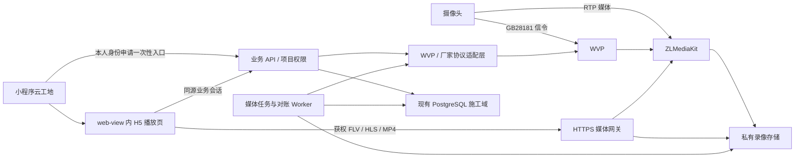

# 冻结历史：云工地视频计划精简前原件（2026-11-05）

> 仅供历史查证，不是当前任务队列、验收新增项或重复授权来源。当前唯一入口为 [开发计划第2节](../cloud-construction-video-plan.zh-CN.md#2-唯一当前任务)。
> 下方逐字节保留精简前完整原件；原件 SHA-256：`c4aaefe6a8104e4c08b6aaa093cbd226c9154d40930c1b4beeafade48e930b84`。历史正文相对路径以原 `docs/` 目录为基准，只按具体问题读取。

<!-- BEGIN ORIGINAL BYTES -->
# 云工地视频开发计划

**原云端真实长测终态：FAILED，不计24/72小时通过。** `2026-10-23T07-33-15-912Z` 于2026-10-23T13:27:40.462Z结束，共5.8866小时/350次观测；原错误 `camera_service_auth_failed`，策略状态实际为error而预期recording，passed/soakPassed=false、milestones为空。已完成5次小时封口私有回放206/匿名401；原G盘停止/烟测及独立功能证据仍分别保留。

- 控制器自清理将自有策略39关闭为版本40，enabled=false/state=stopped。`tmp/cloud-camera/soak-terminal-2026-10-23T14-05-39-367Z.json` 独立确认实际ZLM MP4=false，6段封口索引含尾段、47项前后绑定无漂移。末段13:27:37.713Z封口，无隐藏活动MP4。WVP/ZLM/探针/Redis/MySQL共享服务仍运行，故障时未重启；原46源码/配置及3固定镜像/挂载身份一致，F盘健康，此次不是空间耗尽。
- 只读判别用假transport复现适配器当前机制：首次401清空缓存token并让当次请求失败，下一次独立调用才重新登录；没有真实WVP登录、计划/摄像头变更或录制重启。这证实当次恢复缺口，凭据失效的上游原因（到期或其他）仍未核验，本次未修改冻结适配器。诊断脚本首次模块解析设置失败发生于DB/网络调用前，修正后核验通过，不记作长测验收。
- 原 `soak.json`、时间戳批次与失败/进程日志完整保留。录像仍在批准的F盘私有保留范围，旧G盘批次仍排除。原独立功能回执的策略39/运行中表述是终态前观测，当前状态以本终态为准；24小时、72小时、自然到期和最终连续覆盖均未通过。不加速时钟、不自动重跑；记录终态后停用automation-4，下一交付为有界鉴权恢复及新验收批次。

### 1.8 只读录像清理明细（Implemented）

- 已核实缺口/入口：容量预览原先只有清理数量，无法定位对应录像。负责人现在可在原项目视频页打开“清理记录”。设计源为双语 Admin Ant/重构合同及既有运行记录弹窗：宽760，复用Modal/Table/Alert/Empty，正文/表格内滚并保留关闭按钮。Mini/H5及插画不变。
- GET `/api/construction/video-cleanup/projects/:projectId/bindings/:bindingId` 复用租户事务/摄像头访问。仅enterprise_admin/admin/super_admin可读有效启用绑定，平台管理者在所选企业无需入职/项目成员。拒绝经理/成员、跨项目/租户/绑定、退役/禁用绑定和Mini bearer冒充。可选 `beforeId` 为正signed-bigint游标；非法ID、未知/重复参数422，POST405，no-store。
- 按登记ID倒序20条加前瞻，读取既有 `app.construction_recordings` deleting/deleted/missing，排除ready。仅返回源时间、精确十进制字节、保存状态、仅deleted的已记录完成时间及安全失败原因，不返回上游ID、路径或原始错误。按北京时间及B/KB/MB/GB显示。此为当前状态，不是删除事件时间线、推断重试次数或新的物理文件检查；missing本身不证明本模块删除文件。不改schema，不写策略/录像/审计，不调WVP、不改Worker，无手工删除/重试动作。
- 复用加载/空/错误重试、刷新及最新页重进；更早页失败保留行，重试追加。关闭中止读取，项目/绑定key隔离，源/错误过滤及原真实录像/清理机制保持。
- 最终证据：`tmp/cloud-camera/cleanup-check-2026-10-23T11-52-29-939Z.{json,log}`，隔离 `cloud_camera_cleanup_eval` 9/9、57稳定绑定；有标识写入/读回/清理，两租户均有数据，三类负责人、权限撤回/RLS、同时间分页/重进、真实空绑定及策略/录像/审计不变。`cleanup-http.json`：3018真实HTTP11/11、54稳定绑定，策略开启/3天/版本39不变。最终49入口类型/定向lint通过。`cleanup-validation-final.json`：1155源码/配置绑定稳定；全量lint仍仅固定hls/mpegts分发文件161错误，构建编译成功后仍被既有 `AiDesignerLegacyPage` 导出类型阻断，均不称全量通过。更早构建在类型阶段超时，单独保留。
- `cleanup-ui.json`：10项/57稳定绑定。正常页读取两条此前真实删除的保留验收记录14.3/14.2MB。空/25行状态及分页响应明确为客户端专用fixture，不算物理删除或长测证据；真实服务分页/空态由隔离库覆盖。更早页失败保留20行，重试追加5行。1280×720长正文460/按钮底656；663×892正文632/按钮底836，700表格在584内横滚，页面无溢出。截图：`admin-recording-cleanup.jpg`、`admin-recording-cleanup-error.jpg`、`admin-recording-cleanup-empty.jpg`、`admin-recording-cleanup-narrow.jpg`。Fetch/网络/视口覆盖已清除，恢复真实两行重进并关闭页签；初始GB舍入及浏览器定位/关闭动画/拦截观察保留在回执。 浏览器实际返回JPEG，扩展名已核对修正；最初未完成绘制的空态帧保留为`admin-recording-cleanup-empty-before-paint.jpg`并排除。`emptyRecheck`补充核验刷新按钮已结束加载、空态可见并重拍，源码绑定稳定。 补充空态JPEG为1920×863；窄屏稳定重拍为663×892、真实两行/按钮底506，上述25行滚动界限仍取原客户端fixture的DOM回执。最初663×373窄屏帧保留为`admin-recording-cleanup-narrow-before-paint.jpg`并排除，`narrowRecheck`记录重拍与稳定源码。
- 从admin重跑：`node scripts/construction-camera-cleanup-check.mjs`；既有真实fixture HTTP：`node --import tsx scripts/construction-camera-cleanup-http.ts`。同一74小时控制器、46冻结录像文件、策略39/区间33、F挂载及录像/探针配置不变。前4次每小时私有206/匿名401，24/72小时/自然到期待验；automation-4仍留原验收聊天。下一项为实际长测节点，稳定边界后继续CV-04其余依赖。SD/生产暂停。

### 1.7 只读每日录像覆盖（Implemented）

- 已确认缺口/用户结果：负责人原来能查策略/存储事件，不能直接核对每天已入库覆盖和区间内缺口。原工地视频新增“录像覆盖”，复用已批准Ant Design Modal/Table/DatePicker/Alert/Empty及运行记录弹窗的760px/正文滚动方式；无Mini/H5、插画或还原台账变更。
- GET `/api/construction/video-coverage/projects/:projectId/bindings/:bindingId?day=YYYY-MM-DD` 复用原租户事务和camera access，仅enterprise_admin/admin/super_admin可读有效且启用的绑定，平台管理在所选企业无需入职/项目成员。经理/成员、跨项目/企业/绑定、历史/停用绑定及Mini bearer冒充Admin均拒绝；必须恰好一个day，未知/重复/非法参数和ID返回422，POST405，no-store。
- 日期为北京时间；区间沿私有回放采用视频源时间，只读精确绑定下ready封存记录，保留原最早时差边界的保留期检查。跨午夜片段纳入后按所选日截取；重叠/相接合并不重复计时，保留毫秒，只报告两个已知区间之间的未覆盖。不能据此推断日期两端缺口、停机原因、正在录制未封存部分、物理文件可播或长测通过。最多读1001条，超过时仅统计前1000条并明确“部分统计”；仅返回日期/时间/数量/时长，不返回路径、上游ID、凭据或原始错误；不改schema/迁移、策略/WVP调用和Worker。
- 加载、空、错误重试、日期切换、刷新和重进沿原控件。关闭中止读取，项目/绑定key隔离状态；重进选今天，刷新/日期切换回第1页。短视口正文/表格内部滚动，底部按钮可见。
- 最终证据：`tmp/cloud-camera/coverage-check-2026-10-23T11-29-30-832Z.{json,log}`，隔离 `cloud_camera_coverage_eval` 10/10、59绑定无漂移，含合成真实写入/回读/清理、两个租户均有录像/三种负责人、拒绝路径、午夜/重叠/缺口/时差过期、空/重进、1000条部分上限及策略/录像行不变。最终夹具先以平台读取确认他租户行确实存在，再验RLS不可见，未改产品字节；`coverage-http-2026-10-23T11-25-43-644Z.json` 真实3018 HTTP 11/11、55绑定无漂移，策略仍开启/3天/版本39。最终42入口类型及定向lint通过；全量lint尝试仍仅固定hls/mpegts发行文件161错误，构建尝试已编译后仍受原 `AiDesignerLegacyPage` 导出类型阻断，均不是全量通过；最终格式修正由最终定向检查/HTTP/UI覆盖。
- 页面：`coverage-ui.json`，5项/51绑定无漂移。当日此前测试实际23片段合成21区间，覆盖3小时20分35.055秒、区间未覆盖2小时11分13.678秒；这不是本次长测的连续性结果。1280×720下宽760、正文460、按钮底656/弹窗底676，无页面横向溢出；663×892下按钮底836/弹窗底856，650px表格在584px容器内滚动。截图：`admin-recording-coverage.png`、`admin-recording-coverage-empty.png`、`admin-recording-coverage-error.png`、`admin-recording-coverage-narrow.png`；已验失败重试、空、关闭重进及第2页→刷新第1页。临时请求拦截/视口已恢复，标签关闭。首次Bun驱动失败保留于11-14-36日志/回执，明确Node重跑通过；首次时间仅显示小数位已修正为明确时分秒，UI回执保留原观察及关闭动画时驱动重试，未混作一次无失败通过。
- 从 `admin` 复测：`node scripts/construction-camera-coverage-check.mjs`；真实夹具只读HTTP：`node --import tsx scripts/construction-camera-coverage-http.ts`。同一74小时控制器、46冻结文件、策略39/区间33和录像/探针配置不变；前3小时私有206/匿名401，24/72小时/自然到期待观察。既有每小时automation-4仍ACTIVE并留在原录像验收聊天，未重复创建或改目标。SD/生产暂停；下一项仍是真实长测检查点，稳定边界后再评估CV-04其余依赖。

### 1.6 只读录像运行记录（Implemented）

- 已确认缺口/用户结果：原工地视频只有当前录像/存储状态，没有负责人可读的持久历史。“运行记录”复用已批准Ant Design Table/Modal/Alert/Empty，不引入新视觉方向或Mini/H5改动；负责人可查看策略意图、存储等级变化、时间、安全来源标签，加载更早记录、刷新及重进。
- GET `/api/construction/video-activity/projects/:projectId/bindings/:bindingId` 只读原 `app.construction_audits`；可选 `beforeId` 为正数signed-bigint游标。仅负责人管理角色可读，含admin/super_admin在所选企业继承、无需入职/项目成员；复用共享租户/项目检查并要求当前有效且启用的摄像头绑定。经理/成员、跨项目/企业/绑定、历史绑定被拒绝；未知/重复查询参数或非法ID返回422，POST405，响应no-store。
- 按租户/项目/精确绑定及原有六类action过滤：recording.configure、storage.ok/warning/critical/blocked/unavailable。按审计ID倒序每页20条、多读1条判断下一页，同时间记录不重不漏，不返回其他绑定总量。仅输出ID/时间、管理/系统/未记录来源、校验过的开关/1..30天、0..100百分比及白名单原因；不暴露原始snapshot、人员身份、路径或错误细节。历史缺失字段仍未知，容量不可用事件的百分比标为“最近已知”。事件表示策略意图/保护判断，不是已确认录制启停回执；不补造历史，不新增schema/迁移、策略写入、WVP调用或Worker。
- 状态/恢复：沿原加载、Empty、错误Alert/重试；更早页失败保留已读行。关闭中止未完成读取，项目/绑定key隔离旧视图，重进从最新页开始。入口仅在原负责人录制设置旁，短视口沿Ant弹窗正文滚动保留底部按钮。
- 证据：`tmp/cloud-camera/activity-check-2026-10-23T09-34-02-438Z.{json,log}`，隔离 `cloud_camera_activity_eval` 8/8、57绑定无漂移，真实合成写入/回读/清理、双租户/三种管理角色、经理成员拒绝、同时间ID分页/重进、空/非法字段及策略/审计不变；`activity-http-2026-10-23T09-34-42-937Z.json` 真实3018 HTTP 11/11、54绑定无漂移，策略前后均开启/3天/版本39。35入口类型与定向lint通过；全量lint仍固定vendor161错误，隔离构建已编译、类型校验仍受原 `AiDesignerLegacyPage` 导出阻断。最后“最近已知值”格式调整已由最终测试/类型/lint/HTTP覆盖；未变Mini/H5/原生范围复用原证据。
- 页面：`tmp/cloud-camera/admin-recording-activity.png`，1280×720、宽760、正文滚动高460、按钮底656/弹窗底700，无横向溢出；真实20→40条保持唯一且保留前20条，关闭重进恢复20条。663×892下底部按钮也在视口内，长内容沿表格内部横向滚动；小程序还原台账不变。从 `admin` 复测：`node scripts/construction-camera-activity-check.mjs`；真实夹具只读HTTP：`node --import tsx scripts/construction-camera-activity-http.ts`。
- 同一74小时控制器继续运行，46冻结源码/配置和策略39/区间33不变。前2小时封口片段私有206/匿名401；24/72小时/自然到期仍待观察。SD/重启/格式化及生产继续暂停；需改冻结录像依赖的剩余项等待稳定验收边界。

### 1.5 只读保留容量预览（Implemented，独立于当前长测）

- 入口/设计源：原 `/construction-projects` → 项目Drawer → 工地视频 → 录制设置，复用已批准Ant Design Modal/Form/Alert。短视口只滚动弹窗正文；宽520，1280×720下按钮底656、弹窗底700，无横向溢出。Mini/H5标记、素材、路由及还原台账均未改动。
- GET `/api/construction/video-capacity/projects/:projectId/bindings/:bindingId` 复用共享租户事务与原camera access；仅负责人管理角色可读，admin/super_admin在所选企业继承，无需入职/项目成员。经理/普通成员、跨企业/项目/绑定、历史绑定被拒绝；拒绝多余查询参数，无写接口、WVP调用、新schema或迁移。
- 对当前绑定最近24小时内最多12段ready封口录像，累计字节除以实际片段时长求平均码率，至少60秒；陈旧/未来/缺失/已删除/待删除片段不参与码率。未知为null。用整数计算十进制GB/天和所选1..30天预算，另列25%规划余量；界面仍沿当前节点1..7天保存上限。预览不保存、不执行容量配额；登记存量及待清理/失败数只读，不暴露原始路径或错误。此项不是剩余可录时长预测。
- 证据：`tmp/cloud-camera/capacity-check-2026-10-23T08-48-34-399Z.{json,log}`，隔离 `cloud_camera_capacity_eval` 9/9、57源码/配置绑定无漂移；`capacity-http-2026-10-23T08-49-51-910Z.json` 真实HTTP 6/6、54绑定无漂移，策略前后均开启/3天/版本39。28入口类型和功能定向lint通过；全量lint仍仅固定hls/mpegts发行文件161错误，构建已编译、仍被原有 `AiDesignerLegacyPage` 非法导出阻断类型校验。首次effect同步重置lint错误已修正；HTTP驱动默认导入首次尝试在请求前失败，改为具名导入后通过。
- 页面证据：`tmp/cloud-camera/admin-capacity-estimate-3days.png`、`admin-capacity-estimate-7days.png`。实测0.910Mbps、约9.8GB/天；3天29.5GB/含余量36.9GB，7天未保存预览68.8GB/86.1GB；取消后重进仍3天。加载/不足/失败重试沿同一Alert，不禁用原保存；上述为当次样本，不是固定未来码率。
- 真实74小时批次的46个冻结源码/配置、录制策略39/区间33、F盘挂载和录制/探针镜像未改变。首小时封口片段私有回放206、匿名401；24/72小时和自然到期仍待观察。新增只读文件位于冻结绑定之外。SD继续暂停；需改冻结依赖的录制/默认值/授权/抓拍保留项等待稳定验收边界。

English mirror: [cloud-construction-video-plan.md](./cloud-construction-video-plan.md)

更新：2026-11-03。CV-02默认/业主授权及CV-03抓拍自动保留已完成限定开发验收，见§1.10–1.12；旧74小时失败保留。下一交付CV-04固定执行源码和新长测，整体Limited；24/72小时/自然到期、微信真机/公网4G/生产未通过。第1节为唯一当前调度记录。

## 1. 当前交付记录

| 项目 | 内容 |
| --- | --- |
| 当前交付 / 用户结果 | CV-04仍Limited；真实长测曾按用户要求保持停止、不自动恢复（该边界已于2026-11-05由用户“恢复物理录制”决定解除，见本行末尾与§1.13，历史停止事实保留）。用户确认“是，我发起了停止，先保持停止”。批次2026-11-03T09-03-04-699Z于09:05:51.567Z开始录制，保留4次观测，最后09:08:54.182Z；停止标记09:08:56.913Z（北京时间17:08:56）。原终态保留failed/Soak interrupted by an explicit stop request，归类用户主动停止，不算新SDK故障，不计24/72小时/自然到期通过；原预计结束时间取消。尚未完成的云工地长测等待用户明确恢复指令。 本轮继续完成CV-04不录制的远端验收前置，限定Implemented；整体仍Limited。新远端准备/只读前检已通过，未把“继续”推定为恢复物理录制，停止决定继续有效。 2026-11-05本轮把3个容量/故障注入/恢复live验收驱动绑定到批准的远端部署（见§1.13、§1.2第7项），驱动就绪这一项已解除；剩余CV-04全部依赖用户明确恢复物理录制，本轮未运行任何录制或策略写入场景。 2026-11-05用户明确选择“恢复物理录制”，录制类验收已实际重启：固定07源码下recording-live 4/4通过——业主真实云策略版本46→47、实际写入器启动、无人观看120秒仍保持录制、业主关闭后停止，封口文件28631（08:37:28→08:39:41.132Z，133.132秒/16774230字节）经私有网关Range 206且含ftyp、匿名401，源漂移0。迁移后旧企业3摄像头（绑定3/设备34020000001320000003/通道…0004）在远端WVP为online=false，仅具名1454测试设备…0005/…0006在线；live驱动夹具已与封存批次逐字节对齐，3个驱动按soak既有规则接受两个批准隔离测试企业。整体仍Limited，24/72小时与自然到期仍未验。 2026-11-05恢复录制轮的结果：CV-04除74小时长测外的录制类验收已在批准的远端部署（context sfp-remote-dev、录像宿主D:/Smart-Floor-Planner-Dev/migrated-services-20261103/record）上用真实WVP/ZLM与真实媒体字节完成——真实短录+私有206/ftyp回放+匿名401+停录封口、受控单流丢失6691ms自愈且网关进程被杀期间WVP写入不断、到期保留真实删除物理字节并清除WVP索引且reconcile不复活、容量告警/低空间真实停写/回滞恢复/探针不可用失败、已确认策略的控制器异常退出由独立清理者1次收干净（lastExit 0）。CV-04仍Limited：具名新74小时批次刚开始，24/72小时里程碑与自然三天到期未判定，且这轮短时窗验收不构成真机、公网4G或生产验收。§7 CV-04的“文档/部署回滚预案”项已作为文档落在§9.1（不构成任何部署授权）。 |
| 已完成前序 / 复用 | CV-02企业默认/业主授权、CV-03抓拍留存均保持限定Implemented，见§1.10–1.12。继承2284绑定映射实际副本后仅construction-camera-soak.ts有变，另新增执行工具/测试，副本外漂移0；摄像头service/H5/Mini入口源码未改。前序兼容78/抓拍9/Stable5加入口宿主3仅按原范围复用，不作真机播放证明。 |
| 工作区 / 本地提交 | 仍用G:/workspace/向总/Smart-Floor-Planner、codex/xiaok-public-site-lifecycle。摄像头实现提交11c75b5fc6273bdcc92bc104846f5293bec07e40，父为独立公开直播d45bc65229d60f248d86edc1ded3815df6985f1e；隔离索引/CAS提交11路径，共享改动保留。当前用户停止状态同步更新同一双语计划/模块条目。3个采样代码与固定05一致，追踪v2/测试绑定有效；原交接快照/成功草稿继续历史保留且未执行。无干净worktree/Mini副本或并行云工地owner。 本轮工作基线2e5a13031a045b583eeef3df9eae247b383ca04d；仅6个验收工具/测试及双语摄像头运维合同纳入相关本地提交，最终提交/文件绑定见tmp/cloud-camera-remote-preflight-20261103-01/completion.json。工作区/分支不变，其他模块脏改动和索引保留。 2026-11-05轮基线9db8c4db（timestamp撤销边界修复之后），工作区/分支不变；改动仅5个摄像头验收工具/测试（environment的mjs与test、storage/recovery/retention三个live驱动）加双语视频计划§1／§1.2／§1.13，纳入一个本地提交；其他模块脏改动、索引与小K/公开直播改动保持不动，未推送。 恢复物理录制轮新增两个本地提交：2c02f1a9把storage/recovery/retention三个live驱动改为按夹具实际流身份、双批准隔离测试企业与“今天内”片段选择；e0c21c84让网关归属守卫同时接受封存批次的绝对启动路径。工作区/分支不变，其他模块脏改动与索引继续保留，未推送。 |
| 固定执行 / 配置 | 旧固定05/F环境及原失败只作原批证据，不编辑或作为远端新验收环境。本轮全新固定06：tmp/cloud-camera-operations-20261103-06/execution-manifest.json，SHA25618b4b5ef697eb579de83ef23c841e5c6bcb5e17f6bd523d466bf38c06ab11e2a，85333文件/1140199084字节、83498已安装依赖。prepare显式--context sfp-remote-dev，私有runtime设置CAMERA_DOCKER_CONTEXT及远端D:/Smart-Floor-Planner-Dev/migrated-services-20261103/record；camera-environment.json绑定准备前后3个完整容器ID/镜像/启动时间/挂载及原生容量、探针、SSH。7项外部绑定为Node/Python/SSH/Docker解释器、SSH配置/known_hosts与Docker context metadata；不读/复制私钥。源/依赖/外部资源前后校验稳定，无网关/Next/控制器启动。 本轮当前固定执行=固定09：`tmp/cloud-camera-operations-20261105-09/`，封存HEAD `e0c21c84`、manifest `df7b4a0e…39a20`、85362文件/1140608239字节/83498已安装依赖、deep校验前后稳定，7项外部绑定同前（不读/复制私钥）；其`runtime.private.json`驱动网关/控制器/前检共用同一实际Admin副本，`camera-environment.json`绑定3容器ID/镜像/启动时间/挂载。旧固定06与批次07/08继续只作各自原批证据：07承载recording-live通过，08承载recovery-live第3项的原失败，09承载recovery/retention/storage/crash与当前74小时批次。 |
| 已执行 / 源码绑定检查 | 固定05离线单元5/兼容80/62入口类型0/lint0及85324前后深查稳定继续有效；cadence02的60/0/最大6174ms保留15秒/容量守卫，cadence01的60/17仍failed。v2追踪4/4加lint0有2文件前后绑定；provider-trace-cold-dependencies.json补齐4/4和12个Node/测试/preload/esbuild JS/原生binary/package明确绑定，逐字节同固定副本、漂移[]。v1主路径183.792秒/18观测、私有206/匿名401、封口缺口0、85324/3镜像稳定。v2父丢失02在确认策略后真实exit87/1观测；监督599116在2次守卫尝试后cleaned/lastExit0，独立确认SD/off/stopped/版本43、MP4=false/所有义务0/controllers[]、85324终态深查稳定。short-evidence-summary.json另核3媒体镜像/挂载及主线程transport相同。新固定Next的H5入口HTTP200仅为就绪，未变Mini/H5/Stable只按原范围复用，不称新原生/微信真机通过。 新固定06定向JS18/18、原清理守卫4/4、62入口类型0、6文件lint0；准备完成深查及验证后85333深查稳定，外部7资源及验证/只读状态驱动前后稳定。远端只读物理前检02及结束复查通过：原生总量1403827589120字节、精确D目录、同源RW/RO挂载、探针15秒新鲜度及匿名401。证据tmp/cloud-camera-remote-preflight-20261103-01/validation-06.json；旧证据仍只按上文原范围复用，不称新UI/原生/物理录像验收。 2026-11-05轮定向检查：node --test environment+execution 22/22通过（含新增4条live批次绑定反证与源级守卫）、node --import tsx --test soak-恢复4/4、npm run check:camera为62入口/0错误、5个改动文件ESLint 0；只读远端live绑定实证tmp/cloud-camera-driver-remote-ready-20261105/driver-remote-ready.json记录3容器running、物理D同源RW/RO、连续3次capture逐字节一致、11次调用全为只读docker context inspect/ssh -G/docker inspect、宿主探测与探针请求0、绑定源前后漂移0。本轮未运行--storage-check/--recovery-check/--retention-check，也不声称远端容量新鲜度、真实回放或长测通过。 2026-11-05用户恢复物理录制后新起固定09：`construction-camera-execution.mjs prepare …-09 --context sfp-remote-dev` 封存HEAD `e0c21c84`、manifest `df7b4a0e187dd23b1bf094790542dcb7d6f4aeb9cd17a1a614de737b4be39a20`、85362文件/1140608239字节、deep true；8个驱动/网关/harness/离线测试文件与封存副本逐字节一致（`tmp/verify-batch09-20261105.mjs`），批次网关44900经执行工具`gateway`启动并通过“远端部署与封存前后一致”门。recording-live 4/4（批次07）；recovery-live 4/4（批次09，09:17:05.127Z起64.678秒：真实Worker无需驱动reconcile即开录，source_started_at 09:17:15+00、时钟偏移-391..707ms；对自有流单次`close_stream`code/result=0后6691ms自愈；SIGKILL 44900期间WVP写入未断、18620接管后10381ms恢复durable reconcile并仍recording；停录封口两侧片段29154（1,640,795字节）/29159（3,859,698字节）且私有回放206含ftyp、匿名401，prior 28631仍可读；drift[]、images前后一致、deadlocks 1→1）；retention-live通过（09:19:44.374Z起4.620秒，见§1.13）。 storage-live 6/6通过（09:20:18.281Z起69.587秒，drift[]、images前后一致、deployment/recordingHostPath绑定同批次）：真实媒体容量指标加独立Worker按版本53开录；模拟85%/92%只降级为warning/critical且持续真实录制；96%低空间保护使实际写入者真实停止（`afterLiveProtection.providerPlan=null`，开直播不得重启MP4写入）而私有回放仍206含ftyp、直播FLV首帧可读、historyCount 5且`recordingNotice=camera_storage_low`；93%保持暂停、88%按原意图恢复且`unchangedVersion=true`；探针不可用→`camera_storage_unavailable`真实停写；保存off在真实探针恢复后仍`enabled=false/state=stopped/retentionDays=3`。全程磁盘从未真实填满（report.scenario已声明），容量阈值来自一次性只读fixture探针服务而非远端。 |
| 真实清理 / 正常smoke | 原05的5观测/camera_invalid_response及此前失败全部保留。独立v1正常2026-11-03T08-17-06-957Z通过183.792秒/18观测、私有206/匿名401、封口缺口0及85324/3镜像稳定；额外末尾读取失败保留，另有4731ms不带追踪的独立清理确认。v2父丢失02真实exit87/1观测，经2次守卫清理/lastExit0，恢复SD/off/版本43/MP4=false/所有义务0且85324终态绑定稳定；首尝试细节未知仍保留。新actual74h01在4观测后被用户主动停止：cleanupConfirmed=true/originalModeRestored=true，09:12:49.403Z终态，恢复SD/off/stopped/版本46；监督136004 already-clean/0次、09:12:50.062Z结束。85324前后深查/3镜像稳定，DB只读失败[]，最大已观测间隔60009.954ms，逐接口未见SDK异常HTTP/负回执。09:17:51独立读回及释放前再次新鲜确认实际MP4=false、SD/观看/PTZ/写入义务0、controllers[]。用户停止不清零原失败次数，也不完成长测验收。 本轮新环境仅两次只读核验，均SD/off/stopped46、actualMP4=false、4类义务0/controllers[]；数据库storage健康行因网关保持停止仍为unavailable，未冒充新Worker新鲜度或连续录像通过。 2026-11-05恢复录制轮的真实清理：recovery-live结束由驱动自身把自有策略落回enabled=false/state=stopped并reconcile，绑定与镜像零漂移；retention-live只对该批次标签内的记录28631（16,774,230字节，source_id 54）做合成到期（-4天）后真实删除，远端物理文件`recordingFileStatus`从206变404、WVP `cloudPath`为null，随后`reconcileRecordings()`未把它复活（state保持deleted）。因此原recording-live回执里的媒体字节已按到期清理路径真实消失，回执JSON仍作原批证据，后续不得再声称28631可直接回放。 storage-live自身清理同样真实闭合：会话`sessionHeartbeat(...,true)`关闭，按`ownedVersion`守卫（不得覆盖人工策略变更）落回enabled=false，停止只属于自己的fixture网关后重启真实探针网关并等到`ok/stopped`，回执`restoredGatewayPid=38316`、`cleanupError`/`gatewayCleanupError`缺失、drift[]。 |
| 原失败 / 持续计数 | 存储机制修复1，其后首轮真实正常主路径失败1；固定04健康行过期9观测失败、历史鉴权5.8866小时/350、5观测DB/inline清理失败、8小时盲区、旧SD/整日UNKNOWN、准备01/02、ANSI03/conhost/漏tsx/HTTP01错误预期均保留。CIM机制修复1保持。采样驱动修正1：原60观测/17启动前过期仍failed，就绪后60/0/最大6174ms在原15秒保护下通过。44观测/65秒超时及I/O前CJS准备错误仅诊断。模型/生图/付费调用成本0；新失败的具体摄像头endpoint及当时ack仍未知，当前停录/归属已确认。不重放未知写入，不因新聊天清零持续次数。 可选追踪启动修复1：旧v1父丢失准备未到写入/观测，继续准备failed；包装器首个额外读回null及宿主Core Utility/编码准备错误分别保留。v2排除Worker的4/4只是工程证据，不清零存储/CIM/鉴权/真实正常运行失败。 远端前检01的fetch failed独立保留：本机既有8端口转发监管缺失/端口均空，远端容器仍在运行；用原安装脚本恢复监管后，代码不变的物理前检02通过。不是新录像SDK故障/修复迭代，不重置既有次数。此前PowerShell花括号搜索准备解析失败发生于读取/服务I/O前，亦保留在本轮证据。 恢复录制轮新增两次驱动侧修正计数（均不改产品源码、不计入摄像头SDK失败）：修正2为recovery-live批次08在第3项“网关进程重启”失败——原守卫只认相对路径启动的网关，拒绝承认执行工具以封存副本绝对路径启动的3017监听者，回执`recovery-live-2026-11-05T09-04-08-467Z.json`原样保留（第1/2项PASS、cleanup enabled=false/stopped、drift[]、deadlocks 1→1），`e0c21c84`把归属判定改为共享`ownedGateway`并同时接受两种启动形式，配套离线反证；批次09按同一场景重跑通过（44900→18620）。修正夹具归属：批次07前的4个live驱动仍绑定已下线的企业3摄像头，`2c02f1a9`按soak既有规则改为接受两个批准隔离测试企业并去掉硬编码设备ID，原失败回执保留，不删除任何真实数据、不伪造夹具。11-03用户主动停测批次的failed终态与5次观测继续原样保留，恢复录制不清零任何既有次数。 |
| 数据库 / 部署 | 应用仍沿原55432→批准远端15433/cloud_camera_eval；0116后115条账本，独立0114仍未迁。本次基础设施迁移未应用schema迁移，未改既有主库／向量库及其凭据／转发。2026-11-03单独获授权的迁移已把8个Docker依赖及数据移至192.168.10.54，并新增独立8端口SSH监管；不得再笼统写卷／部署位置均未改。本地Docker／Desktop WSL保持停止，默认context=sfp-remote-dev，当前录像宿主目录为D:/Smart-Floor-Planner-Dev/migrated-services-20261103/record。原备份／RLS证据保持，主库／评估库完整恢复演练未验，生产部署未授权。 |
| 自有资源 / 夹具 | 无活跃长测／控制器／清理者，camera-soak:9已释放。原用户停测启动者428972／控制器325984／监督136004及网关558544／Next521868已按物理状态和身份守卫释放，证据actual-74h-01/user-stop-owned-release.json。迁移验证临时使用网关587200／Next47552／自有子进程106660，完成后全部释放；交付时3017／3018不监听，原3006 PID540892保持。这些为已记录历史身份，不作为接管当前PID的依据。仍用微云1454／项目12／摄像头8／绑定9、SD/off/stopped46、MP4=false／义务0、原3天。8个依赖现运行在远端，原远端5容器及独立数据库／Embedding隧道保持；本地F／旧卷／VHD仅作回退，现录像／探针共同指向远端物理D，摄像头仅SIP目标改至192.168.10.54。无原生／浏览器锁，无新增录制／自动化。53文件hash／私有206／匿名401／直播FLV70358字节／8180ms SSH重连及归属见docs/remote-development.zh-CN.md、tmp/docker-remote-migration-20261103-01/completion.json。 本轮保留停录，3017/3018未启动；恢复原开发依赖SSH监管443384/子进程350404，8端口全部归该SSH，继续常驻，不随测试清理。共享3006 PID540892、本机Docker进程0及远端容器ID/启动时间/全挂载稳定。未重启共享服务、未改设备/策略/数据库/自动化。 2026-11-05再次只读核验（无写入）：绑定9策略仍enabled=false/state=stopped/版本46/模式sd、停止标记2026-11-03T09:09:52.811Z，ready封口19条最晚started_at2026-11-03T09:05:49Z、未关闭会话0，远端物理D为1307.4GiB总/893.4GiB可用（inode在Windows宿主为0/0，按既有规则处理）；证据tmp/cloud-camera-driver-remote-ready-20261105/remote-read-only-check-01.json与driver-remote-ready.json。 2026-11-05恢复录制轮的3017归属台账（只用身份判定释放自己启动的网关，未接管任何他人进程；本地Docker仍0进程，共享3006 PID540892与SSH监管21684的8端口转发未重启）：批次07网关24572已释放；批次08网关39256经`tmp/release-batch-gateway-20261105.mjs`按“记录的PID＋封存批次脚本ASCII后缀”释放（PowerShell控制台代码页会乱码中文工作区段，故用ASCII后缀比对）；批次09网关44900由执行工具`gateway`启动，被recovery-live第3项按守卫杀死并由驱动自身重启为18620；storage-live第1项释放18620并起fixture网关35112，其清理再恢复为38316；我用`tmp/release-owned-gateway-20261105.mjs`按`construction-camera-gateway.ts`身份释放38316后，为soak-crash重新以执行工具起封存网关51108。全程3018未启动、automation-4继续暂停。 本轮交付时的自有资源：唯一活跃长测为具名74小时批次runId `2026-11-05T09-28-48-024Z`（控制器PID 28324，封存副本执行，策略版本57，expectedFinish 2026-11-08T11:28:59.576Z），其独立清理监督按soak既有规则处于waiting-parent；共享媒体网关为封存批次网关51108（3017），SSH监管21684的8端口转发与共享3006 PID540892不变，本地Docker仍0进程，3018未启动。旧表述“无活跃长测／控制器／camera-soak:9已释放”只描述11-03停测时状态，不适用于本轮之后。 |
| 构建 / 原生 / 物理限制 | 无产品路由/schema/UI变更，不称新整包构建通过。前序构建编译后受无关xiaok-manual-fixture.ts:43的state.keys unknown阻断，generated-type漂移原回执保留。Mini入口/模板/资产未改，只复用前序对应Stable范围；仅一台批准摄像头，多路吞吐、物理PTZ/微信真机/公网4G及生产未验。 2026-11-05轮仅改运维脚本、其离线测试与双语视频计划：无运行路由/API/权限/数据契约/UI变化，docs/admin-system-modules.md与docs/miniprogram-system-modules.md无对应条目需改（文档门已核）。 2026-11-05恢复录制轮的提交同样只涉及运维驱动与离线测试（`2c02f1a9`夹具归属与设备ID解绑、`e0c21c84`网关归属守卫）加本双语计划：无新路由/API/权限/数据契约/UI/Mini入口变化，不称整包构建通过。admin约80项数据库套件本轮未重放，依据是受影响范围内产品源码零改动——soak/preflight的前后哈希与批次09封存副本逐字节一致（`before`/`after`漂移0、images前后一致），且本轮断言全部由live驱动在真实服务上直接执行；这不等于该套件已通过，历史结果仍按原范围引用。真实物理磁盘从未填满（storage场景为一次性只读fixture探针），多路并发、物理PTZ、微信真机、公网4G与生产仍未验。 |
| 精确下一步 | 远端prepare/只读容量前置与3个live驱动的远端部署绑定均已完成；云录制保持停止，CV-04剩余验收唯一前置是用户明确恢复物理录制的决定，本轮不新起长测/控制器、不删除旧停止标记、不恢复/新增自动化。恢复后须先为变更后的驱动源码准备全新固定批次（旧固定06及回执只作原批证据），再刷新实际策略/义务/远端环境，完成所需远端短录/私有回放/停录/SD恢复及已确认策略父进程异常清理，然后建立具名新74小时批次。中断原批不续跑、不改completed。24/72小时/自然到期及旧具体SDK失败原因仍未验；不生产、不改持久化/期限/回执/租户守卫。 阻断证据（2026-11-05只读核验）：retention-live第25行要求ready片段的started_at在24小时内，现存最晚为2026-11-03T09:05:49Z；recovery-live与storage-live本身会开启/停止所属录制并替换网关；harness的--playback-only只与--recording-check组合存在，没有不启动录制的回放入口。因此不恢复物理录制时，这三个live场景均无可执行路径，只有停录状态下的只读核验可继续。（该阻断证据描述11-05恢复决定之前；本轮已由用户授权恢复物理录制并按固定09执行，recovery/retention/storage/crash四个live场景全部真实通过，原段落保留作当时事实。） 现在唯一剩余项：等具名74小时批次`2026-11-05T09-28-48-024Z`自然跑到2026-11-08T11:28:59.576Z，由soak自身断言24/72小时里程碑、每分钟观测（最大120秒）、Worker新鲜/实际MP4、封口缺口≤2秒、每小时私有206/匿名401与自然三天物理404/410+WVP索引消失；不得在中途把observations或小时检查说成通过。若该批被显式停止或异常中断，原批保持failed不续跑、不改completed，且恢复前先为任何变更后的驱动源码另起全新固定批次。期间禁止：新的设备计划/格式化/重启/PTZ动作、公网4G、付费调用、生产部署、并行owner或第二个录制控制器。CV-04在§7列出的非设备依赖项已全部闭合（§9.1部署与回滚预案），剩余项全部依赖该74小时批次自然结束。 |
| 授权 / 串行接续 | 用户确认17:08:56主动停止并明确“先保持停止”的决定仍有效。后续指令授权的是已完成的远端开发基础设施迁移及必要有界链路检查，不恢复云录或自动化。本地Docker保持关闭，automation-4继续暂停。本次计划更新仅同步既有交付／环境合同和驱动待办，不启动服务／测试／控制器；保持单一云工地owner、原源码／失败／持续次数／成本及串行上下文接续，创建后继聊天不恢复录制权限。不接管小K／公开直播功能，不建并行owner／worktree，不作格式化／重启／设备计划／公网4G／付费／生产动作。 本次“继续”落实为不依赖录制的远端前置及已有转发恢复，未解除既有物理录制停止边界；无新增/恢复自动化、网关或Next。 2026-11-05轮同样限于验收工具源码、离线测试、只读远端身份核验与双语计划更新：未启动3017/3018、控制器或自动化，未重启共享服务，未改设备/策略/数据库/schema/UI；本地Docker保持关闭，仍通过既有批准SSH context只读inspect。 2026-11-05用户在我明确提问“云工地剩余的录制类验收要怎么处理（当前停止决定仍有效，我不会把“继续”推定为恢复录制）”后选择“恢复物理录制”，该决定取代11-03的“先保持停止”，授权范围限于我提交并获选的同一有界序列：先为变更后的驱动源码准备全新固定批次，再完成远端短录/私有回放/停录/SD恢复、已确认策略的父进程异常清理，然后建立具名新74小时批次。恢复录制不等于生产部署、设备格式化/重启/PTZ动作、公网4G或真机通过，也不解除本地Docker保持关闭、不读/复制SSH私钥、其他模块脏改动保留、automation-4继续暂停这些既有边界；原11-03用户停止批次及其终态原样保留，不因恢复而清零失败次数。 |

设计/实施源：2026-10-22用户批准单路H5/云工地配色、摄像头切换、抓拍历史及云台，去掉源地址/诊断。当时排除录像；2026-10-23进一步明确批准在播放器下加入直播/回放切换、日期、真实片段、返回直播，空/失败沿用既有反馈。当前实现保留此层级和配色，无截图切片/新增插画；Admin沿双语Ant Design/refactor合同。不能将空查询或接口完成记为SD支持。

**上下文容量接续规则：** 开发中接近聊天上下文上限时，先更新本节唯一当前交付记录，记明用户决定、完成/剩余项、精确下一步、工作区/分支/提交/相关脏文件、测试命令/结果/证据及复用边界、持续失败次数、未知结果/成本、运行任务/资源/锁和审批/部署边界；留足一次有界操作与交接空间，不虚构剩余百分比。按根AGENTS.md的既有授权创建同项目/同实际工作区的一个全新后继聊天并验证工作区，串行转交所有权；旧聊天只核验交接并停止开发，不复制饱和历史，不靠自动压缩无限延长。创建失败则在本节留下完整检查点和可直接使用的接续提示，不声称已交接；不扩大设计、生产或并行工作授权。

### 1.1 当前实现合同（优先于后文尚未实现的完整提案）

- Admin `/construction-projects` 原Drawer“工地视频”：平台管理员在所选企业分配已验证WVP通道；负责人/经理绑定解绑/抓拍/已开放云台；只有负责人管理角色保存云台和录像策略，含admin/super_admin继承，无需入职/项目成员。有效普通成员只观看；§1.11已实现业主视频/抓拍/云台显式授权，不授予公开直播同意。
- Mini `packages/construction/projects/projects` → `packages/construction/camera/camera` → H5 `/construction-camera`。一次性入口30秒；独立HttpOnly/SameSite=Strict cookie/CSRF同源会话，观看/会话租约60秒、心跳20秒、绝对4小时。隐藏/退出关闭本观众传输；重进新入口，迟到入口丢弃。
- 员工API：Admin `/api/construction/video`、Mini `/api/miniprogram/construction/video`，`register`、`inventory`、`projects/:id/{inventory,cameras,binding,configure,recording,entry,retention-default,customer-grant}`。POST recording仅负责人管理角色可写，版本控制/相同设置幂等，默认关闭、3天，整数1..节点上限（当前7天），不超过WVP节点自身保留；经理/成员不能开启持续上传。4G云端持续录像保持关闭；§1.9已限定实现产品SD回放，保留可信时间/归属/STOP守卫。
- H5 `/api/construction-camera/{exchange,state,heartbeat,stop,live,snapshots,ptz,recordings/query,playback}`、私有图片 `/snapshots/:id`；直播网关 `/camera-media/:generation/*`、私有MP4 `/camera-recording/:generation/:recordingId.mp4`，支持单Range/HEAD，不暴露源地址/路径/凭据。请求及传输中每5秒重验项目权限/租约/代次/录像保留窗口；撤权/停止/切换使旧媒体失效。
- 0090为设备/绑定/入口/会话/抓拍/停止义务6张强制RLS表；0091新增策略/封口录像2张强制RLS表及会话recording_id复合FK。录像按原绑定/启用区间导入，迁移设备后归原项目，跨绑定边界片段不认领；历史与新项目录制互不干扰，不覆盖外部录像计划。
- 0092新增强制RLS录制区间表及持久补查游标。重新开启新建所属录制区间，保留旧区间并排除停录缺口；增量按源开始时间推进，每10分钟完整补查节点保留窗口，持久保存快照/页码，每tick最多2×100条。迟到/乱序封口可补入，重复/已删记录不复活。策略保存与Worker在绑定行锁之前共用同一advisory锁，修复实测锁顺序反转。
- 0093分离媒体节点私有直连HTTP-Date/源时间与数据库业务时间。开启前及实际停止后采样有界时差，仅有校准证据的区间可新增认领；绑定检查使用保守时差界，最早可能开始时间决定访问到期，最晚可能结束时间决定物理删除。同绑定区间重叠时保留完整可能时差，不放宽跨工地边界。缺少可信时间或时差超过60秒时拒绝认领；旧区间不猜测补写，已索引历史仍可用，旧的开放区间须关闭确认停止后重开取得校准。
- 关闭时先撤下本模块所属计划，再做时间/索引诊断。校准异常仍保留可见error并拒绝未核实导入/停止确认，校准恢复后Worker确认停止/关闭区间；诊断依赖不能让用户已关闭的写入持续运行，外部计划仍不触碰。
- CV-04容量实施：0094新增平台专属强制RLS节点健康表及租户策略健康级别/转换审计。私有Python statvfs探针只读挂载实际既有ZLM媒体卷，无Docker socket/文件内容接口。80%预警、90%紧张、95%或可用<5GiB或已报告空闲inode<128时暂停所属写入；恢复须<90%、可用≥8GiB且已报告空闲inode≥512。未知/过期/非法指标按保护处理；保留原启用意图、外部计划、直播/私有历史及有效保留窗口，明确关闭后不自动重启。后台复用批准的Ant Design Alert/状态，仅负责人管理角色获原始指标；H5复用原录像反馈显示本租户已确认暂停原因。保护依赖运行中的对账Worker，不是硬件磁盘看门狗。
- 兼容固定WVP2.7.4 commit3fcd3ae80c30c95aeb82ef830af439a835257067：[RecordPlanServiceImpl](https://github.com/648540858/wvp-GB28181-pro/blob/3fcd3ae80c30c95aeb82ef830af439a835257067/src/main/java/com/genersoft/iot/vmp/service/impl/RecordPlanServiceImpl.java)有观众时保留流，[PlayServiceImpl](https://github.com/648540858/wvp-GB28181-pro/blob/3fcd3ae80c30c95aeb82ef830af439a835257067/src/main/java/com/genersoft/iot/vmp/gb28181/service/impl/PlayServiceImpl.java)复用就绪流，计划关联不能代表MP4实际启停。重新确认所属计划成员后，私有ZLM startRecord/stopRecord（type1、精确app/stream）须result=true及isRecording确认；开启直播也在同锁内守卫录制意图/保护。外部计划保留，容量保护不关闭整条直播流。
- 独立5秒对账恢复应录通道；只有ZLM实际状态确认后才显示recording/stopped。解绑须先关闭且确认stopped。每10分钟认领过期封口记录，deleting→真实文件404/410且WVP索引消失→deleted；失败留错误重试，不删除仍有有效观看租约的文件。企业清理在录制/媒体未完成时拒绝，防止丢失物理文件归属；暂停项目如保留enabled意图，删除前需恢复可管理状态并显式关闭。
- 当前MP4节点分段上限3600秒，非后文提案5分钟。跨保留边界整段不可访问，整段到期后才删除，有一段粒度偏差；扫描最多30个候选/次，失败可形成积压。日期最多300段；只有≤1秒连续区间自动切下一段，缺口需手选，无时间轴/跨日自动跳转。选择按项目在localStorage保留，重进不自动播放。§1.10已实现企业默认/单机覆盖；SD和历史绑定保留原保存的历史留存天数。
- 私有JPEG bytea≤4MiB，pending/ready/failed/expired及幂等持久化并每次鉴权，最新30张有效图片；§1.12已按摄像头保存策略执行到期拒读及自动字节清理。PTZ默认关闭，仅方向/STOP，300ms脉冲、2秒持久停止义务、独立500ms watchdog重试未知STOP；800ms为HTTP超时，不是设备物理停止保证。实际转动/变倍未证实。

- 2026-11-03有界鉴权恢复：只对白名单只读查询（通道、计划成员/列表/详情、云录像列表/路径）的明确HTTP401，清除本次失败token后最多共享一次重新登录、最多重发一次查询；迟到旧401不驱逐新token。控制/开流/抓拍/计划写入/删除均不自动重发，超时/网络错误/403/5xx不重试。每次HTTP仍沿原有界超时。14项适配器检查与49入口类型通过；真实本地WVP故障注入先正常读、注入一次401、真实重新登录与查询/云录像读取恢复，2次登录/1次注入、无设备写入、绑定无漂移，证据`tmp/cloud-camera-continue-20261103/auth-live-01.json`。该401是显式合成故障，不称自然过期或24/72小时验证。固定上游实现见[JwtAuthenticationFilter](https://github.com/648540858/wvp-GB28181-pro/blob/3fcd3ae80c30c95aeb82ef830af439a835257067/src/main/java/com/genersoft/iot/vmp/conf/security/JwtAuthenticationFilter.java)。

### 1.2 配置与复测

**2026-11-03迁移后执行环境：** 远端开发迁移已完成，本节以该部署为操作对象，并服从第1节的当前状态（2026-11-05用户明确恢复物理录制后，具名74小时批次`2026-11-05T09-28-48-024Z`正在执行；11-03停测的事实与终态仍保留在第1节）。本机Docker保持关闭；远端context、独立回环转发和物理D路径见[远端开发记录](./remote-development.zh-CN.md)。已核实的旧驱动适配缺口列在第1节／1.13，不能将旧本地命令当已就绪的远端流程；F盘历史测试证据保持原范围。本次计划更新不启动服务、录制或自动化。

1. 只在获授权数据库应用0090–0094；Next/独立Node-tsx网关共用DATABASE_URL，`cd admin && npm run camera:gateway`。未自动加入生产Docker。专属cloud_camera_eval/cloud_camera_unit_eval沿既有127.0.0.1:55432→获授权远程验收PostgreSQL15433转发（见remote-development双语记录），属于隔离数据库而非本机PostgreSQL；Next3018/网关3017不切3006/生产。恢复/时差迁移在停录时应用，不能猜测旧区间校准。
2. 服务端配置CAMERA_WVP_ORIGIN、CAMERA_MEDIA_ORIGIN、CAMERA_WVP_USERNAME/PASSWORD、CAMERA_PUBLIC_ORIGIN、CAMERA_APP_ORIGIN；生产PUBLIC_ORIGIN必须HTTPS，网关默认127.0.0.1:3017。反向代理关闭媒体缓冲、原WVP/ZLM端口只对内、小程序登记HTTPS业务域名，尚未生产实施。
3. 录像沿用受限私有CAMERA_ZLM_SECRET、CAMERA_MEDIA_SERVER_ID=wvp-zlm-01、CAMERA_RECORDING_ROOT=/opt/media/www/record、CAMERA_NODE_RETENTION_DAYS=7。Docker／媒体现运行于批准远端192.168.10.54，应用origin经独立SSH回环转发保持不变。节点启动保留api.downloadRoot=/opt/media/www/record，不得放宽或热改ZLM。原外仓start.sh修复／本地重建属于历史修复证据；迁移镜像内容及实际下载根已验证。当前维护通过SSH使用远端D:/Smart-Floor-Planner-Dev/migrated-services-20261103/deployment.private.json，不从本地G盘路径执行compose或重建本地Docker。
4. `construction-camera-check.mjs`默认新建`cloud_camera_unit_eval_<时间>_<PID>`，完整迁移后串行运行42项；仅通过时删除本控制器新建库，失败留证，显式`--database cloud_camera_unit_eval...`的既有库不清理。真实网关的STOP watchdog不能共用unit库。`--runtime-schema`仍只迁移原`cloud_camera_eval`，不接受unit库覆盖。`npm run check:camera`现为49入口/0错误。`construction-camera-local.mjs`沿CAMERA_LOCAL_WVP_ENV加载已授权本地WVP配置；凭据保持在忽略目录。
5. `--recording-check`实际录制后finally关闭；加`--playback-only`只复验已有回放。`--retention-check`加速到期并删除专属测试库最早封口测试录像、保留较新片段，拒绝其他数据库。`--recovery-check`限定标记的隔离项目且无其他观众，只断开所属媒体流/重启核验过的3017进程，确认实际写入/Worker/片段回放，finally关闭；正常检查不由驱动直接对账、不操作SD。前后绑定源码/媒体镜像并核验未新增数据库死锁。`construction-camera-native.mjs`沿Stable单控制器/锁/精确项目/副屏纪律；真实PTZ脚本只用于授权设备。停服务前排空STOP，业务回退不删除历史媒体。
6. 当前容量事实取自远端只读探针和在192.168.10.54上取得的原生Windows D盘指标，不能使用本机statfs或Docker VHD余量。录像/opt/media/www/record与探针/media/record须共同指向D:/Smart-Floor-Planner-Dev/migrated-services-20261103/record；保留token／节点校验、15秒新鲜度、字节／inode阈值和未知保护、匿名401。仅适用于本地的construction-camera-storage-local.mjs显式强制desktop-linux及本机fs.statfsSync，未适配前不是当前远端部署／核验入口。现网段／挂载以受限远端部署和迁移清单为准，不从旧172.16.82.0/24本地示例重建网络，不开放Docker socket／宿主文件API。
7. 容量／故障注入驱动的远端就绪已在源码层完成（限定Implemented）：3个live驱动统一改绑construction-camera-environment.mjs的cameraLiveDeployment(process.env)，显式context、SSH端点、远端容器完整挂载与批次结束复查必须一致，且不再调用任何本机docker inspect；旧本地默认值／镜像哈希读取路径已删除并有源级测试守卫。此结论只证明批次绑定与部署身份核验就绪，不推定远端物理容量新鲜度。原--storage-check／--ui-hold保留真实反馈／恢复和finally恢复实际探针／网关、关闭所属策略的合同，不填盘、不改共享持久化、不放宽守卫。会启动录制或写入策略的场景仍受当前用户停止决定约束，本轮未运行任何--storage-check／--recovery-check／--retention-check。
8. 原--soak-check --smoke为真实3分钟，--background可启动74小时；这是工具能力说明，不是当前开测指令；2026-11-05用户已明确解除停止边界并按本条要求先封存固定09、再启动具名74小时批次，绑定与回执见§1与§9.1。原中断批保持停止，automation-4继续暂停，不恢复／新建自动化。仅在用户明确恢复录制且远端驱动适配后，对具名新批次在执行前后绑定实际源码／依赖／配置、远端容器／镜像／完整挂载、SSH端点和物理D容量；旧46源码／3镜像数量只属原批证据，不作为新绑定模板。保留PID／夹具／版本／孤儿守卫、每分钟观测（最大120秒）、Worker新鲜／实际在录、封口缺口≤2秒、每小时私有206／匿名401、24／72小时覆盖及自然三天字节／索引到期。所需本机Node／SSH控制进程和远端电脑／Docker／服务须运行，本机Docker始终关闭；不加速时钟、不自动恢复。
9. 当前媒体宿主目录为远端物理D:/Smart-Floor-Planner-Dev/migrated-services-20261103/record，应用内路径和逻辑卷名保持。ZLM可写、探针只读共同挂载该目录，迁移已核原生容量及唯一写入文件的hash／清理。本地F:/SmartFloorPlannerCamera/media/record、旧媒体卷和VHD仅作回退，不再是运行位置；不得例行合并本地compose overlay、对本机Docker执行up -d或撤掉远端覆盖挂载。运维通过SSH使用远端实际compose。回退先确认所属停录／义务排空，重新备份远端数据库与媒体、完整核对切换后写入的hash／索引，再主动回退；不能用旧F／VHD回执推定当前容量。

10. SD模式配置服务端CAMERA_SD_PYTHON、CAMERA_SD_VENDOR_ADAPTER（已验证厂家core.py目录）、CAMERA_SD_DEVICES_FILE（受限JSON，键为deviceId/channelId，值含ip/port/username/password/serial）。只读适配器核对物理序列号后读取frmIotRecordCfg/frmDeviceTimeCtrl，无设备写入，12秒有界。没有可达可信时间源时明确拒绝SD；本机局域网适配不等于已具备公网4G时钟通道。固定上游[回放流命名](https://github.com/648540858/wvp-GB28181-pro/blob/3fcd3ae80c30c95aeb82ef830af439a835257067/src/main/java/com/genersoft/iot/vmp/service/impl/RtpServerServiceImpl.java)、[DeviceStatus只返回Online](https://github.com/648540858/wvp-GB28181-pro/blob/3fcd3ae80c30c95aeb82ef830af439a835257067/src/main/java/com/genersoft/iot/vmp/gb28181/transmit/event/request/impl/message/response/cmd/DeviceStatusResponseMessageHandler.java)已按源码核对。
11. 新长测批次可选CAMERA_TEST_OUTPUT与开测前固定的CAMERA_SOAK_BINDING_MANIFEST.files。`--soak-check --preflight`不保存策略/设备设置，且拒绝录像/探针未共同挂载获准目录。仅标记微云1454/GB0005/0006或历史标记企业可用，活动/未确认写入和待清理SD均拒绝。只读PG连接错误最多3次/20秒，不重放保存、开流或控制。已确认策略回执后自动启动独立`construction-camera-soak-watch.ts`，父控制器消失后沿原PID/fixture/版本守卫接续孤儿清理，实际停止/SD恢复确认前保留义务。`--smoke --cleanup-recovery-check`仅用于实际异常退出检验；CAMERA_SOAK_REPORT只能选本输出目录的精确单次回执。未知首次开启提交及监护启动前退出仍不自动重发或推定归属，需沿真实状态核验。仅测试驱动变更，无产品API/UI/角色新增。

### 1.3 当前证据、原失败与限制

- verification.json（15:12:51–15:15:33）：219绑定无漂移，37服务/适配、19Mini、21类型入口/0错误、定向lint/H5语法及当时2探针测试通过。后续源码仅server.py/宿主compose/测试明确Windows inode证据，3项探针对应复验通过；JS/租户/归属行为未变。native.json（15:22:59–15:23:43）：227绑定无漂移，Stable2.02.2608080/SDK0.13/base3.17.2原生5项通过；新就绪/拒绝截图已审看，逻辑390×844/PNG348×752，只证入口/反馈，不计微信真机H5解码。孤儿清理另验真实MP4停止，保留外部新意图。
- 既有提交c1956a90（直播）、f4830650（云录像）、0606b960（SD证据）、814e5cf3（恢复），未变证据按范围复用。完整webpack构建50秒编译后被既有AiDesignerLegacyPage非法路由导出阻断（build-2026-10-23T06-54-21-925Z.log）。全量lint首次误扫隔离构建产物后停止，仅排除.next-camera/.next-camera-build重验执行完成：未改动固定hls/mpegts第三方包161错误，全库2366警告（source-lint-20261023-145828.log），本轮自有源码无错误；定向lint/类型通过，不宣称全量lint/build通过。
- `recovery-live-2026-10-23T05-28-02-460Z.json`/`recovery-live.json`：4项真实检查通过，210个源/配置/镜像绑定无漂移，数据库死锁1→1，清理后关闭/已停止/3天。只断开所属rtp流，4431ms自动恢复；网关替换10060ms恢复且WVP继续写入；新增片段05:28:09及05:28:25UTC开始，私有Range206/MP4头、匿名401，旧历史仍可访问。正常检查依靠独立Worker，直接对账仅用于清理，无SD请求。
- 保留各次原恢复失败：05:01驱动缺必需schema，05:03真实保存/索引死锁（recovery-deadlock.txt），05:10过早观测网关就绪，05:13数据库/媒体时差导致首段排除。分别修正schema/result0、advisory先于行锁、健康及服务器checked_at新值、媒体区间校准，未放宽绑定边界。首轮时间回归还暴露同绑定时差重叠，现保留保守min/max界；原失败不与最后通过批次合并。
- 最后停止顺序保障增加第28项服务回归：时间证据缺失仍先撤下已关闭的所属写入，恢复后确认停止。`recovery-live-2026-10-23T05-37-17-277Z.json`为该修正后的最终4项/210绑定检查：断流6256ms、网关10165ms恢复，新增05:37:22/05:37:38UTC片段，私有206/匿名401、死锁1→1、清理关闭/已停止/3天。05:28通过批次保留为先前校准机制及浏览器片段证据，其实际恢复时间为4431ms/10060ms。
- `recording-live-2026-10-23T04-07-26-578Z.json`证明实际开启、无人观看120秒（超原90秒无人观看超时）、关闭/封口；该次回放失败保留。下载根修正后`recording-live.json`单独复验Range206/MP4头/匿名401通过，不合并为一次无失败全流程。毫秒时间、0..1440分钟计划、关联必传planId、停止后特定stream缺失返回均有回归；后续GC修正未改变已验启停方法，复用120秒证据。
- `retention-live.json`：加速的是一条明确测试记录的时间，真实文件404、WVP索引消失、对账不复活；未声称自然三天运行。测试含三种负责人角色/无入职平台管理、普通成员拒绝、跨租户RLS、版本/幂等、撤权/旧代次、原绑定归属、失败删除重试与迁移隔离。
- 已登录隔离IAB Admin真实保存保留3→2，重进回读2，再恢复3/off并有统一反馈。390×844 H5实际录像1920×1080/125.409秒，currentTime13.399→26.164；日期/片段/模式重进保留且不自动播放，空日期禁用播放，返回直播1920×1080出画。证据h5-playback.png、h5-playback-empty.png、admin-recording.png；沿批准布局无横向溢出。
- 本轮恢复后13:28:25–13:28:53本地时间片段，在390×844解码1920×1080/28.138秒，currentTime10.386160→22.544381、readyState4/播放中且无横向溢出，h5-recovery-playback.png已审看。Admin1280×720确认已停止/3天，见admin-recovery.png。沿既有批准布局/配色与共用状态，浏览器视口已还原、测试观众已关闭。
- 原共享库STOP watchdog争用失败保留verification-20261023-shared-db-failure.json/checks-20261023-shared-db-failure.log；单独unit库后修复。旧WXML/最小化窗口误截图作废；合成GC过期数据修复前失败、verification-before-final-recording-fixes.json源漂移批次及所有recording-live时间戳尝试保留，不计入最终通过。
- 较早容量storage-live-2026-10-23T06-40-55-994Z.json：6/6、217绑定无漂移。85/92%告警，96%实际停写且直播/私有历史可用，93%保护/88%原意图恢复，探针故障及明确关闭均核验。06:18续录和06:31有观众仍写入失败/中间批次保留，修复所属MP4启停/直播守卫机制，未削弱断言。下列F盘真实证据取代当时的虚拟卷容量位置。
- 渲染QA沿批准Ant/H5源。Admin1280×720真实健康容量/正在录制/3天，admin-storage-recording.png已审看；模拟admin-storage-protection.png表格遇轮询spinner，仅作补充。H5390×844显示确认暂停/14真实片段，实际写入false时私有1920×1080/125.409秒录像时间24.998→50.709；h5-storage-paused.png/h5-storage-playback.png已审看、无溢出，临时观众关闭/视口还原。
- soak-smoke-2026-10-23T06-49-58-570Z.json：18次真实观测、183.839秒封口覆盖、末尾206/401，42绑定/3镜像无漂移，清理关闭/已停止；driverSmokePassed=true、soakPassed=false。soak-control-verify.json明确是合成孤儿控制器测试：拒绝其他fixture、确认控制器消失及写入实际停止，不计长测。
- 原soak-2026-10-23T07-00-32-665Z于15:07:48安全中断，关闭/停止确认，不计通过。原生Windows核验VHD实际在G:/AppData/Local/Docker/wsl/disk/docker_data.vhdx，物理≈19GiB而内部810GiB，74小时≈28.3GiB不可继续。用户选F。media-host-verification.json（15:14:44）确认原20文件SHA256全同、旧卷保留、ZLM可写/探针只读同源及实际总量/可用；ZLM镜像不变，最终探针镜像sha256:768ad57e37971c24ca4d145b4392e9c1558dac545cdac826d10fa9a2c515cece。
- F盘15:18原失败/off保留：Windows bind statvfs合成inode999/1000000按无效拒绝。仅Windows宿主覆盖明确inode不可用（0/0），字节/占用率匹配原生F盘；Linux已报inode检查仍严格。最终storage-live-2026-10-23T07-22-54-594Z.json（至15:24:00）：6/6真实MP4/直播/私有检查，220绑定/最终探针镜像无漂移，恢复真实F指标/关闭/停止。
- F驱动15:24冒烟封口188.291秒/私有206/401，但Docker重排未变的WVP挂载列表而失败。复用保存的完整挂载/镜像确认身份未变，按目标/名称排序且保留全部字段；21入口类型/驱动lint通过。最终soak-smoke-2026-10-23T07-29-25-548Z.json（至15:32:40）：driverSmokePassed=true、soakPassed=false，183.641秒本次封口/私有206/匿名401，46源码配置/3完整镜像挂载无漂移，清理关闭/停止；原失败仍排除。
- retention-live.json（15:32:57–15:33:02）/retention-host.json仅加速一条隔离旧fixture，ZLM404/WVP索引消失/不复活，Windows F文件实际消失、较新F文件仍在；原迁移前回执retention-live-before-host-mount.json保留。只证明删除机制，非自然三天通过。
- 真实soak-2026-10-23T07-33-15-912Z.json/soak.json：PID564360、策略39/区间33，10月23日15:33:22→预计10月26日17:33:22，46绑定/3镜像挂载身份，automation-4 ACTIVE/每小时；启动实际录制/物理F健康正常。24/72小时、自然到期和末尾覆盖待观察；多路/摄像头断电断网/WVP重启/生产仍未验。

- 2026-11-05固定09证据：`tmp/cloud-camera-operations-20261105-09/`（HEAD e0c21c84、manifest df7b4a0e187dd23b1bf094790542dcb7d6f4aeb9cd17a1a614de737b4be39a20、85362文件/1140608239字节、deep前后一致）。逐场景回执在 `tmp/cloud-camera/`：`recovery-live-2026-11-05T09-17-05-127Z.json`（4/4、drift[]、deadlocks 1→1、网关44900→18620、新片段29154/29159）、`retention-live-2026-11-05T09-19-44-374Z.json`（28631合成到期后真实404＋WVP索引null＋reconcile不复活）、`storage-live-2026-11-05T09-20-18-281Z.json`（6/6，版本53开录→低空间真实停写→回滞按原意图恢复→探针不可用→保存off）；崩溃注入见 `soak-crash-2026-11-05T09-25-05-236Z.log.json`（真实 exit87）与 `soak-cleanup-2026-11-05T09-25-06-654Z.json`（cleaned/attempts1/lastExit0），事后只读 `soak-preflight-2026-11-05T09-26-33-443Z.json` 独立确认 cloud/enabled=false/版本56、真实可用 959,226,798,080 字节、3容器身份与 deep 执行身份（含网关51108）稳定。
- 原失败保留：批次08的 `recovery-live-2026-11-05T09-04-08-467Z.json` 在第3项失败（原归属守卫不认执行工具以封存副本绝对路径启动的网关，checks1–2 PASS、cleanup enabled=false/stopped、drift[]）；`e0c21c84` 改为共享 `ownedGateway` 判定后同场景重跑通过。批次07/08及其回执只作各自原批证据，不作为批次09的绑定模板。
- 事实更正：本日 recording-live 产生的记录 28631（16,774,230字节）其物理字节已由同日的 retention-live 按合成到期真实删除，任何“现在还能回放 28631”的说法不成立；recording-live 的回放结论仅在其回执时间窗内有效。
- 离线证据（绑定 e0c21c84）：`node --test scripts/construction-camera-environment.test.mjs scripts/construction-camera-execution.test.mjs` 24/24，`npm run check:camera` 62文件/0错误，5个改动脚本 ESLint 0。这些是驱动守卫证据，不构成产品整包构建或真实录像通过。

### 1.4 共用状态与恢复

| 触发 | 可见反馈/动作 | 重进/边界 |
| --- | --- | --- |
| 保存开关/天数 | 统一成功或失败通知，pending/recording/stopped/error真实状态 | 后台回读持久策略，只有负责人角色可写；相同设置幂等 |
| 查询/空日期/失败 | 正在读取、真实片段数或空/错误文案，空/失败禁用播放、可查询重试 | 记住日期/选择，不伪造片段，不自动播放 |
| 播放/段结束/缺口 | 原播放器状态、真实回放；仅连续≤1秒自动下一段，缺口手选 | 切换/返回直播先停止本代次，普通成员只读媒体 |
| 撤权/会话或保留到期 | 既有失败反馈、停止媒体、重新从项目申请入口 | 每次及流中重验，不复活旧代次/过期文件 |
| 删除失败 | deleting/last_error保留并重试 | 仅本模块封口文件，文件与源索引均确认消失后deleted |
| 录制/恢复 | 已绑定健康/状态每5秒刷新；容量Alert仅负责人可见，操作共用结构化反馈 | 丢弃上一项目迟到响应、关闭仍关闭、保持批准布局/配色 |
| 容量/保护/恢复 |80/90%预警，95%/低字节/inode或无指标保护所属MP4；H5确认暂停，直播/历史仍可用 | 持久意图/转换审计、确认实际停止；回差恢复、明确关闭不续录、外部计划不动 |
| 每日覆盖 | 沿原Ant日期/表格/加载/Empty/错误重试；封存记录超过1000条明确部分统计 | 仅负责人有效绑定，只读有效索引，不推断日期两端停机或物理可播；关闭中止、重进今天、刷新复位分页 |
| 时间/索引不可核对 | 原失败/重试反馈，保留期望策略及补查快照/页码 | 不认领未核实区间、不跳过失败页、不把历史迁到当前绑定 |

### 1.9 CV-02双模式集成合同（软件限定Implemented，整体Limited）

已串行接替`475168874dc80b78d0e7d2a4e7dcb47df450810d`，同工作区既有脏改动保留。用户从原工地录像设置选择有线云录像/4G本地SD，沿批准H5摄像头、日期、片段及返回直播观看。SD时间归属、撤权及持久停止已完成限定软件验收与审阅，证据/限制见第1节；不重验已过硬件能力。

- 模式保存沿负责人录像策略/版本/幂等。SD不修改设备录制、不持续云上传；所属云录停止确认后才开放SD，外部计划及历史云录保留。SD容量/覆盖不承诺三天物理删除。
- 固定WVP状态只返回Online，不能用作设备时钟。复用已验证厂家只读认证适配器和私有物理序列号映射读取时间/卡状态；不可达时拒绝SD。只认领绑定及SD启用后连续校准窗口；采样间隔上限120秒、绝对时差上限60秒，断档/跳时另开窗口、不追认前段。新绑定不读旧工地SD，旧绑定不再远程读卡。
- 所选摄像头日期每次最多查询一小时，有更早窗口时复用查询按钮继续；实际返回区间裁到已校准归属并分为至多五分钟片段。短时索引非云备份，开流前重验权限/设备索引；覆写/离线沿原失败刷新路径，超时保持未知、不写0条。
- 固定上游按设备/通道/起止时间共享回放流。开流前持久记录精确所有权/STOP义务，业务观众共享租约，最后有效观众退出/失权才停止该流；未知开流不重发，超过上游开流等待窗口后持久补STOP并确认媒体消失。其他流、直播、云录及既有代次/传输中鉴权保留。
- 完成检查为有界服务/适配/RLS/迁移隔离，微云1454标记项目真实保存/重进/SD查询解码/退出撤权，原云录兼容、批准H5/Admin渲染及Stable单控制器入口。软件源稳定前不开新长测、不恢复/创建自动化；原74小时失败、公网4G/微信真机/生产未验保留。

### 1.10 企业默认留存与摄像头覆盖（Implemented）

**CV-02企业默认留存与摄像头覆盖：Implemented。** 原`/construction-projects`工地视频Tab/Ant表单增加企业默认及摄像头继承/单独设置，设计源为双语Admin refactor合同和既有反馈。Admin/Mini `POST video/projects/:id/retention-default`接收节点范围内整数`retentionDays`（当前1..7）和`expectedVersion`；cameras GET返回仅管理者可读的`retentionDefault`（天数/版本/影响路数）及实际天数/可空`retention_override_days`。录像POST增加`retentionSource=enterprise|camera`，不传沿旧显式设置语义。0113强制RLS迁移新增`construction_camera_retention_defaults`，将所有旧策略回填为显式覆盖，不改录制/历史；新未设置摄像头显示企业默认（初始3、受节点上限约束），不会自动启录。企业保存原子更新仍在绑定的继承云端策略，包括保持关闭的策略；显式覆盖、SD原云历史、历史绑定保留原天数，SD回切云端才重新解析继承。三管理角色沿原项目/租户校验，经理/成员不能改默认。共用advisory锁、版本幂等/审计保护传播及单机保存，存储拒绝整笔回滚。清理候选真正认领时重查有效策略；已持久deleting继续重试，延长不能恢复正在清理的文件。不增加客户/公开授权。证据`tmp/cloud-camera-defaults-20261103/`：兼容57/57，默认5/5（共享清理改动后亦补跑），55入口类型0和定向lint0，各批2132绑定无漂移；真实Mini/服务/H5六项、私有206/匿名401，Admin保存/重进/继承/真实冲突/保留输入/恢复。IAB实际1103×621，Modal宽520、底493/577，无横向溢出；screenshots/admin-ui.json核对既有Ant语言，无Mini模板/插画/台账变更。原Stable5/5只复用未变入口，不作实机播放证明。首轮缓存故障注入/线索清理错误、自动化按钮瞬态loading名称准备失败完整保留；一批lint因漂移无效。全量lint命令退出0，仅作未冻结诊断；构建编译成功后仍被外域`scripts/xiaok-manual-fixture.ts:43`类型错误阻断。模型/生图/付费0。业主授权和抓拍自动保留已由后续交付完成，完整24/72小时/自然到期仍未完成，调度只看原计划唯一当前记录。

### 1.11 业主视频显式授权（限定Implemented，整体Limited）

**CV-02业主私有视频显式授权：授权开发范围内Implemented。** `/construction-projects`工地视频Tab复用Ant Modal/Form/Switch，POST `/api/construction/video/projects/:id/customer-grant`（员工Mini视频API同路径）保存`userId/enabled/captureEnabled/ptzEnabled/expectedVersion`。仅enterprise_admin及所选企业admin/super_admin可保存，经理/成员不可。0115新增强制RLS的`construction_camera_customer_grants`，与报告`customer_access`及公开直播同意分离。一次性入口绑定当前客户/身份/授权版本；每次API、媒体复核及SD停止Worker都重查当前归属、生命周期与授权，重新开启不复活旧入口/会话；业主变更/归档/项目暂停撤销授权。客户抓拍以独立`actor_user_id`外键及幂等键保存，原员工抓拍保留；抓拍/历史及PTZ默认关闭，须分别授权。客户GET Mini `construction/video/customer-projects/:leadId`只返回本人已授权工地；用户明确批准“我的服务档案”复用文字按钮“工地视频”，进入原camera宿主页/H5，无新图片/样式或小K运行时变更。证据见视频计划§1.11及`tmp/cloud-camera-customer-20261103/`：兼容69/69、Mini26/26、60入口类型/定向lint0、真实服务5/5（直播撤权4274ms断流且员工不受影响、私有MP4 206/匿名401、真实1920×1080抓拍、SD最终停止确认）、Admin保存/重进/实际409草稿保留/恢复、Stable5/5加可见入口/宿主补验3/3，绑定均稳定。H5真实SD1920×1080从23.779推进至129.803秒。全量lint0；构建编译79秒成功后被无关public-live-native-diagnostic.ts:12的wx类型错误阻断。抓拍自动保留见下述CV-03，完整24/72小时/自然到期、微信真机/公网4G及生产仍未验证，模型/生图/付费0。

界面来源：用户2026-11-03明确选择并授权“服务档案现有文字按钮落地”；复用原V4档案booking-secondary及原camera/H5共享权限状态。Admin沿双语Ant/refactor合同。真实Admin615×769、约520px弹窗底682.52/按钮底662.53，无溢出。原生390×844按钮[14,673.17,362,45]、固定栏top749，间隔30.83px；胶囊[296,51,87,32]，完整1700×960宿主图已核。首批原生5/5是功能回执；顶部截图未展示按钮，补验以类选择器dataset测量与滚动截图完成。属性选择器几何null及CUA FrameArrived超时均保留，最终沿批准window.ps1 Capture取得全宿主图。未从SDK入口结果推断微信真机播放。

复用微云1454同一真实在线机位（project12/binding9/camera8 v2）。私有进入和重进均实际解码41帧/4.095秒（1920×1080），HLS分片200；原H5页面实际播放从27.4086到31.3789秒，解码帧137→157，只显示观看能力。合成业主临时观看授权恢复关闭v16。 `tmp/public-live-package/{v104-goal-private01,v104-goal-h5-01,v104-goal-public01,v104-goal-feedback01,v104-goal-feedback02,v104-goal-feedback03,v104-goal-feedback04}/`

### 1.12 私有抓拍自动留存（Implemented）

**CV-03私有抓拍自动留存：授权开发范围Implemented。** 既有H5抓拍GET/历史按摄像头保存的有效天数过滤；未设策略使用企业默认（初始3、受节点上限约束），云端/SD/历史绑定原策略语义保留。Worker运行前，到期图片即返回404并移出历史。0116允许终态`expired`且data必须为空，增加ready图片时间索引；强制租户RLS及两类作者幂等键保留。网关独立定时器每分钟最多清理100张ready图片，不依赖WVP/存储探针；按企业默认→摄像头策略锁顺序逐张重查候选，避免并发延长后误删有效图片。清理置空bytea，保留原ID/作者/请求键/抓拍元数据，每张只记一次`camera.snapshot.expire`系统审计；已清理图片不能因延长策略复活，原键重试404且不再次拍摄。迟到provider响应仅可写回仍为pending的行，看门狗已判失败的请求不能复活或假记保存成功。客户抓拍/历史授权及项目/租户/会话校验、匿名拒绝保留。H5模板/样式/资产/文案未改，过滤数据沿批准的既有历史空态/错误/重试/重进路径呈现；无Mini路由或还原台账变更，核对入口函数及打包源未变后只复用原Stable5/5加可见入口/宿主3/3。证据`tmp/cloud-camera-snapshot-20261103/`：抓拍9/9、兼容78/78、62入口类型0、定向lint0，各批2284绑定稳定；串行全量lint0错误/29条现有warning，7486绑定稳定。真实Mini客户入口/抓拍/同次重试/重进保存1920×1080 JPEG（ID14/73836字节），匿名401；仅老化本轮新合成图片后，Worker前私有404/历史移除、原键404，35051ms内自动清空字节且仅一条审计，原图13/策略25/SD关闭/默认3不变。Chrome390×844验证新图解码、读取失败保留原行/重试恢复、过期后重进及无横向溢出；screenshots/h5-ui.json，2290/2291绑定稳定。IAB不可用后使用可用Chrome；全页截图超时保留，稳定DOM后的视口补图成功。首轮竞态观测/夹具清理、generated next-env导致的lint漂移均保留，不冒充产品通过。构建编译52秒成功后被外域`scripts/xiaok-manual-fixture.ts:43`的`state.keys`类型错误阻断，generated next-env漂移亦保留，不记整包通过。网关/Next/桥接进程及临时身份/授权已释放，14保留为过期私有回执。PostgreSQL按正常vacuum回收旧物理页，本功能为逻辑字节清除，不是安全磁盘擦除。自然到期/全新24/72小时、微信真机/公网4G及生产仍未验证；模型/生图/付费0。

从admin重跑：`node scripts/construction-camera-check.mjs --snapshots-only`（9项）或去掉flag执行78项兼容；`node scripts/construction-camera-typecheck.mjs`检查62入口。真实服务/浏览器回执保留于上述tmp目录；老化夹具不替代自然到期验收。

### 1.13 CV-04固定执行与运维合同（Limited，远端前置与录制类验收已验；具名74小时长测进行中）

- 可选provider诊断：仅对具名绑定试验以CAMERA_PROVIDER_TRACE_DIR预加载admin/scripts/construction-camera-provider-trace.mjs。仅应用主线程的全新逐进程JSONL保留规范化接口、request/header/body阶段、HTTP/code/布尔result/status及有限结构；不记URL/query/headers/body/token/原始message，不重发、不改变期限/原响应/成功守卫。响应体异步观测上限2MiB/1秒，未知/截断仍为未知；preload及环境须前后绑定，不是默认产品日志或录像恢复证明。
- 独立健康采样：网关在串行录像/索引对账之外启动5秒、互不重叠的采样，停机时先排空当前读取再关闭数据库。原15秒新鲜度/容量/故障保护规则不变，采样失败不把未知证据当健康。固定04在探针直接响应正常时因健康行过期失败，原回执保持失败；重开必须有具名机制修复及定向固定源码验证，不能再跑未改变的74小时。
- `admin/scripts/construction-camera-execution.mjs`在`tmp/cloud-camera-operations-*`准备全新Git忽略、受限ACL批次，实际复制当前Admin脏源码/配置、已安装Node依赖、批准的厂商只读适配器和私有夹具/配置。manifest逐文件记录原路径→执行路径/SHA256/字节数，固定Node/Python并在封存前重查输入。不创建Git checkout/小程序副本、不迁移/调用provider/设置设备；既有批次不覆盖。Windows依赖仅用`robocopy /E /MT:16`复制，不用mirror/purge/move/delete；准备失败保留证据和未完成文件。
- 网关、可选Next和控制器执行同一实际Admin副本/已保存私有环境，只指向原55432/cloud_camera_eval和3017/3018，原工作区后续修改不能热更新。启动/结束在录像观察窗口之外有界并发校验全部复制依赖；每分钟检查源码/配置和网关PID、创建时间、解释器/精确副本路径；观察耗时计入计划间隔。Next生成的`next-env.d.ts`/`.next-camera/`执行前已声明可变，保留原路径映射；历史回执/绑定不改。
- 远端验收前置限定Implemented：construction-camera-environment.mjs统一显式context、原生容量及镜像/挂载/SSH核验。prepare必须带`--context sfp-remote-dev`（或明确本地回退context）；私有runtime写入对应CAMERA_DOCKER_CONTEXT/精确宿主目录，长测也沿该context读取容器，不再硬编码本机引擎。`construction-camera-storage-local.mjs --context sfp-remote-dev --check --output <tmp下全新JSON>`仅只读；缺context、远端部署请求、错SSH主机/身份/主机检查、错挂载、非新鲜/未知或与原生D不符的容量均拒绝，不启动/回退本地Docker。SSH固定批准别名并在该Windows主机读取原生物理D，探针与录像精确同源、RW/RO及媒体卷身份保持。完整容器ID/启动时间/镜像/所有挂载字段（仅排序）与SSH/Docker公开配置和可执行文件均绑定；不读/复制私钥。容量失败不新增为soak-control清理前置，原版本/夹具/orphan守卫保持。新固定06准备及定向JS18/清理4/62类型/lint0与前后85333深查稳定；见tmp/cloud-camera-remote-preflight-20261103-01/validation-06.json。前检01缺失原依赖转发失败保留，恢复原8端口监管后02/终态物理复查通过；没有摄像头写入/Worker健康或录像长验通过。旧固定05、回执及失败不改。 本地回退部署须显式`--context desktop-linux --deploy-local`，默认不部署。
- 远端live批次绑定（限定Implemented）：`construction-camera-environment.mjs`新增`cameraLiveDeployment(env, command)`，要求显式`CAMERA_DOCKER_CONTEXT`、断言`CAMERA_RECORDING_HOST_PATH`等于该context对应的宿主目录，读取`cameraTransport`，并把`cameraImages`＋`assertCameraMounts`包成可重复的`capture()`供批次结束复查；容器完整ID／镜像／启动时间／所有挂载、挂载RW/RO取向或SSH端点任一变化即失败。`construction-camera-storage-live.ts`／`construction-camera-recovery-live.ts`／`construction-camera-retention-live.ts`此前直接对本机引擎`execFileSync('docker', ...)`读取单个镜像哈希，会把批次静默绑定到当时应答的Docker；现统一经该共享绑定，回执写入deployment／recordingHostPath／transport／imagesBefore并在finally逐字节比对imagesAfter，绑定环境改列`construction-camera-environment.mjs`，不再绑定已迁走的旧外仓`start.sh`。`construction-camera-soak.ts`原同型显式context读取保持。反证：隐式context、远端context配F盘路径、探针overlay变为可写、同名容器被替换均拒绝；另有源级测试要求这3个驱动含`cameraLiveDeployment(process.env)`且不含`execFileSync('docker'`。只读实证见`tmp/cloud-camera-driver-remote-ready-20261105/driver-remote-ready.json`：远端3容器均running、录像与探针共同指向物理`D:/Smart-Floor-Planner-Dev/migrated-services-20261103/record`、连续3次`capture()`逐字节一致、11次子进程调用全部为`docker context inspect`(4)／`ssh -G`(4)／`docker --context sfp-remote-dev inspect`(3)，无`-EncodedCommand`宿主探测、无探针请求、绑定源前后漂移0。这是批次绑定与部署身份的工程证据，不含策略／设备／数据库写入，也不构成容量新鲜度、录像、回放或长测通过；旧固定05／06及原失败保持。
- 仅在用户明确恢复物理录制，且上述远端驱动前置已实施并绑定后，才按变更范围验证必要的真实短录／私有回放／停录／SD恢复，以及已确认策略的父进程异常退出清理，再建立具名新74小时批次。未变范围有效证据复用，不因本次文档更新重放全套。独立清理者须在观测前确认精确父进程，丢失后沿原夹具／版本／orphan守卫和有界只读恢复履责；未知首次保存不重发／不推定归属，停止标记／孤儿守卫及原首次失败保持。本合同中的命令均不恢复当前已停止批。 2026-11-05该前置被用户明确“恢复物理录制”解除并按本条执行：先为变更后的驱动源码封存固定09（HEAD `e0c21c84`、manifest `df7b4a0e…39a20`、85362文件、deep前后一致），再在真实远端WVP/ZLM上完成recovery-live 4/4（含单流丢失6691ms自愈、网关44900→18620重启期间写入不断、停录封口29154/29159并私有206/匿名401）、retention-live（合成到期28631后真实物理404＋WVP索引null＋reconcile不复活）、storage-live 6/6（低空间真实停写、回滞按原意图恢复、探针不可用`camera_storage_unavailable`、保存off在真实探针恢复后保持stopped）与soak-crash（注入exit87后独立清理者attempts=1/lastExit=0，只读preflight独立确认cloud/56与真实可用容量959,226,798,080字节），最后启动具名74小时批次`2026-11-05T09-28-48-024Z`（PID 28324，expectedFinish 2026-11-08T11:28:59.576Z）。恢复决定不改变本条其余边界：不生产部署、不新建并行owner、不清零原失败与11-03停测终态。
- 74小时通过仍须真实时间、每分钟观测（最大120秒）、Worker新鲜／实际MP4、封口缺口≤2秒、每小时私有206／匿名401、24／72小时覆盖及自然三天物理404／410和WVP索引消失；短smoke、老化夹具、合成401、远端迁移核验或旧失败／未知批均不能代替。终态确认MP4=false、off/stopped、原SD恢复且SD／观看／云台／写入义务0，再按完整身份释放自有服务。保留共享3006、远端WVP／ZLM／探针和D媒体、各独立SSH监管，以及本地F／旧卷回退副本。automation-4保持暂停，不建／恢复；单台摄像头不证明多路／物理云台／微信真机／公网4G。产品UI／API／角色／插画不变，当前结果仍只记第1节。
- 生产部署仍未授权；2026-11-03远端开发基础设施迁移已单独获授权并完成。未来获批生产部署须固定实际目标镜像／录像overlay、原始服务仅内网、配置HTTPS／同源代理／小程序业务域名，Next与独立网关／Worker同一获授权数据库及配置。不重放混合完整journal、不推定0114存在。回退前仅关闭所属录像、确认物理停止／排空SD、观看和云台义务，再停核完整身份的自有运行时；保留元数据和有效私有字节。当前远端D回退须新鲜备份及完整hash／索引核对切换后媒体，之后才主动改挂载／摄像头目标；旧F／旧卷不能单独代表无损回退。不得自动启动本地Docker、覆盖既有远端主库／向量库，或把归档校验当完整恢复演练。

## 2. 事实基线与既有计划关系

- [添加摄像头到 WVP](codex://threads/01a16235-d88b-73e3-81af-e01333b5f8bd)：已完成局域网扫描、统一账号批量接入、幂等编号和点播验证；摄像头 `192.168.10.80` 的一路视频有成功记录。接入页支持每批最多 100 台，当前适配 NZ 系列及兼容固件；这不是视频并发容量证明。
- [梳理摄像头对接文档](codex://threads/01a151c3-85dd-7e21-868f-dfaffd8d6368)：用户明确没有 `live-player` 权限，选择 H5 + `web-view`，并已确认企业或个体主体。`G:/workspace/向总/camera/test/README.md` 记录 2026-10-19 桌面浏览器实际播放 FLV、原生 HLS、两者切换及 1920×1080 画面成功；微信真机与 HTTPS 业务域名仍未验证。历史末条有停止 WVP 的记录，本轮没有重新运行媒体验收。
- 复用播放器源码：`G:/workspace/向总/camera/test/h5/{index.html,player.js,style.css}`、本地 `vendor/mpegts-1.8.2.js` 及许可证；小程序壳位于该测试项目的 `miniprogram/pages/webview/`。移入产品前固定源码哈希、依赖与许可证，移除硬编码 LAN 地址和测试诊断内容；既有测试页不是生产鉴权实现或已批准的产品视觉稿。
- WVP 工作目录：`G:/workspace/向总/wvp`。固定源码提交 `3fcd3ae80c30c95aeb82ef830af439a835257067`，镜像 `wvp-stack/wvp:2.7.4-3fcd3ae`；ZLM 固定镜像摘要见该目录 `scripts/versions.psd1`。已有服务端 JPEG 抓拍历史证据；持续录像、清理和 PTZ 尚无本计划验收证据。
- 现配置 `config/application.yml` 的 `record-sip`、`record-push-live` 为 false；`record-day: ${RECORD_DAYS:7}` 是媒体节点级配置。**设置保留天数不等于开启持续录像，也不等于逐摄像头策略已经实现。**
- 产品已有 `/construction-projects`、`packages/construction/projects/projects`、施工聊天和公开照片工地。施工业务实际使用 `admin/src/db/construction-schema.ts` 的 PostgreSQL/Drizzle 表与租户事务/RLS；不因旧总说明提到 Mongoose 而另建一套 MongoDB 摄像头业务。WVP 自身 MySQL/Redis 继续由 WVP 管理。
- 本计划细化既有 XiaoK 路线图 P4C 的视频技术部分。历史的设备租赁、报价、押金、90 天服务期、退款和售后不自动进入本次范围；**三天录像留存与服务期是不同参数**。D7 里程碑①–③现已在后台工地抽屉记录托管服务订单、报价版本、安装点位验收及报修/延期/退场生命周期，费用和押金处理仍在线下结算；退场要求先清理全部活动摄像头绑定，终态订单在新订单确认前拒绝再绑定；该仅记录服务由开发总计划和后台模块清单记载，不改变本计划的摄像头录像、留存或计费行为。不增加 Agent 工具，不把摄像头画面自动送入模型，不扩大 P4B 公开工地范围。

### 2.1 SD 卡方案的当前验证结论

**新设备SD能力验证通过（2026-11-03，限定协议/解码能力，尚非产品集成）：** 用户2026-11-02明确确认换机并允许当前设备测试，固定物理序列号`0383000200efd2aea3ff`、管理地址`192.168.10.100`、GB设备`34020000001320000005`/视频通道`34020000001320000006`。`SDStatus=1/SDInfo=59126/SDFreeSpace=52230`，已有本地持续录制。历史30秒区间与新近`2026-11-03 00:09:41–00:10:11`均由WVP返回非空SD索引，并经其回放API实际解码1920×1080/50帧，时间分别推进5.015/5.014秒；finally停止本会话，新近批次另确认其媒体流不存在。两批各自源码绑定无漂移；未格式化、重启、改变录制计划或发送手动录制/停止命令，观察的是设备已有持续SD录制。证据`tmp/cloud-camera-sd/replacement-playback-20261102T160613Z.json`、`replacement-playback-20261102T161040Z.json`及各自decode.log；只证这台设备的局域网SD能力，不证公网4G、微信H5、逐帧定位、倍速或整个产品入口。首次整日查询30秒超时仍保留为未知结果；更窄的确定视频通道查询成功，不把超时写成0条。

原设备用户指示（历史）：2026-10-27用户在此前`TF20`描述后确认已插入的是全新64GB内存卡，并明确允许格式化；随后确认已经给摄像头断电并将卡插到位，摄像头现已重新上线。品牌/完整型号仍未知。SD验证已恢复，保留全部原失败证据及本次授权。云端录制/受控媒体断流证据与SD能力验证分别记录。

最新插卡复测（2026-10-30 09:57–09:59）：实际SIP远端为192.168.10.93，已核对原物理序列号。直接读取设备固件仍为SDStatus=-1/SDInfo=0/SDFreeSpace=0。随后WVP登录35秒超时，尚未执行设备录像查询；本次录像条数未知，不能记为0条。一次直接设备重启获确认，重新上线地址变为192.168.10.94，原序列号一致，再次直接读取仍为相同无卡/容量0状态。证据：`tmp/cloud-camera-sd/probe-20261030T015659Z.json`、`tmp/cloud-camera-sd/recheck-20261030T015835Z.json`；后者绑定临时驱动、未变SD探测脚本及onboarding适配器前后哈希，sourceStable=true。用户本次再次确认卡已插入，实际容量仍无法读取。未执行格式化、恢复出厂、修改录像计划、手动录像、创建回放会话或重开云端长测。卡识别仍阻塞短录像/非空查询/解码回放验收，独立WVP超时也阻塞该服务路径。下一辨别检查仍为读卡器直接识别/实际容量/分区/文件系统及设备兼容性，尚不能确定卡/卡槽损坏或不兼容。产品路由/API/权限/UI及云端录制合同均未改变。

此前断电重插复测（2026-10-27 11:29）：用户完成现场操作后，实际SIP已建立连接的远端仍为192.168.10.90，已核对原设备序列号。只读探测仍返回SDStatus=-1/SDInfo=0/SDFreeSpace=0，WVP设备录像0条。证据`tmp/cloud-camera-sd/probe-20261027T032903Z.json`，探测脚本SHA256仍为`7e9367f2e59070cc99140ece792827a27485e8a38222d7f27666505d5179d06f`。本轮未追加格式化、重启、恢复出厂、修改录像计划、手动录像或创建回放会话，保留下述原格式化拒绝；通信成功不计卡识别通过。下一辨别依赖为读卡器直接检查卡识别、实际容量、分区和文件系统，尚无读卡器证据，不能确定卡/设备损坏或不兼容。无产品路由/API/权限/UI或云端录制行为变化，模块清单状态不变，实际SD录像/回放仍阻塞。

此前授权格式化复测（2026-10-27 11:20–11:23）：每次写入前均核对192.168.10.90的原设备序列号。原探测脚本发送`frmHDFormat`/Type1/FormatList:[1]后报失败，`tmp/cloud-camera-sd/probe-20261027T032024Z.json`记录sdFormatAccepted=false/cardFormatted=false、WVP设备录像0条。因适配器丢弃了固件错误细节，随后仅补发一次已授权的相同请求，通过原认证适配器捕获原始响应：HTTP200/Result=-655361/Data=null，formatAcceptedByFirmware=false。实际固件前端另以-655365区分无权限，因此此前通用“配置权限”报错不能确定权限原因；前端格式化请求与探测脚本一致，前端SHA256`3932366f170a2450d05dbd082d80e5bd319997641d5fb42113c0cb2067e3200c`。

补充证据`tmp/cloud-camera-sd/format-diagnostic-20261027T032259Z.json`；驱动`tmp/cloud-camera-sd/inspect-format.py`的SHA256`d980621b7e62c4c7d41cf9f2981e8a83b1ca5cae711bcfc788585c4a326fab17`，原onboarding适配器SHA256`37b44367da591235c009c02ea095485a5dba551326f050c0d85cfe16d3110985`。专用`frmIotRecordCfg`前后读取仍为SDStatus=-1/SDInfo=0/SDFreeSpace=0。固件`ipc_iot4g_dome`/V4.3.GN00047.H54G.20260528，能力同时返回SDCard=0与AppSpecial.IotRecord=1，不能单凭通用能力位判定不支持SD；`frmGetHDInfo`为空对象，`frmGetHDStatus`返回-9。格式化未完成，随后未追加重启、恢复出厂、修改录像计划、手动录像或回放。插卡到位/读卡器识别/兼容性仍待排查，条件不变时不重复相同格式化请求。无产品路由/API/权限/UI或云端录制行为变化，模块清单保持既有功能状态，实际SD查询/回放仍未验证。

此前插卡复测（2026-10-27 11:14–11:15）：从实际SIP已建立连接定位192.168.10.86，读取前核对原序列号一致。首次`frmIotRecordCfg`返回SDStatus=-1/SDInfo=0/SDFreeSpace=0，WVP当天设备录像查询0条。执行一次已接受的GB重启后，实际SIP远端为192.168.10.90，原序列号一致，仍为同一SD状态/容量及0条设备录像。证据`tmp/cloud-camera-sd/probe-20261027T031423Z.json`、`probe-20261027T031457Z.json`；两次均绑定探测脚本SHA256`7e9367f2e59070cc99140ece792827a27485e8a38222d7f27666505d5179d06f`。接口读取成功/重启确认不计SD识别或回放通过。该次复测未格式化、恢复出厂、修改录像计划、手动录像或创建回放会话。无产品路由/API/权限/UI或云端录制行为变化，模块清单保持既有功能状态。当时卡识别阻塞短录像/非空查询/解码回放检查，容量尚未知；后续64GB确认/格式化授权及上述结果已替代该缺失信息状态。尚不能据此判定卡/卡槽损坏或设备不支持SD。

上次换卡复测（2026-10-23 12:37–12:38）：用户更换另一张卡后，首次读取及一次GB重启后均为SDStatus=-1/SDInfo=0/SDFreeSpace=0。重启后实际SIP远端为192.168.10.84，原序列号一致；按此前授权再请求SD格式化，被设备拒绝，cardFormatted=false，设备录像仍0条，未追加重启/恢复出厂/改变录制计划。证据`tmp/cloud-camera-sd/probe-20261023T043713Z.json`、`probe-20261023T043734Z.json`、`probe-20261023T043842Z.json`。当前设备前端确认-1为“无SD卡”、格式化为frmHDFormat/Type1/FormatList:[1]；适配器通用“配置权限”报错不能直接诊断权限问题。换卡后仍失败也不能判定卡或卡槽损坏；已向用户询问新卡容量/品牌型号以进一步核对。无产品路由/API/权限/UI或已验云录像变化，SD路径仍未验证。

用户条件：**先确认这款设备能通过 WVP 查询并实际回放 SD 录像；支持后，将计划切换为有线云端录像、4G SD录像。** 新设备的非空查询及真实解码已满足该能力前提；旧设备的卡识别失败不据此改写。不能将空查询/控制成功记为SD支持，也不能仅据0条判定不支持。

2026-10-22 未插卡的原证据 `tmp/cloud-camera-sd/verification.json` 保留。2026-10-23 用户明确确认同一台已插卡、尚未重启；设备 `frmIotRecordCfg` 读取 `SDStatus=-1/SDInfo=0/SDFreeSpace=0`，时钟正确。执行一次 `frmDeviceReboot` 后，设备11:17重新注册 WVP；其 DHCP 地址由 `192.168.10.80` 变为 `192.168.10.81`。通过 SIP TCP 实际远端地址定位，并核对原设备序列号一致；未重建 WVP 通道或修改绑定。

用户重新插拔后，已经GB重启并从实际SIP TCP远端定位192.168.10.83，核对同一序列号；仍返回SDStatus=-1、容量0。再次按已授权frmHDFormat/Type1/FormatList:[1]请求，被设备拒绝，格式化未完成；拒绝后未追加重启、未恢复出厂。最新证据tmp/cloud-camera-sd/probe-20261023T034117Z.json及probe-20261023T035245Z.json；此前首次重启、15秒手动Record/finally StopRecord、0条GB录像及首次格式化失败的probe全部保留。协议确认和新增云端文件均不证明SD写入/回放，硬件卡识别仍阻塞SD路径。

复测脚本 `admin/scripts/construction-camera-sd-probe.py` 复用本地 WVP onboarding 认证，强制原设备序列号校验后才允许重启/格式化；`--camera-ip` 可指定已从实际 SIP 连接定位的 DHCP 地址。默认只读；`--reboot`、`--record-seconds 5..60`（finally补StopRecord）和用户明确授权后才可使用的 `--format-sd` 是显式测试动作。凭据只在忽略目录。硬件可读后再产生短录像、查询非空区间、启动回放并验证解码/时间推进，最后停止本会话；无需用户手动播放验收。移动/定位/倍速分别记录。

按已满足的能力前提与原授权，计划现采用双模式目标：**有线保持云端持续录像与可配置三天保留；4G使用SD本地持续录制，仅看直播/回放时上传媒体，退出后停止本次回放/断流**。抓拍/必要片段可单独保存；SD窗口取实际设备索引与卡容量，不套用云端三天物理删除承诺；断网期间可本地录像、远程不可读。当前SD模式/回放/持久停止已按§1.9接入并完成真实H5/Admin及Stable入口5项；最终审阅和限定检查完成、本地提交收口，全量构建有外域阻断，保持Limited，协议验证本身不计产品集成。公网4G/微信真机仍需分别验证；云端原74小时失败和原设备所有失败继续保留。

## 3. 产品范围与建议默认值

| 能力 | 首版范围 | 完成标准 |
| --- | --- | --- |
| 直播 | 工地多摄像头列表、单路播放、切换、静音、全屏、重连、在线状态；H5 内完成播放和操作 | 获权用户实际出画；未获权用户拿到项目/设备 ID 或旧地址仍不能播放 |
| 录像与回放 | 已启用设备持续收流、服务端 MP4 分段、日期/时间段查询、定位、连续切段、返回直播 | 没人观看也有录像；重进可查；断网处明确缺口；过期段不可再访问并清理 |
| 抓拍 | 从当前实时流生成独立图片，显示时间/摄像头，保存为项目私有抓拍，可再次查看 | 服务端实际生成并持久化；不是手机截图或缓存旧图；失败可恢复且重复请求不重复入库 |
| 云台 | 支持设备的方向、停止及经验证的变倍；能力不足则明确不可用 | 真实执行和停止；离页/断网/竞争操作有控制租约和超时保护 |

建议默认：录像开启后全天持续录制，滚动保留 **72 小时**，每段 **5 分钟**；每 **10 分钟**执行过期清理。界面显示实际可回放区间，不承诺启用前录像或断网期间补录。

保留时间采用“企业默认 + 摄像头可覆盖”，首版建议 1–30 天整数、默认 3 天，受平台容量上限约束；这是拟定参数范围，可在实现前调整。提高天数不恢复已删除录像；降低天数展示预计影响并经明确保存后生效。录像开关独立，0 不同时表示关闭与永久保存。

仅过期且已经封口的片段可删除。边界片段为避免破坏有效画面可延后删除，物理清理延迟目标不超过一个分段周期加一次扫描周期（默认约 15 分钟）；播放授权仍按有效保留窗口裁定。未授权永久保留、导出大文件、定时抓拍、巡航、语音对讲、AI 视频分析及匿名直播不纳入首版。

## 4. 架构与 H5 接入

### 4.1 播放路径

1. 员工沿“我的 → 云工地 → 项目 → 摄像头”进入。业主从本人获权工地入口进入；不因知道项目 ID 获权，也不把员工专用施工 API 改成任意用户通用接口。
2. 新增专用小程序壳，候选路由 `packages/construction/camera/camera`；新建 H5 页面候选 `/construction-camera`，放在 Admin 登录布局之外，使用独立的摄像头会话。路线名称在实施时定稿，目前均为拟新增。
3. 小程序用既有 bearer 身份申请短时、一次性 entry code，绑定用户、企业、项目、摄像头/绑定版本和用途。H5 通过 POST 交换受限会话；不把小程序长期 JWT、摄像头密码、WVP token 或 ZLM secret 拼进 URL。
4. 推荐同一 HTTPS 站点承载 H5、相关 API 和媒体网关。entry code 采用 URL fragment 传递，兑换后清除；页面不加载第三方分析脚本，设置 `Referrer-Policy: no-referrer`。会话使用 Secure/HttpOnly cookie，写请求验证 Origin/CSRF；禁止把它用作 Admin 登录会话。
5. 延续已验证的能力检测：有 MSE 实时解封装能力时用 mpegts.js 1.8.2 播 FLV；支持原生 HLS 时可选择 HLS。错误后有界重连/明确切换，不无限循环、不暗中同时拉两路。不假定所有 iOS/Android 微信 WebView 都支持同一协议。现阶段不强制更换播放器或新增 hls.js。
6. H5 内实现摄像头切换、回放时间轴、抓拍、云台和反馈；不依赖在 `web-view` 上叠加原生按钮。`postMessage` 只用于非实时通知，控制动作直接调用 H5 获权 API。刷新、返回、切账号及切企业后重新核验会话；H5 页面失活释放观看租约并停止云台。
7. FLV、HLS 清单及每个分片、MP4 Range、抓拍图片都走媒体授权；仅保护 H5 页面不够。媒体网关关闭直接源站绕过、匿名目录及缓存泄漏。长连接不能只在建立时校验：撤权后定向终止观看会话，建议服务端失效传播目标 ≤30 秒，不关闭其他人的共享流或连续录像。
8. 一次性 code 建议 30 秒有效，短播放凭据建议 60 秒有效；确切值在 CV-01 固定。重进重新申请；用户撤权、绑定迁移、项目停用和账号停用让后续请求失效。已合法传到终端的字节无法远程收回，不作此承诺。

### 4.2 WVP 与厂商协议分工

优先复用固定版本 WVP 已有接口。下列为已核对源码的上游候选，不直接向客户端透传：

| 用途 | WVP / ZLM 接口依据 |
| --- | --- |
| 设备、通道 | WVP `/api/device/query/devices`、`/api/device/query/devices/{deviceId}/channels` |
| 实时点播 | WVP `/api/play/start/{deviceId}/{channelId}`；停止点播必须核对录像/其他观看者租约 |
| 持续录制计划 | WVP `/api/record/plan/{add,link,get,query,update}`，按通道绑定全天计划 |
| 云端录像索引/播放 | WVP `/api/cloud/record/{date/list,list,play/path,loadRecord,seek,speed}` |
| 抓拍 | WVP `/api/play/snap` 或 ZLM `/index/api/getSnap`，验证新鲜度及实际输出后入库 |
| PTZ | WVP `/api/front-end/ptz/{deviceId}/{channelId}`，动作/速度按固定源码与实机能力映射 |
| 录制与事件 | ZLM `startRecord`、`isRecording`、`on_record_mp4` 等；优先通过 WVP 计划管理，禁止另一个循环反复启停同一路录制 |

厂家 [Slink IPC 文档](https://www.eolink.com/share/inside/98608ece654780d9b0b46bb615ccb020/api/-1) 已实际打开核对：

- [抓拍 `/CaptureV2`](https://www.eolink.com/share/inside/98608ece654780d9b0b46bb615ccb020/api/2767966/detail/52909562)：有 `Type/Ch/Dev/Data`，`DataType` 区分二进制与 base64，`StreamNo` 区分主/子码流。仅在设备 HTTP 可达且适配验证后作为抓拍补充路径。
- [云台 `/frmPTZControl`](https://www.eolink.com/share/inside/98608ece654780d9b0b46bb615ccb020/api/2767990/detail/52909734)：含 `Cmd`、`IsStop`、`Speed`，速度文档范围 1–10；单步、预置点和能力集另有接口。不能拿示例 `Cmd` 数字推断全部方向，须核对命令字与实际固件。
- [Digest 认证示例](https://www.eolink.com/share/inside/98608ece654780d9b0b46bb615ccb020/doc/-1/detail/684449) 描述 `/digest/frmUserLogin` 的挑战认证及特定 User-Agent；现批量接入也有 X-Digest 和 `goform/` 固件适配。复用已验证适配，凭据只在服务端保存，不新造通用浏览器登录流程。
- 云服务器无法因设备 GB28181 在线就直接访问其内网 HTTP/RTSP。公网/4G 优先 GB28181；厂家 HTTP 补充需要已有可达网关/VPN 或明确的厂家中转能力。SD 卡 `/frmVideoRecordsQuery` 不作为本次服务器三天录像的实现依据。

保留 WVP 现有 ZLM Hook。需要事件镜像时增加可靠转发/对账，不直接覆盖 Hook 使 WVP 丢失流生命周期和录像索引。媒体传输由网关/ZLM 负责，Next.js 不承担大流量视频逐字节转发。

## 5. 数据、权限与关键服务规则

拟新增下列施工域记录，最终迁移号按开发时实际顺序分配：

| 记录 | 关键内容 |
| --- | --- |
| 摄像头/通道 `construction_cameras` | enterpriseId、媒体节点、WVP device/channel 标识、序列号引用、名称、在线时间、经验证能力；节点凭据引用置于服务端配置 |
| 历史绑定 `construction_camera_bindings` | enterpriseId、projectId、cameraId、绑定起止时间/版本；同一通道同一时刻仅一个有效工地绑定 |
| 策略 `construction_camera_policies` | 企业默认/设备覆盖、录像开关、保留天数、配置版本、应用状态及失败原因 |
| 录像索引 `construction_recordings` | 固定 bindingId、stream generation、源 record ID、起止时间、私有 storage key、大小、校验及 ready/deleting/deleted/missing 状态 |
| 抓拍 `construction_camera_snapshots` | bindingId、请求幂等键、拍摄/获取时间、发起人、媒体资产引用与状态 |
| 会话/任务/审计 | 观看和 PTZ 租约、一次性入口、操作幂等、重试/未知结果；复用既有持久任务/审计范式，不接入模型 Worker |

业务表沿用 `withTenantTransaction` 和 RLS，使用企业/项目复合关联。Admin 使用 `withTenantRoute`、`isEnterpriseManagementRole`；Mini 使用当前有效签名身份解析和现有施工权限。平台管理员在所选企业内继承负责人管理权，不要求先成为项目员工。

建议权限矩阵（本计划提出的默认值，实施前随设计/业务合同定稿）：

| 用户 | 直播/回放 | 抓拍 | PTZ | 绑定/录像策略 |
| --- | --- | --- | --- | --- |
| 企业负责人、所选企业 admin/super_admin | 企业内获权设备 | 是 | 设备支持时 | 是；设备须已分配给本企业 |
| 当前项目经理 | 本人管理项目 | 是 | 设备支持时 | 可管理项目内布置；不改变企业归属/保留上限 |
| 当前项目设计师/施工成员 | 当前有效成员项目 | 经项目授权 | 默认关闭，可单独授权 | 否 |
| 业主 | 本人关联且已开放视频的项目 | 默认关闭，可单独授权 | 默认关闭，可单独授权 | 否 |
| 访客/公众 | 否 | 否 | 否 | 否 |

平台先把设备分配给企业；企业不能提交任意 WVP deviceId 认领其他企业设备。摄像头迁移先停止旧绑定会话/控制、封口当前录像，生成新 binding epoch，再建立新绑定；旧录像和抓拍仍属于原项目，迟到事件不能归入新工地。

### 5.1 持续录像与清理

- WVP 录制计划保持全天收流，业务 Worker 对账设备在线、媒体存在、录制状态及最近封口时间；无观众也录制。监测 `on_stream_none_reader`、`mp4_as_player` 等实际行为，不能靠配置名称推断持久录制成功。
- Worker 启动/重启后恢复应录通道，指数退避重试，记录断流/故障区间；停止观看只释放观看会话。状态区分“已启用录像”“正在录制”“录像中断”，请求被接收不等于已录制。
- WVP/ZLM 负责生成媒体，业务索引负责租户、绑定历史和有效留存窗口。封口事件重复/乱序幂等入库，丢 Hook 通过索引/文件对账恢复；录像文件不写数据库、不放 `design-references/` 或公开上传目录。
- **只设一个物理删除责任方。** 逐设备保留采用业务清理 Worker，只处理本模块认领的已封口记录，通过已验证的 WVP 删除能力同步源索引。WVP 节点级自动清理须关闭或设置为不会早于任何有效策略的上限；`0` 的实际含义先验证。共享节点不得未经隔离就修改其他业务的清理策略，必要时使用独立节点/卷。
- 删除采用 claim → deleting → 物理删除 → deleted，可幂等重试；数据库过期不等于文件已删。验证无开放写入、无合法播放租约、在允许存储根内，并同步清理临时文件/HLS 派生缓存。清理失败暴露积压，不标记完成。
- 容量预警建议 80%/90%，极低空间停止新增录制并显示失败，不能悄悄删掉仍在承诺窗口内的数据。保留策略保存前估算容量；事故停止、恢复及缺口均有审计。
- 全部时间入库 UTC，UI 用 Asia/Shanghai；摄像头时间校准、源时间戳、服务器时间分开记录。回放处理跨日、关键帧定位误差、缺口和分段边界，不将空白伪装成连续录像。

### 5.2 抓拍与 PTZ

抓拍优先复用实时流；校验设备/通道、图像解码和请求后新鲜度。无流时受控点播，完成只释放本任务的租约，不停止持续录制。写入私有媒体后返回持久 ID，未知结果重进查询同一任务。抓拍首版建议沿用对应摄像头保留天数；若以后显式纳入施工记录，应复制为独立业务资产并遵循其发布/保留合同，不自动公开。

PTZ 每设备仅一个短控制租约，命令带序号和失效时间，拒绝迟到/过期移动，停止命令优先。H5 `pointerup/pointercancel`、失焦、隐藏、退出均停止，客户端心跳丢失时服务端也在上限内发出停止（建议 ≤2 秒，CV-00 结合实机固定）。设备/WVP链路不可达时不能承诺已物理停止，应显示结果未知，恢复连接先补 STOP；若设备支持有限步进/运动超时，优先利用该能力。服务端进程恢复首先清理过期控制租约。不把 STOP 丢进普通排队任务；超时结果标为未知，不能盲重试移动。只提供实机验证能力，固定枪机无 PTZ 时不展示可操作的云台。预置位/变倍必须单独确认支持后开放。

## 6. 拟定业务 API 与工程落点

以下均为规划名称，不是现有接口：

- Admin 继续扩展 `/construction-projects` 设备管理区，通过 `/api/construction/projects/:projectId/cameras` 绑定/解绑、更新策略；平台配置负责媒体节点和企业分配。绑定/策略使用版本检查、幂等键和共享操作反馈。
- Mini 申请入口：`POST /api/miniprogram/construction/projects/:projectId/cameras/:cameraId/entry`。员工/客户复用各自现有身份与项目解析，显式分支，不放宽原员工专用路由。
- H5：`POST /api/construction-camera/session/exchange`；后续获权 `cameras`、`live-sessions`、`recordings?from=&to=`、`playback-sessions`、`snapshots`、`ptz/lease`、`ptz/command`、`ptz/stop`。后端解析企业/绑定，不相信浏览器传入的 WVP 地址/通道/存储路径。
- Media：仅允许获权 session 的不透明资源 ID；同源代理 FLV/HLS/MP4/图片，正确处理 Range、内容类型、CORS/Origin 和缓存。退出操作只取消本人的观看/控制会话。
- 主要实现落点：`admin/src/lib/construction/` 的摄像头服务/权限；独立 WVP/Slink 适配模块；`admin/src/db/` 的施工扩展与迁移；Admin 项目设备区；独立 H5 页面；Mini 专用 `web-view` 壳；持久媒体任务/对账进程。

## 7. 分阶段实施与验收

| 阶段 | 可交付用户结果 | 必须完成的有界检查 | 工作量预估 |
| --- | --- | --- | --- |
| CV-00 基线与设计 | 确定复用播放器、设备能力、H5 主稿/关键状态及权限规则 | 核对版本/协议/设备 PTZ 与录像能力；登记业务域名/HTTPS 状态；明确清理责任；设计源完成映射 | 1–2 人日 |
| CV-01 绑定与直播 | Admin 分配/绑定设备；Mini 从真实工地进入 H5，看直播并切换/重进 | 实际绑定写回、一次性兑换/重放拒绝、FLV/HLS 出画与切换、离线恢复、跨租户/撤权/旧链接拒绝、退出不影响其他观众 | 3–5 人日 |
| CV-02 录像与回放 | 开录像后无人观看仍录制；H5 按日期/时间回放，默认三天且可修改 | 真实封口文件/索引、跨段/跨日/缺口、Worker/媒体重启恢复、默认72小时逻辑、策略覆盖、两阶段删除及清理失败；小程序入口/反馈/重进 | 4–6 人日 |
| CV-03 抓拍与云台 | H5 抓拍并查看历史；支持设备按授权控制/停止 | 实际图像持久化/幂等/重进、离线/权限失败；PTZ 起停/失焦/断网/抢占/过期指令，能力不支持分支；同项目多用户隔离 | 3–5 人日 |
| CV-04 连续运行与交付 | 管理者看到在线/录像健康、容量及失败原因，异常能恢复 | 单/多路并发、真实录像浸泡运行、清理与容量告警、断网/重启、鉴权全链路、H5浏览器与Stable原生入口回归、文档/部署回滚预案 | 2–4 人日，另含被动运行观察 |

串行预算约 **13–22 工程人日**，以复用现有服务且设备支持所需能力为前提，不含等候新视觉批准、域名/网络开通或实际 72 小时观察的纯等待时间；不是工期承诺。直播可先交付，无需等租赁/支付/售后体系。

测试使用批准开发库的合成企业、项目、成员和专门标记的测试摄像头绑定；真实视频只保留在私有测试存储，不公开。每阶段包含 Mini 入口、真实服务写入/回读、可见反馈、持久重进和权限/失败恢复。Native 验收沿用 Stable DevTools 单控制器、既有锁和窗口纪律；不复制临时小程序项目。

播放器测试复用既有 FLV/HLS 证据，新增部分测 H5 会话、安全媒体地址、回放与控制。浏览器自动化证明 H5 出画，Stable 验证入口/路由/会话/业务状态；微信容器、iOS/Android 真机、公网/4G 等缺少实证时明确记为未验证，**不要求用户常规手测或以此阻塞独立开发，也不宣称发布验收通过**。加速时钟/过期合成文件验证保留逻辑，真实持续运行验证录制稳定性，两类证据不能互相代替。

每次执行前后绑定源代码、测试、驱动、媒体版本、配置及固件；保留失败和未知结果。连续录像观察至少覆盖24小时；完整72小时连续窗口和自然到期清理只有取得实际证据后才可声称通过，不以短烟测代替。完成相关检查后推进下一授权阶段，不另设人工截图确认门槛。

## 8. 容量与运行参数

按码流实际平均码率估算（十进制 GB，未含额外音轨/封装/冗余）：`每天GB = Mbps × 10.8`；`三天GB = Mbps × 32.4`。

| 单路码率 | 每天 | 三天 | 三天加25%余量 |
| --- | --- | --- | --- |
| 1 Mbps | 10.8 GB | 32.4 GB | 40.5 GB |
| 2 Mbps | 21.6 GB | 64.8 GB | 81 GB |
| 4 Mbps | 43.2 GB | 129.6 GB | 162 GB |

示例：5 路各 1 Mbps 连续录像，三天原始视频约162 GB，预留后约203 GB；5 路各2 Mbps 则约405 GB。全天上传，1 Mbps 单路每30天约324 GB，上行流量不因只保留三天而降为三天流量。现场持续上行约所有录像码率之和，服务器观看下行另按并发播放路数累加；需留协议和波动余量。

首版延续已验证 H.264；实际码率由设备/现有服务合同决定，不暗改摄像头编码。最多2路≤1Mbps是历史P4C服务基线，不能当作当前服务器实测容量，也不能混同全天所有摄像头录像的上行预算。CPU/内存/磁盘型号与设备总量/转码需求在 CV-00 实测后确定；默认避免重编码，确有不兼容才评估转码成本。

## 9. 设计、文档与部署边界

- 现有批准云工地映射是 `design-references/construction-workflow/cloud-site/manager.png`，业主参考 `owner.png`；两个 prompt 均明确排除 CCTV/live-stream UI。因此只继承品牌/导航语言，不把现有照片记录页视为已批准直播稿。
- 补充一张 H5 直播主稿、一张回放关键变体，以及共享抓拍反馈/PTZ面板/异常/撤权状态规则即可；按 390×844 对应源画布和实际 web-view 可用区标定。默认纵向单路，宽屏/横屏全屏作为适配。无需每个错误各画一张整页，不自动添加四/九宫格大屏。
- 后续实现使用 draw-ui，先读取其校准/实现参考；新业务插画如需要，依仓库规则独立生成透明资产，禁止切复合截图。H5测试页只复用媒体逻辑，产品UI需明确设计源和实施授权。
- 每个阶段更新 `admin-system-modules.{md,zh-CN.md}`、`miniprogram-system-modules.{md,zh-CN.md}`；可见路由实现后更新双语还原台账唯一当前行，Admin UI受影响时同步双语 refactor 合同。未完成的能力保持 Limited/Placeholder。
- 最初规划仅新增双语文件；当前实施、路由/API/数据/权限/UI变化及对应清单/台账以第1节为准。不得混入其他对话脏改动。
- 远程工作前读取 `remote-development.md` 与中文镜像；H5 正式业务域名/HTTPS 与媒体代理同源配置作为部署检查，不能用关闭域名校验作为上线方案。本计划不启动远程部署、采购、支付、摄像头生产录制或改变现有网络暴露。

### 9.1 CV-04 部署与回滚预案（文档项，未构成任何部署授权）

本节把 §7 CV-04 的“文档/部署回滚预案”落成可执行检查序列。目标环境是当前批准的开发部署（远端 192.168.10.54、context sfp-remote-dev、录像宿主 D:/Smart-Floor-Planner-Dev/migrated-services-20261103/record、评估库 127.0.0.1:55432→远端15433/cloud_camera_eval）。任何面向真实客户环境的上线仍需要单独的明确授权。

1. 目标固定：部署前逐容器记录镜像 digest、启动参数与完整挂载（ZLM 对 /opt/media/www/record 可写、容量探针对 /media/record 只读且必须同源同宿主目录），连同录像宿主物理容量写入部署回执；后续验收以该回执为绑定对象，不允许“镜像 tag 未变即视为未变”。
2. 暴露边界：WVP 18080、ZLM 8080、探针 18082 只允许内网/回环；公网仅暴露应用与 H5 的反向代理。代理须关闭媒体缓冲、与 `CAMERA_PUBLIC_ORIGIN`（必须 HTTPS）同源，并在小程序后台登记正式业务域名；不得以关闭域名校验或临时 IP 作为上线方案。
3. 数据与权限：按序应用 0090–0094 及当时确有必要的前向迁移（0114 等未应用项须在部署单中显式列出并给理由），迁移前完成备份与一次真实恢复演练；迁移后核对 RLS 生效、租户守卫行数与 `app.construction_*` 记录数前后一致，留存天数取真实企业默认/摄像头覆盖值而非代码默认。
4. 密钥：`CAMERA_ZLM_SECRET`、WVP 管理员凭据、storage token 由部署平台密管注入，禁止进入仓库、文档、日志与回执；SSH 私钥只留在宿主 `~/.ssh`，验收侧仅做只读 inspect。
5. 上线前有界验证：全新固定批次 `prepare` → 只读 `soak-preflight`（真实远端容量与容器身份）→ recording-live 短录加私有 206/匿名 401 → retention 只读明细核对 → soak-smoke 3 分钟封口；每一步在执行前后绑定源码/依赖/镜像/配置哈希，漂移即判该步无效。
6. 回滚触发：Worker 新鲜度丢失、封口缺口 >2 秒、匿名可读取到媒体、容量探针不可用超过既有 15 秒保护、迁移后 RLS/行数异常，任一发生即停止扩面并按第 7 步回滚，不通过重启服务“先试试看”。
7. 回滚步骤：先把自有策略落回 enabled=false/原录制模式/原版本（沿 ownership 与版本守卫，绝不覆盖人工变更）并确认设备侧停止；应用回滚到上一构建产物与上一镜像 digest；媒体宿主改为只读挂载，禁止删除或清空任何真实历史字节；数据库只回滚本次中向后不兼容的部分，其余以新迁移修正，回滚本身写回执；回滚后重跑受影响的只读检查并留证。
8. 回滚后判定与保留未验项：受影响能力回退为 Limited 并记录原失败与持续次数；多路并发吞吐、物理 PTZ 精度、微信真机与公网/4G、主库完整恢复演练以及自然 74 小时长测（当前只有批次 09 的一次运行）在任何情况下都不因本预案文字而被声称通过。

## 10. 参考与本轮核对

- 诊断参考：[Redis延迟机制](https://redis.io/docs/latest/operate/oss_and_stack/management/optimization/latency/)、[Node Worker预加载继承](https://github.com/nodejs/node/blob/main/doc/api/worker_threads.md)、[esbuild同步Worker/Atomics协议](https://github.com/evanw/esbuild/blob/main/lib/npm/node.ts)。与本机安装源码及分辨证据对照，不据此推断旧摄像头回执或因无关上游issue升级依赖。

- [微信 web-view 官方文档](https://developers.weixin.qq.com/miniprogram/dev/component/web-view.html)：主体/业务域名、嵌入与通信约束。`web-view`业务域名不是`request`合法域名。
- [mpegts.js 官方项目](https://github.com/xqq/mpegts.js)：播放器能力依据；采用已验证的本地1.8.2基线，升级另行验证。
- [固定版本 WVP 源码](https://github.com/648540858/wvp-GB28181-pro/tree/3fcd3ae80c30c95aeb82ef830af439a835257067)：本轮核对本地 vendor 中 PlayController、PtzController、DeviceQuery、RecordPlanController、CloudRecordController、MediaConfig。
- [ZLM RESTful API](https://docs.zlmediakit.com/zh/guide/media_server/restful_api.html)、[ZLM Web Hook](https://docs.zlmediakit.com/zh/guide/media_server/web_hook_api.html)：录制、抓拍、流状态和播放/HTTP访问鉴权；以固定部署实际响应为最终适配依据。
- 原规划核对包括历史、WVP/播放器/施工源码、双语模块、设计prompt和厂家认证/抓拍/PTZ页面；当前云端集成与真实检查见第1节。SD实录/回放仍未通过，最新卡状态见2.1。
