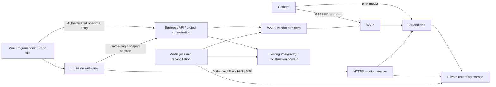

# Cloud construction video development plan

Chinese mirror: [cloud-construction-video-plan.zh-CN.md](./cloud-construction-video-plan.zh-CN.md)

Updated: 2026-10-23. Status: **Non-recording development acceptance complete; overall Limited. CV-02 recording capability verification is current.** Binding, live video, snapshots and guarded PTZ software are integrated. The user confirmed card insertion, but the camera still reports no usable SD card. No production rollout is authorized.

## 1. Current delivery

| Field | Value |
| --- | --- |
| Current ID | CV-02: SD capability verification; readable card/historical media still unavailable; Limited |
| User outcome | Staff open Cloud site → project → site video for live viewing, snapshot history and confirmed supported PTZ; no recording entry |
| Confirmed direction | **Mini Program `web-view` + H5 player**, mpegts.js1.8.2/FLV, hls.js1.6.13/MSE and native HLS fallback; no dependency on `live-player` permission |
| Reused foundations | WVP/ZLMediaKit, batch onboarding, verified H5 test player, construction projects/members/customer relationships, tenant authorization and media conventions |
| Actual state | CV-01/CV-03 non-recording development and bounded acceptance complete: actual FLV/HLS, private snapshots, native entry/reentry/error recovery. Physical PTZ remains unproven and disabled for this camera. Live/snapshot checks pass after its reboot; SDStatus remains -1/capacity0 and WVP has0 recordings. Isolated development only, no production deployment |
| Completion checks | 11 database/adapter and19 Mini tests; scoped typing/lint/H5 syntax pass.5 Stable native and6 real media HTTP checks pass. Source/configuration bindings and the previous full-build limitation are below; these do not prove physical PTZ or WeChat-device decoding |
| Unverified | SD recording/playback, continuous cloud recording/cleanup, physical PTZ, production HTTPS/domain, WeChat physical devices, public4G and soak operation; card detection blocks only SD |
| Next ID | CV-02: independently develop wired cloud recording and the approved playback entry; verify SD playback after readable recordings exist. CV-04 soak/capacity checks remain unverified |

On 2026-10-22 the user approved the single-video H5 layout/cloud-site palette, removing source-address/diagnostics and adding selection, snapshot history and PTZ, without a recording entry. On2026-10-23 the user authorized continuation and confirmed card insertion; non-recording native acceptance is complete and CV-02 capability verification resumed. The user additionally approved keeping that layout/palette, adding live/playback selection below the player, with date, actual recording-segment selection, return-to-live and existing empty/error feedback. This is the CV-02 visual/implementation source. SD capability still requires actual evidence; empty history or backend APIs alone do not complete a user-facing delivery.

### 1.1 Current implementation contract (overrides unimplemented full-product specifications below)

- Admin `/construction-projects` adds a video tab to the existing Drawer. Platform managers allocate WVP channels within the selected enterprise; owners/managers bind/unbind; owners including inherited admin/super_admin rights configure PTZ. Platform accounts need no enterprise employment/project membership.
- Staff enter `packages/construction/projects/projects` → `packages/construction/camera/camera` under existing construction permissions. Customer entries and separate member capture/PTZ grants remain future scope; the later target permission matrix is not implemented evidence.
- Actual staff API prefixes are Admin `/api/construction/video` and Mini `/api/miniprogram/construction/video`, with `register`, `inventory`, `projects/:id/{inventory,cameras,binding,configure,entry}`. Independent H5 APIs: `/api/construction-camera/{exchange,state,heartbeat,stop,live,snapshots,ptz}`, image `/snapshots/:id`; gateway `/camera-media/:generation/*`.
- Migration0090 adds six forced-RLS tables for devices,bindings,entries,sessions,snapshots,STOP obligations; composite enterprise/project relationships and tenant cleanup are retained. Private JPEG bytea snapshots are limited to4MiB with durable pending/ready/failed and idempotency; every read rechecks access. Only latest30 are listed; automatic snapshot retention is not implemented. Future three-day video retention does not describe these snapshots.
- Entry30s; HttpOnly/SameSite=Strict cookie, CSRF and same-origin mutations; session/view lease60s, heartbeat20s, absolute4h. Media checks every request and every5s during streaming; unbind invalidates old generations. Hidden/exited pages close this viewer's transfer; existing WVP/ZLM no-reader lifecycle controls upstream reclamation. Pure4G disconnect timing is unverified; continuous recording settings are unchanged.
- PTZ defaults off; directions/STOP only,300ms pulse then STOP, durable2s STOP obligation and500ms gateway recovery checks. HTTP timeout800ms is not a physical-stop guarantee. No zoom/presets/private-SDK fallback. Actual device movement remains unproven and must not be labelled verified.
- Evidence: `tmp/cloud-camera/checks.log`, `verification.json`, `live-http.json`, `ptz-real.json`, `h5-hls.png`, `native.json`. All5 Stable2.02.2608080/SDK0.13.0/base3.17.2 native checks pass: exact project/window/secondary monitor, fresh compile/live data, actual project button→authorized WebView, fresh entry on reentry, denied/cleared media/visible retry. PNG348×752 corresponds to logical390×844. Customer access, WeChat physical devices/domain/HTTPS, pure4G, soak and production remain unverified.

### 1.2 Configuration and repeatable checks

The2026-10-23 bounded `verification.json` binds192 source/test files without drift:11 service/adapter,19 Mini, scoped types0 diagnostics, lint/H5 syntax pass. `native.json` independently binds200 sources/drivers/configurations with no drift and5 passing checks. Actual screenshots were inspected. Earlier launch-window captures are invalid; current SDK captures follow exact project title/path/coordinate checks and restoration on the secondary monitor.6 real media HTTP checks pass, including post-reboot FLV/HLS segments, anonymous denial, fresh1920×1080 snapshot persistence/idempotency and old-generation denial after stop.

The original shared-database gateway STOP watchdog raced mocked PTZ recovery/unbind tests and produced2 failures. Preserve `verification-20261023-shared-db-failure.json` and `checks-20261023-shared-db-failure.log`. Mocked tests now use dedicated `cloud_camera_unit_eval`; real app/gateway/native fixtures retain `cloud_camera_eval`. All11 pass after isolation without weakening assertions or rewriting failures. Existing Admin enterprise→project→video/PTZ-off persisted reentry evidence in `admin-video.png` remains valid. Physical movement remains unproven; this camera defaults off.

The previous full `NEXT_DIST_DIR=.next-camera-build next build --webpack` compiled in103s, then failed on the existing invalid `AiDesignerLegacyPage` route export in `ai-studio/designer/page.ts`. This run did not edit that page or repeat the full build. The13 video typecheck roots/dependencies have0 diagnostics; a full-build pass is not claimed. Original WXML-cache/minimized-window failures remain preserved. Fresh compilation, exact window restoration and SDK captures now pass bounded native acceptance, without claiming WeChat physical-device decoding.

1. Apply0090 only to an authorized database; Next and the separate gateway share `DATABASE_URL`. Run the Node/tsx gateway using `cd admin && npm run camera:gateway`; it has not been added to production Docker automatically.
2. Server-only variables: `CAMERA_WVP_ORIGIN`, `CAMERA_MEDIA_ORIGIN`, `CAMERA_WVP_USERNAME`, `CAMERA_WVP_PASSWORD`. Production `CAMERA_PUBLIC_ORIGIN` requiresHTTPS; `CAMERA_APP_ORIGIN` is internal Next, gateway port defaults3017 and bind host127.0.0.1. Reverse-proxy the video domain to the gateway without media buffering; restrict original WVP/ZLM ports internally. Register the HTTPS Mini business domain before real-device use.
3. Real isolated app/gateway use `127.0.0.1:55432/cloud_camera_eval`, app3018/gateway3017, preserving3006/production. `construction-camera-check.mjs` creates/migrates dedicated `cloud_camera_unit_eval` for11 mocked service/protocol checks, separate from the real STOP worker. `npm run check:camera` checks scoped types. With `CAMERA_LOCAL_WVP_ENV` pointing at the authorized WVP `.env`, `construction-camera-local.mjs`/`--gateway`/`--fixture` start the corresponding services/labelled fixtures. Credentials remain only in ignored `tmp/cloud-camera/fixture.private.json`; never commit/share it.
4. `construction-camera-live-check.mjs` verifies real playback/segment authorization/snapshot; `construction-camera-native.mjs` reuses Stable serially. `construction-camera-ptz-check.mjs` sends real short pulses and is only for an authorized test camera. Drain STOP obligations before shutdown. Roll back the business entry while retaining private snapshot tables; data deletion is not the rollback procedure.

## 2. Evidence and existing roadmap relationship

- [添加摄像头到 WVP](codex://threads/01a16235-d88b-73e3-81af-e01333b5f8bd) records LAN discovery, shared-credential batch onboarding, persistent numbering and successful one-channel playback for `192.168.10.80`. Batches support up to 100 devices, currently NZ-compatible firmware. That is not a video concurrency benchmark.
- [梳理摄像头对接文档](codex://threads/01a151c3-85dd-7e21-868f-dfaffd8d6368) records the user's lack of `live-player` permission, selection of H5 + `web-view`, and enterprise/individual-business subject confirmation. `G:/workspace/向总/camera/test/README.md` records actual desktop FLV/native-HLS playback and switching at 1920×1080 on 2026-10-19. WeChat physical-device playback and HTTPS business domains remained unverified. The latest historical message records stopping WVP; this task did not restart media acceptance.
- Reuse `G:/workspace/向总/camera/test/h5/{index.html,player.js,style.css}`, locally distributed `vendor/mpegts-1.8.2.js` and its license, and the test project's `miniprogram/pages/webview/` shell. Pin source hashes and dependencies before integration; remove hardcoded LAN URLs and testing diagnostics. The test player is not production authorization or an approved product visual design.
- WVP lives at `G:/workspace/向总/wvp`, pinned to commit `3fcd3ae80c30c95aeb82ef830af439a835257067`, image `wvp-stack/wvp:2.7.4-3fcd3ae`. Its `scripts/versions.psd1` pins ZLM by digest. Historical server-side JPEG capture exists; continuous recording, cleanup and PTZ have no acceptance evidence under this plan.
- Current `config/application.yml` sets `record-sip` and `record-push-live` false and `record-day: ${RECORD_DAYS:7}`. The latter is a media-node setting. **Retention configuration neither starts continuous recording nor implements per-camera policy.**
- The product already has `/construction-projects`, `packages/construction/projects/projects`, construction chat and public photo sites. Actual construction persistence is PostgreSQL/Drizzle with tenant transactions/RLS, as shown by `admin/src/db/construction-schema.ts`; do not create another MongoDB camera domain because older general instructions mention Mongoose. WVP retains its own MySQL/Redis.
- This plan details the video portion of XiaoK roadmap P4C. Rental orders, historical prices, deposits, 90-day service periods, refunds and after-sales do not enter this scope automatically. **Three-day recording retention is separate from service duration.** No Agent tool, automatic model ingestion of video or expansion of P4B public sites is included.

### 2.1 Current SD-card verification

The user's condition is: **verify actual SD query/playback through WVP, then adopt cloud recording on wired networks and SD recording on4G.** This remains unmet. Empty history or successful control acknowledgements prove neither playback support nor absence of support.

Preserve the2026-10-22 no-card evidence in `tmp/cloud-camera-sd/verification.json`. On2026-10-23 the user confirmed this camera has a card but had not rebooted. `frmIotRecordCfg` reported `SDStatus=-1/SDInfo=0/SDFreeSpace=0`; clock was correct. One `frmDeviceReboot` was accepted and the camera re-registered at11:17. DHCP moved its management address from `192.168.10.80` to `192.168.10.81`. Its actual SIP TCP peer and original serial identity were checked; no channel or binding was recreated.

The new address still reports SDStatus-1/capacity0. WVP device `34020000001320000003`, channel `34020000001320000004` returns code0 and0 device recordings for the current day. A15s GB28181 manual-record attempt and finally StopRecord were both acknowledged with code0, but no nonempty recording appeared. The user then explicitly authorized formatting. The firmware UI's SD-specific `frmHDFormat`, Type1, `FormatList:[1]` was attempted and rejected; formatting did not complete and no second reboot occurred. No historical playback/factory reset/recording-plan change occurred; protocol acknowledgement is not proof of writing SD. Latest format failure: `probe-20261023T032946Z.json`; original reboot/manual-record/new-IP status evidence: `probe-20261023T031622Z.json`, `probe-20261023T032057Z.json`, `probe-20261023T032739Z.json` in the same directory. Post-reboot live/snapshot checks pass; SD remains blocked on card detection.

`admin/scripts/construction-camera-sd-probe.py` reuses local onboarding authentication and requires the original serial identity before device reboot/formatting. `--camera-ip` selects the DHCP address already identified from the actual SIP connection. Default is read-only. Explicit test actions are `--reboot`, `--record-seconds 5..60` with finally StopRecord, and `--format-sd` only after explicit user authorization. Credentials stay in ignored storage. Once hardware is readable, create a short recording, query a nonempty interval, start playback, verify decoded frames/time advancement and stop the owned session. No user playback hand-test is required; seek/speed remain separate checks.

If that succeeds, the existing authorization permits revising both plans directly: **wired sites retain continuous cloud recording with configurable three-day retention; 4G sites record continuously on SD and upload media only during live/historical viewing, disconnecting after exit**. Snapshots/selected clips can be saved independently. Available SD history follows actual device indexes/card capacity rather than a cloud three-day physical-deletion promise. Local recording can continue offline while remote access cannot. Public-network 4G compatibility remains a separate verification. Until then, the continuous-cloud specifications below remain the original proposal; dual-mode recording is conditional on evidence.

## 3. Scope and proposed defaults

| Capability | First release | Completion |
| --- | --- | --- |
| Live | Project camera list, single-camera video, switching, mute, fullscreen, reconnect and online state in H5 | Actual playback for authorized users; IDs and stale URLs do not grant unauthorized access |
| Recording/playback | Continuous server ingestion, segmented MP4, date/time lookup, seeking, segment continuation and return to live | Records without viewers; survives reentry; gaps are truthful; expired segments become inaccessible and are deleted |
| Snapshot | Server-generated current-stream image, timestamp/camera identity, private project persistence and history | Actual fresh decoded image, not a phone screenshot or stale thumbnail; recoverable, idempotent writes |
| PTZ | Supported directions/stop and verified zoom | Real action and stopping, with leases for page exit, lost connection and competing operators |

Proposed defaults: once recording is enabled, run continuously, retain a rolling **72 hours**, use **5-minute** segments and run cleanup every **10 minutes**. Show actual playable ranges; do not promise pre-enable footage or recovery of disconnected periods.

Policy is enterprise default plus optional camera override. Proposed initial bounds are integer 1–30 days, default 3, constrained by platform capacity; these bounds can be adjusted before implementation. Increasing retention cannot restore deleted files. Reducing it displays the affected scope before an explicit save. Recording enablement is separate; 0 must not mean both off and forever.

Delete only expired, finalized segments. Boundary segments may be retained to preserve valid frames; target physical deletion lag is one segment plus one scan interval, approximately 15 minutes by default. Playback authorization still enforces the retention window. Permanent retention, large exports, scheduled snapshots, patrol, intercom, AI analysis and anonymous live viewing are out of the first release.

## 4. Architecture and H5 integration

### 4.1 Viewing flow

1. Staff use Mine → construction sites → project → cameras. Customers use their own authorized project entry. Knowing an ID is not authorization; do not turn existing staff-only construction APIs into unrestricted customer endpoints.
2. Proposed Mini shell: `packages/construction/camera/camera`; proposed H5 route: `/construction-camera`, outside the Admin login layout and using its own scoped camera session. These names are proposals, not existing routes.
3. Mini uses its bearer identity to obtain a short-lived, single-use entry code bound to user, enterprise, project, camera/binding revision and purpose. H5 exchanges it through POST. Never place the long-lived Mini JWT, camera credentials, WVP token or ZLM secret in URLs.
4. Prefer one HTTPS origin for H5, related APIs and media. Pass the entry code in a URL fragment and remove it after exchange; no third-party analytics scripts; `Referrer-Policy: no-referrer`. Use Secure/HttpOnly cookies, Origin/CSRF checks for mutations and no reuse as an Admin session.
5. Reuse verified capability detection: mpegts.js 1.8.2 for FLV with supported MSE live playback, optional native HLS where supported. Reconnect/switch with explicit bounded behavior, never infinite retries or silent duplicate streams. Do not assume identical iOS/Android WeChat support. A player replacement or hls.js addition is not a prerequisite.
6. Put camera switching, playback timeline, snapshots, PTZ and feedback inside H5, without relying on native controls over `web-view`. Use `postMessage` only for non-realtime notifications; controls call H5-authenticated APIs directly. Refresh, reentry and identity/enterprise changes revalidate access. Page inactivity releases viewing leases and stops PTZ.
7. Protect FLV, HLS manifests and every segment, MP4 Range and snapshot images, not merely the H5 page. Block origin bypass, anonymous listing and cache leaks. Revalidate long-lived access and terminate the affected viewer connection after revocation; proposed propagation target ≤30 seconds, without stopping other viewers or recording.
8. Proposed entry-code lifetime: 30 seconds; playback token: 60 seconds, finalized in CV-01. Reentry obtains fresh authorization. Account/project disablement, binding moves and access revocation invalidate subsequent access. Already delivered bytes cannot be remotely recalled.

### 4.2 WVP and vendor responsibilities

Prefer APIs verified in the pinned WVP source. These are upstream candidates, never unrestricted client proxies:

| Purpose | WVP / ZLM source interface |
| --- | --- |
| Inventory | `/api/device/query/devices`, `/api/device/query/devices/{deviceId}/channels` |
| Live | `/api/play/start/{deviceId}/{channelId}`; stop only after checking recording and other viewer leases |
| Recording plans | `/api/record/plan/{add,link,get,query,update}`; assign all-day channel plans |
| Cloud recordings | `/api/cloud/record/{date/list,list,play/path,loadRecord,seek,speed}` |
| Snapshot | WVP `/api/play/snap` or ZLM `/index/api/getSnap`, with freshness/output validation |
| PTZ | `/api/front-end/ptz/{deviceId}/{channelId}`, mapped against pinned source and actual firmware |
| Recording events | ZLM `startRecord`, `isRecording`, `on_record_mp4`; prefer WVP plans and avoid a competing start/stop loop |

The supplied [Slink IPC documentation](https://www.eolink.com/share/inside/98608ece654780d9b0b46bb615ccb020/api/-1) was opened and inspected:

- [Capture `/CaptureV2`](https://www.eolink.com/share/inside/98608ece654780d9b0b46bb615ccb020/api/2767966/detail/52909562) includes `Type/Ch/Dev/Data`, binary/base64 `DataType`, and main/substream `StreamNo`. Use as a supplemental path only when device HTTP is reachable and verified.
- [PTZ `/frmPTZControl`](https://www.eolink.com/share/inside/98608ece654780d9b0b46bb615ccb020/api/2767990/detail/52909734) includes `Cmd`, `IsStop`, and `Speed` documented as 1–10. Step/preset/capability APIs also exist. Do not infer all directional codes from a sample number; confirm command mapping and firmware behavior.
- [Digest example](https://www.eolink.com/share/inside/98608ece654780d9b0b46bb615ccb020/doc/-1/detail/684449) documents `/digest/frmUserLogin` and a specific User-Agent. Existing onboarding also supports X-Digest and `goform/` firmware paths. Reuse verified adapters; keep credentials server-side.
- GB28181 registration does not make a camera's private HTTP/RTSP reachable from the cloud. Prefer GB28181 for public/4G operation; vendor HTTP requires an available gateway/VPN or established vendor relay. SD-card `/frmVideoRecordsQuery` is not the server-side three-day recorder.

Preserve existing WVP ZLM Hooks. Add reliable event forwarding/reconciliation when needed; do not replace callbacks and break WVP lifecycle/indexing. Gateway/ZLM transport media; Next.js does not proxy every video byte.

## 5. Data, authorization and services

Proposed construction-domain records; allocate migration numbers at implementation time:

| Record | Important fields |
| --- | --- |
| `construction_cameras` | Enterprise, media node, WVP device/channel IDs, serial reference, name, last online time, verified capabilities; credentials referenced from server configuration |
| `construction_camera_bindings` | Enterprise/project/camera, binding start/end/revision; only one active project binding per channel |
| `construction_camera_policies` | Enterprise default/camera override, recording switch, retention days, revision and applied/error state |
| `construction_recordings` | Immutable binding ID, stream generation, upstream record ID, start/end, private storage key, bytes, verification, ready/deleting/deleted/missing state |
| `construction_camera_snapshots` | Binding, idempotency key, capture/acquisition time, actor, media-asset reference and state |
| Sessions/jobs/audits | Viewing/PTZ leases, one-time entry, idempotency and retry/unknown outcomes, reusing durable-task/audit patterns without the model Worker |

Use tenant transactions/RLS and composite enterprise/project relationships. Admin uses `withTenantRoute` and `isEnterpriseManagementRole`; Mini uses current signed identity and construction authorization. Selected-enterprise admin/super_admin inherit owner management rights without requiring project employment.

Proposed permission defaults, finalized with the business/design contract:

| Actor | Live/playback | Snapshot | PTZ | Binding/policy |
| --- | --- | --- | --- | --- |
| Enterprise owner, selected-enterprise admin/super_admin | Enterprise-authorized devices | Yes | If supported | Yes, for devices assigned to the enterprise |
| Current project manager | Managed projects | Yes | If supported | Project placement only; no enterprise transfer or retention-limit change |
| Current designer/construction member | Active member projects | Explicit project grant | Off by default; separate grant | No |
| Customer | Own project with video access enabled | Off by default; separate grant | Off by default; separate grant | No |
| Public/guest | No | No | No | No |

Platform provisioning assigns devices to enterprises first; an arbitrary WVP ID cannot claim another tenant's camera. Moving a camera revokes old sessions/control, finalizes the active segment, increments binding epoch and creates the new binding. Old recordings/snapshots remain with the original project; late callbacks cannot attach them to the new project.

### 5.1 Recording and deletion

- WVP plans keep channels streaming continuously. Reconciliation checks online/media/recording state and latest finalized segment. Verify actual `on_stream_none_reader`/`mp4_as_player` behavior, not just parameter names.
- Restore intended recordings after restarts with backoff and explicit outage intervals. Closing a viewer only releases its lease. Distinguish enabled, recording and interrupted; accepted configuration is not proof of recording.
- WVP/ZLM create media; the business index owns tenant/history/retention authorization. Deduplicate reordered callbacks and reconcile missing events/files. Store no video blobs in SQL, `design-references/` or public uploads.
- **One physical-deletion owner.** Per-camera policy uses a business cleanup worker for claimed, finalized records through verified WVP deletion APIs, synchronizing upstream indexes. Disable node cleanup or set a ceiling that cannot delete earlier than any valid policy; verify the meaning of 0 first. Do not alter unrelated shared-node retention; isolate a node/volume when necessary.
- Claim → deleting → physical removal → deleted must be retryable/idempotent. Database expiry is not file deletion. Check finalization, valid playback leases and allowed storage roots, including temporary/HLS derived files. Expose deletion backlog and failures.
- Proposed capacity alerts: 80%/90%; critical space stops new recording with visible failure instead of silently deleting promised-window footage. Estimate capacity before policy saves; audit interruptions, recovery and gaps.
- Store UTC, display Asia/Shanghai, and distinguish camera clock/source timestamp/server time. Handle midnight, keyframe seeking offsets, gaps and segment boundaries truthfully.

### 5.2 Snapshots and PTZ

Capture primarily from the current stream and validate device/channel, decoding and freshness after the request. A temporary controlled live lease can be used when no stream exists, then release only that lease. Persist private media before returning a durable ID; reenter unknown requests by their existing task. Proposed snapshot retention follows camera policy. Future explicit promotion to a construction record creates an independent asset governed by that record's publication/retention contract; never publish automatically.

One short PTZ lease per camera; sequence and deadline each command, reject stale movement and prioritize STOP. Stop on `pointerup/pointercancel`, blur, hiding and exit; the server also sends STOP after client heartbeat loss (proposed ≤2 seconds, fixed after actual testing). An unreachable device/WVP link cannot establish physical stopping: report unknown and send STOP first on recovery. Prefer bounded steps/device motion timeouts where supported, and clear expired control leases first after a service restart. STOP cannot wait behind ordinary jobs. Timeout is unknown, not a blind movement retry. Expose only verified capabilities; fixed cameras have no actionable PTZ. Presets/zoom require separate capability validation.

## 6. Proposed API and code locations

These are proposed names, not existing endpoints:

- Extend `/construction-projects` with camera management and `/api/construction/projects/:projectId/cameras` for bindings/policy. Platform configuration owns media nodes and enterprise allocation. Use revision checks, idempotency and shared operation feedback.
- Mini entry: `POST /api/miniprogram/construction/projects/:projectId/cameras/:cameraId/entry`. Resolve staff/customer contexts explicitly using their existing scopes; preserve staff-only boundaries elsewhere.
- H5: `POST /api/construction-camera/session/exchange`; scoped `cameras`, `live-sessions`, `recordings?from=&to=`, `playback-sessions`, `snapshots`, `ptz/lease`, `ptz/command`, `ptz/stop`. Resolve enterprise/binding server-side; never trust client-supplied upstream URLs/channels/paths.
- Media gateway accepts opaque authorized resource IDs and handles FLV/HLS/MP4/images, Range, content types, Origin/CORS and caches. Exiting cancels only the caller's viewing/control session.
- Implement in `admin/src/lib/construction/`, dedicated WVP/Slink adapters, `admin/src/db/` migrations, Admin project camera area, independent H5 page, Mini `web-view` shell and durable media reconciliation process.

## 7. Delivery stages and acceptance

| Stage | Usable outcome | Bounded checks | Estimate |
| --- | --- | --- | --- |
| CV-00 Baseline/design | Verified player/capability foundation, H5 designs/shared states and authorization contract | Pin versions, inspect PTZ/recording capabilities, register domain/HTTPS status, deletion ownership and design mapping | 1–2 person-days |
| CV-01 Binding/live | Admin binds devices; Mini opens authorized project H5 for viewing/switching/reentry | Real binding readback, single-use exchange/replay rejection, FLV/HLS playback/switching, offline recovery, tenant/revocation/stale-link denial, independent viewers | 3–5 person-days |
| CV-02 Recording/playback | Record without viewers; date/time playback and configurable three-day retention | Finalized files/indexes, cross-segment/day/gaps, worker/media restart, 72-hour policy and overrides, staged deletion/failure, Mini entry/feedback/reentry | 4–6 person-days |
| CV-03 Snapshot/PTZ | H5 snapshot history and authorized supported control | Fresh persistent image/idempotency/reentry, offline/permission failure, PTZ start/stop/blur/network/competition/stale commands, unsupported capability branch | 3–5 person-days |
| CV-04 Operations/handoff | Visible recording/online/storage health and recoverable failures | Single/multiple streams, real soak recordings, cleanup/alerts, disconnect/restart, end-to-end authorization, H5 and Stable entry regression, docs/deployment rollback plan | 2–4 person-days plus passive observation |

Serial estimate: **13–22 engineering person-days**, assuming reuse and supported devices, excluding passive waits for design/domain/network and actual 72-hour observation. This is not a delivery-date commitment. Live can ship as a development stage before rental/payment/after-sales.

Use labelled synthetic enterprises/projects/members and dedicated test bindings in approved development databases. Actual footage stays private. Every user-facing stage includes a Mini entry, real service writes/readback, visible feedback, persisted reentry, permissions and recovery. Stable DevTools uses the existing single controller, lock and verified window workflow, never a copied temporary Mini project.

Reuse valid FLV/HLS evidence; test changed H5 sessions, media authorization, playback and control. Browser automation establishes H5 playback; Stable establishes entry/routes/sessions/business states. Missing WeChat-container, iOS/Android, public-network/4G evidence remains explicitly unverified: **no routine user hand-test requirement or blocker for independent development, and no release claim**. Accelerated-clock/aged-fixture retention checks and actual recorder soak evidence are distinct.

Bind source/tests/drivers/media versions/configuration/firmware before and after runs. Keep failures and unknown outcomes. Observe at least 24 hours of recording; only actual evidence can establish the complete 72-hour continuous window and natural expiry, not a short smoke test. Continue authorized stages after their checks without a manual screenshot approval gate.

## 8. Capacity

Using actual average bitrate, decimal GB, excluding additional audio/container/redundancy: `GB/day = Mbps × 10.8`; `GB/three days = Mbps × 32.4`.

| Per-camera bitrate | One day | Three days | Three days +25% |
| --- | --- | --- | --- |
| 1 Mbps | 10.8 GB | 32.4 GB | 40.5 GB |
| 2 Mbps | 21.6 GB | 64.8 GB | 81 GB |
| 4 Mbps | 43.2 GB | 129.6 GB | 162 GB |

Five 1 Mbps cameras need about 162 GB of three-day footage, roughly 203 GB with reserve; five 2 Mbps cameras about 405 GB with reserve. Continuous 1 Mbps upload consumes about 324 GB per 30 days regardless of keeping only three days. Site upstream is the sum of all recording streams; server viewing egress additionally scales with concurrent viewers, plus protocol/variation reserve.

Start with verified H.264. Device/approved service policy determines bitrate; do not silently reconfigure encoding. Historical P4C's maximum two streams at ≤1 Mbps is not a server benchmark or the aggregate budget for recording every camera continuously. Size CPU/RAM/storage after CV-00 measurements; avoid transcoding unless incompatibility justifies its cost.

## 9. Design, documentation and deployment boundaries

- The existing approved site mapping uses `design-references/construction-workflow/cloud-site/manager.png`, with `owner.png` as the customer reference. Both prompts explicitly exclude CCTV/live-stream UI. Inherit branding/navigation, not a false approval for video controls.
- Add one H5 live main design, a material playback variant and shared snapshot/PTZ/error/revocation states. Calibrate the 390×844/source canvas relationship and actual `web-view` viewport; single portrait stream with responsive/fullscreen treatment. No screen-per-error requirement or automatic four/nine-camera wall.
- Future implementation uses draw-ui after reading calibration/implementation references. Generate independent artwork if required; never slice composite screenshots. Reuse test media logic, while obtaining explicit product design source and implementation authorization.
- Update both Admin/Mini module inventory languages each stage. Update the single current restoration-ledger row once affected visible routes are implemented, and the bilingual Admin refactor contract when applicable. Unfinished capabilities remain Limited/Placeholder.
- This change only adds the bilingual plan. No route/API/data/permission/UI behavior changed, so runtime inventories and restoration completion states remain unchanged; unrelated dirty work is excluded.
- Read the bilingual remote-development contract before remote work. Production H5 business-domain/HTTPS and same-origin media checks cannot be replaced by disabling domain validation. This plan does not deploy, purchase, initiate production recording or expand network exposure.

## 10. References and review performed

- [WeChat web-view](https://developers.weixin.qq.com/miniprogram/dev/component/web-view.html): subject/business-domain/embedding and messaging constraints; business domains differ from request domains.
- [mpegts.js](https://github.com/xqq/mpegts.js): use the verified local 1.8.2 baseline; upgrades require separate validation.
- [Pinned WVP source](https://github.com/648540858/wvp-GB28181-pro/tree/3fcd3ae80c30c95aeb82ef830af439a835257067): local PlayController, PtzController, DeviceQuery, RecordPlanController, CloudRecordController and MediaConfig reviewed.
- [ZLM REST API](https://docs.zlmediakit.com/zh/guide/media_server/restful_api.html) and [Hooks](https://docs.zlmediakit.com/zh/guide/media_server/web_hook_api.html): recording, snapshots, lifecycle and media/HTTP authorization; pinned deployment behavior remains authoritative.
- Reviewed: both referenced chats, WVP/player documentation and relevant source, current construction data/identity/routes, bilingual module entries, design prompts and vendor capture/PTZ/auth pages. Added online-state verification and one real WVP device-record query, detailed in 2.1; actual SD recording/playback and product integration acceptance remain unperformed. Documentation checks are reported in the handoff.
