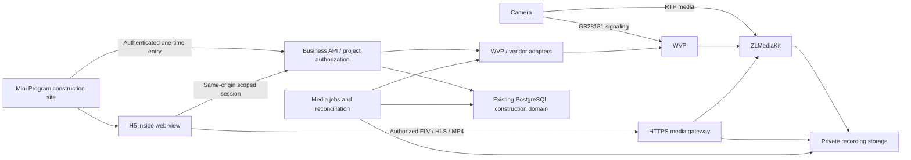

# Cloud construction video development plan

### 1.5 Read-only retention capacity preview (Implemented, independent of the running soak)

- Entry/design: existing `/construction-projects` → project Drawer → video → recording settings; reuse approved Ant Design Modal/Form/Alert. Only the body scrolls at short viewports; width520,1280×720 footer bottom656 and modal bottom700, no horizontal overflow. Mini/H5 markup, assets, routes and restoration ledgers are unchanged.
- GET `/api/construction/video-capacity/projects/:projectId/bindings/:bindingId` uses the shared tenant transaction and existing camera access. Only enterprise-owner management roles, including admin/super_admin in the selected enterprise, can read; manager/member, foreign project/binding and retired binding are denied. Query arguments are rejected; no mutation endpoint, WVP calls, schema or migration.
- Rate uses up to12 latest ready sealed segments in the last24h for the active binding, summed bytes divided by summed actual durations; require60s. Stale/future/missing/deleted/deleting samples do not supply bitrate. Unknown is null. Integer-safe decimal GB/day and selected1..30-day budget include a separate25% planning reserve. The UI retains this node's existing1..7-day saving bound; preview changes do not save or enforce a quota. Indexed stock and pending/failed deletion counts are read-only; no raw media paths/errors are exposed. This is not a prediction of remaining recording duration.
- Evidence: `tmp/cloud-camera/capacity-check-2026-10-23T08-48-34-399Z.{json,log}`:9/9 in isolated `cloud_camera_capacity_eval`,57 stable source/config bindings. `capacity-http-2026-10-23T08-49-51-910Z.json`:6/6 actual HTTP checks,54 stable bindings, policy before/after enabled/3days/version39.28-root typing and feature lint pass. Full lint still fails only pinned hls/mpegts distributions (161 errors); build compiled then existing `AiDesignerLegacyPage` export blocked type validation. Original effect-reset lint failure was fixed; the HTTP helper's first default-import attempt failed before requests and its named-import run passed.
- UI evidence: `tmp/cloud-camera/admin-capacity-estimate-3days.png` and `admin-capacity-estimate-7days.png`; actual0.910Mbps/~9.8GB/day,3days29.5GB/36.9GB with reserve,7-day unsaved preview68.8GB/86.1GB. Cancel/reentry restored3; loading/insufficient/error-retry use the same Alert and do not disable existing saving. A snapshot, not a fixed future bitrate.
- The running74h run's46 frozen source/config files, writer policy39/period33, F-drive mount and recorder/probe images remain unchanged. First hourly sealed private playback returned206 and anonymous401;24/72h/natural expiry remain pending. The readonly feature's new files are outside that binding. Keep SD operations paused; remaining writer/defaults/grants/snapshot-retention work that changes frozen dependencies waits for a stable acceptance boundary.

Chinese mirror: [cloud-construction-video-plan.zh-CN.md](./cloud-construction-video-plan.zh-CN.md)

Updated2026-10-23. **Cloud recording/private playback, recovery, capacity protection and read-only retention estimates have bounded development evidence; overall Limited.** Actual74-hour acceptance continues on the user's approved F drive;24/72h/natural expiry pending. The unsafe earlier G-drive run was safely stopped and excluded. SD remains paused;no production rollout.

## 1. Current delivery

| Field | Value |
| --- | --- |
| Current ID | CV-04 capacity alarms/low-space protection and read-only retention capacity preview bounded Implemented; actual74h soak continues. Recovery/history evidence reused;SD paused |
| User outcome | Owners manage recording/retention and preview measured daily/selected-day storage plus cleanup backlog in the existing project recording settings; staff retain the existing H5 live/private-playback journey and persisted reentry |
| Direction/foundation | Mini web-view + H5,mpegts.js1.8.2/FLV,hls.js1.6.13/MSE/native HLS;existing WVP/ZLM,construction projects/members/tenant policy,no live-player dependency |
| Actual state | Recorder/probe share verified F:/SmartFloorPlannerCamera/media/record;20 originals hash-identical,old volume retained. Actual74h run 2026-10-23T07-33-15-912Z,PID564360,policy39/period33,recording2026-10-23 07:33:22UTC,expected2026-10-26 09:33:22UTC. Actual physical headroom≈193.7GiB,not virtual810GiB.24/72h not yet passed |
| Checks | Capacity preview:9 calculation/isolated database checks with57 stable bindings;6 actual3018 HTTP checks with54 stable bindings;28-root typing and scoped lint pass;3→7-day preview/cancel/reentry3 verified at1280×720. Prior37 service/adapter,19 Mini,3 probe,6 F-capacity and5 Stable native results reused for unchanged recording/H5/Mini scope.74h still running;not24/72h acceptance |
| Unverified/unimplemented | 24/72h/natural expiry pending;SD,multichannel,enterprise defaults,customer grants,snapshot retention,physical PTZ/power/network and WVP/ZLM restart,HTTPS/domain,WeChat devices/public4G/production. In-app capacity alerts have no email/SMS/push or remaining-duration forecast |
| Next ID | Observe this actual74h run with hourly same-chat automation-4;collect24/72h,private playback,natural physical expiry and final coverage before closure. Stop only the unchanged owned policy;then assess remaining CV-04. SD after replacement;no production/4G enablement |

Design/implementation source: the user approved single-video H5/cloud-site palette,selection,snapshot history/PTZ and removal of source/diagnostics on2026-10-22,initially excluding recording. On2026-10-23 they explicitly approved live/playback selection below the player,date,actual segments,return-to-live and existing empty/error feedback. Preserve that hierarchy/palette,no screenshot slicing/new artwork;Admin uses the bilingual Ant Design/refactor contract. Empty queries/APIs alone do not prove SD support.

### 1.1 Current implementation contract (overrides the unimplemented full proposal below)

- Admin `/construction-projects` video Drawer: platform managers allocate verified WVP channels in the selected enterprise;owners/managers bind/unbind,capture and use enabled PTZ;only owner-management roles save PTZ/recording settings,including inherited admin/super_admin without employment/project membership. Ordinary active members view;customer grants remain unimplemented.
- Mini `packages/construction/projects/projects` → `packages/construction/camera/camera` → H5 `/construction-camera`.30s single-use entry;independent HttpOnly/SameSite=Strict cookie/CSRF same-origin session,60s session/view leases,20s heartbeat,4h absolute. Hidden/exit closes this viewer;reentry obtains fresh entry,late entries discarded.
- Staff APIs: Admin `/api/construction/video`,Mini `/api/miniprogram/construction/video`,`register`,`inventory`,`projects/:id/{inventory,cameras,binding,configure,recording,entry}`. POST recording is owner-management only,versioned/idempotent for identical settings,default off/3days,integer1..node maximum(current7),never beyond WVP retention;managers/members cannot start continuous uploads. Keep4G off;SD unavailable.
- H5 `/api/construction-camera/{exchange,state,heartbeat,stop,live,snapshots,ptz,recordings/query,playback}`,private `/snapshots/:id`;live gateway `/camera-media/:generation/*`,private MP4 `/camera-recording/:generation/:recordingId.mp4`,single Range/HEAD,no source URL/path/credentials. Every request/every5s of transfer rechecks project/lease/generation/retention;revocation,stop/switch invalidate old media.
- 0090 owns six forced-RLS camera/binding/entry/session/snapshot/STOP tables;0091 adds policy/sealed-record tables and composite session recording_id FK. Import belongs to the original binding/enabled interval;history remains in the original project after camera moves,cross-binding files are quarantined,retired policies do not interfere with the next writer,and foreign plans are preserved.
- 0092 adds forced-RLS recording periods and durable index sweep cursors. Reenabling creates a new owned period;previous periods remain queryable and disabled gaps are excluded. Incremental scans use source start times;every10min a full retained-window sweep resumes its saved snapshot/page,at most2×100 records/tick. Late/out-of-order files are recovered;duplicates/deleted records are never resurrected. Policy saves and the worker take the same advisory lock before binding row locks,preventing the observed lock inversion.
- 0093 separates direct private ZLM HTTP-Date/source time from database business time. Sample bounded clock offsets before starting/after confirmed stop;only calibrated periods can claim new files. Binding checks use conservative offset bounds,access expires at the earliest possible start and deletion waits for the latest possible end. Overlapping same-binding periods retain the full possible offset range;no arbitrary tolerance crosses project bindings. Missing/untrusted clock evidence or offsets beyond60s fail closed. Legacy uncalibrated periods cannot be backfilled by guessing;already indexed history remains available,and an open legacy recorder must be disabled/confirmed stopped then reenabled to obtain calibration.
- Disable removes this module's owned plan before clock/index diagnostics. A clock outage still leaves the policy error visible and blocks unverified imports/stop confirmation;once calibration recovers,the worker confirms stop/closes the period. This diagnostic dependency must not keep an unwanted writer running;foreign plans remain untouched.
- CV-04 capacity implementation:0094 platform-only forced-RLS node health plus tenant-policy health level/transition audits. A private Python statvfs probe mounts the actual existing ZLM media volume read-only;no Docker socket/source-file API.80% warns,90% critical,95% or available<5GiB or reported free inodes<128 pauses owned writers;resume below90%,available≥8GiB and reported free inodes≥512. Unknown/stale/invalid metrics fail closed. Preserve saved intent,foreign plans,live/private history and valid retention;explicit off remains off after recovery. Admin reuses its approved Ant Design Alert/status,only owner-management roles receive raw metrics;H5 reuses existing recording feedback with tenant-scoped confirmed-pause notice. Protection depends on the running reconciliation worker;it is not a hardware disk watchdog.
- Pinned WVP2.7.4 commit3fcd3ae80c30c95aeb82ef830af439a835257067: [RecordPlanServiceImpl](https://github.com/648540858/wvp-GB28181-pro/blob/3fcd3ae80c30c95aeb82ef830af439a835257067/src/main/java/com/genersoft/iot/vmp/service/impl/RecordPlanServiceImpl.java) keeps streams with readers; [PlayServiceImpl](https://github.com/648540858/wvp-GB28181-pro/blob/3fcd3ae80c30c95aeb82ef830af439a835257067/src/main/java/com/genersoft/iot/vmp/gb28181/service/impl/PlayServiceImpl.java) reuses ready streams. Plan linkage alone cannot prove MP4 start/stop. Reconfirm owned plan membership,then private ZLM startRecord/stopRecord(type1,exact app/stream),validate result=true and actual isRecording. Live startup uses the same locked writer guard. Foreign plans are preserved;capacity protection never closes the whole live stream.
- Independent5s reconciliation recovers desired recording;only actual ZLM confirmation produces recording/stopped. Disable/confirm stopped before unbinding. Every10min claims expired sealed records,deleting→physical404/410 plus missing WVP index→deleted;failure retains error/retry,active view leases prevent removal. Tenant cleanup refuses unfinished recording/media cleanup;paused projects retaining enabled intent need management restored and explicit disable before deletion.
- Actual node MP4 maximum3600s differs from the later5min proposal. Whole files crossing access cutoff are unavailable,removed after whole-file expiry,with one segment of granularity;max30 cleanup candidates/scan,failures can backlog. Date queries cap300;only≤1s continuous intervals auto-advance,gaps require selection,no timeline/cross-date auto-navigation. Project choices persist in localStorage,no autoplay on reentry. Enterprise defaults remain unimplemented.
- Private JPEG bytea≤4MiB with durable pending/ready/failed/idempotency and per-read authorization,latest30;no automatic snapshot retention,three-day video policy does not apply to snapshots. PTZ defaults off,directions/STOP only,300ms pulse,2s durable obligation,independent500ms watchdog retries unknown STOP;800ms HTTP timeout is not physical-stop proof. Physical movement/zoom unverified.

### 1.2 Configuration and repeatable checks

1. Apply0090–0094 only to an authorized database;Next/separate Node-tsx gateway share DATABASE_URL,`cd admin && npm run camera:gateway`;not added to production Docker. Dedicated cloud_camera_eval and cloud_camera_unit_eval use the existing127.0.0.1:55432→approved remote evaluation PostgreSQL15433 forwarding (remote-development pair);these are isolated databases,not a physically local PostgreSQL service. Next3018/gateway3017 preserve3006/production. Apply the recovery/clock migrations with recording off;do not invent calibration for legacy intervals.
2. Server-only CAMERA_WVP_ORIGIN,CAMERA_MEDIA_ORIGIN,CAMERA_WVP_USERNAME/PASSWORD,CAMERA_PUBLIC_ORIGIN,CAMERA_APP_ORIGIN. Production public origin requiresHTTPS;gateway defaults127.0.0.1:3017. Reverse proxy without buffering,keep raw WVP/ZLM internal,register Mini HTTPS business domain;not deployed.
3. Recording adds CAMERA_ZLM_SECRET,CAMERA_MEDIA_SERVER_ID,CAMERA_RECORDING_ROOT,CAMERA_NODE_RETENTION_DAYS;local private secret,wvp-zlm-01,/opt/media/www/record,7. Startup requires`api.downloadRoot=/opt/media/www/record`,never/. ZLM forbids hot modification. External`G:/workspace/向总/wvp/docker/zlm/start.sh` was repaired,only local zlm rebuilt/restarted,volume retained;node distribution must carry that correction.
4. `construction-camera-check.mjs` migrates dedicated cloud_camera_unit_eval/runs37 checks,separate from real STOP worker;`--runtime-schema` migrates real isolated DB only.`npm run check:camera` checks21 roots/dependencies.`construction-camera-local.mjs` loads authorized WVP environment via CAMERA_LOCAL_WVP_ENV;`--gateway`/`--fixture` start services/synthetic data;credentials stay ignored.
5. `--recording-check` records then disables in finally;`--playback-only` retries existing playback only.`--retention-check` accelerates/deletes the oldest sealed fixture,retains a newer segment,and refuses other databases.`--recovery-check` requires the labelled isolated fixture/no active viewers,closes only its owned media stream,restarts only the verified3017 process,checks actual writer/worker/file playback and always disables in finally;no SD action or driver reconciliation in its normal checks. It binds source/media image and checks no new database deadlock.`construction-camera-native.mjs` follows Stable single-controller/lock/exact-project/secondary-monitor rules. Physical PTZ scripts are for authorized devices only;drain STOP before shutdown,do not delete history as rollback.
6. `node scripts/construction-camera-storage-local.mjs` verifies the existing volume and exact recording overlay. Windows refuses volume-only Docker free space;the readonly private probe must share ZLM's host bind,and measured total/free must match native statfs. storage-deployment.json records physicalCapacityVerified. No Docker socket/host-file API. Server-only CAMERA_STORAGE_ORIGIN/TOKEN/MEDIA_VOLUME remain shared.
7. `construction-camera-local.mjs --storage-check` uses authenticated simulated capacity/outage with actual MP4/live/private playback;never fills the disk. `--ui-hold` is serial rendered QA with programmatic completion,not a user approval gate. Finally restores real metrics/gateway and turns its fixture off.
8. `--soak-check --smoke` is3 actual minutes;`--soak-check --background` starts74h hidden. `--soak-control` verifies PID;`--request-stop` writes its marker;`--cleanup-orphan` refuses a live controller/foreign fixture/changed enabled policy and confirms MP4 stopped.46 source/config bindings and3 image/mount snapshots;each-minute observations(max gap120s),fresh worker/actual writer,≤2s sealed gaps,hourly private206/anonymous401,24/72h segment coverage and natural3day missing bytes/index required. No clock acceleration. Keep computer,Docker,forwarding and services running;automation-4 follows this chat hourly,quiet while unchanged.
9. Local F placement:with writer off/confirmed stopped,copy/hash-verify media first. Merge existing WVP compose with admin/docker-compose.camera-media.local.yml using CAMERA_RECORDING_HOST_PATH=F:/SmartFloorPlannerCamera/media/record;existing wvp-stack project/env,up -d --no-deps zlm. Only ZLM is recreated,not the camera/other services. Probe helper merges docker-compose.camera-storage.host.yml. Original media-data volume remains a fixed rollback copy;rollback needs stopped recording and full verified new-media copy,not simply removing the overlay. Earlier0.913Mbps sample estimates74h≈30.4GB/28.3GiB before headroom;three-day expiry deletes whole F files. Sparse Docker VHD free space is not Windows physical headroom.

### 1.3 Evidence,original failures and limits

- verification.json(07:12:51–07:15:33UTC):219 stable bindings,37 service/adapter,19 Mini,21 typing roots/0 diagnostics,scoped lint/H5 syntax and then2 probe tests pass. The only later source impact is explicit Windows-bind inode evidence in server.py/host compose/test:3 targeted probe tests pass;no JS/tenant/ownership behavior changed. native.json(07:22:59–07:23:43UTC):227 stable bindings,5 Stable2.02.2608080/SDK0.13/base3.17.2 checks pass;new ready/denial captures inspected,logical390×844/PNG348×752. Entry/feedback evidence,not WeChat-device H5 decode. Guarded orphan cleanup separately confirms stopped MP4 and preserves external policy intent.
- Existing commits c1956a90(live),f4830650(cloud recording),0606b960(SD evidence),814e5cf3(recovery);reuse unchanged scoped evidence. Full webpack build compiled in50s then failed on existing AiDesignerLegacyPage invalid route export(build-2026-10-23T06-54-21-925Z.log). Full lint initially scanned isolated build artifacts and was stopped;rerun excluding only .next-camera/.next-camera-build completed with161 errors in unchanged pinned hls/mpegts vendor bundles,2366 warnings(source-lint-20261023-145828.log);changed authored source has no errors. Scoped lint/types pass;no full-lint/build success claimed.
- `recovery-live-2026-10-23T05-28-02-460Z.json`/`recovery-live.json`:4 real checks pass,210 source/config/image bindings without drift,DB deadlocks1→1,cleanup off/stopped/3days. Only the owned rtp stream was closed;automatic recovery4431ms,gateway replacement10060ms while WVP kept writing;new media starts05:28:09 and05:28:25UTC,private Range206/MP4 bytes and anonymous401,older owned history remains. Normal checks used the independent worker;direct reconciliation was cleanup-only,no SD requests.
- Preserve original recovery attempts separately:05:01 driver omitted required schema,05:03 actual save/index deadlock (recovery-deadlock.txt),05:10 premature gateway-readiness observation,05:13 DB/media-clock skew excluding the first sealed file. Fixes respectively pin schema/result0,unify advisory-before-row lock order,wait for health/fresh server checked_at,and calibrate source periods instead of widening binding boundaries. The initial clock test also exposed ambiguous same-binding overlap;retain conservative min/max bounds. Failures are not pooled into the final passing run.
- The final stop-order safeguard adds the28th service regression:missing clock evidence cannot prevent unlinking an owned disabled writer,then healthy retry confirms stop. `recovery-live-2026-10-23T05-37-17-277Z.json` is the final4-check/210-binding run after that change:stream recovery6256ms,gateway10165ms,new files05:37:22/05:37:38UTC,private206/anonymous401,deadlocks1→1,cleanup off/stopped/3days. The05:28 passing batch is retained for the earlier clock mechanism and browser clip;its measured recovery times were4431ms/10060ms.
- `recording-live-2026-10-23T04-07-26-578Z.json` proves actual start,120s without viewers(beyond former90s no-reader timeout),disable/seal;its playback failure remains. After download-root repair,`recording-live.json` separately passes playback-only Range206/MP4 bytes/anonymous401;do not pool as a failure-free whole run. Millisecond times,0..1440-minute plans,mandatory planId membership and specific absent-stream replies have regressions. Later GC fixes do not alter validated start/stop methods,so120s evidence is reused.
- `retention-live.json` accelerates one labelled fixture timestamp,then proves physical404,missing WVP index and no resurrection;not natural3day operation. Tests cover three management roles/platform without employment,member denial,tenant RLS,version/idempotency,revocation/generations,original ownership,failed cleanup retry/rebind isolation.
- Authenticated isolated IAB Admin saved3→2days,reopened/read2,restored3/off with shared feedback.390×844 H5 decoded1920×1080/125.409s,currentTime13.399→26.164;date/segment/mode persisted without autoplay,empty dates disable play,return-to-live decoded1920×1080. Evidence:h5-playback.png,h5-playback-empty.png,admin-recording.png;approved layout,no horizontal overflow.
- Current recovered H5 file13:28:25–13:28:53 local time decodes1920×1080/28.138s at390×844,currentTime10.386160→22.544381,readyState4/playing and no horizontal overflow;h5-recovery-playback.png inspected. Admin1280×720 shows confirmed stopped/3days in admin-recovery.png. Existing approved layout/palette and shared states retained;the browser viewport was reset and the test viewer closed.
- Preserve shared-DB STOP watchdog failures in verification-20261023-shared-db-failure.json/checks-20261023-shared-db-failure.log;dedicated unitDB resolves the race. Old WXML/minimized-window/wrong-launch captures are invalid;pre-repair synthetic-expiry failure,verification-before-final-recording-fixes.json source drift and all timestamped recording-live attempts remain excluded from final passes.
- Earlier capacity storage-live-2026-10-23T06-40-55-994Z.json:6/6,217 stable bindings.85/92% alerts,96% actual stop with live/private history usable,93% hysteresis hold/88% unchanged-intent resume,probe outage protection and explicit off confirmed. Original06:18 resume and06:31 reader-kept-writer failures/intermediate attempts remain separate;repair explicit owned MP4 start/stop/live guard,not assertions. Later actual F-drive evidence below supersedes the virtual-volume capacity placement.
- Visual QA preserves approved Ant/H5 sources. Admin1280×720 real healthy capacity/recording/3days in admin-storage-recording.png inspected;simulated admin-storage-protection.png has a polling-spinner row,supplemental only. H5390×844 shows confirmed pause/14 real segments and plays private1920×1080/125.409s,currentTime24.998→50.709 with actual writer false;h5-storage-paused.png/h5-storage-playback.png inspected,no overflow. Temporary viewer closed,viewport reset.
- soak-smoke-2026-10-23T06-49-58-570Z.json:18 actual observations,183.839s sealed coverage,final206/401,42 bindings/3 images unchanged,off/stopped cleanup;driverSmokePassed=true,soakPassed=false. soak-control-verify.json is an explicitly synthetic orphan-controller test:foreign fixture denied,absent controller and actual stopped writer confirmed;not long-soak evidence.
- Original soak-2026-10-23T07-00-32-665Z safely interrupted07:07:48UTC,off/stopped confirmed,not passed. Native Windows resolved the VHD to G:/AppData/Local/Docker/wsl/disk/docker_data.vhdx with≈19GiB physical free despite810GiB internal;74h≈28.3GiB was unsafe. User chose F. media-host-verification.json(07:14:44UTC) confirms20 SHA256-identical original files,old volume retained,ZLM writable/probe readonly same host source,actual physical total/free. ZLM image unchanged;final probe image sha256:768ad57e37971c24ca4d145b4392e9c1558dac545cdac826d10fa9a2c515cece.
- F-drive07:18 attempt retained failed/off:Windows bind statvfs reports synthetic inode999/1000000,correctly rejected. Explicit Windows-host override reports inode evidence unavailable(0/0);byte/percentage measurements match native F capacity. Linux reported inode checks stay strict. Final storage-live-2026-10-23T07-22-54-594Z.json(to07:24:00UTC):6/6 real MP4/live/private checks,220 stable bindings/final probe image,restored real F metrics/off/stopped.
- F-driver smoke07:24 sealed188.291s/private206/401 but failed because Docker reordered unchanged WVP mounts. Saved complete mount/image comparison proves identity unchanged;sort by destination/name while retaining every field.21-root typing/scoped driver lint pass. Final soak-smoke-2026-10-23T07-29-25-548Z.json(to07:32:40UTC):driverSmokePassed=true,soakPassed=false,183.641s own sealed file/private206/anonymous401,46 source/config bindings and3 complete image/mount snapshots stable,off/stopped. Original failed smoke remains excluded.
- retention-live.json(07:32:57–07:33:02UTC)/retention-host.json:accelerated only one isolated old fixture;ZLM404,WVP index absent,no resurrection,Windows F file actually missing and newer F file retained. Original pre-F receipt is retention-live-before-host-mount.json. This confirms deletion mechanism,not natural3day success.
- Actual run soak-2026-10-23T07-33-15-912Z.json/soak.json:PID564360,policy39/period33,2026-10-23 07:33:22UTC→expected2026-10-26 09:33:22UTC,46 bindings/3 image-mount identities;automation-4 ACTIVE/hourly. Actual writer/physical F health normal at start.24/72h,natural expiry and final coverage pending;multichannel/camera power/network/WVP restart and production remain unverified.

### 1.4 Shared states and recovery

| Trigger | Visible feedback/actions | Reentry/boundary |
| --- | --- | --- |
| Save switch/days | Shared success/failure notification;actual pending/recording/stopped/error | Persisted Admin readback,owner-management writes only,identical settings idempotent |
| Query/empty/failure | Loading,actual count or empty/error copy;disable empty/failed playback,retry query | Remember date/selection,no fabricated segments/autoplay |
| Play/end/gap | Existing player status,actual playback;auto-next only≤1s continuous,gaps require selection | Stop own generation before switch/return-live;members read media only |
| Revoked/session or retention expiry | Existing error feedback,stop media,reenter from project | Per-request/in-transfer rechecks,no old-generation/expired-file resurrection |
| Delete failure | Retain deleting/last_error and retry | Owned sealed files only;deleted requires missing bytes and source index |
| Recording/recovery | Bound-camera health/status refresh every5s;owner-only capacity Alert,shared structured operation feedback | Ignore late project replies;off remains off,approved layout/palette |
| Capacity/protection/recovery |80/90% warnings;95%/low bytes/inodes/unavailable metrics protect owned MP4;H5 confirmed-pause notice,live/history usable | Persist intent/transition audit,confirm actual stop;hysteresis recovery,explicit off/foreign plans preserved |
| Clock/index unavailable | Existing error/retry feedback;retain desired policy and durable scan snapshot/page | Do not claim an unverified interval,skip a failed page or move history to the current binding |

## 2. Evidence and existing roadmap relationship

- [添加摄像头到 WVP](codex://threads/01a16235-d88b-73e3-81af-e01333b5f8bd) records LAN discovery, shared-credential batch onboarding, persistent numbering and successful one-channel playback for `192.168.10.80`. Batches support up to 100 devices, currently NZ-compatible firmware. That is not a video concurrency benchmark.
- [梳理摄像头对接文档](codex://threads/01a151c3-85dd-7e21-868f-dfaffd8d6368) records the user's lack of `live-player` permission, selection of H5 + `web-view`, and enterprise/individual-business subject confirmation. `G:/workspace/向总/camera/test/README.md` records actual desktop FLV/native-HLS playback and switching at 1920×1080 on 2026-10-19. WeChat physical-device playback and HTTPS business domains remained unverified. The latest historical message records stopping WVP; this task did not restart media acceptance.
- Reuse `G:/workspace/向总/camera/test/h5/{index.html,player.js,style.css}`, locally distributed `vendor/mpegts-1.8.2.js` and its license, and the test project's `miniprogram/pages/webview/` shell. Pin source hashes and dependencies before integration; remove hardcoded LAN URLs and testing diagnostics. The test player is not production authorization or an approved product visual design.
- WVP lives at `G:/workspace/向总/wvp`, pinned to commit `3fcd3ae80c30c95aeb82ef830af439a835257067`, image `wvp-stack/wvp:2.7.4-3fcd3ae`. Its `scripts/versions.psd1` pins ZLM by digest. Historical server-side JPEG capture exists; continuous recording, cleanup and PTZ have no acceptance evidence under this plan.
- Current `config/application.yml` sets `record-sip` and `record-push-live` false and `record-day: ${RECORD_DAYS:7}`. The latter is a media-node setting. **Retention configuration neither starts continuous recording nor implements per-camera policy.**
- The product already has `/construction-projects`, `packages/construction/projects/projects`, construction chat and public photo sites. Actual construction persistence is PostgreSQL/Drizzle with tenant transactions/RLS, as shown by `admin/src/db/construction-schema.ts`; do not create another MongoDB camera domain because older general instructions mention Mongoose. WVP retains its own MySQL/Redis.
- This plan details the video portion of XiaoK roadmap P4C. Rental orders, historical prices, deposits, 90-day service periods, refunds and after-sales do not enter this scope automatically. **Three-day recording retention is separate from service duration.** No Agent tool, automatic model ingestion of video or expansion of P4B public sites is included.

### 2.1 Current SD-card verification

Current user direction:continue other development and resume SD only after their next card replacement. Do not repeat SD reads,reboots or formatting meanwhile;retain the original failures below. Cloud recording/controlled media-loss checks proceed independently and do not resume the SD path.

Latest replacement-card retry(2026-10-23 12:37–12:38 Shanghai):initial read and one GB reboot both report SDStatus=-1/SDInfo=0/SDFreeSpace=0. Re-registered SIP peer192.168.10.84 matches the original serial. The previously authorized SD format was rejected again,cardFormatted=false,device history0;no extra reboot/factory reset/recording-plan change. Evidence:`tmp/cloud-camera-sd/probe-20261023T043713Z.json`,`probe-20261023T043734Z.json`,`probe-20261023T043842Z.json`. Current device frontend confirms-1 means no SD and frmHDFormat/Type1/FormatList:[1] is the format operation;the adapter's generic configuration-permission error does not diagnose permissions. Failure after replacement alone does not prove a bad card/slot;new-card capacity/brand/model was requested. No product route/API/permission/UI or validated cloud-recording change;SD remains unverified.

The user's condition is: **verify actual SD query/playback through WVP, then adopt cloud recording on wired networks and SD recording on4G.** This remains unmet. Empty history or successful control acknowledgements prove neither playback support nor absence of support.

Preserve the2026-10-22 no-card evidence in `tmp/cloud-camera-sd/verification.json`. On2026-10-23 the user confirmed this camera has a card but had not rebooted. `frmIotRecordCfg` reported `SDStatus=-1/SDInfo=0/SDFreeSpace=0`; clock was correct. One `frmDeviceReboot` was accepted and the camera re-registered at11:17. DHCP moved its management address from `192.168.10.80` to `192.168.10.81`. Its actual SIP TCP peer and original serial identity were checked; no channel or binding was recreated.

After the user reseated the card,a GB reboot and actual SIP TCP peer identify192.168.10.83 with the same serial;SDStatus remains-1/capacity0. The authorized frmHDFormat/Type1/FormatList:[1] request was rejected again;formatting did not complete,no extra reboot/factory reset followed. Latest evidence:tmp/cloud-camera-sd/probe-20261023T034117Z.json and probe-20261023T035245Z.json. Preserve all earlier reboot,15s Record/finally StopRecord,zero GB-history and first-format probes. Protocol acknowledgement/new cloud files do not prove SD writes/playback;card detection still blocks SD.

`admin/scripts/construction-camera-sd-probe.py` reuses local onboarding authentication and requires the original serial identity before device reboot/formatting. `--camera-ip` selects the DHCP address already identified from the actual SIP connection. Default is read-only. Explicit test actions are `--reboot`, `--record-seconds 5..60` with finally StopRecord, and `--format-sd` only after explicit user authorization. Credentials stay in ignored storage. Once hardware is readable, create a short recording, query a nonempty interval, start playback, verify decoded frames/time advancement and stop the owned session. No user playback hand-test is required; seek/speed remain separate checks.

If that succeeds, the existing authorization permits revising both plans directly: **wired sites retain continuous cloud recording with configurable three-day retention; 4G sites record continuously on SD and upload media only during live/historical viewing, disconnecting after exit**. Snapshots/selected clips can be saved independently. Available SD history follows actual device indexes/card capacity rather than a cloud three-day physical-deletion promise. Local recording can continue offline while remote access cannot. Public-network 4G compatibility remains a separate verification. Until then, the continuous-cloud specifications below remain the original proposal; dual-mode recording is conditional on evidence.

## 3. Scope and proposed defaults

| Capability | First release | Completion |
| --- | --- | --- |
| Live | Project camera list, single-camera video, switching, mute, fullscreen, reconnect and online state in H5 | Actual playback for authorized users; IDs and stale URLs do not grant unauthorized access |
| Recording/playback | Continuous server ingestion, segmented MP4, date/time lookup, seeking, segment continuation and return to live | Records without viewers; survives reentry; gaps are truthful; expired segments become inaccessible and are deleted |
| Snapshot | Server-generated current-stream image, timestamp/camera identity, private project persistence and history | Actual fresh decoded image, not a phone screenshot or stale thumbnail; recoverable, idempotent writes |
| PTZ | Supported directions/stop and verified zoom | Real action and stopping, with leases for page exit, lost connection and competing operators |

Proposed defaults: once recording is enabled, run continuously, retain a rolling **72 hours**, use **5-minute** segments and run cleanup every **10 minutes**. Show actual playable ranges; do not promise pre-enable footage or recovery of disconnected periods.

Policy is enterprise default plus optional camera override. Proposed initial bounds are integer 1–30 days, default 3, constrained by platform capacity; these bounds can be adjusted before implementation. Increasing retention cannot restore deleted files. Reducing it displays the affected scope before an explicit save. Recording enablement is separate; 0 must not mean both off and forever.

Delete only expired, finalized segments. Boundary segments may be retained to preserve valid frames; target physical deletion lag is one segment plus one scan interval, approximately 15 minutes by default. Playback authorization still enforces the retention window. Permanent retention, large exports, scheduled snapshots, patrol, intercom, AI analysis and anonymous live viewing are out of the first release.

## 4. Architecture and H5 integration

### 4.1 Viewing flow

1. Staff use Mine → construction sites → project → cameras. Customers use their own authorized project entry. Knowing an ID is not authorization; do not turn existing staff-only construction APIs into unrestricted customer endpoints.
2. Proposed Mini shell: `packages/construction/camera/camera`; proposed H5 route: `/construction-camera`, outside the Admin login layout and using its own scoped camera session. These names are proposals, not existing routes.
3. Mini uses its bearer identity to obtain a short-lived, single-use entry code bound to user, enterprise, project, camera/binding revision and purpose. H5 exchanges it through POST. Never place the long-lived Mini JWT, camera credentials, WVP token or ZLM secret in URLs.
4. Prefer one HTTPS origin for H5, related APIs and media. Pass the entry code in a URL fragment and remove it after exchange; no third-party analytics scripts; `Referrer-Policy: no-referrer`. Use Secure/HttpOnly cookies, Origin/CSRF checks for mutations and no reuse as an Admin session.
5. Reuse verified capability detection: mpegts.js 1.8.2 for FLV with supported MSE live playback, optional native HLS where supported. Reconnect/switch with explicit bounded behavior, never infinite retries or silent duplicate streams. Do not assume identical iOS/Android WeChat support. A player replacement or hls.js addition is not a prerequisite.
6. Put camera switching, playback timeline, snapshots, PTZ and feedback inside H5, without relying on native controls over `web-view`. Use `postMessage` only for non-realtime notifications; controls call H5-authenticated APIs directly. Refresh, reentry and identity/enterprise changes revalidate access. Page inactivity releases viewing leases and stops PTZ.
7. Protect FLV, HLS manifests and every segment, MP4 Range and snapshot images, not merely the H5 page. Block origin bypass, anonymous listing and cache leaks. Revalidate long-lived access and terminate the affected viewer connection after revocation; proposed propagation target ≤30 seconds, without stopping other viewers or recording.
8. Proposed entry-code lifetime: 30 seconds; playback token: 60 seconds, finalized in CV-01. Reentry obtains fresh authorization. Account/project disablement, binding moves and access revocation invalidate subsequent access. Already delivered bytes cannot be remotely recalled.

### 4.2 WVP and vendor responsibilities

Prefer APIs verified in the pinned WVP source. These are upstream candidates, never unrestricted client proxies:

| Purpose | WVP / ZLM source interface |
| --- | --- |
| Inventory | `/api/device/query/devices`, `/api/device/query/devices/{deviceId}/channels` |
| Live | `/api/play/start/{deviceId}/{channelId}`; stop only after checking recording and other viewer leases |
| Recording plans | `/api/record/plan/{add,link,get,query,update}`; assign all-day channel plans |
| Cloud recordings | `/api/cloud/record/{date/list,list,play/path,loadRecord,seek,speed}` |
| Snapshot | WVP `/api/play/snap` or ZLM `/index/api/getSnap`, with freshness/output validation |
| PTZ | `/api/front-end/ptz/{deviceId}/{channelId}`, mapped against pinned source and actual firmware |
| Recording events | ZLM `startRecord`, `isRecording`, `on_record_mp4`; prefer WVP plans and avoid a competing start/stop loop |

The supplied [Slink IPC documentation](https://www.eolink.com/share/inside/98608ece654780d9b0b46bb615ccb020/api/-1) was opened and inspected:

- [Capture `/CaptureV2`](https://www.eolink.com/share/inside/98608ece654780d9b0b46bb615ccb020/api/2767966/detail/52909562) includes `Type/Ch/Dev/Data`, binary/base64 `DataType`, and main/substream `StreamNo`. Use as a supplemental path only when device HTTP is reachable and verified.
- [PTZ `/frmPTZControl`](https://www.eolink.com/share/inside/98608ece654780d9b0b46bb615ccb020/api/2767990/detail/52909734) includes `Cmd`, `IsStop`, and `Speed` documented as 1–10. Step/preset/capability APIs also exist. Do not infer all directional codes from a sample number; confirm command mapping and firmware behavior.
- [Digest example](https://www.eolink.com/share/inside/98608ece654780d9b0b46bb615ccb020/doc/-1/detail/684449) documents `/digest/frmUserLogin` and a specific User-Agent. Existing onboarding also supports X-Digest and `goform/` firmware paths. Reuse verified adapters; keep credentials server-side.
- GB28181 registration does not make a camera's private HTTP/RTSP reachable from the cloud. Prefer GB28181 for public/4G operation; vendor HTTP requires an available gateway/VPN or established vendor relay. SD-card `/frmVideoRecordsQuery` is not the server-side three-day recorder.

Preserve existing WVP ZLM Hooks. Add reliable event forwarding/reconciliation when needed; do not replace callbacks and break WVP lifecycle/indexing. Gateway/ZLM transport media; Next.js does not proxy every video byte.

## 5. Data, authorization and services

Proposed construction-domain records; allocate migration numbers at implementation time:

| Record | Important fields |
| --- | --- |
| `construction_cameras` | Enterprise, media node, WVP device/channel IDs, serial reference, name, last online time, verified capabilities; credentials referenced from server configuration |
| `construction_camera_bindings` | Enterprise/project/camera, binding start/end/revision; only one active project binding per channel |
| `construction_camera_policies` | Enterprise default/camera override, recording switch, retention days, revision and applied/error state |
| `construction_recordings` | Immutable binding ID, stream generation, upstream record ID, start/end, private storage key, bytes, verification, ready/deleting/deleted/missing state |
| `construction_camera_snapshots` | Binding, idempotency key, capture/acquisition time, actor, media-asset reference and state |
| Sessions/jobs/audits | Viewing/PTZ leases, one-time entry, idempotency and retry/unknown outcomes, reusing durable-task/audit patterns without the model Worker |

Use tenant transactions/RLS and composite enterprise/project relationships. Admin uses `withTenantRoute` and `isEnterpriseManagementRole`; Mini uses current signed identity and construction authorization. Selected-enterprise admin/super_admin inherit owner management rights without requiring project employment.

Proposed permission defaults, finalized with the business/design contract:

| Actor | Live/playback | Snapshot | PTZ | Binding/policy |
| --- | --- | --- | --- | --- |
| Enterprise owner, selected-enterprise admin/super_admin | Enterprise-authorized devices | Yes | If supported | Yes, for devices assigned to the enterprise |
| Current project manager | Managed projects | Yes | If supported | Project placement only; no enterprise transfer or retention-limit change |
| Current designer/construction member | Active member projects | Explicit project grant | Off by default; separate grant | No |
| Customer | Own project with video access enabled | Off by default; separate grant | Off by default; separate grant | No |
| Public/guest | No | No | No | No |

Platform provisioning assigns devices to enterprises first; an arbitrary WVP ID cannot claim another tenant's camera. Moving a camera revokes old sessions/control, finalizes the active segment, increments binding epoch and creates the new binding. Old recordings/snapshots remain with the original project; late callbacks cannot attach them to the new project.

### 5.1 Recording and deletion

- WVP plans keep channels streaming continuously. Reconciliation checks online/media/recording state and latest finalized segment. Verify actual `on_stream_none_reader`/`mp4_as_player` behavior, not just parameter names.
- Restore intended recordings after restarts with backoff and explicit outage intervals. Closing a viewer only releases its lease. Distinguish enabled, recording and interrupted; accepted configuration is not proof of recording.
- WVP/ZLM create media; the business index owns tenant/history/retention authorization. Deduplicate reordered callbacks and reconcile missing events/files. Store no video blobs in SQL, `design-references/` or public uploads.
- **One physical-deletion owner.** Per-camera policy uses a business cleanup worker for claimed, finalized records through verified WVP deletion APIs, synchronizing upstream indexes. Disable node cleanup or set a ceiling that cannot delete earlier than any valid policy; verify the meaning of 0 first. Do not alter unrelated shared-node retention; isolate a node/volume when necessary.
- Claim → deleting → physical removal → deleted must be retryable/idempotent. Database expiry is not file deletion. Check finalization, valid playback leases and allowed storage roots, including temporary/HLS derived files. Expose deletion backlog and failures.
- Proposed capacity alerts: 80%/90%; critical space stops new recording with visible failure instead of silently deleting promised-window footage. Estimate capacity before policy saves; audit interruptions, recovery and gaps.
- Store UTC, display Asia/Shanghai, and distinguish camera clock/source timestamp/server time. Handle midnight, keyframe seeking offsets, gaps and segment boundaries truthfully.

### 5.2 Snapshots and PTZ

Capture primarily from the current stream and validate device/channel, decoding and freshness after the request. A temporary controlled live lease can be used when no stream exists, then release only that lease. Persist private media before returning a durable ID; reenter unknown requests by their existing task. Proposed snapshot retention follows camera policy. Future explicit promotion to a construction record creates an independent asset governed by that record's publication/retention contract; never publish automatically.

One short PTZ lease per camera; sequence and deadline each command, reject stale movement and prioritize STOP. Stop on `pointerup/pointercancel`, blur, hiding and exit; the server also sends STOP after client heartbeat loss (proposed ≤2 seconds, fixed after actual testing). An unreachable device/WVP link cannot establish physical stopping: report unknown and send STOP first on recovery. Prefer bounded steps/device motion timeouts where supported, and clear expired control leases first after a service restart. STOP cannot wait behind ordinary jobs. Timeout is unknown, not a blind movement retry. Expose only verified capabilities; fixed cameras have no actionable PTZ. Presets/zoom require separate capability validation.

## 6. Proposed API and code locations

These are proposed names, not existing endpoints:

- Extend `/construction-projects` with camera management and `/api/construction/projects/:projectId/cameras` for bindings/policy. Platform configuration owns media nodes and enterprise allocation. Use revision checks, idempotency and shared operation feedback.
- Mini entry: `POST /api/miniprogram/construction/projects/:projectId/cameras/:cameraId/entry`. Resolve staff/customer contexts explicitly using their existing scopes; preserve staff-only boundaries elsewhere.
- H5: `POST /api/construction-camera/session/exchange`; scoped `cameras`, `live-sessions`, `recordings?from=&to=`, `playback-sessions`, `snapshots`, `ptz/lease`, `ptz/command`, `ptz/stop`. Resolve enterprise/binding server-side; never trust client-supplied upstream URLs/channels/paths.
- Media gateway accepts opaque authorized resource IDs and handles FLV/HLS/MP4/images, Range, content types, Origin/CORS and caches. Exiting cancels only the caller's viewing/control session.
- Implement in `admin/src/lib/construction/`, dedicated WVP/Slink adapters, `admin/src/db/` migrations, Admin project camera area, independent H5 page, Mini `web-view` shell and durable media reconciliation process.

## 7. Delivery stages and acceptance

| Stage | Usable outcome | Bounded checks | Estimate |
| --- | --- | --- | --- |
| CV-00 Baseline/design | Verified player/capability foundation, H5 designs/shared states and authorization contract | Pin versions, inspect PTZ/recording capabilities, register domain/HTTPS status, deletion ownership and design mapping | 1–2 person-days |
| CV-01 Binding/live | Admin binds devices; Mini opens authorized project H5 for viewing/switching/reentry | Real binding readback, single-use exchange/replay rejection, FLV/HLS playback/switching, offline recovery, tenant/revocation/stale-link denial, independent viewers | 3–5 person-days |
| CV-02 Recording/playback | Record without viewers; date/time playback and configurable three-day retention | Finalized files/indexes, cross-segment/day/gaps, worker/media restart, 72-hour policy and overrides, staged deletion/failure, Mini entry/feedback/reentry | 4–6 person-days |
| CV-03 Snapshot/PTZ | H5 snapshot history and authorized supported control | Fresh persistent image/idempotency/reentry, offline/permission failure, PTZ start/stop/blur/network/competition/stale commands, unsupported capability branch | 3–5 person-days |
| CV-04 Operations/handoff | Visible recording/online/storage health and recoverable failures | Single/multiple streams, real soak recordings, cleanup/alerts, disconnect/restart, end-to-end authorization, H5 and Stable entry regression, docs/deployment rollback plan | 2–4 person-days plus passive observation |

Serial estimate: **13–22 engineering person-days**, assuming reuse and supported devices, excluding passive waits for design/domain/network and actual 72-hour observation. This is not a delivery-date commitment. Live can ship as a development stage before rental/payment/after-sales.

Use labelled synthetic enterprises/projects/members and dedicated test bindings in approved development databases. Actual footage stays private. Every user-facing stage includes a Mini entry, real service writes/readback, visible feedback, persisted reentry, permissions and recovery. Stable DevTools uses the existing single controller, lock and verified window workflow, never a copied temporary Mini project.

Reuse valid FLV/HLS evidence; test changed H5 sessions, media authorization, playback and control. Browser automation establishes H5 playback; Stable establishes entry/routes/sessions/business states. Missing WeChat-container, iOS/Android, public-network/4G evidence remains explicitly unverified: **no routine user hand-test requirement or blocker for independent development, and no release claim**. Accelerated-clock/aged-fixture retention checks and actual recorder soak evidence are distinct.

Bind source/tests/drivers/media versions/configuration/firmware before and after runs. Keep failures and unknown outcomes. Observe at least 24 hours of recording; only actual evidence can establish the complete 72-hour continuous window and natural expiry, not a short smoke test. Continue authorized stages after their checks without a manual screenshot approval gate.

## 8. Capacity

Using actual average bitrate, decimal GB, excluding additional audio/container/redundancy: `GB/day = Mbps × 10.8`; `GB/three days = Mbps × 32.4`.

| Per-camera bitrate | One day | Three days | Three days +25% |
| --- | --- | --- | --- |
| 1 Mbps | 10.8 GB | 32.4 GB | 40.5 GB |
| 2 Mbps | 21.6 GB | 64.8 GB | 81 GB |
| 4 Mbps | 43.2 GB | 129.6 GB | 162 GB |

Five 1 Mbps cameras need about 162 GB of three-day footage, roughly 203 GB with reserve; five 2 Mbps cameras about 405 GB with reserve. Continuous 1 Mbps upload consumes about 324 GB per 30 days regardless of keeping only three days. Site upstream is the sum of all recording streams; server viewing egress additionally scales with concurrent viewers, plus protocol/variation reserve.

Start with verified H.264. Device/approved service policy determines bitrate; do not silently reconfigure encoding. Historical P4C's maximum two streams at ≤1 Mbps is not a server benchmark or the aggregate budget for recording every camera continuously. Size CPU/RAM/storage after CV-00 measurements; avoid transcoding unless incompatibility justifies its cost.

## 9. Design, documentation and deployment boundaries

- The existing approved site mapping uses `design-references/construction-workflow/cloud-site/manager.png`, with `owner.png` as the customer reference. Both prompts explicitly exclude CCTV/live-stream UI. Inherit branding/navigation, not a false approval for video controls.
- Add one H5 live main design, a material playback variant and shared snapshot/PTZ/error/revocation states. Calibrate the 390×844/source canvas relationship and actual `web-view` viewport; single portrait stream with responsive/fullscreen treatment. No screen-per-error requirement or automatic four/nine-camera wall.
- Future implementation uses draw-ui after reading calibration/implementation references. Generate independent artwork if required; never slice composite screenshots. Reuse test media logic, while obtaining explicit product design source and implementation authorization.
- Update both Admin/Mini module inventory languages each stage. Update the single current restoration-ledger row once affected visible routes are implemented, and the bilingual Admin refactor contract when applicable. Unfinished capabilities remain Limited/Placeholder.
- The original planning change added only bilingual documents;current implementation,route/API/data/permission/UI and inventory/ledger changes are in section1. Exclude unrelated dirty work.
- Read the bilingual remote-development contract before remote work. Production H5 business-domain/HTTPS and same-origin media checks cannot be replaced by disabling domain validation. This plan does not deploy, purchase, initiate production recording or expand network exposure.

## 10. References and review performed

- [WeChat web-view](https://developers.weixin.qq.com/miniprogram/dev/component/web-view.html): subject/business-domain/embedding and messaging constraints; business domains differ from request domains.
- [mpegts.js](https://github.com/xqq/mpegts.js): use the verified local 1.8.2 baseline; upgrades require separate validation.
- [Pinned WVP source](https://github.com/648540858/wvp-GB28181-pro/tree/3fcd3ae80c30c95aeb82ef830af439a835257067): local PlayController, PtzController, DeviceQuery, RecordPlanController, CloudRecordController and MediaConfig reviewed.
- [ZLM REST API](https://docs.zlmediakit.com/zh/guide/media_server/restful_api.html) and [Hooks](https://docs.zlmediakit.com/zh/guide/media_server/web_hook_api.html): recording, snapshots, lifecycle and media/HTTP authorization; pinned deployment behavior remains authoritative.
- Original planning review covered history,WVP/player/construction source,bilingual modules,design prompts and vendor authentication/capture/PTZ. Current cloud integration/real acceptance is in section1;SD recording/playback remains unproven,latest card state in2.1.
