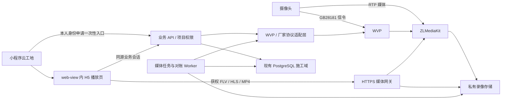

# 云工地视频开发计划

English mirror: [cloud-construction-video-plan.md](./cloud-construction-video-plan.md)

更新：2026-10-23。**CV-02有线云录像/私有回放已实现并完成有界开发验收；整体Limited，CV-04运行核对已开始。** SD重新插拔、重启及授权格式化后仍未识别。24/72小时浸泡、真机/公网、容量告警未完成。不授权生产部署。

## 1. 当前交付记录

| 项目 | 内容 |
| --- | --- |
| 当前ID | CV-04单路运行核对，Limited；CV-02云端路径限定Implemented，SD路径受卡识别阻塞 |
| 用户结果 | 负责人在项目“工地视频”保存连续录像/保留天数；员工从云工地进入同一H5，切换直播/回放，按日期选择真实封口片段，重进保留选择并可返回直播 |
| 技术方向/基础 | Mini web-view + H5；mpegts.js1.8.2/FLV、hls.js1.6.13/MSE/原生HLS，复用WVP/ZLM、施工项目/成员/租户权限，不依赖live-player |
| 实际状态 | 实际启动、无人观看120秒、关闭封口；私有MP4 Range206/匿名401；浏览器1920×1080解码/时间推进、重进/空状态/返回直播通过；真实测试文件及WVP索引过期清理无复活。仅隔离开发环境 |
| 完成检查 | 服务/适配21、Mini19、涉及类型0错误、lint/H5语法；200个源/测试/驱动绑定无漂移。Stable原生5项/208个绑定无漂移；原生截图已审看；真实媒体证据见1.3 |
| 未核验/未实现 | SD录制/回放、24/72小时连续运行/自然到期、多路容量、容量告警/低空间保护、企业默认、客户授权、实际PTZ、HTTPS/业务域名、微信真机/公网/纯4G；卡识别只阻塞SD |
| 下一ID | CV-04继续长期运行/容量和中断恢复；有可读SD介质后继续CV-02设备回放。测试连续录像已关闭、保留3天，不自动开启4G上传/生产录像 |

设计/实施源：2026-10-22用户批准单路H5/云工地配色、摄像头切换、抓拍历史及云台，去掉源地址/诊断。当时排除录像；2026-10-23进一步明确批准在播放器下加入直播/回放切换、日期、真实片段、返回直播，空/失败沿用既有反馈。当前实现保留此层级和配色，无截图切片/新增插画；Admin沿双语Ant Design/refactor合同。不能将空查询或接口完成记为SD支持。

### 1.1 当前实现合同（优先于后文尚未实现的完整提案）

- Admin `/construction-projects` 原Drawer“工地视频”：平台管理员在所选企业分配已验证WVP通道；负责人/经理绑定解绑/抓拍/已开放云台；只有负责人管理角色保存云台和录像策略，含admin/super_admin继承，无需入职/项目成员。有效普通成员只观看；客户授权尚未实现。
- Mini `packages/construction/projects/projects` → `packages/construction/camera/camera` → H5 `/construction-camera`。一次性入口30秒；独立HttpOnly/SameSite=Strict cookie/CSRF同源会话，观看/会话租约60秒、心跳20秒、绝对4小时。隐藏/退出关闭本观众传输；重进新入口，迟到入口丢弃。
- 员工API：Admin `/api/construction/video`、Mini `/api/miniprogram/construction/video`，`register`、`inventory`、`projects/:id/{inventory,cameras,binding,configure,recording,entry}`。POST recording仅负责人管理角色可写，版本控制/相同设置幂等，默认关闭、3天，整数1..节点上限（当前7天），不超过WVP节点自身保留；经理/成员不能开启持续上传。4G工地保持关闭，SD尚不可用。
- H5 `/api/construction-camera/{exchange,state,heartbeat,stop,live,snapshots,ptz,recordings/query,playback}`、私有图片 `/snapshots/:id`；直播网关 `/camera-media/:generation/*`、私有MP4 `/camera-recording/:generation/:recordingId.mp4`，支持单Range/HEAD，不暴露源地址/路径/凭据。请求及传输中每5秒重验项目权限/租约/代次/录像保留窗口；撤权/停止/切换使旧媒体失效。
- 0090为设备/绑定/入口/会话/抓拍/停止义务6张强制RLS表；0091新增策略/封口录像2张强制RLS表及会话recording_id复合FK。录像按原绑定/启用区间导入，迁移设备后归原项目，跨绑定边界片段不认领；历史与新项目录制互不干扰，不覆盖外部录像计划。
- 独立5秒对账恢复应录通道；只有ZLM实际状态确认后才显示recording/stopped。解绑须先关闭且确认stopped。每10分钟认领过期封口记录，deleting→真实文件404/410且WVP索引消失→deleted；失败留错误重试，不删除仍有有效观看租约的文件。企业清理在录制/媒体未完成时拒绝，防止丢失物理文件归属；暂停项目如保留enabled意图，删除前需恢复可管理状态并显式关闭。
- 当前MP4节点分段上限3600秒，非后文提案5分钟。跨保留边界整段不可访问，整段到期后才删除，有一段粒度偏差；扫描最多30个候选/次，失败可形成积压。日期最多300段；只有≤1秒连续区间自动切下一段，缺口需手选，无时间轴/跨日自动跳转。选择按项目在localStorage保留，重进不自动播放。无企业默认/容量保护。
- 私有JPEG bytea≤4MiB，pending/ready/failed/幂等持久化并每次鉴权，最新30张；尚无自动抓拍保留，录像三天不适用于抓拍。PTZ默认关闭，仅方向/STOP，300ms脉冲、2秒持久停止义务、独立500ms watchdog重试未知STOP；800ms为HTTP超时，不是设备物理停止保证。实际转动/变倍未证实。

### 1.2 配置与复测

1. 只在获授权数据库应用0090/0091；Next/独立Node-tsx网关共用DATABASE_URL，`cd admin && npm run camera:gateway`。未自动加入生产Docker。实际隔离库为127.0.0.1:55432/cloud_camera_eval、Next3018/网关3017，不切3006/生产。
2. 服务端配置CAMERA_WVP_ORIGIN、CAMERA_MEDIA_ORIGIN、CAMERA_WVP_USERNAME/PASSWORD、CAMERA_PUBLIC_ORIGIN、CAMERA_APP_ORIGIN；生产PUBLIC_ORIGIN必须HTTPS，网关默认127.0.0.1:3017。反向代理关闭媒体缓冲、原WVP/ZLM端口只对内、小程序登记HTTPS业务域名，尚未生产实施。
3. 录像额外配置CAMERA_ZLM_SECRET、CAMERA_MEDIA_SERVER_ID、CAMERA_RECORDING_ROOT、CAMERA_NODE_RETENTION_DAYS；本地对应私有secret、wvp-zlm-01、/opt/media/www/record、7。节点启动必须设`api.downloadRoot=/opt/media/www/record`，不能用/放宽；ZLM禁止热改。已修复仓库外`G:/workspace/向总/wvp/docker/zlm/start.sh`并仅重建/重启本地zlm、保留媒体卷，分发节点须同步该修正。
4. `construction-camera-check.mjs`迁移专属cloud_camera_unit_eval并运行21项，不与真实STOP worker共库；`--runtime-schema`仅迁移真实隔离库。`npm run check:camera`校验16个类型入口/依赖。`construction-camera-local.mjs`从CAMERA_LOCAL_WVP_ENV加载已授权WVP环境，`--gateway`/`--fixture`启动服务/合成数据；凭据仅忽略目录。
5. `--recording-check`实际录制后finally关闭；加`--playback-only`只复验已有回放。`--retention-check`加速到期并删除专属测试库最早封口测试录像、保留较新片段，拒绝其他数据库。`construction-camera-native.mjs`沿Stable单控制器/锁/精确项目/副屏纪律；真实PTZ脚本只用于授权设备。停服务前排空STOP，业务回退不删除历史媒体。

### 1.3 当前证据、原失败与限制

- `tmp/cloud-camera/verification.json`：200个源/测试/驱动前后无漂移，21服务/适配、19Mini、类型/lint/H5语法通过。`native.json`：208个绑定无漂移，Stable2.02.2608080/SDK0.13/base3.17.2，5项通过（精确窗口/副屏、fresh compile、项目按钮/真实entry、重进新entry、拒绝清空/可见重试）；逻辑390×844/PNG348×752，native-camera.png及native-camera-error.png已审看。原生不等于微信真机。
- 非录像首版提交`c1956a90`；复用其`live-http.json`6项真实FLV/HLS/匿名拒绝/新1920×1080抓拍入库幂等/停止旧代次证据。此前全量build编译103秒后被既有AiDesignerLegacyPage非法路由导出阻断，本轮未改该页或重跑全量build，不能称全量构建通过。
- `recording-live-2026-10-23T04-07-26-578Z.json`证明实际开启、无人观看120秒（超原90秒无人观看超时）、关闭/封口；该次回放失败保留。下载根修正后`recording-live.json`单独复验Range206/MP4头/匿名401通过，不合并为一次无失败全流程。毫秒时间、0..1440分钟计划、关联必传planId、停止后特定stream缺失返回均有回归；后续GC修正未改变已验启停方法，复用120秒证据。
- `retention-live.json`：加速的是一条明确测试记录的时间，真实文件404、WVP索引消失、对账不复活；未声称自然三天运行。测试含三种负责人角色/无入职平台管理、普通成员拒绝、跨租户RLS、版本/幂等、撤权/旧代次、原绑定归属、失败删除重试与迁移隔离。
- 已登录隔离IAB Admin真实保存保留3→2，重进回读2，再恢复3/off并有统一反馈。390×844 H5实际录像1920×1080/125.409秒，currentTime13.399→26.164；日期/片段/模式重进保留且不自动播放，空日期禁用播放，返回直播1920×1080出画。证据h5-playback.png、h5-playback-empty.png、admin-recording.png；沿批准布局无横向溢出。
- 原共享库STOP watchdog争用失败保留verification-20261023-shared-db-failure.json/checks-20261023-shared-db-failure.log；单独unit库后修复。旧WXML/最小化窗口误截图作废；合成GC过期数据修复前失败、verification-before-final-recording-fixes.json源漂移批次及所有recording-live时间戳尝试保留，不计入最终通过。
- CV-04只读快照：本地媒体卷16%使用/约849622348KiB可用，ZLM2.45%CPU/11.91MiB，WVP1.84%/647.2MiB。125.409秒/14313370字节样本约0.913Mbps，三天估算29.6GB（未含余量），不是容量/并发承诺。多路、24/72小时浸泡、自然到期、低空间告警/保护、断网恢复均未完成，不以短样本替代。

### 1.4 共用状态与恢复

| 触发 | 可见反馈/动作 | 重进/边界 |
| --- | --- | --- |
| 保存开关/天数 | 统一成功或失败通知，pending/recording/stopped/error真实状态 | 后台回读持久策略，只有负责人角色可写；相同设置幂等 |
| 查询/空日期/失败 | 正在读取、真实片段数或空/错误文案，空/失败禁用播放、可查询重试 | 记住日期/选择，不伪造片段，不自动播放 |
| 播放/段结束/缺口 | 原播放器状态、真实回放；仅连续≤1秒自动下一段，缺口手选 | 切换/返回直播先停止本代次，普通成员只读媒体 |
| 撤权/会话或保留到期 | 既有失败反馈、停止媒体、重新从项目申请入口 | 每次及流中重验，不复活旧代次/过期文件 |
| 删除失败 | deleting/last_error保留并重试 | 仅本模块封口文件，文件与源索引均确认消失后deleted |

## 2. 事实基线与既有计划关系

- [添加摄像头到 WVP](codex://threads/01a16235-d88b-73e3-81af-e01333b5f8bd)：已完成局域网扫描、统一账号批量接入、幂等编号和点播验证；摄像头 `192.168.10.80` 的一路视频有成功记录。接入页支持每批最多 100 台，当前适配 NZ 系列及兼容固件；这不是视频并发容量证明。
- [梳理摄像头对接文档](codex://threads/01a151c3-85dd-7e21-868f-dfaffd8d6368)：用户明确没有 `live-player` 权限，选择 H5 + `web-view`，并已确认企业或个体主体。`G:/workspace/向总/camera/test/README.md` 记录 2026-10-19 桌面浏览器实际播放 FLV、原生 HLS、两者切换及 1920×1080 画面成功；微信真机与 HTTPS 业务域名仍未验证。历史末条有停止 WVP 的记录，本轮没有重新运行媒体验收。
- 复用播放器源码：`G:/workspace/向总/camera/test/h5/{index.html,player.js,style.css}`、本地 `vendor/mpegts-1.8.2.js` 及许可证；小程序壳位于该测试项目的 `miniprogram/pages/webview/`。移入产品前固定源码哈希、依赖与许可证，移除硬编码 LAN 地址和测试诊断内容；既有测试页不是生产鉴权实现或已批准的产品视觉稿。
- WVP 工作目录：`G:/workspace/向总/wvp`。固定源码提交 `3fcd3ae80c30c95aeb82ef830af439a835257067`，镜像 `wvp-stack/wvp:2.7.4-3fcd3ae`；ZLM 固定镜像摘要见该目录 `scripts/versions.psd1`。已有服务端 JPEG 抓拍历史证据；持续录像、清理和 PTZ 尚无本计划验收证据。
- 现配置 `config/application.yml` 的 `record-sip`、`record-push-live` 为 false；`record-day: ${RECORD_DAYS:7}` 是媒体节点级配置。**设置保留天数不等于开启持续录像，也不等于逐摄像头策略已经实现。**
- 产品已有 `/construction-projects`、`packages/construction/projects/projects`、施工聊天和公开照片工地。施工业务实际使用 `admin/src/db/construction-schema.ts` 的 PostgreSQL/Drizzle 表与租户事务/RLS；不因旧总说明提到 Mongoose 而另建一套 MongoDB 摄像头业务。WVP 自身 MySQL/Redis 继续由 WVP 管理。
- 本计划细化既有 XiaoK 路线图 P4C 的视频技术部分。历史的设备租赁、报价、押金、90 天服务期、退款和售后不自动进入本次范围；**三天录像留存与服务期是不同参数**。不增加 Agent 工具，不把摄像头画面自动送入模型，不扩大 P4B 公开工地范围。

### 2.1 SD 卡方案的当前验证结论

用户条件：**先确认这款设备能通过 WVP 查询并实际回放 SD 录像；支持后，将计划切换为有线云端录像、4G SD录像。** 当前仍未满足，不能将空查询/控制成功记为 SD 回放支持，也不能仅据0条判定设备不支持。

2026-10-22 未插卡的原证据 `tmp/cloud-camera-sd/verification.json` 保留。2026-10-23 用户明确确认同一台已插卡、尚未重启；设备 `frmIotRecordCfg` 读取 `SDStatus=-1/SDInfo=0/SDFreeSpace=0`，时钟正确。执行一次 `frmDeviceReboot` 后，设备11:17重新注册 WVP；其 DHCP 地址由 `192.168.10.80` 变为 `192.168.10.81`。通过 SIP TCP 实际远端地址定位，并核对原设备序列号一致；未重建 WVP 通道或修改绑定。

用户重新插拔后，已经GB重启并从实际SIP TCP远端定位192.168.10.83，核对同一序列号；仍返回SDStatus=-1、容量0。再次按已授权frmHDFormat/Type1/FormatList:[1]请求，被设备拒绝，格式化未完成；拒绝后未追加重启、未恢复出厂。最新证据tmp/cloud-camera-sd/probe-20261023T034117Z.json及probe-20261023T035245Z.json；此前首次重启、15秒手动Record/finally StopRecord、0条GB录像及首次格式化失败的probe全部保留。协议确认和新增云端文件均不证明SD写入/回放，硬件卡识别仍阻塞SD路径。

复测脚本 `admin/scripts/construction-camera-sd-probe.py` 复用本地 WVP onboarding 认证，强制原设备序列号校验后才允许重启/格式化；`--camera-ip` 可指定已从实际 SIP 连接定位的 DHCP 地址。默认只读；`--reboot`、`--record-seconds 5..60`（finally补StopRecord）和用户明确授权后才可使用的 `--format-sd` 是显式测试动作。凭据只在忽略目录。硬件可读后再产生短录像、查询非空区间、启动回放并验证解码/时间推进，最后停止本会话；无需用户手动播放验收。移动/定位/倍速分别记录。

若实测通过，按已有授权直接修订双语计划：**有线保持云端持续录像与可配置三天保留；4G改为SD本地持续录制、仅看直播/回放时上传媒体，退出后自动断流**。抓拍/必要片段可单独保存，SD回放可用窗口以实际录像索引和卡容量为准，不能套用云端三天物理删除承诺；断网期间可本地录像但远程不可读。公网4G兼容性仍须独立验证。当前其余章节的持续云录像规格保持原提案，双模式仍为待实证的条件方案。

## 3. 产品范围与建议默认值

| 能力 | 首版范围 | 完成标准 |
| --- | --- | --- |
| 直播 | 工地多摄像头列表、单路播放、切换、静音、全屏、重连、在线状态；H5 内完成播放和操作 | 获权用户实际出画；未获权用户拿到项目/设备 ID 或旧地址仍不能播放 |
| 录像与回放 | 已启用设备持续收流、服务端 MP4 分段、日期/时间段查询、定位、连续切段、返回直播 | 没人观看也有录像；重进可查；断网处明确缺口；过期段不可再访问并清理 |
| 抓拍 | 从当前实时流生成独立图片，显示时间/摄像头，保存为项目私有抓拍，可再次查看 | 服务端实际生成并持久化；不是手机截图或缓存旧图；失败可恢复且重复请求不重复入库 |
| 云台 | 支持设备的方向、停止及经验证的变倍；能力不足则明确不可用 | 真实执行和停止；离页/断网/竞争操作有控制租约和超时保护 |

建议默认：录像开启后全天持续录制，滚动保留 **72 小时**，每段 **5 分钟**；每 **10 分钟**执行过期清理。界面显示实际可回放区间，不承诺启用前录像或断网期间补录。

保留时间采用“企业默认 + 摄像头可覆盖”，首版建议 1–30 天整数、默认 3 天，受平台容量上限约束；这是拟定参数范围，可在实现前调整。提高天数不恢复已删除录像；降低天数展示预计影响并经明确保存后生效。录像开关独立，0 不同时表示关闭与永久保存。

仅过期且已经封口的片段可删除。边界片段为避免破坏有效画面可延后删除，物理清理延迟目标不超过一个分段周期加一次扫描周期（默认约 15 分钟）；播放授权仍按有效保留窗口裁定。未授权永久保留、导出大文件、定时抓拍、巡航、语音对讲、AI 视频分析及匿名直播不纳入首版。

## 4. 架构与 H5 接入

### 4.1 播放路径

1. 员工沿“我的 → 云工地 → 项目 → 摄像头”进入。业主从本人获权工地入口进入；不因知道项目 ID 获权，也不把员工专用施工 API 改成任意用户通用接口。
2. 新增专用小程序壳，候选路由 `packages/construction/camera/camera`；新建 H5 页面候选 `/construction-camera`，放在 Admin 登录布局之外，使用独立的摄像头会话。路线名称在实施时定稿，目前均为拟新增。
3. 小程序用既有 bearer 身份申请短时、一次性 entry code，绑定用户、企业、项目、摄像头/绑定版本和用途。H5 通过 POST 交换受限会话；不把小程序长期 JWT、摄像头密码、WVP token 或 ZLM secret 拼进 URL。
4. 推荐同一 HTTPS 站点承载 H5、相关 API 和媒体网关。entry code 采用 URL fragment 传递，兑换后清除；页面不加载第三方分析脚本，设置 `Referrer-Policy: no-referrer`。会话使用 Secure/HttpOnly cookie，写请求验证 Origin/CSRF；禁止把它用作 Admin 登录会话。
5. 延续已验证的能力检测：有 MSE 实时解封装能力时用 mpegts.js 1.8.2 播 FLV；支持原生 HLS 时可选择 HLS。错误后有界重连/明确切换，不无限循环、不暗中同时拉两路。不假定所有 iOS/Android 微信 WebView 都支持同一协议。现阶段不强制更换播放器或新增 hls.js。
6. H5 内实现摄像头切换、回放时间轴、抓拍、云台和反馈；不依赖在 `web-view` 上叠加原生按钮。`postMessage` 只用于非实时通知，控制动作直接调用 H5 获权 API。刷新、返回、切账号及切企业后重新核验会话；H5 页面失活释放观看租约并停止云台。
7. FLV、HLS 清单及每个分片、MP4 Range、抓拍图片都走媒体授权；仅保护 H5 页面不够。媒体网关关闭直接源站绕过、匿名目录及缓存泄漏。长连接不能只在建立时校验：撤权后定向终止观看会话，建议服务端失效传播目标 ≤30 秒，不关闭其他人的共享流或连续录像。
8. 一次性 code 建议 30 秒有效，短播放凭据建议 60 秒有效；确切值在 CV-01 固定。重进重新申请；用户撤权、绑定迁移、项目停用和账号停用让后续请求失效。已合法传到终端的字节无法远程收回，不作此承诺。

### 4.2 WVP 与厂商协议分工

优先复用固定版本 WVP 已有接口。下列为已核对源码的上游候选，不直接向客户端透传：

| 用途 | WVP / ZLM 接口依据 |
| --- | --- |
| 设备、通道 | WVP `/api/device/query/devices`、`/api/device/query/devices/{deviceId}/channels` |
| 实时点播 | WVP `/api/play/start/{deviceId}/{channelId}`；停止点播必须核对录像/其他观看者租约 |
| 持续录制计划 | WVP `/api/record/plan/{add,link,get,query,update}`，按通道绑定全天计划 |
| 云端录像索引/播放 | WVP `/api/cloud/record/{date/list,list,play/path,loadRecord,seek,speed}` |
| 抓拍 | WVP `/api/play/snap` 或 ZLM `/index/api/getSnap`，验证新鲜度及实际输出后入库 |
| PTZ | WVP `/api/front-end/ptz/{deviceId}/{channelId}`，动作/速度按固定源码与实机能力映射 |
| 录制与事件 | ZLM `startRecord`、`isRecording`、`on_record_mp4` 等；优先通过 WVP 计划管理，禁止另一个循环反复启停同一路录制 |

厂家 [Slink IPC 文档](https://www.eolink.com/share/inside/98608ece654780d9b0b46bb615ccb020/api/-1) 已实际打开核对：

- [抓拍 `/CaptureV2`](https://www.eolink.com/share/inside/98608ece654780d9b0b46bb615ccb020/api/2767966/detail/52909562)：有 `Type/Ch/Dev/Data`，`DataType` 区分二进制与 base64，`StreamNo` 区分主/子码流。仅在设备 HTTP 可达且适配验证后作为抓拍补充路径。
- [云台 `/frmPTZControl`](https://www.eolink.com/share/inside/98608ece654780d9b0b46bb615ccb020/api/2767990/detail/52909734)：含 `Cmd`、`IsStop`、`Speed`，速度文档范围 1–10；单步、预置点和能力集另有接口。不能拿示例 `Cmd` 数字推断全部方向，须核对命令字与实际固件。
- [Digest 认证示例](https://www.eolink.com/share/inside/98608ece654780d9b0b46bb615ccb020/doc/-1/detail/684449) 描述 `/digest/frmUserLogin` 的挑战认证及特定 User-Agent；现批量接入也有 X-Digest 和 `goform/` 固件适配。复用已验证适配，凭据只在服务端保存，不新造通用浏览器登录流程。
- 云服务器无法因设备 GB28181 在线就直接访问其内网 HTTP/RTSP。公网/4G 优先 GB28181；厂家 HTTP 补充需要已有可达网关/VPN 或明确的厂家中转能力。SD 卡 `/frmVideoRecordsQuery` 不作为本次服务器三天录像的实现依据。

保留 WVP 现有 ZLM Hook。需要事件镜像时增加可靠转发/对账，不直接覆盖 Hook 使 WVP 丢失流生命周期和录像索引。媒体传输由网关/ZLM 负责，Next.js 不承担大流量视频逐字节转发。

## 5. 数据、权限与关键服务规则

拟新增下列施工域记录，最终迁移号按开发时实际顺序分配：

| 记录 | 关键内容 |
| --- | --- |
| 摄像头/通道 `construction_cameras` | enterpriseId、媒体节点、WVP device/channel 标识、序列号引用、名称、在线时间、经验证能力；节点凭据引用置于服务端配置 |
| 历史绑定 `construction_camera_bindings` | enterpriseId、projectId、cameraId、绑定起止时间/版本；同一通道同一时刻仅一个有效工地绑定 |
| 策略 `construction_camera_policies` | 企业默认/设备覆盖、录像开关、保留天数、配置版本、应用状态及失败原因 |
| 录像索引 `construction_recordings` | 固定 bindingId、stream generation、源 record ID、起止时间、私有 storage key、大小、校验及 ready/deleting/deleted/missing 状态 |
| 抓拍 `construction_camera_snapshots` | bindingId、请求幂等键、拍摄/获取时间、发起人、媒体资产引用与状态 |
| 会话/任务/审计 | 观看和 PTZ 租约、一次性入口、操作幂等、重试/未知结果；复用既有持久任务/审计范式，不接入模型 Worker |

业务表沿用 `withTenantTransaction` 和 RLS，使用企业/项目复合关联。Admin 使用 `withTenantRoute`、`isEnterpriseManagementRole`；Mini 使用当前有效签名身份解析和现有施工权限。平台管理员在所选企业内继承负责人管理权，不要求先成为项目员工。

建议权限矩阵（本计划提出的默认值，实施前随设计/业务合同定稿）：

| 用户 | 直播/回放 | 抓拍 | PTZ | 绑定/录像策略 |
| --- | --- | --- | --- | --- |
| 企业负责人、所选企业 admin/super_admin | 企业内获权设备 | 是 | 设备支持时 | 是；设备须已分配给本企业 |
| 当前项目经理 | 本人管理项目 | 是 | 设备支持时 | 可管理项目内布置；不改变企业归属/保留上限 |
| 当前项目设计师/施工成员 | 当前有效成员项目 | 经项目授权 | 默认关闭，可单独授权 | 否 |
| 业主 | 本人关联且已开放视频的项目 | 默认关闭，可单独授权 | 默认关闭，可单独授权 | 否 |
| 访客/公众 | 否 | 否 | 否 | 否 |

平台先把设备分配给企业；企业不能提交任意 WVP deviceId 认领其他企业设备。摄像头迁移先停止旧绑定会话/控制、封口当前录像，生成新 binding epoch，再建立新绑定；旧录像和抓拍仍属于原项目，迟到事件不能归入新工地。

### 5.1 持续录像与清理

- WVP 录制计划保持全天收流，业务 Worker 对账设备在线、媒体存在、录制状态及最近封口时间；无观众也录制。监测 `on_stream_none_reader`、`mp4_as_player` 等实际行为，不能靠配置名称推断持久录制成功。
- Worker 启动/重启后恢复应录通道，指数退避重试，记录断流/故障区间；停止观看只释放观看会话。状态区分“已启用录像”“正在录制”“录像中断”，请求被接收不等于已录制。
- WVP/ZLM 负责生成媒体，业务索引负责租户、绑定历史和有效留存窗口。封口事件重复/乱序幂等入库，丢 Hook 通过索引/文件对账恢复；录像文件不写数据库、不放 `design-references/` 或公开上传目录。
- **只设一个物理删除责任方。** 逐设备保留采用业务清理 Worker，只处理本模块认领的已封口记录，通过已验证的 WVP 删除能力同步源索引。WVP 节点级自动清理须关闭或设置为不会早于任何有效策略的上限；`0` 的实际含义先验证。共享节点不得未经隔离就修改其他业务的清理策略，必要时使用独立节点/卷。
- 删除采用 claim → deleting → 物理删除 → deleted，可幂等重试；数据库过期不等于文件已删。验证无开放写入、无合法播放租约、在允许存储根内，并同步清理临时文件/HLS 派生缓存。清理失败暴露积压，不标记完成。
- 容量预警建议 80%/90%，极低空间停止新增录制并显示失败，不能悄悄删掉仍在承诺窗口内的数据。保留策略保存前估算容量；事故停止、恢复及缺口均有审计。
- 全部时间入库 UTC，UI 用 Asia/Shanghai；摄像头时间校准、源时间戳、服务器时间分开记录。回放处理跨日、关键帧定位误差、缺口和分段边界，不将空白伪装成连续录像。

### 5.2 抓拍与 PTZ

抓拍优先复用实时流；校验设备/通道、图像解码和请求后新鲜度。无流时受控点播，完成只释放本任务的租约，不停止持续录制。写入私有媒体后返回持久 ID，未知结果重进查询同一任务。抓拍首版建议沿用对应摄像头保留天数；若以后显式纳入施工记录，应复制为独立业务资产并遵循其发布/保留合同，不自动公开。

PTZ 每设备仅一个短控制租约，命令带序号和失效时间，拒绝迟到/过期移动，停止命令优先。H5 `pointerup/pointercancel`、失焦、隐藏、退出均停止，客户端心跳丢失时服务端也在上限内发出停止（建议 ≤2 秒，CV-00 结合实机固定）。设备/WVP链路不可达时不能承诺已物理停止，应显示结果未知，恢复连接先补 STOP；若设备支持有限步进/运动超时，优先利用该能力。服务端进程恢复首先清理过期控制租约。不把 STOP 丢进普通排队任务；超时结果标为未知，不能盲重试移动。只提供实机验证能力，固定枪机无 PTZ 时不展示可操作的云台。预置位/变倍必须单独确认支持后开放。

## 6. 拟定业务 API 与工程落点

以下均为规划名称，不是现有接口：

- Admin 继续扩展 `/construction-projects` 设备管理区，通过 `/api/construction/projects/:projectId/cameras` 绑定/解绑、更新策略；平台配置负责媒体节点和企业分配。绑定/策略使用版本检查、幂等键和共享操作反馈。
- Mini 申请入口：`POST /api/miniprogram/construction/projects/:projectId/cameras/:cameraId/entry`。员工/客户复用各自现有身份与项目解析，显式分支，不放宽原员工专用路由。
- H5：`POST /api/construction-camera/session/exchange`；后续获权 `cameras`、`live-sessions`、`recordings?from=&to=`、`playback-sessions`、`snapshots`、`ptz/lease`、`ptz/command`、`ptz/stop`。后端解析企业/绑定，不相信浏览器传入的 WVP 地址/通道/存储路径。
- Media：仅允许获权 session 的不透明资源 ID；同源代理 FLV/HLS/MP4/图片，正确处理 Range、内容类型、CORS/Origin 和缓存。退出操作只取消本人的观看/控制会话。
- 主要实现落点：`admin/src/lib/construction/` 的摄像头服务/权限；独立 WVP/Slink 适配模块；`admin/src/db/` 的施工扩展与迁移；Admin 项目设备区；独立 H5 页面；Mini 专用 `web-view` 壳；持久媒体任务/对账进程。

## 7. 分阶段实施与验收

| 阶段 | 可交付用户结果 | 必须完成的有界检查 | 工作量预估 |
| --- | --- | --- | --- |
| CV-00 基线与设计 | 确定复用播放器、设备能力、H5 主稿/关键状态及权限规则 | 核对版本/协议/设备 PTZ 与录像能力；登记业务域名/HTTPS 状态；明确清理责任；设计源完成映射 | 1–2 人日 |
| CV-01 绑定与直播 | Admin 分配/绑定设备；Mini 从真实工地进入 H5，看直播并切换/重进 | 实际绑定写回、一次性兑换/重放拒绝、FLV/HLS 出画与切换、离线恢复、跨租户/撤权/旧链接拒绝、退出不影响其他观众 | 3–5 人日 |
| CV-02 录像与回放 | 开录像后无人观看仍录制；H5 按日期/时间回放，默认三天且可修改 | 真实封口文件/索引、跨段/跨日/缺口、Worker/媒体重启恢复、默认72小时逻辑、策略覆盖、两阶段删除及清理失败；小程序入口/反馈/重进 | 4–6 人日 |
| CV-03 抓拍与云台 | H5 抓拍并查看历史；支持设备按授权控制/停止 | 实际图像持久化/幂等/重进、离线/权限失败；PTZ 起停/失焦/断网/抢占/过期指令，能力不支持分支；同项目多用户隔离 | 3–5 人日 |
| CV-04 连续运行与交付 | 管理者看到在线/录像健康、容量及失败原因，异常能恢复 | 单/多路并发、真实录像浸泡运行、清理与容量告警、断网/重启、鉴权全链路、H5浏览器与Stable原生入口回归、文档/部署回滚预案 | 2–4 人日，另含被动运行观察 |

串行预算约 **13–22 工程人日**，以复用现有服务且设备支持所需能力为前提，不含等候新视觉批准、域名/网络开通或实际 72 小时观察的纯等待时间；不是工期承诺。直播可先交付，无需等租赁/支付/售后体系。

测试使用批准开发库的合成企业、项目、成员和专门标记的测试摄像头绑定；真实视频只保留在私有测试存储，不公开。每阶段包含 Mini 入口、真实服务写入/回读、可见反馈、持久重进和权限/失败恢复。Native 验收沿用 Stable DevTools 单控制器、既有锁和窗口纪律；不复制临时小程序项目。

播放器测试复用既有 FLV/HLS 证据，新增部分测 H5 会话、安全媒体地址、回放与控制。浏览器自动化证明 H5 出画，Stable 验证入口/路由/会话/业务状态；微信容器、iOS/Android 真机、公网/4G 等缺少实证时明确记为未验证，**不要求用户常规手测或以此阻塞独立开发，也不宣称发布验收通过**。加速时钟/过期合成文件验证保留逻辑，真实持续运行验证录制稳定性，两类证据不能互相代替。

每次执行前后绑定源代码、测试、驱动、媒体版本、配置及固件；保留失败和未知结果。连续录像观察至少覆盖24小时；完整72小时连续窗口和自然到期清理只有取得实际证据后才可声称通过，不以短烟测代替。完成相关检查后推进下一授权阶段，不另设人工截图确认门槛。

## 8. 容量与运行参数

按码流实际平均码率估算（十进制 GB，未含额外音轨/封装/冗余）：`每天GB = Mbps × 10.8`；`三天GB = Mbps × 32.4`。

| 单路码率 | 每天 | 三天 | 三天加25%余量 |
| --- | --- | --- | --- |
| 1 Mbps | 10.8 GB | 32.4 GB | 40.5 GB |
| 2 Mbps | 21.6 GB | 64.8 GB | 81 GB |
| 4 Mbps | 43.2 GB | 129.6 GB | 162 GB |

示例：5 路各 1 Mbps 连续录像，三天原始视频约162 GB，预留后约203 GB；5 路各2 Mbps 则约405 GB。全天上传，1 Mbps 单路每30天约324 GB，上行流量不因只保留三天而降为三天流量。现场持续上行约所有录像码率之和，服务器观看下行另按并发播放路数累加；需留协议和波动余量。

首版延续已验证 H.264；实际码率由设备/现有服务合同决定，不暗改摄像头编码。最多2路≤1Mbps是历史P4C服务基线，不能当作当前服务器实测容量，也不能混同全天所有摄像头录像的上行预算。CPU/内存/磁盘型号与设备总量/转码需求在 CV-00 实测后确定；默认避免重编码，确有不兼容才评估转码成本。

## 9. 设计、文档与部署边界

- 现有批准云工地映射是 `design-references/construction-workflow/cloud-site/manager.png`，业主参考 `owner.png`；两个 prompt 均明确排除 CCTV/live-stream UI。因此只继承品牌/导航语言，不把现有照片记录页视为已批准直播稿。
- 补充一张 H5 直播主稿、一张回放关键变体，以及共享抓拍反馈/PTZ面板/异常/撤权状态规则即可；按 390×844 对应源画布和实际 web-view 可用区标定。默认纵向单路，宽屏/横屏全屏作为适配。无需每个错误各画一张整页，不自动添加四/九宫格大屏。
- 后续实现使用 draw-ui，先读取其校准/实现参考；新业务插画如需要，依仓库规则独立生成透明资产，禁止切复合截图。H5测试页只复用媒体逻辑，产品UI需明确设计源和实施授权。
- 每个阶段更新 `admin-system-modules.{md,zh-CN.md}`、`miniprogram-system-modules.{md,zh-CN.md}`；可见路由实现后更新双语还原台账唯一当前行，Admin UI受影响时同步双语 refactor 合同。未完成的能力保持 Limited/Placeholder。
- 最初规划仅新增双语文件；当前实施、路由/API/数据/权限/UI变化及对应清单/台账以第1节为准。不得混入其他对话脏改动。
- 远程工作前读取 `remote-development.md` 与中文镜像；H5 正式业务域名/HTTPS 与媒体代理同源配置作为部署检查，不能用关闭域名校验作为上线方案。本计划不启动远程部署、采购、支付、摄像头生产录制或改变现有网络暴露。

## 10. 参考与本轮核对

- [微信 web-view 官方文档](https://developers.weixin.qq.com/miniprogram/dev/component/web-view.html)：主体/业务域名、嵌入与通信约束。`web-view`业务域名不是`request`合法域名。
- [mpegts.js 官方项目](https://github.com/xqq/mpegts.js)：播放器能力依据；采用已验证的本地1.8.2基线，升级另行验证。
- [固定版本 WVP 源码](https://github.com/648540858/wvp-GB28181-pro/tree/3fcd3ae80c30c95aeb82ef830af439a835257067)：本轮核对本地 vendor 中 PlayController、PtzController、DeviceQuery、RecordPlanController、CloudRecordController、MediaConfig。
- [ZLM RESTful API](https://docs.zlmediakit.com/zh/guide/media_server/restful_api.html)、[ZLM Web Hook](https://docs.zlmediakit.com/zh/guide/media_server/web_hook_api.html)：录制、抓拍、流状态和播放/HTTP访问鉴权；以固定部署实际响应为最终适配依据。
- 原规划核对包括历史、WVP/播放器/施工源码、双语模块、设计prompt和厂家认证/抓拍/PTZ页面；当前云端集成与真实检查见第1节。SD实录/回放仍未通过，最新卡状态见2.1。
