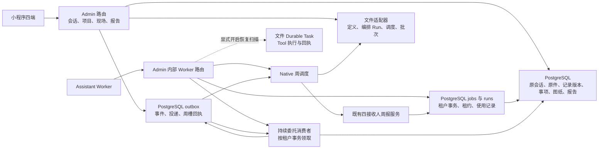

# Native Workflow B5.10 技术审查与验收报告

2026-11-13，上海时间。审查基线为 `zmc1212/Smart-Floor-Planner` 的 `codex/xiaok-native-workflow`，本地与远端均从 `ccac838b10d71bdb1c2379190add876c929a7b5e` 开始。实库验收使用 B5.9 的 PostgreSQL 17.10 隔离库 `127.0.0.1:55433/xiaok_b59_test`、`sfp_app` 应用角色、微云 1454 和对照企业 1455。所有业务样本均有合成标记。

**试点判定。** 单 Admin、独立持久目录和显式企业名单下，可以继续隔离技术试点。真实施工项目试点和生产多实例部署仍不具备条件。容器重建会使未挂载的编排文件失效，分离目录实测允许重复领取，同一共享目录仍缺少全链路的跨进程更新栅栏。完整生产构建也有基线类型阻塞。

## 实际架构



| 交付 | 代码及证据范围 |
| --- | --- |
| B5.1 | 原咨询阶段提醒及持久重进，沿原施工事件和站内投递。既有 B 隔离及 Stable 证据仍适用。 |
| B5.2–B5.4 | 日报、状态读回和单项目周报使用原报告事实、正文和投递流水。状态读回与原运行轨迹分开。 |
| B5.5–B5.7 | 工人、设计师、老板各有原绑定和周报接收权限。此前报告与原件访问证据按既有合同保留。 |
| B5.8 | 四接收人周报批次与持久委托均有实现。委托作用于指定项目和两个登记部位，原会话和项目权限继续约束结果。 |
| B5.9 | 周调度和水电四端协同均有实现。本轮重跑 B5.9 实库业务链，覆盖追加的权限、来源撤销和故障场景。 |
| B5.10 | 已验证下述 PostgreSQL 事务、Worker 争用、周槽恢复和文件适配器边界。整体维持 Limited。 |

以上按可执行路径和对应记录判定。B5.1–B5.8 的实模与 Stable 历史证据见 [Native Workflow 合同](../admin/src/lib/native-workflow/README.md)。

## 存储与多实例

| 数据 | 现行存储 | 多实例结论 |
| --- | --- | --- |
| 定义、发布版本、编排 Workflow Run | 文件 `store/file-store.ts`、`live/run-store.ts`。业务 AI Run 另存在 `assistant_runs`。 | 进程内 `Map` 仅串行化本进程操作。跨进程更新无数据库级版本比较。独立目录读到的发布版本与运行历史可分叉。 |
| Durable Task 与 Tool Execution | `durable-task-store.ts` 保存任务、租约、步骤、回调与补偿。Tool 执行写在原任务中。 | 同目录正常租约挡住了第二个进程。独立目录两个进程均可领同一标识。过期接管、删除和写回跨文件，存在竞争窗口。Worker 只在显式启用时扫描任务恢复，通用 Tool 端口没有注册到线上入口。 |
| Period Report Schedule、Batch | 文件保存运行、控制、接收人冻结清单、问题台账。周槽和业务报告、来源、消息在 PostgreSQL。 | 本轮将周槽领取和 outbox 回执放入同一事务。运行文件可在同一恢复窗口内重建。分离目录仍有独立暂停状态和批次观察历史。 |
| Delegation、Event Processing | PostgreSQL 委托和事件应用回执，outbox 与唯一投递键。 | 同租户通过事务级 advisory lock 串行取事件，失败保留重试或 dead 回执。跨租户独立。没有文件依赖。 |
| Delivery Receipt | PostgreSQL 报告投递、施工回传事件及原会话消息。 | 使用现有唯一键、事务、权限和来源复核。文件轨迹仅用于观察。 |

文件更新写临时文件后在同目录 rename，首次创建使用独占 copy，租约使用 `wx`。实测覆盖正常共享根、隔离根、进程终止后的过期接管和文件写失败。磁盘断电、共享卷缓存一致性和任意两个写入者同时抢占过期租约仍未验证。文件目录缺少生产级历史保留和清理策略。跨事务窗口的实证为 PostgreSQL 周槽已提交而调度文件缺失。

`docker compose config` 的实际 Admin 只挂载 `/data/ai-assets`，固定容器名和端口，Assistant Worker 经 HTTP 调用 Admin。五个 `NATIVE_WORKFLOW_*_DIR` 默认落在 Admin 的 `tmp/`，当前 Compose 没有对应持久卷。容器替换可使文件定义、队列、批次和历史丢失。即使增加共享挂载，文件里的旧进程写回和补偿竞争仍需解决。

在有真实多 Admin 上线需求时，优先将调度运行、批次清单和编排 Run 接入租户事务及并发版本校验，保持现有 Store 接口，复用 outbox、业务报告幂等键和 `assistant_jobs` 租约语义。需要上线通用 Durable Tool 时，再将其任务、租约、回调去重及补偿放在同一事务边界。部署迁移应先对文件快照做只读校验和历史回填，比较版本、作用域和回执计数，再停止旧写者并切换。回退前核对切换后已发生的业务副作用及 unknown 项。保留文件适配器用于开发和测试。本轮未引入 PostgreSQL Store 或新表。

## 企业启用及回退

| 配置 | 当前行为 |
| --- | --- |
| `NATIVE_WORKFLOW_ENABLED`、`NATIVE_WORKFLOW_ENTERPRISE_IDS` | 仓库运行入口没有读取这两个变量，设置它们不会开启或停止任何切片。 |
| `NATIVE_WORKFLOW_DELEGATION_ENABLED`、`NATIVE_WORKFLOW_DELEGATION_ENTERPRISE_IDS` | 同时满足显式开关和名单才受理新委托并消费该企业事件。关闭或移出后，已写入的委托和事件保留。恢复名单后领取已有积压。停用时有条件产生的项目变更事件仍需要重新核对当前事实。 |
| `NATIVE_WORKFLOW_COLLABORATION_ENTERPRISE_IDS` | 启用四端项目协同投影及操作入口。移出后既有设计事项、带专业意见的图纸和已确认整改保留历史权限约束。 |
| `NATIVE_WORKFLOW_SCHEDULE_ENABLED`、`NATIVE_WORKFLOW_SCHEDULE_ENTERPRISE_IDS` | Native 每轮处理前 20 个有效企业 ID。相同范围为 `stage_enabled=false` 的报告计划预留周槽，即使 Native 调度暂停或关闭，旧 Worker 也不会代跑该周槽。未纳入这 20 家的企业保留原日报、周报规则。 |
| `NATIVE_WORKFLOW_TASK_RECOVERY_ENABLED` | 与 Native 调度开关独立，使用调度企业名单扫描对应文件任务。空名单、缺配置时不扫描。 |

周调度暂停保留当前运行和回执，恢复后继续当前周期。关闭调度与任务恢复并保留名单，可停止新增 Native 周调度并继续预留周槽。要恢复旧周报，明确移出该企业并检查现有报告设置、时间槽及已排队任务。此前已进入业务队列的报告沿原权限和报告配置处理，关闭编排开关不回滚已提交动作。环境变量按 Admin 进程生效，滚动切换必须保证各进程使用同一份配置。后台 Worker 的故障响应保留稳定错误码，测试、报告和示例均不写入连接凭据或密钥。

生产配置隔离仍需部署验证。现有 Compose 的服务级 `DATABASE_URL` 覆盖 `env_file` 同名值，`NODE_ENV=production` 本身无法鉴别目标库或已有数据来源。本轮只核对本地 Compose 解析结构和隔离测试的硬目标校验。生产的数据库身份、独立密钥、运行目录权限、备份恢复及滚动部署尚未验证。

## 四端基础水电验收

采用签名 Mini Program 路由、真实 PostgreSQL 业务写入和读取。业主原咨询 `70` 发起持续委托并共享书房需求。施工人员的主卧照片和 PCM 原件进入同一记录 `53`，整理为待核对草稿，再由经理发布并绑定进度。设计师核对图纸后提交意见，旧意见的并发写冲突。业主在原咨询预览并确认图纸，施工端只得到当前 V2 `921`。现场回传、独立经理复核和四端重读指向事项 `904`、原咨询回执 `826`。复核重开会失效旧结果，重做后保留新的生命周期版本。

| 角色 | 本轮实库核对 |
| --- | --- |
| 业主 | 私聊仍私有。家庭账号只能代看获权进度，撤回后进度为 404，无法读原咨询或决定图纸。需求撤回使相关 V2、施工图片授权和原结果回执失效，独立主卧进度仍指向记录 `53`。 |
| 设计师 | 撤销项目成员后读写均由现有隐藏资源策略返回 404。恢复项目分工后，两份同版本意见一份成功、一份 409。迟到旧意见无法覆盖已批准 V2。 |
| 老板 | 同一项目的简报和详情计数一致，另外一个标记项目使用自己的一组计数。整改中、待复核和已修正各自读取当前事实，排除项不计入施工质量未修或已修。老板不具备正式设计发布或经理复核权。关闭协同开关后，原 V2 仍受原专业授权约束。 |
| 施工 | 无效照片上传返回 422，媒体记录数不变。草稿直接整改回传被拒绝，经理退回后补拍并重提，经发布才能回传。两个相同请求键得到同一回执。过期图纸及媒体已无有效入口。 |

两套独立的本地 HTTP 路由宿主读取同一进度版本 2 和原回执，分别拒绝对照企业与家庭私聊。另外启动两套完整 Next.js 开发 Admin，使用独立监听端口和构建目录连接同一 B5.9 库，均从实际路由读到项目 `7` 的进度版本 `2` 和原记录 `28`。生产容器横向部署仍未实测。[双 Admin 实测](../admin/tmp/b510-next-parallel03.log)。照片与 PCM 的组织步骤沿生产 Worker 服务，通过确定性整理和 ASR 测试适配器。现有 UI 模板、样式与导航没有变更。本轮 Stable 官方项目列表未返回目标 worktree 的小程序路径，因此本轮原生交互未执行。此前 B5.9 的 Stable 记录见 [现有合同](../admin/src/lib/native-workflow/README.md#b59-cross-role-project-collaboration)。真机、真实微信授权和配置模型没有在本轮重新运行。

## 故障演练

| 初始状态及注入 | 恢复及最终状态 | 副作用 |
| --- | --- | --- |
| 1454 的周槽已到期。数据库推进时间槽后、运行文件创建前强制杀进程。 | 旧版只得到 `alreadyConsumed`，运行缺失。修复后新进程取回原 PostgreSQL 回执，并与另一进程共同收敛到原周槽。 | 每企业、每业务周仅一条领取回执，时间槽没有再次推进。 |
| 两个企业均到期。1454 的运行文件目标被测试目录占用。 | 1454 报真实写失败，1455 同一轮完成登记。移除阻碍后 1454 从数据库回执恢复。 | 同一业务周未新增第二条领取。 |
| 1454 暂停 Native 调度，旧 Worker 与另一个企业同时运行。 | 旧版旧 Worker 推进了 1454 周槽。修复后，1454 暂停和总开关关闭时均保留周槽，1455 作为第 21 家仍按自己的旧周报策略推进。 | 暂停期间没有 Native 批次。原失效演练中新增的 36 条合成报告任务沿既有取消服务清理，历史记录保留。 |
| 实际现场记录已排队，Worker 的独立本地数据库传输中断。 | 真实 Worker 路由返回 503，原任务仍排队。正常连接的两个进程只领到一份任务。强制终止后，未过期不能接管，过期后新租约接管。 | 原租约写回被 `context_changed` 拒绝，原记录和照片、PCM 保留。 |
| 已落库委托事件在开关关闭或只允许对照租户时积压。 | 两种情况下原投递状态均保持。重新开启后两个进程争用，最终由有效租户消费。 | 目标事件 `attempts=1`，旧版迟到事件及重复投递不覆盖当前图纸，也不增加应用回执。 |
| 外部 HTTP 端收到请求并落盘，故意不返回应答。 | 第一次和重进均保留 `unknown`，从持久任务等待真实测试回调。重复回调被去重，跨租户回调查无任务。 | 一次外部效果、一次保存、一次写回。 |
| 两进程竞争相同文件租约，再改用分离目录。 | 共用目录的未过期租约挡住第二次领取，过期后可接管。分离目录中两个进程各自成功。 | 分离目录有重复领取风险，通用文件运行不满足多实例部署条件。 |
| 老板读到已有设计事项，再移出协同名单。 | 旧版在回滚事务中接受新版发布。修复后实库业务路由返回 403，原 V2 保持可读。 | 无新增正式方案，无审批和结果变更。 |

真实周槽恢复批次使用有界测试周期，覆盖领取与运行登记。完整的多实例周报正文、外部通知、分布式文件卷断电恢复和生产流量下的积压时延仍待验证。

## 数据库、构建与本轮修复

- 周槽推进与 `native.workflow.weekly.claimed.v1` 由同一租户事务提交。Worker 重读已有回执恢复缺失的当前运行，并在拿到运行租约后重读文件。暂停复核覆盖观察和剩余派发。
- 旧周报 Worker 尊重 Native 名单的周槽预留。文件 Durable Tool 的重进返回已持久化的未知结果。正式设计、意见及整改的历史授权约束独立于当前协同开关。Worker 的调度失败响应输出稳定错误码。
- 只读核对数据库已应用 121 条迁移，最后一条 `0121_native_workflow_delegations` 的 SHA-256 为 `86aabfda7cd31ce59aea2e68ab8ad93289293bd118b62202826f593e88635450`，与仓库一致。两个委托表、outbox 和投递表均启用强制 RLS。周槽复用现有唯一索引，委托事件复用既有待投递索引。本轮没有执行迁移、历史回填或 DDL 回滚。应用回退保留数据库事件和业务原件。验收清理后，活动助手任务、待投递委托事件和临时报告设置均为 0。[数据库只读核验](../admin/tmp/b510-db-verification.log)。
- 离线 Native Workflow 与 Construction 共 **570 项通过**，Mini Program 相关 **323 项通过**。实库与故障演练共 **14 项通过**。同范围 TypeScript 诊断为基线 289 项、当前 289 项，新增 0 项。定向 ESLint 通过，整库 ESLint 仍有基线 FastGPT `no-explicit-any`。webpack 生产 bundle 已编译，完整构建在基线 `scripts/fastgpt/setup-unified.mts:113` 的 `TS2339` 停止。构建运行 `npm run build --ignore-scripts -- --webpack`，跳过会刷新量房生成物的预构建钩子。

| 检查 | 本轮执行记录 |
| --- | --- |
| 基线 | [Native 469 项](../admin/tmp/b510-baseline-native-offline.log)，[B5.9 实库 7 项](../admin/tmp/b510-baseline-cross-role.log)，[整库 ESLint 基线](../admin/tmp/b510-baseline-eslint.log) |
| 最终实库与故障演练 | [合并实库记录](../admin/tmp/b510-live05.log)，[源码绑定](../admin/tmp/b510-after05.json) |
| 离线和客户端 | [Native 与 Construction](../admin/tmp/b510-offline05.log)，[Mini Program](../admin/tmp/b510-mini03.log) |
| TypeScript、ESLint 和 webpack | [同范围类型差分](../admin/tmp/b510-type-final.json)，[定向 ESLint](../admin/tmp/b510-scoped-final05.log)，[全量 ESLint](../admin/tmp/b510-eslint05.log)，[构建](../admin/tmp/b510-build05.log) |
| 原失败 | [周槽及暂停复现](../admin/tmp/b510-deployment-red03.log)，[权限回滚复现](../admin/tmp/b510-collaboration-off-red.log)，[回调重进状态及测试驱动首轮](../admin/tmp/b510-live01.log)，[积压与测试驱动二轮](../admin/tmp/b510-live02.log)，[名单容量复现](../admin/tmp/b510-cap-red.log)，[类型差分首轮](../admin/tmp/b510-type-compare.json) |

复现统一实库批从 `admin/` 执行。使用已核对的 B5.9 应用连接、合成 JWT 签名配置，并保持隔离队列空闲。

```powershell
$env:B59_LIVE_DEVELOPMENT = '1'
node --import tsx --test --test-concurrency=1 src/lib/native-workflow/__tests__/deployment.live.test.ts src/lib/native-workflow/__tests__/cross-role.live.test.ts
```

多实例部署前需验证同一制品上的生产构建与两套完整 Admin、数据库级租约和历史迁移策略、持久目录或数据库替换、生产密钥及目标库隔离，以及滚动部署的授权一致性。旧版在修复前已错过的周槽没有数据库领取回执，需要按原报告记录单独核对，避免补跑重复。持续委托超出恢复窗口、dead 事件和外部工具 unknown 仍需原运维处理。
