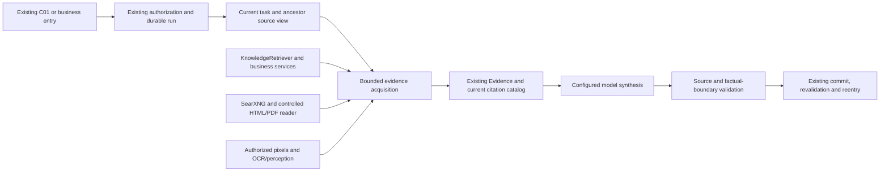

# XiaoK Phase Two: Requirements and Human Handoff

<!-- xiaok-v1-02-proactive-current -->
## Current V1-02: deterministic private report foundation (Limited)

<!-- v1-02-staff-private -->
**Staff private report questions06/07: Limited; recipient services and bounded native state checks verified.** The existing `followups/:bindingId/conversation` resolves the signed worker/designer/boss recipient (including selected-enterprise admin/super_admin) and reuses ConversationService, owner participants/repository guards, report selection and the same Agent. Report references retain their exact recipient/project/period/revision and revalidate current duties, audiences and originals. Staff snapshots carry an admin principal, with legacy userId references still readable; current project conditions enter the original KnowledgeRetriever/Evidence/citation pipeline. Staff consume only effective published internal/public knowledge, never Admin draft previews. Their messages remain private; S04 remains shared. Migration0108 extends the original trigger only for owner-authored AI-mode private questions. Local application: `node scripts/construction-report-migrate.mjs --development --staff-questions --audit=<fresh-path>`; unrelated0102 is excluded.

<!-- v1-02-conversation-list -->
**Approved01 private conversation list: bounded Implemented; V1-02 remains Limited.** Source: 01-conversation-list-v001.png plus the canonical notebook README and approved management-entry SVG,853×1844→390×844. Only history gets the699px paper at y145,39×5 grip,31px same Black heading,18px project name, separate right unread/date,15px delivery state and16px ordinary title. The management target is108×44px/13px. The original delivered-and-authorized latestReport determines delivery copy; its saved timestamp is not a delivery timestamp. Ordinary rows retain the actual first-question title, creation date and open/closed status, with no invented model summary; invalid dates stay empty. Existing-data refresh keeps cards in place; initial loading and explicit failure/retry remain. Other sheets, APIs, schemas, roles and Agent orchestration are unchanged; there is no Admin functional change.

The existing standalone MessageCircleMore vector supplies the themed48×48/1283B alpha conversation-outline.png; requirement-home.png remains. Paper, plus, arrow and rings are native geometry, with no screenshot slicing/new business art/image call. The same licensed Black union adds only 话 to45 codepoints/11884B, prior44 outlines/metrics unchanged. See tmp/v1-02-conversation-list-visual/font.json and the source README's27-element ledger.

Evidence: tmp/v1-02-conversation-list-visual/verification.json. Final client-02 passes120/120 including13 package checks; lint-02 passes/drift[]. Native-03 has two passing prerequisites and two passing list cases (geometry, actual503/retry, visible-card seen versus full-report unread and management), but remains failed overall because its last driver reentry supplied mutually exclusive leadId+conversationId. The saved entryInput check reproduces that rejection; native-04-reentry passes3/3 only for the corrected single-destination reentry, draft-preserving close and new-chat/fixed-binding remainder. These are separate scoped results, not one final full journey. Native-01's minimized-window preflight failure and native-02's strict333/334-width assertion plus external api.js drift remain failed. The latter batch is invalid, not pooled. One loading/optical product repair, one width-driver correction, one entry-driver correction and one read-only minimized-placement guard correction are retained.

Four valid final-page PNGs were inspected at Stable390×844/encoded348×752. Same HWND947063424 was minimized; read-only saved placement proves the secondary monitor and unchanged inspection focus, without restore/input/window mutation. Full-host capture, root-panel native and device/keyboard QA remain unverified. The driver pauses only background polling for stable geometry; explicit reads/receipts/writes remain real. All four batches cleaned up; projects310–313 archived/customer-off, originals363–366 withdrawn, bindings128–131 stopped, ordinary fixtures1021/1024/1027/1030 archived,5410 disabled. Policy false/version234/dispatch_epoch57,q0; controls and providerMax4114/knowledgeMax3753/3753 unknown-input_tokens-null unchanged. Stored user originals are protocol fixtures, not native send/model-answer evidence. New model/ingestion/image calls0. Main2096462/assistant2092160 bytes leave690/4992B below the unchanged2097152 hard cap; assistant exceeds the unchanged1998848 safety target by93312B. Compiled/upload bytes remain unverified. Original quota/semantic stops, unknown costs, failed batches and deletion rejections remain. Root compatibility is now retained as a failed bounded acceptance; its return condition is below, not V1-03.
Root-entry acceptance remains **Limited/unverified**, not a product pass or a demonstrated root UI defect. Evidence: tmp/v1-02-conversation-list-visual/root-verification.json. Native-05-root failed on a Page-versus-component timer-owner mistake. After that correction, native-06-root still had sheet=""; the read-only root-capability discriminator shows that the CLI expression #xiaok-chat >>> .notebook-history resolves outer component/node7, while an internal component query finds the real44×44 button at(26,47) and its handler. Native-07-root-touch used registered element touchstart/end at that real button center(48,69), but sheet stayed empty and ordinary history was never requested. Root harness repair iterations=2: stop before another selector/coordinate variant. Owning domain is native automation/component action integration; a supported component-scoped action mechanism and discriminator are required before reopening. No product hook, Computer Use/9420/window/focus fallback, knowledge reingestion or user hand-test gate was added. Three root failure PNGs were inspected; all three batches failed, cleaned up and had drift[]. Root06/07 reuse05's unchanged compiled Mini sources. Final seven-batch readback: projects310–316 archived/customer-off, originals363–369 withdrawn, bindings128–134 stopped, four ordinary fixtures archived,5410 disabled, policy false/version240/dispatch_epoch60,q0; controls/accounting unchanged and no provider/ingestion/image call. The read-only budget snapshot still has42 reconciling reservations/2004000 tokens versus daily1200000. Deep-link01 evidence remains valid in its recorded scopes. There is no third root retry or automatic model/quota recovery authorization.

**Installed root-action capability review (read-only, 2026-11-02):** The local official wechatide-skill0.3.11 registry exposes only Page selectors for automation_element_action, with no componentSelector/elementId scope; automation_page_action.callMethod is a Page method. The saved node7/inner44×44 discriminator therefore still lacks a documented registered component-child action. Calling existing component logic through evaluate would not prove that its user-facing button works. This is a registered-contract/evidence limitation, not proof of a root product defect or a claim that every underlying SDK lacks component support. Evidence: tmp/v1-02-report-sources/root-action-capability.json, with registry/skill/helper/source hashes. New native/model/ingestion/argument-file calls0; rootEntryHarnessRepairIterations remains2. No product UI/API/code or restoration-status change. Source/original navigation is locally committed as e3a816b03a1815b2598cf7d6377b16b815cdd6a1 and its scoped evidence is reused. Root acceptance reopens only for a documented supported component-action mechanism plus discriminator; configured-model report/follow-up trials still require the original unknown-usage/quota return conditions. No new selector/coordinate loop, product hook,9420/Computer Use/window/focus fallback, manual-test gate or V1-03 advancement.

<!-- /v1-02-conversation-list -->

<!-- v1-02-owner-detail -->
**Approved03 owner full daily fact detail: bounded Implemented; overall V1-02 Limited.** The source is03-report-detail-v001.png plus the same canonical notebook README/shared03/04 (853×1844→390×844). Only ownerDaily+ready uses independent owner-report-detail WXML/Less; staff/weekly/stage/unready/unavailable keep the original detail branch, byte-identical to HEAD81a7b58b after removing the new branch. The same licensed Black title is31px, dynamic project name18px local serif, body/fabric labels16px, metadata/original-record action13px. Original authorized records sit at the section top-right. Published pending/coordination/carried-over items, arrangements, facts_only and missing-evidence copy remain; no invented process or tomorrow schedule. Statistics use the actual cutoff, historical progress is labelled 当日进展 and saved time is not model generation. No API/schema/permission/orchestration/new-art/font change. Background list polling now preserves an existing operation error; explicitly retrying the same original clears it using the approved shared failure treatment.

Evidence: tmp/v1-02-report-detail-visual/verification.json. Node client-02 passes120/120 including13 package checks; lint-02 passes. Final Less-only package-02 passes13/13, all drift[]. Native-02 passes4/4 (two prerequisites plus detail geometry and actual original-record503 feedback/retry/read receipt/persisted exact-reference reentry). Native-04-footer passes3/3 only for final geometry: paper(15,90)/375×754, grip(175.5,101)/39×5, scroll(38,246.75)/322×508.25, fixed ask(29,765)/334×44 at16px, bottom809≤actual safeArea.bottom810; two-line13px footnote. The final two pages and one passive full host were inspected at logical390×844/encoded348×752/HWND947063424. The native capsule is visible; an IME toolbar partly covers the upper-right close region, so unobscured full-host QA is not claimed.

Original native-01 and literal numeric-newline failures remain; error/footer repair1 passes. Optical repair2 remains recorded: native-03-footer bottom814 exceeded the safe area by4px; offline official Less4.1.3 folded max(...) to29px. Escaping preserves native CSS; native-04 measures34px bottom padding. The driver's original<32 assertion was separately corrected for intrinsic32px fabric labels, without reducing16px text/44px actions. All four batches cleanup true/drift[], new CLI argument files/model/ingestion/image calls0; memory identity/storage/transport/hydration restored and root relaunched. Projects306–309 archived/customer-off, originals359–362 withdrawn, bindings124–127 stopped,5410 disabled; policy false/version226/dispatch_epoch53,q0. Original27/50/60–64 controls and providerMax4114/knowledgeMax3753/3753 unknown-input_tokens-null remain. Prior02/04/06/07/08 evidence retains its original scope. Only scoped03 Less changed after native-02; the final post-native README result edit has a separate impact check. All1446 backend dependencies still match; only the original three-API+proxy/process-only/compile-only evidence is reused, not full build/standalone.

Main2096461/assistant2084249 bytes, hard2097152 with691/12903B headroom. Assistant remains85401B over the unchanged1998848 safety target; PNG≤300KB stays unchanged. Compiled/upload bytes, full03 natural report/process citations, native long/empty/cross-date/carried-over/populated-arrangement variants, root panel and device/keyboard remain unverified. The42 reconciling holds, stopped work, original failures/unknown costs/CLI deletion rejections and D2=2/original04 optical2 remain; no paid fallback or new quota. Next is the sameV1-02 approved01 conversation-list calibration, not V1-03.
<!-- /v1-02-owner-detail -->

<!-- v1-02-owner-daily -->
**Approved02 owner daily root component: bounded Implemented; V1-02 remains Limited.** The current source is 02-follow-up-chat-v002.png plus the same canonical notebook README/shared03/04 rules (853×1844→390×844). The ready customer daily card now has the approved owner-progress title, hanging fabric label, 23px same licensed Black heading, 13px snapshot date/stage/actual cutoff and 16px body. Historical dates never become “today”. The first two original completed entries remain progress; a separate “待你确认” section reads the original authorized publishedRecordItems pending/coordination, including carried-over items. It does not truncate those confirmations into the two progress highlights; an empty published projection never falls back to internal drafts. Empty/unavailable/loading, stage/weekly, reception and shared03/04 keep their existing approved scope. No API/schema/permission change, invented schedule/process facts or automatic construction confirmation; facts_only remains visible. Original full-report and exact-report ask actions remain.

The independent02 sprig maps to miniprogram/packages/assistant/assets/owner-daily-leaf.png,94×168 RGBA/16608B, SHA256 0cf1224d73640a9c1bb66f93bd1a5d8c7dc3d3b75e1d8a5800ea1b97a3501471. Official Images API gpt-image-2.5-flare/medium returned one successful one-image response:1753 input/439 output/2192 total tokens, unknown0; cost was not returned. The original halo and response/prompt are retained in follow-up-v1/assets/owner-daily-leaf-v001/manifest.json; only generated-art alpha cleanup and proportional optimization were used. Ivory/dark composites and native art were inspected; no UI screenshot was sliced/cropped/masked into an asset. The same Black font adds only 家 to a44-codepoint/11660B union, preserving every original43 outline/metric; dynamic project names retain local serif fallback.

Evidence: tmp/v1-02-owner-visual/verification.json. Node client02 passes118/118 including13 package checks; lint01 passes, during-run drift[]. The first client wrapper used Bun and failed before Node tests; it remains separate. Native01 passes3/3 (two prerequisites plus actual published root facts, full report, persisted exact reference and reentry). Its tag-based footer geometry query was empty, so it does not prove target sizes. Native02-footer passes3/3 only for that selector supplement: exactly two measured142.5×46px targets,15px text/8px gap. Three page PNGs and one unobscured passive full-host capture were inspected at Stable390×844/encoded348×752/HWND947063424; two batches cleanup true/drift[], new argument files0, identity/storage/transport/hydration restored, no focus/window/new-window operation. Original source binding remains intact; later README result text and its CRLF→LF normalization are recorded as non-behavioral post-run impacts; all product hashes remain identical. Projects304/305 are archived/customer access off, originals357/358 withdrawn, bindings122/123 stopped, retained5410 disabled; plan false/version218/dispatch_epoch49, queue0, original27/50/60–64 controls and providerMax4114/knowledgeMax3753 unchanged. Backend compile dependencies1446 remain identical; only the prior three-API+proxy/process-only/compile-only evidence is reused. Source main2095985/assistant2077849 bytes, hard2097152 with1167/19303B headroom; assistant remains79001B above the unchanged1998848 safety target. Actual compiled/upload size, full02/stage-message composition, long/empty native variants, root-panel, physical keyboard/device and normal model/report semantics remain unverified. The original42 reconciling holds, stopped semantic/ingestion work, failures, unknown costs and CLI deletion rejections remain; no new model/ingestion call.
<!-- /v1-02-owner-daily -->

Approved08-boss-weekly-digest-v003.png and the same canonical notebook README/shared03/04 state rules now supply a bounded boss weekly root component (853×1844→390×844), overall Limited. It uses grouped real projects, historical snapshot stages, original project/full-weekly/ask actions, 28px/26px fixed headings, 18px names, 16px body, 13px right-aligned project actions and reachable 153×48px footer targets. The original enterprise name precedes “仅自己可见”; the ordinary enterprise manager stays read-only while the existing platform picker is unchanged. The metadata states the exact Shanghai start/inclusive final date before the exclusive end and actual cutoff; “本期工地进展” never calls an old period this week. Only the real project count is shown, without fabricating a coordination total. The outlook is “已确认的后续安排”: original arrangements remain grouped; only complete aggregated empty data says “暂无记录”, while missing/truncated data remains incomplete. No next-week date, assignee or schedule is invented. Reception and unavailable/loading reports retain their approved shared states. No API/schema/permission change; facts_only remains visible.

Standalone artwork maps approved08's outlook sprig to miniprogram/packages/assistant/assets/boss-weekly-leaf.png (126×192 RGBA, 23445B, SHA256 e750086e9f88f0271affda080ef8a4bacccf7f4f1ef8139483a7fc76e3e4ef5f). It was independently generated through official Images API gpt-image-2.5-flare/medium: two successful one-image responses (first plus one specific halo correction), 2996 input/878 output/3874 total tokens, zero unknown requests; cost was not returned. Both originals and prompts remain in follow-up-v1/assets/boss-weekly-leaf-v001/manifest.json. Alpha-only cleanup of generated artwork and proportional optimization removed the residual halo; ivory/dark composites and the native leaf were inspected. No composite UI pixels were cropped, sliced or masked into product assets. The same licensed Black font now has a 43-codepoint/11292B union; all prior29 outlines and metrics are unchanged, and dynamic project names retain local serif fallback.

Evidence: tmp/v1-02-boss-visual/verification.json. Final client02 passes117/117 including13 package checks, lint02 passes/drift[]. Native01 passes3/3 (two prerequisites plus the weekly component with actual project/full-report actions, existing choice callback cancellation, long-name reflow, complete-empty outlook and leaf); native02-metadata passes3/3 only for the subsequent explicit-cutoff/approved enterprise-scope completion. Three page PNGs and two unobscured passive full-host captures were inspected at Stable390×844/encoded348×752/HWND947063424. The second batch does not replay or pool the first batch's actions. Both cleanup true/drift[], optional CLI args omitted, new argument files0, memory identity/storage/transport/hydration restored and root relaunched; no window/focus mutation or model/ingestion call. Four owned projects300–303 are archived/customer access off, originals353–356 withdrawn, staff5447–5448 disabled, bindings116/117/119/120 stopped; plan false/version214/dispatch_epoch47, queue0, original controls and providerMax4114/knowledgeMax3753 unchanged. The first final-read wrapper failed to resolve tsx from repository cwd before touching the database; corrected admin cwd read02 passed, original log retained. Prior1446 compile dependencies remain identical; no new backend build is required. Current source bytes main2095760/assistant2056883 versus hard2097152, headroom1392/40269B; assistant exceeds the unchanged1998848 safety target by58035B. Actual compiled/upload bytes, full closed-week/native populated-arrangement variants, whole06/07/08/root-panel/physical-device/keyboard and actual host-picker gestures remain unverified. Normal model answers/natural reports retain the42 reconciling/2004000-token versus daily1200000 stop; old failures, D2=2,04 optical2, unknown costs and rejected old CLI deletions remain unchanged.

The approved06-worker-follow-up-v001.png,07-designer-follow-up-v002.png and canonical notebook README/shared04 rules remain the source (853×1844→390×844). The current worker/designer root daily-card components use role-specific headings, hanging fabric labels, 18px project names, 14px left-aligned project actions and two 46px footer buttons. Static 28px/22px headings use the 43-codepoint/11,292-byte union of the existing licensed Noto Serif SC Black (original29 outlines/metrics unchanged), embedded in miniprogram/packages/assistant/chat/staff-followup.less; this is glyph coverage for the approved font, not a new font choice. Dynamic project names retain the original local serif fallback. Card-only labels leave full-detail identity/ranges and original facts intact; historical daily cards show their date instead of calling an old report “today”. facts_only feedback remains visible. No API/schema/permission change, new artwork or screenshot slicing; ordinary staff topics remain unavailable and reception/media stay customer-only.

Bounded 06/07 visual evidence: tmp/v1-02-staff-visual/verification.json. Final client03 passes 115/115 including 13 package checks; adapter lint02 passes, drift[]. Native03-components passes 4/4 (two prerequisites plus worker/designer root components), cleanup true/drift[]; four PNGs inspected at Stable 390×844/encoded 348×752. Real saved two-project reports, original long-name reflow, 44px project actions, reachable 46px footer actions and the actual first-project button are verified. Native01's old nested-Less compile output and native02's unsupported tag selector failure remain failed originals; only official cleanCompileCache was used, without clearing storage. Saved native02 geometry also located the in-flow label gap; one component repair reuses the approved hanging-label rule. Original 04 optical failures remain 2; this is not another 04 CSS trial. Full 06/07/08 restoration, root-panel, actual host-picker gestures, physical device/keyboard and unobscured full-host acceptance remain unverified. The optional passive host capture was occluded; no window/focus mutation or model/ingestion call occurred. Six owned projects 294–299 are archived/customer access off, originals 347–352 withdrawn, staff 5441–5446 disabled and bindings 104/105/106/108/109/110/112/113/114 stopped; policy false/version 208/dispatch_epoch 45, queue 0, original controls/accounting unchanged. Current source bytes main 2095261/assistant 2021914, hard 2097152 and assistant safety 1998848; actual compiled/upload bytes remain unverified.

Project drill-down06/07/08 now carries the clicked projectId into the existing report-detail projection. Refresh and reopening a persisted question keep that project; a missing/revoked project shows the approved unavailable state and never falls back to another project. Full-report/history actions reset the projection. The server still resolves/revalidates the original complete report and its sources; the client filter is no grant or new API. The staff view now includes original pending/coordination excerpts where no formal issue references the record; formal tracking wins and the customer publishedRecordItems projection stays authoritative. Native01 exposed the original empty-issues display omission despite passing its six navigation checks; that original visual failure is retained. Native02-pending checks only this new display gap (one business check plus two prerequisites), with correct project and full-report rendering. Both batches cleanup true/drift[], new argument files0, model/ingestion0; native01 seven PNGs and native02 two PNGs inspected. Callback-based native action-sheet choices/cancellation do not establish actual host-picker gesture acceptance. Final client02 is114/114 including13 package checks; two driver lints pass. Runtime Admin/previous compile dependencies have no drift, so prior three-API+proxy compile-only evidence is reused. Evidence: tmp/v1-02-project-drilldown/verification.json. Fixtures290–293 archived/customer access off,343–346 withdrawn,5437–5440 disabled, owned bindings96/97/98/99/101/102 stopped; plan false/version199/dispatch_epoch42, queue0, original controls/accounting unchanged. Current source bytes main2094524/assistant2008779, hard2097152 and assistant safety1998848 (+9931B); actual compiled/upload bytes remain unverified.

Evidence: `tmp/v1-02-staff-followup/verification.json`. Migration01 applied0108; client02 passes110/110 including13 package checks, unit01 passes6/6, lint01 and driver-lint02/03/04/05 pass; types01 retains82 existing/zero affected errors. Service01 passes5/5 (one fixture plus four staff checks), cleanup true/drift[], covering five real signed identities, saved fact reports/exact selection/same-key readback, current project/published sources, quota rollback, other-owner/tenant/reception/preview denial and member/original withdrawal. Synthetic assistant replies/runs/citations are protocol fixtures without provider jobs/reservations and are not semantic answer evidence. Native01 selector and native02 host-occlusion batches remain failed; only the saved native02 worker remove/draft/original-key assertions are reused. Native03-remainder has5/5 native checks (two prerequisites plus quota-input retention, actual local HTTP503 same-source retry and designer isolation/persisted reentry), product/driver binding drift[]. Its enclosing service batch remains failed because the first staff cleanup transaction timed out. Recovery retains the original timeout, Windows URL-wrapper failure and incomplete-binding assertion; `cleanup-final.json` verifies the two new staff disabled, all three bindings stopped, project archived/original withdrawn, queue0, rejected-send message0 and unchanged accounting. No native/model replay repaired that batch. The driver now attempts each independent owned cleanup once and records every failure. Compile01 passes only the three affected production APIs plus proxy, using the inherited process-only/compile-only override, config changes0/drift[]; full-build/standalone remains unverified. The earlier staff-entry source counts were main2094036/assistant2008675 versus hard2097152 and assistant safety1998848 (+9827B); actual compiled/upload bytes remain unverified.

Final fixture evidence combines unchanged286–288/5420–5434 with new289/5435–5436: four archived projects/customer access off, seventeen disabled staff, seventeen staff plus four customer bindings stopped and originals339–342 withdrawn; plan false/version193/dispatch_epoch40, queue0. ProviderMax4114/knowledgeMax3753,3753 unknown/input_tokens null and inherited D2=2/ten dialogue unknowns/CNY32.828897 remain; new model/ingestion0. Forty-two reconciling holds/2004000 tokens versus daily1200000 still block normal answers and natural reports. No hold release/recalculation, quota increase, paid fallback or stopped-batch replay. Native01's7 CLI argument files remain after automatic deletion rejection (`blocked by policy`, deleted0/rejections1); do not read bodies, retry or bypass. Native02/03 use documented optional-args omission and one-use loopback memory identity, new argument files0. Read only cleanup/manifest metadata. The inherited75 files and original rejection count2 remain; an earlier broad rg addressed that directory, so a global never-scanned claim is not established. No production/remote/external-message authorization.

User correction on2026-11-01: staff/customer-facing test utterances must sound like real requests. The staff fixture now asks role-appropriate natural questions about the unresolved kitchen socket or current confirmations; synthetic labels, test intent and expected actions stay in fixture/report metadata. Earlier native01/02 staff-bubble protocol wording and screenshots are retained as historical engineering evidence, never business-answer acceptance. This test-text change does not reopen model calls or invalidate unchanged permission/source checks; future native remainder uses the corrected fixture.

Reference review for this actor/source extension: retain server-injected runtime identity from the [LangGraph context contract](https://docs.langchain.com/oss/javascript/langgraph/graph-api#runtime-context) and inspect its maintained [ToolRuntime/prebuilt tests](https://raw.githubusercontent.com/langchain-ai/langgraphjs/main/libs/langgraph-core/src/tests/prebuilt.test.ts). [Issue2351](https://github.com/langchain-ai/langgraphjs/issues/2351) concerns raw caller selectors in MongoDBSaver; this project keeps its existing PostgreSQL tenant/recipient guards and never forwards caller checkpoint selectors. These sources motivate preserving application authorization, not a framework migration or a claim that the MongoDB-specific defect affects this runtime. Upstream tests were inspected, not executed; no new provider workaround or dispatch was added.

<!-- v1-02-report-context -->
<!-- v1-02-live-followups -->
**Private-report read boundary: bounded Implemented; natural answers remain Limited.** Customer and staff construction_followup replies offer only report-scoped query_followups({}) and the original search_knowledge. Shared site questions keep knowledge-only tools; explicit ordinary topics retain their original services. The adapter reuses boundReportContext, step740, the existing durable agent_tool/BusinessSnapshot and citation catalog. Fresh/cached reads recheck the selected recipient, report revision, project, original hash and current source/member permission. It reads frozen originals, never generated report prose; it grants no need write, construction approval, other consultation or additional project access. No route/schema/UI/style/asset/model-provider or knowledge-ingestion change.

Evidence: tmp/v1-02-live-followups/verification.json. Preflight06 passes3/3 including rollback-only fresh/cache/recipient/revocation probes for both roles; final-kind unit14/14, runtime compatibility25/25 and scoped lint pass. Final driver type checking removes only erased fixture annotations;82 inherited project errors remain. Configured01–03 remain failed, cleanup true/drift[]:1926 ordinary-consultation read rejection,1927 unavailable-tool rejection,1928 partial sourced prose,1929 a successful service run but raw business snapshot instead of an answer to the room correction/next-step question. The read-scope repair count is2 and this patch/model loop is stopped. Seven qwen3.7-flash calls total input47134/output239 tokens; actual money is unavailable, not zero. Earlier quota-block notes are historical: the user-confirmed unlimited daily setting admits these sends without releasing/recalculating old holds. Knowledge3753 and old unknown outcomes remain. Staff normal answers and the planned Stable input/reentry were not executed after the first failed case; no new native, rendered-state or restoration claim. Approved04/06 markup/styles/assets and ledgers are unchanged.

Offline discriminator: tmp/v1-02-live-followups/discriminator.json. Expected a natural response to the room correction and what remains before Friday installation;1929 read the correct report snapshot, then chose the still-advertised {kind:business,resultKey} display receipt. The current renderer printed reportFactText rather than answering. This belongs to Agent final-contract/response consumption; Knowledge originals/Evidence require no change for this defect.1928 is partial only: its next action is underdeveloped and cutoff12:00 lacks timezone (the source is12:00Z/Shanghai20:00). Do not count its automatic check or1929's succeeded run as complete acceptance. Preserve every first draft, both failed repair iterations and the body/D2/root/source counters. Before reopening affected acceptance, define a mechanism-level report final contract distinguishing authoritative snapshot display from a sourced answer, including corrections, next actions and timezones. The prior query-scope loop remains stopped; no wording/regex/prompt variant or provider replay is allowed without a concrete mechanism change and discriminating evidence. This is a local strategy stop, not a pause of authorized development.

Planned report final-response mechanism (not implemented): classify a genuinely paired report-scoped query_followups result carrying reportReference and the original catalog as an answer source, rather than a business-display receipt. Reuse finalToolForMessages and the existing synthesis schema/citation catalog, and mirror that boundary in server final validation so business snapshot display cannot bypass a natural question. Keep ordinary-topic action/clarification displays and shared-project boundaries intact. First replay saved1929 against schema/server tests, verify user-room corrections do not write needs or amend published facts, and make the source cutoff unambiguously Asia/Shanghai (12:00Z is20:00). Only after the mechanism and deterministic rejection/compatibility/permission evidence exist may the original fixed two-customer/two-worker plus two-native run scope reopen, stopping on its first failure/unknown/drift. Preserve the existing read-scope repairs2, every first draft and cost; do not rename/reset them, replay unknowns, regenerate report bodies, change model/provider or alter approved04/06 UI. Continue authorized work automatically after a bounded cycle; if context is nearing capacity, checkpoint section2 and transfer serially instead of ending for routine user confirmation.

Reference review: adopt runtime filtering of registered tools from the [official middleware contract](https://docs.langchain.com/oss/javascript/langchain/middleware/custom#dynamically-selecting-tools) and inspect maintained [middleware tests](https://raw.githubusercontent.com/langchain-ai/langchainjs/main/libs/langchain/src/agents/tests/middleware.test.ts). [Issue9418](https://github.com/langchain-ai/langchainjs/issues/9418) is a closed createAgent structured-response/middleware compatibility issue; it does not explain this application's ordinary-consultation scope rejection. Upstream tests were inspected, not executed; no framework migration, alternate facts store, provider-specific workaround or fallback was introduced.

Followup replies reuse the original citation chips, reference-image materializer and source sheet. GET `followups/:bindingId/conversation/citations/:citationId` checks the same conversation inside the original ConversationService before knowledge or web projection; it grants no other private-destination or reception-staff access. The original run query and POST `runs/:runId/cancel|retry`, journal, pending-message paper and generating/stopped/unknown controls are connected. Removing a report retains an editable visible draft; new AI sends still require a valid explicit reference. Closing/hiding or losing identity/permission clears source state. The included WXML now imports its report templates locally. Staff-private entry/source scope is described above; normal AI-answer acceptance remains pending.

**Report follow-up04 remains Limited.** Approved04/06 keep the exact persisted report revision/project/period/cutoff/hash and consume authorized originals through step740. Unlimited daily admission is verified, while a natural correction/next-step answer and the complete customer/staff/native journey are not accepted. Read-scope repairs2 and the original body repairs2 remain stopped separately; no V1-02 completion or V1-03 advancement.

Native evidence is deliberately split: native04 contributes its first2 business passes (view/remove/draft included); native05 contributes original-key lost-selection recovery; native06 passes7/7 including2 preflights and5 business checks for ordinary topic/fixed delivery, original source sheet with controlled loopback HTTP503/retry, synthetic run controls, real human pause/end and withdrawal. Native12 passes3/3 including final named elements and4 component captures/one passive full host. Earlier failed batches stay failed. Source/driver bindings and cleanup are retained per batch with drift[]. Synthetic reply/run/citation fixtures are engineering evidence, never normal model output. Root-panel04, physical device/keyboard and actual compiled/upload bytes remain unverified.

Optical repair count2 is retained: native08/09 expected avatar x38/action44px but observed x0/43px despite source changes. The Mini runtime/compile-cache hypothesis was tested after stopping source patches: read-only compile_wxss diagnostic10 failed; diagnostic11 successfully cleared only this project's compilation cache. With identical product code, native12 then measured x38/44px and verified generating/stopped/unknown papers. The original paper typography is23px/16px, actions15px, tag14px and reference13px. The retained common scope header places this dynamic two-line paper at(38,199.8),327×184.38; its original approximate y181 ruler is not an exact full-shell fidelity claim. No new font/artwork or screenshot slicing.

Compatibility client14 is106/106; final layout-only client15 is25/25 including13 package checks, both drift[]. Earlier client09's105 and offline05's41 are retained at their original scope. Lint10 passes; types10 completes with82 existing/zero affected diagnostics (later changes are WXML/Less/classes only). Production compile01 succeeds for the three affected API entries and proxy only, with source/runtime/environment binding and drift[]; default standalone/full build is not passed. Source bytes are main2093818/assistant2008628 versus2097152 limits; assistant remains9780B above its1998848 safety target. Final readback: queue0, report plan disabled/version181/dispatch_epoch36; all10 new labelled projects archived/customer-closed, bindings stopped/AI and originals withdrawn; topic933 archived, synthetic accounts disabled. Provider/knowledge maxima remain4114/3753, new calls0;3753 remains unknown/input_tokens null and original D2=2/costs remain.77 new04 CLI argument files were found in the first cleanup readback and removed in one verified native PowerShell cleanup; inherited75 were untouched, their two prior automatic rejections remain, and no bodies were read. Full evidence: tmp/v1-02-report-followup/verification.json.

<!-- v1-02-human-takeover -->
**Human reception11: bounded Implemented; V1-02 remains Limited.** Approved11-human-takeover-report-v001.png and the canonical notebook README/shared states remain the source (853×1844→390×844). C01 reuses its original ChatController, media adapter and persisted request journal for the customer's private followup: waiting supplements, real staff text/photos, original-key send/end recovery, unavailable-owner feedback and explicit request/cancel/end. Ordinary consultation drafts/destinations remain separate; denial clears only this destination's pending operations. The followup microphone remains explicitly unavailable; ordinary voice is unchanged. No new Agent, knowledge, permission/citation pipeline, font, generated artwork or screenshot pixels are added.

GET /api/miniprogram/assistant/followups/:bindingId/conversation[,/messages?beforeSeq=&limit=,/handoff,/media[/:mediaId]] and POST messages/handoff/media (plus original media DELETE) delegate to the original ConversationService/HandoffWorkflow/HandoffService/media services. The server resolves the recipient-owned binding and same conversation, then rechecks the original repository, current Mini identity/enterprise/project and participants. Payloads cannot select a conversation/principal/tenant; staff question resources use the recipient path above, reception/media remain customer-only, and ordinary conversation APIs are not opened. Original staff handoffs list/claim/read/reply/media accept only live customer followups with their existing explicit consent/grant. Migration0107 extends the original participant/message trigger and preserves staff-owner-only private destinations. Reception packets/messages exclude report locators and confer no recipient-report permission. AI sends without an explicit validated04 report reference and all AI uploads remain blocked after explicit return. The normal04 reply journey remains Limited under the original quota/semantic boundaries.

Reception cancels chat work while preserving queued/running construction.report.facts and its context revision. Report tasks, saved results and read-only history remain independent of AI insertion. Explicit end/cancel records database-clock endedAt; reports created by that time become muted on delivery, including tasks completed later, and remain in history without a catch-up burst. Existing stop/delete/rebinding/dispatch-epoch, current-project/source checks and other cancellation rules remain. Reading a report never resumes AI or ends reception.

Evidence: tmp/v1-02-human-takeover/verification.json. HTTP05's9/9 and cleanup remain valid for their bound service scope: waiting/claim/text/reply/photo, exact-key replay/conflict, independent background/queued reports across reception, muted backlog and tenant/identity/current-project/staff denial. Its original failures and later packet filtering/client-journal/style impacts are retained separately. Native10 at the same secondary-screen Stable2.02.2608080/base3.17.2/390×844 passes7/7: actual waiting supplement/claim, lost-send receipt and original-key reentry, real reply, read-only report with AI paused, unavailable owner and lost explicit-end receipt recovery/old-staff denial. Packet locator filtering is checked against real stored reports. Nine348×752 pages/two1700×960 hosts were inspected. Native13 then verifies only the changed component styles/owner variant4/4, with two pages/one full host, bound direct/nested drivers and drift[]. Its passive host capture validates the existing HWND947063424, bounds/occlusion and unchanged foreground, with no focus/input or new window. Business and visual batches are not pooled into a fictitious final-source whole-suite result.

The startup blocker was the included followup-view.wxml:36 wx:else combined with wx:for: the IDE's real compiler log rejected it before App/Page code registration. A non-rendering block preserves the intended message DOM while fixing the branch. A standalone WXML summary had not established successful page compilation. Native01–07,08's asynchronous claim assertion,09's foreground-capture rejection,11's stale imported Less, and12's dark-gradient/CLI-evaluation failure remain original failures. Final entry invalidation loads the actual new Less; suspended labels, pale saved-report fabric, source-specific23px headings/16px descriptions/13–15px actions, two-line long-name reflow and44px action bounds were measured and inspected. Original C01 shell, icons and Chat Serif remain; full common-shell glyph optics are not upgraded. Detailed element measurements are in the existing design README and Mini inventory below.

Final package13/13 and driver lint0 pass with drift[]. Static01's79/79 client logic, source lint0 errors/25 warnings and82 existing/zero affected type diagnostics are reused only after recording the five changed files (WXML/Less entries and driver binding); unchanged JS/backend logic is not replayed. The first final package wrapper used Bun incorrectly and the first lint wrapper timed out; their originals are retained. A new full webpack build was interrupted after its owned worker used about8.5GB; it is not a pass. Compile04 successfully compiles the three affected production API entries (Mini assistant, Admin handoffs, internal Worker) plus proxy using a process-only entry/output override and compile-only mode, with loaded .env.local/.env.production, Node/Next, drivers/config/source binding and drift[]. The default standalone/full-product build and existing whole-project type failures remain unverified; the printed route inventory is not proof that every route was compiled. Compile02's invalid async validation hook and03's narrower configuration binding remain separate. No repository config bytes changed.

Assistant source bytes1995992/1998848 (2856B safety reserve); actual packaged/upload bytes, root-panel11, physical keyboard/device and full followup restoration remain unverified. Final readback: queue0, planoff/version154/dispatch_epoch23;271/272 archived/customer_access=false,60/61 stopped/AI,5410/5419 disabled; original27/880/human and50/910/stopped/AI unchanged. Identity/storage/transport/hydration are restored, root route is pages/index/index and no native controller/owned job/build/lock remains. ProviderMax4114/knowledgeMax3753 and3753 unknown/input_tokens null are unchanged; this11 package adds0 model/ingestion calls. V1-01 Limited/disabled explanations, D2=2, ten dialogue unknowns/CNY32.828897 of100 and separate3753 unknown cost remain. Finish the scoped local11 commit, then continue04 under the sole plan; no production enablement, external messages, paid fallback or remote deployment is authorized.

<!-- v1-02-report-history -->
**Report history05: bounded Implemented within V1-02 (overall Limited).** The existing C01 chat/panel paper sheet now filters the recipient's saved reports by current project, Shanghai month and daily/weekly kind, with the original20-row beforeId cursor. Month membership uses the immutable period start in Asia/Shanghai, including a week crossing the month boundary. GET /api/miniprogram/assistant/followups/:bindingId/reports accepts projectId/month/kind/beforeId; the binding context accepts afterProjectId/projectId, returns20 authorized project options plus projectsNextCursor and separately revalidates selectedProject beyond the first page. These use FollowupService and the original followupProjects/RLS/source projection. Invalid or duplicate parameters are rejected; no body selects a tenant/principal. A project-filtered index contains only that currently valid project section and no read grant; opening the same report revalidates its complete recipient-authorized snapshot. There is no new report center, Agent, knowledge, permission or citation pipeline.

The shared controller keeps history separate from chat cards, retains filters and valid rows on a failed read, retries the same range, fences older filter responses and clears revoked names/content. The existing settings link and authenticated detail/original path remain. Only the detail's actual render and validated original-journal acknowledgement update read state; filtering/listing does not. Same-session selection is restored on reentry; an identity/enterprise change drops cached state. Facts remain facts_ready / knowledge not_generated; customer questions now require the explicit04 reference and original send guards above, with normal semantics still unverified.

Evidence: tmp/v1-02-report-history/verification.json. HTTP02's index/cursor/month checks are retained,03 completes permissions/read receipts, and05 verifies real two-page project options using21 labelled service-created projects250–270;04's missing-data driver assumption remains failed. Native04's project/filter/geometry check and06's remaining5/5, followed by final07 overlay3/3, cover manual same-filter transport503 recovery, actual rendered read/reentry and live identity denial; source/helper/official CLI/window bindings have drift[]. Original fixture, status-code, runtime-read, selector, polling-race and wrapper failures remain separate. Mini91/91 and calendar/history11/11 are retained for unchanged logic; final package13/13, current scoped lint0, source lint0 errors/25 warnings and types82 existing/zero affected diagnostics are recorded with impact bindings. No full build is restarted; prior full-build failure/compile-only limits remain.

Approved05-report-history-v001.png and the canonical README remain the source,853×1844→390×844. Bounded native overlay measurements: sheet(0,145)/390×699;32px Black heading,331px content,44px project/type targets,17px row headings and13px metadata,93.23px normal rows; source-calibrated glyphs, separators, grip/close and full host captures were inspected. Existing requirement-home.png/x.png are reused. The5820B/22-glyph heading/date subset derives from the approved Noto Serif SC Black/OFL in styles/assistant-report-history.less; original Chat Serif bytes are unchanged. No artwork generation or composite slicing. Assistant source bytes1989938/1998848; actual compiled/upload bytes, root-panel05, physical picker/keyboard/device and full-chat optical acceptance remain unverified. Queue0, planoff/version122,248–270 archived/customer_access=false, owned accounts disabled and native identity/storage/transport/resources restored. ProviderMax4114/knowledgeMax3753 and3753 unknown/input_tokens null are unchanged;0 model/ingestion calls. Approved11 is documented above; next is04 under the sole plan; V1-01's stop/cost and production boundaries remain.

<!-- v1-02-enterprise-plan -->
**Enterprise report plan10: bounded Implemented within V1-02 (overall Limited).** The approved10 sheet opens from the existing C01 history for enterprise_admin and selected-enterprise admin/super_admin. It shares the original page/component, paper sheet, native switch/time/weekday/checkbox controls, request journal and management gate. GET/POST `/api/miniprogram/assistant/followups/plan` recheck the signed Mini identity, current management role, password, selected enterprise and RLS; the body never selects a principal or tenant. GET returns only plan settings and authorized project options with30-row cursor pagination. Explicit projects are limited to20; an empty filter means all applicable projects, still subject to the original20-active-project bound. Stage filters are preserved by the approved compact form.

Migration0106 extends the original settings with stage_enabled, weekly_day(1–7), audiences, inactive_policy and dispatch_epoch. Existing fields and optional legacy configure callers remain supported. Day/week clocks use Asia/Shanghai; changing the weekly sending day retains the preceding Monday-to-Monday fact period. Role/stage/scope/time edits apply to subsequent tasks; queued scope stays immutable. Disabling the master advances the dispatch epoch, so an old run, pending/held delivery or automatic supplement cannot resume as a new insertion after re-enabling. Required daily/weekly fact persistence remains separate from personal reminder preferences. Discovery/queueing enforce the selected audiences; original member/customer/source checks remain independent. The approved lifecycle mode is pause_inactive: paused/archived project status and the existing completion/move_in stage keys pause new scheduling and delivery. Custom terminal stages require the original project status; names are not guessed. Historical reads retain their original permissions.

Drafts survive foreground reentry; closing/switching confirms discard.409 preserves the choices and requires explicit reread/review. Unknown saves retain the exact key/body and block another operation; a saved notice requires a matching tenant/version/field receipt. Revocation clears the plan, options and draft. No new Agent, source resolver, citation pipeline, image generation or composite slicing is used. The unchanged Chat Serif payload is shared from the main package; approved Noto Serif SC Black/OFL supplies a4464-byte heading subset in the shared plan style. Source-to-package and element calibration are in the existing approved README. Assistant source bytes1983308/1998848; actual compiled/upload bytes remain unverified.

Evidence binds the combined dirty checkout, not a clean-commit reproduction claim. Evidence: `tmp/v1-02-enterprise-plan/verification.json`. HTTP01 passes its first7 checks (roles, real CAS/same-key/concurrent save, controlled daily/weekly, audience/stage scope, lifecycle and old-epoch denial), then retains a disabled-account401-versus403 driver expectation failure and original cleanup failure. Cleanup01 and targeted permission02 complete separately, with drift[]; cleanup02 additionally restores the first fixture's original progress note. Native02 passes5/5 service behavior, with its unstyled optical frames retained. Final native07 passes3/3 for the calibrated28px heading,16px rows, sheet(16,88)/374×756, choices,44px actions, long-name ellipsis and host capture. It binds product, direct driver, adapter, official CLI/executable/asar and window helper before/after, drift[]. Native01 selector,03/04 calibration,05 wrapped-label review and06 unsupported-query failures are not regraded. Mini84/84 and calendar9/9 pass; source npm lint has0 errors/27 pre-existing warnings, scoped/driver lint0, types retain82/zero affected diagnostics. An unscoped lint scan of generated caches was stopped and retained. Prior complete-build type failure and compile-only limits remain; no full build replay. Queue0, policyoff and labelled fixture/account/identity/transport cleanup are verified. No model/ingestion calls, external messages or production changes. Root-panel10, physical picker/switch/keyboard/device behavior and full-chat optical scope remain unverified; facts_ready/knowledge not_generated is still a fact report, and normal report questions remain Limited under04 above. Approved05/09/10 and11 retain their bound evidence; current delivery is04 in the same V1-02.

<!-- v1-02-personal-settings -->
**Personal follow-up settings09: bounded Implemented within V1-02 (overall Limited).** The approved09 paper sheet and the01 “Manage follow-up” entry use the same C01 definition/component. `GET /api/miniprogram/assistant/followups/manage?beforeId=` returns up to30 current-authorized minimal binding rows, including stopped, deleted and retention-redacted destinations; it returns no old conversation, report, project count, unread or summary. Customers retain current project ownership/customer-access checks; worker/designer membership and selected-enterprise owner/admin/super_admin use the extracted original relationship predicate, not a new authority system. Conversation/content access retains its separate closed, deleted, participant and retention guards. An empty ordinary list still exposes management; automatic discovery never renews a tombstone.

Migration0105 adds three default-on personal reminder booleans and `list_hidden` to the original binding. `POST .../:bindingId/preferences` validates all three booleans, expectedVersion and the original idempotency key. Preferences affect only this recipient’s stage/daily/weekly reception. Scheduling and fact persistence continue; delivery records `muted` without a message or unread, and muted history remains readable under the original source checks. Explicit detail rendering can acknowledge that report without confirming message visibility. Re-enabling applies to future reception and never replays muted history. Archive is only `list_hidden`, with no conversation cancellation or context mutation; a real future delivery unhides it. Stop/resume preserves the destination. Delete closes/revokes the old destination; only explicit self-resume moves the same binding to a fresh generation after delete or retention. No old context, report, sequence or unread is copied; the prior mode remains. Old jobs, details, corrections and receipts cannot migrate to the new generation.

The shared client retains unsaved preferences through foreground reentry, confirms discard before switching/closing/lifecycle actions, preserves drafts on409, and requires an explicit reload/review before another save. Busy/unknown results prevent competing writes; recovery uses the original persisted key/body and validates the exact receipt before any saved notice. Current revocation removes settings labels and drafts. Approved09’s existing home/x assets and native line geometry, switch, picker and modal are reused; no illustration generation or composite-image pixels are needed. Evidence is under `tmp/v1-02-followup-settings/`; original driver/fixture failures and narrower bindings remain, with final dependency-bound evidence below. This is personal reception/management, not AI report/question or complete V1-02 acceptance.

Current bounded evidence: canonical local0105 migration passes under the existing acceptance lock. Final `http-06-bound-dependencies` passes9/9 with2201 bound paths/drift[]: six identities, CAS/same-key saves, real stage/daily/weekly queue/save/muted delivery, future-only reception, hidden visibility, stop/resume, concurrent deleted renewal/stale-job denial, real targeted retention, removal/customer/forced-RLS boundaries and cleanup. Original HTTP01 entry-token/array-cleanup,02 missing current-stage fixture,03 stale-job error-code expectation and04 retention-baseline guard failures remain; cleanup-only and later remainders never regrade those batches. Native03 passes6/6 for real save, lost successful receipt/reentry/same-key recovery, discard cancellation, stop/resume and delete/actual-retention/new-generation. Native01 clicked the professional back control;02 retained its wrong SDK switch-tap expectation and old sheet cascade. Native03’s service behavior is retained separately from final optical calibration. The final06 element capture reuses the same secondary-screen Stable2.02.2608080/base3.17.2/390×844 with full product/direct-driver/CLI/window bindings; source05/06 use the same final32px Noto Serif SC Black heading,16px rows,44px preference label targets,64px management rows and44px save action. The sheet is(16,88),374×756. The new four-glyph WOFF2 is2544 bytes, derived from the approved original font with the existing OFL license, embedded only in the shared settings style; the original124-glyph Chat Serif is unchanged. Native switch changes use the official `trigger/change` API; physical gesture/keyboard/device behavior is unverified. Seven relevant page frames and two host frames were inspected across03 and the final capture, with intermediate frames retained. Mini71/71, identity/auth14/14 and scoped lint0 pass; types retain82 existing/zero affected diagnostics. Later changes are isolated typography/label markup and driver capture; impact records preserve unchanged server/client behavior evidence rather than rerun the business matrix. Assistant source bytes are1998612/1998848; actual compiled/upload package bytes and root-panel native09/full-chat optical acceptance remain unverified. No full build is restarted; the prior complete-build type failure and compile-only boundary remain. Queue0, policyoff, labelled accounts disabled, native identity/storage/transport restored and all owned resources released. ProviderMax4114/knowledgeMax3753 and3753 unknown/input_tokens null are unchanged; no model/ingestion calls, production or external messages.

<!-- v1-02-selected-enterprise -->
**Selected-enterprise Mini management: bounded Implemented within V1-02.** The original identity switch/refresh/bootstrap and `MiniProgramIdentityRepository.selectContext` now preserve an explicitly selected active enterprise for admin/super_admin, without creating employment or project membership. Ordinary staff requesting another enterprise are rejected. Migration0104 replaces the existing `construction_miniprogram_access` function so selected-tenant admin/super_admin inherit owner access through the same live phone/user/context-version/menu/password and tenant checks; no second permission resolver is added. The approved follow-up-v1 screen08 enterprise selector reuses the paper sheet, native search and20-row pagination over the existing platform-enterprises API. It clears old private reports/photos before the app's original hydration and opens only the selected private destination. Scope switching no longer triggers the ordinary leave-followup navigation. The unselected state asks for an enterprise rather than claiming human takeover. The original floorplan controller is shared from main-package utils with its old subpackage wrapper retained; its behavior and package path contract are unchanged. No new artwork or composite-image asset is used.

Evidence: `tmp/v1-02-followup-management/verification.json`. HTTP-01 retains the driver's wrong bootstrap envelope and invalid enterprise-status cleanup; the labelled accounts/control were subsequently disabled, and generated synthetic phones on users3917–3920 are retained as fixture data because their first pre-run values were not saved. HTTP-02 passes8/8, drift[], including owner/admin/super_admin real switch/refresh/read/write, same-key open, current identity/password, principal/tenant denial and cleanup. Native-01 retains the real unintended-navigation failure. Native-02 passes5/5 for the repaired admin/super_admin journey, but its two search captures reused one filename and its new Less rules were stale; do not promote it to final optical evidence. Native-03 verifies the refreshed stylesheet; the final native-04 binds product, direct/nested drivers, CLI helper and window script and passes4/4 for the selected component at the same secondary-screen Stable2.02.2608080/base3.17.2/390×844. Three348×752 pages and two1700×960 host captures were inspected. Runtime search bounds are331×45px at(31,250.03); the enterprise action retains a44px hit area. Entry stylesheet invalidation was needed to refresh the imported Less; old frames are retained. These are component checks, not complete report/card glyph calibration, root-panel, physical-keyboard/device, actual compiled-package bytes or stage acceptance. Final Mini63/63, identity/auth14/14 and scoped lint0 pass; types retain82 existing/zero affected diagnostics, all bound checks drift[]. Assistant source bytes are1994826/1998848. No build or model/ingestion batch was restarted; providerMax4114/knowledgeMax3753 and3753 unknown/input_tokens null remain. Queue0, policyfalse/version62, synthetic project248 archived, management accounts disabled and native identity/storage/transport restored. Personal reception/recovery management is documented above; approved05 filtering and09/10 settings are documented above; human reception11 is documented above; report questions remain unfinished.


This is the independent deterministic work authorized by the sole [execution plan, section2](./xiaok-renovation-agent-development-plan.md#2-唯一当前任务). It does not reopen V1-01's stopped closure batch or declare the four-role user journey complete. No new provider, model, ingestion or validation pipeline is introduced; KnowledgeRetriever/Evidence and the existing unknown-outcome/accounting contract remain unchanged. Authorized staff issue/arrangement aggregation and customer publication excerpts use the same fact service. The initial facts-only client and original-record/photo navigation have bounded HTTP/native evidence below; the composition runtime is now present as documented below; original-source opening, real configured-model semantics and complete native acceptance remain outstanding.

<!-- v1-02-report-composition -->
The adopted boundaries were checked against [Deep Agents runtime composition](https://github.com/langchain-ai/deepagentsjs/blob/main/libs/deepagents/src/agent.ts), [LangGraph persistence](https://docs.langchain.com/oss/javascript/langgraph/persistence), the maintained [put_writes conformance tests](https://github.com/langchain-ai/langgraph/blob/main/libs/checkpoint-conformance/langgraph/checkpoint/conformance/spec/test_put_writes.py), and the reported [restart-safety test gap](https://github.com/langchain-ai/langgraph/issues/7201). We retain the original LangGraph ports and PostgreSQL step/lease/usage boundary, rather than move report runs into the user's accumulated chat state. Python saver tests are design references, not evidence for this TypeScript/provider integration. Existing mixed-final projection and provider-specific normalization remain shared; no new provider workaround or automatic semantic resampling was added. The observed “已完成正式验收” miss was fixed in the existing formal-completion predicate, retaining negative scope and all original/new regression cases.

**Natural report composition: runtime/protocol integrated; V1-02 remains Limited.** After the original local fact transaction, `construction.report.compose` is admitted through the existing `newRun` budget/ledger. It binds report/revision, recipient/binding, original conversation generation, dispatch epoch, project set, period/cutoff and fact hash; it does not read ordinary chat history or generated old reports. `report-body-worker.ts` reuses `runRenovationAgent`, `executePostgresText`, KnowledgeRetriever/Evidence, existing synthesis/citation catalogs and source resolvers. The internal retrieval scope supplies the original lease/project guard before and after I/O; candidate audience/publication predicates are unchanged. Final-only tool output uses the original shared projection, preserving the provider packet and billing evidence before source-sensitive completion. No additional Agent, facts store, permission resolver or citation pipeline is introduced.

Migrations0109/0110 are applied to the approved development and isolated evaluation databases; the report table retains forced RLS. Immutable facts remain `queued/facts_ready`. The same version additionally stores `body_run_id`, `body`, `body_generated_at`, `body_error_code`, `body_attempts` (at most3 admitted attempts), and knowledge status `not_generated/queued/ready/failed`. A body has per-project progress/pending/standards/arrangements using the original synthesis format. Read projection exposes authorized display lines, basis and resolved source labels/locators, never private Evidence/checkpoints. All consulted originals are rechecked; withdrawal can invalidate the entire saved project section. Composed wording is never a new factual source for follow-up questions. Completing the body clears that version's report-read receipt and binds the new displayed body into its read token; it does not create another ordinary answer or delivery message.

Existing report list/detail HTTP responses now include `body`, `bodyGeneratedAt`, `generationState`, `generationError`, `generationLabel` and `generationRetryable`. The existing revision/idempotency-protected `.../reports/:reportId/retry` also admits a new body run only after an explicit pre-dispatch failure, retaining the same facts. Unknown text dispatch or query-embedding usage retains reconciliation, blocks retry and prevents text dispatch after an unknown query. Rejection/shortage preserves the original fact report and truthful failure state. The active-chat unique index exempts both scheduled report purposes while retaining interactive-chat exclusivity; report tasks survive human reception under the original insertion/epoch contract.

The approved03 detail and shared04/06/07/08 keep the existing composed sections, source labels and failure/retry components. Ordinary-topic state/destination stays separate.

<!-- v1-02-report-source -->
**Report workmanship sources and original-file navigation: bounded Implemented; overall V1-02 Limited.** The approved03 action sits on the workmanship heading's right, reusing its13px/44px original-record action and the existing citation paper. The same shared detail exposes it for other audiences/periods. Multiple actually cited knowledge sources use the existing native single-choice interaction. GET `/api/miniprogram/assistant/followups/:bindingId/reports/:reportId/projects/:projectId/sources/:sourceId[/original]?revision=:revision` revalidates the signed recipient/enterprise, private destination generation, saved report revision, project facts and cited catalog membership, then the original synthesis context, Evidence and citation projection. A bare/uncited chunk ID grants nothing. Current publication/audience/profile/hash/effective-period checks remain; project revocation clears an open source, and close/hide/identity changes fence late replies. No new schema, Agent, permission resolver or citation pipeline; no Admin UI change.

The source paper shows the saved quotation, version and original file/page locator. The original endpoint resolves the exact version asset/name/format/hash again and verifies downloaded bytes. A publication containing excluded blocks allows excerpts only: it cannot disclose the unredacted original. The Mini Program uses authenticated download plus `wx.openDocument(showMenu:false)`, then unlinks its temporary file. Same-scope polling cannot cancel an in-flight original download; real revocation still does. Control logic stays in the assistant subpackage; no main-package helper, style/font/artwork or navigation redesign. LF normalization of the two edited chat entries, shortening obsolete headers and .gitattributes pinning LF for five edited Mini runtime files preserve the2MB hard cap and unchanged1998848 safety target/300KB artwork limit; actual upload bytes remain unverified.

Evidence: `tmp/v1-02-report-sources/verification.json`. Units45/45, final source/download+package checks19/19, scoped lint pass; tsc remains82 inherited diagnostics/owned0. Initial client127/127 and later126/127 with the original21B package failure remain separate; the final19 covers the changed download race and13 package checks. Service01's missing entry credential, service02's immutable published-file mutation probe, and remainder03's ambiguous notice selector/file-open count remain failed with cleanup true/drift[]. Service02's actual source/file/hash and recipient/tenant/catalog denials are reused only in their recorded scope; retirement/audience/hash rollback guards reached their assertions before the immutable-file probe failed. Excluded-file disclosure is now a pure tested predicate, with fresh authorized-file HTTP after refactoring. Remainder04 passes its four fixture/file/project-gate checks and Stable5/5 (two prerequisites plus source503/manual retry, authenticated file-open dispatch, private reentry/live revocation), cleanup true/drift[]. Five final route-verified pages inspected at390×844/encoded348×752; the workmanship action is94.86×44px at(264.14,509.75),13px. Same minimized HWND947063424 retains read-only verified secondary placement/focus. The document viewer alone is substituted by an in-memory observer; actual viewer/device/full-host/root and generated-report semantics are unverified. No CLI argument files or model/embedding/ingestion/image calls; original quota, unknown costs, stops and failure counts remain. This is source navigation over a clearly labelled persisted protocol body and real published404/410 page29 Evidence, not configured-model acceptance.
Fresh affected-three-API plus proxy Webpack compile-only passes (compile-01-routes), source/driver/config drift[] and original configs unchanged; no full-build/standalone upgrade. Final319–322 archived/customer-off,372–375 withdrawn,137–140 stopped,5410 disabled, policy false/version252/dispatch_epoch66 and queue0;404/405 remain published,28 drafts and42 holds/2004000 plus4114/3753 unknown accounting unchanged.
<!-- /v1-02-report-source -->

<!-- v1-02-stage-reminder -->
**Approved02 stage reminder/direct workmanship source: bounded Implemented; V1-02 remains Limited.** The canonical notebook README and02-follow-up-chat-v002.png/shared03/04 remain the source (853×1844→390×844). Ready stage cards now use the report's frozen stage key and actual saved standards, rather than progress/pending highlights. They keep the existing paper/fabric and21px title/16px body, reflow long real text, and expose the original13px/44px source action directly. Missing standards retain the actual generation label/retry; no example work, missing source or stage-specific advice is fabricated. Reception retains approved11. No artwork/font/main-helper/API/schema/Agent/permission change.

The assistant controller binds direct opening to the selected binding, exact report/revision/project and current cited catalog. It reuses the existing source API, native source chooser, citation paper and authenticated original download without mounting full detail or writing its report-read receipt. List polling revalidates a direct source; unchanged scope preserves a download, while changed revision/catalog, close/hide/identity/binding or project revocation fences stale replies. A visible source error waits for explicit retry. Three identical detail bodies now use report-sections.wxml; the owner nested include explicitly imports them. Chat indentation compaction and LF attributes preserve the original2MB cap; no screen pixels are sliced.

Evidence: tmp/v1-02-stage-reminder/verification.json. Final Node client03 passes134/134 including13 package checks; syntax/template-expansion equivalence and external api.js hash pass, drift[]. Scoped ESLint reports two inherited unused catch identifiers in chat-definition.js and zero new diagnostics; no backend build/type rerun is needed because backend dependencies are unchanged. Real local stage transition→scheduler→Worker→one private delivery and duplicate-tick suppression,404/410 saved catalog/original hash, wrong recipient/version/locator and current-project denial pass in service02's five checks. Its whole batch remains failed. Native02's two prerequisites plus direct503/retry/authenticated-download/no-full-read targets are valid only in their recorded scope. Native03's scroll-only repair failed; native04's registered-node discriminator proved the compound selector returned views while the simple class returned actual buttons. The scoped reentry/live-revocation target passes, but its container-only detail assertion did not prove body rendering. Actual screenshot review found and fixed the nested-template import regression; native05 verifies owner pending/coordination/generation/arrangement text. Its generic assertion batch remains failed (JSON-escaped newline and an empty expectation against a nonempty protocol fixture); saved actual generic rendered standards and three uncertainty sections are reviewed offline, with zero repeat calls. Do not combine these into a single passing native journey.

Final current source bytes: main2096882/assistant2096739, hard2097152, headroom270/413B; unchanged1998848 safety target and PNG≤300KB. Stable2.02.2608080/base3.17.2, same minimized secondary HWND947063424,390×844/encoded348×752; final pages inspected. Five fixture projects323–327 archived/customer-off, records376–380 withdrawn, bindings141–145 stopped,5410 disabled; plan false/version266/epoch71, queue0. Every service batch cleanup true/drift[]; original provider4114/knowledge3753 unknown accounting,42 holds/2004000 tokens and28 drafts unchanged. No actual model/embedding/ingestion/image call, CLI argument file, root retry or window/focus mutation. Protocol body plus real Evidence proves source/navigation only; configured-model semantic trials, actual viewer/device/full-host/root and full build/upload bytes remain unverified. The approved02 composer gap is addressed by the current composer contract below; normal answers retain the original quota boundary.
<!-- /v1-02-stage-reminder -->

<!-- v1-02-followup-compose -->
**Approved02 first question and private draft reentry: bounded Implemented; normal AI answers remain Limited.** The same02-v002 composer and04 exact-reference states are authoritative. An authorized open private chat now exposes the existing textarea before a report is selected. Typing/rendering/source viewing performs no selection. On an explicit first send, the original ReportQuestionController/journal selects the newest available ready, non-muted saved report; multiple projects use the approved native chooser. The exact reference remains visible and persists. Existing selections are never replaced by new reports. Cancellation, identity/route/version change, changed draft, failed or unknown selection prevents automatic sending; unknown selection recovers its original key/body and requires another explicit send. Missing-ready-report feedback reuses the approved empty copy. Existing backend send/tenant/source/budget/receipt guards are unchanged.

An assistant-only FollowupChat wrapper retains at most20 unsent drafts for7days under the active session and binding:conversation. It restores only after the real authorized conversation read, clears on successful send or a fatal read, and never stores report bodies or enters Agent memory/the pending-operation journal. Storage failure preserves the live memory draft. Other identities cannot rehydrate the text; revoked routes clear visible private state and must be authorized again before restore. This uses wx storage; native automation substitutes its storage with memory to preserve the real account. Actual disk/app termination, storage-full, device and keyboard remain unverified. No API/schema/permission/Agent/artwork/font or ordinary-chat flow change.

Evidence tmp/v1-02-followup-compose/verification.json: final client02 passes142/142 including13 package checks; scoped lint0/0, CSS code/font bytes and chat markup are equivalent after removing obsolete comments/inter-tag whitespace. Chat-definition indentation uses tabs with identical parsed AST except the intended wrapper import. service-native01's normal input→actual200 report selection→actual429 quota and same-page retained text pass, but whole batch remains failed because full route reentry lost the draft. The wrapper fixes that lifecycle mechanism (one repair). service-native02-draft passes its three real setup checks and Stable4/4: two prerequisites, actual natural textarea input/selection-before-message/original quota feedback/no full-report acknowledgement, then exact-reference/draft reentry and live project revocation. Original failed evidence is retained; these are not configured-model answers. The latest parsed actor/report/protocol fixture is bound, not a new semantic trial; both admission rejections made zero model/embedding/ingestion/image calls.

Final main2096882/assistant2096851 bytes, hard2097152, headroom270/301B; safety1998848/PNG≤300KB unchanged, actual upload bytes unverified. Same minimized secondary Stable2.02.2608080/base3.17.2/HWND947063424/390×844(encoded348×752), final pages inspected; identity/storage/transport restored, no CLI args/root/window/focus action. Projects328/329 archived/customer-off, records381/382 withdrawn, bindings146/147 stopped,5410 disabled, plan false/version272/epoch73, queue0, cleanup true/drift[]. Original42 reconciling holds2004000 versus daily1200000, provider4114/knowledge3753 unknown accounting and old failures/stops remain. The next normal-answer/stage/report acceptance still depends on the saved quota/unknown return conditions; do not issue a third429 trial or advance V1-03. Root acceptance separately requires a documented component action mechanism; its repair count stays2.
<!-- /v1-02-followup-compose -->

<!-- v1-02-live-reports -->
**Configured report bodies remain Limited.** The user confirmed unlimited daily admission on2026-11-02; the existing daily-limit switch is disabled, while reservations, unknown outcomes and per-run/context bounds remain active. Do not treat the historic42 holds/2004000 tokens alone as a current global admission block. The configured model remains qwen3.7-flash. Its exact capability profile now registers documented JSON Object/Schema support, reusing existing final-only strict response_format; business-tool rounds and unrelated search/cache/Partial/Batch gates remain unchanged. Report final schemas reuse nativeFinalDefinition, each project's existing citation catalog and the original1200-character/four-citation limits. No string-array decoding, prompt variant, new Agent/retriever/store, source rewrite, weaker local quantity/commitment/tenant/revocation guard, route, role or Mini markup/style/artwork change.

Evidence: tmp/v1-02-live-reports/verification.json. Daily-limit units2/2, protocol/source-guard units33/33 and scoped lint pass; tsc retains82 inherited/zero owned diagnostics. The fixed body batch has five private destinations/two projects/daily+weekly/two planned first drafts, maximum20 bodies, stopping on the first failure. Configured01 stops before dispatch on an overstrict unrelated-owner preflight; the corrected check preserves binding59 and its messages by full hashes. Configured02 report272/run1919 has one unknown query embedding with null usage and no text attempt; the absent original18089 forward is restored through the existing approved supervisor, authenticated health200/profile/revision/1024 dimensions verified. A DTO cleanup rejection is retained; cleanup02 recovers the exact prior version287 service receipt. Configured03 run1921/attempt4115 returns projects as a JSON string and is rejected. After mechanism1, configured04 run1923/4116 proves native JSON/Schema valid but fails unsupported_model_commitment on uncited claims. After mechanism2, configured05 run1925/4117 remains schema-valid and fails the same semantic expectation. Stop before a third report-body patch/model batch;19 other fixed items remain unexecuted in each stopped batch. Original failures are never relabelled as acceptance.

All owned fixtures are archived/withdrawn/stopped/revoked, original ledger rows and binding59 preserved, policy false/version296/epoch82 and queue0; final live batches have drift[]. External3006/Worker267212 are preserved. Restored dedicated Embedding supervisor84052/SSH518972 stays available under the existing development authorization. Three known text calls use7666 input/1873 output tokens, plus111 observed query tokens; run1919 query usage and all new monetary costs remain unknown, never zero. Knowledge attempt3753 and published404/405 versions410/411/other28 drafts remain unchanged; no ingestion/image call. No new native/normal-follow-up/full-body semantic/device/root/viewer/upload acceptance or V1-03/production claim. The next independent authorized scope is the original owner/staff selected-report factual follow-up, which consumes original frozen facts without requiring a successful generated report body.

Shared-cause discriminator after two repairs; no new provider call: run1925 still fails the expected complete natural water-stage daily body. tmp/v1-02-live-reports/faithful-discriminator.json replays each original guard with saved Evidence.file restored: only the two Jingyi sections lack number29; progress/pending/arrangements and the third standard pass. The model used the title’s original-PDF page29 while typed file.page=1 locates its OCR copy. A verifiable original-to-copy locator relation is not yet shared by that citation contract. Knowledge owns original locators; Agent must not whitelist numbers parsed from titles. Read-only metadata audit is complete: source-map-read.json shows professional=null and no original-page relation in404/410 or405/411 source_file. The existing prepared manifest and verified original/copy SHA bind assets139/140 to original PDF pages29/30, but that relation is absent from the durable citation contract. No publication/index/guard was changed, no title-derived whitelist added and no third body batch reopened. D2=2 and report-body repair2 persist across chats. Factual report follow-up independently consumes original facts and remains authorized.

Adoption: reviewed [Alibaba exact-model structured output](https://help.aliyun.com/en/model-studio/qwen-structured-output), [LangChain provider strategy](https://docs.langchain.com/oss/javascript/langchain/structured-output) and [Qwen Code validated terminal schemas](https://github.com/QwenLM/qwen-code/blob/main/docs/users/features/structured-output.md). Reuse the current capability table/runtime/local source checks without a framework migration; documentary support, mock wire, live schema validity and business-semantic acceptance remain separate evidence.

<!-- v1-02-stage-note -->
**Same-stage note edits retain stage notices and questions: bounded Implemented; V1-02 remains Limited.** report-worker.ts now shares stage-events.ts with ordinary C01 dispatch and history: lock the same tenant/project, then reject every newer committed stage event in a fresh statement, including a correction away and back to the same key. Ordinary notices additionally prove each intervening progress revision is only a real note change using existing construction_audits, ordered by expectedVersion and normalized with the same JS trim rule; identical resubmissions do not count. Missing audit proof remains unavailable, and revoke/regrant or pause/resume revisions cannot revive an old notice. Questions retain original triggerEventId/settingsVersion/customer/room/conversation authority, stable need identities and original construction:user/need consumer keys. Private construction_followup no longer consumes ordinary C01 notices; its fixed report destination retains the original pipeline. Note edits do not rewrite the original event, time, text or frozen facts. No route/schema/Agent/API or Mini markup/style/font/artwork changes. New cross-stage staff stageReview records also retain server-owned projectVersion/progressNote anchors. need-issues.ts uses notesPreserveProgress only after existing stage/settings/customer authority and original-hash/immutable-review checks. A note does not change issue identity/revision/owner or revive the old question, memory or derived answer; historical reviews without both anchors retain exact-revision checks, without invented historical snapshots.

Completed C01 evidence is tmp/v1-02-c01-stage-note/verification.json and repeatable admin/scripts/xiaok-v1-02-c01-stage-note-check.ts. Final service-native06 binds source/driver and passes7/7 real-service and4/4 Stable native checks in the same registered, minimized secondary window HWND947063424,390×844(encoded348×752). All four original captures were individually checked against existing C01 bubbles/shared failure-recovery rules in the canonical tab-context-v1/README.md; no design/restoration-ledger change. Actual reminder/question visibility survives note edits and real write/reentry without duplication; an actual messages HTTP503 shows existing failure feedback and reentry recovers the same originals. Transport/session/storage restore in finally; project340/lead3150/conversations1086/1087/binding158 and separately labelled user3958 are cleaned up/revoked, with queue/owned controllers/locks/builds0. Complete source lint excluding generated .next* directories passes with0 errors/28 inherited warnings, unit10/10, tsc82 inherited/owned0 and drift[]. Preserve original service01 event5185/revision1 versus project2 delivery failure and service02 competing synthetic-user3914 polling into old synthetic conversation884/message11963; isolated-user service03 and final06 pass, without changing that old conversation or seizing its external Worker. Failed native04 observer loss/identity timeout after compile refresh and native05 invalid combined leadId+conversationId remain separate; reuse of unchanged runtime and the documented single conversationId entry fix their distinct mechanisms. The initial offline kind/id assertion mistake, thirteen driver annotation errors, generated-cache lint timeout/owned stop and one read-only ESM diagnostic-wrapper failure remain recorded, never pooled into first-draft success. Actual model/embedding/ingestion/image calls0; KnowledgeRetriever/Evidence, published404/405 versions410/411, other28 drafts,42 reservations totaling2004000/3753 unknown and external3006/Worker267212 are unchanged. Reuse Mini142/package13/private input and stage-card evidence only for unchanged scope. Actual model answers, root entry, device/full-host/real viewer/upload limitations remain unverified.

Completed reviewed-issue evidence is tmp/v1-02-reviewed-stage-note/verification.json and repeatable xiaok-v1-02-reviewed-stage-note-check.cjs. service01-before retains a real S01 review at preparation/revision4 followed only by note revision5, incorrectly invalidating the same awaiting_review issue. One mechanism repair passes eight original-hash service checks in service02 and ten durable-legacy-receipt/original-hash/absent-anchor/revoke-regrant checks in service07. One labelled preexisting synthetic run is not model acceptance. Shared audit-proof regression c01-native08 passes7 real-service and4 Stable native checks; all four original notice/note/reentry/503-recovery captures were individually reviewed, bound source/driver drift[] and transport/session/storage restored. No UI changes; reuse old S01 interactions only in unchanged scope. Complete source lint/unit10 and scoped script/test lint pass; tsc82 inherited/owned0. Preserve compat03 with1 pass/2 failures, misplaced diagnostic04 and targeted05 showing prerequisite savedStatus failed/unsupported_model_commitment/memory=null. The injected model double omitted current need-source-input-v2 schema-required additionalNeeds. Only the existing test output factory now defaults it to[], preserving every original user statement/business assertion and production Agent guard. Stable-source compat10 passes all three original-hash/legacy/source-authority cases. Keep service06 incorrect contracts.ts import failure separately; the actual contracts/index.ts import passes in07. That test factory changed after native08 and is not imported by native runtime/driver; record its impact without all-suite replay. Owned resources/queue0, accounting4114/3753,42 reservations totaling2004000/unknown and report policy false/version287/epoch78 unchanged; actual model/embedding/ingestion/image calls0. Configured-model normal replies/pending-state semantics, root/device/full-host/real-viewer limitations remain unverified; V1-02 stays Limited.

Controlled same-key recovery evidence is tmp/v1-02-same-key-recovery/verification.json and repeatable xiaok-v1-02-isolated-stage-recovery-check.ts. Only existing55432/xiaok_embedding_eval, Weiyun1454, labelled fixtures and the original acceptance lock/idle guard are used. Three real scheduler/facts-Worker/private-delivery checks pass: final isolated02 rejects old report16/event33475; after leaving and returning to the same key, event33477 yields expected1/actual1 explicit recovery, report17 facts_ready/delivered; duplicate ticks0 and a later note preserve frozen facts with one delivery. Body jobs are cancelled through existing cancelRuns before provider dispatch, without model-config changes. Isolated provider2920/knowledge5418 counters stay unchanged, original assistant enabled=false is restored, both owned projects1922/1923 archived and bindings7/8 stopped/synthetic identities revoked, queue/owned resources0. This package adds an isolated engineering driver/evidence only, with no new product-runtime behavior, native/model-semantic credit or upgrade of primary same-key05. Original primary270/271/event5178 expected1/actual0 remains failed; external-Worker attribution remains unproven and primary3006/Worker/42 reservations/unknowns are untouched. One initial driver union-DTO type diagnostic is fixed only by an erased Row assertion; the entire transpiled JS is byte-identical, so bound service evidence is reused. Scoped lint passes, tsc82 inherited/owned0, drift[]. Lock/pool release now lives in the outer promise finally, including binding-read/evidence-write exceptions; isolated02 binds this final driver and passes the same three checks.

Evidence tmp/v1-02-stage-note/verification.json: the original service01 reproduces event5108/revision3 versus project revision4, still utilities, expected queue1/actual0; failed batch retained with cleanup true/drift[]. After one mechanism repair, service02 and the four service checks in native04 pass: note before scheduling→one delivery/duplicate0; note before Worker→saved frozen facts/private delivery; actual stage correction rejects the old report and the new event recovers. Unit16/16, scoped lint pass; tsc82 inherited/worker0, drift[]. Native04 binds the custom driver before/after and passes3/3(two prerequisites plus the actual approved02 water-stage card/private reentry), same minimized secondary Stable2.02.2608080/base3.17.2/HWND947063424,390×844(encoded348×752); both pages inspected. Native03's observations are retained without acceptance because its custom driver dependency was not independently bound. Mini4192dbf2/client142/package13 and original permission/source scope are reused, not rerun.

The extra same-key-away-and-back case05 remains failed: the old report270 was rejected, but recovery tick expected1/actual0 while new report271/event5178 was already facts_ready. An existing project assistant-worker PID267212(started2026-10-31T16:00:22Z) is observed and left untouched; attribution to it is a hypothesis, and its result receives no source-bound recovery credit. Two read-only diagnostic wrappers failed; the saved original read and failure remain, no query/retest loop. The permanent admin/scripts/xiaok-v1-02-stage-note-check.cjs retains the three verified core cases plus this strict supplementary regression; its last case needs controlled Worker scheduling. This extra case does not erase the core note-edit evidence or make the whole V1-02 journey pass.

Final fixtures330–334 archived/customer-off,383–387 records withdrawn,bindings148,149,150,151,152 stopped;5410 disabled, plan false/version287/epoch78, queue0, all batches cleanup true/drift[]. Original42 holds2004000 versus daily1200000, provider4114/knowledge3753 unknown,404/405 published and28 drafts unchanged; actual model/embedding/ingestion/image0. No production/remote/window/root/paid action. This is real event/facts/card behavior, not generated workmanship or natural-answer acceptance. The next independent code point is the same progress-revision assumption in reminders.ts; reproduce it under its existing C01 audience/consumption/isolation contract before changing it. No new visual source or restoration-status upgrade.
<!-- /v1-02-stage-note -->

Actual configured-model wording, two fixed first drafts, real knowledge-bearing report semantics, normal follow-up answers, full generated-body native acceptance, root entry and full build/upload bytes remain unverified; no V1-03 advancement or production permission.

Evidence: `tmp/v1-02-natural-reports/verification.json`. Unit49/client126 (including package checks)/scoped lint pass; current TypeScript has82 diagnostics outside this change and zero owned-path diagnostics. Service04 retains its failed daily/weekly batch: five daily bodies were saved, weekly admission hit the old active-chat index. Migration0110 addresses that mechanism; service05 verifies five weekly revisions with reused unchanged daily evidence, exact reentry/read/cross-recipient denial, and pre-provider failure/same-key retry. Its missing-withdrawal-reason failure and service06's wrong facts_only assertion remain failed. Source-harness repairs stop at2: service07 only reads the saved withdrawn version and verifies the actual unavailable DTO (no new withdrawal), then tests unknown text outcome; service08 independently tests unknown-query usage fencing with zero text calls. These are substituted-model protocol checks:12 injected model callbacks across retained batches, zero actual text/embedding/ingestion/image calls, never semantic acceptance or real charges. The original developer tenant retains42 reconciliation holds/2004000 tokens against1200000 daily, provider4114, knowledge3753 unknown/input_tokens null and prior CNY32.828897/100.

Native01 verifies two prerequisites and the real quota-failure detail; its same-key retry packets are retained, but the combined final step fails on an ordinary conversationId entry404. Native02-reentry only verifies the original lead/private-binding reentry (two prerequisites plus one target), not a combined final journey. Both cleanup/drift checks pass; three final state pages were inspected at Stable2.02.2608080/base3.17.2/390×844 (encoded348×752), using the same saved-secondary/minimized HWND, official CLI, memory-only identity and zero argument files. Full host/root/generated-body optical acceptance is not claimed. Development fixtures317/318 are archived/customer-disabled, originals370/371 withdrawn, bindings135/136 stopped, staff5410 disabled; policyfalse/version244/epoch62 and queue0. Original controls and accounting remain. Existing full-build/standalone failure limits remain; actual native HTTP served the changed detail/retry path, not a new full production build.

- **Entry and configuration:** the existing authenticated `POST /api/internal/assistant/jobs/run` advances configured reports and consumes the existing assistant job queue. Internal response data adds `constructionReportChecks`; this internal foundation originally added no user HTTP route, page or menu; the new client HTTP branch is documented below. `ConstructionReportService` uses existing `constructionAccess`: owner/admin/super_admin within the selected enterprise, not a knowledge-preview grant. Configuration defaults off and binds up to20 projects and configured stage keys; valid write-enabled configuration now discovers destinations immediately in the same transaction, before a due task or client open. Disabled/non-writable assistants retain configuration without creating destinations; staff cannot change enterprise policy. Empty project selection means the bounded active-project scope, not permission to exceed20. Configuration/discovery overflow rolls back the enablement and any new bindings together; later scheduling-scope overflow remains a persisted policy error. Paused/archived projects do not generate; historical reads still require current allowed relationships.
- **Schedule and versions:** timezone is fixed to `Asia/Shanghai`, daily20:00 and Monday08:00 by default. The weekly period is the preceding Monday00:00 to Monday00:00; a daily report covers that day's00:00 to cutoff, with an exclusive end. One latest due period of each kind is caught up, without replaying every missed day. A setting change schedules future work; queued scope is immutable. Exact period/audience keys deduplicate scheduling. An explicit correction reuses reportId and adds a version, preserving the saved project set and extending from the latest version end. Daily supplements stop exclusively at Shanghai midnight; completed weekly cutoffs do not move with the request time. Stage-event reads also use the exclusive cutoff. Published timestamps remain recorded-time boundaries, not inferred construction dates; there is no business occurrence-date model.
- **Automatic day-close supplementation:** At the first Worker tick after Shanghai midnight, completed daily snapshots are checked for still-authorized late publications. The check uses the existing facts-ready outbox/consumer receipt, original publish event/version and local queue; at most20 snapshots/tick from the last7 closed days are examined. Only a qualifying publication adds a revision of the same report, ending exclusively at that day's midnight. No-change/invalid checks are durably consumed without a user delivery; queued/failed/unknown runs are not restarted. Corrections freeze the saved project set, use the latest version end, and never read next-day issue/stage state into a daily or completed weekly period. Current original/member removal history, stop/delete, retention and original scope guards remain. No new table, cursor, route, Agent, model call or knowledge ingestion is added.
- **Authorized facts:** immutable versions store period/cutoff/generation time, original record ID/version/hash and stage-event locators. Source selection precedes serialization: customers see only their exact customer publications; staff see their live project scope and published internal/customer records. Drafts and homeowner private chats are excluded. Per report limits are20 projects,50 records/project and30 stage-history events, with truncation flags. Unknown historical stages remain unknown. The local fact run retains `facts_ready` and its own `not_generated` snapshot marker; its success alone is not body-generation success or engineering approval. The body's separate knowledge status is defined above.
- **Issue/arrangement history:** `report-items.ts` uses optional exclusive-cutoff reads in the original `site-issues`, `site-plans` and `site-resolution` services. Default callers still read current state. Staff/boss daily and weekly facts use `aggregated`, retaining event IDs, revisions/hashes, period changes/carryover and at most50 issue plus50 latest-plan candidates/project with separate truncation flags. A pre-period unresolved item remains carryover; terminal items unchanged before the period are omitted. Only an explicitly approved plan before cutoff is a confirmed arrangement; later replies/decisions/implementation/closure cannot backfill it. Approval does not mean execution, acceptance or payment, and no deadline is inferred. Current original, room/material, publisher/member and removal-history checks remain; withdrawn/superseded plans or invalid saved items hide the project section on read/delivery rather than rewrite history. Legacy snapshots without item fields are preserved. Customer return/plan grants remain limited to the original consultation. Customer pending/coordination publication excerpts are integrated separately below, without copying those messages or widening the grants. Stage-only facts retain `not_aggregated`. No new table/migration/route/permission resolver or citation pipeline.
- **Customer publication sources:** Customer return/plan grants remain bound to the original consultation. Customer period facts now use `issuesStatus: published_records_only`: `publishedRecordItems` contains only exact pending/coordination text from currently authorized customer publications, with record/version/hash, publication time, room and pre-period carryover. The exclusive cutoff and50-candidate bound apply before serialization, with a separate truncation flag; empty fields, drafts, internal records and other recipients are excluded. These are publication excerpts, not current issue status, assignment, deadlines, completion or approval. `arrangementsStatus` remains `original_consultation_only`; no private/shared reply, return excerpt, plan or original-image grant is moved into the follow-up. Every saved original, including carryover outside the current record list, is revalidated through the existing record resolver; withdrawal hides the project section and revokes pending delivery without changing saved facts. Legacy snapshots retain their original shape/status.
- **Private destination and lifecycle:** migration0103 adds five forced-RLS domain tables and a `construction_followup` purpose to the original conversation/participant/message system. Customers get one destination/project; workers, designers and enterprise owners get one per enterprise/principal/audience. Platform accounts opt in explicitly to the selected tenant. S04 remains shared and C01 remains ordinary private consultation. A new ordinary chat never changes the destination. The existing tenant queue, lease/attempt limits and terminal events handle work; local report assembly is never routed to a model after unresolved authorization. Actual stage changes now persist outbox events even when customer access/visit reminders are off.
- **Delivery and read:** report-version/recipient uniqueness, message and delivery state commit atomically. Stored message text is only `report:id:revision`; every list/detail/delivery resolves current originals and relationship authority, including removal/regrant history. Revoked sections reveal no names, counts, summaries or record text. The existing retentionRedacted marker blocks list/detail, source projection, new jobs and delivery, without deleting the underlying business records or silently resurrecting the old binding. Only explicit, write-authorized self-resume can atomically move the same binding to a fresh private conversation after delete or retention. The old tombstone/participant, business facts and runs remain; no old context is copied, unread resets, and human mode is preserved. Report history/detail/retry/correction, delivery and day-close checks require the run’s current conversation generation. Renewed destinations use generation-scoped period keys; original destinations retain their existing keys. Visibility confirmation for a renewed conversation requires its conversationId and binds that ID into idempotency, preventing old sequence/replay collisions. Configuration, discovery and ticks never perform this renewal. Retry and correction idempotency receipts also revalidate the current destination, so replaying an old successful key cannot return a queued receipt for an earlier generation. Report acknowledgement requires a current detail token and does not acknowledge conversation visibility; listing/opening detail alone marks neither. Archive may reopen on a real new delivery; stop/delete prevent automatic recreation, and resume is explicit. Human mode saves results but holds insertion without reactivating AI; older held runs are collapsed on resume, not burst-delivered. Known local failure retries keep the original job/run; provider-started/unknown outcomes are never eligible for this recovery.
- **Design boundary:** Runtime integration now lives in the shared C01 page/component (`packages/assistant/chat/chat` and the XiaoK panel on `pages/index/index`). The code adds private followup grouping, recipient-scoped paper cards/details, original-record/photo reads, actual-render read acknowledgement, visible-card sequence confirmation, and archive/stop/resume actions using the new branch. Ordinary consultation drafts/focus/destinations are separate; foreground list polling does not switch them. The existing projects brief entry navigates to `chat?followup=1` for construction roles, reusing the approved card and professional variants. All follow-up-v1 designs01–11, the manage-follow-up entry and shared state rules were explicitly approved for implementation on2026-11-01. This is a bounded facts-only integration with real HTTP/native evidence, not a full restoration: explicit customer04 reference handling and human reception11 are documented above; report question semantics remain unfinished; approved05 filtering and09/10 settings are documented above. Original source services/generation boundaries still govern access. No composite design pixels or new artwork are packaged.

Customer publication-only source integration is now implemented within the deterministic foundation; consultation-only sources remain accessible through their original consultation, with client navigation still pending. Binding creation occurs on valid enablement/configuration, a due schedule/event or explicit self-open; explicit self-resume after delete or retention rotates the destination within the original binding/change command; preference/list columns and management HTTP projection are documented above. These are V1-02 remaining work, not permission to advance to V1-03.

Architecture adoption remains focused: [LangGraph workflows/agents](https://docs.langchain.com/oss/javascript/langgraph/workflows-agents) distinguishes deterministic workflows from model-selected orchestration; [persistence](https://docs.langchain.com/oss/javascript/langgraph/persistence) explains durable per-conversation state. We retain the installed runtime and transactional business outbox/queue instead of adding another graph, agent, knowledge store or delivery queue. No provider workaround is added by this change.

Engineering evidence is retained under `tmp/v1-02-proactive-foundation/`. Clock checks pass6/6; service-02 passes13/13 for the fixed deterministic matrix, service-03-boundaries5/5 for timestamp/subscription boundaries, and current service-04-retention6/6 adds redaction compatibility. Each batch has its own stable source/driver/config binding with drift[]; unchanged service-02 scope is reused rather than relabelled as a current-version first draft. Provider/knowledge attempt deltas are0 and original3753 remains unchanged. The first service batch's staff/boss preview-authorization failures and the driver preflight failure remain separate. Only an explicitly identified local workflow skips the irrelevant preview check; live actor/participant/project/source/policy checks remain. Corrected source lint passes with27 existing warnings; corrected types retain82 existing diagnostics, zero affected-new. Three driver type assertions produce identical JavaScript. The initial static batch is invalidated by Next's generated-type configuration drift and retained separately; the exact original dirty config is restored. A normal isolated build still fails on the existing xiaok-manual-fixture.ts43 state.keys type error. The final controlled Webpack compile-only check exits0 with a full source/config binding drift[] and exact original-config restoration; this does not turn the failed full type-checked build into a pass.

The bounded item evidence is under `tmp/v1-02-report-items/`. Service-04 retains five passed blocks for cutoff/history, four-role queue/write/delivery/reentry, immutable facts/idempotency and recipient/tenant denial. Its sixth block passed plan withdrawal, then failed member-removal reentry because future source events were compared with unshifted present-time synthetic membership audits; the block remains failed and the final accounting block was not executed. Service-05-revocation reuses the original report80/hash and passes2/2 with newly written, explicitly clocked synthetic removal/regrant audits; it does not regenerate reports or regrade service-04. Both bindings have drift[] and only the test driver changed between them. Preserve service-01/02 fixture-preflight failures and service-03's two passes followed by its premature queue assertion (two completed/two unclaimed jobs, retained in queue-diagnosis.log). The corrected driver bounds terminal waiting and records every owned run. Source code and permissions were not relaxed for these driver/time fixes. Final `static-closed` focused lint exits0; full types retain82 existing diagnostics/zero affected-new, binding drift[]. No route/schema changes require another full build; the earlier compile-only evidence retains its original scope and the existing full-build failure is not relabelled. Provider/knowledge maxima remain4114/3753 and3753 remains unknown, with no new calls or cost reset. All owned batches end with policy off, reused projects242/243 archived, accounts5395–5397 disabled and the acceptance lock released. This is backend engineering evidence, not natural conversation/native acceptance.

First-enable evidence: `tmp/v1-02-first-enable/service-01/` passes5/5 against real services, including assistant-disabled gating, immediate four-audience discovery (five destinations/two projects), same-key reentry, staff denial and stop/delete/retention preservation. No due tick, client open, report or provider/knowledge attempt is required. Its binding has drift[]; accounts5410–5414 are disabled, projects248/249 archived, policy and temporary non-fixture-owner suppression restored and the acceptance lock released. Final static lint exits0; full types retain82 existing/zero affected-new, drift[]. The change is confined to configure/discovery timing; existing fact/history/delivery evidence is reused within its unchanged scope.

Late-publication evidence is retained under `tmp/v1-02-late-reports/`. Service-03-formal-room preserves its first6 passed blocks: real four-role snapshots/delivery, late/exact-midnight exclusion, concurrent single-version insertion, immutable history, daily/weekly cutoff correction and withdrawal projection. Its seventh block remains failed because the driver tried to remove the sole project manager (`construction_manager_required`); final accounting was not executed there. Service-04-lifecycle-remainder passes3/3, reuses reports82–85 and those six blocks, and adds only the remaining non-manager designer removal/regrant, stop/delete/retention,7-day horizon and combined accounting checks. Product hashes match between these batches; only the driver changed, and each binding has drift[]. Service-01's tenant-scoped global-user lookup and service-02's roomless formal-issue preconditions remain original failures, not regraded. Controlled publication clocks cover the record, immutable publish version and outbox event together; newly written membership audits are recorded separately. Node calendar tests pass8/8; final lint exits0 without warnings, full types retain the same82 existing diagnostics/zero affected-new, byte-identical to static-node, drift[]. The initial Bun-runner error and5 driver typing diagnostics are retained in static-pre. No new full build/native claim. Provider/knowledge maxima stay4114/3753, attempt3753 remains unknown with null input_tokens. All owned policies/jobs/fixtures are closed and the acceptance lock released; no model/ingestion attempt or cost reset.


Retention-generation evidence is retained under `tmp/v1-02-retention-reopen/`. Service-02-correct-fixture passes all10 fixed business checks: original archived denial/rollback, automatic no-resurrection, tenant/self/version/write gates, concurrent single renewal, fresh same-period queue/save/delivery, distinct report-read/message-seen semantics, stopped-job failure, real targeted retention, deleted-retained reopening and stale report/correction/retry/receipt/delivery exclusion, fresh reentry and unchanged accounting. Its overall exit remains1 because cleanup used the wrong DTO field (`customerAccess` instead of `customer_access`); do not relabel that batch green. Service-03-cleanup-only reuses those10 checks and passes its cleanup-only check without replaying business work; only the driver changed, product hashes match and each binding has drift[]. It verifies policy off/version32, assistant enabled, queue0, projects248/249 archived/customer access off,5410/5411 disabled and bindings27/29 stopped at new conversations878/876. Old863/865 remain redacted. Original reports82–85/facts/hashes remain. Service-01’s wrong fixture report mapping is a retained preflight failure. Static-pre was diagnostic only (unbound, five driver DTO union typing errors); final bound lint exits0 without warnings, types retain82 existing/zero affected diagnostics, drift[]. No route/schema change or new full-build/native/semantic claim. Provider/knowledge maxima remain4114/3753;3753 remains unknown with null input_tokens, no new attempts or cost reset. The acceptance lock is released and temporary empty suppression36 is removed.


Final service-04-receipt-replay targets only the newly reviewed idempotency-receipt boundary and passes3/3 with drift[]. Real services first persist a successful same-generation retry receipt (original run1711) and report96 correction receipt (run1712); after actual retention and explicit renewal to conversation880, original-key replays both fail context_changed, add0 runs and deliver0 old messages. Original run status remains succeeded and report96 remains revision2. Only retry prevalidation, report-service correction postvalidation and the driver change; other generation/role/fact/unread evidence is reused after impact review, without replaying the ten checks. Final static-closed lint exits0 without warnings, types retain82 existing/zero affected diagnostics identical to the previous package, drift[]. Earlier static-final retains its original source scope. Cleanup verifies policy off/version34, queue0, assistant enabled,248/249 archived/customer access off,5410/5411 disabled and bindings27/29 stopped at880/876; old863/865/877/878 remain redacted. The new empty suppression is removed, menus restored and the acceptance lock released.

Customer-publication evidence is retained under `tmp/v1-02-customer-sources/`. Service-01 passes setup/selection, then fails its consultation fixture because the driver combined consultation and follow-up capabilities; the ordinary creation rolls back. Service-02-purpose-fixture changes only the driver, reuses the original publications and passes the real team-return/approved-plan origin checks, then retains its delivery expectation failure: original daily run1713/report98 succeeded, but conversation880 correctly held delivery in human mode. Service-03-held-remainder passes6/6 remaining blocks, reusing that exact succeeded/held run and both earlier source checks; it controls only the labelled fixture mode for delivery and restores human mode in finally. The daily report is delivered/reentered without regeneration, weekly report99/run1714 is saved, other user/tenant reads are denied, withdrawal of a pre-period original hides both sections and revokes pending weekly delivery without changing either snapshot, and51 candidates yield50 items with truncation. All three source/driver/config bindings have drift[]; product hashes match across the batches. Original failures are retained, not rewritten as a single all-green first draft. Final static-final lint exits0 without warnings; types retain82 existing/zero affected diagnostics, identical to prior static-closed, with drift[]. Static-pre retains8 driver DTO diagnostics; its corrected types-02 already returned the original82. No route/schema/UI change or new full-build/native/semantic claim. Cleanup reads policy off/version40, queue0,5410 disabled,248/249 archived/customer access off, binding27 stopped at880, human mode restored and temporary suppression removed; acceptance lock released. Provider/knowledge maxima remain4114/3753 and3753 remains unknown with null input_tokens. Original report hashes82–85/92/94–97 and all costs are preserved.

### Client integration checkpoint (2026-11-01, Limited)

The existing catch-all now dispatches `/api/miniprogram/assistant/followups`: GET the private binding list/context, `/:bindingId/reports?beforeId=`, `/:bindingId/reports/:reportId?revision=`, and report-authorized `.../projects/:projectId/records/:recordId[/media/:mediaId]?revision=`. POST supports explicit self-open, versioned archive/stop/delete/resume, visibility confirmation with conversationId/throughSequence, report acknowledgement with revision/readToken, and known-local-failure retry. These delegate to FollowupService and the original tenant repository, generation/retention, project/record and membership guards. Mini identity and the selected enterprise come from existing authentication or a verified customer entry token; no body-supplied principal, tenant, audience or delivery capability is trusted. Construction staff reach only the new followups branch, not ordinary customer conversations/runs/citations. Password-change restrictions remain. Context returns only current authorized project/stage names and private destination metadata; originals require membership in the same still-valid report snapshot and exact record/media locator. Preference columns and the factored original relationship predicate are documented above; no alternate authority, Evidence or citation pipeline.

Current evidence is `tmp/v1-02-followup-client/`. The original static-01 failures and static-02-package-sharing222/222 remain. HTTP-01–06 retain fixture/contract failures; HTTP-07 passes its first7 checks then fails because the driver omitted the existing ordinary-consultation body.entryToken. HTTP-08 reuses those7 and the saved reports/originals with unchanged product hashes; setup plus the remaining4 checks pass5/5. Real local1454 writes/readback cover four recipient daily/weekly facts, human-held results without regeneration, originals/photos, JWT/role/version/password boundaries, separate visible/read receipts, same-key recovery, archive/stop/resume, ordinary-chat isolation, member removal/rejoin and source withdrawal. That batch's global Mini403 remains historical; the bounded selected-enterprise fix is documented above. Native-01/02/03 retain registry/window/legacy9420 failures. Native-04-cli uses the existing registered official wechatideNativeClient adapter in the single verified secondary-screen Stable2.02.2608080 window, base3.17.2/390×844, and passes7/7 bounded facts-only checks: history/draft, cards/details/rendered read, authenticated originals/photos, lost-stop receipt/same-key recovery, worker/designer/boss views, reentry/human readonly and withdrawal clearing. All completed HTTP/native bindings have drift[]. Eleven348×752 page PNGs and one1700×960 host capture were inspected; two more host captures are saved but not inspected after the image-view tool stalled. Geometry is saved; full element/glyph calibration, root-panel followup acceptance, physical keyboard/device and complete new-state restoration remain unverified. New-driver scoped lint exits0; types retain82 existing/zero affected diagnostics. Compile-01 exits0 with bound source/config drift[] in NEXT_DIST_DIR=.next-v1-02-followup-client; original tsconfig/next-env hashes are exactly restored and the acceptance lock is released. This is compile-only, not full production-build success; the existing complete-build type failure is retained. The unchanged assistant source budget is1996029/1998848 bytes; actual uploaded/compiled package bytes remain unverified. Closed-fixtures.json records queue0, policyfalse/version62,248/249 archived/customer_access=false,5410–5419 disabled, all owned followups stopped,880 modehuman restored and23 temporary owned CLI argument files removed. ProviderMax4114/knowledgeMax3753 and3753 unknown/input_tokens null are unchanged; no model/ingestion calls, semantic/full-stage or production-completion claim.

Repeatable entry points (run in admin/). Use a fresh label only for a named change/failure; reuse unchanged evidence and never replay the stopped V1-01 batch. verification.json records the combined bounded result, not native/semantic acceptance.

```powershell
node --import tsx --test src/lib/construction/__tests__/report-calendar.test.ts
# Reuse the saved ten business checks; cleanup-only is already complete. A new run needs a named behavior change.
node --import tsx scripts/xiaok-v1-02-retention-reopen-check.ts --development --output=../tmp/v1-02-retention-reopen/service-NAMED-CHANGE
# Reuse the original six blocks; do not replay prior batches or overwrite their evidence.
node --import tsx scripts/xiaok-v1-02-late-reports-check.ts --development --day=2026-11-21 --recheck-lifecycle=../tmp/v1-02-late-reports/service-03-formal-room/report.json --output=../tmp/v1-02-late-reports/lifecycle-NAMED-CHANGE
node --import tsx scripts/xiaok-v1-02-reports-check.ts --development --first-enable-only --output=../tmp/v1-02-first-enable/service-NAMED-CHANGE
node --import tsx scripts/xiaok-v1-02-reports-check.ts --development --output=../tmp/v1-02-proactive-foundation/service-NAMED-CHANGE
node --import tsx scripts/xiaok-v1-02-reports-check.ts --development --delivery-boundaries-only --output=../tmp/v1-02-proactive-foundation/boundary-NAMED-CHANGE
node --import tsx scripts/xiaok-v1-02-report-items-check.ts --development --day=2026-11-11 --output=../tmp/v1-02-report-items/service-NAMED-CHANGE
node --import tsx scripts/xiaok-v1-02-report-items-check.ts --development --recheck-revocation=../tmp/v1-02-report-items/service-04/report.json --output=../tmp/v1-02-report-items/revocation-NAMED-CHANGE
npm run lint -- --ignore-pattern '.next-*/**'
npx tsc --noEmit --pretty false
```

<!-- xiaok-v1-knowledge-current -->
## Current V1-01: enterprise knowledge dialogue (Limited)

**Current natural-explanation package (default off, 2026-11-01):** explicit `agent_config.knowledgeExplanation` opt-in binds fresh nonnative reply/site.question snapshots to `reviewed-knowledge-explanation-v1`. Bounded model question plans are data, not literal-span authority; the unchanged current user originals are independently reviewed. Every Q requires existing synthesis segments/catalog citations. Existing citation/number/project/receipt checks precede a same-configured-model review of coverage, support, conditions and obligation strength. Draft, authorized sources and user originals bind the durable proof; commit reauthorizes and requires that matching successful proof. Exact quotations and old snapshots retain their original extractors. Review and one repair share the original held-token/dispatch/cash envelope (at most five calls); no quota expansion, second Agent/citation pipeline, ingestion, schema or UI. Adopt the maintained [LangChain final tool strategy](https://docs.langchain.com/oss/javascript/langchain/structured-output) without a framework migration; inherited D2 repair count remains2.

**Bounded closure and evidence:** all1603–1608 first drafts/repairs remain;16 dialogue calls include five new unknowns4101/4104/4107/4111/4114, in addition to five older unknowns. Saved1608 alone proves a complete JSON final argument followed by one unmatched right brace: a string/bracket-aware decoder handles only that exact official qwen3.7-flash/final_response frame and privately retains the raw argument; truncated JSON, changed tokens, other tools/providers remain rejected. `tool_calls:null` is accepted as no calls; safe diagnostics expose only shapes/counts/hashes, with opt-in private invalid frames in existing checkpoints. Zero-call trace replay is engineering evidence, not semantic acceptance. Knowledge's separate named-manual selection fix preserves authorized2835/2837 before document diversity within the existing five-source limit; the user original, not appended retrieval terms, supplies《精艺》. No reingestion/publication or permission change.

Affected offline checks135/135, focused lint pass; full types retain82 existing/zero affected-new. Real `service-named-01` passes8/8 across six-role/source/draft/tenant/revocation and actual503 recovery; only the native driver changed afterward, so unchanged service evidence is reused. Stable preflight4/4 confirms the registered secondary project and live390×844/3.17.2. The **one final** `closure-business-01` bound262 files, original two three-turn journeys twice (HTTP then native), retaining parallel questions, WHY/corrections and assertions. It stopped before any dialogue run: test-source419/version425 indexing job2125, **chunk attempt3753 unknown**. All12 planned runs remain unexecuted. No retry/new diagnostic batch; sources retired, temporary owner5389 disabled, strategy/quota restored, no active jobs, drift[]. V1-01 remainsLimited and the strategy stays off. Conservative dialogue ledgerCNY32.828897/100 retains10 unknowns;3753 tokens/cost are separately unknown, never claimed zero. See `tmp/v1-01-weiyun-jingyi/closure-business-01/{fixed-plan,binding,report,index-audit}.json` and `explanation-implementation/closure-offline.log`. Continue only independent V1-02 scheduling, period persistence, authorized facts and private destination/idempotent delivery per the sole plan section2; no completion, new UI or production claim.

The sole plan's section2 owns this delivery. Local tests default to 微云/1454 and the user-selected `装修施工标准手册制度规范/精艺.pdf`, SHA-256 `efcdc6f1e01ec848d0908e99ddd08929a7f0f07b3942f5b539864361f4aa049b`. Thirty page-preserving local OCR copies are documents376–405; reviewed construction pages29/30 are published404/405, versions410/411,55 indexed passages. Other28 remain internal drafts pending OCR/table review. Original images/PDF and existing knowledge remain; conflicting printed180mm/≥1800mm values are preserved. This is local preprocessing, not runtime OCR or a larger upload limit. Evidence: `tmp/v1-01-weiyun-jingyi/`; import is not semantic acceptance.

The verified S04 gap is being closed through the same Agent, published-source KnowledgeRetriever/Evidence and durable job/usage/recovery pipeline. Project questions are read-only and retain the original record/action review and homeowner-private-chat boundaries. Live membership/selected enterprise authorize every read and commit; drafts never become project knowledge. Actual stage/revision is a server dependency rechecked before dispatch/commit and during reentry. S04's original PPT22/38 main composition and existing C01 source-sheet state rules supply the source variant; no Less/art/new navigation direction. Four-role real-model/native acceptance remains pending; D2's two failed repairs, unknowns and cumulative costs remain.

**Preserved failure and mechanism check:** `http-fixed-01/run-1596.json` records the natural question “我在看《精艺》这份装修手册，卫生间防水前要准备什么？”. Correct Evidence included chunks2835/2837 of version411. The answer paraphrased “地基放坡找平” as “需对地基进行放坡找平”; the exact-condition source guard rejected this as `ungrounded_response_scope`, including the one existing repair. Three known provider outputs used8460 tokens (CNY0.042300 at the retained conservative budget rate); none becomes a passing first draft. This is an Agent consumption/finalization defect; Knowledge requires no reingestion. Saved-trace `excerpt-diagnosis.json` proves the same guard accepts the exact original clauses with zero model calls. Fresh nonnative reply/site.question runs now bind `validated-source-excerpts-v1`: after a paired real source read, source-only questions expose the existing excerpt identities, the model selects them and the existing service renders original text. All synthesis/source/number/commitment guards and live Evidence authorization still run; old snapshots retain their original protocol. This is a mechanism change using the existing selector, not a third prompt/regex repair; inherited D2 repair count stays2. The reopened fixed scope is two trials of the same three-turn customer and three-turn shared-role journeys, retaining all first drafts and actual configuration.

Maintained [LangGraph JS paired-tool tests](https://github.com/langchain-ai/langgraphjs/blob/main/libs/langgraph-core/src/tests/prebuilt.test.ts) support reusing paired messages and application-owned authorization; no framework migration is justified. Qwen-related [stream chunk merging](https://github.com/langchain-ai/langchainjs/issues/9237), [stream tool-call loss](https://github.com/langchain-ai/langchainjs/issues/10937) and [Ollama reasoning-history](https://github.com/langchain-ai/langchainjs/issues/11908) reports concern different adapters/streaming paths and are not assumed causes of this nonstreaming DashScope failure. Local response traces and the zero-call discriminator determine this focused adoption.

**Native source-state checks, 2026-10-31:** the user confirmed secondary-monitor placement. Registered Stable CLI/official SDK freshly compile this exact project at base3.17.2 and390×844; no duplicate window or9431 dependency. `native-confirmed-01` passes preflight. Preserve native01 tap timeout and native02 owner failure: the latter is an owned test account missing the existing nonempty-phone requirement, not a permission change. `owner-contact-diagnosis.json` proves web owner / Mini denied → Mini owner after an unverified synthetic contact, all inside a rolled-back probe. Native02 customer/worker/designer source taps/reentry and native03 owner source access plus actual deterministic project-query write/reentry are reused within their unchanged scope; their complete batches remain failed. The query honestly returned an empty scoped-record result, not construction progress.

Native03 exposed a real cache-revocation defect: the existing four-second page poll skipped every open sheet, so an already-open original could survive member removal. The focused fix permits refresh only for a nonloading read-only source sheet; edit/publish/busy/hide rules stay. The regression fails on the old gate and the Mini group now passes28/28. `native-reentry-04` passes9 scoped checks (including explicit evidence reuse), with fresh live source tap, actual delayed HTTP503/visible loading/error/retry, member removal clearing history/quote, and KnowledgeService retirement clearing an open quote plus persisted reentry. Product/helper impact is checked before reuse, the final bound snapshot has drift[], and14 selected route-checked390×844/348×752 frames are inspected. See `tmp/v1-01-weiyun-jingyi/native-final.json`. Owned synthetic source411 returns to retired with unchanged version content; observer membership, native identity/storage/request/route and locks/listener are restored. Temporary owners are disabled. Native tests create no Agent run/model step; original run1602 output hash remains unchanged. Physical devices, real WeChat authorization and full host/PPT optical restoration are unverified, without a manual acceptance gate.

**Historical snapshot, 2026-10-31 — remaining V1-01 gap:** backend52/52 and earlier role/tenant/retrieval/retirement/recovery service evidence remain valid; full types retain the same82 existing diagnostics and zero new. One three-turn customer journey passed with run1599's original repaired first-draft failure retained. Run1602 still misses threading order although Evidence is complete; this Agent selection/completeness defect and the stopped second normal-user trials are not passed by native UI checks. D2 count remains2, five old unknowns and cumulative conservative CNY31.078857/100 remain; this turn adds no model calls/costs. Continue a mechanism-level completeness change and the affected fixed trials before V1-02. No deployment/push. **This preserves the original evidence/costs; its proposed next action is superseded by the 2026-11-01 bounded closure in the sole plan section2. Do not resume the old trial loop.**

<!-- xiaok-notebook-ui-current:start -->
## Current notebook chat UI and explicit archive scope (2026-10-30)

**Implemented within the approved UI scope; the overall Agent remains Limited.** The customer entry `pages/index/index` now defaults to XiaoK, with Service and Mine as the other logical tabs. The five registered native tab routes and professional-role navigation stay within the existing role contract. Async `chat-panel` and the legacy `packages/assistant/chat/chat` reuse one chat definition/controller. Switching tabs preserves the conversation, draft and selected archive. Only the customer navigation changes on `pages/mine/mine`; its account body and professional workbenches retain their existing sources.

The current design authority is [the notebook design and element ledger](../design-references/xiaok-chat-redesign-20261029-v1/tab-context-v1/README.md); its active directory `design-references/xiaok-chat-redesign-20261029-v1/tab-context-v1/` includes 01–04 main variants and 05–11 generating/stopped/failure/handoff, exploration, public-site and designer-result supplements. Native paper, spine, typography, photo mats and controls are implemented as markup/Less. Two independently generated transparent PNGs supply the welcome mascot/sage; no composite screenshot pixels are packaged. Public site photos, stages/districts, designer identity and work metadata come from the original authorized projections. Separate work/profile/site actions retain the original routes. Shared loading, empty, location-denied, error and revoked-source rules apply; incomplete runs and human takeover hide discovery entries. No appointments, distances, certification or completion data are invented.

`GET/POST /api/miniprogram/assistant/conversations/:id/floorplan-context` implement default **no archive**. GET lists current owned formal-v4 primary plans or reads an exact plan without selecting it. POST requires `expectedVersion` and explicit `selection` (leadId/floorPlanId/layoutHash) or null, reuses the original idempotency journal, and persists `floorplanContext` in `entry_snapshot`; no new table or migration. Selection is scoped to customer/enterprise/conversation/version and never grants permission. Busy/human/closed or unreconciled-run writes are rejected; lost responses reuse the same request key. Reentry and both material/business read paths recheck live ownership, primary relation and layout hash. Invalidated selection clears and stops formal-plan injection. Uploaded messages and original user statements keep their existing source rules. Default root context resolves only an unambiguous enterprise already owned through this customer's leads/open consultations; it never chooses among multiple enterprises.

Evidence: `tmp/xiaok-chat-restoration-20261029/final-checks.json`, native `attempt-14-less-invalidation` (12 checks,16 application captures plus the host capture) and focused final `attempt-16-bound-final` (5 checks,5 captures; overlap retained). These use Stable2.02.2608080, base3.17.2,390×844 logical/348×752 encoded, one secondary project/controller, actual isolated HTTP/database writes and authenticated media, with cleanup/source bindings retained. Earlier stale Less/card screenshots are failed visual evidence. The final check asserts actual card display/photo bounds and inspects the host capsule. Mini focused161/161, backend units8/8 and material compatibility7 pass/1 configured-model skip; the broad Mini run is2053/2054 with the pre-existing surveying Phase0 audit mismatch retained. Source lint passes with0 errors/27 existing warnings; affected lint passes. Types retain56 existing diagnostics/zero affected. Isolated webpack compile passes with configuration restored and drift[]; standalone copying is disabled only in that validation process, so this is not a clean shipping build claim. No configured renovation-Agent/provider business call was made; built-in ImageGen design work is separate. Physical devices, real WeChat authorization, actual soft-keyboard geometry and production deployment remain unverified. D2's original two failed iterations and the sole D7 execution record are unchanged.

This archive selector is deterministic application state, not a new Agent/Knowledge pipeline. The existing runtime/context/read-tool split is retained, following the [LangChain context-engineering contract](https://docs.langchain.com/oss/javascript/langchain/context-engineering). A saved choice is reauthorized on every read/replay; checkpoint persistence does not persist authority. The [upstream runtime-context serialization discussion](https://github.com/langchain-ai/langgraph/issues/8417) is a Python-specific reference about fresh invocation authority, not a claim that this JavaScript runtime has that bug. No framework migration, new citation resolver, provider-specific workaround or paid fallback was introduced; configured-provider semantic quality is not regraded by these zero-model UI/scope checks.
<!-- xiaok-notebook-ui-current:end -->

## Current D6: reviewed local speech (Limited)

**D6 reviewed voice: Limited (2026-10-29).** C01/S04 now support explicitly configured local recording/transcription, correction in the original composer, separate user sending, authenticated original replay, deletion and persisted recovery. S04 voice plus an owned photo completes the original reviewed/publication chain. This does not close the whole D6 journey: the original customer need was actually saved, but the Agent added unsourced desk dimensions and its answer was correctly rejected; D2 remains at two failed repair iterations, with no customer resampling or guard weakening. New forced-RLS assistant_speech_assets/0099 reuse existing scope, durable jobs, usage and message/record writers. Local ASR uses an isolated CPython3.12/faster-whisper1.2.1/CTranslate2 4.8.3 CPU runtime and an existing hash-pinned medium model; it is opt-in, with no download, paid ASR or fallback. Site-action decoding only discards schema-valid, exactly empty inactive optional slots; populated/malformed slots and all domain/role/source checks remain. Current checks: 7 unit,7 real-service,37 compatibility plus one declared configured-provider skip,157 Mini pass; lint passes and tsc retains the exact54 old diagnostics/zero affected. Native original failures remain separate; native06's actual staff chain and original replay pass, native07 verifies customer correction/error state and actual replay/deletion, native09/10/11 finish actual HTTP404/member clearance and reachable failure feedback without new inference. Three successful real local ASR runs, five failed local runs and five cancelled unexecuted probes are retained; six Qwen calls/25583tokens, conservative cumulative CNY30.633887/100. All local text/cost reservations settle at zero; existing paid unknowns remain. Thirteen route-verified390×844 logical/348×752 captures inspected; C01/S04 reuse approved main designs/U01/native dialogs, with no Less/art/restoration upgrade. See [D6 contract](./xiaok-assistant-phase-2.md#current-d6-reviewed-local-speech-limited) and tmp/d6-speech-20261029/final-checks.json. Next D7 requires the order/quotation/installation design source; device/payment/commercial conditions and production rollout are unverified. Full isolated build compilation completed, but standalone media copying exhausted disk and automatic tsconfig drift invalidated that batch. The owned copy was reversibly archived on E, source configuration restored exactly, and a separate process-only no-standalone compile03 passes(exit0/drift[]), with the shipping output configuration unchanged; no clean production-build claim.

### Contract and ownership

- Entry/design: the existing C01 microphone/message long-press and S04 microphone/source long-press. C01's canonical P4B README inherits chat-first-batch1 README's standard recording/cancel/replay rule; S04 uses original PPT22/38, with U01 notices/native dialogs.853×1844 maps by width to390×844. No new screen, CSS, art or approval direction. Main-package utils/assistant-client.js and utils/speech.js are shared by both subpackages; former assistant/lib paths re-export them, preserving the existing pending-operation protocol. Recording/processing/error/editable/sent/deleted/revoked states use these approved components. Ordinary loading text, the existing reachable failed-run footer and original permission feedback are checked; the long C01 history requires scrolling to see its existing footer.
- GET/POST /api/miniprogram/assistant/conversations/:cid/speech and /api/miniprogram/construction/projects/:pid/chat/speech list/upload; GET/DELETE :speechId protects original WAV/removes its source; POST :speechId/retry reuses the same saved original only after explicit user action and an unchanged configuration. Upload is JSON base64 bounded before decoding; strict RIFF/PCM mono16kHz/16bit WAV,0.3–60s,≤2MiB,20 lifetime clips/conversation. Never trust a suffix/client duration. No raw source URL or public audio.
- 0099 assistant_speech_assets stores tenant/conversation/project/principal, request key, original bytes/hash/observed duration, configuration/run, raw transcript, separately reviewed corrected text, original message, version/deleted_at. Composite FKs/forced tenant RLS and existing consultation/handoff or project scope apply. Unsent drafts remain author-private; sent originals require live original participation/project access. Management roles enterprise_admin/admin/super_admin inherit within the selected enterprise without employment/membership. Deletion clears bytes/transcripts, redacts the original message, withdraws linked site records through original audit and conservatively suppresses pre-deletion derived assistant prose after that original; current memory/source checks exclude revoked originals. Retention also erases audio/raw/corrected text. S01 raw-audio UI is not part of this delivery.
- Existing speech.transcribe runs/jobs use the original lease/heartbeat/source/configuration fences and private draft completion. No business message/Agent dispatch happens until the author explicitly sends reviewed text via the original atomic writer. Human/handoff mode may transcribe private drafts without an AI interjection. Original-key reconciliation retains unknown upload bodies; retry never silently substitutes a new recording. Lost local results fail honestly and require explicit recovery. Local audio_input_ms is observed, with zero external vendor cost and zero fabricated text tokens; a successful ASR cannot conceal an older unresolved paid answer. Physical microphone/WeChat consent/speaker output, broad ASR accuracy, package-size release QA and production are unverified/non-blocking.

### Explicit local runtime and failure evidence

Apply0099 through the authorized migration flow before enabling this capability; this batch migrated only isolated55432/xiaok_embedding_eval. Install scripts/assistant-speech-requirements.txt in an owned isolated CPython3.12 environment; configure ASSISTANT_ASR_PROVIDER=local-faster-whisper, absolute ASSISTANT_ASR_PYTHON/ASSISTANT_ASR_MODEL_PATH and ASSISTANT_ASR_MODEL_SHA256. The admin runtime must include scripts/assistant-speech-local.py; missing configuration/files disable recording. Native acceptance injects these only into its owned child environment; normal .env.local/remote/production were not enabled. CPU int8/4threads, local_files_only/offline flags,90s process bound, original model SHA/config/tokenizer/adapter fingerprints and before/after checks apply. No automatic model acquisition or external ASR fallback. Tested model SHA256:9b45e1009dcc4ab601eff815b61d80e60ce3fd8c74c1a14f4a282258286b51ae.

Native01 retains the actual Anaconda3.10/CTranslate2 4.8.2 model-initialization access violation. Saved discriminating checks exclude audio/decoder, model-specific, working-directory and simple MKL/ISA hypotheses;4.8.3 under that old runtime still failed. A clean isolated CPython3.12/4.8.3 ran the unchanged adapter/model/audio successfully. This is an observed environment resolution, not proof of a particular DLL defect or a claim that every Python3.10 installation fails. Reuse maintained [faster-whisper](https://github.com/SYSTRAN/faster-whisper) and [CTranslate2 hardware configuration](https://opennmt.net/CTranslate2/hardware_support.html); [upstream model-reader fix](https://github.com/OpenNMT/CTranslate2/pull/2110) was inspected but does not explain this path-based reproduction. No orchestration/framework/Knowledge replacement.

Native02 preserves two successful configured local transcriptions, silent failure/reentry/same-original retry and lost-upload recovery; its role selector failed. Native03/04 preserve stale synthetic identity and single-element/iterable driver errors. Native05 retains both original business failures: C01 record_need actually saved housing/household/desk, and offline saved-answer replay confirms the receipt check passes; synthesis rejects the extra60–70cm/55cm desk dimensions without source. That Agent/D2 failure remains, count2 unchanged, with no third wording repair or customer resampling. Knowledge returned the real missing/ambiguous material scope; ingestion required no change. S04 correctly selected report but emitted empty inactive plan/assignee/resolution slots; schema-first exact-empty normalization fixes this provider shape without accepting populated fields or executing extra actions. Native06's fresh speech/photo draft, actual internal publication, reentry and native onPlay pass; its expected-revocation open helper still failed and is not regraded. Native07 records customer replay(onPlay1/errors[]), actual deletion and correct failed-run state;07/08 retain the serialized __name driver error. Supported SDK callWxMethod replaces callback serialization. Native09/10/11 finish the remaining raw HTTP404, deleted/revoked reentry, empty history and visible existing failure footer with zero new inference; deleted originals/membership are never revived for these checks.

### Bounded checks and next delivery

Current source-bound commands: node scripts/assistant-d4-sharing-acceptance.mjs d6-speech-unit <unique-label> (7); d6-speech-service (7); d6-speech-compat (37pass/1declared configured-provider skip). The original compat01 missing retention configuration and service01/02 failures remain separate. Mini157, lint and exact54-old/zero-affected type evidence are in preflight-06. Final driver-only changes have explicit source-impact/current lint/native evidence; no retrospective binding reduction. Build result and scoped resource audit are in final-checks.json.13 native captures were inspected, without promoting host/device/tall/full restoration status. Ten synthetic enterprises and all original failures/attempts are retained; active settings/staff/members/jobs and owned3118/controller connections are zero. ASR8 executions=3succeeded/5failed, plus5cancelled unexecuted probes; all13 local quota reservations are settled at0/0. Observed audio39900ms, vendor cost0; Qwen6attempts/25583tokens and conservative cumulativeCNY30.633887/100 preserve original invoices/unknowns.

D6 remains Limited at the normal customer-answer boundary; its reviewed-speech/service capabilities are usable under the explicit development configuration. D5 baseline commit72fd0b4f and earlier bounded journeys are reused. Independent next D7 first needs an approved order/quotation/installation UI source: repository/PPT27–34 audit found service-description pages and existing video viewing, but no approved order runtime design or order model/writer. Do not invent that UI, replay D2, claim device/payment/refund success or deploy while this source decision is pending.


## Current D4 natural material sharing

**D4 natural material sharing: bounded Implemented; full D4 remains Limited.** C01 prepares a private durable exact project/room and verbatim need excerpt or immediately preceding own drawing. Only explicit confirmation of the displayed project-team audience writes the existing grant; a named/personal recipient, ordinary acknowledgement, question, correction or restricted audience never silently opens team access. Live team members include designers/managers/workers/observers and authorized enterprise_admin/admin/super_admin management; personal-only ACLs remain unsupported. Separate source/consent hashes, 30-minute pending expiry, live scope/version fencing, original-key recovery and revocation of derived reads/original media remain enforced. Scoped revocation resolves the actual own-consultation project/room/kind or explicit material ID; an unrelated latest preview or conflicting model-selected ID cannot choose the target. Legacy recipient clauses use the same private preview while the plain missing-image guard remains. No new route/table/migration, Agent or knowledge pipeline; approved C01/S04 structure, styles, artwork and navigation remain unchanged. Executed checks, retained failures and source reuse: [phase two](./xiaok-assistant-phase-2.md#current-d4-natural-material-sharing), `tmp/d4-natural-sharing-20261028/final-checks.json`.

The model selects private preview data, never an authorization flag. One current consultation pointer references an immutable construction.material.proposed.v1 snapshot. Confirmation rechecks the actual succeeded-run output, original source/consent hashes, live project/room access, previous same-kind grant and expiry. A later correction/new image invalidates the old pending selection; an ordinary acknowledgement does not grant access. Only whole deictic cancellation may address the latest preview; named scopes go through the actual grant catalog and a conflicting model ID is rejected.

Post-native authorization hardening is a separate, bounded service check: typed revocation now resolves and authorizes the entire persisted customer message, never only a model-selected excerpt. Questions, negation and unknown clauses cannot be dropped. `tmp/d4-sharing-revocation-20261028-01/report.json` passes its selected regression1/1 with drift[] (eight unchanged cases excluded, not re-scored). It also rechecks normal scoped revocation and wrong-ID rejection. The byte-identical source used by native08/10 is retained as `tmp/d4-natural-sharing-20261028/material-sharing-before-whole-input.ts`; the only subsequent product change is this typed guard, with unchanged prepare/grant/confirm/readers/generic native cancellation. Reuse of the prior stable40-case batch is explicit; counts from different versions are not pooled. These checks bind the combined working-tree hashes. The pre-existing synthesis/current-question instruction order remains unstaged; the related local commit does not sweep that earlier change or claim clean-checkout/release acceptance.

Reviewed [official tools](https://docs.langchain.com/oss/javascript/langchain/tools), [native tool tests](https://github.com/langchain-ai/langchainjs/blob/main/libs/langchain-core/src/tools/tests/tools.test.ts), [issue9450](https://github.com/langchain-ai/langchainjs/issues/9450), and [Qwen streamed-chunk issue9237](https://github.com/langchain-ai/langchainjs/issues/9237). Retain the existing LangGraph loop, LangChain schema/tool-pair guards and audited nonstreaming Qwen transport; these upstream reports are not proof of the same project defect. No coercion, monkey-patch, migration, new fact store or KnowledgeRetriever/Evidence change.

Final checks: unit20/20; unchanged role/media/service foundation6/6 reused with explicit impact; current compatibility 39 passed / 0 failed / 1 explicitly optional older configured-model skip (40 total), including scoped revocation, no-write recipient guards, legacy missing-image behavior, expiry/replacement/hash races and source/tenant/member/management boundaries. Mini68/68; scoped lint0 errors, source lint0 errors/26 existing warnings; tsc retains54 existing diagnostics, none in affected files. No route/schema/build/deployment claim.

The four fixed natural inputs retain their original Qwen results: two need requests select correct private previews in original04, whose overall native batch remains failed; two drawing requests pass2/2 in pinned native08. Actual total6 provider dispatches/46,710 tokens, zero argument/final repairs. Native10 passes2/2 using new C01 messages, the exact recorded need prepare payload and actual Worker/grant/S04/revocation/reentry writes with zero provider calls; it is adoption replay, not another first-draft sample. The active prompt/tool definitions and product runtime are unchanged across the reused semantic inputs/current successful native batches. At native08 close the cumulative conservative ledger is CNY28.480732/100; actual bills remain unknown and historical holds remain.

Preserve original unit circular-import failure, broad consent/legacy probes, old injected need fixture, compat01/03 drift (03 also has the original missing-image regression), compat04 idle refusal, native01–06 preflights/driver failures, native07 config drift despite executed flows, and interrupted native09 with explicit native/fixture crash recovery. Native09 dispatched no provider call; its incomplete report is never promoted. Future runs pin the effective tsx config without editing the shared tsconfig; stdout is collected through close, model jobs deduplicate by run, and client checks require a new persisted message. All current successful batches have drift[] and owned cleanup receipts.

C01 P4B README and S04 PPT22/38 remain the only route design sources (853×1844→390×844). Twelve route/stack-verified PNGs are348×752 and reviewed in native-visual-review.json. C01 latest revocation receipts are read back but below the selected reentry viewport; those frames do not prove complete optical visibility. Full host/keyboard/tall-screen/device/real-WeChat/BLE remain unverified/non-blocking; no restoration status is upgraded. Evidence: `tmp/d4-sharing-unit-20261028-07/report.json`, `tmp/d4-sharing-service-20261028-03/report.json`, `tmp/d4-sharing-compat-20261028-05/report.json`, `tmp/d4-natural-sharing-20261028/mini-final.json`, `tmp/d4-sharing-native-20261028-04/report.json`, `tmp/d4-sharing-native-20261028-08/report.json`, `tmp/d4-sharing-native-20261028-10/report.json`, and tmp/d4-natural-sharing-20261028/final-checks.json. Full D4's two construction/site-issue journeys and D2 failure count2 remain in the sole plan; no third D2 prompt patch, production seed, push or rollout.

## Current D4 site-record retakes

Native review-control investigation closed: native-25 recorded Page67/67,publish state,direct-child count0/descendant count1 and actual bounds,then tapped the unique visible enabled confirmation inside the approved sheet. Publication,reentry,three photo generations and revocation passed; native13/14 failures remain. Network traces separately identified native21/22 GET503 as the shared test harness hard-coding3006; the continuation now passes/records isolated3112 and verifies the signed worker read first. That mechanism change reopens bounded native acceptance without rerating failures or changing product auth/tenant/model/design behavior. No Computer Use or desktop keyboard/mouse input was used.

Directly authorized on 2026-10-28. A manager writes retake requirements, the original author submits new photos linked to the original chain, and a manager reviews again. Existing S04 project sharing, site.record Worker, media permissions, quota, usage and idempotency are reused. Agent, KnowledgeRetriever/Evidence and model prompts are unchanged.

| Trigger | Feedback/actions | Recovery/reentry/permission |
| --- | --- | --- |
| Manager returns a draft/published record | Existing reason sheet requires instructions; record becomes changes_requested; homeowner publication is revoked immediately | Exact version/original-key receipt; project manager or selected-enterprise owner/admin/super_admin; blank requirements rejected |
| Author enters project | Original card and composer reminder/locator display instructions and retake action; existing composer accepts 1–4 new photos and text | Pending cards survive recent-message pagination; selected original/version, input and photos persist per staff/enterprise/project; lost receipts reconcile the same key |
| Author resubmits | New original binds previous and first record; existing Worker drafts it for re-review | Original text/photos remain; earlier-photo hashes, foreign/used photos rejected; one child per return |
| Manager reviews | Explicit publication or another return with instructions; history includes all originals/photos | Resubmission authors cannot self-publish; observers read only; current project/member/customer grants and revocation apply |
| Organization fails or outcome is unknown | Originals remain; inspect status or explicitly review manually before manager publication | Existing held/reconciling usage fences prevent another dispatch; manual recovery never claims model success |

Migration0098 adds review_requirements, returned_by/at, resubmission_of_id, original_record_id and changes_requested to existing construction_site_records. Composite tenant/project FKs, one-child uniqueness, forced RLS and tenant cleanup remain. Existing version actions add request_changes/resubmit/submitted; history reads all records with the same original. POST existing …/records/:id/request_changes takes expectedVersion/requirements; …/resubmit takes expectedVersion/text/mediaIds. Other media/edit/publication/retry/receipt APIs remain. No new Admin page/menu/role.

Design source: original PPT22/38,853×1844 mapped to390×844; existing record-card/note/helper/links/actions, reason sheet/.field, composer/photo-grid/feedback. New states change text/data/authorized actions only; no new layout, color, icons, assets or screenshot slices. Long instructions stay in scrollable cards; the composer displays a concise original-record association. These shared component/state rules are the source for ordinary states, without a separate screen mockup requirement.

Native output parity: schema-optional roomId omission is normalized identically for native JSON-schema text and final_response serialization. Strict domain parsing still rejects numeric/named/foreign room IDs and unknown business fields; only an explicitly linked retake inherits its known original room. General references: [JSON Schema optional/required properties](https://json-schema.org/understanding-json-schema/reference/object#required) and [LangChain structured output strategies](https://docs.langchain.com/oss/javascript/langchain/structured-output). Reuse native/schema capabilities with this focused output-boundary correction; no framework migration, prompt change, second Agent or Knowledge change. Actual provider behavior is established by the retained checkpoints/trials, not these references.

Evidence: Bounded retake delivery Implemented. Service-08 passed2/2 on the restored isolated database after applying0098; original service-06 evidence remains valid. The two successful fixed Qwen drafts remain native12/run9687(751tokens) and native13/run9688(731tokens), with their original partial-batch status unchanged. native-25 completed7/7 native checks with0 new model calls: explicit isolated3112 signed-worker read, manager review/publication, persisted reentry, three generations of original text and protected-photo control taps, real private downloads and captured previewImage calls, then history/media clearance after worker removal. Fresh compilation uses official simulator_refresh and the existing Stable2.02.2608080/SDK3.17.2 single secondary-monitor window; logical390×844,PNG348×752. Bindings drift[], fixture/configuration/transport/service/lock cleanup verified. Focused TypeScript and lint pass. Schema5/5,Mini24/24 and build-final exit0 are retained as prior retake-scope evidence, with continuation-impact.json preserving the source comparison. Earlier failures remain separate: native11's732-token optional-room parse failure; native13/14 direct-child selector failures; native15–17 SDK/queue/foreground guards; native18 restored-schema absence,19 cross-drive binding,20 asynchronous window readiness and21/22 wrong-origin GET503; native23 missing preview instrumentation and24 source-drift guard. The extended loopback diagnostic's close stall and verified owned-process cleanup are retained. No failed batch is rerated. Actual Qwen outputs total1482tokens after the parser fix; cumulative conservative ledger¥28.480732/100, actual billing and historical unknowns remain. Sources,commands,original traces and cleanup:tmp/construction-retake-20261028/. No production deployment, push or additional model sampling. Replay scope: continuation-replay-impact.json preserves the exact old/new notification-source hashes and service-08 evidence. Only customer-watch consultation selection changed; draft generation/decoding is unchanged. Saved provider outputs are labelled fixtures, while current publication/permission behavior is tested live. The preview API is intercepted after real private downloads; native gallery UI,physical camera and real WeChat authorization remain unverified/non-blocking.

In-project pending work only; external WeChat push, physical-camera authenticity, device authorization, formal stages/quality/acceptance and production are outside scope. Other D4 gaps, D2 failure counts and unknown historical costs remain. No push/merge/deployment.

Repeat and steps: from admin run `node scripts/construction-rework-acceptance.mjs --rework-only --wait`; the native command is `node scripts/construction-rework-native.mjs --development`, with explicit settings in `tmp/construction-retake-20261028/native-25/replay-config.json` (a reproduction recipe, not another result). Verify the isolated database/bindings, unique secondary-monitor window and serial lock; then manager publication/reentry, three original/photo controls with private downloads/preview API, and removed-worker denial/clearance. Finally restore owned fixtures/session/configuration and release resources. Saved-output replay makes no new model call and has no manual acceptance gate.


## C01 location-assisted discovery

Repeatable checks: from `admin/`, `node scripts/assistant-location-acceptance.mjs location-<unique-name> --location-only --wait-for-lock` runs the isolated database races; `node --import tsx scripts/assistant-location-live.ts` runs the fixed four Qwen/Stable journeys with the approved evaluation connection, original project/window, serial lock and existing cumulative budget guard. From the repository root, `node --test miniprogram/test/assistant-location.test.js` runs the location client checks. Exact final fast-check arguments are preserved in `tmp/xiaok-location-20261028/final-checks.json`; those commands do not imply production or additional model-budget authorization.

Current status: **Implemented within the bounded local location flow; this does not close whole D4/D2.** User action: ask for nearby ongoing sites or tap the existing designer recommendation. Verified gap: the old C01 catalog required spoken city plus style/layout and had no location input. The new location service stores a verified coarse administrative area in the existing conversation snapshot, separately from customer needs; explicit housing cities win. Existing cards/notices and the sole C01 P4B design remain authoritative; no WXML/Less/artwork changes or visual-restoration completion claim.

Data/API: owner-scoped GET/POST/DELETE `conversations/:id/location`; strict GCJ02 input, existing platform AMap configuration, structured code/city/district validation, 5-second/64KB provider bounds, quota receipts without coordinates, 30-minute server validity and 5-minute client reuse. A coordinate-free request nonce fences late lookup results after DELETE or a newer lookup; provider/configuration failure clears only its own stale context. DELETE is repeatable and increments the existing context revision when needed. Normal sending does not refresh location during pending/uncertain operations. Denial/failure clears stale context; retries can recover. Location never authorizes public materials, changes a home address or becomes a need fact. Nearby sites mean current authorized public projects in the selected city/district, with no meter/radius/nearest claim. Non-AMap reverse geocoding is unsupported and follows the existing fallback. Tenant, participant/context-version, active project, exact publication/consent, source withdrawal and designer rights remain live checks.

Agent adoption: reuse the existing LangGraph run context and read-only public-source dependencies, consistent with [LangChain runtime context](https://docs.langchain.com/oss/javascript/langchain/runtime). The server supplies verified location separately from model-generated tool arguments, and uses the existing `recommend_designers`/real catalog pipeline. No framework migration, second Agent, facts store, knowledge parsing/retrieval or citation pipeline. Map protocol follows the [AMap reverse-geocoding contract](https://lbs.amap.com/api/webservice/guide/api/georegeo); provider-specific unsupported adapters fail explicitly.

Bounded verification: affected Mini 66/66, focused backend 15/15, acceptance-lock guards 5/5 and scoped ESLint pass. The real-database nonce/revocation/out-of-order/provider-failure batch `tmp/location-race-fixed-20261028-04/` passes 3/3 with drift `[]` and owned cleanup; its prospective binding includes the actual `contracts.ts` dependency and checks the held lock before/after execution. Earlier 02 drift and 03's missing dependency-path binding remain separate. Normal `tsc --noEmit` retains exactly the same 54 pre-existing diagnostics after line-number normalization, with no additions/removals. The complete Webpack production build later exited0; its scope is qualified in the final evidence below. Original isolated compatibility batch `tmp/location-service-20261028-01/` has 30 passes/2 failures, drift `[]`: location persistence/owner/tenant/rate/privacy and real same-district public matching pass; the old construction cleanup test and its after-hook fail because the evaluation schema lacks `app.construction_recordings`. Owned leaked synthetic fixtures were subsequently cleaned; no unrelated recording migration was applied. Full unscoped ESLint includes pre-existing `.next-qa/d3-copy-build` generated artifacts (16,560 errors); scoped lint is separate.

Original live trials are retained in `tmp/agent-contract/trial-location-live-*.json` and their `tmp/location-live-*` folders: transport/compile/window/selector/readiness failures, configuration/source drift and every dispatched provider attempt are not pooled into a passing batch. The 03:52 UTC batch's missing-region designer response is an original failed assertion: the permission mock failed to change to granted after successful `getLocation`, so the next normal send correctly cleared the region before tool execution; it also drifted in unrelated material-sharing sources. The mock is now stateful and each queued native question verifies the required region before provider dispatch. The 03:59 UTC batch passed public-site answering and native denial, then its SDK command timed out; its vanished temporary marker is not a verified restore receipt. The current runner permits one explicit recompile/reconnect after an SDK transport timeout, retaining that error and reusing only successful persisted answers from the very same bound batch, never resampling those questions. The original interrupted batches remain separate from the final successful batch; device GPS/real WeChat authorization remain unverified and non-blocking for development. This feature does not close D4/D2 or authorize production.

Final bounded acceptance: `tmp/agent-contract/trial-location-live-2026-10-28T04-09-34-199Z.json` passes 4/4 fixed natural-language configured-Qwen journeys (nearby public sites and designer discovery, each twice), six provider calls/43,502 tokens. Stable uses the original project at 390×844: actual input/taps, API/Worker writes, real published cards, denial/failure/recovery and same-consultation reentry pass 4/4; six PNGs are 348×752. The current batch needed no SDK recovery, has drift `[]`, and confirms owned data cleanup, exact model configuration restoration, native transport/session restoration and lock/server release. Data/control assertions verify failure notices; those long-message screenshots are not complete optical evidence of below-fold notices or a new visual-restoration acceptance. Native permission/position responses are synthetic; reverse geocoding, services and model are real. Real-device GPS and WeChat authorization remain unverified/non-blocking. `tmp/xiaok-location-20261028/final-checks.json` binds sources/tests/drivers/config before and after: Mini66/66, backend28/28, lock5/5 and scoped ESLint pass with drift `[]`; normal tsc retains exactly the original54 diagnostics, none added/removed. Continuation review in `tmp/xiaok-location-20261028/continuation-check.json` reuses that valid native/model batch: the only three subsequent source changes concern retake listing/audit and room inheritance for resubmissions, outside location/nearby-public reads and the fixture's new-record path. All original bindings are retained; current combined Node checks again pass Mini66/66, backend28/28, lock5/5 and scoped ESLint with drift `[]`, and staged code parses without errors. The first continuation driver accidentally inherited Bun and could not start Node tests; its failed report/logs remain separately as `continuation-check.bun-driver.json` and `continuation-*.bun-driver.log`. No new model calls or device interactions were made. `build-final.log` records `npm run build -- --webpack` exit0 including compilation, Next types, pages and packaging; that build lacks its own before/after binding and is supporting build evidence, not a separately version-bound release gate. At the original batch close the cumulative trial ledger conservatively reserves ¥28.236112/¥100, including historical unknowns; actual billing is unknown. No knowledge-domain change, new design, production seed/migration, push or deployment. The sole plan keeps current D4 and D2 failures unchanged; this insertion is complete and its successor remains that recorded D4.

## Current chat queue outage recovery

2026-10-30 real-company follow-up: **bounded recovery Implemented**. User645's actual12:14 message failed in run1588 after a successful qwen3.7-flash response because local127.0.0.1:18089 refused the Embedding connection. Enterprise1454 profile1 matched; the earlier synthetic no-profile trials had skipped this real dependency and were insufficient evidence. Restored the existing strict-key SSH tunnel.ps1 supervisor to the approved remote8089 service; authenticated health200 preserves the exact1024-D model/profile/revision. Original conversation802 retrieval now returns5 authorized passages, observing26 query tokens.

Explicit retry now distinguishes this known-response retrieval failure from unknown dispatch: every model attempt must have succeeded/been accepted with numeric integer usage, observed token records must exist, and no unresolved provider result may remain. The original reconciling hold and null settlement remain; a new run reserves budget again, and the existing quota still blocks overspend. Cancellation, unknown attempt, absent usage/response and all other unresolved failures remain blocked; no invoice was invented or hold released. Existing approved notebook failure/retry components are reused; no Mini markup/style/art/copy or API shape/schema/role change.

Final actual-company trials: original run1588 was retried once as1589 in the same conversation802, with exactly one original user message and a persisted/read-back answer; old1588 remains failed and its hold remains reconciling. A second clearly synthetic user in the SAME enterprise1454 exercised the active profile and real published knowledge, then its identity was revoked. Runs1589/1590,7 audited qwen3.7-flash attempts,54806/564 observed input/output tokens; both successful retrievals and fresh history readback pass, source/configuration drift[]. Isolated usage/retry regression10/10, Mini chat44/44 and changed-file lint0 pass. Full lint reports0 errors/27 warnings; the current full TypeScript check still reports57 diagnostics elsewhere, with none in the three changed code/test files. Current IDE SDK exists but the CLI reports no mapped project and no verified CDP project path was available; no window was touched and no new native screenshot pass is claimed. Evidence:tmp/xiaok-chat-queue-20261030/real-knowledge-recovery.json,user-802-retrieval-probe.json,retrieval-retry-tests.log,retrieval-fix-mini.log,retrieval-fix-lint.log. Earlier same-day scoped queue/model evidence below remains historical and does not replace this real-company check.

2026-10-30, bounded fix **Implemented**. C01 text consults no longer remain queued when the development service is started with the existing unified launcher. The reported runs1580/1581 were saved while an old Next-only process had no Worker; restoring the consumer exposed the preserved total-deadline/argument failures. The live3006 service now uses supervised scripts/dev.mjs plus its original Worker. Existing shutdown, consumer restart, tenant/participant/source, lease, quota and unknown-outcome guards remain.

The read-tool preflight now returns its field-level diagnostics before the generic JSON-schema error can mask them. A corrected call still passes the registered complete schema before dispatch; authorization and the single-correction limit remain. For a pure read batch that asks for a known read capability outside the actual active list, unavailable-read-tool-v1 returns one paired no-dispatch diagnostic for the whole batch. It shares the existing argument/turn limit and never executes even a valid sibling. Unknown/mixed writes, exhausted reads, finalization and original-source/authorization guards still fail. This follows the [LangGraph recoverable tool-error pattern](https://docs.langchain.com/oss/javascript/langgraph/thinking-in-langgraph) while retaining PostgreSQL leases, raw attempts and bounded recovery. Original1581 invalid_tool_arguments, retry1582 unsupported_model_commitment (internal archive identifiers in the old model response), and new-model baseline1585 (unoffered recommend_references after empty reads) remain. Baseline1585 has three accepted provider responses,21129 input/76 output tokens, and is not a passing answer. Its observer query also used nonexistent top-level token columns; the corrected driver reads observed usage from assistantResponse metadata. The mechanism changed before the two fixed final trials; no original failure was replaced by sampling. Knowledge/Evidence needs no change.

The user explicitly replaced the earlier keep-Qwen decision with **Bailian qwen3.7-flash**. Development enterprise1454 and the platform chat connection now use official Beijing DashScope and that exact model, with image input/tools retained; independent VLM endpoint/model/credentials were verified unchanged. The authenticated catalogue and one synthetic image/function-call/non-thinking wire probe passed (350 input/23 output tokens). The exact-model profile enables only the verified function-call/thinking-control path. Native final JSON channels, native search, explicit cache, Batch and prefix continuation remain off for this model; no Qwen3.8 evidence was copied. Official model reference: https://help.aliyun.com/zh/model-studio/qwen3-7-flash . The product UI, public API, schema, roles and approved C01 design are unchanged; no production deployment.

Bounded verification: backend75/75 and changed-file ESLint0 errors/warnings. Full TSC retains56 existing diagnostics, none in the affected files. Reuse the unchanged Mini44/44 and launcher4/4 evidence; native-03 separately passed deterministic send/queued/poll/reentry, failure/button retry/reentry and actual identity revocation, with no model-semantic claim. Final **qwen37-http-live-03** uses actual authenticated HTTP3006 → supervised Worker → qwen3.7-flash for exactly two fixed natural style consults, first without lead records and second with two owned unselected lead records. Runs1586/1587, 8 audited provider attempts and 54354/621 observed input/output tokens; both answers persisted and were fetched after fresh-token reentry. Same-key sends create no duplicate run/message. Other-customer access returns404; the same real HTTP token works before actual context-version revocation and returns401 afterward. Source/configuration binding drift is empty; synthetic enterprises are disabled and identities revoked. Additional configured-model native QA remains unverified because the matching IDE window disappeared before native06; no window was reopened. Physical-device/real WeChat, broad image/D2 semantics and actual billed cost remain unverified.

Post-trial impact check: the resume-only exhaustion guard was tightened with final-tests75/75 and focused lint0; these fresh HTTP trials had no restored checkpoint. Concurrent Qiniu-only provider/price-label changes were reviewed separately;19/19 affected Bailian/model-binding checks pass with a stable source snapshot, current enterprise/platform still qwen3.7-flash and active jobs0. Original model evidence is retained without new sampling; see tmp/xiaok-chat-queue-20261030/evidence-reuse.json.

Evidence: tmp/xiaok-chat-queue-20261030/ (qwen37-probe.json, model-switch.json, qwen37-recovery.json, qwen37-http-live-03.json, read-protocol-tests.log, final-lint.log, native-03..06/report.json). The two original failed runs have reconciling cost holds, so their retry requests were correctly refused before any new provider dispatch; no hold was cleared or result rewritten. Native04 stopped on a transient page stack and native05 on a driver JWT signed before env loading, both before a model request. Native06 stopped before fixture/model creation because no matching IDE window remained. The first HTTP batch failed at entry-context while3006 was stopped, also before model dispatch; the unified development service was restarted before HTTP02. All failures remain. The earlier2026-10-28 recovery1578/attempt4050 (6563/104 tokens), failures1576/1577, native01/02 driver errors, old54 TSC diagnostics and old source drift remain in tmp/xiaok-chat-queue-20261028/; they are not pooled into this stable batch. D2 failure count2, the sole plan's D7 scope and successor remain unchanged.

## D2 image context (Limited)

The sole execution record is development-plan section2. Initial implementation commit c60fa76d enables current/historical authorized images through conversation-images-v1 and quoted-native-images-v1 for exact DashScope/qwen3.8-flash with tools/native-sourced-final. Planning and final requests use real native image blocks; quoted catalogs/checkpoints retain IDs/hash and empty bytes. Hydration/dispatch/commit recheck private ownership and formal source. Empty upload notices never become text originals; image-only turns do not invent a requirement receipt, while prior text claims remain state-bound. C01 uses the approved P4B README and existing image, bubble, source, unknown/retry and reentry components. No markup/style/art, public API/schema/role, another Agent or knowledge pipeline was added. Existing development tenants/production are not automatically switched.

New image-capable runs bind conversation-images-budget-v1 and the original quota row to128000 tokens/1777778 cost micros, covering four primary/final/repair calls plus an optional summary. Only actual image requests use25600, derived from the existing48KB/four-image/output/result envelope; text-only/old snapshots retain16000. Image bytes/count,2048 output, complete tool pairs, current source data and unknown-outcome accounting stay guarded. Explicit-image-object-schema-v1 is a bounded candidate: it adds a redundant object-kind root and hides impossible saved-target edit branches only for new runs with actual images. Valid historical add/replace sources remain; removal names a real saved target and current writable original. It did not resolve the observed model noncompliance and is not a proven fix.

The existing formal material/business adapter now exposes recorded lengthMm, floor height and opening dimensions for eligible closed rooms; absent records stay unknown. It does not infer net dimensions from photo/coordinates/render bounds, map a photo to a wall, or write geometry. The original layoutHash binds the new text. Unchanged geometry/name preserve the legacy material dependency version; actual changes invalidate it. Next-trial synthetic plans explicitly store4000/3000mm wall records; the earlier03/04 fixtures/results are unchanged. Knowledge parsing/indexing/retrieval/Evidence remain unchanged.

| Fixed batch | Actual result and retained evidence |
| --- | --- |
|03 original two journeys twice plus native |17 turns,48 requests/351031 observed tokens,11/17 completed. Knowledge6/6, image-only uploads2/2 and native3/3 pass; photo/formal follow-ups9496–9498/9500–9502 fail agent_input_limit. Saved exact checkpoints/completion/claim catalogs reproduce six refusals offline at16226–17343 estimates; the reserved budget resolves those limits. |
|04 first mechanism repair |8 image turns,26 requests/195829 tokens,6/8 completed.9515 emits an array under an object schema;9520 twice uses original clauses as nonexistent saved targets. Original guards reject both. Cumulative CNY26.601567. |
|05 second mechanism repair |11 image/native turns,33 requests/240144 tokens,6/11 completed.9533/9536/9538 fail native_schema_unverified;9534/9541 select a tool absent from their exact request and fail assistant_capability_forbidden. Stored formal dimensions reach the required follow-ups. Native compile/upload2/3 pass; actual follow-up input writes9541 but fails, and final reentry/capture is unexecuted. Only the upload capture exists and was inspected. |

All three batches retain first drafts, complete known provider outcomes, actual usage, exact before/after bindings, cleanup and config restoration with drift[]. No invalid final reply was committed; genuine pending proposals remain unadopted and separately audited. The latest raw final responses include empty arrays despite strict object/root-kind declarations; a locally valid uncertainty object demonstrates schema satisfiability without replacing any reply. Source/permission/receipt guards are not weakened. Current engineering evidence:90/90 bound units,6/6 real HTTP/DB/Worker services (quota429 atomics, image idempotency/hydration/delete, formal read/tenant/legacy-version/change invalidation), D1 deterministic compatibility5/5 and lint0. TSC exits2 with the exact original54 diagnostics, zero added. Two additional current JWT/HTTP reentries after the original knowledge retirement hide all6 derived replies. Original deterministic/native and formal-media evidence retain their versions. See schema-final-bound-status.json, services-schema-formal/report.json, schema-trace-replay.json, knowledge-retirement-readback.json and d2-loop-stop.json under tmp/xiaok-d2-context-20261027/; D1 evidence is tmp/agent-runtime/services-composable-d1-2026-10-27T18-04-23-084Z.json.

**Stop and ownership:** after two failed repair iterations for the same complete image journey, no third wording/regex/prompt patch or pass-sampling run is executed. Agent/provider integration owns the remaining failure, not Knowledge ingestion. Hypothesis: actual images plus tool/history/catalog context expose provider decoder/binding or model current-contract compliance limits; the exact upstream cause is unproven. The saved-trace discriminating check for a future mechanism decision is a fixed same-payload with/without-pixels comparison plus a minimal object-schema control, with no business writes. It was not run. Proceed serially to D3's independent explicit no-phone content-entry/human-reception path; it need not generate an image answer. Preserve these blockers and the repair count. User authorization was “继续必要实模调用，累计不超¥100”; cumulative conservative cost is now CNY27.802287/100, actual bill unknown and historical failures/holds retained. No further D2 calls, fallback, production rollout or push. Physical device/WeChat/BLE/full optical remain unverified, not manual progression gates.

Adoption decision: retained installed LangGraph bounded routing and LangChain tool validation, compared with [short-term-memory guidance](https://docs.langchain.com/oss/javascript/langchain/short-term-memory), [transformer implementation](https://github.com/langchain-ai/langchainjs/blob/main/libs/langchain-core/src/messages/transformers.ts), [message-shape tests](https://github.com/langchain-ai/langchainjs/blob/main/libs/langchain-core/src/messages/tests/messages.test.ts), [Qwen structured-output contract](https://help.aliyun.com/zh/model-studio/qwen-structured-output) and [Qwen Code's object validation](https://github.com/QwenLM/qwen-code/blob/main/docs/design/structured-output/structured-output.md). These support preserving object/tool validation and rejecting arrays; they do not prove provider compliance in this batch. The existing tool-limit issue10090 is a caution, not this failure's established cause. No framework rewrite, second facts store or repaired-response pass count.

## D1 source-bound requirements and native acceptance (bounded Implemented)

D1 bounded Implemented (2026-10-27): C01 consultation, requirement correction and surveying advice coexist; C02 selects only budget, retains tile/heating, writes a real draft, recovers a lost response with its original key, reenters and denies another customer. Explicit development allowlist/run settings retain native-sourced-final-v1 with requirementClaims=requirement-claims-v1 and reviewCompletion=review-completion-v1, exact Bailian qwen3.8-flash, tools on/images off; old in-flight policy is preserved. Claim IDs bind actual originals and saved/pending/expired state. The same Agent declares remaining questions or a genuine receipt; receipt-only has no free final-model slot. Existing negative guards constrain individual writable clauses without replacing whole-turn understanding. Source/receipt/tenant/version/customer-consent guards remain.75 units,5/5 current deterministic services,6/6 unchanged-reader boundaries,10/10 fixed model turns (34 requests/269672 tokens) and7/7 Stable native checks (7 requests/54279 tokens) pass without drift; two pure-correction turns reconstruct real receipts. Four route-checked C01/C02 captures were visually inspected, logical390x844/PNG348x752. Latest webpack build exits0 with exact config restoration; TSC retains54 original diagnostics, zero added. Approved C01 P4B/C02 slide06/shared states remain; no WXML/Less/art/API-route/role change, new table/Agent/knowledge pipeline/design or production deployment. All original failures/holds remain; cumulative conservative CNY23.867267/100, actual billing unknown. Original config/projections and temporary session/transport restore; synthetic enterprises/identities and owned resources are cleaned. Evidence: tmp/agent-contract/trial-composable-d1-2026-10-27T14-46-20-203Z.json, tmp/agent-contract/composable-native-d1-claims-completion-live-20261027-01/report.json, tmp/xiaok-d1-claims-20261027/delivery-evidence.json. The sole current delivery is section2 of the development plan; the D2 section below records its actual limits.

### Historical mechanisms, failures and implementation checkpoints (not the current queue)

The completed claim-only fixed batch `trial-composable-d1-2026-10-27T14-17-44-653Z.json` retains37 requests/281961 tokens,7/10 first drafts, drift[] and exact configuration restoration. Every provider outcome is known; conservative cumulative cost is CNY22.247512. Runs9423/9428 ignored optional claim IDs and emitted a completed budget change with its digits stripped in free advice; the original receipt guard rejected both originals and their original single repair. Run9429 instead proposed the literal retention clause as a replacement budget. `completion-saved-traces.json` discriminates both causes offline: genuine pending claims can supply the receipt without a free final call, and existing per-clause negative write guards reject the exact saved replacement while retaining the independent surveying question. No result is rescored. This is Agent planning/composition, not a knowledge-ingestion defect.

Explicit `agent_config.reviewCompletion=review-completion-v1` now binds the same Agent's finish tool to `receipt_only` or `answer` plus exact current question-clause IDs. Receipt-only is accepted only after actual requirement-tool results, without an intervening other business/read result; the server reconstructs pending claims/real receipts, so no free final-model slot exists for that turn. The original graph/checkpoint revalidates and reconstructs it on recovery without repeating a proposal. Mixed questions continue to the existing final generation. Existing negative retention/undecided/inquiry write guards constrain individual source clauses and native tool source enums; they do not route the whole question or generate an answer. Old claim-only/legacy runs retain their policy.75 relevant units and focused lint pass; TSC retains the identical54 historical diagnostics. Deterministic source-boundary6/6 is reused for unchanged readers. The first new deterministic driver run remains failed: it incorrectly constructed an approval workflow during the injected model callback, yielding two internal indeterminate states with zero external calls. The corrected driver binds current clause IDs before dispatch. One affected fixed model revalidation (original two journeys twice, maximum40 calls) and a Stable chain (maximum8 calls) remain, under the same CNY100 cap. A further failure of the same expectation stops patch/sampling; original2/2 and OS11 counts remain historical. No new design, table, knowledge pipeline or production rollout.

Reuse decision: inspected installed LangGraph1.5.0 `dist/prebuilt/react_agent_executor.js`, its separate `generateStructuredResponse`, the current [structured-output contract](https://docs.langchain.com/oss/javascript/langchain/structured-output) and [upstream structured-response/checkpoint tests](https://github.com/langchain-ai/langgraph/blob/main/libs/prebuilt/tests/test_react_agent.py). Keep that separation, the existing bounded graph and service-owned consent/commits; a schema is not an adoption decision. [Issue41304](https://github.com/langchain-ai/langchain/issues/41304) concerns stale Python dynamic-ProviderStrategy state, not proof of this Qwen failure. It supports checking per-run state rather than adopting another framework or response cache; no second Agent or orchestrator is added.

Current mechanism: `requirement-claims-v1` is explicitly bound in `agent_config.requirementClaims` alongside the existing native final strategy; an in-flight old run keeps its original configuration. The requirement service's item provenance, original messages and `requirementProposalIsCurrent` build a read-only claim catalog. Each claim binds one exact original, source hash, summary/version and the actual saved-draft, pending, expired or historical-speech state. The model selects `claimId`; it cannot supply the value, quote, status or completion receipt. Free explanation remains model-generated and uses the existing non-customer evidence protocol. The original citation, numerical, receipt, tenant and source-revocation guards validate the expanded answer without relaxation. Existing run-step1012 retains the catalog; every dispatch/recovery/commit checks it against current services. No new facts table, parser, KnowledgeRetriever, API or client layout is introduced. The source scope retains the existing41-original/24KB bound. The two saved failures9397/9400 remain rejected as original prose; offline state-bound witnesses validate against their real originals, without new model calls or rescoring the historical8/10 batch. Source/protocol/schema regressions69/69 and focused lint pass; TSC has the identical54 historical diagnostics, zero added. Isolated services pass10/10 without model calls and with cleanup; durable recovery, other-customer denial, withdrawal, original-hash revocation and draft-redaction boundaries pass6/6. The original single repair/crash-recovery protocol uses an expanded deterministic view while retaining the raw provider output; customer claims must still match the original catalog exactly. No additional model turn is introduced. Final build and the fixed Qwen/native batch are being completed. The new human instruction explicitly reopens the mechanism-level work under the cumulative CNY100 ceiling; the original two-failure counts remain historical.

The post-P0 fixed report trial-composable-d1-2026-10-27T12-09-46-413Z.json retains32 requests/248080 tokens and1/10 first drafts. Mechanism1 report trial-composable-d1-2026-10-27T12-40-42-517Z.json retains37 requests/269696 tokens and4/10 first drafts. Both have drift[] and exact configuration restoration. Actual text-only non-thinking strict json_schema returned invalid packets, including uncited quantities and a top-level array; native_schema_unverified blocked them. Other source-semantic failures remain. Agent final generation owns the defect; ingestion needs no change and no second KnowledgeRetriever/Evidence pipeline is added. Original OS11 two-failure count stays stopped; originals are not rescored.

The original LangGraph uses local zero-argument finish_context, paired result and durable finalizing checkpoint, then final-only Schema within four calls. This adopts installed createReactAgent generateStructuredResponse separation and [upstream guidance](https://github.com/langchain-ai/langgraphjs/blob/main/docs/docs/agents/agents.md)/[tests](https://github.com/langchain-ai/langgraph/blob/main/libs/prebuilt/tests/test_react_agent.py), without another Agent or migration. [Issue1017](https://github.com/langchain-ai/langgraphjs/issues/1017) is only a Bedrock compatibility warning. Official [Qwen keywords](https://help.aliyun.com/zh/model-studio/qwen-structured-output) list conditional/anyOf/pattern support; that does not prove actual responses comply.

Fixed diagnosis trial-native-schema-2026-10-27T12-57-40-793Z.json reconstructs run9375/attempt2602 exact payload hash43df5dacc1b062c1566287d2064708749bb994e3c11b2c5356e88f064d5c23fb. Three single probes pass local native-schema validation: complex schema without native tool-history roles, original history with minimal constant schema, and original history with equivalent direct-anyOf.21175 tokens, no drift, exact restoration; conservative cumulative cost CNY19.466717. They do not uniquely establish a provider cause or pass journey acceptance. Mechanism2 quoted-native-schema-v2 combines the compatible representations: source catalogs/schema are selected from complete original tool messages, then every non-system role/call/result/original is serialized as quoted user data. Only original trusted systems retain instruction status; checkpoints and data authority remain unchanged. Equivalent direct anyOf branches express the existing numerical citation contract. Citation-ID enums, original constraints, per-original numerical/receipt/tenant/revocation/write checks stay intact; no prose/regex relaxation. The explicit development structuredFinal strategy remains run-bound and non-C01 is unchanged.63 focused units pass. Isolated services-composable-d1-2026-10-27T13-02-17-204Z.json passes10/10 with drift[], cleanup and zero model calls. Afterwards only the test image mediaId/hash type fields were supplied;5/5 recheck passes and production code is unchanged. TSC retains54 historical diagnostics, zero in changed files. The original fixed two journeys repeated twice have now completed mechanism2. Results and the two-failure stop diagnosis follow; no third wording sample is added.

Mechanism2 fixed result: trial-composable-d1-2026-10-27T13-11-12-988Z.json retains37 actual requests/274198 tokens,10 valid final JSON/schema packets and8/10 first drafts;8 service runs succeed and2 fail. Drift[], all usage known, exact settings restoration, synthetic AI disabled and user contexts revoked. Conservative cumulative cost is CNY20.837707; actual billing remains unknown and all original failed/unknown holds remain. No more model dispatch in this batch. The Stable real-model chain was not executed; original deterministic7/7 native evidence remains limited to its original binding.

Two-failure stop diagnosis (Agent owner, count2/2; original OS11 count retained): the withdrawal question should retain the original budget and answer surveying preparation without adopting the pending10wan. Run9397 instead retells10wan with only the withdrawal sentence and12wan original selected; neither quote supports10. Saved per-segment parseSynthesis reproduces unsupported_model_commitment. The advice list numbering was not the cause; the discriminator rejects that hypothesis. The mixed15wan question should produce a pending proposal plus advice. Run9400 instead states that the budget intention has been adjusted to15wan. Its complete parseSynthesis and15/90 originals validate, while an explicitly empty-memory assertRecordedReply control rejects the update wording and the actual service fails with the same code; this is not a save receipt. saved-output-discrimination-final.log retains resolved originals and each guard result; provider responses/attempts remain unchanged in the original report. Shared hypothesis: free-form final prose still lacks structural binding of per-claim source and current adoption state. Shape/ID membership cannot establish these semantics. Do not reingest knowledge, weaken guards or try a third prose/regex variant. Reopen only with a concrete mechanism-level contract and saved-trace evidence that distinguishes the hypothesis; next ID remains D1.

Engineering guard: native acceptance now retains only historical holds checked against original authorized IDs/report hashes; a new unknown cannot authorize itself. Authorization/channel dependencies enter the existing binding. Failed HTTP/invalid JSON also persist exact rawResponse/hash before parsing. Home navigation, controller disconnect, service/fixture cleanup, settings restoration and lock/database release handle failures independently; fixture errors cannot skip restoring settings. This script is outside the completed model-dispatch dependency set and adds no calls; no new native fault acceptance is claimed. Final driver lint passes; d1-native-driver-cleanup-tsc.log retains the same54 historical diagnostics, zero in this file.63 focused units,5/5 after test-type correction,6/6 budget guards and focused lint pass. Isolated services pass10/10 without drift; TSC retains54 historical diagnostics, zero in changed files. Fresh webpack production build exits0 with230 bound files and drift[]; build-only generated-types includes restore to the original hash. Final TSC retains the same54 path/line/code identities, zero in changed files. Evidence d1-build.json and d1-final-tsc.log; unchanged historical checks do not become a new whole-product acceptance.

## P0 model capability contract (2026-10-27; bounded live acceptance Implemented)

The sole execution record remains section2 of `xiaok-renovation-agent-development-plan.md`. This contract records the implementation, not another queue. `bailianBinding` validates the official Bailian compatible-mode/Generation endpoint, region and a safe model ID; it is no longer restricted to one model. Each exact model ID has a capability-table entry: Qwen3.8-flash keeps its recorded states, while an unregistered model still connects through the same transport but receives no native final schema, explicit cache, native search, Batch or prefix continuation. Adding a model is a data/documentation change backed by that model's own wire evidence, never inferred from the platform or copied from another model. Batch permits Beijing only. Source-bearing native search uses its own explicit DashScope Generation binding. Reused native code is installed LangChain core1.2.18 `tool` validation and LangGraph1.5.0 bounded graph execution, compared with upstream [tool code](https://github.com/langchain-ai/langchainjs/blob/main/libs/langchain-core/src/tools/index.ts), [tests](https://github.com/langchain-ai/langchainjs/blob/main/libs/langchain-core/src/tools/tests/tools.test.ts) and [provider/tool strategies](https://docs.langchain.com/oss/javascript/langchain/structured-output). Only `ToolInputParsingException` from a side-effect-free validator becomes one existing-budget argument correction. Executed service errors, revocation, stale approvals and indeterminate dispatch never enter that catch. Existing business transactions, citations, final semantic validation and durable result reconstruction retain ownership. This does not adopt complete `createAgent` or install a second runtime.

`agent-chat.ts` selects native `response_format` only for a final-only dispatch on a model whose capability entry documents the selected schema channel (currently Qwen3.8-flash); an unregistered model keeps function tools and rejects an explicit native schema request. `outputMode` chooses JSON Object or strict JSON Schema; normal business tools stay separate. The wire schema omits unsupported `uniqueItems`, while complete local validation remains. JSON validity, schema validity and business semantics are separate; original raw text/usage survives for audit before semantic acceptance. Implicit cache observations distinguish hit, reported0 and missing fields; optional `cacheControl=ephemeral_system` places the documented marker on the trusted first system message's last text content block, default off. `postgres-workflow-chat.ts` exposes that switch to ordinary C01 through `explicitCacheControl`: only `ASSISTANT_TEXT_EXPLICIT_CACHE=1`, a DashScope binding whose model entry documents explicit cache, and an all-text leading system block enable it (currently Qwen3.8-flash); consultation and other providers remain off. Input/output/read/write cache tokens, latency and stable system/tool-prefix hashes use existing attempt metadata. Actual cost remains unavailable until billing evidence; no guessed discount or business fact cache is introduced.

`node --import tsx scripts/assistant-model-capabilities.ts inspect` is offline. `prepare-batch <synthetic.json>`, `prepare-search <public-query.json>`, `prepare-draft <approved-draft.json>`, `read <id>`, `submit <id>`, `sync <id> [original-remote-id]`, `cancel <id>`, `recover-upload <id> <original-file-id>`, `search <id>`, `continue-draft <id> <version> <consent-version>` and `revoke <id>` are internal development entries; explicit `ASSISTANT_P0_ENTERPRISE_ID`/`ASSISTANT_P0_ADMIN_ID` select a synthetic enterprise/current manager. No REST/UI role is added. The existing isolated connection record and loopback55432/xiaok_embedding_eval guard are mandatory, including original acceptance lock/idle queue discipline. `migrate-isolated` applies only0096 and records its hash in the existing Drizzle journal. Its two forced-RLS tables preserve creator, key, exact binding, immutable request hash, reservations, remote IDs and per-item original `ai_provider_attempts` links; enterprise reset/purge removes both and their owned audits. The existing manager guard covers enterprise_admin/admin/super_admin, active identity, selected tenant and original menu boundary; no parallel permission resolver.

The [native search documentation](https://help.aliyun.com/zh/model-studio/web-search/) limits `enable_source` to DashScope, so source-bearing search explicitly binds `api=dashscope-generation`. Native search submits only the existing privacy-validated public query with `enable_search`/`enable_source`; returned model prose/snippets are discarded. Candidates require actual `searchWeb`/read-page extraction to become the existing URL/hash/time Evidence; empty, missing sources and read failures remain distinct. Ordinary C01 can now use that native entry through `native-search.ts`: it resolves with the same platform override/provider order as the text call and activates only when the current runtime exactly matches the Agent's DashScope binding and that model's capability entry records native search (currently Qwen3.8-flash). Explicit `ASSISTANT_WEB_SEARCH_PROVIDER=bailian-native` selects it; when unset exact binding wins, explicit `searxng` keeps the existing path and other values do not fall back. Each search writes its own `ai_provider_attempts` row tied to `assistantRunId` (query hash only), mapping success/4xx/timeout-truncation to succeeded/failed/unknown; consultation `read_web` is excluded because it depends on private discovery candidate IDs. The live main-path search+read+database-attempt chain remains unverified. Batch uses `/files`, `/batches`, retrieval, output/error files and cancellation, at most20 synthetic text items without business tools. Unordered and missing item outcomes, repeated downloads, content changes, concurrent submit and lost upload/submit responses retain durable identities and full holds. Recovery verifies the exact input file/hash and returned task metadata; unresolved work is never resubmitted. This thin adapter and new native-job persistence fill provider-specific gaps in the installed core framework; they reuse the existing transaction/audit/cleanup system rather than replacing its business queue or creating a second Agent.

Draft continuation binds prefix/hash/owner/version/expiry/knowledge epoch/consent, revalidates after completion and rejects completion claims. `partialBody` additionally requires the model's capability entry to record Partial support; an unregistered model is rejected before any task or provider request. The [Qwen3.8 model page](https://help.aliyun.com/zh/model-studio/qwen3-8-flash) and [dedicated Partial list](https://help.aliyun.com/zh/model-studio/partial-mode) differ, so default dispatch stays fenced. Under the latest direct authorization, two exact Beijing/non-thinking Partial calls succeeded, including a durable task/reentry. The internal CLI accepts `--partial-evidence <file>` only after `assistant-partial-evidence.ts` reparses the original successful wire response, matches the binding/request/current parser and prefix source hashes, verifies a recent timestamp and safely joins the suffix. No boolean environment bypass or provider/region switch is introduced. Necessary additional calls are now authorized under the original cumulative CNY100 ledger, retaining all historical holds, original failures and the OS11 two-failure count. Every synchronous request/Batch item is reserved before I/O in the original `trial-*` ledger; cancellation or a known rejection does not imply zero billing. 2026-10-29 closure review: the implementation and gate are unchanged; `ModelTaskService.continueDraft` still returns `partial_protocol_unverified`. The dedicated Partial list only reaches3.7 and refreshing live evidence needs an available isolated database plus additional calls; neither is available, so no probe or model switch is attempted.

Live protocol evidence is in `tmp/xiaok-p0-live-20261027/`: the first fixed14 dispatches/items have stable source/configuration binding and11/13 passed checks, with original text-endpoint400 and still-pending Batch download retained. Two natural-language function/result round trips and native JSON Object/strict Schema pass. Implicit cache observes miss/hit3584/3072; explicit cache creation3334 and next-request hit3334 tokens are reported without guessed billing discounts. The [native search documentation](https://help.aliyun.com/zh/model-studio/web-search/) specifically requires Qwen3.8's multimodal-generation endpoint and SSE. The repair reuses installed LangChain [event-source framing](https://github.com/langchain-ai/langchainjs/blob/main/libs/langchain-core/src/utils/event_source_parse.ts), preserves early source metadata and terminal cumulative usage, and reserves1050000 tokens before searching. The real corrected search succeeds; system DNS returns special-use198.18/IPv6 addresses, which existing SSRF validation correctly rejects. Existing `ASSISTANT_WEB_DNS=alidns` resolves public addresses and independently reads genuine standard pages. Internal retry-search-read now recovers these saved candidate/failed URLs, using the existing Evidence reader with current ownership, revocation, domain/SSRF checks and a two-retry bound. Recovery history belongs to the task projection; original inference items, response hashes, attempts and usage remain immutable. The first9/10 service run hit the immutable-item trigger and remains failed; moving history to the projection passes10/10 without relaxing the trigger. Real AliDNS recovery/persisted reentry passes with zero new inference in recovery-2026-10-27T11-59-43-181Z.json. Final recovery-2026-10-27T12-05-07-161Z.json passes2/2 with no drift: original Batch33/batch_546dc461-b37a-44dc-b84a-e409262e5344 returns both successful output items, repeated download agrees, and their original holds resolve to176 observed tokens. Unknown cancellation and failed-search holds remain. Configuration and manager states restore exactly. Bounded P0 six-capability live acceptance is complete at local code commit6ce1c632; original pending/failed checks are not rescored. D1 now resumes its separately fixed configured-model and native scope. Real asynchronous submit/reentry/cancel is evidenced and original remote IDs/unknown-item holds remain. Stream/proof units15/15 and real isolated mocked-transport services10/10 pass; fresh type checking has no diagnostics in changed files. D1 configured-model/Stable journey remains pending. No Mini/Admin visual, business permission, knowledge ingestion, Evidence pipeline or production change is implied.

Evidence: `tmp/xiaok-p0-20261027/service-evidence-native-api.json` binds24 files with no drift:9/9 real isolated database cases using mocked native transport; forced tenant RLS, all3 management roles, immutable keys, async/cancel/unknown recovery, concurrent CAS, no-call fence, original-page Evidence and stale/revoked draft behavior. Fixture IDs/cleanup and provider calls0 are explicit. The first7/8 run failed because its assertion ignored Drizzle's nested PostgreSQL cause; it is preserved in `services-first.log`/`service-evidence-first.json`, not rescored. `verification-native-api.json` binds the98/98 unit and65/65 client checks plus engineering outputs. The final `verification-native-api.json` binds451 files with drift[]. Stable webpack build exits0; the initial Turbopack Windows qiniu junction error87 and initial webpack include drift remain separate, not stable acceptance. Temporary tsconfig includes were restored to the original hash. Targeted lint has0 errors/0 warnings; repository lint has0 errors/26 existing warnings. TypeScript retains54 original path/line/code identities (7 only reorder inferred object-property display),0 in changed files. D1 deterministic compatibility after tool/runtime integration passes10/10 with model calls0: `tmp/agent-runtime/services-composable-d1-2026-10-27T09-57-36-785Z.json`. The later native-search API/pure-usage extraction correction affects internal native tasks, preserving C01/approval/Worker execution behavior; that scoped evidence is reused without becoming real-model acceptance. Repeat new-capability checks from `admin/` using `node --import tsx --test --test-concurrency=1 src/lib/assistant/__tests__/model-capabilities.test.ts src/db/__tests__/assistant-model-tasks.test.ts`; fixtures are created/cleaned automatically without real models. Existing C01 P4B/C02 slide06 markup/styles/art/navigation and receipt contracts do not change; no new native/optical or configured-model acceptance is claimed. That was the original zero-model engineering scope. Later six-capability native calls, observed cache hits and exact-binding Partial evidence close bounded P0 as described above. Actual billed discounts remain unknown; complex business Schema and full D1 retain their separately measured limitations.

**D3 contact recovery: client contract repaired; complete delivery Limited.** The existing `packages/assistant/work/work` contact/retry actions reuse the approved D-02 v2 shell and P2C.2 shared feedback/unknown/reentry states. Contact receipts must identify the original consultation and contain a known handoff state, matching conversation mode and request ID before the pending key is cleared. Malformed/mismatched receipts retain the original key/body and show the existing error/retry state. Feedback now mirrors the current HandoffWorkflow receipt: waiting is not a connection/booking, active may be unavailable, cancelled retains the need, and ended is not reported as a new submission. First contact and confirmed same-key retry both return to the original C01; hidden/changed-identity results do not navigate. No WXML/Less/art, route, REST body, permission or model change. New offline regression reproduced4 failures/3 passes before repair, then7/7 passed; affected compatibility totals39/39 with15 source/test/config bindings and drift[]. These synthetic service projections do not establish real writes, tenant enforcement or rendered/native acceptance. D3 fixed8 real isolated service cases now pass after the explicitly approved one-time isolated-owner prerequisite initialization; the original28P01 remains recorded and source-instance sfp_migrator credentials were not changed. Full D3/model/native acceptance remains Limited. The original server pending.patch remains an immutable review artifact; see tmp/d3-connection-repair-20261027/handoff.json for closure. Evidence: `tmp/d3-contact-client-recovery-20261027/`; original service failures remain in `tmp/d3-portfolio-reception-20261027/`. D1/full D2/D3 remain Limited; no paid call, push or deployment. This is a bounded repair within the existing D3 dependency, not a new delivery or a framework change; KnowledgeRetriever/Evidence and ingestion require no change. Reused source: `design-references/designer-portfolio-publishing-v1/frames/v2/d02.png`, the canonical work-route ledger and existing P2C.2 state table. Only existing feedback data and the established same-chat return path change; fresh390×844 rendering was not verified because the inherited DevTools approval restriction remains. The seven fixed checks cover live-state copy, terminal replay, unknown reentry/key/body, original-chat return, malformed receipts, hidden/identity boundaries and definite owner conflict.

## D1 composable consultation: bounded implementation, overall Limited

The new development-only `composable-business-review-v2` uses the existing Agent graph, typed approval tools and C02 selection service. Unlike the preserved v1 candidate, it does not classify the entire utterance into budget clarification/retention or terminate with a proposal receipt. Tool results return to the model; the final persisted answer also carries service-authored receipts reconstructed from durable effects and current authorization. Existing save/confirmation guards still validate model prose. Ordinary C01 creation is enabled only by `ASSISTANT_REVIEW_DEVELOPMENT_ENTERPRISE_IDS`; clearing it rolls new runs back, production always rejects rollout, and in-flight policies remain bound. There is no framework migration, new fact store, client layout or source/citation pipeline.

The old OS11 raw “已记录/已确认” failures retain their two-repair count. The concrete shared cause for swallowed questions is the whole-utterance branch plus terminal proposal response. The new mechanism permits mixed action/question turns, rather than adding another phrase exception. Deterministic actual Worker journeys in `admin/scripts/composable-review-acceptance.ts` validate complete answer plus budget proposal, retained tile/heating fields, rejected old proposals, separate draft consent, post-write response loss/original-key recovery and persisted reentry. Focused graph/requirement tests and existing client/selection boundaries are separate engineering evidence; no injected response is counted as configured-model acceptance.

D1 current model evidence (2026-10-27, Limited): the restored development database selects SiliconFlow GLM9, while the isolated database selected official DeepSeek `deepseek-flash`. A directly authorized fixed batch against that isolated choice made exactly one request (run9321/attempt2399), received HTTP402/failed/accepted=false and stopped; it does not establish any Bailian credit problem. The user then explicitly selected Bailian `qwen3.8-flash`. Its recorded existing test-channel loader was reused in-process under that new instruction, the authenticated catalog returned200, and only isolated LLM/VLM projections/settings were temporarily bound. `trial-composable-d1-2026-10-27T08-37-38-593Z.json` records30 requests/226237 observed tokens, ten original first drafts:4 pass and6 fail `unsupported_model_commitment`; no outcomes were sampled or rewritten. Proposals succeeded, but numeric customer statements were emitted in synthesis without citable original sources. The subsequent mechanism carries proposal-read originals through the existing HistorySnapshot/H catalog, hash/memory-version/customer checks and durable step reentry; it changes no numeric, commitment, approval or tenant guard and adds no knowledge parser/retriever/facts store. At most41 originals/24000 bytes enter the unchanged request budget. `services-composable-d1-2026-10-27T08-55-08-145Z.json` passes10 real isolated turns with deterministic citation selection and zero provider calls; uncited/invented numbers still fail the focused regression. Current focused units45/45, clients56/56, lint0 and all54 baseline TypeScript diagnostics match exactly with no affected-file error. The user declined additional model calls: this connection fix has no new hosted-model acceptance. Original OS11 two-failure counts, R1 runs1174/1175 and all unknown holds remain; their IDs belong to a detached database instance and must never be reconciled against colliding IDs in the restored database. Conservative total is CNY11.102482, including the earlier CNY8.771297, the new HTTP402 hold and the observed Bailian usage; actual billing is unknown. Isolated configuration/projection restoration is hash-equal and the development database was not changed. The initial zero-model restoration preflight failed428C9 on a generated identity column, then was repaired by excluding IDs and exact restoration verified. Source, authorization, original failures and cleanup evidence are under `tmp/xiaok-d1-resume-20261027/` and the sole current plan. Provider references: [Qwen3.8 Flash](https://help.aliyun.com/en/model-studio/qwen3-8-flash), [LangChain tool/message contract](https://docs.langchain.com/oss/javascript/langchain/tools); reuse the existing graph and citation pipeline, without a framework migration.

Provider diagnostic contract (Implemented internally, D1 Limited): `agent-request-diagnostic-v1` records only payload bytes/hash, field names, role/content types, tool names/schema hash, max tokens and thinking mode in the existing attempt metadata. `provider-http-diagnostic-v1` records allowlisted HTTP status/provider code/type/parameter, public trace ID, bounded category and response size/hash; no raw body, prompt, images, credentials or tool argument values are retained. Agent error messages also omit raw upstream prose. Unknown categories stay unspecified. Generic client-facing failure wording, provider disposition, accepted state, no-retry/fallback rule and billing/approval guards are unchanged. The isolated local-fake test `admin/scripts/provider-http-diagnostics-acceptance.ts` writes attempt1384 (explicitly synthetic, not a real provider response), verifies one audit and no fallback, disables its fixture and preserves the historical rows byte-for-byte. Evidence: `tmp/d1-contract-recovery-20261026/service-2026-10-26T17-46-05-301Z.json` (zero real calls, drift[]); 12 related units and scoped lint pass. `accounting.json` confirms no usage/review for runs1174/1175, reservations1170/1171 reconciling, conservative CNY8.771297 and two unknowns; the dispatch guard remains blocked. Original response prose was discarded before this patch and cannot be reconstructed: do not infer the original cause from the fake response. Reference: [SiliconFlow response/trace/error contract](https://docs.siliconflow.cn/docs/api/chat-completions-post). No architecture or knowledge-domain change.

D1 current native evidence (bounded, overall Limited): the user granted the existing Codex CLI access request. On the exact repository Mini Program project and secondary monitor, Stable2.02.2608080 registered CLI0.3.11/base library3.17.2 completed fresh compilation, live390×844 systemInfo, nonempty page data, positive element queries and real input/taps/navigation. `composable-native-resume-20261027-cli-02/report.json` passes7/7 C01 answer/proposal→C02 budget-only write, dropped-response original-key recovery, persisted reentry and other-customer denial; four route-checked348×752 PNGs were saved and representative C01/C02 captures visually inspected. Session, pending storage and transport were restored, fixtures disabled and the3108 bridge/lock released; no window close/restart or desktop input. This uses an injected deterministic model and predates the later H-source connection, so it is not configured-model integration or full optical/device/real-WeChat acceptance. The first CLI driver attempt before compilation settled remains failed in the sibling cli-01 report; cli-02 waits and retains one explicit recompile recovery. Historical SDK/CDP/CUA failures and approvals below retain their original scope; they are not current testing gates.

Adoption references: [official LangGraph tool-result loop](https://docs.langchain.com/oss/javascript/langgraph/quickstart), [LangChain.js tool-limit router issue10090](https://github.com/langchain-ai/langchainjs/issues/10090). Keep the existing explicit durable routing, authorization, accounting and read/approval boundaries; the issue is a caution about terminal routing, not proof that this installation has that library defect. The implementation owner and exact remaining checks are recorded only in section2 of the development plan.

Maintained implementation cross-checks: [Dify FunctionCallAgentRunner](https://github.com/langgenius/dify/blob/main/api/core/agent/fc_agent_runner.py) appends `ToolPromptMessage` with the original call ID and continues the model loop; [OpenHands SDK Agent](https://github.com/OpenHands/software-agent-sdk/blob/main/openhands-sdk/openhands/sdk/agent/agent.py) consumes unmatched pending actions before another model sample. Adopt both contracts, without importing their orchestration stacks. The existing opaque proposal ID/digest, same-key approval payload and durable tool markers freeze the approved action; do not regenerate its parameters during recovery. [LangGraph interrupt/resume](https://docs.langchain.com/oss/javascript/langgraph/interrupts) requires the same thread and restarts its node, so checkpointing alone does not give business exactly-once execution. Keep the existing separate C02 approval graph and service idempotency; interrupting the whole mixed consultation would again delay its answer. These are main-branch reference observations, not pinned-release guarantees or local model acceptance. Read-only/hypothetical budget questions must not produce writes; unresolved semantic coverage remains part of D1, not another large model matrix.

## Current delivery: OS-CONTRACT-12 actual reception request and customer cancellation (2026-10-27)

**Bounded Implemented for the candidate path; full consultation and default rollout Limited.** In C01 a customer naturally asks to talk with a designer without sharing a phone number. The actual Worker now narrows a direct, unambiguous reception-only turn to `propose_designer_reception` plus final response; mixed requirement changes and refusals do not enter this narrow scope. The model can stage an unapproved proposal only. The customer uses the existing C01 control to approve the original `POST /api/miniprogram/assistant/conversations/:id/handoff` write. After a waiting handoff, C01 says XiaoK is paused; the existing customer cancellation button, not a Worker turn, confirms cancellation and returns to AI. The saved requirement draft stays unchanged, and phone/contact consent remains false. No Mini markup/style/art or new route, table, role or knowledge store changed. C01's approved source is `design-references/xiaok-p4b-public-sites-v1/README.md`.

**Evidence and original failure.** The first fixed configured-model batch `tmp/agent-contract/trial-handoff-runtime-os12-2026-10-26T15-54-10-578Z.json` has two known calls/14896 tokens: first reception proposal passes; the second raw first draft wrongly chooses `propose_requirement_changes` and stages an unapproved `usage` proposal, so the batch remains failed. Scoping the pure reception tool is the mechanism-level repair. The second fixed batch `tmp/agent-contract/trial-handoff-runtime-os12-2026-10-26T15-55-41-708Z.json` has two known calls/11503 tokens; 2/2 actual Worker proposals, customer approvals, waiting receipts, cancellation, reentry, tenant denial, original-key replay, unchanged draft and no phone grant pass, drift[]/fixture and checkpoint cleanup. Deterministic actual Worker service passes 2/2 in `tmp/agent-runtime/services-handoff-runtime-os12-2026-10-26T16-04-02-513Z.json`; the initial failing driver preflight and earlier first model failure remain separately recorded. Existing Stable SDK C01 flow is rerun at the current source in `tmp/agent-contract/review-native-os12-sdk-current-20261027/report.json`: 12/12 real HTTP/client checks, four captures, request/cancel response-loss recovery, rejected modal, permission revocation and retained draft, drift[]/cleanup. It attaches only to the existing `9420` SDK (Stable2.02.2608080/base3.17.2, logical390×844); no fresh compile, Computer Use or device claim. The first native contact is the existing exact-text shortcut; the actual-Worker model/approval evidence is the separate bound service batch, not a falsely claimed combined native model run. OS12 adds four known calls/26399 tokens; cumulative1618792 tokens/conservativeCNY6.371297, actual bill unknown, underCNY100.

**OS-CONTRACT-11 retained Limited semantic boundary.** An unfinished budget and explicit keep-original turn now expose only one `final_response`; service-owned displayed receipts say the draft is unchanged, and C01 projects pending only while the proposal still matches source/epoch/base. `tmp/agent-runtime/services-review-multiturn-os11-2026-10-26T16-03-48-617Z.json` passes10/10 deterministic Worker cases; requirement selection22/22 and handoff26/26 isolated service checks pass in `tmp/agent-selection/services-2026-10-26T16-04-11-064Z.json` and `tmp/agent-review-next/services-2026-10-26T15-49-28-260Z.json`. Pure SDK `tmp/agent-contract/review-native-os11-sdk-current-20261027/report.json` passes6/6 C01/C02 pending, stale invalidation, selected budget draft and reentry checks, five captures, drift[]/cleanup, no fresh compile. Raw configured-model first drafts still fail the reply-only semantic expectation: in `trial-review-multiturn-os11-2026-10-26T15-40-21-789Z.json` the provider attempted an unavailable write and said unapproved changes were confirmed; after the single-final-tool repair, `trial-review-multiturn-os11-2026-10-26T15-42-40-805Z.json` still said “已记录/已确认” with no write. Expected I/O is a question for the missing amount or acknowledgement that the original draft remains; actual raw I/O claims recording/confirmation. Both repair iterations failed the same first-draft expectation. The Agent domain owns the defect; KnowledgeRetriever/Evidence is correct. Saved requests show named `final_response` and the remaining false claim, distinguishing tool-protocol failure from language behavior. Stop this patch/retest loop before a third model sample; a new mechanism-level change is needed to reopen that expectation. The later classifier-priority fix has deterministic evidence only and does not retroactively pass the earlier model batches. All three OS11 batches total 30 known calls/213779 tokens; original first-draft failures remain failed. No default Agent or production rollout follows from the safe receipts.

## Historical delivery: OS-CONTRACT-10 actual chat runtime composition (2026-10-26)

**OS-CONTRACT-10: opt-in actual-chat journey Implemented; default migration and full consultation remain Limited.** A customer corrects an existing requirement naturally in C01; the actual `agent/worker.ts` calls official LangChain typed `businessReviewTools` through `runRenovationAgent`, staging an unapproved proposal and a service-owned receipt. C01 shows the existing text-button treatment to open C02 only when an authorized pending candidate proposal is projected, following the ledger-approved `design-references/xiaok-p4b-public-sites-v1/README.md`. C02 retains sole slide06-needs.png rows/pencils and the approved native keep/adopt menu. The customer defaults to retention and selects fields before the existing `POST /api/miniprogram/assistant/conversations/:id/requirements` saves a draft. Selecting budget does not change the stored tile, heating, or housing values/IDs/provenance and is not formal confirmation. This is enabled only for the owning user's `customer_consultation` with `agentReviewCandidate=true`, `requirementReviewMode=true`, `requirementWorkflow=langgraph`, and run-bound `candidate-business-review-v1`; ordinary conversations and the default Agent are not migrated. No new table, route, role, knowledge store, or visual direction.

**Composition and acceptance boundary.** The Worker hides old `record_need` and direct-write `request_designer` for candidates, builds the typed catalog from current customer clauses and stored items, uses a deterministic run proposal key, and rechecks lease, source/epoch, summary version and tenant in the transaction. The proposal calls the existing RequirementService; the separate LangGraph approval graph is prepared only after the outer Agent graph returns, avoiding a nested interrupt that would truncate the receipt. Durable tool steps contain protocol/IDs/hashes, and the final reply is reconstructed by rereading the currently authorized proposal. Only a customer approval resumes the original Command/PostgresSaver; normalized `selectedFields`/body hash, original-key recovery, untouched fields and draft/formal separation follow OS09. Two natural budget corrections repeated twice with one configured Qwen3.7-Flash first draft per case pass 4/4 proposal/selection/real-write/receipt in `tmp/agent-contract/trial-review-runtime-os10-2026-10-26T14-12-31-709Z.json`; deterministic actual Worker service runs pass 4/4 in `tmp/agent-runtime/services-review-runtime-os10-2026-10-26T14-12-20-096Z.json`. Both have drift[], synthetic-enterprise disablement and owned-checkpoint cleanup. Native `tmp/agent-contract/review-native-os10-sdk-final-20261026/report.json` passes C01 button → C02 budget-only selection → real draft → reentry/other-customer denial on existing Stable2.02.2608080/base3.17.2, logical390×844/PNG348×752. Three host-window captures were reviewed; transport/session/lock/fixtures cleaned, drift[]. Only the existing 9420 SDK was used: no Computer Use, fresh desktop compilation, physical device, real WeChat, or full optical calibration claim. The final-binding repeat has four model calls/29266 tokens; the initial bound batch (tmp/agent-contract/trial-review-runtime-os10-2026-10-26T14-02-08-123Z.json) has four/29296 and retains its separate first-draft score. OS10 added eight/58562 tokens total; cumulative1378614 tokens/conservativeCNY5.170407/actual billing unknown, belowCNY100. Original OS08/09 wrong-tile first drafts and failure counts remain unchanged. The handoff proposal staging transaction now runs the same Worker lease guard; 26 isolated handoff service checks including revoked-lease denial pass in tmp/agent-review-next/services-2026-10-26T14-11-23-761Z.json. No new Worker handoff semantic pass is claimed. Knowledge needs no implementation change; its dependency pointer is updated. The successor needs an authorized scope; neither the default path nor production is enabled here.

## Historical delivery: OS-CONTRACT-09 (2026-10-26)

**Customer-controlled field approval Implemented; default Agent composition Limited.** The user explicitly approved existing C02 rows/pencils and a native keep-original/adopt-proposal action sheet. Default retention makes no write; save sends only selected fields. The sole visual source remains slide06-needs.png plus the newly approved state rules. No Less/layout hierarchy/artwork/navigation changes. Added/deleted optional fields retain review rows; same-proposal foreground preserves choices while a new proposal resets them. Identity changes and late menu/history-modal callbacks cannot authorize a different context.

**API and recovery.** Original POST requirements apply_proposal adds optional selectedFields: nonempty, enum-only, unique, restricted to actually changed fields and canonical order. New clients always send it; omission only preserves old whole-proposal clients/checkpoints. Validate the complete proposal/source hash/sequence/epoch/base version first, then compile the customer's selected field groups through existing commands. Untouched fields retain the exact stored representation and item IDs/text/provenance. Only selected historical restoration requires restoreConsent. Original LangGraph interrupt/Command/PostgresSaver persists the normalized body hash in the decision/applied marker; checkpoints retain IDs/hashes/decisions, never values/chat/selection arrays. Cross-process/post-commit recovery reuses the original body/key; different-key retries with changed choices are rejected too. The write remains draft/confirmedFields=null, separate from formal confirmation, with current-row receipts. No new table/route/permission/model-approval loop/knowledge store.

**Bounded service/code evidence.** `tmp/agent-selection/services-2026-10-26T11-18-29-342Z.json` passes22 checks and `tmp/agent-workflow/services-2026-10-26T11-00-39-703Z.json` passes the original21 compatibility checks, drift[]/cleanup/model0. Replay both original OS08 wrong room replacement/removal first drafts, rebinding IDs only; original argument meaning/diff/failure scores stay intact. Covers budget-only saves, exact tile/negative heating/area/provenance retention, invalid/unchanged scope rejection, independent-process post-commit recovery, changed-selection replay rejection, tenant/customer/identity and source/version/epoch revocation, selected historical consent and real formal receipts.19 server/17 client units,1417-dependency scoped type0, scoped lint and the isolated full webpack build pass; optional cssstyle warnings belong to existing bundle scope. A final service-only amendment preserves the old omitted-restoreConsent direct-request hash, covered by22 real services/type/lint. Native/webpack evidence predates that amendment. New clients already send explicit false/true; selection/UI/dependencies are unchanged, so scoped evidence is reused after impact review, without claiming a post-amendment native/build run. tmp/agent-selection/audit.json verifies16 synthetic enterprises disabled, identities advanced,0 active jobs/provider attempts/owned checkpoint rows and no final service dependency drift.

**Native evidence remains separate.** `tmp/agent-contract/review-native-os-contract-09-sdk-01/report.json` completes6 real SDK/HTTP checks for the first wrong proposal, then the driver incorrectly redirectTo-navigates the tab home; the overall batch remains failed. Its bounded budget/tile/200 response-loss/cross-page original-body/key evidence is reusable. Only the driver changed to reLaunch/second-only; `tmp/agent-contract/review-native-os-contract-09-sdk-02/report.json` supplements the second saved failure and selected historical consent with7 passing checks. Business dependencies match across batches, only driver hash differs; both have drift[] and transport/session/lock/checkpoint/fixture cleanup. Actual requests send selectedFields=[budget], unknown recovery replays the same body/key, historical decline writes nothing and modal content excludes unselected tile. Stable2.02.2608080/base3.17.2, logical390×844/PNG348×752; first selection/recovered draft and second persisted-draft captures were inspected against existing rows/actions/quotes. SDK only, no desktop focus/movement/input; actual new request fields prove the changed controller loaded, freshCompileVerified=false. Native menu/modal pixels, full host optics and physical devices remain unverified. Earlier test-cache/type/lint and CJS/NODE_PATH audit preflights remain failures, not business passes or new model calls.

**Adoption, budget and successor.** Reuse [native LangGraph approval/recovery](https://docs.langchain.com/oss/javascript/langgraph/interrupts). Customer editing constructs the selected scope/body in the original service; the framework binds its hash and resumes approval. No new HITL middleware is claimed. This batch adds0 model calls/tokens/cost; cumulative1320052tokens/conservativeCNY4.877597/actual paid unknown with original unknown cash holds preserved. CumulativeCNY100 replaces old token hard caps. Full answers/eight-round memory/original first-draft semantics/default Worker migration remain Limited. OS-CONTRACT-10 actual-runtime gap audit has continued without enabling a default path.

## Historical delivery: OS-CONTRACT-08 (2026-10-26)

**OS-CONTRACT-08: structural guard Implemented; complete requirement-proposal journey Limited.** The user action is correcting a saved draft while retaining untouched facts. LangChain typed tools and native LangGraph approval still use the original tenant/source/epoch/idempotent RequirementService; C02 layout/API and default Worker are unchanged. The new model-only retention/write partition does not establish authoritative customer intent. Do not mark this delivery complete or enable the affected default editing path.

**Two frozen cohorts, not a pooled score.** Original raw-change cohort `tmp/agent-contract/trial-requirement-proposal-os08-2026-10-26T09-30-02-332Z.json` uses4 known Qwen3.7-Flash calls/7421tokens: mixed correction2/2 passes, reversal0/2 (tile replaced by “瓷砖留着” or deleted). After the mechanism change, `tmp/agent-contract/trial-requirement-plan-os08-2026-10-26T09-57-16-189Z.json` uses4 known calls/8939tokens: mixed1/2 and reversal1/2. One contradictory retain/write plan is rejected before staging; another valid-shaped plan still replaces the retained tile. Test-side customer never confirms those wrong proposals, so their draft effects are not applied. Every first draft remains intact, without judge/repair/forced-tool calls. Both bindings have drift[] and complete checkpoint/fixture/lock cleanup. The mixed preparation-answer branch and implicit historical reference are ungraded. Successful explicit reversals cite the latest explicit12万 statement; they do not newly prove old-source restoration consent, whose earlier service/native evidence remains separate.

**Concrete guard and verification.** `requirements/plan.ts` requires a complete, disjoint retained-ID/write-target partition, preserves retained item text/provenance by reference, requires a current-customer clause for removal and compiles to the existing domain commands. `agent/review-tools.ts` also fences the captured summary version, source and epoch. The schema contains no customer consent/execution parameter.7 plan units,5 cost-policy units,25 real service checks (`tmp/agent-review-next/services-2026-10-26T09-49-26-416Z.json`),1457/1434-source scoped type0 and scoped lint pass. Reuse the unaffected21 requirement compatibility/C01 SDK12/C02 native15 and previous build scope; no UI/route/runtime bundle change or new native acceptance is claimed. A post-cohort harness-only guard now rejects another live run before DB/provider dispatch; its rejection was checked with0 new calls. The first cohort's original command returned0 despite failed cases; the harness now exits1 for failed live acceptance. This reporting/closed-scope amendment does not repair or rescore the stored outputs.

**Owning domain, shared cause and stop.** `tmp/agent-review-model/{reversal-diagnosis,retention-plan-diagnosis}.json` link expected and actual I/O to Agent intent/proposal. Raw model args already contain the wrong room operation, with complete source/item catalogs and known non-truncated provider responses; knowledge and checkpoint application are not the cause. A structural partition catches contradictions but cannot validate intent when the same model defines both its write scope and edits. Two mechanism cohorts have failed the retained-tile expectation: stop before any third prompt/schema/model trial. The closed-protocol guard enforces that stop. Knowledge needs no change; original failures remain failures.

**Budget and boundaries.** Current authorization is cumulativeCNY100 with the old batch/cumulative token hard caps explicitly removed. `assistant-review-budget.ts` aggregates all original trial ledgers plus the preserved869762-micro cash base/unknown holds, counts unknown attempts at at least their full reservation and blocks new dispatch on unknown. Fixed case/call/per-request limits remain. New calls this delivery8/16360tokens; together with OS-CONTRACT-07, this continuation adds12 calls/18138tokens, cumulative1320052/conservative upperCNY4.877597; actual paid amount remains unknown. Retain the historical5-micro/token conservative rate; the bound small-context Qwen price is checked against [official pricing](https://help.aliyun.com/zh/model-studio/qwen3-7-flash), without repricing old attempts. Computer Use/window/focus/desktop keys remain prohibited; no production rollout, new knowledge ingestion or three-framework matrix.

**Next decision: editable customer approval, before runtime composition.** The approved C02 source remains `design-references/xiaok-assistant-phase1-ppt-v1/sources/slide06-needs.png`; its existing row pencil/editor/quote/confirmation components are the proposed foundation. Current WXML explicitly hides the pencil during a proposal and the controller rejects proposal edits, leaving only whole-proposal approval or return to chat. [LangChain HITL](https://docs.langchain.com/oss/javascript/langchain/human-in-the-loop) supplies approve/edit/reject decisions; reuse its editing pattern with the existing ID-only interrupt/Command contract, rather than storing raw chat in framework checkpoints. Proposed state rules below are a reviewable interaction proposal, not implemented UI/API or another passing model score. An edited journey must retain the model's original first-draft failure separately.

| State | Visible feedback/action | Write authority and recovery |
| --- | --- | --- |
| Proposal opened | Existing C02 rows and original→proposed quotation; default result retains the saved value | No accepted draft write |
| Pencil on a changed row | Native choice: keep original requirement / adopt proposal; reuse the existing approved row control | Only the customer's chosen changed fields may execute; unchosen fields keep exact original IDs/text/provenance |
| Save selected changes | Existing confirmation button and real draft receipt; historical-source restore still needs explicit consent | Bind selection/body hash, source/epoch/base version and original request key; no formal confirmation |
| Reject/stale/unknown | Existing reject/back/error/unknown components | Rejection writes no new draft; stale revalidates; unknown reenters with original selection/key and actual receipt |

Remaining delivery is OS-CONTRACT-09 customer-controlled editing scope, subject to choosing this new proposal-review interaction. It should first replay the saved wrong proposals through real C02/client/service selection and recovery with0 new model calls. Broader question answering, eight-round memory, formal edited-value provenance, actual Worker composition and production remain Limited.

## Historical delivery: OS-CONTRACT-07 (2026-10-26)

**OS-CONTRACT-07: bounded configured-model reception/cancellation proposals Implemented; full-dialogue/default rollout Limited.** Commit `1f542032` supplies the unchanged business foundation. `admin/scripts/business-review-model-acceptance.ts --live` used the original contact/phone-refusal and cancel/keep-draft sentences twice each, each in an independent synthetic conversation and one original Qwen3.7-Flash request. Existing ChatOpenAI1.7.0/core1.3.0 is the test adapter; business tools remain pinned core1.2.18/Zod4.3.6, approval uses LangGraph1.5.0/PostgresSaver1.1.2. Production runtime was not switched. Default preflight makes0 provider calls and enforces byte/output reservations; all retries and semantic judge calls are disabled.

**Original results and real effects.** `tmp/agent-contract/trial-proposal-os07-2026-10-26T09-08-38-432Z.json` passes all four fixed first drafts: each selects exactly the expected native zero-argument proposal tool, with empty prose/no invalid tool call. The tool records only a proposal, before-state and the seeded requirements remain unchanged; separate synthetic customer approval writes the real waiting/cancelled state and returns a database receipt, phone empty/contactConsent=false and the original draft intact. Every raw request/response/usage/first draft remains saved; no repair, judge, forced-tool or resampling call. Source drift[], checkpoint/fixture/lock cleanup complete. Four known200 responses consume1778tokens (443/446/443/446), cumulative1303692; the then-approved batch is193414. Conservative cumulative upperCNY4.795797 includes original unknown holds; actual paid amount remains unknown. Both zero-call preflights are retained; the first failed only because the SDK wraps the deliberate local interceptor exception.

**Verification, boundaries and authorization change.**1431-source scoped type0 and script lint pass. The change adds a test harness and evidence; no route/API/permission, default Agent worker, C01 UI or knowledge ingestion changes, so it reuses the valid24-service/21-requirement/12-SDK evidence and leaves restoration ledgers unchanged. This proves the two bounded action-selection and confirmation paths, not eight-round memory, question answering, implicit historical reference or all original scenarios. After this completed run, the user raises total cost toCNY100 and explicitly removes the old200000/1400000-token limits. `contract-scope.json` records the new cost/fixed-case policy and historical approval; original OS-CONTRACT-07 evidence retains its original budget/source binding. Its closed original-budget harness is historical; subsequent requirement trials use the new policy, without re-enabling the retired matrix.

## Historical delivery: OS-CONTRACT-06 (2026-10-26)

**OS-CONTRACT-06: opt-in business mechanism Implemented; configured-model semantics/default rollout Limited.** The existing C01 customer “find designer” and cancellation controls use the same LangGraph interrupt/Command/PostgresSaver foundation as requirements. The staff-only handoff page remains staff-only. RequirementWorkflow and HandoffWorkflow share `core/review-graph.ts`; the original RequirementService/HandoffService remain the authoritative mutators. Only entry_snapshot.requirementReviewMode=true plus entry_snapshot.requirementWorkflow=langgraph selects this candidate. No production migration or default-runtime switch.

**Proposal and approval contract.** Official LangChain `tool` plus strict Zod schemas expose sourced requirement changes and zero-argument reception/cancellation proposals. Customer-source/target enums and source-hash/epoch revalidation keep company references separate; no model consent, phone or execute parameter. The explicit natural-message shortcut stages a pending proposal instead of granting reception. Existing runtime tools cannot bypass the service's internal native-review capability. Customer POST `/api/miniprogram/assistant/conversations/:id/handoff` binds expectedVersion and the complete original body hash, source hash, epoch, context revision and prior request/state. C01 supplies explicit reception consent with contactConsent=false/phone empty. Only the trusted customer click resumes the graph and calls the original service. Checkpoints hold IDs/digests/decisions only. Successful replies project current authorized state and actual staff availability; old request/cancel replays never reopen/cancel a newer reception. Requirement drafts/formal confirmation stay separate. Normalize omitted restoreConsent=false on requirement apply/readback to preserve the original idempotency hash.

**Scoped evidence.** `admin/scripts/handoff-workflow-acceptance.ts` replays the saved createAgent contact/cancel actions from `tmp/agent-contract/trial-2026-10-25T06-01-28-936Z.json`. Original prose, failed company references and the old budget-reversal failure remain historical; only the business action is replayed. `tmp/agent-review-next/services-2026-10-26T08-54-17-192Z.json` passes24 real isolated-service checks, including independent-process approval and post-commit recovery, changed-body rejection, no phone grant, duplicate/stale-key handling, tenant/identity/source fences, unchanged requirements and unavailable-staff receipts. The original compound phone-refusal wording requires model interpretation and was not classified as a semantic pass. Earlier driver failures remain saved; all8 fixtures from the earlier four service attempts were independently audited:0 provider attempts/active jobs, disabled. The unchanged requirement path passes21 compatibility checks in `tmp/agent-workflow/services-2026-10-26T08-20-00-627Z.json`. Fresh server9/Mini53 checks pass,1456-source scoped type0, scoped lint and full lint0errors/26 unrelated warnings. Isolated webpack build passes; later unavailable-staff receipt/erased return-type amendments have service/type/lint evidence and reuse the unchanged bundle/UI scope.

**Client and user constraint.** Reuse the sole approved C01 source `design-references/xiaok-p4b-public-sites-v1/README.md`, existing controls, unknown notice, cancellation modal and bubbles; no markup/styles/assets or new visual hierarchy. After the user's instruction not to use Computer Use, all window/focus/desktop-key fallbacks are disabled. `tmp/agent-contract/review-native-os-contract-06-sdk-04/report.json` passes12 real SDK/HTTP checks on existing Stable2.02.2608080/base3.17.2: natural proposal only; explicit click; request/cancel response loss; new-page original-body/key recovery; modal rejection; persisted reentry; unchanged draft; identity denial; exactly1 request/1 cancel/0 model runs. Actual version/consent fields verify the changed controller; source drift[], transport/session/lock and fixtures cleaned. Waiting/cancelled captures were inspected at logical390×844/PNG348×752. Fresh desktop compilation, full host/optical/modal pixels, physical device and configured-model understanding remain unverified. Earlier minimized-window/focus/capture and driver-canary/message-field/status failures remain separate, not business passes.

**Adoption and next delivery.** [Official LangChain tools](https://docs.langchain.com/oss/javascript/langchain/tools) supply typed tools; [LangGraph interrupts](https://docs.langchain.com/oss/javascript/langgraph/interrupts) supply pause/resume. Reuse the installed/pinned core1.2.18/Zod4.3.6 and existing LangGraph1.5.0/PostgresSaver1.1.2; no second Agent, facts store, approval loop or knowledge rebuild. This slice adds0 model calls/tokens/cost: the prior191636-token batch, cumulative1301914 and CNY4.786907 conservative upper bound remain. Next OS-CONTRACT-07 is a fixed configured-model proposal test (two contact/cancel trials each), constrained by the remaining approved batch/cumulative/cost budget; no three-framework matrix or repeated sampling until pass.

## Historical delivery: OS-CONTRACT-05 (2026-10-26)

**OS-CONTRACT-05: isolated approval workflow Implemented; new model semantics and default rollout Limited.** User authorized fixing LangChain/LangGraph, reusing native approval/recovery and replaying saved failures before any new full Agent matrix. Entry remains the approved C02 requirements page and original GET/POST `/api/miniprogram/assistant/conversations/:id/requirements`. Existing opt-in review sessions additionally select `entry_snapshot.requirementWorkflow="langgraph"`; ordinary sessions keep their existing behavior. Next OS-CONTRACT-06 is the bounded typed proposal-tool/informational-answer integration, unstarted; no three-framework matrix, paid sampling, legacy R0–R4/knowledge ingestion or production deployment resumes.

**Adoption and state contract.** Reuse the installed `@langchain/langgraph@1.5.0` StateGraph, `interrupt` and `Command`, plus official `@langchain/langgraph-checkpoint-postgres@1.1.2`. Proposal staging remains RequirementService; the graph pauses before acceptance and resumes only from the authenticated customer request. The apply node calls the original tenant/participant/source-hash/source-sequence/epoch/base-version/idempotency transaction. A separate formal confirm still writes confirmed fields. New workflow HTTP success adds an optional `receipt` with `effect/summaryId/text`, projected from the real authorized database row; original model prose is not an execution receipt. Same/different-key and concurrent retries preserve the same business entity. A process-local graph is rebuilt for every operation and official Postgres checkpoints restore it; no custom inference/recovery loop or second business store.

**Persistence and boundaries.** Official setup creates its four checkpoint tables in `assistant_requirement_workflow`; setup is explicit, never customer-request DDL. This delivery initializes only the approved isolated database using its existing owner connection, then grants the application role schema USAGE and table CRUD, without schema CREATE or public access. Checkpoints carry opaque proposal/digest/summary IDs, the decision and original request key; no chat, requirement values, company evidence or original model answer is copied. Every access reuses the current identity/participant/tenant boundary. A shared tenant advisory transaction serializes cross-process resume; business idempotency remains authoritative after a write commits before the framework checkpoint. Known errors retain codes; SQL parameter errors are sanitized before checkpointing. Source epoch changes, another customer/tenant and revoked identities cannot resume acceptance. Cleanup uses the official deleteThread; production setup/rollout and broad retention-operation integration are not claimed.

**Fixed saved-input check.** `admin/scripts/requirement-workflow-acceptance.ts` replays the original createAgent trial1 save/mixed/reversal first submissions from `tmp/agent-contract/trial-2026-10-25T06-01-28-936Z.json`. Only resource IDs are rebound by identical source text and item field/value; actions/fields/values/first-draft prose are preserved. Company-answer citations are a separate, still-unverified channel, so an invalid company reference no longer blocks an otherwise valid budget proposal. The source record/hash and each rebound mapping are retained. `tmp/agent-workflow/services-2026-10-26T07-16-25-908Z.json` passes21 real isolated-service checks, drift[], cleanup complete and actual provider-attempt/active-job counts0. This proves the deterministic business/recovery path, not a repaired original model answer or a new semantic pass. Earlier setup-permission and driver/command preflights remain failures.

**Client, verification and limits.** Reuse the sole approved `design-references/xiaok-assistant-phase1-ppt-v1/sources/slide06-needs.png` C02 layout/assets/actions; no Mini markup/styles/copy or new visual design. Server13/Mini13 units pass;1888-source scoped type0 and scoped lint pass; full Admin lint exits0 with26 warnings outside the changed scope. Isolated webpack production build passes; the earlier Turbopack Windows junction error is retained, and the active development output is not replaced. Native `tmp/agent-contract/review-native-os-contract-05-native-03/report.json` passes15 real HTTP/page/write/reentry/failure checks, drift[], cleanup complete and actual modelCalls0, on the existing Stable2.02.2608080/SDK3.17.2 secondary window. The user confirmed the exact project path when the old9431 inventory port was unavailable; the existing verified native helper compiled that same window without replacement. Logical390×844/encoded348×752 captures of pending and restored-draft states were inspected against the approved source. Restore-modal decisions use SDK callbacks; modal pixels, complete optical restoration and physical-device login are unverified. No new model calls; the previous191636-token batch and cumulative1301914-token/upperCNY4.786907 accounting remain unchanged.

**Maintained sources and choice.** [LangGraph approval/resume](https://docs.langchain.com/oss/javascript/langgraph/interrupts) supplies the actual interrupt/Command mechanism; [official Postgres checkpoint example](https://docs.langchain.com/oss/javascript/langgraph/add-memory) supplies persistence. The upstream replay warning is honored by keeping side effects after approval and retaining existing service idempotency. Pin dependencies, bind each source/configuration/driver run, preserve all old failures and never pool old model scores into this zero-model acceptance. KnowledgeRetriever/Evidence and publication/ingestion are unchanged.

**Final impact and closure.** The21-check service batch additionally proves recovery in two independent Node processes, and receipt replays reflect later formal confirmation or redaction without cached private text. The last runtime correction only selects receipt effect/text for those later states; its branches are covered by the final services/type/lint. The unchanged C02/UI/draft path and dependency/bundle shape reuse the valid earlier native/build evidence; no final-patch native/build replay is claimed. The historical three-Agent runner now rejects live mode before database/provider dispatch; the guard check passes and saved traces/budgets are unchanged. This closes the requested saved-input approval/confirmation/write/receipt slice; new configured-model language understanding remains unverified.

## Historical delivery: OS-CONTRACT-04 (2026-10-25)

**OS-CONTRACT-04: opt-in mechanism Implemented; configured-model journeys Limited.** The user authorized the three-layer split, existing-draft idempotency, historical restoration confirmation and retesting AnythingLLM, official createAgent and PydanticAI. The bounded retest is closed at the approved budget:52 of54 planned rounds dispatched. No candidate passed a complete journey; no default runtime migration is justified. Next OS-CONTRACT-05 is a shared protocol/answer-composition decision using these saved traces, unstarted. Legacy R0–R4, enterprise-knowledge ingestion and production remain paused.

**Implementation and authority.** Existing messages hold chat memory. Opt-in `entry_snapshot.requirementReviewMode=true` suppresses automatic summaries. Internal `RequirementService.propose` stores one pending diff in the existing entry snapshot, bound to the saved summary/version, customer source sequence, a hash of the ordered source messages, and knowledge epoch. GET requirements adds `reviewMode/proposal/sourceSeq`; read hides stale source hashes or bindings. POST `apply_proposal` accepts only proposal ID/digest/consent/restoreConsent; it revalidates the source and reruns the authoritative diff in the original tenant/participant transaction. Models have no apply/confirm tool. Customer acceptance creates a draft with `confirmed_fields=null`; separate formal confirmation binds `reviewedSourceSeq` to the displayed GET watermark. No new table, permission authority, Agent, facts store or KnowledgeRetriever/Evidence change.

**Idempotency and limitations.** Proposal request keys retain identifiers, not cached private text. Replay never resurrects a superseded/applied diff; it returns current authorized proposal content or a superseded marker. An unchanged existing-draft acknowledgement clears an earlier pending diff. Exact repeated additions, same-key accepted writes and different-key acceptance of the same proposal do not create another summary, including concurrent requests. The Mini journal restores the original key/body after cross-page reentry and an unknown response. Customer-edited formal values are protected: non-empty Agent edits that would replace their provenance are currently rejected. Exact excerpt duplication is handled; semantic normalization and unpunctuated multi-fact splitting remain Limited.

**History and client.** Replacing a newer item with an older quote, including remove-plus-add, requires extra restoration consent. C02 shows current/proposed values and provenance using the approved `design-references/xiaok-assistant-phase1-ppt-v1/sources/slide06-needs.png` cards/quote area/actions and existing native modal. Styles/artwork stay unchanged. A proposal is not a saved draft, and a saved draft is not formal confirmation. Reception/cancellation also remain proposals until the original customer reception action; waiting, connection, booking and phone consent are distinct. The default runtime is not migrated.

**Open-source adoption.** Reference [LangChain approval/resume](https://github.com/langchain-ai/docs/blob/main/src/oss/langchain/human-in-the-loop.mdx) and [PydanticAI deferred tools](https://pydantic.dev/docs/ai/tools-toolsets/deferred-tools/) for external decisions, keeping native typed outputs/known-rejection recovery and AnythingLLM's custom skill without a core patch. Durable consent belongs to existing business services; full framework checkpoint persistence is not claimed. Original model prose remains visible and auditable next to real receipts; contradictory claims are scored as failures, never silently rewritten by an online judge.

**Engineering evidence.** Server13/13 units, Mini13/13, scoped1551-source type0 and scoped lint pass. Full Admin lint exits0 with25 existing warnings. Stable services `trial-2026-10-25T05-19-55-994Z.json` pass30 checks; legacy compatibility `tmp/agent-comparison/trial-2026-10-25T05-55-29-577Z.json` passes10; native SDK transport `trial-2026-10-25T05-25-14-324Z.json` passes6, all zero model calls/drift[]. Stable native `review-native-os-contract-04-native-05/report.json` passes15 real HTTP/page/write/reentry/failure checks,390×844 logical/348×752 PNG,drift[]; pending, draft, history decline/accept and formal-confirmed captures were inspected. Modal decisions use SDK callbacks; real-device/BLE/real-login/full optical restoration are unverified, not a manual progression gate. Both restoration ledgers retain the one approved C02 source. Earlier harness errors, a drifted21-check service run, window-placement/runtime preflights and native-driver assertion errors remain failed evidence. The legacy test was corrected to compare saved business entities while separately asserting growth of the new source watermark; imported runtime helpers did not change.

**Fixed model results.** `trial-2026-10-25T06-01-28-936Z.json`:54 case records,52 dispatched rounds,91 calls,191636tokens,34 delivered validated outputs,4928 before/after bindings,drift[],unknown0. AnythingLLM attempted16/18 rounds with9 state passes; createAgent18/18 with10; PydanticAI18/18 with10. All six repeats preserve one draft, and all six save/mixed pairs create12 drafts only after explicit test-side customer confirmation. All required reversal/contact/cancel paths remain incomplete; AnythingLLM trial2 contact/cancel never dispatched because conservative request reservation exceeded the remaining batch cap, so those two are unexecuted rather than model-capability failures. Full journeys remain0/2 per planned candidate scope. No failed proposal was repaired or accepted by the test oracle.

**Audit and shared cause.** `confirmation-review-2026-10-25T06-01-28-936Z.json` v2 separates missing safety checkpoints from failed assertions; original v1 is retained.41 rows have direct confirmation-boundary readbacks;13 SDK exception rows lack those original snapshots and must not be presented as individually observed safety passes. The separate read-only `review-final-effects.json` audit passes16 checks: exactly12 database summary IDs match the12 customer-confirmed draft receipts, all remain draft/null-confirmed, final values remain90m²/100000/tile/no floor heating, and all six conversations have no handoff. Cleanup, idle jobs and closed3109 are verified. This cumulative audit cannot reconstruct the13 missing per-turn snapshots. The three `semantic-*-review-01.json` files retain all original outputs/rejected submissions.43 known rejections are `source_not_authorized`, commonly customer `c...` IDs incorrectly supplied as enterprise Evidence IDs. Expected: customer references edit requirements, while only the current company catalog supports company claims. Actual: repeated wrong-namespace references, premature “saved/updated/arranged” prose, invented1–2-hour or30–60-minute timing after source withdrawal, and a PydanticAI first draft restoring wood when only budget restoration was requested. Correct database receipts do not validate adjacent prose. Ownership is Agent contract/answer consumption; no evidence of a knowledge-ingestion defect. Next discriminating work is offline replay of typed reference catalogs and separation of informational prose from service-owned status text, not a third wording/regex repair, guard relaxation or another broad paid sample.

**Budget and cleanup.** User grant: new≤200000tokens, cumulative≤1400000tokens, cumulative≤CNY5. This batch uses191636tokens (upperCNY0.958180); cumulative1301914tokens/upperCNY4.786907 includes unchanged old unknown holds. Actual bill remains unknown. The remaining8364 batch tokens cannot cover the final conservative reservations; no automatic budget expansion or paid fallback. Synthetic AI settings disabled/identities revoked, temporary API key revoked, skill disabled and bridge/acceptance locks released; only owned18089 tunnel PID201004 was stopped. Source/configuration stayed frozen during the paid run. After the paid run, final code review found that proposal-key replay skipped the integration guard and epoch/base checks. A separate deterministic patch now rechecks the guard, conversation mode/status, epoch, source hash/sequence and base ID/version before exposing a pending diff. `review-replay-final.json` passes8 isolated-service checks with drift[]/modelCalls0/cleanup; run from admin with `node --import tsx scripts/agent-contract-replay.ts`. Final scoped1551-source type and lint pass. The earlier invalid-mode test-driver attempt is retained. Paid/model and native evidence remains bound to its original source; unchanged client/apply behavior is reused by impact review, while this replay branch is covered by the new service evidence. No paid or native rerun is claimed for the final guard patch. The post-run scorer correction changes reporting only and does not regrade any original answer or fill missing snapshots.

**Integration impact (2026-10-26).** Baseline advanced to the independent portfolio/recommendation commit69d103b0 during the pause. Its client additions format recommendation messages; AssistantClient mutation/journal methods and the C02 requirements page are unchanged. Comparison execution still uses RequirementService/HandoffService rather than the changed production Agent worker. Preserve that commit and unrelated dirty work. On the combined source, Server13/Mini13 units, the8 deterministic replay-service checks (new synthetic fixture, cleanup, modelCalls0/drift[]), scoped1551-source type0 and scoped lint pass; logs are `review-*-integrated.log`. The final paid/native evidence retains its earlier source binding and is reused only for unchanged scope, without pooling different versions.

## Historical comparison: OS-CONTRACT-03 (2026-10-25)

**OS-CONTRACT-03 — Isolated comparison complete / product migration Limited.** The user requests functional redesign using mature open-source Agent capabilities, followed by retesting AnythingLLM, official createAgent and PydanticAI. Reuse KnowledgeRetriever/Evidence, RequirementService, HandoffService and the isolated synthetic database. Natural consultation, explicit drafts, partial corrections, revocation/reentry, reception and cancellation remain the user scope. Legacy plans/R0–R4 and the default production runtime remain paused/unchanged. Next: OS-CONTRACT-04 proposal/consent decision, unstarted; no automatic production migration.

**Adopted design.** Separate customer dialogue from saved business state; store independent sourced items in existing draft_fields JSON and target one item per add/replace/remove. Aggregate text remains compatible with the existing Mini summary and confirmation. The host supplies complete qualified evidence sentences, binds source/version/participant/tenant checks to real services and appends real readback receipts to the original answer. Safe recent discourse is revoked separately from durable customer requirements. No new table, public REST proposal input, facts store, permission authority, frontend design or production chat/job migration.

| Maintained source | Reuse |
| --- | --- |
| [LangChain middleware](https://docs.langchain.com/oss/javascript/langchain/middleware/built-in) | Official createAgent afterModel/matched ToolMessage/jumpTo:model for known rejection; beforeModel ends verified terminal results. |
| [PydanticAI output functions](https://github.com/pydantic/pydantic-ai/blob/v2.61.0/docs/output.md) | Native typed terminal output and ModelRetry; unknown outcomes are terminal, never automatically replayed. |
| [AnythingLLM pinned implementation](https://github.com/Mintplex-Labs/anything-llm/blob/3e4f9411b67f2dd7fa9fc6f2b95dfacbda0633ba/server/utils/agents/aibitat/index.js) | Existing custom skill leaves skipHandleExecution=false on known rejection and terminates only verified/unknown terminal results; no core patch. |
| [Agno session state](https://docs.agno.com/state/agent/overview) / [memory](https://docs.agno.com/memory/overview) | Borrow separation of dialogue, memory and application state; do not install a fourth candidate or another store. |

**Retired mechanism and persistent repair count.** The added online LLM judge is rejected, not a capability adopted from these frameworks. First probe trial-2026-10-25T01-58-42-956Z.json consumes32533tokens: truncated384-token JSON and missing operation/status/history context cause false rejections. The context/catalog repair then returns empty function arguments in trial-2026-10-25T02-03-43-940Z.json (2936tokens). Four saved-input controls in trial-2026-10-25T02-05-38-942Z.json return valid shapes for both forced-tool and strict-JSON variants; they do not prove a deterministic forced-tool bug. The structured-output attempt trial-2026-10-25T02-06-39-756Z.json consumes101761tokens and stops at a2048-token judge truncation after eight AnythingLLM turns and one incomplete createAgent turn. The judge also contradicts itself about consent, demands historical questions be answered again and rejects sourced correction text such as “预算改成10万” for not being normalized. This is the shared experimental evaluator's failure, not a ranking of the frameworks. Two mechanism repairs are exhausted; no third semantic prompt/regex repair. Original calls/failures/costs remain intact.

**New mechanism / fixed acceptance.** three-agent-native-contract-4 separates execution from evaluation. The same original eight natural messages and assertions remain, two trials per engine; original failures are not dropped or regraded. Native frameworks own execution/recovery; deterministic host checks and actual readbacks remain. Semantic authorization/answer quality is measured offline, with null verdicts rather than fabricated passing flags. This intentionally limited comparison seam is isolated behind SFP_COMPARISON_ISOLATED and is not a production consent policy: an unwanted save/handoff is an original failing assertion, never proof of authorization. Production intent/tenant/source guards remain unchanged. Trial two injects a real version conflict; count actual save recovery only if a save receipt and exactly one new summary exist. Reentry reloads saved experiment dialogue and real business state; no Mini migration/native acceptance claim. Punctuation currently defines source items; unpunctuated multi-fact clauses remain a limitation. Legacy default field proposals are not silently migrated.

**Completed scope and decision.** OS-CONTRACT-03 completes the isolated prototype and fixed native comparison; product migration remains Limited. Each engine executes two original eight-turn trials:48 cases,63 configured-model calls,119829tokens,43 receipt-bound outputs and five failed outputs. Six mixed corrections each create one real summary retaining10万/tile/90平/no-heating; six source withdrawals exclude old duration in input/output and retain requirements. Six waiting requests and six cancellations have actual service state, contactConsent=false/no phone. All30 receipts match actual entities. Each engine still fails both complete journeys (0/2): six inquiries prematurely save drafts, then six explicit-save turns lack a fresh write (one truthful existing-draft reply, four SDK retry failures and one local cap failure); createAgent trial1 restores historical wood while claiming tile. Save failures partly cascade from the earlier wrong save, not six proofs that data was never saved. Wrong construction-topic follow-ups, occasional overstatement of waiting and an equivalent tile-clause duplicate also remain. True receipts do not validate adjacent prose.

**Evidence and coverage.** Native trial-2026-10-25T02-15-21-855Z.json has4923 stable bindings,drift[] and no new unknown provider calls. Review-v2 compares handoff business state/mode; the original derived review mistakenly included conversation version changed by user append and remains separate. semantic-review.json audits all48 original answers. Deterministic submission acceptance is not a semantic pass. Model stale-save recovery is not passed: two faults occur on third-attempt action=none proposals and exhaust capacity; the other SDK never passes argument validation. Ten item-service checks in trial-2026-10-25T02-31-55-523Z.json separately prove stale SAVE rejection before writing, exactly one retry write and idempotent replay. Ten legacy checks in tmp/agent-comparison/trial-2026-10-25T02-30-08-569Z.json pass. These are engineering evidence, not substitutes for failed model journeys.

**Verification, costs and cleanup.** Server9/9 units, Mini8/8 controller tests,20 real-service checks, six native SDK controls,1093-source type check (0 diagnostics) and ten-file scoped lint pass. The first final-service launch had a duplicate local variable and never started; its console is retained and the passing launch follows the fix. Paid task total136 calls/262470tokens, conservative upper CNY1.312350; cumulative1110278tokens/CNY3.828727 includes old holds, below approved300k new/1.2M cumulative/CNY5. Actual bill unknown, old holds unchanged. Legacy pilot/comparison/diagnosis guards now count all new experiments without raising old caps. Accounting-only edits preserve imported helpers; reversing only the services-mode regression block reconstructs the exact frozen native-driver hash (impact-final.json). Synthetic identities disabled/context-revoked, temporary keys revoked, owned skills inactive, bridge/locks released. The approved18089→8089 tunnel was restored, health/profile checked, then only owned SSH PID580912 stopped; no remote service/endpoint/credential change. The zero-call02-14-12 Embedding preflight failed before binding and is not a model score.

**Next functional design OS-CONTRACT-04 — Proposed / not implemented.** Use a proposal/confirmation flow: dialogue notes stay in existing messages; creating a business requirement is a separate reviewable proposal; an identical existing draft returns its real state; modifications show current versus proposed values/provenance and require confirmation before reviving historical values. Keep reception request, actual connection, booking and phone-sharing consents distinct; existing services remain authoritative. Reference [LangChain native approval/resume](https://github.com/langchain-ai/docs/blob/main/src/oss/langchain/human-in-the-loop.mdx), not another Agent/permission store. No new screen, unreviewed UI or production migration is approved. Do not run another broad paid matrix or a third judge prompt repair. These consumption/orchestration defects need no knowledge parsing/retrieval change.

[Official Qwen Function Calling](https://help.aliyun.com/zh/model-studio/qwen-function-calling) does not guarantee required tool calling; the final batch uses auto. [Structured output](https://docs.modelstudio.console.alibabacloud.com/en/model-studio/qwen-structured-output) is distinct from semantic correctness. Four controls do not prove a deterministic forced-function bug; changing JSON format did not repair the discarded judge's business reasoning.

## Historical diagnosis: third candidate and shared causes (2026-10-25)

**Current delivery OS-DIAGNOSE-02: bounded diagnosis delivered, part of the fixed matrix unverified; product migration remains Limited.** The user requested a third candidate and diagnosis of functional/shared-cause failures, superseding the historical recommendation against another platform. Use [PydanticAI](https://github.com/pydantic/pydantic-ai/tree/v2.61.0)2.61.0's official Agent and output functions; the production runtime did not switch. Both legacy plans, R0–R4 and OS-MIGRATION-04 remain paused.

**Selection and attribution.** This evidence does not justify migrating to PydanticAI for business intelligence, nor establish that three open-source projects lack capability. Natural consultation, partial corrections, declining reception and truthful receipts are reasonable user goals. Proven problems concern shared requirement storage, authorization/receipt boundaries and the experimental seam; the model still makes incorrect choices and claims. All candidates use Qwen3.7-Flash, with no cross-model control, so model-specific responsibility is unresolved. These small samples are not rankings of the original products.

| Verified shared cause | Evidence and owner |
| --- | --- |
| Replacing a composite field drops independent facts | Zero-model real-service contrast: storing wood/no-heating together in room and replacing it with tile loses heating; storing the identical heating excerpt independently in devices preserves it. Both original-protocol PydanticAI corrections and one split-tool real correction reproduce the loss. This belongs to the requirement-update contract, not SDK selection or knowledge reingestion. |
| Exact provenance is not semantic consent | The synthetic comparison seam accepts an exact negative quote and writes waiting. It deliberately measures model choice; production intent guards remain intact. This is not evidence that production accepts negative requests. |
| Direct receipts protect only the invoked path | All11 delivered receipts match final output and real entities, yet four plain-text answers falsely claim a draft, cancellation or update. Original provider messages contain no tool_calls, ruling out framework failure to execute an existing call. Completion validation must cover the prose path too. |
| Known argument rejection becomes a terminal answer | Three inquiries incorrectly choose saving; their quote omits a preceding survey qualification, correctly triggering invalid_answer_evidence. The adapter turns that known rejection into “cannot verify” and terminates, leaving no correction opportunity. This batch retains the old contract and disables validation retries; it is not a failure of PydanticAI's native recovery capability. Keep provenance guards and distinguish known rejection from a genuinely unknown outcome. |
| Correct revocation filtering does not complete continuity | Both post-retirement inputs exclude the withdrawn90-minute text, but answers fail to address current policy and heating fully. Context projects customer excerpts/saved requirements/current material, without safe assistant discourse/source-state continuity. This belongs to Agent consumption/projection; source text and retrieval are correct. |

**Fixed scope and results.** Before paid dispatch, scripts/agent-comparison/diagnosis.json fixed two eight-turn original-protocol trials and two four-turn split-tool controls. User messages are unchanged from scenarios.json; expectations never enter model input. Only the action-enum tool is split into four named tools, keeping other arguments, system instructions, real services and model settings: Qwen3.7-Flash, temperature0.2, thinking off,2048 output, auto tool choice, no transport retries/paid fallback. Reuse KnowledgeRetriever/Evidence, RequirementService, HandoffService and the existing synthetic factory. The official Python Agent owns the loop and business output functions return service receipts directly. SDK/dependencies are locked in isolated Python3.12.14, without changing Admin dependencies.

| First-draft scope | Original protocol | Split-tool control |
| --- | --- | --- |
| Completed answers / calls / tokens | 13 / 13 / 18694 | 8 / 8 / 21549 |
| Complete journeys | First eight-turn journey fails; second has five evaluated turns and three unverified turns, not0/2 completed journeys | Both four-turn journeys fail,0/2 |
| Corrections preserve heating negation | 0/2; budget/tile change in the database but heating is lost | One real update loses heating; the other does not update but claims it did, not a retention success |
| Real receipts match | 8/8 | 3/3 |
| False completion prose | One: lists a pending draft that does not exist | Three: two cancellations and one update |

Original trial one's real reception/cancellation and no-phone-sharing pass only that bounded1/1 subcase; they do not fill trial two's unexecuted scope. Tool splitting supplies no improvement and increases schema/token cost. No prompt repair, test-phrase routing or additional sampling follows.

**Evidence and checks.** tmp/agent-diagnosis retains raw requests/provider messages, SDK traces, tool attempts/readback, fixture IDs and bindings. Review derives results without rewriting trials. Reviewed [official output/ModelRetry](https://github.com/pydantic/pydantic-ai/blob/v2.61.0/docs/output.md), [tool tests](https://github.com/pydantic/pydantic-ai/blob/v2.61.0/tests/test_tools.py), [Agent retry-isolation tests](https://github.com/pydantic/pydantic-ai/blob/v2.61.0/tests/test_agent.py) and the [multiple-output execution issue](https://github.com/pydantic/pydantic-ai/issues/3485). Parallel calls are disabled and each answer uses one call; there is no evidence of that upstream defect being triggered here.

| Evidence | Result |
| --- | --- |
| trial-2026-10-25T01-23-55-856Z.json | Initial zero-model driver was terminated by its55-second outer timeout; incomplete, not a pass, zero provider calls. Later cleanup under the acceptance lock disables only its recorded synthetic identities; original report remains. |
| trial-2026-10-25T01-25-49-973Z.json | Tenant denial and three shared-cause real-service reproductions pass,3606 stable bindings, all synthetic identities disabled. |
| trial-2026-10-25T01-27-40-492Z.json | Official SDK local simulated transport/direct receipts pass under both tool schemas; zero paid calls and3606 stable bindings. |
| trial-2026-10-25T01-28-29-319Z.json | Sole fixed paid batch:21 first drafts/calls,40243 tokens, zero provider unknowns,3606 bindings/drift[]. Trial-two reversal is rejected409 by local reservation guard before provider dispatch; that turn/contact/cancel remain unverified. |
| review-2026-10-25T01-28-29-319Z.json | Independently derives11/11 receipts, four raw-provider prose false claims/real state, withdrawal inputs and accounting; reproduce with node scripts/agent-comparison/review-diagnosis.mjs. |
| tmp/agent-comparison/trial-2026-10-25T01-34-41-644Z.json | Original10 real-service compatibility checks pass on the current combination, zero chat-model calls, drift[], identities disabled; the old entry now accounts for40243 diagnosis tokens against the shared cap. |

Final scoped TypeScript covers1539 source files with zero diagnostics; added/adjusted TS passes scoped ESLint and10 current service compatibility checks pass. After the paid batch, changes only aggregate diagnosis usage in the old comparison entry and add offline review, without changing model input, protocol, services or customer-state logic; the paid evidence remains bound to its recorded version. The earlier303-item comparison also has existing business-repository/skill-enabled differences; retain it as historical evidence without pooled rates. This batch binds the current combined checkout. Documentation updates only this current record and four module inventories, excluding preexisting unrelated dirty changes in those same files.

**Accounting, cleanup and reproduction.** New21 calls/40243 tokens, conservative cost ceiling CNY0.201215, actual billed null. Previous comparison93363 plus40243 equals133606/140000; remaining6394 cannot reserve the next full request, so execution stops without increasing the cap. Including old holds, cumulative847808 tokens/CNY2.516377 ceiling; old unknowns/holds remain. Every current/interrupted synthetic identity is disabled and the bridge is closed; no new provider/AnythingLLM key or production write. Install an isolated Python3.11+ venv from scripts/agent-comparison/pydanticai-requirements.txt; default tmp/agent-diagnosis-venv/Scripts/python.exe can be overridden with SFP_PYDANTIC_PYTHON. node admin/scripts/agent-diagnosis-run.mjs services/transport uses zero chat-model calls; live consumes remaining budget and must not be repeated unchanged. Retain the original shared lock, idle queue and unique localhost:55432/xiaok_embedding_eval boundary.

**Successor OS-CONTRACT-03 (proposed, unimplemented).** Reuse the existing requirement model for independent requirement items/partial updates, host-bound identity/version arguments, distinct known-rejection/unknown-outcome handling with repair feedback, receipt-backed completion claims on every output path, and safe post-revocation discourse continuity. Then isolate model capability; do not keep selecting a fourth framework. Knowledge parsing/indexing/retrieval needs no rebuild. No product route/API/model/permission/UI changes, Mini Program migration/native acceptance or resumed legacy/production work is claimed.

## Historical comparison: AnythingLLM versus official createAgent (2026-10-25)

**Current delivery OS-COMPARE-01: the bounded comparison is Implemented; product migration remains Limited and is not accepted.** The user authorized keeping AnythingLLM and adding only LangChain's official createAgent, using the same model, enterprise material and business tools with natural follow-ups, corrections, reversals and mixed requests. Both legacy Agent/enterprise-knowledge plans and R0–R4 remain paused. OS-MIGRATION-04 host integration has not started. Historical current/next records below do not dispatch work.

**Selection decision.** Retain AnythingLLM as the current experimental baseline. This controlled sample supplies no evidence that replacing it with createAgent improves business intelligence; do not begin that migration or introduce another platform on these results. Keep the isolated createAgent adapter for reproducible comparison. Neither candidate passes the complete journey. The next useful scope is shared current-turn authorization, complete requirement updates and provenance-aware conversation continuity, before durable-session/accounting work and Mini Program integration. This is a recommendation, not a resumed legacy queue or a production approval.

**What was compared.** AnythingLLM remains v1.18.0, source 3e4f9411b67f2dd7fa9fc6f2b95dfacbda0633ba, with the previously pinned image. The isolated scripts/agent-comparison package locks langchain 1.5.19, @langchain/openai 1.7.0, @langchain/core 1.3.0 and resolved @langchain/langgraph 1.5.2. It calls [official createAgent](https://docs.langchain.com/oss/javascript/langchain/agents), with its native tool loop and returnDirect; it does not substitute this project's hand-built StateGraph. AnythingLLM uses its native imported skills and [direct-output branch](https://github.com/Mintplex-Labs/anything-llm/blob/3e4f9411b67f2dd7fa9fc6f2b95dfacbda0633ba/server/utils/agents/aibitat/index.js). The [official returnDirect repair/tests](https://github.com/langchain-ai/langchainjs/pull/11712) and [reported Qwen/tool parsing issue](https://github.com/langchain-ai/langchainjs/issues/9450) were reviewed; they do not establish the cause of our observed failures.

- Both receive Qwen3.7-Flash through the existing DashScope endpoint, temperature 0.2, thinking off, max_tokens 2048, automatic tool choice, no provider fallback or transport retries. The bridge supplies identical system instructions, JSON tool schemas and authorized context structure; native current-turn tool messages remain intact. This compares the two hosted business integrations under a common contract, not every out-of-box feature of the applications.
- Each candidate gets two independent synthetic enterprises/conversations with identical published service text and the same existing KnowledgeRetriever/Evidence, RequirementService and HandoffService. Trial two reverses engine order. User messages are eight ordinary turns; expected outcomes stay in scenarios.json and never enter model instructions. @agent is only the upstream activation prefix.
- Both share exact customer-excerpt/sourceSeq validation, tenant/participant/identity checks, transactional epoch/version fences, idempotency, persisted readback, no phone consent and cancellation. Successful mutation/status replies use real service receipts. Mixed replies can attach verified complete sentences from current enterprise evidence. This is not a new production endpoint, knowledge ingestion path or permission resolver.
- The experimental seam exists only in admin/scripts, verifies the approved isolated database and a synthetic-agent-comparison enterprise code. No production source imports it. It deliberately measures the model's semantic action choice without the previous sentence-based intent routing/forced tool choice. An exact quote proves provenance, not semantic authorization: an erroneous negative-request action can therefore be observed as a real synthetic write. Existing production intent guards were not relaxed. This seam must not be exposed to real customers as an authorization mechanism.
- Historical customer excerpts remain authorized numbered data. Withdrawn enterprise text is excluded and the AnythingLLM thread rotates on epoch change. Its historical UI prose still lacks production revocation; createAgent here is stateless between calls and has no durable checkpointer. Neither is represented as a migrated Mini Program service.

**Fixed experiment and one shared mechanism correction.** The eight turns ask about survey duration, follow up with “先别联系设计师”, save pending requirements, change 12万/wood to 10万/tile while asking preparation, follow up after enterprise-source retirement, restore 12万 while retaining tile and declining a designer, request reception without sharing a phone, then cancel reception without changing requirements. No test sentence was added to a routing rule.

The first complete paired batch exposed a common input defect: historical user messages were duplicated as consecutive user-role turns, and both candidates often returned their concatenation as the current authorization quote. Its 32 first drafts and all costs remain separate. One mechanism change removed those duplicate user-role turns, leaving the numbered history as data plus one current user message and native in-turn tool protocol. Questions, system instructions, tool definitions, service guards and model settings stayed unchanged. Both candidates then ran the same fixed two trials again. There was no third repair/sample loop.

| Final fixed scope (18-05-24-632Z) | AnythingLLM | createAgent |
| --- | --- | --- |
| Complete eight-turn business journey | 0/2 | 0/2 |
| Respect the negative designer request | 1/2 | 1/2 |
| Correct requirements while preserving no-floor-heating | 0/2 | 0/2 |
| Actually cancel reception and preserve the current stored draft | 2/2 | 2/2 |
| Delivered service receipts equal final output/readback | 9/9 | 7/7 |
| Model calls / observed tokens | 16 / 22215 | 16 / 22386 |

The cancellation subcase can pass after an earlier erroneous reception; it does not repair the journey score. One trial per engine wrongly created a waiting handoff for “先别联系设计师”, preventing later writes under the existing human-mode fence. In the other trial, both stored heating negation inside the flooring field; replacing that field with tile removed the heating requirement. The AnythingLLM mixed reply selected relevant preparation evidence but lost that requirement; createAgent selected a generic process sentence and also lost it. After source retirement, AnythingLLM returned status without answering both questions; createAgent once falsely denied ever having supplied a duration and exposed internal sourceMessageId. These are Agent/context/tool-contract defects with correct enterprise retrieval, not grounds to rebuild ingestion. Both final inputs exclude the withdrawn 90-minute fact. Genuine receipts prove execution, not that the user requested the action.

**Evidence and verification.** Evidence lives under tmp/agent-comparison; reports preserve original provider inputs/outputs, every tool attempt, readback, fixture IDs and bindings.

| Evidence | Result |
| --- | --- |
| trial-2026-10-24T17-55-22-314Z.json | Ten zero-chat-model real-service checks passed: scoped retrieval, tenant denial, invalid provenance/no write, idempotency, stale version, sparse merge/mixed receipt, epoch retirement, cancellation, waiting controls and redaction. |
| trial-2026-10-24T17-57-10-790Z.json | Retained startup failure while the owned container was not ready; no paid calls or fixtures. |
| trial-2026-10-24T17-58-16-836Z.json | Both real frameworks completed local simulated-model transport and direct service-receipt output; zero paid calls. This is plumbing evidence, not semantic acceptance. |
| trial-2026-10-24T17-59-27-775Z.json | Original diagnostic batch: 32 replies/calls, 48762 tokens, no successful business receipt; 20 current-quote, three excerpt and three answer-evidence rejections. All four final cancellation answers falsely claimed saved/cancelled state while database requirements and handoff were null. A vacuous receiptProjection=true in this older report is not a pass; its receipt count is zero. |
| trial-2026-10-24T18-05-24-632Z.json | Final paired batch: 32 replies/calls, 44601 tokens, 16 matching real receipts, semantic failures above. AnythingLLM history reentry persists all 16 replies. createAgent transcript persistence in the report is not an implemented product session. |
| negative-handoff-original.png | Original AnythingLLM UI visibly shows the negative customer request followed by a real waiting receipt. |

Both paid batches bind 303 source/test/configuration/deployed-skill items with drift[] and zero unknown provider outcomes; no results from different versions are pooled into a success rate. The common context correction changed only driver projection/reporting; unchanged service evidence is reused. Final scoped TypeScript covers 1087 source files with zero diagnostics; both new TypeScript scripts pass scoped ESLint. Whole-repository tsc and native Mini Program acceptance are not claimed. The earlier OS-MIGRATION-03 receipt acceptance (commit da6ca806, eight replies, 13 service checks and 20 unit checks) remains bounded historical evidence, not acceptance of these wider expressions.

**Accounting and cleanup.** The user explicitly approved up to 140000 additional chat-model tokens for this comparison while retaining the original one-million-token/CNY5 aggregate ceilings. Actual new usage is 64 calls/93363 observed tokens, 46637 below the added cap; conservative upper cost CNY0.466815, not billed cost. With prior pilot 195717 and old observed/reserved 518485 tokens, total is 807565 tokens; including old 869762 micros yields CNY2.315162. Old unknowns/holds are not settled. Local Qwen3-Embedding-0.6B usage is recorded separately. All synthetic identities are disabled, temporary API keys revoked and bridge closed. Histories remain readable. Comparison-only installed skills are disabled after the frozen run; preparation explicitly re-enables them.

**Reproduction and limits.** Install the isolated lock with npm ci --ignore-scripts --prefix scripts/agent-comparison. Run node scripts/agent-comparison/prepare.mjs in the idle owned pilot; ensure sfp-anythingllm-pilot is healthy. node admin/scripts/agent-comparison-run.mjs services and transport perform the non-paid checks; live runs the fixed semantic matrix and enforces all earlier comparison attempts against the remaining cap. The wrapper retains the shared acceptance lock, idle-queue guard and only permits 127.0.0.1:55432/xiaok_embedding_eval. Do not repeat the unchanged live batch to seek passes. No default runtime, product UI/API/schema, production configuration or legacy plan was changed. Durable identity/session mapping, jobs/usage, delivery/history revocation, unknown-outcome recovery and the approved Mini Program journey remain unimplemented or unverified for migration.

<a id="current-architecture-review-and-reconstruction-plan-2026-10-23-planning-only-implementation-pending-approval"></a>

## Current architecture review and reconstruction plan (2026-10-23, implementation authorized)

**Implementation decision: retain LangGraph and the business kernel; refactor consultation within bounded seams.** This section owns detailed protocols/budgets;[Agent plan section1](./xiaok-agent-engineering-plan.md#1-scope-and-priorities) owns order and[knowledge plan section1](./xiaok-enterprise-knowledge-plan.md#1-current-assessment-and-reusable-foundations) records dependencies only. Sequential R0–R4/automatic progression is authorized. Latest authorization separates free short tests from Qwen long chains under the dual ceilings below, superseding all-DeepSeek/cash0 wording. No automatic paid fallback, model matrix or production. CONSULT-02/KDEP-CONSULT-02 remain Limited.

### Current execution: R1 bounded deliveries (recovery implemented, saved web continuity verified; original fixed acceptance incomplete)

**Delivery | 2026-10-24; explicit user approval for the2369 isolation exception.** Keep original C01 and the original two-question chain×two. Reuse passed A accounting-recovery and B saved-web evidence; execute C. Preserve2369's unknown status, full unresolved hold and original failures without replay or synthetic settlement. New scenarios remain under the original cumulative1M-token/CNY5 caps; any new unknown stops dispatch immediately. This approval supersedes historical requirements below to resolve2369 before any new model call; manufacturer PDFs, enterprise/own-project conditions and mixed revocation remain required.

| R1 delivery | User action and bounded completion | Status / dependency |
| --- | --- | --- |
| R1-A recovery after accounting review | After an authorized evidence-backed token/cost review, refresh/reenter C01 and explicitly send a new question; the old unknown run stays indeterminate/nonretryable and its original key returns its original result | Bounded Implemented: real review service, Mini controller and serial Stable flow pass. Actual2369 remains unresolved; synthetic evidence never settles it |
| R1-B saved source opening and continuity | In original C01, open web/PDF sources with URL/read time/page/quote, reenter and follow up using authorized sources | Reuse existing evidence. New non-adjacent same-page spans pass targeted real services/original Stable zero-model persistence/reopening checks with permissions/revocation preserved. Autonomous technical originals and fixed mixed-source semantic acceptance remain in C |
| R1-C original fixed combined acceptance | Original two-question chain×two=four answers: enterprise rules, own project/preferences, manufacturer technical originals, numeric citations, strict schema, follow-up/opening/reentry/mixed revocation | Limited: live-09/10 first turns fail, follow-ups unexecuted.9294 persistence fixed;9293 repair mismatch lacks original outbound evidence. Stop repeated sampling; do not advance to R2–R4 |

**Fixed acceptance funding mechanism (live-09 preflight snapshot below).** Latest live-10 uses250000tokens/chain with joint951861tokens/CNY3.183170 preflight. That batch ended and failed; current total is518485tokens/CNY0.869762 including holds. Never dispatch using this older snapshot. Each chain has its own budgetGroup and a300000-token hard envelope. Retain two questions/ten call slots per chain, at most60000tokens per request and four primary calls plus one final repair. Group accounted+held+the next full request reservation cannot exceed its envelope or borrow the other chain's allocation. The envelope does not promise ten peak-sized requests: exhaustion stops honestly with incomplete acceptance. Before dispatch, preflight both chains under the same settings-row lock: original enterprise4536/authorization has314444+59497=373941tokens and396702+285586=682288micros; allocate600000tokens/2880000micros for totals973941tokens/CNY3.562288 upper bound. scenarioTokenLimit/isolatedUnknownAuthorization are server bindings; a config flag alone cannot bypass the guard. Read-only ledger proof must match run9216/attempt2369 fingerprint/status, reservation version11/89596tokens/323790micros, known30099tokens/38204micros, five attempts/four usage rows/zero reviews, with9216 the sole unknown run. Any mismatch or second unknown denies dispatch. Original59497tokens/285586micros remain held, unknownUsage remains true and actual cost null; the old conversation is not unlocked. No new tables, substitute settlement, default grants, UI/API/permission or knowledge-ingestion changes.

**Funding verification.** isolation-allocation-01 passes14 scoped units; retain its initial single type diagnostic. After allowing an undefined read-only row type,02 passes two real services and218 actual dependency sources with zero type diagnostics;03 passes the original eight consultation compatibility checks and scoped lint. All make zero provider calls with stable bindings. Real services cover shared group caps, separate groups sharing the original campaign and denial after a new unknown; synthetic tenants never settle4536. The log tool interrupted an earlier compatibility run: retain it as incomplete, verify zero attempts for exact fixtures4580/4581, cancel their leftover jobs/disable AI, then complete the same scope through a persistent command without pooling counts. Driver types pass. plan-qwen-long-03 preserves02's original questions/expectations/deterministic checks/client/oracle and changes only authorized funding. Live results follow in this section; every first draft and unknown remains separate.

**Recovery mechanism and boundaries.** Consultation accounting previously ignored settled reviews, mixed runs treated known subtotals as totals, and the client locked input solely on indeterminate. A read-only projection now verifies the original reservation against its matching immutable cost-review audit. Fully known usage still requires exact totals; proven unknown outcomes/missing usage, including transport failures with no usage row, permit confirmed totals only at or above observed subtotals. Keep original observed rows; accountedTokens counts confirmed totals, confirmed portions release their holds and use reviewed costs, unresolved portions retain holds and block dispatch. The same original authorization spans dates/stages/groups under1M tokens/CNY5, including reviewed totals above reservations. A settled label or mismatched audit cannot unlock. Existing GET /api/miniprogram/assistant/conversations/:id and /runs/:id add only a usageReconciled boolean; C01 requires strict true for a new explicit question, never automatic submission/replay. Old status/error/attempts/usage remain unchanged. Existing explicit review grants,180-second in-flight protection,versions,idempotency/settings lock remain; no new table/menu/default permission/production. Keep LangGraph checkpoints/business kernel; [upstream fault tolerance](https://docs.langchain.com/oss/javascript/langgraph/fault-tolerance) retry capability does not establish nonexecution of an unknown external request. Do not use retry/resume or a second scheduler to replay it.

**Evidence and commands.** reconciliation-recovery-before-01 retains six new service failures and client failures; one client assertion incorrectly included entry-context and was narrowed while preserving its failed log. after-01 passes14 real services (including8 original usage checks),29 Mini checks and216 dependency sources/type0. final-01 passes241 related units,all eight original consultation compatibility checks and scoped lint. Retain native-01 as a pass within its original scope,without pooling counts. Add installed SDK sources/Node executable to binding and rerun the identical controlled native scope as native-02;1439 entries including11 SDK runtime files have no drift and form the final native evidence. recovery-native-02 runs10 checks on original Stable2.02.2608080/base3.17.2/390×844: synthetic enterprise4578/conversation8372/old9267 review then new9268/9269, real writes/feedback/source opening/reentry/other-customer denial. Three injected worker turns/zero provider attempts do not establish Qwen semantics. Four of six PNGs were reviewed: before/after review, web source and follow-up reentry. Keep sole approved design design-references/xiaok-p4b-public-sites-v1/README.md and C01/C02/U01 states; markup/styles/assets/copy/navigation are unchanged; no overall restoration upgrade. Bindings have drift[]; original2369/campaign snapshots remain identical, native session/transport restored,synthetic AI off/contexts revoked/service and lock released. Initial NODE_PATH import failure is retained with zero calls; reuse existing admin dependencies without installation/model configuration changes. In admin set ASSISTANT_CONSULTATION_STAGE=R1 and a fresh ASSISTANT_CONSULTATION_BATCH, then node scripts/assistant-consultation-check.mjs recovery/client/unit/types/consultation/lint. Native driver: tmp/xiaok-consultation-r1/recovery-native.ts with NODE_PATH=admin/node_modules. Existing161 vendor lint errors remain; no whole-repository pass claim.

**Read-only investigation of2369 | 2026-10-24 12:44 UTC+8; refreshed data remain unresolved.** Review Beijing audit logs and both billing pages on commitd7a96740b1eb3ae989f872cc2029bf85a7fdb0da. All API keys/no status filter still show the same nine200 records:unchanged Request IDs,per-call tokens/outputs/times,matching2360–2368 only. Total71154tokens:57511 uncached input,12032 cached input,1611 output. Refreshed daily billing still has34 items/two pages;the ten10:47–10:51 items and provisionalCNY0.01327228 are unchanged. No item starts at/after10:51. The latest visible service interval ends10:51:00;this is not an accounting-completeness watermark.2369 started10:51:03.580 and still has no attributable receipt/result/usage/cost determination. Absence,accepted=false or elapsed time cannot establish zero cost. provider-reconciliation-readonly-02.json records fresh observations/comparison with01. unknown-readonly-2369-02.json reuses the original baseline for16 passing read-only checks:database/source/holds unchanged,AI off,queue0,owned ports closed,no later dispatch,complete-chain preflight provider_outcome_unknown. Retain59497tokens/285586micros;campaign314444observed+59497=373941tokens,including-hold upperCNY0.682288,actual bill unresolved. Zero replay/new models/business writes. All1337 prior bindings match;reuse engineering evidence without product/live reruns. Strict-schema R1 and R2–R4 await applicable receipt/usage/cost evidence. Direct billing navigation initially stalled;Bailian overview→bill fees→model-invocation details succeeded. No runtime/UI/API/schema/access/configuration/inventory impact. See[audit semantics](https://help.aliyun.com/zh/model-studio/model-telemetry/) and[billing guidance](https://help.aliyun.com/zh/model-studio/bill-query-and-cost-management).

R1 remains the original C01 enterprise + own-project + manufacturer-original consultation, source-based follow-up, source opening and persisted reentry. Run-bound8192 profiles, dispatch reservations in original quota/usage rows, separate discovery/read_web, real outgoing links/4MB/50-page HTML/PDF reading, authorized ancestor Evidence and current catalogs are integrated. No additional Agent, facts store, access resolver or citation authority; C01 visuals/routes,formal-v4 and knowledge ingestion remain;the existing citation endpoint adds run-bound web/PDF locators and optional Evidence.web under original tenant/conversation/source reauthorization,no schema migration. Static Crawl4AI/pypdf is integrated; dynamic-browser/CAPTCHA reading is unimplemented and unaccepted.

**Latest test strategy/authorization (2026-10-23).** The user explicitly selected models by test class, approved a campaign-wide CNY5 Qwen long-trial ceiling, then approved separate accounting: retain60k/80k/100k for R1/R2/R3 free short tests; all Qwen long chains across R1–R4 share1,000,000 observed plus unobserved-reserved tokens and CNY5, stopping at either limit. Zero-model unit/offline/real-service checks cover access, idempotency, withdrawal, receipts, reentry and recovery first. Short model-semantic tests use quota-only Bailian`deepseek-v4.1-flash-1017`; multi-tool research, continuing conversations, drawing-version chains and long compaction trials select`qwen3.7-flash`before the scenario, thinking=false/max output8192. No automatic paid fallback after free failure, expanded matrix, production or pooling first drafts across models/configurations.

Before starting, preflight the entire scenario's main/repair, summary and necessary perception requests. Aggregate tokens, conservative tariff bounds and unknown holds across stages in the same synthetic enterprise's original usage/reservation rows; changing tenant/batch/date cannot reset the campaign. Use the highest uncached Beijing[official rates](https://help.aliyun.com/zh/model-studio/qwen3-7-flash), input1.2/output4.8 CNY per million tokens. Each paid dispatch is capped at60k request tokens, reserved entirely at the higher output rate; observed usage narrows the bound.`settled_cost_micros`remains null until actual bill reconciliation. Unknown usage/accepted outcomes stop calls and retain the complete hold; null is not zero. No Qwen free-quota row is not proof of zero balance or successful paid access. Each complete R1 two-question chain preflights at most10 requests×60k=600k tokens/CNY2.88; each of the two fixed trials rechecks the same cumulative ledger. Original questions/failures remain.

**Executed evidence.** R0 internal commit`36f1c29ba669acd0da98d7047851061aa437fa8c`:`tmp/xiaok-consultation-r0/final-audit.json`records192 units,65 real-service assertions,193 actual sources/type0,51 historical wires and20 catalog/reentry replays. Historical251487tokens remain separate from zero R0 calls. The original whole-file batch retains60 passes/7 skipped live cases/3 failures and remains failed/incomplete; all three reproduce before extraction. Independent advice`unsupported_model_commitment`carries to R3; AG05 stale kinds/AG08 hardcodedv8 now pass two R1 compatibility checks, without dropping idempotency/revocation assertions.

R1`integration-final-01`217 units,`split-research-01`6 real services/200 sources/type0,`budget-audit-01`one selected accounting check and`compatibility-01`two original compatibility checks pass with zero model calls. Latest routing`strategy-03`:220 units,200 sources/type0 and one selected cross-stage paid-service check pass;`strategy-02`passes all7 services. Initial BigInt literals caused five target-compatibility diagnostics; BigInt() correction yields zero, retaining the original failed batch. Original accounting/free guards remain. Latest scope-projection-02 passes222 units,201 sources/type0,7 real services and scoped lint. Domain filtering/body deduplication preserve server Evidence/locators;offline replays and both live failures remain separate. Final original-ledger rounded knownCostMicros166985/held0/unknown=false,observed134593tokens,zero reconciled-cost rows.

**Actual model/native records.**`live-01`found the original window minimized;`live-02`claimed too early in the test driver. Both made zero model calls and retain failures. Only owned bounded waiting/cleanup changed, not product queue behavior.`live-03`uses Stable2.02.2608080/390×844 and actual C01 input/service persistence for run9110: two DeepSeek calls/14552tokens. The third local reservation46785 plus observed usage=61337 exceeds the original60000 R1 cap;`agent_budget_guard.dispatched=false`blocks it. Attempt2326 exists but dispatched no network request; it is neither a third model call nor an actual unknown. No final answer, so R1 fails. The quota page still displays436.37K with delay; neither exhausted free balance nor reconciled billing is established.

`plan-qwen-long-01.json`'s independent Qwen batch`live-04/report.json`is closed: runs9122/9123/9124 make11 actual calls,86368 input+1262 output=87630tokens;highest uncached tariff upper bound CNY0.1096992,actual bill null. Both complete scenarios pass600k-token/CNY2.88 preflight;no quota interruption. First-answer service/native persistence,knowledge-source opening and reentry pass,but manufacturer originals/web citations fail. Follow-up agent_input_limit and trial-two first-question unsupported_model_commitment retain R1 failure;the second follow-up was not executed. Config/projection exactly restored,queue0,acceptance lock/owned3107/18095/18097 resources released,no source drift. Keep Qwen synthetic enterprise4536's original cumulative usage;never change enterprise to reset budget. Preserve paragraph2/desk2/budget1 and unknowns1430/3862/8673/1948/1949. Next reuse saved requests for mechanism discrimination without wording/regex resampling;do not start R2 before R1 business completion. No new ingestion defect/index rebuild. CONSULT-02/KDEP-CONSULT-02 Limited.

**Bounded closure of the same expectation/next discrimination.** live-05 reuses enterprise4536's ledger;whole-chain preflights include prior87630/111106 observed tokens,totaling687630/711106tokens and CNY2.989700/3.018253 before starting. Domain provenance actually removes guesses and controlled reading acquires4 pages,but9134/9135 still fail agent_input_limit after three model calls each;both follow-ups unexecuted. This batch adds6 calls/46963tokens. Combined Qwen17 calls:133073 input+1520 output=134593tokens,highest-tier upper estimate CNY0.1669836/actual bill null,no quota interruption. live-05 config/projection restored,queue0/owned resources and lock released,no drift. Initial R1 acquisition/projection and domain-plus-duplicate-body mechanism correction both fail the same normal three-source outcome;stop a third patch/live sampling loop,without resetting failures or declaring R1 complete. Shared Agent cause:the private-reader artifact/model-readable-body boundary is incompletely compiled,not missing KnowledgeRetriever originals. The sole zero-model discrimination read-packet-discriminator-01 preserves every source body:100→8→0 candidates produce78990/61303/58492 and79013/61326/58515bytes,all above48000;candidate pruning alone is insufficient. Next define bounded artifact/body projection and consistent48k-byte,32k-estimated-context,60k-request-reservation limits while preserving originals/conditions/locators/citations/access/accounting. Reopen fixed acceptance only after a new mechanism passes saved-failure/offline/service compatibility;no wording/regex retries,source truncation or guard increase to manufacture a pass. R2–R4 remain unstarted pending this dependency.

**Current repair | 2026-10-24, still R1.** User resumed capacity repair, offline before fixed acceptance. tool-content-artifact-v1 applies to opted-in complete trusted synthesis contracts with source-read/final tools only;writes,handoff,reference actions and unknown contracts remain unchanged. Full source bodies,citation IDs/UTF16 ranges,conditions/locators,original memory,unknown fields and receipts remain. Repeated hashes,identical Evidence locators and original-text hints leave model content;navigation exposes at most8 frontier links while readable and none at closure. Original checkpoints/Evidence/all navigation still own access,restoration,opening and commit validation. Retain/correct the old duplicated-final-schema diagnostic;48KB/32k-estimated-context/60k-request guards remain unchanged. Adopt [LangChain content/artifact](https://docs.langchain.com/oss/javascript/langchain/messages) and [transient context projection](https://docs.langchain.com/oss/javascript/langchain/context-engineering) boundaries,retaining LangGraph,storage and the business kernel.

`content-artifact-replay-02/03.json` replays9123/9134/9135 with the actual single final tool/runtime rule:31059/44331/44354bytes,19313/23737/23745 estimated tokens,42835/55595/55618 request holds. Unchanged48k-byte/32k-context/60k-hold guards;full originals/catalog/memory/pairs pass,zero model calls. content-artifact-01 then passed224 units,202 sources/type0,7 services/lint. That offline phase made zero new calls;134593 was the ledger before live-06/07. Old9134/9135 only acquired brand-news pages;capacity/reader checks are not business delivery. Latest accounting/blockers follow in the live-07 closure.

**Current zero-model completion checks.** content-artifact-replay-03 rechecks all three failures on final sources. pdf-context-replay-01 retains the actual complete six-page PDF yet fails at62352bytes;read-only projection02/03 fits46121bytes/24334 estimated tokens/57897 hold,with unchanged originals. capacity-final-01 passes226 units/202 sources/type0/lint;the new service assertion on an original-only fixture sees contentProjection=null and fails6/7. Retain that failure;the ordinary combined-consultation fixture in capacity-final-03 passes all7 services. No product guard change or retrospective original-only reclassification. Bindings are stable within batches;Python stdout has its own regression.

**Public-original mechanisms/platform defect.** discovery-gap-probe-01 retains irrelevant results for both long technical queries;02 uses the actual public title's foreign brand label to find directories,without guessed domains,preloaded originals or authority promotion. All actual/refined queries still share≤3;reads≤6/depth≤3/60seconds,with original queries and refinement provenance retained. A directory query owns its frontier rather than merging stale aggregator ranking. Pending URLs are deduplicated before retaining the top100;repeated menus cannot prevent later manual links entering ranking. CMS paths are navigation hints;downloaded content decides type. Follow [Crawl4AI bounded best-first navigation](https://docs.crawl4ai.com/core/deep-crawling/),retaining static scraping/pypdf,SSRF/TLS/4MB/50-page bounds,no extra Agent/browser fallback.

acquisition-preflight-01..04 remain failed. Original HTML refutes the initial claim that the reader's100-link limit dropped this PDF;the actual issues are pending-frontier capacity/duplicates and CMS hints.04 reaches the actual PDF but pdf_parse_failed. pdf-child-framing-before.log reproduces Windows GBK child stdout failing onfi;explicit UTF-8 bytes pass after.log without changing originals. acquisition-preflight-05 autonomously starts from the saved9134 query:2 searches/4 reads/depth2,complete6-page PDF,1,009,260 original bytes/hash2cf948a6aba13a30cb3590412b4b4e3aa75602eee6e6334f949c9692b36a533b. Originals/pages/conditions retained,resources released/no drift/zero model calls;this is neither model-answer acceptance nor continuity of the old six-page document hash. This zero-model acquisition is not R1 acceptance;fixed live-06/07 results/closure follow below. Preserve enterprise4536's cumulative campaign across dates,no production.

**Current live closure/mechanism discrimination | live-06.** Actual9162/9163 each complete4 model calls with maximum44855/26798bytes,no agent_input_limit. Both first questions fail unsupported_model_commitment;both follow-ups are unexecuted,R1 remains failed. Native input,generating feedback and real service writes execute,but no valid final answer/source/reentry/mixed-withdrawal pass. This batch adds8 calls/56709tokens;enterprise4536 cumulatively retains25 calls/191302tokens,held0/unknown=false,knownCostMicros238734/actual bill null across dates. Config/projection precisely restored,queue0,acceptance lock/3107/18095/18097 released,no source drift,all drafts/attempts retained.

commitment-root-cause-01 replays each segment:only the same advice segment in both drafts fails,with CommonMark list markers1/2/3 misclassified as unsupported engineering quantities;the general completion guard and other segments pass. Agent prose consumption owns this,no KnowledgeRetriever/Evidence defect.9162 navigation prioritizes PDF file type and reaches brochures rather than installation clauses. Correct URL discovery is not correct original admission. Preserve the prior two source-repair iterations and this failure,no wording/regex sampling.

**Mechanism scope for live-07 (now closed and failed).** Adopt [mdast-util-from-markdown](https://github.com/syntax-tree/mdast-util-from-markdown)2.0.2 CommonMark AST to distinguish real ordered-list markers only in the numerical-claim view. Original prose/quotes,quantities,dates,code and completion claims retain their guards;ambiguous unit prefixes remain numerical,no automatic answer rewrite. Root-cause02 no longer rejects the original segments solely for numbering;both drafts still lack technical sources and remain business failures. Separately classify navigation as technical documents/pages,actual directories and other documents;retain complete short/blank PDF pages. Admit a complete bounded document before tool completion while preserving all original reads in the existing artifact;committed Evidence is unchanged. Original budgets,access,safety and questions remain. Reopen the same two-question chains×two only after offline/service discrimination passes;continued failure follows the existing bounded-stop rule,no third wording repair or expanded matrix.

captured-navigation-replay-01 cannot complete because newly reached technical paths lack recorded transport. After acquisition-preflight-06 captures those actual paths,02 uses the original first-hop bytes and additional captured paths to reach the complete4-page manual with zero network/model calls,transport-fixture discrimination only.06 reproduces the model's previously selected China-site candidate from actual discovery,then follows actual installation pages/links in4 reads:165829 original bytes/4 pages/hash50f341fde6ce22e29d970f2ed0059f7ba7171a2ab8ede047a596f7eed28f75cd,no preloaded document URL in the autonomous arm. purpose-and-prose-01 passes229 units/204 sources/type0/lint. Retain the first ambiguous-unit negative-test failure;conservative handling then passes10 scoped checks. purpose-and-prose-01/02 finish with7 real services,229 units,204 sources/type0/lint;one selected service audit also passes,zero model calls. Precommit index-type-audit-01 reads only indexed source/config:203 actual sources/type0,excluding unrelated unstaged platform/provider edits.11 documents/32 links pass;subsequent closure edits are documentation only,not expanded model acceptance. The first complete npm run lint scanned existing .next-camera generated files;stop only the verified owned ESLint process and retain its incomplete log. With .next-camera/.next-camera-build excluded,full-lint-02 still fails:2528 problems (161 errors/2367 warnings). All errors are confined to existing hls-1.6.13.js/mpegts-1.8.2.js vendor bundles;R1 has only one unused _hint test warning,no lint errors. Unrelated vendor/camera code remains unchanged;scoped lint is not a whole-repository pass. All2789 live-07 bound files still match at precommit;subsequent edits are documentation only,no model rerun. Fixed native results/closure follow.

**Latest fixed acceptance and bounded closure | live-07, 2026-10-24.** Both original two-question chains preflighted against the same campaign/configuration. First answers9175/9176 each made4 Qwen calls,maximum26798/35522bytes,no agent_input_limit,but both fail unsupported_model_commitment;both follow-ups remain unexecuted. This batch made8 calls/51988tokens. strategy-close-04 confirms enterprise4536 cumulatively33 calls/243290tokens,knownCostMicros305516 (CNY0.305516 conservative upper bound),held0/unknown=false,zero reconciled rows/actual bill null. Remaining756710tokens/CNY4.694484 is not quota exhaustion. Config/projection restored,AI off/identities revoked,queue0,owned3107/18095/18097 and acceptance lock released. Full binding includes169 mdast runtime files,before/after drift[]. Native input,generating feedback and real service writes ran;no useful final answer,source opening/persisted reentry/follow-up/mixed withdrawal completed. R1 remains Limited.

**Expected versus actual and discriminator.** Expected:enterprise rules plus own project/preferences plus manufacturer originals,distinguished explanation and continuing source use.9175's actual query has no foreign brand label to refine;six reads stay in generic aggregators,zero original pages.9176 discovers the manufacturer directory from an actual title,follows four actual links to the complete165829-byte/four-page PDF/hash50f341fde6ce22e29d970f2ed0059f7ba7171a2ab8ede047a596f7eed28f75cd,but selected quotes omit1.5/0.3/27/5,correctly blocking numerical claims. Both drafts' inline1./2./3./4. are not CommonMark ordered lists;the AST only fixes actual multiline lists. live-07-diagnosis-01/02 replay saved segments/sources with stable code,zero network/model calls. Masking markers in a diagnostic clone lets9175 validate but still lacks the required original;9176 still fails numerical-quote coverage. Every segment passes the separate completion-commitment guard. Clones are never delivered,substituted for first drafts or counted as passes.

Previous live-06/07 repairs failed the normal three-source expectation and were closed under the bounded rule; preserve those failures/counters. The user's explicit2026-10-24 instruction resumes the mechanism change below, superseding that loop's stopped execution state without changing historical outcomes or guards.

**Current remaining mechanism repair | 2026-10-24, explicitly resumed by the user, still R1.** Zero-network/model recovery-baseline-01 replays saved9175/9176 drafts/catalogs: inline ordinals are paragraphs rather than CommonMark lists; public PDFs were excluded from the existing file-repair eligibility; four primary turns left no final repair. The missing1.5/0.3/27/5 are present in the original catalog, but four selected quotes concentrate on page1. Agent consumption/orchestration owns this defect; no knowledge ingestion rebuild. Preserve failures, counters and unknowns.

structured-list-marker-v2 reuses CommonMark AST and a complete conservative grammar for colon-led, semicolon-delimited consecutive1..N markers in plain-text paragraphs. Ambiguous units, code/blockquote, body quantities/dates and commitment guards remain. Prose, quotations and IDs are unchanged. Adopt [mdast node/position contracts](https://github.com/syntax-tree/mdast/blob/main/readme.md) and review [upstream position/nested-list/CommonMark tests](https://github.com/syntax-tree/mdast-util-from-markdown/blob/main/test/index.js); inline grammar is a local conservative extension. Keep current LangGraph using [explicit state and conditional transitions](https://docs.langchain.com/oss/javascript/langgraph/thinking-in-langgraph); no migration or duplicate scheduler, and no claim that upstream tests ran here.

numeric-span-coverage-v1 indexes only literal numbers in actual authorized catalog spans, then selects at most four candidates by missing-value coverage rather than duplicate matches. The model must explicitly choose IDs; no automatic citation or draft edits. tool-content-artifact-v2 adds optional indexes after the complete core, bounded by1600bytes and actual spare48KB capacity with double JSON encoding accounted. Originals, conditions, locators, catalog IDs/ranges, memory and unknown fields remain. Typed public PDF metadata makes the existing single repair reachable without relaxing numeric, access, SSRF/TLS or applicability checks. shared-auxiliary-final-repair-v2 shares five dispatches per answer: at most four primary turns plus one final_response-only repair; each durable summary/perception consumes primary allowance. Resume checks the original allocation and repair baseHash; tools and unknown requests are not replayed. Existing48KB/32k estimated context/60k request, recursion and free/paid accounting guards remain.

Public discovery decomposes the checked public entity prefix into a directory query, using actual results without invented domains. acquisition-recovery-01 retains a failure where actual Chinese-directory anchors on the global site were excluded by zero relevance. Matching-language real directory links now precede generic search roots while technical links retain priority; ranking grants no authority/applicability.02 autonomously follows original9175 query through2queries/4reads/depth3 to a complete six-page Chinese manufacturer PDF,1,098,211bytes/hash553258c147a1934d9822f4ab3e4fedd42dec9a867d639e9a3297deb46a568edd. Oversized HTML remains in private originals without clipping. pdf-context-replay-07 preserves all six pages in follow-up at43911bytes/55687reserved tokens; old six-page06 is47625bytes/59401. recovery-replay-03 retains five original failures:9176 still correctly rejects missing numeric coverage but now reaches bounded repair. Zero new model/network calls in these replays; no historical business pass.

Current zero-model recovery-navigation-02 passes237units,207sources/type0/lint and all8 real services,1336 bound files stable.02/03 fixtures incorrectly assumed two web sources despite legitimate ancestors, producing controlled fake unknowns; current-run PDF selection and actual fourth-argument final schema pass04/navigation02 without filtering product ancestry. Keep nullable-type/PDF-magic failures; fixture fixes preserve guards. plan-qwen-long-02 only clarified shared five dispatches before execution; original two questions/two trials/ten60k reservations unchanged.

**Latest fixed acceptance | live-08, failed; real model calls stopped.** Same enterprise4536/authorization/original two-question chains/two trials/serial Stable; preflights843290/884345tokens andCNY3.185516/3.238498 upper. First answers9215/9216 autonomously retrieve complete four-page English/six-page Chinese manufacturer technical PDFs, max logical input43180/47977bytes, no capacity error. Both first drafts still correctly fail numerical quote coverage.9215 uses its fifth final-only repair but Qwen returns edits as a string, invalid_model_answer.9216 reaches reserved repair; attempt2369 reports PROVIDER_CONNECTION_FAILED in about1055ms with no response wire/usage, run provider_outcome_unknown/indeterminate. accepted=false does not prove no network or zero cost; never replay/release its hold. Both follow-ups, valid-answer source opening/reentry/mixed withdrawal remain unexecuted. Native captures prove actual input/generating feedback only, not a settled failure UI. Preserve both trials, drafts and malformed repair separately; R1 Limited, R2–R4 unstarted.

strategy-close-05 retains its failed old unknown=false assertion and actual ledger:314444 observed Qwen tokens+59497 unknown hold=373941,42 confirmed model calls+one unknown dispatch. knownCostMicros396702+heldCostMicros285586=CNY0.682288 conservative upper, actual bill/settled_cost_micros null, reconciled rows0. Neither1M tokens norCNY5 was exhausted; unknown outcome blocks further calls. This batch adds9 confirmed calls/71154tokens plus one unknown; local Embedding separate. live-08 restores config/projection exactly, AI off/identities revoked,queue0, owned3107/18095/18097/lock released, full binding drift[]. Preserve prior failures/counters/unknowns1430/3862/8673/1948/1949 and new2369; never reset by enterprise/date/batch.

**Offline protocol repair after stopping; no new configured-model acceptance.** Following [Bailian strict structured output and supported keywords](https://help.aliyun.com/en/model-studio/qwen-structured-output), server-bound non-thinking Qwen3.7 Flash final_response-only dispatches use qwen37-final-json-schema-v1 with the existing dynamic schema/baseHash/actual-ID enums and no simultaneous function channel. Business tools/other models retain function calling. Wire-only removal of unsupported uniqueItems retains local duplicate-ID rejection. No string-to-array coercion, semantic rewrite, automatic citation, additional call/output budget, retry or fallback. Official advice to omit max_tokens does not override the8192 spending cap; truncation still fails. final-schema-replay-02 uses complete server checkpoints rather than deduplicated model views: zero network/model, wrong drafts still rejected, unknown never replayed; new wire requires edits=array, without claiming semantic or hosted-provider success. Retain01's missing-private-hash diagnostic;02 corrects only diagnostic input, not business outcome. recovery-final-schema-02 passes240units,208sources/type0/scoped lint; all8 real services pass,1337 bound files stable. Keep01's two response_format union-property type errors and duplicate-ID error-code assertion failure. index-type-audit-02 compiles207 actual indexed sources/configuration with0 diagnostics, excluding unrelated unstaged platform/provider edits; Bailian temperature remains0 without staging the unrelated temperature adapter. Subsequent closure changes documentation only, not source or model evidence. Strict mode has no real model trial; unknown must resolve before another scenario/R2–R4, no production.

**Isolated fixed acceptance close | live-09,2026-10-24, still failed.** Retain original Stable/C01, original two questions×two, strict schema and unchanged questions/expectations/deterministic checks. First turns9289/9290 each make five Qwen calls and fail invalid_model_answer; neither follow-up executes, with no successful answer-source/reentry/mixed-revocation coverage. Strict output now produces arrays for both edits. Zero-network/model repair-state-replay-01 uses original checkpoints/Evidence and proves both repairs satisfy the then-current schema yet fail unchanged local validation:9289 adds two citations to a segment already containing four;9290 deletes a segment while also changing its citations. The shared cause is missing state-dependent composition constraints in dynamic schema, owned by Agent rather than KnowledgeRetriever. Preserve original numeric-citation failures. Stop same-version sampling; next compile existing four-citation total/deletion exclusivity into schema and replay saved traces for protocol/capacity consistency without weakening local semantic/citation guards. Alibaba's[strict-schema keywords](https://help.aliyun.com/en/model-studio/qwen-structured-output) support composition/conditionals, but configured-provider verification remains necessary; offline substitutions are not semantic acceptance.

live-09 adds ten confirmed calls/77920tokens; campaign totals392364used+59497original hold=451861tokens and497584known+285586held=CNY0.783170 conservative upper bound,52 confirmed+one original unknown, actual cost null.2369/run9216/reservation are unchanged; new unknown0. Do not refresh unchanged bills without new evidence. All2798 bindings including driver/SDK/Node/reader dependencies remain stable. Configuration/projection restored, AI/identities disabled, jobs0 and owned resources/lock released. Initial missing NODE_PATH is a separate zero-model import failure retained before using existing dependencies; no installs/model changes/production. Reuse A/B; R2–R4 still require C to pass.

**Repair-state mechanism |2026-10-24, still R1-C.** For the original Qwen long profile, answer purpose and sole final_response with trusted synthesis_repair, compileModelRequest derives allOf/if/then/anyOf constraints from the immutable baseHash draft: deletion has only segment/remove; removals belong to that segment; additions exclude existing IDs; added capacity equals4−original citations+explicit removals. It selects no citations, changes no prose and never coerces an invalid repair. Local resolveSynthesisRepair and complete semantic/numeric/source/permission guards remain byte-for-byte unchanged. Add constraints before context compilation/reservation estimates; ordinary/business-tool/free profiles remain unchanged. Reuse[LangChain native structured output](https://docs.langchain.com/oss/javascript/langchain/structured-output), shared JSON Schema and existing LangGraph without a new framework, retry/fallback or relaxed guards; provider-supported conditionals apply only to fixed Qwen.

repair-state-replay-01 retains both original schema-accepted/local-rejected failures;02 rejects those same repairs at schema level while preserving local failures/first drafts, with zero network/model calls. Complete logical inputs46436/46628bytes remain below48000 without trimming source conditions or increasing limits. repair-state-01 passes31 protocol/scope units and scoped lint; retain one test-only union-type diagnostic, then add the existing-property assertion and pass02's219 actual sources with zero diagnostics.02 reruns only affected real-profile dispatch and four-primary/one-final-PDF-repair service checks: two passes/zero models. Reuse unaffected original eight compatibility checks and A/B without claiming new coverage. plan-qwen-long-04 preserves questions/expectations/deterministic checks/client/oracle and ten slots per chain; from451861 cumulative tokens allocate two250000-token envelopes, jointly preflighted to951861tokens/CNY3.183170 upper bound. Original2369 hold remains; exhaustion or a new unknown stops dispatch.

**Current fixed acceptance close | live-10,2026-10-24, still failed.** Original two-question chain×two/strict schema/questions/expectations/deterministic checks remain; plan-qwen-long-04 allocates250000tokens/chain. First turn9293 uses five calls/38906tokens, emits path instead of required segment and fails invalid_model_answer;9294 uses four calls/27718tokens and fails invalid_model_citation. Neither follow-up runs; no fixed live answer/source-reentry/mixed-revocation acceptance passes. Nine confirmed calls add66624tokens; original4536 totals458988+59497=518485tokens and584176known+285586held=CNY0.869762 conservative upper bound,61 confirmed+one old unknown, actual cost null.2369/run9216/reservation unchanged; new unknown0. All2799 source/configuration/driver/SDK/Node/reader bindings remain stable; config/projection restored, AI/identities disabled, jobs0 and resources/lock released. Budget mechanism committed as8ad2c7c10baf0843b1587809c9ff157fc9319259; no repeated unchanged supplier-bill checks.

**Saved-trace discrimination and quote-span repair.** schema-wire-diagnosis-02 reconstructs9293 strict schema, rejecting path/missing segment with47124 logical input bytes matching the record. The complete original outbound HTTP body was not retained, so reconstruction cannot prove response_format received by the provider or establish responsibility.9294 original draft passes schema and full parseSynthesis; six citation IDs resolve uniquely. web-span-discriminator-01 proves persistence/reopening joins same-page ranges701–1067 and1410–1706 (366/296 characters) into1005, exceeding the existing600 limit and discarding the answer. Agent owns assembly; KnowledgeRetriever/Evidence are correct. webAnswerQuoteSpans derives only saved answer/original Evidence: bounded combinations keep w:run:index; overwide combinations use selected spans as w:run:index:part, at most24 parts and600 characters each. Persistence/existing source endpoint share it. Require saved-message membership and conversation/tenant/hash/page/revocation checks; no client offsets, prose changes, automatic citations or raised limits.02 retains9294 unchanged draft/all selected quotes at399/366/296 characters; original run remains failed. Preserve diagnostic startup errors and01/02 failures.

**Completion checks and remaining blocker.** web-span-01 passes14 units. Retain three initial test type diagnostics; quote/sourceLocation property assertions let02 pass219-source type checks, scoped lint and four real services (legacy IDs, follow-up/reentry, other-customer/tenant/forged-part denial and revocation). web-span-native-01 passes nine checks on original Stable2.02.2608080/basic library3.17.2/390×844: synthetic enterprise4588 real C01 input/writes, both PDF sheets, follow-up/persisted reentry, other-customer denial and withdrawal invalidating both answers/all citations. Three injected answers/zero provider attempts prove protocol, not PDF parsing/model semantics. All1442 bindings remain stable. Both reentry sheets/withdrawal PNG reviewed against C01/C02/U01 in design-references/xiaok-p4b-public-sites-v1/README.md; markup/styles/assets/copy/navigation unchanged. Finally restores native transport/session, closes owned service, disables AI/revokes identities, leaves jobs0 and releases the lock. Reuse A/unaffected B; no full-suite replay. Missing evidence is9293/attempt2384 original outbound response_format linked to providerRequestId=e3708099-a596-9b48-ae1e-caf0bcf1b22e. Saved traces cannot distinguish final dispatch from provider execution. Stop a third prompt/regex/same-version sampling loop, never count substitutions as original fixed acceptance, and require C before R2–R4.

### Evidence and attribution

This review inspected the working tree, original providerWire/first drafts, both original PNGs and saved cleanup evidence. It did not restart services, access the remote development host, dispatch business models or rerun the experiment. The branch `codex/xiaok-public-site-lifecycle`, HEAD `6596fc734fda71a384c0b654786f6efc8f426125` and index `8fdd8cf5b226129dcf09583121d1e4a06d803b20` match handoff. Uncommitted product changes exist, so HEAD alone does not identify the code reviewed. Before editing, the content digest of 161 existing modified/untracked files, excluding this task's seven plan/contract/handoff documents, was `88598ff051e0941d7db10bd7a938e0b0e7006bb420bac2a7a8cc530e5f5f0d5d`. This is a preservation check, not a substitute for future acceptance's complete dependency binding.

**Final drift check.** During this task the shared checkout gained `35e07debf7d56b47eb6aa8c5b2eaa1189cef81f8` (construction recording coverage); index became `7fdb1f9939f6bad0b23c23abd68b70f22cc1cc63`. Its 18 committed paths exclude the Agent review sources below and this task's seven documents. The whole-tree digest changed; do not claim no global drift. This task did not revert/stage/commit that work. The final sorted `[path, sha256(bytes)]` array for 23 reviewed files hashes to `2cb675e3bfca6878e4aff43ddf5ca256160a51e68cd7c62149bb2d35dc751908`: `admin/package.json`; `assistant/contracts/{index,model,web-source}.ts`; `assistant/agent/{config,runtime,worker,web,web-evidence,synthesis-sources,citation-catalog,synthesis,synthesis-review,model-policy,independent-advice-context,vision,media-context}.ts`; `ai/providers/agent-chat.ts` and `ai/postgres-workflow-chat.ts` (module groups are under `admin/src/lib/`, excluding package.json); `admin/src/lib/assistant/__tests__/{agent-vision,agent-runtime,web}.test.ts`; `admin/src/db/__tests__/assistant-web.test.ts`. This is a read-only planning snapshot, not runtime acceptance. Documentation git diff --check passes; 35 current local links/anchors resolve; 15 upstream links and stage/budget fields match across languages. Product/upstream test suites were not run.

| Concrete input/output or code fact | Established ownership and conclusion | Remaining discriminating check; limits |
| --- | --- | --- |
| RPC in the initial 16-reply mature batch addressed Docker-local `127.0.0.1`; preparation also had a vector-IP collision | Comparison environment/driver failures, not model incapability. Four transport-affected replies were separately rerun after repair | Reuse configuration/transport records; do not replay the initial batch or pool repaired answers into first-draft passes |
| The same manufacturer-heating question in 8962/8964 reads distributor pages after transport repair; independent real-link navigation and the native Tool read a six-page manufacturer PDF | Body acquisition works; autonomous manufacturer discovery is 0/2. Candidate coverage, link ranking, stopping policy and model selection jointly form the incomplete path | Replay saved candidates/outgoing links offline to locate the missing edge. After approval, fix two trials each of correct-evidence and autonomous-acquisition arms. Success only with supplied evidence isolates acquisition; failure there requires protocol/consumption analysis, not a claim that no original exists |
| Raw responses 8963/8965 retain `[4][5]`/`[5]`, but saved answers have two sources and the real UI shows `undefined` | Reproducible lifecycle defect in this Open WebUI extension/catalog path; neither missing internal RAG text nor a CSS-only bug | Offline ancestor → full source → current catalog → display replay identifies the boundary. Actual branches/revocation still need service tests. XiaoK has strict catalog validation; do not assert the same UI defect in XiaoK |
| Raw first drafts 8954/8958 call untyped 5400×4200mm dimensions net; 8954 derives 22.7m²; 8956 says the V2 desk remains under the window | Correct PNG bytes reach the hosted model; errors already exist in raw responses, before UI/XiaoK parsing. Image consumption/semantic restraint fails. V2 pixels place the desk left of the window | Correct image transport is not correct understanding. Original pixels plus OCR locations and explicit unspecified types, two fixed trials, distinguish recognition from unsupported type/geometry inference. Hosted errors do not identify weights or the provider's internal vision routing |
| All 51 wires use `deepseek-v4.1-flash-1017`, `enable_thinking=false`, max output 8192; no raw reasoning_content | Evidence concerns this Bailian-hosted non-thinking path, not XiaoK's 2048-output path | Reasoning-field compatibility is a future adapter risk, **not an established cause here**. Do not enable thinking, change models/platform settings or generalize to all DeepSeek capabilities |
| General advice guarantees unrestricted furniture dragging or non-darkening grout | Overgeneralization is present in the original generation and will not disappear merely by fixing citations | Fixed ordinary advice must test qualifications; an advice label or banned-word regex does not establish semantic quality |
| 32 internal full-text checks, eight actual image inputs and 20 reentries pass integrity checks | Input/persistence integrity is evidenced; no new knowledge ingestion/parser/Evidence defect is established | This does not prove real-plan understanding, XiaoK tenancy/revocation, normal native sending or complete consultation acceptance |

Originals are under `tmp/xiaok-intelligent-consult/`: `openwebui-mature-{review-01,ui-01,acquisition-02}.json`, `openwebui-mature-live-04-ready.json` (16 replies/34 calls) and `openwebui-mature-transport-live-04.json` (four replies/17 calls). `openwebui-continuity-{mechanism-check-01.log,ocr-02.json,preflight-04-prepare.json,live-04-prepare.json,close-01.json}` establish zero-model protocol/OCR/208-dependency preparation and cleanup only, with business runs0. Simulated ancestry exclusion is not real branch acceptance. Current `scripts/openwebui-comparison/` differs from the old 51-call tested bytes; neither transplant nor resume it automatically.

### Actual XiaoK architecture and tradeoffs

| Current module | Preserve | Boundary to change |
| --- | --- | --- |
| `agent/runtime.ts`, `agent/worker.ts`, `contracts/model.ts` | LangGraph 1.5.0; four primary rounds, up to four tools per round, one argument/final repair; repeated authorization, checkpoints, deduplication and final-round tool withdrawal | Keep the graph/durable dispatcher. Separate context projection, authorized acquisition, provider adaptation and commit responsibilities in worker, without a second Agent. Summary/perception currently sit outside the main loop and must share total usage/deadline accounting |
| `agent/web.ts:136–213` | Free SearXNG, URL/DNS guards, original snapshots and explicit failures | Search immediately attempts up to three candidates/accepts two pages; HTML extraction removes navigation and lacks an outgoing-link/PDF contract. Separate candidate discovery, controlled reading and evidence admission, rather than increasing maxModelTurns/text limits alone |
| `agent/synthesis-sources.ts:32–74`, `agent/web-evidence.ts`, `agent/citation-catalog.ts` | Authorized current-run sources, web run:step:index identity, existing w:run:index endpoint and commit/reentry revalidation | Preserve identity/endpoints; bind prior-turn sources into a newly authorized current catalog instead of copying answers or treating display numbers as primary keys |
| `agent/vision.ts`, `worker.ts:655–661`, `agent/media-context.ts` | Image identities/hashes, authorized pixel rehydration, media revocation and an existing perception entry | The conditional providerKey=deepseek path substitutes roughly 150 characters of free-form observation per image for pixels, without structured labels/types/positions/relations/version identity. Choose direct pixels or structured perception by verified capability. This XiaoK branch **did not participate in the stock comparison** |
| `agent/synthesis*.ts`, `model-policy.ts`, `independent-advice-context.ts` | Quotes, quantities, business states, user originals, one repair and complete checkpoints | Consolidate repeated projections/repair responsibilities behind one context compiler and typed fact contract; migrate existing regressions without deleting effective guards. Preserve a continuing independent-advice task across short follow-ups |
| `ai/providers/agent-chat.ts`, `ai/postgres-workflow-chat.ts` | Paired tool/image transport, provider attempts/usage and no unknown replay | Reversible wire adaptation per provider/model capability. ModelMessage currently lacks opaque reasoning metadata; if required later, retain/return it privately rather than placing it in normal text or fabricating it. Separately test metering of original and malformed responses |

**Small patches** can fix one ranking/citation defect quickly, but cannot jointly close source continuity, perception and repeated projections; wording retries have reached their existing limit. The **recommended bounded refactor** replaces these consultation boundaries while retaining service contracts and rollback points. **Wholesale Open WebUI/Dify/framework replacement** would rebuild Mini integration, source revocation, tenant/participant rules, idempotent accounting and human takeover; the stock comparison has not demonstrated a better complete journey. It is not selected. Only if R0 demonstrates an actual runtime limitation should a separate migration decision quantify a concrete advantage. File size and model rankings are insufficient reasons.

### Maintained implementations, tests and adoption decisions

Reviewed on 2026-10-23. These are source/test inspections, **not locally executed upstream test suites**. Current upstream is not the installed project version; dependencies are not automatically upgraded.

| Source | Inspected mechanism/tests | Adoption and limit |
| --- | --- | --- |
| [LangGraphJS ToolNode](https://github.com/langchain-ai/langgraphjs/blob/c6675bf03f353ff32fb2ee0a82adb3541c0aee40/libs/langgraph-core/src/prebuilt/tool_node.ts), [prebuilt tests](https://github.com/langchain-ai/langgraphjs/blob/c6675bf03f353ff32fb2ee0a82adb3541c0aee40/libs/langgraph-core/src/tests/prebuilt.test.ts) | tool_call_id pairing, artifacts, signals/errors/interrupts; default execution includes parallel tools | Reuse message/result contracts and test patterns. Writes still pass serially through XiaoK's durable receipts; unknown/takeover exceptions must not become ordinary tool errors or concurrent side effects |
| [Dify app_runner](https://github.com/langgenius/dify/blob/44564a1dec7d183b44a959a7f5fb531988132d2e/api/core/app/apps/agent_app/app_runner.py), [tests](https://github.com/langgenius/dify/blob/44564a1dec7d183b44a959a7f5fb531988132d2e/api/tests/unit_tests/core/app/apps/agent_app/test_app_runner.py) | Tool identity matching; unidentified results do not attach to the previous tool; trusted knowledge receipts reach source display once; usage persistence tests | Adopt separation of result, source receipt and display, mapped onto existing run steps; no Dify database/session or second citation system |
| [Open WebUI v0.12.3 middleware](https://github.com/open-webui/open-webui/blob/v0.12.3/backend/open_webui/utils/middleware.py), [Agentic Search](https://docs.openwebui.com/features/chat-conversations/web-search/agentic-search/) | Real tool bodies become sources through get_citation_source_from_tool_result; request processing builds sources. Local zero-model Tool evidence and actual UI failure are retained | Independent protocol reference for actual links/bodies. Platform persistence does not establish XiaoK business revocation/accounting or durable authorized evidence |
| [Crawl4AI BFS](https://github.com/unclecode/crawl4ai/blob/30165f1ee1fb61f6cce1477feed2acc5e2181e25/crawl4ai/deep_crawling/bfs_strategy.py), [PDF implementation](https://github.com/unclecode/crawl4ai/blob/30165f1ee1fb61f6cce1477feed2acc5e2181e25/crawl4ai/processors/pdf/__init__.py), [download-limit tests](https://github.com/unclecode/crawl4ai/blob/30165f1ee1fb61f6cce1477feed2acc5e2181e25/tests/unit/test_pdf_download_limits.py) | Visited/depth/page/cancel/resume controls; redirect-hop, peer-IP, byte/page-bound tests | Reuse bounded HTML/real links/PDF parsing, not unrestricted deep crawl. The recorded 0.9.2 run required an instance guard removing certificate-ignore flags; browser and PDF need controlled egress. New source tests do not retroactively validate old configuration |
| [Docling RapidOCR](https://github.com/docling-project/docling/blob/main/docling/models/stages/ocr/rapid_ocr_model.py), [options tests](https://github.com/docling-project/docling/blob/main/tests/test_options.py) | OCR text/confidence/coordinates/scale conversion; file/page/time/scale tests. Reviewed file blobs: 481ed787548c49bfb93e6d347d5ebc5d897a143b / a8d53eee9ba59c3afbc8813358cc2ad83c2f3f8d | Reuse the existing isolated RapidOCR component and coordinate contract first; do not migrate knowledge ingestion wholesale. OCR numbers cannot establish net dimensions, wall geometry or acceptance. Re-pin compatible versions before adoption |

Provider-specific issues stay separate. [DeepSeek's official thinking protocol](https://api-docs.deepseek.com/guides/thinking_mode/) requires reasoning fields to be returned for relevant requests. [Open WebUI #20926](https://github.com/open-webui/open-webui/issues/20926), now closed, concerns official reasoner tool continuation in v0.7.2, not this Bailian non-thinking wire. [Docling #3265](https://github.com/docling-project/docling/issues/3265) records a RapidOCR dependency/model-filename incompatibility: pin both code and weights, without blaming this run's geometry errors on that issue. [SearXNG's Baidu implementation](https://github.com/searxng/searxng/blob/master/searx/engines/baidu.py) treats CAPTCHA as an engine error; successful 360 fallback is not a Baidu pass.

### Proposed data, message and tool contracts



These are **proposed contracts**, not new tables or implemented APIs. Prefer versioned existing checkpoints/tool results; introduce no extra Agent, facts store or permission resolver.

| Contract | Required content/validation |
| --- | --- |
| TaskContext | Server run/conversation/trigger, actual ancestry/sequence bound, current objective/valid preferences, authorized project, turn authorization including no writes, Evidence refs, unresolved gaps and remaining budget. The task summary is a rebuildable projection; user requirements still depend on original messages/memory services. Short follow-ups do not silently switch to project work or authorize saving |
| ModelMessage / ToolResult | Preserve user/assistant/tool roles and callId pairs. Model arguments cannot supply tenant/user/permissions. Results carry invocation identity, ready/partial/empty/unavailable/denied, actual receipt, sourceRefs, errors and remaining budget; readable content is separate from server artifacts. Retrieved pages/image text never become system instructions |
| EvidenceHandle / SourceCatalog | Keep Evidence.ref + version + hash, original locator, authorization scope, epoch/audience. Web captures retain actual URL/redirect chain/time/body hash/parser version. Quote spans/display numbers are current-turn projections, not source keys; identical text cannot deduplicate across tenants/audiences |
| DrawingObservation | Original mediaId/hash, page/version, coordinate system/rotation/scale, literal label/bbox/value/unit, net/axis/overall/unspecified plus explicit type support, objects/relations and ambiguity/confidence. OCR confidence is not factual confidence; annotation is not measurement. Relations require object locations. V1/V2 matches remain candidates when ambiguous |
| AnswerDraft | Retain segments/citations with traceable claim/support kinds: enterprise rule, project record, drawing annotation/observation, general advice or unknown. Select only the current server catalog; validate quantities/units/objects/conditions/business state separately. Only actual business receipts support completed-action claims |

**Source continuity.** Restore original Evidence from actual server-side ancestor runs/dependencies, recheck tenant/participant/epoch/audience/version/retention, then compile a fresh current-turn catalog. Historical `[4]` is not authorization. Display mappings resolve through existing source endpoints. Withdrawal, media deletion and membership removal invalidate caches, summaries, imported catalogs, derived answers and reentry. DB-controlled references need not copy the prototype's HMAC; cross-process signatures establish integrity, not current access. Use real sequence ancestry for existing linear conversations without inventing a branching product feature; existing real branches must exclude siblings/future sources.

**Public acquisition.** Separate query, navigation, body reading and evidence admission. The model can express public research intent; bounded navigation uses actual candidates/anchors, prioritizes manufacturer/product/installation documents, and preserves distributor identity. Never preload answer-key domains, URLs or PDF contents into autonomous trials. An explicitly supplied-original discriminator is labelled oracle and is not autonomous discovery. Oversized full text retains an immutable original and page/paragraph locators; select complete conditions/exceptions rather than promoting snippets to originals or public pages to enterprise knowledge. KnowledgeRetriever is unchanged.

**Drawings versus reality.** Both current PNGs support 5400/4200mm with unspecified type, not net area. V2 places the desk left of the window rather than V1's under-window relation. Types require an explicit drawing legend/annotation or the formal v4 measurement contract; otherwise remain unknown. Pixel proportions cannot establish physical measurements. S5, a new upload or a later filename cannot prove installation, material suitability, formal-version approval or electrical/plumbing acceptance. Actual states come only from authorized formal-plan/site/signoff services. Extend existing vision.ts, not a vision Agent; verified capabilities choose direct pixels/perception, without provider-name assumptions or a silent VLM switch.

**Validation and expression.** Keep citation/access/receipt hard guards. Move decidable dimension/version/state invariants into structured checks; do not remove existing numeric/state regressions before equivalent coverage. Schemas, model self-review and banned-word lists cannot establish arbitrary semantic correctness. Fixed business adjudication still checks useful, accurate explanations. Permit at most the existing budgeted repair; repaired drafts/conservative missing-evidence feedback are not first-draft semantic passes, and normal journeys cannot be delivered through refusal alone.

**Authorized validation configuration.** Only Bailian`deepseek-v4.1-flash-1017`, thinking disabled, output cap8192. Fixed trials bind identical actual message/image capabilities and parameters, without a model matrix.8192 consultation integration is authorized, but R1 must bind actual capability/profile/reservations per run before activation. Preserve delivered business profiles/default budgets/shared model settings. Caps are not target consumption; unknown quota/usage stops calls, never null-as-zero. R4 reuses original68 inputs/criteria, not the historical Qwen model field; inconsistent configurations cannot be pooled as a strict pass.

**Proposed network/call limits, not measured throughput.** Per public research task: three public queries, eight candidates/query, six page/document reads, navigation depth three and three redirects/read; deduplicate normalized URLs/body hashes. Search/ordinary HTTP each have 12 seconds, browser 20, PDF parsing 15, all inside a shared 60-second research deadline. PDFs cap at 4MB/50 pages. Browser subrequests/PDF downloads validate DNS and connected peer on every hop, rejecting private/fake-IP/credential URLs and certificate/CAPTCHA bypass. Retain approved safe DNS/egress; failures may use an approved static reader or another free engine, never weaker TLS/paid fallback. Keep four primary Agent rounds, reserving the last for the answer and including repair. At most one existing summary and one required perception call also count toward total calls (at most six), tokens/accounting; propose a 180-second run deadline, always bounded by remaining time. New tool loops get no separate unlimited retries. Accepted provider timeout/interruption remains unknown and is never automatically resubmitted; DNS/read failure, empty results and quota rejection are distinct outcomes.

### Bounded implementation and acceptance sequence

R0–R4 implementation and fixed acceptance are explicitly authorized; no routine confirmation is needed between stages. R0 is internal preparation, not a user stage. From R1, each step includes the existing C01 entry, real answer/source persistence, visible feedback, reentry, access/failure recovery and Stable automation; client integration cannot wait until R4. One owner executes serially, retains failures/rollback points and makes scoped local commits before the next authorized step.

| Step / dependency | Usable result and preserved/replaced scope | Bounded completion checks | Rollback / authorized model budget |
| --- | --- | --- | --- |
| R0 contracts/offline attribution | Internal: bind original drafts/I/O/context/catalog differences and locate each defect; extract worker responsibilities while retaining behavior | Offline wire pairing/parsing, original image hash/OCR locations, catalog replay; affected runtime/vision/web/synthesis/service contracts, without resuming the comparison | Compatible exports/old checkpoint readers; zero business model calls |
| R1 acquisition and continuing citations / R0 | C01 enterprise + own-project + manufacturer consultation gives actual originals/precise gaps; follow-ups/source opening/reentry retain locations. Reuse knowledge/project services, replace web-reader/catalog projection | Original combined two-turn chain × two = four replies. Only if offline evidence cannot discriminate, preregister at most two same-question oracle trials, reported separately. Actual mixed knowledge/project/web withdrawal and other-customer/cross-tenant denial | Pin each run; retain old source endpoints/data and never replay unknowns. Free short tests cap60,000; complete original two-question chains select Qwen and share1,000,000 tokens/CNY5 across R1–R4, preflighted before each chain |
| R2 drawing facts / R1 | C01 V1 → follow-up → V2 → actual-state question correctly explains point changes/untyped dimensions. Extend vision/media; no formal v4 or knowledge-index writes | Original four-turn image chain × two = eight replies; check pixels/coordinates/types/version/state individually. Test original/new-image revocation, corrupted/unclear/absent images, real service/native reentry | Retain original media/provenance; disable new perception for new runs only, never formalize observations. Free short tests cap80,000/local OCR separate; complete drawing chains select Qwen under shared dual caps |
| R3 scope, ordinary advice and combined closure / R1–R2 | General floor advice/short follow-ups preserve scope without blanket guarantees; real-document/version comparison works. Consolidate context/answer entry, retaining needs/issues/takeover | General two-turn chain × two = four replies; one fixed authorized real-plan/version two-turn chain × two = four more. Never substitute synthetic-image acceptance. Reuse unchanged evidence; test affected write/takeover/lost-receipt/restart/revocation compatibility | In-flight runs keep their protocol. Free short tests cap100,000; continuing advice/real-plan-version chains select Qwen under shared dual caps. Without lawfully model-usable real material, that scope stays unverified |
| R4 long chat/compaction and remaining F-06/F-07 / R3 | Natural discussions/corrections beyond turns 35/60 still recall original constraints, latest corrections and unresolved work | Preserve normal-history-plan.json's 68 inputs × two real conversations, including 61 discussions; no inserted history/model-authored answers. At least two actual compactions, not message count alone. Remaining QA/XK follow dependency scope. Reuse only version/semantic-scope-valid evidence; old failures stay failed | Fixed Qwen shares this campaign's1,000,000 observed plus unobserved-reserved tokens/CNY5 with R1–R3 long chains; no extra million. Preflight the complete conversation and do not start if it cannot fit; retain Limited |

**Separate funding, cumulative within each campaign.** Free R1–R3 combined cap240,000 requires fresh model balance/quota-only verification; R1 already observed14552tokens. Qwen long chains separately share1,000,000 tokens/CNY5 across stages in the same synthetic enterprise's original ledger, including upper costs/unknown holds; a new enterprise cannot reset them. Preserve historical51 calls/251487tokens/named CNY0 bill and per-attempt nulls. Tariff estimates are not paid bills. Main/repair, summary/necessary perception share at most6 calls/180seconds per run; each Qwen request reservation caps60000tokens. Stop before an unfunded complete scenario, on unknown usage or either exhausted cap; no automatic model switch, paid top-up or business-completion claim.

**Acceptance criteria.** Preregister two independent fixed trials per new/materially changed semantic core question; preserve first drafts, tool I/O, source hashes, configuration and failures. No substitute questions or extra sampling until two outputs pass. Report protocol, acquisition, citation integrity, semantics and user-operation outcomes separately. Correct guards with no useful normal answer still fail delivery. Combined questions require real manufacturer originals, correct enterprise/project conditions, valid citations and truthful limits on onsite conclusions. Image cases require actual version changes without invented net/axis or installed/accepted states. Use actual services for injection, forged source/tenant/receipt and cache/summary withdrawal; no-save/no-schedule requests must have zero business side effects.

Stable DevTools remains serial in the verified project/window with existing locks/idle-queue guards, approved C01/C02/C05/U01 and current Admin preview/shared feedback. Actually send/upload/open sources/refresh/reenter/recover, with real writes/readback in every user stage. Affected need/handoff compatibility uses valid owner, other customer, cross-tenant and enterprise owner/admin/super_admin identities. Bind actual dependencies/drivers/config/media/documents before/after checks; preserve drifted batches and rerun affected scope only. No new design, HTML-first gate or routine user manual/screenshot task; physical device/real WeChat/BLE remain explicitly unverified.

After two mechanism-repair iterations fail the same expectation, stop the patch loop and retain expected/actual I/O, ownership, shared-cause hypothesis and one discriminating check. Planning does not reset old paragraph2/desk2/budget1 counts. Access/revocation/false-receipt failures block every affected path; ordinary semantic failures block their dependencies, without dropping required cases or using unrelated passes to claim completion.

**Approval boundary/current delivery.** The user authorized R0–R4 implementation, fixed designated-model trials and the free-quota caps; progress automatically using the current record. New models/providers, a higher cash cap, new visual design, knowledge migration/republication or production deployment still require separate authorization. R0 is an internal behavior-preserving extraction/offline contract, without a new Implemented business claim; subsequent completion depends on actual client/service/model evidence.

## Historical committed evidence before R0

**Execution entry (2026-10-22):** Only [Agent plan section 1](./xiaok-agent-engineering-plan.md#1-scope-and-priorities) and the [knowledge dependency record](./xiaok-enterprise-knowledge-plan.md#1-current-assessment-and-reusable-foundations) select the current delivery, exit criteria and successor under the [delivery execution rules](../AGENTS.md#xiaok-delivery-execution). Capability ordering, historical current/next passages, old stop notices and test matrices below do not create another queue. Reuse delivered evidence; original failures/unverified scope remain and are not passed by changing order.

## Current CONSULT-02: original questions and long-chat evidence (Limited)

**Current final contract and fixed acceptance,2026-10-23:** `tmp/xiaok-paragraph-contract/offline-before.json` replays the eight original failed drafts from1517/1518,1535/1536 and1567–1570: shape-only `currentMessageReplyFeedback` accepts all8 although the current request explicitly asks for one/two sentences. `offline-after.json` rejects the same8 and retains the original four saved model-view hashes. `current-message-scope.ts` recognizes only one unambiguous exclusive current-paragraph request with an explicit sentence bound, excludes quoted/verbatim/conflicting requests, and counts terminal sentence punctuation/newlines rather than commas, semicolons or decimal points. It returns `invalid_model_answer` into the existing sole final repair, retaining the rejected checkpoint and ordinary failure after a second invalid draft. This has bounded implementation; it does not establish general semantic correctness, edit first-call instructions/tools, clip text, generate a server answer or add budgets/tools/knowledge authority. Existing Graph/checkpoint, tenant/revocation and accounting mechanisms remain; no framework migration or provider-specific workaround.

`red.json` retains3 causal failures/5 passing controls. `green.json` passes68 scoped units/compatibility checks and lint at242 stable bindings. `service-ready.json` passes4 deterministic real-service cases8674–8677 at244 stable bindings: one repair succeeds, repeated excess fails after exactly2 injected calls, no invalid customer draft, persisted API reentry/idempotency and valid other-customer/cross-tenant denials, memoryv0/zero writes,0 real provider attempts. Fixtures4466/8964/8010 and4467/8965/8011 have AI disabled/context incremented/jobs0. The first driver asserted legacy tools instead of the fourth dispatch-tools parameter, leaving isolated8673 indeterminate/provider_outcome_unknown with0 attempts; `service.json` and `service-preflight-review.json` retain it without replay. A subsequent refused tunnel and PowerShell parse preflight did not execute a service batch; the approved development tunnel/Next/Worker were restored. These are not model-semantic passes.

`plan.json` fixes original1517/1535 twice each,4 total free siliconflow/THUDM/GLM-4-9B-0414 trials, now all executed as1571–1574. `native-preflight.json` verifies the original242/244-entry service bindings without drift, both databases jobs0/locks0 and exact Stable project. Earlier CDP-before-IDE startup and Windows PowerShell5 UTF-8 failures remain in `continuity-audit.json`. This run uses the standing-authorized exact no-automator replacement: close only the verified project, verify disappearance, cli auto for the same forward-slash path, then place the sole original project on the secondary monitor. Each trial compiles freshly with SDK0.13.0/base3.17.2/logical390×844/encoded348×752. Before execution the driver adds actual C01 client dependencies to its binding and separates automated delivery from pending semantic review. `native.json` has275 stable source/test/configuration/driver/client entries. Real native input/persisted API/two native reentries/idempotency/valid other-customer and cross-tenant denials/old-token401/memoryv0/zero need-business-tool writes pass, with14 native/2 cleanup checks and4 individually viewed C01 captures.2747/3865/785 and2748/3866/786 have AI off/context bumped, transport/auth restored, both databases jobs0/acceptanceLocks0 and controller0. `typing.json` checks two changed roots and181 complete dependencies with0 diagnostics. Reuse unchanged68-unit/lint and4 deterministic-service evidence rather than rerunning passed scope.

`review.json` retains4 first drafts/sole repairs,8 real attempts4042–4049 and6605 observed tokens/null costs: **checksCompleted=true, normalJourneyPassed=false; first-draft semantics0/4, semantics after repair1/4**. All4 first drafts still copy the paragraph and are rejected without delivery. Exactly one repair each produces a one-sentence persisted reply.1571/1573 only say homework display and long-term study arrangements need distinction, without explaining occasional display versus a decided permanent dining-room study location.1572 extracts the first-person grouping action and omits the requested preparation/final-decision distinction. Only1574 directly says grouping is preparatory rather than a permanent-storage decision; omitted cabinet/disposal details are not converted into decisions, so it passes the bounded meaning. Relevant accurate literal wording may answer a question; copying alone is not a failure rule, and sentence/JSON/delivery compliance is not semantic success. The mechanism establishes enforceable final bounds, without fixing overall understanding. Preserve paragraph2/desk-chain2/budget1 and1430/3862/8673 unknowns. Fixed4 trials are exhausted; stop this repair/sample loop, without a third wording patch or error-guard success replacing a normal explanation.

The user asks for reasoning and web access appropriate to an intelligent renovation agent. Read-only code inspection finds no internet-search tool. Some general-advice paths prioritize `search_knowledge` and allow only nonquantitative unsupported advice; tool-calling support does not imply live web access. Within the same CONSULT-02, first reuse saved traces to inspect model understanding, actual tool/context routing and response constraints rather than rebuilding ingestion. Proposals should use existing LangGraph and KnowledgeRetriever/Evidence, distinguishing model general knowledge, enterprise rules, the customer's project facts and external webpages. Sources: [Agent tool loop](https://docs.langchain.com/oss/javascript/langchain/agents), [retrieval/tools/memory foundations](https://www.anthropic.com/research/building-effective-agents) and [web search with sources](https://developers.openai.com/api/docs/guides/tools-web-search). These explain a proposal, not an implemented integration or model/provider-switch authorization. Approved C01 source/markup/styles/assets/fixed copy/navigation/ledger remain; no new restoration/full-host optical/device/real-WeChat/whole-consultation/production acceptance. Following coverage/channel passages retain their historical versions, not another queue.

**Current history coverage,2026-10-23:** after up to2 matching current-need sources, `recall_history` prioritizes chronological recorded originals retained in this consultation's memory, then lexical chat. Memory supplies IDs only; superseded assertions never become current facts. Exact tenant/customer/consultation/cutoff, `projectMessage`, unavailable-correction and full text/hash/version revalidation remain, with4-original/7000-byte limits and no archive-wide semantic retrieval/new knowledge channel. `coverage-red-ready.json` reproduces2 displaced-initial-room/oversized-marker failures while2 cutoff/withdrawal cases pass. After repair, `coverage-green.json` passes4 services/42 memory-history compatibility units/lint at stable bindings. Rollback-only isolated55432 `coverage-saved.json` reuses1561/1562 saved texts/memory/query/cutoff, remapping identity/IDs only: originals10869/10873/11037/11151 and10871/10875/11039/11152 are retained respectively at958 bytes, with0 model calls. Two-root typing has0 diagnostics at the complete181-entry binding in `coverage-typing-complete.json`; initial import-order failure and four-entry typing-filter omission remain separate.

After mechanism evidence, `coverage-plan.json` fixes exactly two original66 free-GLM9 trials, without repeating67,35/60 discussion, correction saves, ingestion or OPS/P5. Original776/777 sources stay withdrawn. Labelled development consultations782/783 copy saved customer originals/remap existing memory without detached derived replies or claims of new extraction/long-chat acceptance. Stable2.02.2608080/SDK0.13.0/base3.17.2 uses the sole original secondary-monitor project with fresh compilation. Real C01 inputs1565/1566 both produce first answers distinguishing initial window desk/storage/no living-room projector from the later desk-only inner-wall change, without new dates/saves. Persistence/idempotency/API readback/two native reentries/valid customer-tenant denials and unavailable replies after **new earliest-living-source withdrawal** pass:0 need writes, unchanged memoryv8 and0 final repairs.251 source/test/configuration/driver entries stay stable;8 real attempts4030–4037 retain52133 observed tokens/null costs.16 native/cleanup checks and6 individually viewed route-confirmed captures use logical390×844/encoded348×752. AI off/context2/jobs0 and transport/auth/controller/acceptance-lock cleanup are verified;1430 remains indeterminate/3862 accepted unknown without replay/accounting cleanup. See `coverage-review.json`; its missing-NODE_PATH bootstrap failed before checks and corrected review only reads back. Approved C01 source `design-references/xiaok-p4b-public-sites-v1/README.md`, markup/styles/assets/fixed copy/navigation/ledger, routes/APIs/permissions/schema, VLM/1454/credentials remain. Existing bubbles/source_unavailable states were inspected; no new restoration/full-host optical/device/real-WeChat/production acceptance. History coverage has bounded completion; overall remains Limited.

**Ordinary-paragraph common-cause discrimination, count2 retained:** `paragraph-mechanism-audit.json` retains expected/actual1517/1518 and1535/1536 I/O:1–2 sentence distinctions were expected, but provider final_response arguments contain107/137/92/92 copied characters and exactly equal persisted replies. The same-version view has only system/current original, excluding UI duplication, server replacement and history leakage. At a stable245-entry binding, freeze complete system/user text and free GLM9 and change only to a JSON answer envelope without business tools: exactly2 trials per case,1567–1570/attempt4038–4041. Protocol4/4 but semantic0/4:107/107/92/80 copied characters remain. `paragraph-channel-ready.json` retains all first outputs/1341 observed tokens/null costs; platform configuration is unchanged and synthetic2746/784 has AI off/context2/jobs0. No customer reply/native/product change or normal-Worker acceptance is claimed. The initial canonical-versus-raw hash mismatch stops before fixtures/model calls and remains in `paragraph-channel.json` plus preflight review. `paragraph-channel-review.json` rejects JSON-only dispatch as a fix: forced-function output is not a necessary cause; task-policy permission to restate versus model adherence remains unresolved. This is Agent generation ownership, not KnowledgeRetriever/Evidence. Preserve paragraph2/desk-chain2/budget1; no further samples/third wording patch. Next inspect the remaining task-policy/model hypotheses offline before new mechanism evidence permits redispatch. Do not infer provider-wide failure or change selected free GLM9, knowledge or passed scope.

Rechecked maintained [LangGraph memory](https://docs.langchain.com/oss/javascript/langgraph/add-memory) and [message/tool protocol tests](https://github.com/langchain-ai/langgraphjs/blob/main/libs/langgraph-core/src/tests/prebuilt.test.ts): retain original checkpointer/message identities and adjust only server read-candidate priority. Existing services retain tenant/withdrawal/receipt/accounting authority, without framework migration/provider-specific workaround. Examples do not replace configured-model/native evidence. Following records retain their original versions; old failed narration is never relabelled.

**Current execution,2026-10-22:** the user selected free GLM9 development text and excluded repeated passed scope. The original platform service saves/reads back siliconflow/THUDM/GLM-4-9B-0414, retaining credentials, independent VLM and enterprise1454. Configuration timestamp and1439 old-fixture-probe failures remain separate;1430/3862 is never replayed. `tmp/xiaok-consult-02-glm9/through35-aligned.json` retains31 actual replies1440–1470 at244 stable entries, with no need changes. Copy/directness failures1456–1458 and later copies remain failed ordinary semantics, not factual passes. The batch was deliberately fenced at an idle settings lock after the zero-call `legacy-read-view-red.json` found a concrete correction defect.1470 had already completed, but its idempotency HTTP then received403; no provider was cancelled or replayed. The batch is not a completed35-turn acceptance.

The bounded fix recognizes the destination of an explicit `书房书桌从靠窗改为靠内墙` stored correction and its recording prefix in the existing read interpreter. It qualifies the earlier unscoped desk position, preserves immutable history and independent storage/device/date facts, and retains current-unavailability after source withdrawal. No write extractor, generated answer, relaxed guard, second memory authority, schema/API/role/UI or knowledge change. The exact-input red diagnostic fails both current/withdrawn projections;33 affected memory units then pass. Real isolated service writes confirm the correction and idempotency before a driver negative-control identity returns401 instead of404. `repair-followup.json` reuses those four successful writes with a valid synthetic identity:6 checks pass, including current destination, source withdrawal without old-value revival, independent facts, derived-reply unavailability, immutable memory and customer/tenant isolation; model calls0/replayed writes0/source drift0. Focused lint passes. No full repository typing or unrelated suite rerun is claimed.

`resume-plan.json` binds persisted data after cleanup and excludes all31 completed replies. At246 stable entries, `through35-resume.json` executes only34 remaining inputs1471–1504:30 ordinary replies retain their copy failures;1501/1502 each use one GLM9 call to save four actual fields, with correction/current-view checks passed and no replay. Extractive summaries1503/1504 both succeed, but each final input exceeds budget after four parallel recall_history calls, with no delivered answer. Their four accepted successful provider calls3936–3939 and usage remain; summary success is not readback acceptance. Cleanup leaves both context versions8, AI disabled, old tokens401, jobs0 and no source drift.1430/3862 remains unknown; paragraph-mechanism failure count2 remains.

The2026-10-23 budget mechanism diagnosis reuses both complete saved checkpoints without model calls: four history tools repeat current needs, instructions and originals, leaving17,243 estimated tokens even after the existing projection. `current-turn-sources-v9` replaces a duplicate history envelope with historySourceIds only when full text/message/hash/memoryVersion/seq match individually and no unknown metadata exists. Identical currentNeedView/instructions reference their actual earlier callId; differing versions never merge. Full originals, query membership/completeness flags, tool pairs and durable checkpoints remain, with unchanged16,000/48,000-byte guards. Saved-trace replay falls to13,912 tokens;2 new regressions and28 affected compatibility checks pass, with lint clean. The new fixture initially omitted authorized read interpretations and failed its assertion; only those2 tests were rerun after fixing the fixture, so the initial29-test combined run is not called clean. `budget-recall-plan.json` fixes one mechanism-repair iteration and exactly two original questions, once each. `recall-budget-repair.json` delivers correct initial/current desk positions and three independent fields in1505/1506; both actual threshold-triggered summaries select6 complete originals, with real API readback/idempotency/unchanged memory passed.8 real GLM9 attempts3940–3947 record51,742 observed tokens and null costs.1505 makes two duplicate read requests absorbed by existing deduplication, with one actual history read, then finishes within the original four answer turns; neither run uses final repair.249 source/driver/configuration entries stay stable; cleanup leaves AI off, context versions9, old tokens401, jobs0. `review35-budget-repair.json` accepts only this factual core; old1503/1504 and ordinary copy failures remain. Only original indices40–67 now run in `through60.json`, without repeated correction, save or earlier discussion.

At249 stable entries, `through60.json` completes52 original later discussion inputs1507–1558 with no need writes; full-paragraph copies1517/1518 and1535/1536 remain semantic failures. Actual summaries1559/1560 succeed and the model states initial window→later interior wall, but `ungrounded_response_scope` blocks delivery. Original attempts, sole repair and costs remain; index67 is undispatched and the batch is not passed. Offline `temporal-red.json` proves current needs/originals are correct: the Agent final validator drops a standalone historical heading at a comma. Already-recognized “最初，” reproduces it too, so this is not just another “最开始” wording patch. The existing validator now carries historical expression scope within its sentence, resetting at sentence/newline boundaries or explicit current/later markers. The actual authorized older value is still required; withdrawal/current-old-value assertions remain blocked.2 new temporal cases,2 affected budget-projection cases and7 existing desk compatibility cases pass, with lint clean. An explicit history null guard brings the six-root targeted TypeScript program from3 nullable diagnostics to0; this is not full-repository tsc. Model-request projection hashes remain byte-identical on4 saved checkpoints. `temporal-green.json` proves only offline validator recovery and never relabels an old run.

`final-recall-plan.json` fixes desk initial/current journey repair count2 (budget mechanism separately1; original paragraph count2 remains closed). Only `recall-final-repair.json` retries original66 once per consultation and dispatches previously unexecuted67 once each, four inputs total; stop before any third loop if it fails. Reuse all52 discussion inputs, corrections1501/1502 and factual recall/compaction1505/1506. Bind the new batch separately, never shrinking or rewriting prior bindings. DB/Next/Worker use approved development paths/endpoints without paid fallback or production changes. Rechecked maintained [LangGraph memory](https://docs.langchain.com/oss/javascript/langgraph/add-memory) and [protocol/recovery tests](https://github.com/langchain-ai/langgraphjs/blob/main/libs/langgraph-core/src/tests/prebuilt.test.ts); retain orchestration/checkpoints/source/tenant/accounting authority, without framework migration or another knowledge authority. Original C01/restoration ledger remain unchanged; this batch's native scope is pending.

**Final bounded result,2026-10-23:** `recall-final-repair.json` delivers1561–1564 at251 stable entries: four actual summaries, unchanged memoryv8,0 need writes, real API readback/idempotency and original16,000/48,000-byte budgets pass.20 real GLM9 attempts4010–4029 retain134053 observed tokens and null costs, with no final-repair calls. Old1559/1560 remain original false-rejection failures. `review60.json` accepts only initial/current desk and current storage/device/date facts.1561/1562 omit a separate initial living-room clause, so complete historical narration is not accepted. Offline `history-coverage-audit.json` confirms that original exists, but the four-source result contains the old desk/current correction/repeated questions; the living original scores2 while the repeated original question scores39. This belongs to Agent history selection, with no KnowledgeRetriever/Evidence defect. The mechanism audit is complete; no third wording/regex/prompt sampling loop is started. Future reopening first needs evidence for coverage within the same source/byte limits.

Native acceptance reuses Stable2.02.2608080/SDK0.13.0/base3.17.2, the original project on the secondary monitor,9420/9431 and fresh compilation. Both consultations complete actual C01 reentry, other-customer/cross-tenant denials and unavailable derived replies after correction-source withdrawal.4 route-verified captures were individually viewed at logical390×844/encoded348×752. Slash comparison and a CLI close that did not remove the window both stop at preflight guards; only the registered forward-slash path removes the old target before auto, without duplicate windows; original failures remain. All first-consultation checks and second reentry pass before the second control wrongly reuses the first identity's pre-cleanup context version:401 is not a404 pass. `native-final.json` reads live versions and completes only the missing second denials/withdrawal, with0 model calls, unchanged provider-attempt sets and its own stable binding. Final cleanup leaves AI off, context versions12/13, jobs0 and restored transport/auth/controller/lock. Approved C01/ledger, routes/APIs/roles/schema/VLM/1454 are unchanged. No new visual restoration, full-repository typing, physical-device/real-WeChat authorization/full-host optical or production acceptance is claimed; no human hand-test gate is added. CONSULT-02 remains Limited for ordinary copying and complete historical narration; passed long-chat/correction/current-recall/compaction scope is not repeated.

## Earlier standalone-advice and candidate evidence (historical bindings)

The earlier bounded change is `independent-advice-context-v1` in the existing Agent loop. An explicitly standalone general-advice request uses a transient task policy/current original/same-turn knowledge and repair from its first call, while the full original checkpoint and source dependencies remain authoritative. Tools narrow to search_knowledge/final_response,6030→517 system characters; no answer synthesis, number stripping, relaxed guard, new Agent/store or knowledge pipeline is introduced. Mixed and factual-premise requests retain the existing path. The approved C01 component/design source, routes/APIs/roles, Mini files and restoration ledger are unchanged. Earlier unfinished35/60 statements below retain their original binding and do not override the current result above.

Current evidence is indexed in `tmp/xiaok-consult-02/task-context-final-review.json`: focused67 units/lint at241 stable dependency entries; full tsc294/0 affected (3 added/1 removed diagnostics versus292, including unrelated camera tests/generated types; no clean repository claim). The earlier broad check-03 retains7 service observations and1 failed empty-retrieval repair precondition, with external source drift; it is not an integrated pass. Its test now requests the exact published office original and the unused import is removed, but no repaired broad-suite pass is claimed: shared construction cleanup references new camera tables absent in55432. Later real journeys use independent labelled fixtures without that unused cleanup dependency; no historical required failure is dropped.

Main configured Qwen1431/1432 each perform real knowledge lookup but still invent unsupported color temperatures (2700–3000K /3000–3500K), remain blocked with no delivered answer,4 accepted attempts/4515 observed tokens and2 query-embedding records, costs null. At241 stable entries this disproves task-context size as a sufficient cause; it is not a model-general claim. The explicit human choice to assess other existing free models authorizes the fixed separate comparisons: Xing1433/1434 produces malformed whitespace payloads (protocol failure); Qwen2.5-7B1435/1436 chooses another knowledge read (nonterminal, not professional-semantic failure); GLM91437/1438 gives useful qualitative advice without unsupported quantities. Those6 calls retain their first drafts, observations and null costs; catalog/config-URL/adapter-shape preflight failures made0 inference calls and remain separate.

Selected GLM9 normal isolated service8666/8668 uses the original durable Agent/Provider/quotas and validates reply persistence/idempotency, unchanged saved needs, same-tenant other-user/cross-tenant denial and withdrawal of the original need source. Both have2 actual provider attempts,4 total/4250 observed tokens/null costs, no final repair, with245 stable source/test/driver/config entries. Deterministic initial record_need fixtures are labelled and are not model extraction evidence. The advice cores are useful and nonquantitative; the second draft's extra privacy benefit is not separately sourced and remains a wording-quality limit, not proof of complete professional semantics. `glm-integration-resources.json` verifies exact isolated LLM configuration and managed projection restoration, with the development model/VLM/1454 unchanged. Both synthetic tenants end AI-off/context2/active0/unknown0. No new native acceptance or stage commit is claimed.

Adoption follows maintained [LangChain transient model-context guidance](https://docs.langchain.com/oss/javascript/langchain/context-engineering) and its [middleware override tests](https://github.com/langchain-ai/langchainjs/blob/main/libs/langchain/src/agents/tests/middleware.test.ts), reusing existing per-call projection instead of migrating frameworks. [Issue9426](https://github.com/langchain-ai/langchainjs/issues/9426) is a schema-retry caution, not evidence that it causes this provider behavior. [SiliconFlow's current tariff](https://www.siliconflow.cn/pricing) plus live catalog establish the free-candidate constraint; official Xing tool support does not prove this hosted adapter works. Original paragraph count2, old numeric/8B failures,1430/3862 unknown/reconciling and all unexecuted long-chat/native checks remain. Next validate GLM9's existing development probe/tool/image/VLM boundaries, then only the remaining fixed factual continuation; no new model matrix or wording loop.

### Current factual prerequisite and bounded recovery

AG-01 was read before preregistering `tmp/xiaok-consult-02/normal-history-plan.json`: two fresh consultations, three initial statements,61 distinct normal customer discussions, a durable correction,35/60-turn recall and reentry, plus the fixed new-consultation isolation question. Every customer turn uses real HTTP and waits for the existing Worker; no inserted history or simulated replies. The first execution stops before discussions:1392–1395 save desk/storage and the living-room negative requirement;1396/1397 each propose two writes for the same empty-room `timeline` key, repeat the rejected batch twice, then falsely claim saved. `unsupported_model_commitment` blocks both replies, timeline0/2 and memoryv3 unchanged.12 provider attempts/12 observed token rows/75021 tokens, all costs null; no unknown attempt. Source/configuration are stable, fixtures2734/2735 end AI-disabled/context-revoked with active0. This is a failed normal-chat prerequisite, not35/60-turn, correction, compression or native acceptance.

The Agent-owned `need-batch-conflicts-v1` is the first mechanism repair for this failure. Previously `needWriteFeedback` re-parsed the rejected batch and lost all submitted-argument diagnostics. A typed `invalid_message`422 error now retains only individually validated model arguments and exact duplicate room/field positions; the original paired tool response exposes that batch conflict separately from original-substring errors. Duplicate proposals still fail atomically. The model chooses any revised arguments; no automatic merging, inferred field/value/room, expanded quote enum, extra tools/rounds, new Agent/store, receipt bypass or knowledge change. Original date statements and all old advice failures remain intact.

Evidence is separate by version: `normal-check.json` has70/70 bound units and9 passing services, with2 test-assertion failures retained (expected3 versus actual2 calls on the existing receipt fast path; an obsolete 更正 substring expectation). `normal-check-02.json` passes those two corrected services, scoped lint and tsc-baseline comparison:292 existing errors/0 affected, diagnostic lines identical to advice-types.log. Only those assertions and the not-yet-dispatched r1 driver gate changed; the70 units and nine unaffected service bodies are reused with an explicit impact check, not pooled as a new11/11 batch. Both batches have no source drift or provider calls. The earlier unbound70-unit observation is provisional and not added to them.

The unchanged two-trial `normal-history-r1-plan.json` execution has ended at its fixed paired failure1410/1411. Do not restart the script or replace samples. This is diagnostic repair iteration1 with date recovery2/2; retain1396/1397 and all cross-chat counts. CONSULT-02/KDEP-CONSULT-02 stay Limited and uncommitted. Numeric-advice1390/1391 and the exhausted8B comparison remain stopped; no UI/API/role/model/design/deployment change. C01 continues its sole approved `design-references/xiaok-p4b-public-sites-v1/README.md` components, with no restoration-ledger completion update.

The completed r1 batch has14 runs:12 terminal successes and2 failures, not12 semantic passes. Date1402/1403 final recovery2/2, first proposal0/2: each rejects two duplicate proposals before the third original-loop call selects one valid timeline write; memoryv3→v4, one save and truthful receipt each (6 attempts/39046 tokens for those two dates). Each consultation then completes only3 normal discussion turns.1410/1411's current paragraph explicitly says no new save/material/site query, yet both call query_materials twice using numeric1398/1399 (historical run IDs) as leadId and fail invalid_message; no answer/write.1409 terminal success still adds unrequested fixed-socket/lighting/storage prerequisites and fails scoped semantic review;1408 is partially on topic but exceeds the sentence request and adds a hypothetical criterion; it is not a semantic pass. Whole batch:23 attempts/23 observed token rows/149219 tokens, costs null, unknown0, source/config stable.2736/2737 end AI-disabled/context-revoked, active jobs/locks/owned processes0. No35/60 threshold/correction/compaction/native acceptance. The offline tool/source and1408/1409 review is complete in current-message-review.json; retain this ended batch without replay or a knowledge-defect inference. Details: normal-history-r1.json and normal-conflict-review.json.

Current implementation is `current-message-scope-v2`: an explicitly exclusive reply has no read/write/handoff tools. The transient view sends unchanged original text in the live user role; IDs/original wrappers and full durable history stay server-side. Same-turn repair, the general envelope, tenant/lease/source checks, receipts, usage and budgets remain; mixed requests retain existing paths and unrelated summary/vision calls are skipped. Latest `current-message-check-03.json` passes79 units,3 current-only services,lint and the identical292-error baseline/0 affected with no drift.7 unchanged compatibility services retain original bindings, not a new10-service batch. Earlier7 test type errors/wrong-key null-memory assertion and corrected check-02 results remain separate.

Fixed v1 prefix1412–1425 ended with6 real saves and8 scope-boundary passes. Usage-process and keys each pass2/2; dining1422/1423 remains partial, and paper-book1424/1425 answers a person, semantic0/2.18 attempts/18 observed token rows/68161 tokens, costs null/unknown0,2289 source/config entries stable. Changing only the current-original role presentation leaves customer words unchanged: v2 original1426–1429 technically succeeds without tools/writes/summary or memory changes, but dining stays partial and paper-book1428/1429 again answers a person,0/2.4 attempts/4 observed rows/2903 tokens, costs null/unknown0,2298 entries stable. Removing provenance JSON is not sufficient; retain audience/thing-read ambiguity and comprehension hypotheses without a general capability claim. Current-paragraph mechanism count is2; stop before a third wording/regex/presentation/model trial. Preserve separate originals/bindings and the false original prefix/tail semantic gate.

Fixture revocation claims require an explicit correction. current-message-raw.json stopped at identity preflight with0 model calls: tenant transactions cannot read app.users and old identityRevoked=true flags did not prove updates. `fixture-context-repair.json` verifies exact synthetic enterprise/nickname ownership for2730–2739, uses a platform transaction/RETURNING for context1→2, and confirms10 stale tokens401. Retain historical reports with this correction. v2 cleanup takes2738/2739 to context3; postflight verifies context2 tokens401, while2730–2737 remain context2. All fixture AI is off, jobs/acceptance locks/controllers0, with no real-customer or business-content mutation.

CONSULT-02/KDEP-CONSULT-02 remains Limited. Sequential owner01a162a7-3655-7743-9ca6-fb9530b58f3f audited actual consultations776/777: each retained9 runs/18 messages/four distinct topics/four saved facts at memoryv4; core2282/e1328e98 and inherited source/docs were unchanged. Failed earlier no-read/no-write paragraphs supply no saved facts, so the remaining exact original schedule was separately preregistered in `factual-history-plan-02.json` for paired35/60/correction/recall checks. This does not reopen the old false r1/prefix/tail gates or rescore their failures. Zero-call audit/preflight failures are retained: the audit first encountered an intentionally deleted inherited file; the data preflight then detected pg Date/millisecond versus repository PostgreSQL/microsecond timestamps. Recursive comparison verified only equivalent created_at/updated_at representations; the new binding retains the complete repository data, without dropping fields.

The first new input, original index7/discussion-4/run1430, produced one accepted provider attempt3862, `PROVIDER_TIMEOUT` after91415ms, `unknown`/`provider_outcome_unknown`/`indeterminate`, with no output message or observed usage. Actual tokens/cost remain unknown; the reconciling reservation of1 request/72000 tokens/1000000 cost_micros is a reservation, not a fee. The batch stopped immediately; paired trial2 and all later inputs were not dispatched. `factual-history-through35-02.json` binds2308 unchanged source/test/config/data entries; platform configuration and memory are unchanged. No semantic pass/fail can be assigned to a missing answer, and35/60/correction/recall/compaction remain unverified.

`unknown-recovery.json` adds9 real HTTP checks at2310 stable entries, with0 new model calls: run/conversation/messages persist the same unknown/retryable=false state; two same-key retry requests return409; other-tenant reads404; both stale identities401 after actual platform RETURNING/readback. Runs/attempts/usage/memory remain byte-equivalent.2738/2739 end AI-off/context5;2730–2737 remain context2. Native performed read-only preflight only: exact original Stable CDP target/9420/9431 remain, but window screenX/Y=-32000 and outer160×28 show minimization; no verifiable secondary window, SDK controller, fresh compile, navigation or capture. Physical/real-WeChat remain unverified/non-blocking. No product code/UI/API/role/knowledge/Evidence/model configuration or restoration-status change, stage commit, push or production deployment.

Current evidence and next boundary: `tmp/xiaok-consult-02/factual-final-review.json`; earlier semantic count2/failures remain in `current-message-final-review.json`. Do not rerun either completed driver, replay1430, clear its reconciling reservation without trustworthy provider/accounting evidence, or invent a replacement paired trial. Before future authorized factual continuation, bind actual persisted data and only unexecuted inputs/core trials, retaining extra diagnostic turns, failures and version separation. Native awaits verifiable restoration of the exact original secondary window; no duplicate project or routine manual-acceptance request. Knowledge has no established defect and must not rebuild ingestion/retrieval. [Qwen official message examples](https://huggingface.co/Qwen/Qwen3.5-4B) inform representation only, not a causal claim.

Reference decision: inspected [LangGraph ToolInvocationError and model-controlled validation details](https://github.com/langchain-ai/langgraph/blob/main/libs/prebuilt/langgraph/prebuilt/tool_node.py), its [error-handling/injected-argument tests](https://github.com/langchain-ai/langgraph/blob/main/libs/prebuilt/tests/test_tool_node.py), and the previously recorded [structured-schema retry issue9426](https://github.com/langchain-ai/langchainjs/issues/9426). Retain precise argument feedback through the existing durable loop and keep injected identity outside model arguments. This adopts a validation practice, not a framework migration or a claim that Qwen shares that issue; the actual configured-model outputs establish its behavior. Full I/O, accounting, limits and next command: `tmp/xiaok-consult-02/normal-conflict-review.json`.

This scope also follows inspected [LangChain context engineering](https://docs.langchain.com/oss/javascript/langchain/context-engineering), [AgentNode tool-identity checks](https://github.com/langchain-ai/langchainjs/blob/main/libs/langchain/src/agents/nodes/AgentNode.ts) and [middleware tests](https://github.com/langchain-ai/langchainjs/blob/main/libs/langchain/src/agents/tests/middleware.test.ts). Reuse transient per-model context/tool projection in existing ports without framework migration, another Agent/store or added retries. Server checks still enforce schema compliance; issue9426 does not establish this Qwen failure's cause.

| Executed scope | Result and boundary |
| --- | --- |
| Current history/budget dependencies | 11/11 units and8/8 real isolated services pass, with injected model adapters and no provider calls. Saved1381/1383 steps show no summary/trim:11996→13871→14173/14125 estimated tokens, unchanged messages, omitted IDs empty. Both searches are ready/zero sources below0.3; no KnowledgeRetriever/Evidence defect is established. |
| Configured Qwen3.5-4B history | Two fixed synthetic archives,105 rows each, with two threshold-triggered questions each:1384–1387 all preserve no demolition/no night speakers/comparison not consent. Each selects an early original outside recent60 and omits11 recent messages; all also call recall_history, so success is not attributed to the digest alone. Two summaries additionally select an irrelevant kitchen original. Real writes/readback, idempotent resend, reentry and original withdrawal pass; no corrections or native tests.12 attempts/12 observed usage rows/79785 tokens, all costs null. |
| Explicitly authorized Qwen3-8B comparison | Exactly two frozen synthetic original inputs reconstructed to the saved1381/1383 first-draft fingerprints; only model changes, no executed tools, repair calls or customer delivery.1388 passes the parser but cites storage/reading-corner/desk-position/budget statements for LED/dimming advice: semantic failure.1389 still invents3000K and is rejected as unsupported_model_commitment; it also contradicts itself about desk lamps. Semantic0/2, not default-model acceptance.2 attempts/2 observed usage rows/17122 tokens, costs null; catalog-free is not billed-zero evidence. |

Expected versus actual: saved1388 used genuine but unrelated customer originals as support for LED/dimming advice. `question-source-scope-v2` now excludes unsolicited history/project citations only for explicitly standalone general advice; the model projection, final schema and server review share this scope. Explicit factual premises, mixed requests and project-conditioned advice retain the existing path; knowledge originals/conditions and consulted-source revocation remain. This is bounded source scope, not arbitrary semantic entailment. The sole bound repair can remove a rejected ID after catalog narrowing, without granting a new source or retry. Offline1388 now fails `ungrounded_response_scope`.

Executed checks:65/65 units; five compatibility services pass in integrated-02 while the new service test fails only because it searched history source_refs for full text. The corrected assertion checks its message/hash dependency and separate synthesis snapshot; service-03 alone passes actual writes, one repair, idempotency, reentry, other-customer/tenant denial and withdrawal. Do not pool versions as one six-test run. Affected lint passes; tsc has292 baseline errors/zero affected, with error lines exactly matching OPS-01. Original test failures and bindings remain.

Two preregistered configured Qwen3.5-4B first drafts1390/1391 (attempts3803/3804) use the original1381/1383 synthetic answer inputs with only the new projection/policy/schema. Both now use empty citations but still invent color-temperature/illuminance/brightness quantities; both fail `unsupported_model_commitment`, semantic0/2. No tool execution, repairs, client delivery, retry or replacement sample.2 attempts/2 observed token rows/9373 tokens, costs null; original outputs stay intact and global configuration is unchanged. Source narrowing fixes the distinct attribution defect but is not the common cause of unsupported numeric advice. Preserve v119/v120 failures/sole repairs and the exhausted8B comparison; stop this patch/retest loop, without more wording/lighting-regex variants or third samples.

Next independent scope within CONSULT-02: normal35/60-turn conversation, durable corrections and original-history recall using sourced personal facts. This does not depend on free technical advice; the earlier four configured synthetic-history replies support only that limited independence, not normal-conversation acceptance. Read AG-01 and fix the bounded trial schedule before execution; do not replay archive-only tests. KDEP still needs no knowledge-code change. No new controller/native acceptance, paid fallback, push or production; the incomplete delivery remains uncommitted and unrelated changes stay preserved.

Implementation reference: inspected maintained [LangChain structured output](https://docs.langchain.com/oss/javascript/langchain/structured-output), [response strategies](https://github.com/langchain-ai/langchainjs/blob/main/libs/langchain/src/agents/responses.ts), [their tests](https://github.com/langchain-ai/langchainjs/blob/main/libs/langchain/src/agents/tests/responses.test.ts) and [schema-retry issue9426](https://github.com/langchain-ai/langchainjs/issues/9426). Reuse the existing tool-schema plus application-validation/one-repair pattern; framework schema validity is not semantic support. No framework migration, second citation pipeline or retry expansion. The issue is reference context, not evidence that current Qwen has that same provider bug;1390/1391 are the actual configured-model evidence.

## Delivered OPS-01: two-site factual brief (bounded Implemented)

Managers open `packages/construction/brief/brief` from the original project overview, compare authorized stages, latest published records and ongoing issues, then explicitly send the exact who/why question in original S04. Claim, transfer, reply, review and formal actions reuse existing commands; the brief rereads those same facts. GET `/api/miniprogram/construction/brief` preserves ConstructionService tenant/management scope, including selected-enterprise owner inheritance for admin/super_admin. Ordinary members gain no management access. Reads are bounded to20 projects/50 issues each, disclose truncation and use no-store. Latest-record attribution identifies the original author, not the manager who published it.

`constructionBrief → projectSiteIssues/projectPlans/currentRecord` revalidates original sources, rooms, media and permissions. Legitimate roomless project records are allowed in the brief; formal matters retain their room requirement. Existing issue questions have runId=null and are independent of the failed general-advice chain. No new table, Agent, facts store, permission resolver or citation pipeline; no private customer-chat reads. KDEP-OPS-01 requires no knowledge source change. Deadlines remain unknown, with no overdue inference or free-form management advice. CONSULT-01 failures1381/1383, repeated-failure counts, unknowns and null costs remain unchanged.

Design sources remain PPT20/25 `proactive-service/boss.png` (853×1844,68d5db47355d7eec), PPT26 `cloud-site/manager.png` (935×1683,eb5ff5c3681da40f) and original S04 PPT22/38; PPT23 supplies issue context. Map each by its own width to390, without stretching the manager source. Actual data replaces example photos/claims; unavailable voice or general-advice input is not exposed. Retain brand, pale XiaoK container, white paper, project rows and existing actions. Reuse independently generated `packages/construction/assets/xiaok-site-assistant.png` (37,896bytes) and `xiaok-project-scene.png` (51,118bytes), with no screenshot slicing.

Evidence: `tmp/xiaok-ops-01/verification.json`. Final binding14eff582/2278 entries passes2 targeted services, including author-versus-publisher attribution;101 Mini checks are reused from the unchanged client version,37 compatibility checks remain bound to67deea7c with recorded impact analysis. Stable native-06 passes11 checks (7 business steps,3 setup checks and1 wrapper), including two fixed questions per site, real writes/readback/reentry, one lost-receipt recovery, source/member revocation and retry. Site1 uses native input; site2 uses real HTTP. Native-07 adds5 visual/setup checks with element measurements and two full-host captures. Packaging12/12; construction source234,702bytes, reused artwork≤300KB. Model calls0. Earlier failures remain separate; tsc292 baseline/0 affected is reused, not a fresh final-source tsc pass.

**Native and element review.** All native-06/07 images were inspected: logical390×844, simulator PNG348×752 and host1700×960, one Stable2.02.2608080 window/SDK0.13.0/base3.17.2 on the secondary monitor with a fresh compile. native-07 native.json records elements: brand x57/y51 at20px, headings17px, body14px/22.4px line-height, project names16px, status12px and metadata11px. Source-mapped targets20.8/17.7/14.6/16.6px retain their hierarchy with recorded native rounding, without shrinking to fit. Brief container x14/y151.5/w362, paper x21/y250.9/w348, first row x31/y322.5/w328/h117; rows have9px gaps, originals action y573.5, final actions y655.1, all content-driven. Brand right176 stays left of capsule296, confirmed in full-host captures. Image boxes and visible XiaoK/document glyphs were reviewed separately. The overview entry reuses its PPT26 container with two actual sites; this is not the original three-photo specimen. Tall/device/real-WeChat, the complete PPT and production remain unverified.

Retain startup CJS/module, signing environment, synthetic phone, cleanup status, foreground capture and package-expectation failures. native-03 has separate cleanup-recovery.json. Host captures now use verified-HWND PrintWindow without foreground changes; native-07 binds auxiliary helper hashes before/after. The final attribution repair is failing-before/passing-after and changes only author_id projection. Prior native fixtures use the same author/publisher, so their behavior is unchanged; evidence keeps its original version. Development/isolated queues, acceptance locks, controllers and active synthetic staff are zero. Next is CONSULT-02/KDEP-CONSULT-02: inspect remaining original questions and compaction evidence before new trials; do not rerun passed OPS flows.

| Trigger | Visible feedback and actions | Recovery / reentry | Permission boundary |
| --- | --- | --- | --- |
| Initial entry / refresh | Loading in approved container, then current project facts | Reread on every reentry | Current enterprise management scope |
| No authorized projects | Empty paper state without stale projects | Reread after identity/membership recovery | Ordinary members gain no management access |
| Read failure | Clear old brief and offer retry | Existing retry rereads | No revoked content retained after failure |
| Select an issue project | Open original S04 with exact question prefilled | Explicit user send persists original message | Original project/write permission |
| Reply / formal action | Existing S04 receipt; brief reads new status | Return, poll or reenter to refresh | Reply is not resolution/closure |
| Source/member revocation or identity change | Invalid source not reused; revoked projects removed | Reject old conversation or read new scope | Late replies cannot restore old-identity data |

## Current v120: unified final-response protocol

**Current v120: unified source-answer and catalog-repair projection; overall Limited.** Pure floor-plan reads and resolved material reads now advertise the existing `synthesis` final response, using the returned original/citation catalog to answer the question; action cards and unresolved-home/room clarification retain their business result keys. The deduplicated model view retains material `data.resolution`. Catalog-draft detection validates the complete shape, including empty citation arrays, so the sole numeric repair uses zero-based text paths rather than mixed legacy segment numbers. Conflicting legacy read-result finish instructions are removed. The model still selects every answer, citation and edit; four calls/one repair, source/number/commitment checks, tenant permissions, durable receipts/recovery and accounting remain. KnowledgeRetriever/Evidence, parsing/retrieval/publication, public routes/schema/roles and Mini markup/styles/art/fixed copy/navigation stay unchanged. C01 uses `design-references/xiaok-p4b-public-sites-v1/README.md` and the approved C01/C02/C05/U01 components; no restoration-ledger completion change.

**Executed v120 evidence.** Fixed source/test/configuration binding `80086579363dfe56468a0f3a645600701fee8633a0b66a3cd83edf34b6df74be` (2270 entries): 390 Agent units, 1 targeted real service, 8 compatibility services, 99 Mini tests and scoped lint pass. Full tsc remains 292 baseline errors/0 affected, byte-identical to v118. In two serial Stable windows the unchanged plan and independent-advice questions each ran exactly twice on configured Qwen/Qwen3.5-4B: 1380/1382 answered plan verification from authorized synthetic metadata in their first drafts; 1381/1383 failed after the sole repair (`invalid_model_citation` / `unsupported_model_commitment`). Correct zero-based feedback still failed to remove unsupported lighting quantities, so protocol repair is not a complete common cause; no third wording/regex trial is authorized without new mechanism evidence. CONSULT-01 remains Limited; retain this blocker for CONSULT-02 and next inspect OPS-01 actual dependencies once. Ten accepted provider attempts have ten observed token records and two query-embedding records, all costs null; no need writes and memory stays v6. Source/configuration/drivers remained stable. Seven C01 captures were inspected at 390×844 (PNG348×752), with source summaries, persisted reentry, failure feedback and real primary-plan unlink revocation; this is not a knowledge modal or full host-layer fidelity check. Approved C01/C02/C05/U01 source remains `design-references/xiaok-p4b-public-sites-v1/README.md`; no Mini markup/style/assets/copy/navigation or restoration-ledger change. Existing published synthetic PDF was reused without new ingestion/indexing or knowledge code changes. Transport/auth restored; fixture AI/identities/staff disabled or revoked, queues/locks/controllers zero. Physical-device/real-WeChat/full-host checks remain unverified. Original red/service/model failures, unknown outcomes and null costs remain separate. See `tmp/xiaok-final-protocol-v120/verification.json`, `semantic-review.json`, `live.json` and `postflight.json`; no production rollout.

The bounded change follows [LangGraph's paired-tool/structured-response implementation](https://github.com/langchain-ai/langgraph/blob/main/libs/prebuilt/langgraph/prebuilt/chat_agent_executor.py), its [agent tests](https://github.com/langchain-ai/langgraph/blob/main/libs/prebuilt/tests/test_react_agent.py), and [LangChain structured-output strategies](https://github.com/langchain-ai/langchain/blob/master/libs/langchain_v1/langchain/agents/structured_output.py). Keep the existing Graph and application-owned permission/checkpoint/accounting boundaries; no extra generation call or framework migration. [Reported Qwen XML/parser failures](https://github.com/QwenLM/Qwen3.8/issues/125) concern other serving configurations and are not reproduced by these valid JSON calls; no provider-specific parser workaround is adopted.

## Historical v119: existing material/advice numeric-citation repair

**Historical v119: bounded material/advice numeric-citation recovery; overall Limited.** Current customer-original/primary-floor-plan sources now reach the existing one hash-bound final edit repair for missing numerical support: evidence gaps must have every missing number in those actual originals, while unsupported advice quantities can be removed. Complete structure/citations and the existing commitment guard are checked before this diagnostic path; final number/source/scope checks remain strict. The model still chooses text, citations and edits, with no new tool/turn, server-filled answer, general-kind bypass, model switch or paid fallback. v118 original-question context remains. Project/history origins use the existing “本轮依据” category summary plus exact server-bound originals; they are not knowledge-file citation rows/popovers. No parsing/retrieval, route/API/schema/permission, memory/job/accounting or approved C01/C02/C05/U01 markup/style/art/fixed-copy/navigation/geometry change; no restoration-ledger impact.

**Executed v119 evidence.** Working source/test/configuration 5795e4353dec55d72b80fe456a5769cb6595005a179609b59c2bc1e22361fbbc (2269 entries, including original dirty dependencies) passes 387/1/2 Agent units/targeted isolated service/affected compatibility and scoped lint; full tsc remains292/scoped0 with byte-identical v118 diagnostics. The service uses a real budget save, current formal v4 plan, explicit model edits, ignored-repair failure, unchanged memory/write count, cross-customer/tenant denials and primary-plan withdrawal/reentry. Three red groups move from2fail/1pass to3pass. Pre-service-review1/2 retain injected-callback assertion unknowns8285/8287 without actual chat-provider dispatch; review3 retains the incorrect assumption that project sources create knowledge citation rows. They are excluded from final checks; no product/model result was rescored. Two native windows with fresh official free-only catalogs ran the same plan/advice questions once each on configured Qwen/Qwen3.5-4B.1373 gives one bounded source-bound metadata explanation;1375 merely lists the plan and misses the verification question.1374/1376 fail after the only repair (duplicate citation/unchanged quantities and wrong segment/unchanged quantities). No need writes; memory stays v6.10 accepted actual attempts3769-3778 have10 observed token records with null costs. Source/test/configuration and driver hashes stay stable. Five native captures were inspected; primary-plan unlink revokes old reply on reentry. A copied original-only protocol assertion incorrectly failed non-original audits; preserve this as harness failure, not source drift or a project citation-API defect. This normal-path batch remains failed.  v118 original-file1371/1372 first drafts, source sheets/withdrawal and98Mini stay separately valid for unchanged client/original-question behavior; v115 passes and all old failures/real unknowns/costs remain untouched. Evidence: `tmp/xiaok-material-citation-v119/`. The independent P3B current-grant owner-continuity gap is now implemented and accepted with real native end/reconsent/original-result reentry; professional consultation/F-06/F-07 remains blocked by v119 tool-final selection and sole-repair adherence. No new model/prompt matrix or fallback. Pre-type-review also retains two test-only typing errors, fixed before the final same-source387/1/2/lint/tsc batch.

**Separately retained v117 evidence.** Final working source/test/configuration 55fb104e38d89d76fbb0f4dc3d0f2302702e513b4df71735e070c5d6b69a0b2f (2267 entries, including retained dirty dependencies) passes 379 Agent units/4 targeted isolated services/8 knowledge compatibility/98 Mini and scoped lint. Full tsc remains exit2/292/scoped0; complete diagnostics equal v116. Services cover exact1363/1366 draft text across six basis variants, real one-edit repair/ignored-repair rejection, source/permission/reentry/withdrawal and affected save-receipt compatibility. Earlier pre-scope-review and red2 are separate, excluded from final checks. New free-Qwen/Stable1369/1370 each read PDF370/version376, select the correct page2 paragraph, and also answer unrequested page1 plus project-gap/query prose. The actual page1 approval-denial and extra project paragraph fail unsupported_model_commitment; repair feedback throws before the existing sole repair is offered. No answer, citation sheet or native withdrawal is reached. Both first final drafts fail, no final-repair calls, no need writes, unchanged memoryv6. Four actual accepted Qwen3.5-4B attempts/four observed token records retain four null costs, never zeroed. Two original C01/U01 failure PNGs were actually viewed, logical390x844/encoded348x752; fresh compile/SDK/route and transport/controller/lock cleanup pass, not business acceptance. The copied helper rejects an unobserved citation ID and admits only IDs from owned real HTTP messages by code; its positive citation path remains unexecuted because no answer is delivered. Existing conversation HTTP own200/same-enterprise-other404/cross-enterprise404 passed; no new citation HTTP result is claimed. Fixture cleanup=true. Native=false, direct semantics=false. Offline parser-diagnostic.json accepts the isolated page2 segment and locates page1/project failures; these are diagnostics, not repaired model results or rescored passes. Evidence: `tmp/xiaok-answer-scope-v117/`. v115 budget passes, all v116 failures and historical unknown outcomes/costs stay separate. Next fix original-only model context/relevance and existing feedback scope using actual1369/1370; then F-07 material-citation composition/independent advice. Do not relax numerical/commitment checks or infer that the citation API is broken.

Retain existing protocol capabilities from [LangChain structured-output validation](https://docs.langchain.com/oss/javascript/langchain/structured-output#schema-validation-error) and [maintained paired-tool tests](https://github.com/langchain-ai/langgraphjs/blob/main/libs/langgraph-core/src/tests/prebuilt.test.ts), with app-owned single repair, permissions and persistence. No framework migration. The upstream DeepSeek reasoning_content issue is not a reproduced Qwen defect or general workaround; real failures above remain authoritative over examples.

**Historical completed v115 budget recovery: scoped current-budget final repair and internal-ID guard; overall Limited.** The existing one final repair carries a trusted, draft-hash-bound current_budget_available/unavailable format scope. Available-budget repairs use general; unavailable-budget repairs use one synthesis uncertainty segment with empty citations. The model still generates every answer; no supplied budget value, server answer, new tool/round, model switch, old-budget revival or relaxed tenant/source/receipt check. Current-budget text rejects internal source/message IDs as well as unsupported correction dates. Copied/stale/unknown controls cannot authorize the scope; v1 unscoped checkpoints and catalog edits remain compatible. Stable 370/3/8/98 Agent units/targeted isolated services/knowledge compatibility/Mini and scoped lint pass. Services cover ten withdrawal and four date/internal-ID branches plus the affected receipt regression. Full tsc remains exit2/292/scoped0; complete diagnostics equal v114. Fresh confirmed-free Qwen/Stable saves1353/1356, recaps1354/1357 and withdrawals1355/1358: native=true, direct semantics=true, final-repair runs=1355/1357/1358, semantic failures=none. All13 attempts use actual Qwen3.5-4B; accepted=true;13 token records retain null costs. 12 unique route-verified native PNGs were actually viewed at390x844/encoded348x752. Original outputs and failures are retained without replay or pooling. C01/U01 markup/styles/assets/fixed copy/navigation/geometry, public APIs/roles/database schema, KnowledgeRetriever/Evidence and PostgreSQL jobs/authorization/accounting remain; no restoration-ledger impact. Evidence: `tmp/xiaok-budget-repair-scope-v115/` and [phase two](./xiaok-assistant-phase-2.md). This bounded change does not complete F-06/F-07, all PPT scenarios or device/production acceptance. Real write/reentry evidence by run: 1353:v6/writes1,1354:v6/writes0,1355:v6/writes0,1356:v6/writes1,1357:v6/writes0,1358:v6/writes0. U01 read-error/reconnect recoveries=2; permission results={"positiveOwn":200,"sameTenantOther":404,"crossTenant":404}. First final drafts rejected=1355/1357/1358; recovered finals are not first-draft passes. Completed source withdrawals and any unreached/error branches remain explicit in live.json/native.json; an unreached state is not a pass.

**Separately retained v116 evidence.** Stable 375/3/8/98 Agent units/targeted isolated services/knowledge compatibility/Mini and scoped lint pass on source 2538066e5d25d413fb37ecad5d19c214391b4a9fcb894c8a5a2be16b99f0308d (2266 entries). Six bypass variants of the original1360/1362 drafts, a real empty read, actual budget save/recap/source withdrawal, ordinary read-only reentry and failed-receipt recovery are covered. Full tsc remains exit2/292/scoped0, with complete diagnostics identical to v115. Earlier changed-test/source-scope checks remain separate and are excluded from this stable batch. Fresh free-Qwen/Stable1363/1366 each actually read search_knowledge before final output and cite PDF369/version375/page2, but both add unsupported closing conditions in advice (1366 also settlement/signed confirmation), so direct semantic acceptance fails. Real citation HTTP returns owner200/other-customer404/cross-enterprise404 and the exact page2 quote; native citation sheets remain unverified because the unchanged synthetic transport blocks /citations/:id and both waits time out.1364/1367 query actual materials but their final paragraphs omit support for the version/amount claims;1365/1368 unnecessarily search for an independent general lighting question and invent unsupported lighting quantities. All four are blocked by unsupported_model_commitment with no output. All six original questions executed once, with zero need writes, unchanged memoryv6 and no final-repair calls; no exact case remains undispatched. Native=false, direct semantics=false; 12 actual configured Qwen3.5-4B attempts, 12 observed token records, 12 null token costs; null fees remain unknown. 8 original route-verified PNGs were actually viewed, logical390x844/encoded348x752. First final failures=["1363","1364","1365","1366","1367","1368"], never pooled with repaired passes. Fixture/transport cleanup=true. Evidence: `tmp/xiaok-source-read-v116/`. Previous v115 budget/native recovery and original1359/1361 safe width records remain separate; old1360/1362 remain their original failures, not replays or rescored passes.

**Historical v115 original-source failures: Limited.** On the same committed v115 source (digest 20f7e6309ceb881de521d9571675fafa91af58d30d3df3156b2e156b5a03aac5), fresh free-Qwen/Stable runs1359/1361 display actual utilities records explicitly lacking onsite measurement/acceptance; they invent neither width nor approval and add no need writes, memory remains v6. The original `合成手测点位说明.pdf` bytes/name/hash were retained; new document368/version374 was imported, parsed with its real page2, reviewed, indexed, published and downloaded byte-identically through the real service. Both exact section2 questions bypassed search_knowledge:1360 generated an unsupported closing workflow and failed unsupported_model_commitment with no output;1362 technically succeeded but supplied an uncited general explanation adding unsupported closing conditions including fee settlement. It fails direct semantic and exact-version/page2 acceptance. Neither outcome proves a parser/index/retrieval defect because no retrieval ran. All6 attempts actually used Qwen3.5-4B and were accepted;6 observed token costs remain null. All4 captured native PNGs were actually viewed at390x844/encoded348x752; no citation sheet was reached. Plan/first-long-question cases in both trials remain unexecuted after the PDF failures. Own200/other-customer404/cross-enterprise404, unchanged source/configuration/driver hashes, restored transports, disabled fixture AI/staff, revoked test identities and idle owned queues/controller are recorded in `tmp/xiaok-original-sources-v115/`. The offline baseline helper initially mishandled an already deleted unrelated file; it now records null without altering that deletion, and no model had been dispatched. Product code/UI/API/roles/database schema and restoration ledgers did not change in this acceptance window; previous v115 budget recovery and its original first-draft failures remain separate.

**Remaining authorized scope.** Continue one bounded Agent final-scope change using the actual1363/1366 drafts: an advice label or a real PDF citation must not authorize original-unsupported business prerequisites. Reuse existing tool/final schemas and the single repair/four-turn budget, with model-selected text/citations and unchanged numerical/commitment guards. Before the next fresh native window, copy the verified helper into the new evidence directory and admit only citation IDs actually returned by that owned synthetic conversation; preserve existing serial SDK/CDP/window/lock/finally discipline. Then address the concrete F-07 citation composition and independent-advice over-retrieval without changing parsers, inventing source support, server-filling answers or bypassing number validation through a general downgrade. Source expression coverage, full F-07 long-chat/compaction, whole PPT/professional/device/BLE/real-WeChat/production acceptance remain incomplete.1132/3196 and1184/3327 remain unreplayed/unaudited with unknown fees; historical global unknown jobs are not settled by these fixtures. No paid/model fallback, push or deployment.

Reviewed maintained [LangChain structured output](https://docs.langchain.com/oss/javascript/langchain/structured-output), [LangGraph ToolNode](https://github.com/langchain-ai/langgraphjs/blob/main/libs/langgraph-core/src/prebuilt/tool_node.ts), [paired-tool tests](https://github.com/langchain-ai/langgraphjs/blob/main/libs/langgraph-core/src/tests/prebuilt.test.ts) and [historical1440](https://github.com/langchain-ai/langgraphjs/issues/1440). Reuse structured tools with application-owned authorization/persistence/budgets, paired results and independent output enforcement; no framework migration or attribution of this Qwen defect to the historical ToolMessage-status issue. The initial context-mode documentation fetch hit a certificate error; the official page was read successfully through web, without weakening certificate/provider boundaries.

Prompt xiaok-renovation-v115 retains need-source-input-v2, atomic writes/receipts, tool pairs, current_request/history_original identity and the configured free Qwen. final-answer-repair-v2 adds only a validator-owned format scope to the existing adjacent draft-hash control. The available and unavailable branches narrow the same final_response tool; no answer text, fact value, source or citation is selected for the model. Server authorization and full final validation remain authoritative, including fresh source checks after generation. Old v1 controls without scope remain accepted; unknown/forged scopes, changed drafts and v1 scope claims cannot alter the tool. Catalog synthesis-edit-v1 retains priority and its existing contract. Initial two red tests, an overbroad assertion and a missing test-role type narrowing are retained separately; all relevant checks were rerun on final source digest 20f7e6309ceb881de521d9571675fafa91af58d30d3df3156b2e156b5a03aac5 (2265 entries). Maintained [LangChain structured output](https://docs.langchain.com/oss/javascript/langchain/structured-output), [LangGraph executor](https://github.com/langchain-ai/langgraphjs/blob/main/libs/langgraph-core/src/prebuilt/react_agent_executor.ts) and [tool/message tests](https://github.com/langchain-ai/langgraphjs/blob/main/libs/langgraph-core/src/tests/prebuilt.test.ts) support reusing a bounded tool schema; provider adherence must be established by these actual Qwen outcomes, not inferred from documentation. No framework migration or additional orchestration/store/citation pipeline. The shared acceptance lock, idle guard, exact Stable project, fresh compile, secondary monitor and finally transport/controller cleanup remain.

Historical v111 scope: 1330:succeeded/1 writes/v6; 1333:succeeded/1 writes/v6. Recaps 1331:succeeded; 1334:succeeded; withdrawal 1332:succeeded. Native source-retry feedback runsnone and numeric-repair runsnone are separate from unit/service branch coverage. Attempts 3689,3690,3691,3692,3693,3694; no paid fallback or replay. Source/test/configuration 2265 entries, digest f835fab2e2bc8a6c977ff6d4cd34fc09a3c08dbcedf7d6011acd3555f93a39b4, unchanged across final checks/native; model configuration b8e4c1e06526f9ec6ad9552b56ebcad81488e8eb641f952587811fd044c47ef7. The C01/U01 screenshots verify the existing approved shell and actual feedback/reentry, with no visual-restoration claim. Physical-device/BLE/real-WeChat, full original multi-domain scenarios and production remain unverified.

Server validation builds internal currentNeeds only through availableNeedMemory and needSourceRefs. A history source must match H+message ID, full-original hash and current memory version, contain the saved quote/value, and support an actually missing Arabic digit from that value; unrelated quantities elsewhere in the original and matching units alone cannot open recovery. Current sources come from currentSynthesisContext, never a model/client packet. The model explicitly edits the rejected draft through existing synthesis-edit-v1; all final validation, four model calls/four need items/one repair, real receipts, revocation and durable accounting remain. No source/facts store or knowledge responsibility is added.

The unchanged-v107 initial batch saved1325, then1326 read the right18万元 but omitted its source in an extra20→18 comparison; final delivery failed unsupported_model_commitment.1327 repeated unrelated desk arguments in a budget-only save, made0 writes, and never reached its scheduled recap. These are separate failures; HTTP recovery/withdrawal were not executed there. The retained1326 raw hash is c92c354abab5defc12edd1f62a2d7fcf0f3f93224dd1ef822a19b206f323ccf3; offline diagnosis still rejects that exact draft and only offers feedback, without provider/business replay or rescoring. Initial unit red2/5, two service callback/fixture failures and scoped type2/full294 are preserved; final evidence is separately bound. The extra test phrase 当前记录的预算 triggered an existing site-record scope guard; the numeric service fixture was corrected to the literal1326 sentence, so that phrase is not certified by this batch.

Historical v110 failure evidence. Fresh development enterprises2688/2689/users3762–3764/consultations703–705 reproduce the original1223 first-five canonical desk/storage/living/budget prerequisites at memoryv5 and positive bound formal v4 plans; they are new prepared fixtures, not old model-run replay. Both actual budget corrections1328/1329 repeatedly choose desk/靠内墙 under a budget-only quote; need_source_mismatch rolls back every proposal. Both final raw acknowledgements incorrectly imply saved changes and are blocked unsupported_model_commitment,0 writes/memoryv5. Neither original recap is dispatched; withdrawal/U01 and the new current-need numeric repair remain unexecuted live. Own200/same-enterprise other-customer404/cross-enterprise404 and existing failure UI are independently verified. All8 provider attempts succeed, so this is not a provider-connection failure. Next source/field recovery is Agent AG-04/05, not knowledge parsing; keep the single tool/schema protocol and original write authority.

Historical v110 failure evidence. Actual answer-run attempts3681,3682,3683,3684,3685,3686,3687,3688 have states{"succeeded":8}, observed usage{"tokens":8} and other usage{}; every cost is null. Original failures, unknown1132/3196 and1184/3327 are not replayed or re-audited. Source/test/configuration entries2265, digesteb8004a653820bcd2622f6ec955ce40494b8956f267e59f04a61747da522b3f2; six full checks and native before/after are identical. No Mini markup/styles/artwork/fixed copy/navigation/geometry or restoration-ledger change. U01 recovery was not executed in this failed batch.

Reviewed maintained [ToolNode](https://github.com/langchain-ai/langgraphjs/blob/main/libs/langgraph-core/src/prebuilt/tool_node.ts), [protocol tests](https://github.com/langchain-ai/langgraphjs/blob/main/libs/langgraph-core/src/tests/prebuilt.test.ts) and [closed1440](https://github.com/langchain-ai/langgraphjs/issues/1440). Reuse paired tool/results, explicit model selections and existing bound edits; Postgres remains the permission/source/job/accounting authority. Installed LangGraph1.5.0/core1.2.18 stay. The issue is historical, not the current provider cause; API403 lookup fell back to the actual issue page.

## Historical v108: original F-02 followup verified on unchanged v107

**Current v108 acceptance record: original F-02 missing-dimension followup passes twice; overall Limited.** Product source and prompt remain xiaok-renovation-v107, including its current-original numeric recovery. Fresh free Qwen/Stable1321/1324 each answer the exact original question after two study questions with one model call: positions cannot be determined directly without site dimensions; no invented point/acceptance or need write. Original KA/KB bodies and v4 graph are reproduced in new synthetic enterprises2684/2685, not a replay of the entire old fixture. Historical GLM1242 failure/1243 pass remain separate; the old scope-rejection branch is not triggered or regraded. All6 scheduled native turns/reentry,2 HTTP U01 reconnects, owner/other-customer/cross-enterprise isolation and actual knowledge retirement pass; all11 captures inspected at logical390x844/PNG348x752.10 accepted Qwen attempts3663–3672,10 observed token plus4 observed query_embedding answer-run records, all costs null; index-job usage is outside these totals. Source digest0a954f285087bb47140b44e86f0d5069ebed6a52a8d94a2c5ee322969cb06c54/2,264 entries is unchanged, so352 units/27 services/8 compatibility/98 Mini/lint are explicitly reused v107 checks, not rerun; full tsc remains failed292/scoped0. KnowledgeRetriever/Evidence, routes/APIs/roles/schema and approved C01/U01 markup/styles/assets/fixed copy/navigation/geometry remain; no restoration-ledger impact. Fixtures AI off/context-revoked, queues0/owned lock released. No new product function, full F-02/F-04/PPT/professional/device/production completion, push or deployment. Next F-06 original budget/width-and-acceptance/named-file questions, then F-07. See [phase two](./xiaok-assistant-phase-2.md), `tmp/xiaok-missing-dimensions-v108/`.

Both exact followups use kind=general, no read/write tool and no repair; distinct provider request/attempt identities are retained. They establish the general missing-measurement boundary in this configured model, not a repair of the old stage-mixing draft. The four earlier study turns are real prerequisites and are not broader professional-quality certification. Trial0 actually retires documents364/365 through the existing versioned API: dependent answers become unavailable, while the independent general F-02 response remains available. Two existing U01 reconnect actions restore persisted history without new runs. Actual synthetic project/knowledge/message/response writes, history reentry, permissions and error paths are recorded in live.json and semantic-review.json; no new runtime behavior or design is introduced. Original failures and preparation-error-1.json remain. The code/documentation impact check confirms only acceptance records change.

## Historical v107: numeric recovery bound to the saved current original

**Bounded internal implementation; F-04 and overall Limited.** Prompt xiaok-renovation-v107 adds the server-known trigger ID/content hash to internal synthesis review context. A numeric-only failure may enter the existing one final repair only when one authorized history source matches that ID, hash and full current question, and each affected segment has a missing digit actually present in that original. Matching the unit 万元 alone cannot open recovery. The source is the existing saved-need original, revalidated through currentSynthesisContext; titles and old history do not authorize it. Feedback locates text paths and existing citationOptions. The model explicitly cites support or deletes unsupported old amounts/extra paragraphs while preserving the independent tradeoff answer. No server-selected citation, rewritten draft/quote, replayed save, new tool/turn/Agent/facts store/citation pipeline or DB/API schema. All final numeric/commitment/source/tenant/room/version/receipt validation remains.

Reviewed maintained [LangGraph ToolNode](https://github.com/langchain-ai/langgraphjs/blob/main/libs/langgraph-core/src/prebuilt/tool_node.ts), [protocol tests](https://github.com/langchain-ai/langgraphjs/blob/main/libs/langgraph-core/src/tests/prebuilt.test.ts) and [closed issue1440](https://github.com/langchain-ai/langgraphjs/issues/1440). Keep standard paired tool results, JSON Schema and the existing bound-edit final protocol. Installed LangGraph1.5.0/core1.2.18 and framework remain; issue1440 is not this provider's diagnosed cause. An initial wrong-repository1440 lookup was discarded.

| Verification | Actual result |
| --- | --- |
| Stable checks |2,264 source/test/config entries, digest `0a954f285087bb47140b44e86f0d5069ebed6a52a8d94a2c5ee322969cb06c54`.352 Agent units,27 isolated real-service tests,8 knowledge compatibility,98 Mini and scoped lint pass. Full tsc exits2/292; scoped0 and the entire diagnostic set equal v106. Five targeted units are a subset, not extra passes; initial/intermediate red logs remain separate |
| Targeted recovery | Retained original1311 raw hash4eb0b6b3adb42338fb2250f8015fead24ca1a1720acaed8df7cb676bf3020f66 still fails numeric validation. Offline v107 feedback now points to its current original; no provider/business replay or old-run regrade. Real-service cite/remove/invalid/revoked branches preserve the tradeoff, commit only one two-item batch and block invalid delivery. Wrong identity/hash/text, unrelated quantities and positive commitments remain closed |
| Free model/native | Live official catalog again confirms Qwen/Qwen3.5-4B among8 free models;0 connection probes/config writes. Fresh Stable1314/1317 each submit exact desk靠内墙 + global budget18万元 once, v5→v7, and deliver bounded general tradeoffs/unknown site conditions.1315/1318 persist/reenter desk/storage/reading area/budget with0 new writes. All5 scheduled topics pass, no topic unexecuted. Neither natural mixed run triggers numeric final repair or incomplete-batch retry; no claim of actual-provider coverage for those branches |
| Withdrawal/recovery |1316 original model wrongly retains 靠内墙 after source withdrawal. Existing step1011/unavailable-desk-view-v1 reconstructs only the authorized partial view: desk current position cannot be confirmed; independent storage remains. Original and delivered texts stay separate; runtime delivery passes, unmodified-model semantic quality does not. Old dependent answers are hidden on actual reentry. Both trials inject one HTTP read failure and use actual U01 reconnect to restore persisted history with no new run/write; these are not provider-failure recoveries. Own200/same-enterprise other customer404/cross-enterprise404 |
| Native/design | Sole Stable2.02.2608080/automator0.13.0/base3.17.2 secondary-monitor window reused, fresh DOM compile and SDK/system/page positives. All10 captures inspected; exact C01 route/stack, logical390x844/PNG348x752. Approved source design-references/xiaok-p4b-public-sites-v1/README.md C01/U01. Mini markup/styles/assets/fixed copy/geometry/navigation remain; no visual restoration or ledger impact |
| Usage/cleanup | Attempts3651–3662 all succeeded/accepted=true/actual Qwen/Qwen3.5-4B.12 observed token records plus2 query_embedding(unavailable) records, all costs null;2 agent_need_write steps are separate. The earlier v106 handoff mislabeled its2 query_embedding rows as need-operation usage; raw v106 evidence actually has8 tokens+2 query_embedding and2 separate write steps. No original evidence overwritten. Enterprises2682/2683 AI off, users3752–3754 contexts revoked, consultations693–695 retained. Fixture active0/unknown0 is not a whole-database audit; sessions/transport restored, SDK disconnected and owned lock released. Model config hash b8e4c1e06526f9ec6ad9552b56ebcad81488e8eb641f952587811fd044c47ef7 and8 drivers stable |

Evidence: tmp/xiaok-current-numeric-v107/ baseline, all original red logs, six check manifests, live/native, diagnosis, semantic-review and verification. Historical v1061311 failure, v105/model failures and unknown1132/3196 and1184/3327 are preserved separately without replay, rescoring or zero-filled cost. KnowledgeRetriever/Evidence, API/roles/database schema and deployed environment remain.

**Next bounded task:** F-02 original missing-measurement followup, then F-06/07. Keep the original1242 failure and1243 pass separate. Continue in the authorized sole-owner flow; context-capacity rotation follows both plans. Full F-04/PPT/professional/device/BLE/real-WeChat/production acceptance remains incomplete; no push or deployment.

## Historical v105: original quote choices verified internally; native provider rejection

**Internal recoverable checkpoint; F-04 and overall remain Limited.** Prompt `xiaok-renovation-v105` / `need-original-quotes-v1` exposes at most four contiguous original clauses (each at most1,000 characters) from the existing explicit assertion block. The same string enum is provided to the primary and additionalNeeds quote fields, and quoteOptions to existing error feedback. The independent hypothesis is excluded by the existing assertion scope. The model still chooses every room/field/value/quote; no parameter correction, missing-field completion, inferred fact, added tool/turn, Agent/store or citation pipeline. Larger/unscoped inputs keep the existing unrestricted quote schema and independent persistence validation. Existing atomic four-write/source/value/room/tenant/version/receipt checks, completed-statement exhaustion and one final repair remain.

| Verification | Actual result |
| --- | --- |
| Stable source | 2,263 source/test/configuration entries, SHA256 `ef6276d00135ae565b3b688e67fe13948ba873b16b7e674d233c333e0677b49a`; all six check windows and native before/after match; eight native driver hashes and DB model config unchanged |
| Automated checks | 344 Agent units,25 isolated services,8 knowledge compatibility,98 Mini and scoped lint pass. Scoped types0/repository292; whole tsc fails. New service covers real atomic writes/reentry, both schema positions reaching dispatch, rejection of rewritten originals, original raw-parameter retention and recovery without server-filled values |
| Red provenance | First19 tests16 pass/3 fail are recorded only in tool-output counts: a subsequent invocation accidentally overwrote the initial raw red log. No reconstructed raw log is claimed. Post-fix red19/19, targeted service1 and complete checks remain separate; target1 is included in25, not added |
| Native execution | Sole Stable2.02.2608080,SDK0.13.0,base3.17.2; verified real project/executable/title, secondary monitor, fresh DOM compile and SDK positives. Real C01 inputs1307/1308 (triggers10149/10150) each receive a single rejected provider attempt3633/3634: HTTP_402,accepted=false, application provider_payment_required. Requested model remains THUDM/GLM-4-9B-0414; this does not prove model execution |
| Outcome | No draft, observed usage row, need write or assistant output. Both memories remainv5/budget20万元. Native topics0 passed/2 failed/3 unexecuted(recap-0/withdrawn-0/recap-1); two planned read-failure/reconnect subcases are unexecuted. No semantic answer is assessable; provider rejection is separate from v104's original semantic failures |
| Client/permissions | Own HTTP200, same-enterprise other-customer404, cross-enterprise404. Both exact-route/stack390x844 PNG348x752 failure captures were inspected: existing “这次回答没有完成”, no invented success. Approved design source `design-references/xiaok-p4b-public-sites-v1/README.md` C01/U01 and existing markup/styles/assets/fixed copy/navigation/geometry remain; no new visual restoration or ledger update |
| Cleanup/usage | Synthetic enterprises2676/2677 AI off, users3743–3745 context-revoked, conversations684–686 retained as labelled evidence; fixture active0/unknown0 only. Session/transport restored, SDK disconnected, acceptance lock released. Attempt estimated_cost/actual_cost are empty objects and no usage row exists; no zero tokens/cost/settlement is inferred. Original1132/3196 and1184/3327 are not replayed or newly audited |

Reviewed [LangChain tool schema conversion](https://github.com/langchain-ai/langchainjs/blob/main/libs/langchain-core/src/utils/function_calling.ts), [LangGraph ToolNode](https://github.com/langchain-ai/langgraphjs/blob/main/libs/langgraph-core/src/prebuilt/tool_node.ts), [protocol tests](https://github.com/langchain-ai/langgraphjs/blob/main/libs/langgraph-core/src/tests/prebuilt.test.ts) and [closed issue1440](https://github.com/langchain-ai/langgraphjs/issues/1440), alongside installed LangGraph1.5.0/core1.2.18 and the current transport. Reuse JSON Schema and paired controlled errors with independent service enforcement; do not assume provider strict-schema compliance or treat that issue as the GLM root cause. No framework/configuration/provider migration.

Evidence: `tmp/xiaok-original-quotes-v105/` baseline/check/validate/verify, six result manifests, initial-red-observation.json, native.mjs/ts, live.json, semantic-review.json, provider-rejection.json and both trial directories. Existing v1041305/1306 drafts, v103/v102 failures and unknown accounting remain separately preserved. Next stays Agent F-04: actual provider availability must recover (or the user explicitly specifies new configuration), then use a new evidence directory/fresh fixtures for two configured-model/Stable groups. Do not replay1307/1308, automatically retryHTTP402, switch models, purchase or declare acceptance from units alone. Complete atomic saves, useful daylight benefit+risk, persisted recap/withdrawal, permissions and U01 recovery before F-02/06/07. The user has been informed of the external requirement; no reply is treated as recovery. Follow the plans' sequential new-chat rule near context capacity. Full PPT/professional/device/BLE/real-WeChat/production acceptance remains unfinished.

## Historical v104: authorized current recaps verified; mixed native acceptance failed

**Internal recoverable checkpoint; F-04 and overall status remain Limited.** Prompt `xiaok-renovation-v104` passes the actual current question to the existing completed-update guard, including both ordinary and synthesis commits. Both commits use `availableNeedMemory`. Exclusive chat-original recaps may describe the still-authorized current desk/budget target from a previous run; “本次/本轮/刚刚”, assistant-performed actions, wrong/unavailable targets and generic “已保存/已记录” cannot borrow that read scope. Completed “已将” is distinguished from future “将”. Existing bounded history/denial/future and legacy desk-key controls remain; no new fact extraction, store or citation pipeline. The four-write atomic contract, original/source/tenant checks, identical-run receipts, tool exhaustion and single final repair remain authoritative.

| Verification | Actual result |
| --- | --- |
| One complete stable window |341 Agent units,24 isolated real-service tests,8 knowledge compatibility tests,98 Mini units and scoped lint pass; scoped type errors0, repository errors292, whole tsc failed |
| Version binding |2,263 source/test/configuration entries, SHA256 `c2613485f9946d0002e9c1175d11e8d65f48c820dad7071fbe634e95fa439222`; before/after maps match across all six classes and native,8 native-driver hashes unchanged |
| Original offline probe |Accepted with the real exclusive-recap question; synthetic validator only, no client/provider/database writes |
| First-window failures |Original red16:14 passed/2 failed; first full units341:340 passed/1 failed on completed “我已将”; first service24:23 passed/1 failed because the injected callback parsed the appended user question as a tool result, yielding injected indeterminate. It was corrected to select role=tool/exact H-source. Raw logs/maps remain in red.log and attempt-1; not pooled into the final window or called a real provider failure |
| Fresh Stable/GLM9 |Runs1305/1306 each fail with unsupported_model_commitment,0 need writes, memoryv5 and actual budget20万元. Each has4 successful real provider attempts,3625–3632 combined; observed usage retained and costs remain null, not zero-filled |
| Native semantics |0 passed/2 failed/3 unexecuted model topics: recap-0,withdrawn-0,recap-1 are unexecuted. Both planned injected-read recovery cases are unexecuted after the failed prerequisite |
| Permission/cleanup |Own consultation positive200, same-tenant other customer404 and cross-tenant404. Synthetic enterprises2674/2675 AI disabled; users3740–3742 context revoked; own active0/unknown0. Original session/transport restored and SDK disconnected; no unknown replay |

Both real models submit `更正：书房书桌改为靠内墙。` and `更正：预算改为18万元。` as quotes, whereas the original is `更正：书房书桌改为靠内墙；预算改为18万元`. Repeated source/parameter diagnostics do not correct that punctuation/prefix mismatch; initial packets also try to save the independent hypothetical question. Three atomic attempts per run are rejected. Each final draft then claims18万元 and treats “hypothesis not saved” as permission not to answer the tradeoffs. The existing guard blocks delivery within the original four-turn budget; this protects integrity but does not pass the requested business action. Do not replay either failed run or turn refusal into successful acceptance.

Two348×752 native captures were actually reviewed at logical390×844: C01 shows the existing U01 “这次回答没有完成”, with no false success draft. Approved source remains `design-references/xiaok-p4b-public-sites-v1/README.md`. Mini markup/styles/artwork/fixed copy/navigation/geometry and restoration ledgers are unchanged; no new restoration or full-host/optical/device approval is claimed. KnowledgeRetriever/Evidence, knowledge production, public APIs/schema, permissions, human handoff, lease and accounting boundaries remain.

Upstream review reused installed LangGraph1.5.0/core1.2.18, [ToolNode implementation](https://github.com/langchain-ai/langgraphjs/blob/main/libs/langgraph-core/src/prebuilt/tool_node.ts), [protocol tests](https://github.com/langchain-ai/langgraphjs/blob/main/libs/langgraph-core/src/tests/prebuilt.test.ts) and [closed issue1440](https://github.com/langchain-ai/langgraphjs/issues/1440). Existing paired tool results and bounded application validation remain; no framework migration or provider-root-cause inference from that issue.

Evidence/commands: `tmp/xiaok-current-recap-v104/check.mjs` (unit|service|compat|mini|lint|types), `validate.mjs`, `verify.mjs`, `read-boundary.ts/json`, `native.mjs/ts`, `live.json`, `semantic-review.json`, `prior-observations.json`, both trial directories and original attempt-1. v103's two separate stable windows and failed offline probe remain in `tmp/xiaok-mixed-reply-v103/`; v102's1301/1304 and historical unknown1132/1184 are unchanged. New fixture unknown0 does not establish global unknown0.

**Next bounded task remains Agent F-04:** make exact original quote selection/recovery effective in the existing tool/schema/result protocol without server-filled needs or more turns. A bounded original-quote enum/catalog is a candidate to inspect, not implemented or proved. Preserve atomic/source/room/tenant checks, receipts and one final repair; actually answer the independent hypothesis. Bind new complete checks and two fresh configured-model/Stable groups to the new version, then continue F-02/06/07. Follow the two plans' context-capacity rule for sequential sole-owner rotation; no parallel chat/worktree/test or production release. Full PPT/professional/device/BLE/real WeChat/production acceptance remains incomplete.

**Bounded internal improvement; F-01/F-04 and the product remain Limited.** An explicit correction block may span semicolons/periods before an independently introduced question. Completeness applies only to that block, without saving the hypothetical tail. The model still supplies exact values/quotes/fields; the server never fills omissions. Same-packet record_need calls reuse one four-field atomic batch while preserving the raw packet. A budget cannot borrow the desk clause's room. Completed blocks exhaust record_need through existing exhaustedTools; identical current run/original/room+field/value/quote writes reuse facts/receipts without advancing versions, archives or supplements. Original-key, source/tenant, rollback, current-view and withdrawal boundaries remain. No schema/API/knowledge-production/permission/approved-UI change. Versions xiaok-renovation-v102/same-turn-need-batch-v2; compact policyv13/final protocolv3 remain.

Checks: preserve the initial five-test red batch(3 passes/2 failures). First services passed15/17; two new tests mistakenly used nonexistent lease.triggerMessageId, corrected to sent.messageId with originals under attempt-1. Final330 units,17 real services,8 knowledge compatibility tests,98 Mini tests and scoped lint pass. These cover atomic incompleteness/rollback, complete saves followed by questions, raw packets, budget-room rejection, tenant isolation, cross-turn/original-key reuse, withdrawal/recovery and legacy compound-other/mislabeled-style reads. Scoped type errors0/global errors292; repository-wide tsc did not pass. All final checks/native windows bind the same2,263 working-tree/configuration entries, digest eeff7af618a6607efeecc1d135cb6661f2234d312605ad800e6bb47ddc20ed49; eight driver hashes/model configuration remain stable. This is not merely clean-HEAD testing.

Stable2.02.2608080/SDK0.13.0/base3.17.2 uses the sole original project on the secondary monitor, fresh unique-button DOM compilation, logical390×844/PNG348×752. No extra window/project or desktop-input fallback. Same siliconflow THUDM/GLM-4-9B-0414 text model, charging and VLM settings. Synthetic enterprises2672/2673, users3737–3739, conversations678/679/680; live.json retains seed originals/IDs. Own200, same-enterprise other/cross-enterprise404.

| Run | Actual result and conclusion |
| --- | --- |
|1301|Three provider calls: rejected quote, then one atomic desk=靠内墙/global budget=18万元 receipt, memoryv5→v7. The reply only says the hypothesis was not saved, omitting the tradeoffs: mixed answer fails.|
|1302|Two calls/zero writes; all four current items, historical20万元 and persisted reentry are correct: bounded recap passes.|
|1303|Four calls/zero writes; actual correction-source withdrawal invalidates derived replies. Existing authorized partial-view reconstruction cannot confirm the desk position and retains storage without reviving old locations/18万元: bounded recovery passes, not raw-model correctness.|
|1304|Four calls/three rejected argument batches/zero saves; memoryv5/budget20万元 remain. Canonical text nevertheless says the desk was changed and budget adjusted to18万元, and omits tradeoffs: unsupported acknowledgement/missing answer fail despite succeeded status.|

Semantic review:2 passed/2 failed/1 not executed.1304 failed memory5!=7, so the second recap was not submitted.1301's /光|反光|眩光|窗/ assertion falsely accepts an echoed question; semantic-review.json rejects that implication and future checks must require substance.1304 retains native input/HTTP/Worker/provider/persistence evidence but failed before final screenshot/reentry; no visual pass is claimed. Four trial-0 captures were inspected(save, recap, invalidated replies, partial recovery). The sole approved design-references/xiaok-p4b-public-sites-v1/README.md and existing C01 components remain; no Mini markup/styles/assets/fixed copy/navigation/geometry or restoration-ledger changes and no new restoration claim.

Next remains Agent F-04: use1301/1304 originals for exact-original/budget-scope argument recovery and receipt-bound completed-update wording, including observed 已更改/调整为, while preserving historical/negative wording. assertRecordedReply receives decoded parseAgentReply text; standard JSON Unicode escaping is not the root cause. Reuse the single final repair/bounded loop to answer the separate hypothetical question without saving it or adding loops, Agents or citation pipelines. Fix these before F-02/F-06/F-07; they are unfinished.

Reviewed [ToolNode source](https://github.com/langchain-ai/langgraphjs/blob/main/libs/langgraph-core/src/prebuilt/tool_node.ts), [protocol tests](https://github.com/langchain-ai/langgraphjs/blob/main/libs/langgraph-core/src/tests/prebuilt.test.ts), and [closed status issue1440](https://github.com/langchain-ai/langgraphjs/issues/1440). Retain paired results, controlled errors and application-owned durable idempotency; installed LangGraph1.5.0/core1.2.18 is unchanged. The upstream issue does not explain this GLM failure.

Evidence/commands: tmp/xiaok-mixed-needs-v102/check.mjs(unit|service|compat|mini|lint|types), result manifests, red.log, attempt-1, native.mjs/native.ts, live.json, trial-0/1/native.json, original provider/usage, semantic-review.json, verification.json. Finally restored transport/disconnected SDK/released acceptance lock;9420 established=0. Synthetic AI is off/identity contexts revoked/fresh active0unknown0, not a global unknown count. Historical failures/unknown fees remain unreplayed/unsettled and unpooled with later versions/repaired answers. Continue sequentially in a new chat under the plans' context rule; this is not completed user acceptance or release. Full PPT/professional/device/BLE/real-WeChat/production acceptance remains unfinished/unverified.

## v101: constrain basis and citations when the catalog is empty

**Bounded internal fix; overall Limited.** In v100, run1296 received empty Evidence after real withdrawal but invented a default citation. This is an Agent output-protocol defect; knowledge production code is unchanged. Retain v100's synthesis envelope selected from paired real results. Only for knowledge-only finalization with no actual catalog IDs, advertise basis=advice/uncertainty and citations=[], explicitly stating in the tool description and trusted compact policy that ready does not imply evidence. Actual authorized project/history citations retain evidence capability. The server still rejects invented IDs, without deleting citations, changing basis, guessing sources or weakening quantity/permission/revocation validation. Versions: `xiaok-renovation-v101`, `trusted-synthesis-v13`, `source-final-kind-v3`. The configured siliconflow THUDM/GLM-4-9B-0414 model, charging and VLM configuration are unchanged.

**Executed checks.** Preserve the initial red batch of two tests with one failure. Final 325 units, 13 real services, 8 knowledge compatibility tests, 98 Mini tests and lint pass. Services cover not_ready and ready-but-empty Evidence after real creation/indexing/publication/retirement, persistence/reentry, invalid_model_citation for an invented ID, cross-tenant denial and zero need writes. Scoped type errors are zero; 292 existing global errors remain, so repository-wide tsc did not pass. Each source/test/configuration window is stable and matches the final native window's 2,261 entries.

**Stable native/configured-model acceptance: three bounded cases pass.** Enterprises2670/2671, users3734/3735/3736 and conversations675/676/677; real two-page PDF document363/version369/asset105/chunk2790 excludes page1 and indexes actual page2. The quote does not use the digit2 as a page shortcut. On original C01 `packages/assistant/chat/chat`, runs1298/1299 each use three provider calls, with raw synthesis containing only kind/segments, evidence basis and actual IDs. The source sheet shows actual page2/verbatim text, reentry persists, and real retirement invalidates old replies/citations. Run1300 uses four calls after withdrawal, with raw synthesis/advice/citations=[], labelled general advice and an explicit enterprise-source gap; persistence/reentry pass. All three use zero repairs and zero need writes, retaining memory v0/facts=[]. These three cases do not establish full PPT or professional-semantic acceptance.

**Native preparation failures and recovery.** Attempt1 timed out in fresh-compile Input.dispatchMouseEvent; attempt2's minimized window caused the guard to count zero. Both made zero new text-model requests and executed none of the three questions. Original logs/fixtures remain separate from the final business denominator. Recovery verifies the sole same-repository project/CDP and known executable/title, programmatically restores its minimized window to the secondary display, and clicks the unique Compile button through DOM for a fresh compilation. SDK systemInfo/page.data positive controls pass. The temporary native helper changes only the compile-click method; product scripts/UI are unchanged, with no other window closed/restarted and no project copy. Stable2.02.2608080, SDK0.13.0, base3.17.2, logical390×844/PNG348×752. Seven driver hashes and configuration hashes match before/after; all2,261 source entries are stable, and real provider metadata binds v101/v13/v3. The single controller and existing acceptance lock release in finally. Final fixtures have active0/unknown0, AI disabled, identity context revoked, source retired and transport restored; this does not clear historical global unknowns.

Evidence: `tmp/xiaok-empty-catalog-v101/` contains `*-result.json`, `live.json`, `native.json`, screenshots, manifests, raw provider attempts/usage, `attempt-1/`, `attempt-2/` and `recompile.json`. Commands: `node tmp/xiaok-empty-catalog-v101/check.mjs <unit|service|compat|mini|lint|types>` and `node tmp/xiaok-empty-catalog-v101/native.mjs`, using existing isolated locks and synthetic development fixtures. Preserve run1296 and older failures/unknown outcomes without replay, clearing or pooling repaired-version results. C01's approved source and existing rendering components remain; only model data constraints change, with no markup/styles/assets/fixed-copy/navigation or restoration-ledger changes. The native general-advice state has no fabricated source chip; existing source/withdrawal states pass. KnowledgeRetriever/Evidence, parsing/retrieval/publication, permissions and APIs remain; no production rollout. Next bounded work returns to Agent F-01/F-04 corrections and mixed-question completeness, then F-02/F-06/F-07. Complete PPT/professional acceptance, physical devices/BLE/real WeChat and production remain unfinished or unverified. Sequential new-chat rotation follows the user's rule at the front of both plans.

## Historical v100: one applicable final envelope for knowledge results

**Bounded internal fix; overall Limited.** Real runs1292/1293 had correct PDF Evidence but mixed knowledge/segments,so the defect belongs to Agent. `finalToolForMessages` narrows generation from actual paired current-turn results: when search_knowledge supplies synthesisSources and no other real business/reference resultKey exists,only kind=synthesis and required nonempty segments are advertised. Explanations and original queries share existing cited paragraphs; empty results retain advice/uncertainty capability. Real display keys retain original formats. User text,unpaired messages and unexecuted input failures cannot widen formats. The single synthesis_repair still takes priority; current citationOptions IDs and complete originals stay intact. Legacy server formats,citation/quantity/commitment/tenant/revocation validation remain. No authorization by model selection,kind renaming,ID guessing or dropping unvalidated top-level prose.

Promptv100 / trusted-synthesis-v12 / source-final-kind-v2 align tool results,compact policy and final schema; actual cited PDF locators remain separate from quantities. Tests can observe exact dispatched final/repair tools through optional fourth requestTools while the original three callback arguments keep business-tools semantics; the real provider path needs no test adapter. Final323 units,12 services,8 compatibility tests,98 Mini tests and scoped lint pass; scoped types0/global292. Every window binds2,261 source/test/config entries without drift; checks were rerun on the final combined version. Services include real PDF parsing/review/embedding/publication/retrieval,page delivery/reentry/withdrawal,invented-quantity rejection,input recovery/real display keys,and rejection of mixed raw envelopes. Commands:`node tmp/xiaok-final-envelope-v100/check.mjs <unit|service|compat|mini|lint|types>`.

Initial schema regressions failed3 tests. First services passed10/failed2 because new assertions looked for final_response in the legacy injection argument; callbacks threw before returning outputs and Worker conservatively marked unknown. Those injected callbacks made no remote text-model call; real embedding still ran. Preserve original logs/statuses/hashes in service-attempt-1,never overwrite with a pass or replay historical unknowns. After correcting observation,new fixtures reran the full checks; existing after hooks only cleaned isolated synthetic data. Earlier and final8-test compatibility windows remain separate.

Stable2.02.2608080 / SDK0.13.0 / base3.17.2,secondary monitor,one repository project,fresh compilation,exact C01,390×844 (PNG348×752). Final enterprises2664/2665,users3725–3727,conversations665–667; document360/version366,asset102,chunk2787 supply reviewed actual page2 with no digit2 in its quote. Runs1294/1295 repeat the v99 questions,each using3 provider calls and0 repairs. Their first final drafts contain only kind/segments; body page2,actual source sheet,verbatim original and reentry pass. Actual retirement invalidates both delivered replies/citations; source-sheet/withdrawal captures inspected. Run1296 asks for general layout advice after withdrawal: two real searches returned ready with Evidence0,but the model labelled generic advice evidence and fabricated current_citation_1. It failed invalid_model_citation after4 calls. Preserve error capture,original and usage; native batch2/3 is not an overall pass. All3 made0 need writes with memoryv0 unchanged. Own200 and same-tenant-other/cross-tenant positive controls then404 pass. Fixture AI off,contexts revoked,active0/unknown0,source retired,transport restored; LLM config,source and two drivers unchanged.

Native attempt-1 failed only its window precondition,with no new model request. The same project was minimized and its size guard counted0; it was not closed. Verified CDP path/Stable version and sole executable/handle before restoring that window,without closing/replacing others. Enterprise2662/2663 identities are revoked and AI off. Document359 was retired once; an initial cleanup assertion incorrectly expected a cleared published pointer and remains recorded. A read-only followup confirms retired/v3 with historical pointer365 retained; no second retirement or task replay. Final run uses new fixtures and a fixed driver. Evidence:`tmp/xiaok-final-envelope-v100/live.json`,`native.json`,attempt-1 and results. Approved original C01 `design-references/xiaok-p4b-public-sites-v1/README.md` remains; no Mini markup,styles,assets,fixed copy,navigation or restoration-ledger changes.

Reviewed [OpenAI Agents JS tool schema/input validation](https://github.com/openai/openai-agents-js/blob/main/packages/agents-core/src/tool.ts) and [tests](https://github.com/openai/openai-agents-js/blob/main/packages/agents-core/test/tool.test.ts). Adopt applicable object schemas with independent service enforcement within the existing Gateway/LangGraph/durable steps; no SDK migration or unverified provider strict/union-schema flags. Only the configured GLM9 bounded results were verified,not reliability across providers. Next bounded Agent fix is evidence/fabricated-reference choices when the current citation catalog is empty; correct zero-evidence knowledge output does not justify weaker validation or another pipeline. F-01/02/04/06/07,full PPT/professional quality,physical devices/BLE/real WeChat and production remain open/unverified.

## Historical v99: trusted actual PDF pages versus engineering numbers

**Bounded internal fix; overall Limited.** An actual PDF locator absent from the original paragraph was misclassified as an unsupported engineering quantity. Agent `engineeringClaimText` reads only a valid positive integer `file.page` with `format=pdf` from knowledge Evidence actually cited in this segment and recognizes its exact Chinese page locator, allowing horizontal layout space. It adds no number to quotes or a general allowlist, and preserves originals,catalog IDs,locators and public DTOs. Uncited/other-source/other-format/invalid/different pages,bare numbers and quantities retain existing checks; literal numeric validation is not complete semantic attribution. Prompt v99 reflects this distinction. Knowledge parsing,indexing,retrieval,publication and revocation production code are unchanged.

Recorded windows:320 units,9 real file-service tests,8 knowledge/Agent compatibility tests,98 Mini tests and scoped lint pass,with2,261 source/test/config entries unchanged within every window. Scoped types0/global292 is not a global type pass. The initial page regression had1 failure/2 passes; a disconnected tunnel prevented the first service precondition from reaching DB writes. One new optional-field type error was fixed with a String assertion,then9 services/lint/types passed again. Unit/compatibility windows precede that test-only assertion change and share the same production implementation; retain window hashes rather than pooling them as an unexecuted global run. Commands:`node tmp/xiaok-pdf-page-v99/check.mjs <unit|service|compat|mini|lint|types>`. A real two-page PDF with number-free prose traverses upload/local parse/review/real embedding/publication/retrieval,Agent page2 delivery,reentry and withdrawal; invented thickness2mm still fails after the existing single valid repair,with0 need writes. Existing K02/03/06/07/08 file coverage passes.

Stable2.02.2608080 / SDK0.13.0 / base3.17.2,one repository project,secondary monitor,fresh compilation,exact C01 route,390×844 (PNG348×752). New enterprises2660/2661,users3719–3721,conversations659–661; document358/version364,asset100,chunk2785 contain only reviewed actual page2 (original page1 b1 excluded),with no digit2 in its quote. Configured GLM9 runs1292/1293 retrieved the correct original/page but emitted mixed `kind=knowledge` and `segments/text` envelopes. Both failed `invalid_model_answer` after3/2 provider calls. Preserve originals,attempts and usage; these are not page-guard failures,successful first drafts or native business passes. Each of the two scheduled trials was submitted once,with0 need writes and memoryv0 unchanged. Native source-sheet and delivered-answer withdrawal checks were unexecuted because no answer delivered; fixture retirement and native error/reentry captures do not turn an empty loop into withdrawal acceptance. Own200 and same-tenant other/cross-tenant positive controls then404 pass. Fixture AI is off,identity contexts revoked,active0/unknown0,transport restored,and LLM config/source/two drivers unchanged. Evidence:`tmp/xiaok-pdf-page-v99/live.json`,`native.json`,result files; error screenshot inspected.

Approved original C01 `design-references/xiaok-p4b-public-sites-v1/README.md` remains authoritative; no Mini markup,styles,assets,fixed copy,navigation or restoration-ledger changes. Reviewed [LlamaIndex node metadata/content](https://github.com/run-llama/llama_index/blob/main/llama-index-core/llama_index/core/schema.py) and its [schema tests](https://github.com/run-llama/llama_index/blob/main/llama-index-core/tests/schema/test_schema.py): adopt the separation principle within existing Evidence,permissions,revocation,durable jobs and accounting; no framework migration or locator injection into originals. Its metadata-separator regression is not evidence of the GLM envelope failure's cause. Next bounded work belongs to the Agent final-response protocol for the observed knowledge/synthesis mix; correct knowledge output does not justify a second retrieval,permission or citation pipeline. Historical unknown outcomes,F-01/02/04/06/07,full PPT/professional quality,physical devices/BLE/real WeChat and production remain open.

## Historical v98: read-only inquiries, need completeness and knowledge compatibility

**Bounded internal fix; overall Limited.** Unified work resumes on 2026-10-21 at the user’s request. `need-write-intent.ts` shares the registered no-change and inquiry expressions between tool availability and `applyNeedDelta`; selected quote/value cannot bypass durable checks. Explicit saves and leading correction plus follow-up remain supported through the original Graph/PG steps, operation keys, tenant/participant, revocation and usage guards. Related existing uncommitted four-field same-turn projection and incomplete-batch rollback/feedback are included. A complete compound value can carry room separately without covering an omitted second room. Prompt v98 distinguishes general advice from knowledge evidence, without weakening citation or quantity validation.

Final separate workspace windows pass 317 units, 5 targeted services, 8 knowledge/Agent compatibility checks, 98 Mini tests and scoped lint; scoped types 0/global 292. Each window records unchanged hashes for 2,261 source/test/config files; native execution also binds both drivers. Earlier 26 service passes/7 live opt-in skips belong only to that earlier version. Original red tests, the compound-value red test and compatibility prerequisite/stale-version failures remain separate. K08 reads the actual document version, still requires `context_changed`, and proves exactly one retirement and version increment. Production knowledge services/permissions are unchanged. Repeat with `node tmp/xiaok-write-intent-v98/check.mjs <unit|service-final|compat|mini|lint|types>` and `native.mjs`.

Stable 2.02.2608080/SDK 0.13.0/base library 3.17.2, fresh compilation on the secondary monitor, exact C01 route and 390×844 viewport (348×752 PNG) execute GLM9 run1287 as a real save. Read-only runs1288/1289 and inquiry runs1290/1291 make zero need writes and retain memory version1. Runs1288/1290/1291 deliver and reenter;1289 fabricates `current_citation` and fails `invalid_model_citation`, retaining visible error/reentry evidence. The business batch does not pass. General advice and error captures were inspected against the existing C01 bubble/composer/source components and approved `design-references/xiaok-p4b-public-sites-v1/README.md`; no Mini markup, styles, artwork, fixed copy, navigation or restoration-ledger change. Own access is200; same-enterprise other customer and cross-enterprise controls first access their own consultations, then receive404 for the target. Synthetic enterprises2658/2659 have AI disabled and user contexts3716–3718 revoked; active/unknown are0 and LLM configuration is unchanged.

Original1283 remains in attempt-1. Runs1284–1286 are diagnostics only because a driver edit crossed the queue-to-child transition;1286 failure and unexecuted cases remain. The final fixed-driver window executes all four trials with unchanged source/config/driver hashes. Evidence is in `tmp/xiaok-write-intent-v98/live.json`, `native.json`, `*-result.json`, `compound-red.log` and attempt-1/2. Historical unknowns including1132/1184 are not replayed or settled to zero. Formal graphs, knowledge version/epoch/audience/original locators, KnowledgeRetriever/Evidence, APIs/menus/roles and production remain unchanged.

Reviewed [LangGraph ToolNode](https://github.com/langchain-ai/langgraphjs/blob/main/libs/langgraph-core/src/prebuilt/tool_node.ts), [tool protocol tests](https://github.com/langchain-ai/langgraphjs/blob/main/libs/langgraph-core/src/tests/prebuilt.test.ts) and [historical status issue1440](https://github.com/langchain-ai/langgraphjs/issues/1440). Retain controlled tools and real results; neither model selection nor a status field grants authority, and that old upstream issue is not treated as the GLM root cause. No framework migration, extra Agent/facts store/knowledge pipeline. F-01/02/04/06/07, citation/finalization stability, complete PPT/professional/device/BLE/real-WeChat and production acceptance remain open. The next bounded fix concerns trusted PDF page locators being treated as engineering quantities.

## Independent automated-test continuation (2026-10-21)

**The independent continuation closed on 2026-10-21; overall status remains Limited.** HEAD is `f1f40339cde71238c3601321ed3e74b0e6cb4d37`; 1,693 relevant source/test/config files bind digest `b339d685e11ddcfe6c880a92d7911186aab7077dc1c7103a2c9c193528b3bc1f`, using the unchanged siliconflow / `THUDM/GLM-4-9B-0414` configuration. Valid child windows and model configuration stayed unchanged. The parent scheduler briefly received an independent harness edit; dispatched bytes were restored and D10 explicitly excludes a continuous parent-hash claim. Each child is bound independently. Worktree v96 development is excluded. Backend pure tests passed 316/316 and Mini client units 98/98. All 31 maintained service files ran: 337 pass, 18 fail, 16 skip. Current-contract copies, diagnostics and supplemental controls stay separate and do not replace maintained failures or enter their pass count. Lint/repository typing were not rerun; earlier results are historical.

Actual Stable 2.02.2608080 / automator 0.13.0 / base 3.17.2 at 390×844 exercised native input, upload, citations, reentry, handoff and the recorded business branches. Supplemental knowledge operations used real HTTP and do not claim Chrome UI coverage. Customer runs (126), admin extractive runs (0) and site-record runs (4) are reviewed separately; technical terminal state is not semantic acceptance and cancellation before generation is not a model call. The complete 146-case index records failed=40、passed=31、not_executed=6、partial=30、area_regression_only=36、driver_failure=3; uncovered conditions stay explicit, without claiming all cases or the full PPT passed. Confirmed issues include unrequested requirement writes, incomplete multi-field saves/corrections, history ordering, citation support, phase applicability, answer completeness and final/repair protocol failures. Historical failures, original drafts and harness failures remain. See `tmp/xiaok-auto-20261020-01a159e6/report.zh-CN.md`, `case-results.zh-CN.md`, `findings.zh-CN.md` and `model-run-results.zh-CN.md`.

Both supplemental HTTP operation modes stopped at the idle-queue preflight (0/2 dispatched). The prepared repair/read-before-followup controls, history attempt4 and omitted-branch native window were not executed either. Prepared files are not results; see this batch's deferred-work.json.

Final read-only provider-outcome unknown run IDs are 1132/1184. Original 1132/3196 and current 1184/3327 were not replayed and unknown cost was not set to zero. Known outcomes with reconciling billing are listed separately. Final queues/shared acceptance locks/DevTools connections are zero; synthetic AI/staff are disabled, contexts revoked and formal v4 graph hashes unchanged. All 305 earlier raw files retain their hashes. Physical devices, BLE, real WeChat authorization, voice transcription/OCR, actual cross-day behavior and untriggered conditions remain unverified without mandatory user hand-tests. These documentation edits record independent evidence only: no product source, UI, API, model, permission, data-contract, design-restoration or release change.

## Independent automated-test closeout (2026-10-20)

**The batch did not pass and full manual coverage was not completed; this is not an implementation or release batch.** It followed `docs/manuals/xiaok-stage-tests/automation.zh-CN.md` with labelled development/isolated fixtures and the saved siliconflow / `THUDM/GLM-4-9B-0414` configuration. The 889-file source/test/config digest was `59c110642cd8659587f6483a4d6cb487e3a527e7f0e01f454138c55a8ebd12c0`, unchanged across valid windows. Independent backend pure tests passed 300/300, Mini client unit tests 98/98, and 4/31 service files recorded 62 passes, 7 opt-in live-model skips and no failures; lint passed. Repository type checking still reports 292 errors in 40 files. These counts are separate from other batches and do not substitute for Stable native or model-semantic acceptance.

Actual Stable input, upload, citations, reentry, sharing, human handoff, exact V1/V2 decisions and original-key recovery ran. S04 manual review/publication, same-issue return, and implementation→resolution→closure→original-media return and withdrawal passed with a separately labelled supported completion phrase. The original manual completion phrase still routes to `clarify` without a draft. Seven findings, including three P1s, cover stale correction recall, partial saves reported as complete, the missing completion draft, undelivered ordinary answers, false rejection of conditional clarification, wrong read domains and `agent_input_limit`. Original drafts, human edits, versions and first failures remain separate. Product source, UI, APIs, permissions, designs and model configuration were not changed to replace failures; overall status remains `Limited`.

Only 5/61 long-chat inputs were dispatched: four hit the input budget; run `1132`, actual trigger message `9716`, provider attempt `3196` is `indeterminate/unknown`. It was not replayed; its reservation remains `reconciling` with null settled usage/cost. The remaining 56 inputs, dependent correction/history paths, later stage progression and 27 service files were not executed. Later attempts blocked in consultation584 created no new message/run and are not scored as model answers or successful leak prevention. After interruption the active service file finished and the runner yielded at its file boundary. Primary/isolated queued/running jobs and the shared acceptance lock were zero; synthetic AI was disabled, five synthetic staff accounts disabled and contexts revoked, with formal v4 graph hashes unchanged. Device, BLE, real WeChat authorization and untriggered paths remain unverified.

The evidence root is `tmp/xiaok-auto-20261020-01a15876/`: `report.zh-CN.md`, `case-results.json`, `findings.json`, `run-input-index.json`, `interruption-closeout.json` and `evidence-manifest.json`. Database `trigger_message_id` is authoritative; older paginated audit.input metadata is retained with explicit corrections, without model replay. Service/unit, native, configured-model, harness and unexecuted results remain separate. This is not completion of all 146 manual cases or full PPT acceptance. Inventory edits record test evidence only and change no runtime contract.

## Agent and knowledge development ownership

**Current ownership contract; physical code decoupling remains incomplete.** The user authorizes this chat to continuously implement both plans and own shared interfaces, integration and acceptance. Agent and knowledge remain separate domains under one owner rather than two parallel chats. Keep one product/repository/mainline/database and the existing authorization/job foundations. Existing `KnowledgeRetriever`, `Evidence`, `conversationKnowledgeRetriever` and source revalidation remain the interface baseline. Continue complete business batches by dependency without new per-batch confirmations; approved-design and production-deployment boundaries remain.

| Surface | Single development owner | Boundary |
| --- | --- | --- |
| Intent, conversation/need memory, tool loop, model protocol/budget, replies, handoff/recovery | Agent domain, implemented by this chat | `admin/src/lib/assistant/agent/*` and customer-service chain; retain fixed failures/original Evidence from knowledge work and fix them in the Agent domain |
| Upload/parsing/chunking/indexing/ranking/retrieval, knowledge versions/publication/epoch/audience, originals/page/paragraph/table locations | Knowledge domain, implemented by this chat | Pure knowledge services under `knowledge/*`, file/professional contracts, knowledge schema/routes/Admin UI; Agent consumes existing interfaces rather than compensating for parser/retrieval/publication defects in generation |
| Multi-source synthesis, actual-project/customer-original composition, model catalog, citationId selection and final quote/number/commitment validation | Agent plan | One Agent H/B/K citation path; knowledge supplies complete authorized originals/identity/version/hash/locator/applicability/gaps without owning final customer prose or changing Agent prompts to compensate for retrieval defects |
| Knowledge cases, retrieval diagnostics and evidence regression | Knowledge plan | May store/display existing Agent integration results and route defects; knowledge batches do not directly change model context/memory/final-answer validation |
| Interfaces/authentication/job/usage/retention foundations | Existing shared contracts, changed once by an explicit integration owner | Keep tenant/participant/source-revocation/operation-key/lease/unknown-cost authority. Register needed interface changes, then one owner changes shared contracts/adapters; no concurrent edits of common files |
| End-to-end compatibility | Agent owns the thin integration entry; knowledge supplies stable evidence fixtures/Provider checks | Validate each domain first, then affected integration after interface/semantic/permission changes. User stages still require real Mini/HTTP/Worker/reentry/permission evidence; component passes do not upgrade whole stages |

Call direction is `Agent → knowledge tool adapter → KnowledgeRetriever → Evidence → Agent synthesis`. Server identity/enterprise/conversation scope, epoch, conditions and budgets remain constrained and revalidated by knowledge services; model-supplied identity and absent retrieval are not authority. Full originals/conditions/negation are not rewritten to reduce model input. Missing/conflicting/withdrawn evidence has explicit status; Agent owns explanation, minimal clarification and existing failure feedback without inventing enterprise rules.

Known legacy crossings include `knowledge/sources.ts` combining knowledge/message/media/site projections, `knowledge/applicability-context.ts` reading project stages, `knowledge/batches.ts` importing Agent version metadata, and history/digests reusing knowledge lexical helpers. Incrementally extract pure knowledge Providers and Agent/business adapters when touched, retaining exports and tenant/source/reentry tests. Agent owns mixed source/project adapters during transition; knowledge owns batches and reads Agent versions through a fixed metadata interface. Stabilize shared pure utilities while keeping Agent history anchoring and knowledge terminology expansion in their own domains; semantic changes also declare compatibility scope. This contract does not claim all cross-module imports are removed or make a wholesale move a new PPT progression gate.

Routing: parsing/condition/version/recall defects belong to knowledge; correct Evidence being ignored, misanswered/miscited, lost context, erroneous actions or repeated tools belong to Agent. Withdrawal revokes evidence on the knowledge side and derived use on the Agent side, with compatibility checks. Fixtures/outputs stay separate and the isolated database retains its lock/idle-queue guard; no additional service deployment/production authorization.

## Historical v95: user-requested closeout and development stop

**Limited; code preserved, final service/native acceptance incomplete.** The user requested stage closeout and stopping development. Do not advance stages or restart queued tests automatically. Prior executed v93/v94 evidence remains valid; this batch is not a completed user-facing stage or production approval.

The existing NeedMemory gains a read-only current view for explicit room/desk/position corrections. It separates the old compound position fragment from independent storage requirements, retains complete historical originals, and never changes stored facts or fills extraction gaps. It covers legacy other/style keys, later corrections back to an older value and unavailable correction sources. Explicit exclusive chat recap excludes construction/enterprise knowledge tools. Source loss neither reveals the hidden correction nor revives the older position: a current-desk question can return a freshly authorized bounded server reply, audited as `agent_need_unavailable_reply`. Original model output, provider usage and failed evidence stay separate. Reference-preference requests retain `record_reference_preference` instead of being captured by pure-record receipts.

After inspecting [LangChain structured-output implementation](https://github.com/langchain-ai/langchainjs/blob/main/libs/langchain/src/agents/nodes/AgentNode.ts), its [structured-output contract](https://github.com/langchain-ai/docs/blob/main/src/oss/langchain/structured-output.mdx) and [LangGraph tool-protocol tests](https://github.com/langchain-ai/langgraphjs/blob/main/libs/langgraph-core/src/tests/prebuilt.test.ts), the existing bridge defers a virtual `final_response` mixed with real tool calls. Preserve the provider packet, execute/pair actual tools, then return protocol feedback; no premature answer, new loop/budget or replay. Only the application bridge creates `toolProtocolFeedback`; arbitrary provider fields are not trusted controls. Existing Graph/leases, source revocation, tenant, usage and handoff boundaries remain. KnowledgeRetriever/Evidence, version/epoch/audience/original locators and publication operations are unchanged. No framework migration or general attribution of all GLM failures to mixed output.

Final275 units,98 Mini and scoped/full lint pass against889 stable source/test/config files. Scoped types0/global292, with the same global diagnostic set as v94. Final service, compatibility and native controllers were waiting for the shared isolated lock with no test child started; they and only their database wait connections were cancelled on the stop instruction. Earlier9-service/4-compatibility passes do not validate the final275-unit source. Red tests, failures and distinct source windows remain separately under `attempt-1` through `attempt-4`; no pooled success rate.

In the separate preceding native window (274-unit source, free-text GLM9), runs1149/1150 successfully recap current needs and their old/current differences and reenter. After the synthetic correction original became unavailable,1151 still proposed the old window position and was blocked, so the batch failed. The latest bounded partial reply has unit coverage but no final service/live-model/native execution. That window ends with enterprises2648/2649 AI off, users3693–3695 identity contexts revoked, active0/unknown0 and configuration unchanged. The cancelled final native controller created no new fixtures. Approved C01/S04 designs, Mini markup/styles/assets/navigation/restoration status remain unchanged. Earlier screenshots cover their own source window only, not final rendering acceptance.

The closeout read-only audit preserves original1078/1080/1081/1084/1086/1092/1100/1132, incorrect reply9639 and F-03 message9636 without a record. Attempt3196 remains unknown, reservation reconciling and settlement null, without replay or zero settlement. The independent305-file manifest and other chats' lock/Worker/processes stay intact. Evidence: `tmp/xiaok-current-needs-v95/interruption-closeout.json`, `stopped-queues.json`, `stopped-database-waits.json` and `original-audit.json`. F-01 final current-value/source-loss recovery, F-02 missing measurements, F-04 extraction/mixed receipts, other F-06 domains and F-07 input budget remain open. Full PPT/image/device/BLE/real WeChat/global-type/production acceptance is not passed. Resume only on a new user request.

## Historical v94: actual receipts for pure recording

**Bounded internal fix Implemented; F-04 and overall remain Limited.** Original F-04/run1084 writes only window position three times, but the model confirms storage too. Only explicit current record-only requests without questions, other actions, quotations or hypotheticals use this path. They expose `record_need`, finish the complete tool batch with paired messages, then the server reads existing source-authorized current NeedMemory facts for this run/trigger and lists actual saves. Unlisted content is not considered saved; missing extraction is not filled automatically. Mixed correction-plus-professional questions retain the existing flow and are not declared repaired.

Inspected [LangGraph returnDirect](https://github.com/langchain-ai/langgraphjs/blob/main/libs/langgraph-core/src/prebuilt/react_agent_executor.ts), [tool-message tests](https://github.com/langchain-ai/langgraphjs/blob/main/libs/langgraph-core/src/tests/prebuilt.test.ts) and [Agents SDK tool completion strategies](https://openai.github.io/openai-agents-js/guides/agents/#forcing-tool-use) support the general direct-tool-result pattern. Keep the existing Graph/PG leases, operation keys, source revocation, usage and handoff boundaries. An optional `resolveToolReply`, `durable-tool-reply-v1`, `finalFromTools` checkpoint marker and `agent_need_receipt` audit step reconstruct under fresh authorization on validation/resume; unavailable results fail without model repair or write replay. Server-result provider/usage are null; actual provider steps/usage remain separate, without fabricated generation or zero settlement. No GLM-specific reasoning workaround, framework migration, second Agent/facts store/citation pipeline.

The original defect fails a pre-fix causal service test. Final checks:266 units; full Agent service file18 passes/7 opt-in live skips;4 knowledge/citation/revocation/tenant and construction compatibility services;98 Mini; scoped/full lint. Scoped types0/global292. Covered partial and atomic saves, mixed-question preservation, complete batch pairing, resume without replay, revocation and no model repair of server results. All889 source/test/config hashes are stable. The earlier263-unit window stays separate; no mixed-version rate. Repeat with `node tmp/xiaok-receipts-v94/check.mjs <unit|service|compat|mini|lint|lint-full|types>` and `node tmp/xiaok-receipts-v94/native.mjs`, using the shared isolated acceptance lock/idle queues and fresh labelled fixtures only.

Stable2.02.2608080/SDK0.13.0/base3.17.2, secondary monitor, fresh compile, exact C01 route/stack at390×844: free-text GLM9 runs1145/1146 each use one real provider call and persist/reenter. First only desk=靠窗 is saved, without falsely confirming storage. Next both record_need calls finish before a combined desk=靠内墙/budget=18万元 receipt; the earlier desk has an actual supersedes link. These are durable operation receipts, not model first-draft correctness. Storage is still omitted, so F-04 stays Limited. Authenticated own200, same-enterprise other-customer and foreign own-positive/target404 controls pass. Both actual348×752 PNGs inspected; the approved C01 bubble/composer data path retains markup/styles/assets/navigation/restoration status. The helper's generic capacity/history/withdrawal label covers only these two receipts/correction writes/reentry, not those other native scenarios.

Fresh enterprises2642/2643 end AI off, users3684–3686 context-revoked, active0/unknown0 and exact configuration unchanged. Read-only audit preserves1084/1086 and erroneous reply9639, failure1092, unknown1132/3196 with reconciling/null settlement and original F-03 message9636 without a record; the independent305-file manifest stays unchanged. Evidence: `tmp/xiaok-receipts-v94/core-freeze.json` (136631409fbed99be9623db1bd87997ad46e1b490eda83707cb79fbb3a05a66d), `semantic-review.json`, `original-audit.json`. Next address F-01 legacy wrong-key/compound correction projections, F-04 extraction/mixed replies, then F-02/F-06/F-07. Full PPT/image/device/BLE/real WeChat/global-type/production acceptance remains open.

## Historical v93: pending-human-review completion entry

**Bounded internal fix Implemented; overall Limited.** Independent F-03's exact observation was classified as clarify with no draft. `construction/site-queries.ts` only extends the existing 待核对 predicate to `待(?:人工)?核对`; query, followup-request and ordinary-acknowledgement priorities remain. Existing Mini/Admin project chat APIs return recordId/runId and retain Worker, internal draft, author/manager editing, version checks and explicit publication. No schema, migration, API or role change; a photo or observation does not approve a formal plan.

Two corrected pre-fix causal tests fail. The fix passes262 units,12 construction services,8 Agent compatibility services,98 Mini and scoped/full lint; scoped types0/global292. All889 source/test/config hashes remain stable. Isolated service and primary native windows use the shared acceptance lock/idle-queue guard. Repeat entry points are `node tmp/xiaok-completion-v93/check.mjs <unit|service|compat|mini|lint|lint-full|types>` and `node tmp/xiaok-completion-v93/native.mjs`; only fresh labelled fixtures, no old-run replay.

Stable2.02.2608080/SDK0.13.0/base3.17.2, secondary monitor, fresh compile and exact `packages/construction/chat/chat` stack at390×844: real photo upload/input invokes free-text GLM9 once, creating internal draft run1144/record205. Designer reentry sees that record without edit rights; manager uses the existing editor, then explicitly publishes internal v4 and reenters. Observer read200/write403, authenticated foreign positive control then target404, and customer internal-chat403 pass. The model preserves the entire observation in completed with pending empty; field-quality is not a pass. Photo originals are retained without claiming image understanding, formal approval, implementation, resolution or customer publication. SDK album and synthetic publication-confirmation substitutions are explicit.

The design remains original PPT22/38,853×1844 mapped to390×844 and existing S04 components. Both actual draft/publication PNGs348×752 were inspected. No Mini markup/style/asset/copy/navigation or restoration-ledger change. The native helper adds only an optional scoped exercise and an interactive-input wait; its default scenario remains. Initial response-oracle error and post-upload pre-input timeout remain in attempt-1, with no message POST/run/provider call and no model-failure claim.

Original F-03 message9636 still has no record; old1092 remains failed and1132/3196 indeterminate/unknown, reservation reconciling and settlement null. Fresh enterprises2640/2641 end AI off, users3677–3683 context-revoked, staff disabled, active0/unknown0 and exact configuration unchanged. Evidence: `tmp/xiaok-completion-v93/core-freeze.json` (558ea394dad78612ba555d2b9141970eae5881ec025451ebcc29d016312f9c75), `semantic-review.json`, `original-audit.json`; the independent305-file manifest remains unchanged. Next address F-01/F-04 correction/save coverage, then F-02/F-06/F-07. Both plans, full PPT/device/production/global-type acceptance remain Limited/unpassed.

## Historical v92: conditional recording clarification

**Internal technical fix Implemented; overall Limited.** Independent F-05/run1092 shows that `assertRecordedReply` mistakes a conditional future for a committed save. The existing projection now recognizes complete clause-scoped conditional-ability/next-action need predicates. Original reply/quote bytes and same-run operation IDs remain. Covered completed suffixes, rhetorical/double-negative forms, unscoped acknowledgements and independent actual save claims remain guarded. Source/tenant/handoff boundaries, budgets, prompt version, schemas, public APIs and approved UI are unchanged. Inspected [LangGraph tool-message tests](https://github.com/langchain-ai/langgraphjs/blob/main/libs/langgraph-core/src/tests/prebuilt.test.ts) and [Agents SDK output-guardrail tests](https://github.com/openai/openai-agents-js/blob/main/packages/agents-core/test/guardrail.test.ts) support retaining application-owned validation; no framework migration or second judge loop.

262 units, 8 targeted isolated services, 73 Mini and scoped/full lint pass; scoped types0/global292, all889 source/test/config hashes stable. Exact original/transition wording persists and reenters without a write/repair; a separate completed claim is rejected. An actually rejected ambiguous write can be followed by delivered clarification; tenant/citation/revocation controls remain. Both red windows stay separate. `attempt-1/` preserves a launcher import failure before fixtures/provider/native dispatch; `attempt-2/` preserves first implementation checks and real run1142 failing on “然后我们可以帮您记录需求”. Neither old failure is rescored.

The final fresh text-only GLM9 C01 run1143 makes four model calls and delivers “请先确认具体是哪一间房间的书桌需要改动，然后我们才能为您记录需求。” Memory remains version0/empty, no need write succeeds, and actual reentry plus valid same-enterprise other-customer/foreign-customer denials pass. This new draft uses 为您; causal checks of the rejected 帮您 forms are the pure/services, not a counterfactual native pass of1092/1142. Stable2.02.2608080/automator0.13.0/base3.17.2 uses the verified secondary monitor and fresh compilation; exact C01 route, logical390×844, PNG348×752, screenshot inspected against `design-references/xiaok-p4b-public-sites-v1/README.md`. No UI source or new restoration. The shared helper's generic capacity/correction/history/withdrawal label covers only the supplied F-05 clarification/reentry callback here; those extra native scenarios are unexecuted.

Synthetic AI ends off, identity contexts revoked, active0/unknown0, exact configuration restoration/no change. The independent305-file manifest, incomplete coverage and overall-not-passed result remain separate. A read-only audit confirms1092 still failed and1132/3196 still indeterminate/unknown with reconciling/null settlement; no replay or zero settlement. Evidence: `tmp/xiaok-clarification-v92/core-freeze.json`, `semantic-review.json`, `original-audit.json`. Repeated blocked tool attempts and six other findings remain open. Next fix F-03's existing S04 completion-record transition; no full PPT/image/device/production/global-type pass is claimed.

## Historical v91: explicit completion denials and free-model regression

**Internal technical substage Implemented; overall Limited.** The existing completion guard in `parseAgentReply` mistakes a rule saying that a need does not prove a point is implemented for an actual completion. A pure counterexample from the v90 GLM9 draft first reproduces `unsupported_model_commitment`; see `tmp/xiaok-denial-v91/red.log`. The fix projects only an immediately denied completion predicate after explicit clause boundaries and finite subjects. Reply text, quotes and data remain unchanged. Later independent actions, double negation, rhetorical assertions, price/safety commitments, source ownership/originals/conditions/revocation, tenants and genuine operation receipts retain their guards. No additional Agent, framework migration, knowledge pipeline or permission resolver is introduced.

259 units, 13 targeted isolated services, 73 Mini and scoped/full lint pass; scoped types 0/global 292. All 173 source/test hashes and individual drivers remain stable. Services publish real knowledge, persist originals/reentry, require no repair for a denial, reject a separate positive completion, and preserve tenants/revocation. The first service acquisition reaches 55P03 while another full regression holds the lock, before any test child/fixture/model dispatch. Preserve it separately, then queue successfully; it is not a failed business assertion. Evidence: `tmp/xiaok-denial-v91/core-freeze.json` and `queue-attempt-1.json`. Pure checks now accept two old denials and reject a synthetic positive addition without rescoring or delivering old runs. Initial diagnostic expectations and an omitted existing bound-material snapshot path are preserved separately; correcting those diagnostic drivers does not modify original model records.

The user's authorization permits free-model tests on saved endpoints. On identical source and four-call/16000/2048 budgets without injected faults, GLM9/Qwen4 each receive two isolated fixtures: eight questions/20 model calls. GLM9 delivers four reviewed-correct answers without final repair. Its two policy answers preserve dimensions/outlets/aisles, the conditional electrical-plumbing stage, point drawings/site records, expressed need versus implementation/acceptance, missing lookup versus reality, and no promised date. Original citations/reentry/revocation pass. Explanations largely repeat the rule; richer personalized reasoning is not proven. Qwen4 delivers three of four, with two correct after direct review. One structurally accepted reply falsely claims a completed formal plan; another emits unsupported internal message ID66912 and is rejected. Do not judge an undelivered answer as a reviewed semantic result: retain attempted/delivered/reviewed counts and distinct drafts/versions. No new unknown job arises from these 20 responses. Fixtures end AI off/admin disabled/documents retired/active0 with exact runtime/both-projection restoration. Structural guards still permit some semantic misstatements, retained as AG-09 work rather than solved by model selection.

After closing the core window, a separate development setup window selects SiliconFlow `THUDM/GLM-4-9B-0414` as the current free **text** baseline. Admin saves it and a real connection test responds successfully. Existing credentials, independent VLM and enterprise1454 grants/quotas/old Qwen image-capability probe remain. `ASSISTANT_TEXT_MODEL` becomes empty; SiliconFlow thinking-disable remains. After verifying PID/path/command/owner and an idle primary queue, only local Next reloads; the original HTTP Worker resumes jobs/run 200 with fresh post-reload health. `configuration-selection.json`/`configuration-post.json` bind settings/mapping/environment. Only this intentional post-core `.env.local` change differs among the 173 core files; it is not backfilled into core evidence. Selecting an LLM does not upgrade business-enterprise probes. Fresh native tests use labelled synthetic fixtures with matching GLM9 text capabilities; image understanding has no pass, enterprise1454 is not silently changed, and no paid fallback is purchased.

Acceptance binds actual integrated working-tree source/test hashes, including provider/config changes owned by another completed task; an individual local commit is not clean-checkout acceptance. The original isolated-database lock and idle-queue guard remain. User-authorized coordination explicitly returns the independent test window after completion; product/test source, environment and configuration then remain frozen for that chat. Its independent 300 pure/98 Mini tests and drifted windows are not added to this batch. Approved C01/C02/C05/U01/S04 components, structure/styles/assets/APIs/navigation remain; no new native/device/full-PPT/production pass. Both plans remain Limited. Historical v85/v89/v90 unknown jobs/fees, staff publications and originals stay unreplayed/unreconciled.

## Historical v90: free-provider screening and tariff cross-checks

Tariff fix commit: `7b6068654abd10ad1f01c560bd48cbd695f408c5`. SiliconFlow's plaza displays zero for `zai-org/GLM-5.3-Flash`, while its [official tariff page](https://www.siliconflow.cn/pricing) and [launch announcement](https://www.siliconflow.cn/news/ok5ja7brf921kgf1644yyedz) list CNY0.80 input/2.80 output per million tokens. This conflicting candidate receives no request. Chat discovery now cross-checks rendered tariffs; positive rates override a zero display price. An unavailable/unrecognized tariff page cannot validate plaza zero prices. Existing price tags and controls remain.

Eleven candidates on saved Zhipu/SiliconFlow endpoints receive 17 synthetic screening requests; three Qwen models pass the simplified tool/source task. Models without tools, offline models and conflicting prices are excluded separately. Five isolated enterprises/ten natural questions/31 Agent attempts then produce five successes, four failures and one unknown. These are original structural/delivery states, not professional/PPT success rates. Qwen8 times out once (run6215/attempt1814), retained unreplayed. Qwen2.5 repeatedly selects incorrect save/read actions and fails format. Some Qwen4/GLM9 drafts hit the completion guard; GLM9's exact denial is separately reproduced as an application false positive, without retrospectively passing the run.17 focused LLM,257 joint units,12 targeted services,73 Mini/lint pass; types0/292,173 source/test hashes unchanged. Each fixture ends AI off/administrator disabled/documents retired/active0, with exact runtime and both provider-projection restoration. Primary settings/credentials and fee classifications remain intact. Original results/limits: `tmp/xiaok-free-models-v90/manifest.json`. v91 uses fresh evidence without overwriting this batch.

## Historical v89: conversation-bound identity for read tools

**AG-05/09 internal technical substage Implemented; overall Limited.** New runs derive `conversation-read-v1` identity from the authorized conversation `entry_snapshot`. Model-facing `query_materials` requires only `room`, and `query_business` only `domain`, for a bound home. Any model-supplied `leadId`, including a number, string, empty string or the correct ID, is rejected as an extra field. The existing adapter injects the server-bound string ID before unchanged strict application parsing and tenant/customer/participant/source checks. Unbound consultations retain the original strict `leadId` contract and room/multiple-project ambiguity rules.

Original provider-step and application-checkpoint `input_summary.readContext` retain protocol and identity. Existing `scoped` checks revalidate the binding after model dispatch and before preflight/tools, source checks, checkpoints and delivery. Recovery before the first application checkpoint reads the original `agent_model` marker; old runs without a marker retain their original parameter format and cached outputs, without numeric-ID coercion. Changed identity or an unknown marker stops with `context_changed`. Same-run read reuse, one argument correction, four calls, one final repair and the 16000 budget remain. KnowledgeRetriever/Evidence, full originals/conditions/version/epoch/audience/revocation, public APIs/schema/roles and approved UI remain unchanged.

Adoption: compare [LangChain ToolRuntime injection tests](https://github.com/langchain-ai/langchain/blob/master/libs/langchain_v1/tests/unit_tests/agents/test_injected_runtime_create_agent.py) and [OpenAI Agents local context](https://openai.github.io/openai-agents-js/guides/context/) for separating runtime identity from model parameters, then reuse existing application ports and Postgres recovery. Existing [invalid-tool serialization issue 11490](https://github.com/langchain-ai/langchainjs/pull/11490) concerns streaming adapters; this application binding is independent of provider coercion/retry workarounds. No framework migration or additional permission, memory, knowledge or judge pipeline is introduced. Original v87/v88 numeric-ID failures and historical unknown outcomes remain intact.

Final evidence is `tmp/xiaok-bound-read-v89/manifest.json`: 235 units, 12 targeted isolated services, 73 Mini and scoped/full lint pass; scoped types 0/global 292. Hashes match for 172 source/test, 94 provider/environment and 711 Mini files. The earlier full window has 57 passes/one failure/seven skips, configuration-source drift and an incorrect new test expectation that counted a project source as a public knowledge citation. Preserve/exclude attempt-1. The corrected test independently verifies canonical K/B original quotes and public knowledge citations; final services cover new/legacy recovery, binding drift, real need/business/knowledge composition, tenants and revocation. Attempt-2 units have two configuration-file changes, and attempt-3 precedes the final test hash; both remain separate and excluded. New GLM enterprise3883/conversation5982/run6212 makes one real request: attempt1807 is failed/accepted=false/HTTP_429, while application run/job conservatively remains indeterminate. No material read, first draft or delivery exists, and question two is unexecuted. No replay, historical fee reclassification, semantic failure rate or model comparison is inferred. Isolated runtime and both provider projections restore exactly. Original fixture cleanup uses invalid administrator status inactive and rolls back; live.json retains that error. Hash-bound cleanup-restoration.json separately applies the actual active/disabled CHECK to the exact synthetic administrator, verifies AI off/documents retired/active0/unknown1 and unchanged jobs, and makes no model call. Prior 16 attempts/four staff publications/original2567 and v85/v87/v88 reports remain unchanged. No new native/full-build/global-types/production pass; approved C01 and Mini structure/styles/assets/fixed copy/APIs/navigation remain.

During this window the user explicitly selected the current official Zhipu backend, `zhipu / glm-4.7-flash`, for subsequent tests. Before natural execution, read the primary development configuration and temporarily project it into the isolated database. The child process explicitly replaces the old Qwen test-model override and removes the prior provider's thinking-disable override, retaining provider defaults and the original 16000/2048/call budgets. Primary credentials, enterprise capability records and deployment files remain intact. Persist actual remote_model, first drafts, usage and exact restoration separately; do not rescore prior Qwen reports or turn these batches into a model comparison. Configuration-source changes from another task invalidate the earlier full-regression window; retain its outputs and rerun affected compatibility/tenant/revocation checks on the stable integration.

## Historical v88: trusted field diagnostics

**AG-05/09 internal technical substage Implemented;overall Limited.** v87's controlled model repeats numeric IDs despite the full schema. v88 adds issues derived only from registered tool schemas:trusted field paths,error kinds,expected constraints and received types without copying parameter values or unknown field names. Existing application parsers remain the validity authority;rejections beyond schema shape receive only application_contract without guessed IDs/rooms. read-input-v2 explicitly describes JSON string quoting and recognizes previous v1 checkpoint errors. One input correction/four calls/one final repair/16000,strict IDs,tenant/source revocation and KnowledgeRetriever/Evidence remain. The new model window snapshots original encrypted settings/projections under restricted ACL before exact restoration,avoiding credential resave drift. Original v87 reports/model failure remain unchanged.

Stable source passes232/232 units,8/8 targeted isolated services,73/73 Mini and full lint;scoped types0/global292.All79 source/test and92 provider/environment hashes match.The field-diagnostic counterexample first fails on the old implementation;fixed checks cover required/type/enum/length/JSON errors without reflecting input values or malicious field names.Services create/publish/retrieve real knowledge,read once after correction,persist originals/citations/reentry,revoke during repair and reject foreign customer/tenant resources.Only these8 services count;v87's55 are not inherited.Initial service setup lacks tunnel18089,index7892 conservatively becomes unknown,and8 hooks fail before business assertions.Original attempt-1 remains;existing tests clean their dedicated fixtures without replaying that task.Existing Embedding forwarding is recovered before fresh fixtures pass,with no endpoint/SSH configuration change.

New isolated enterprise3874/conversation5893 first persists a kitchen-fridge need using a fixed Provider,then run6116 starts from an explicit numeric-ID fault.Current Qwen3.5-4B makes one real call,input6069/output42,and repeats numeric6722;the second error terminates it.Controlled correction/reads/delivery0,active/unknown0;this is not natural first-draft or professional-support acceptance.Original encrypted settings use restricted ACL;complete runtime and two provider projections restore exactly.Original v87 live.json hash,v85's16 attempts/job states,four staff records and original2567 remain;unknown1073 is not retried or declared billed/reconciled.Evidence:tmp/xiaok-input-diagnostics-v88/manifest.json and live.json;this stable window has ended.Public APIs/schema/roles/KnowledgeRetriever/Evidence and approved C01/C02/C05/U01/S04 UI remain;no added native/device/build/production/global-types pass.Next inspect server injection of the conversation's already bound identity to reduce model-generated IDs,without coercing erroneous IDs or weakening tenant/project checks.Topic choice,explicit repair edits and complete conditions remain.

## Historical v87: read-input recovery before execution

**AG-05/09 internal technical substage Implemented; overall Limited.** Preserve v85 run1072's numeric leadId counterexample. New read-input-v1 reuses strict application parsers before query_materials, query_business and recall_history execute. JSON/field/ID/room/history-length failures produce a paired tool error with the original tool schema, without coercion, guessed IDs, query execution or successful-read receipts. One run receives at most one such error; argumentFailures persists in the existing private checkpoint and survives recovery. The original four-model-call budget, one final-format repair and final-only fourth call remain. Writes, every post-dispatch error, unauthorized/revoked sources and unknown provider outcomes are outside this recovery.

A rejected query no longer implies acquired sources, allowing minimal clarification through the existing general component. Earlier actual sources still narrow final kinds, so input errors cannot bypass source validation. Existing server argument/tenant/customer-project/source-version/revocation/operation-key/lease/usage checks remain. KnowledgeRetriever/Evidence, knowledge parsing/retrieval/publication, public APIs/schema and approved UI remain unchanged. Reuse approved C01/C02 chat/state components without new visual design or added native/device/production acceptance.

Reviewed [LangChain tool error feedback](https://docs.langchain.com/oss/javascript/langchain/tools#error-handling), [structured validation errors](https://docs.langchain.com/oss/javascript/langchain/structured-output#schema-validation-error) and [LangGraph tool/message tests](https://github.com/langchain-ai/langgraphjs/blob/main/libs/langgraph-core/src/tests/prebuilt.test.ts), adopting paired error messages and bounded continuation without installing/migrating frameworks or running upstream suites. The pinned StateGraph and application PostgreSQL recovery remain; a pure pre-execution parser port avoids broad middleware that catches post-dispatch errors or retries effects. Input validation is provider independent; existing Qwen4B trusted-system projection remains restricted to its verified model. Unknown run1073 is not replayed. Actual configured-model execution and failure scope follow below; upstream examples do not imply acceptance.

Stable source passes231/231 units,55/55 isolated services(7 additional optional live tests disabled),73/73 Mini and full lint;scoped types0/global292. All79 source/test and92 provider/environment hashes match. Services create/publish/retrieve knowledge and persist exact citations;corrected input reads once,persists reentry and revokes after withdrawal. Repeated malformed inputs perform no read;corrected foreign-customer/tenant IDs still fail. Pure offline preflight identifies1072's original input without changing its report hash/score. This bound acceptance window has ended.

A separate configured-model run uses isolated enterprise3869/conversation5879. A fixed Provider first persists the actual synthetic kitchen-fridge need;new run6104 starts from an explicitly injected numeric-ID checkpoint,not a natural model first draft. Current SiliconFlow Qwen3.5-4B makes one real call,input6017/output42,and repeats numeric leadId after feedback;the second error stops it,reads/delivery0,active/unknown0. Model correction fails. Historical1073 is not replayed;16 attempts/original job states,four staff records and original2567 remain unchanged. The harness initially resaves configuration and drifts temporary profiles/encrypted hashes;the original failure report remains. Under the original lock,an existing isolated backup candidate matches the complete pre-window runtime hash exactly before only the LLM configuration is restored,without whole-database rollback. A5432/55432 tunnel interruption is recovered through the existing remote-dev/tunnel.ps1 without endpoint/SSH configuration changes or additional model requests. Original reports,restoration proof,lock-wait failure and manifest remain separate in tmp/xiaok-tool-input-v87/. Next work retains specific-field feedback,topic/repair edits and complete conditions;historical business scores are not upgraded. Native/device/full build/global types/production remain unverified or not passed.

## Historical v86: cited filenames stay separate from engineering quantities

**AG-08 internal technical substage Implemented; overall Limited.**

The v85 diagnostic marks03/2.0 in the authorized filename03 金螳螂家施工工艺手册2.0.pdf as unsupported quantities: old edition aliases treat the extension as a quantity suffix and never include the numeric prefix. v86 recognizes only an exact paired-quoted complete .pdf/.docx/.xlsx filename from this paragraph's cited knowledge title/file.name in the engineering-claim view. Chinese title/quotation marks, ASCII quotes and literal punctuation are supported without normalizing or clipping originals. Outside quantities/units,uncited sources,project names,unknown/partial/altered filenames,split edition digits and formal completion claims retain existing checks. Catalog IDs,persisted prose,source revalidation,tool protocols and model budgets remain.

The actual regression assertion first fails against the old implementation (tmp/xiaok-filename-v86/red.log). Stable source passes221/221 units,4/4 targeted isolated services,73/73 Mini and full lint;scoped types0/global292,77 source/test and92 provider/environment hashes match. The real service test creates/indexes/publishes a document,delivers its exact quoted filename on the first draft,preserves prose/verbatim citations and reentry,then revokes old citations/answers after withdrawal. Customer/tenant separation and repair-withdrawal paths also pass. Public APIs/schema/roles and approved C01/C02/C05/U01/S04 UI stay unchanged;no visual/native pass is added.

Offline parsing of three unchanged drafts/complete historical sources bound to v85 report hashes no longer rejects1067/1070 for filenames;1071 still fails actual unsupported quantities. This is parser verification,not rescoring or delivery from retired sources. Missing prior downstairs contact and other semantic gaps remain;v85 delivery0/5,complete conditions0/3,three questions/nine checks unexecuted stay unchanged. No new real chat-model call or replay of1073 occurs. Read-only audit confirms16 provider attempts/original job IDs/statuses unchanged,unknown1 preserved,four staff records/original enterprise2567 intact,AI off/documents retired,no active runs/jobs. Model/configuration are not changed;unverified fees remain. Evidence:tmp/xiaok-filename-v86/manifest.json. Next work addresses actual topic/tool arguments,repair edits and complete conditions before a fresh-key/fresh-fixture model batch;old unknowns remain. Native/host/tall-screen/keyboard/device/WeChat/BLE/build/full-types/production remain unverified or not passed.

## Historical v85: a bound repair task at the end of the model projection

**AG-05/08/09 internal technical substage Implemented; overall Limited.** `xiaok-renovation-v85` / `bound-repair-tail-v1` changes only a hash-bound catalog repair's final model-view reminder. The exact rejected draft, complete feedback, original question, authorized source text/catalog and tool pairs remain. The fixed application task requests explicit correction rather than repeating the original question; it contains no interpolated user/tool values, grants no authority and creates no customer message or run. Ordinary answers, untrusted copies and legacy repairs retain their original tail. The existing edit parser, all validators, four-call/one-repair and 16000/48000 budgets remain unchanged. Actual Worker steps record `current-turn-sources-v8` and the repair projection only when applied.

Offline projection of the eight unchanged v84 checkpoints confirms that each former repair ended with the original question after the Qwen3.5 adapter moved trusted controls to the leading system. The new projection keeps the bound task last and the feedback complete; this is a reproducible input defect, not proof that it caused every business failure. The [maintained LangChain structured-output guidance](https://docs.langchain.com/oss/javascript/langchain/structured-output) supplies the principle of returning concrete validation feedback for the next model task; this focused implementation retains this product's authorization, durable jobs, unknown-cost and citation boundaries rather than migrating frameworks or adding another loop.

Technical closure: 217/217 units, 4/4 targeted isolated services, 73/73 Mini and full lint pass; scoped types 0/whole repository 292. Final 80 watched source/test hashes match. The first targeted service attempt passes 3/4: one old bounded-edit fixture lacks its stage configuration when run alone. The case now creates its own labelled stage through the existing service; the failed attempt is preserved separately, then all affected checks pass on the stable source.

The `2026-10-20T05:49:19.880Z–05:57:25.931Z` window creates enterprises 2624(A)/2623(B), each with 74 complete passages/10 embedding batches and two explicitly edited/published staff observations; four site jobs are cancelled with zero site-provider calls. Executed runs are A1067/1071/1073 and B1070/1072: only 5/8 questions execute, delivery/automatic first drafts 0/5, complete-condition semantics 0/3 reviewable synthesis drafts. All three repairs actually use bound-repair-tail-v1/current-turn-sources-v8, yet copy prose and re-add existing citations. Water drafts retain core quantities/check/leak handling but omit prior downstairs contact; the electrical draft labels unmeasured shielding incomplete, omits same-paragraph comparison/numeric support and invents record199/version3. Filename03/2.0 rejection is reproduced independently and is not an engineering-quantity error; it is the next focused fix. Complete originals, per-case review and raw edits are in review-view.json/semantic-review.json.

Run1072 produces no draft: the model searches water-test terms for an electrical question, then passes a numeric leadId to query_materials; the existing string-ID contract rejects invalid_message without coercion. Run1073's third model attempt returns HTTP_503, recorded failed/accepted=false while the run remains provider_outcome_unknown/indeterminate; no replay or zero-cost assumption. Of16 attempts,15 are known successful and one503; peak request estimate15271/16000, no input limit. Observed input109581/output2576 and query-embedding input483 remain separate from unverified fees/one unknown job. All nine parent live tenant/independent-withdrawal assertions are unexecuted; cleanup is not acceptance. AI is off/documents retired, active staff/runs/jobs/customer-readable documents zero, four staff records/original enterprise2567 unchanged. Final80 source/test,92 provider/environment and runtime-config hashes match. Evidence: tmp/xiaok-repair-tail-v85/manifest.json; local source/index commits follow the standing rule, without push/deployment.

Public APIs, schema, permissions, `KnowledgeRetriever`/`Evidence` and the approved C01/C02/C05/U01/S04 UI are unchanged. No new native/device/real-WeChat/BLE/build/full-types or production approval is claimed. Prior v84/v82 attempts and scores remain separate.

## Historical v84: source-aware final kinds and isolated question fixtures

**AG-05/08/09 internal technical substage Implemented; overall Limited.** `xiaok-renovation-v84` / `source-final-kind-v1` aligns the model's final-response enum with the existing server contract after source queries: synthesis, business, knowledge and references remain; general/vision/unavailable remain available to ordinary, history, memory and image turns. Current catalog IDs, legacy result forms, complete originals, source revalidation, the four-call/one-repair budget and all server validators remain. This is a bounded structured-output constraint on the existing runtime, following the existing [LangChain structured-output reference](https://docs.langchain.com/oss/javascript/langchain/structured-output), without a provider-conformance or semantic guarantee. Public APIs, database schema, permissions and approved UI remain.

The development-only `--manual-site-fixtures` acceptance option explicitly edits/publishes labelled synthetic observations through the existing staff services, using the already supported edit-during-generation cancellation path. It neither accepts/coerces a provider draft nor scores site generation as passed. Actual attempts/cancellations/unknown usage remain. The default model-draft acceptance path is unchanged and report/resume modes cannot mix. Real customer HTTP/Worker runs must record this prompt/read/final protocol, not merely match filesystem hashes. The new unique `xiaok-final-kind-v84-live` window retains two original scenarios twice in each of two enterprises, separate first/final prose review, nine tenant/withdrawal assertions, exact cleanup, shared locks/non-bypass roles/idle queues and unchanged model/configuration boundaries. Evidence belongs to `tmp/xiaok-final-kind-v84/manifest.json`; the actual results below do not inherit v83/v82 scores.

v84 closure: 214/214 units, 3/3 targeted isolated services, 73/73 Mini and full lint pass; scoped types 0/whole repository 292. Final 80 source/test files and 92 provider/environment files match. The guarded `2026-10-20T05:04:43.223Z–05:14:26.745Z` window creates enterprises 2621/2622, each with 74 complete passages/10 embedding batches and two explicitly published synthetic staff records. Four site-generation jobs are cancelled through the original edit path, with 0 site provider calls; this does not pass S04 generation. A runs 1058/1060/1062/1064 and B runs 1055/1059/1061/1063 all submit synthesis first drafts and record the actual v84/read/final protocols. Initial validation reports unsupported_model_commitment eight times; all eight sole repairs end invalid_model_citation. Delivery, automatic first-draft and direct first/final semantic review pass 0/8. All 26 model responses are known/successful, with no input-limit/provider-unknown/new unknown-job outcome; peak request estimate is 15,616/16,000. Observed usage is 204,018 input/6,417 output tokens plus 825 query-embedding input tokens; costs remain unreconciled. Citation IDs belong to the current catalog, but paragraphs omit 48-hour prerequisites, treat unknown shielding as failure, invent calendars or lack local record/manual support. All eight repairs redundantly add existing IDs; seven make no substantive text/new-reference change and one changes segment0 to a plan conclusion. Structure/reference presence is not professional correctness. Exact originals and per-run review remain in `review-view.json`/`semantic-review.json`, without rewriting raw reports.

The parent completes only the two-tenant/same-original/same-code setup check, then stops at `assert.ok(citation)` because no answer supplies a deliverable citation. The remaining eight live cross-tenant citation/independent-withdrawal checks are unexecuted; cleanup/deterministic checks do not replace them. The independent data audit confirms AI off/documents retired and zero active staff/runs/jobs/unknown jobs/customer-readable documents in both fixtures. Four explicit staff publications survive cancelled generation unchanged; original enterprise 2567 stays internal/unchanged. The effective 4B runtime digest and complete environment file remain, without a model switch or replaying older unknown work. No new Stable/native/host/tall-device/keyboard/device/real-WeChat/BLE/build/full-type acceptance is claimed or assigned as user hand-testing. Overall business stays Limited. Save the source commit/actual plan hashes locally under the standing rule, without push/deployment. Next reproduce repair-task projection versus the repeated original question at the request tail, preserving complete originals/catalogs and the single repair budget.

## Historical v83: reuse completed reads within one authorized run

**AG-05/09 internal technical substage Implemented; overall Limited.** `xiaok-renovation-v83` / `same-run-read-v1` recognizes only the existing application-owned read tools. After a successful read, the private checkpoint binds its tool name, canonical JSON argument hash and complete result-message position. An identical call receives an `already_queried` tool response pointing to that original result; the original text, conditions, locators, citations and paired messages remain intact. A different argument or tool can still query. Every operation outside this explicit read list executes normally and clears prior read receipts after success. No cross-run cache or new evidence source is introduced.

Authorization still runs before and after every reused result and before model dispatch/final delivery. Existing knowledge/version/epoch/audience and project/history checks revoke reuse. Resume validates receipts against actual paired tool calls/results; legacy checkpoints without receipts remain readable and establish receipts only on a subsequently completed read. Unknown/failed calls are never treated as completed. Existing four model calls/one repair/16,000 estimated input/48,000 text bytes remain. Model diagnostics record the read protocol; embedding/service usage is recorded only for actually executed calls. This follows the [LangChain tool-call limit guidance](https://docs.langchain.com/oss/javascript/langchain/middleware/built-in#tool-call-limit) and [LangGraph tool-message/recovery tests](https://github.com/langchain-ai/langgraphjs/blob/main/libs/langgraph-core/src/tests/prebuilt.test.ts). Keep the installed StateGraph/application persistence rather than introduce a second runtime; upstream [DeepSeek issue10883](https://github.com/langchain-ai/langchainjs/issues/10883) is a separate provider issue, not evidence of this bug.

KnowledgeRetriever/Evidence, parsing/retrieval/publication and the approved C01/C02/C05/U01/S04 UI, public APIs, roles and schemas remain. Fixed acceptance covers same-batch/cross-turn duplicates, distinct queries, writes, recovery, revoked sources, malformed receipts, legacy checkpoints and the existing repair/unknown-result boundaries. Isolated services must execute real knowledge writes, a single retrieval, persisted reply/citation reentry and official document withdrawal. Configured-model questions retain the existing two scenarios twice per synthetic project; first/final prose and untouched original evidence remain separate. Evidence belongs to `tmp/xiaok-read-dedupe-v83/manifest.json`. This batch closes only internal deterministic checks. New configured-model/native acceptance is unexecuted and belongs to the next combined final-protocol window, without new business scores, device or production claims.

Final closure: 211/211 units, 3/3 targeted isolated services, 73/73 Mini and full lint pass; scoped types 0/whole repository 292. Final source/test hashes and 92 provider/environment files do not drift. Real knowledge creation/indexing/publication, one retrieval, complete citations/reentry, official retirement and pre-reuse revocation execute. Three unchanged historical input-limit traces are offline only: request estimates fall from 17,877–17,881 to 15,860–15,864 without rewriting originals, reports or scores. `attempt-1/` preserves 210/211 after an old budget test omitted the existing trusted projection. `attempt-2/` preserves 51 service passes/1 new assertion error/7 skips: withdrawn citations return available=false rather than throw. Correcting that assertion against the unchanged interface yields 3 service passes in a new stable window; groups are not summed. Reproduce with this evidence directory's `final-checks.mjs`; committed fixed entry points are `node scripts/assistant-memory-acceptance.mjs --unit --source-integrity --evidence=<new-prefix>` and guarded `--source-integrity --wait-for-lock`. No new development-model fixtures/configured-model business questions, model switch or old unknown-job edits occur. Earlier 8B scores and native limits remain separate. Continue final output-kind/citation work and configured-model acceptance on the combined stable version.

## Historical v82: bounded original checks and typed site drafts

**Internal technical substage Implemented; overall Limited.** This single integration owner changes knowledge original-passage checking and Agent site-draft serialization together. `fileChunks` checks at most four independent original passages concurrently, then restores their original order, Unicode offsets, complete text/conditions and file locators. The first failure stops new dispatches and drains in-flight checks before propagating failure. Each original callback still revalidates the current enterprise/job/version and durably records its attempt; existing 80-second chunk/110-second embedding dispatch deadlines, lease, profile and no-replay policy remain. No OCR, new chunking strategy, second retriever or publication capability is added.

`xiaok-site-record-v2` reuses the existing explicitly selected `final_response` output transport with five required text fields and an optional authorized string `roomId`. An omitted room is explicitly decoded to the existing null state; numeric/name/foreign IDs are never coerced or guessed. Projects with no rooms omit the room property from the schema. Exactly one matching output call passes the original strict `parseSiteDraft`; extra fields, unknown/multiple calls and truncation remain rejected. Raw provider output stays in the durable checkpoint, legacy JSON checkpoints remain readable, and recovery does not reissue a provider call. This is serialization, without business-tool execution, automatic review/publication or retries. Known safe provider rejections become terminal failures; genuinely unknown acceptance stays fenced. Historical1039/1040 jobs are not rewritten merely to clear their unknown labels. Existing author/manager/member, tenant, source and usage boundaries remain.

The customer prompt version is `xiaok-renovation-v82`; synthesis policy/catalog/transport/repair remain `trusted-synthesis-v10` / `source-catalog-v1` / `final-tool-choice-v1` / `synthesis-edit-v1`, with unchanged budgets. This follows the existing [LangChain structured-output contract](https://docs.langchain.com/oss/javascript/langchain/structured-output) and [Qwen model tool-call contract](https://huggingface.co/Qwen/Qwen3.5-4B), without adopting another runtime or treating a provider schema as authorization or semantic proof. No Mini/Admin markup, styles, artwork, fixed copy, navigation, routes, public APIs, roles or schema change. Existing C01/C02/C05/U01 and PPT22/38 S04 sources, real writes/review/error/retry/reentry remain the client baseline; no new native or deployment claim.

The first setup attempt under `tmp/xiaok-setup-v82/` completes both74-passage indexes but executes0/8 customer questions: a newly appended late system instruction causes SiliconFlow HTTP400/20015. A distinct synthetic probe retains the exact rejection. Qwen's [official template](https://huggingface.co/Qwen/Qwen3.5-4B/blob/main/chat_template.jinja) confirms system messages must lead; the verified-model/provider-only `qwen35-leading-system-v1` wire adapter consolidates trusted systems without changing runtime checkpoint/repair adjacency, source text, other roles or tool pairs. User/tool content is never promoted. Full merged text remains budget-checked; other providers/models retain their prior behavior. This is a provider/template workaround, without replacing orchestration. Synthetic probes retain numeric-ID failures with both nullable and pure-string schemas plus one pure-string success; schema guidance is not a conformance guarantee. The [maintained vLLM parser tests](https://github.com/vllm-project/vllm/blob/main/tests/tool_parsers/test_qwen3coder_tool_parser.py) cover this family of typed conversion. SiliconFlow's serving version/parser is unknown; no specific upstream bug is asserted as its implementation.

v82 closes in `tmp/xiaok-setup-v82/manifest.json`:198/198 units,23 isolated services passed/1 live-photo skipped,73/73 Mini/full lint pass; scoped types0/whole292. Source/test/provider hashes match. A service run with a mid-run TypeScript narrowing edit is preserved/invalid; only final-* counts. First2615/2616 each index74 full passages/10 embedding batches but fail site setup on HTTP400; AI is off/documents retired, with two original conservative unknown jobs quarantined alongside failed/accepted=false provider audits. Final2617/2618 imports time out before any document/model call:0/8 questions,0 live isolation assertions, active/unknown/customer-readable counts0. Original2567 is unchanged. The stable window ends/releases at2026-10-20T03:19:41.306Z; businessBatchPassed=false. After verifying idle queues/recent attempts/process identity, the unresponsive local3006 process restarts with its original command/configuration; auth returns401/56ms. No production process is touched.

The user-requested free8B is Qwen/Qwen3-8B, not Qwen3.5-8B. The [official catalog](https://www.siliconflow.cn/pricing) lists3-8B as free/text-only/tools supported, has no3.5-8B and charges for3.5-9B. Separate tmp/xiaok-free-model-comparison/ evidence retains Xing's default-thinking90s unknown outcome,4B numeric-room rejection and8B draft/tool-roundtrip probe success. The original one-lookup assertion was narrower than the existing up-to4-call contract; its failed manifest remains and only a known returned lookup was continued without replay. Probes changed no configuration or quality ranking. The subsequent explicit8B business window and exact4B restoration are recorded below.

Technical reproduction from admin uses `node ../tmp/xiaok-setup-v82/check.mjs <mode> --final`, with mode unit, service, mini, lint-full or types. Service uses the existing isolated lock/role/idle guard. Committed cases include `src/lib/__tests__/construction-site-contract.test.ts`, Agent runtime and file tests. Live batches retain guarded drivers, unique fixtures and original/model boundaries.

## v82 follow-up: Qwen3-8B business validation

**Separate validation, unchanged source; business not passed and overall Limited.** The user-authorized temporary SiliconFlow Qwen/Qwen3-8B text-model trial uses the a88ed26d implementation baseline plus actual working-tree/provider/test hashes, without claiming a clean whole-repository rebuild. Earlier 4B setup failures and probes remain separate. The guarded 2026-10-20T03:34:51.509Z–03:50:13.551Z window holds the shared isolated acceptance/development locks and verifies a non-super/non-BYPASS role plus idle initial queue. New enterprises 2619/2620 each index the exact original as 74 full passages/10 embedding batches; 4 native final_response site drafts have authorized string room IDs and exactly 1 successful provider attempt each, followed by explicit synthetic owner edit/review/publication. Raw outputs/versions remain; no automatic publication or ID coercion.

All 8 planned customer requests execute, with 0/8 fixed/first-draft passes and no delivered answer:1044/1048 invalid_model_answer;1047/1051 invalid_model_citation;1046/1049/1052 agent_input_limit;1050 indeterminate/provider_outcome_unknown. The original 4 calls/1 repair/16,000 estimated input/48,000 text bytes/6 paragraphs/4 references remain. Repeated identical read queries inflate input. The 2 raw kind=general water-test paragraphs retain 48h/20mm/24h/downstairs/leak-stop conditions but combine project/manual claims without required catalog citations or clearly carrying the record's unverified completion/curing facts. semantic-review.json directly reviews original/prose; the other 6 have no valid final prose. This 0/8 measures integration, not broad intelligence or every raw phrase being false; no independent human certification or same-condition complete 4B business comparison.

B's unknown call stops its driver before the parent isolation barrier: 0/9 planned live tenant/citation/independent-withdrawal assertions execute and stay unverified. Provider attempt 2953 records PROVIDER_TIMEOUT after 91,165ms; original run 1050/job 1454 remain unknown without retry/reset. Both synthetic enterprises disable AI/retire their sole document/disable staff/revoke test-user context; active staff/runs/jobs/customer-readable documents are0, with 1 added unknown job in 2620. Original enterprise 2567 and historical 2615/2616 unknown jobs remain. Observed usage is retained; unknown tokens/fees are unreconciled and queue-inclusive durations are not provider latency or P50/P95.

tmp/xiaok-qwen8-v82/manifest.json binds stable source/test/provider hashes and original outputs. After window release, model-trial-restored.json/restore-proof.json verify exact original Qwen/Qwen3.5-4B platform configuration and complete environment-file digest, credentials/vision preserved, no later source drift and auth 401 after reload. The existing checks on the same source remain: 198 units, 23 isolated services, 73 Mini checks and lint; no code/UI/API/role/schema/knowledge-boundary or native/device/WeChat/BLE/build/full-type/production acceptance changes. Next Agent AG-05/08/09 work owns duplicate read selection/input growth and final protocol/citation behavior; these failures establish no new KB parsing/retrieval defect.

## Historical v81 AG-08: explicit source edits within the single repair

**v81 internal technical substage; professional service remains Limited.** `xiaok-renovation-v81` retains `trusted-synthesis-v10` / `source-catalog-v1` / `final-tool-choice-v1` and adds `synthesis-edit-v1`. Only a structurally valid catalog synthesis rejected by the existing validator can receive the original single repair. The trusted control binds the preceding complete draft hash. The model explicitly edits text/basis, adds/removes citation IDs, removes original-indexed paragraphs or appends necessary paragraphs. Unspecified text/references remain unchanged; entire reference arrays cannot be replaced and candidates are never automatically stitched. Foreign/stale/ambiguous IDs, wrong hashes, duplicate paragraph edits, extra fields and first-turn forged repairs fail.

Reconstructed complete answers still pass existing source, number, mechanism-role, status, formal-commitment and scope validation, plus six paragraphs/four references per paragraph/24,000 bytes. Four calls/one repair/16,000 estimated input/48,000 text bytes remain. Provider steps/checkpoints retain the raw edit response; crash recovery deterministically reconstructs with fresh authorization instead of reissuing model/business calls. The synthesis context stores the canonical complete answer for normal history/withdrawal. Legacy verbatim-quote repairs remain compatible; an advertised edit repair cannot silently replace the whole draft. Project provenance remains in synthesis context/ordinary source text and knowledge references remain citation cards, preserving C01 presentation.

KnowledgeRetriever/Evidence, parsing/chunking/retrieval/publication, version/hash/epoch/audience, public APIs/schema/menus/roles and Mini markup/styles/assets/navigation remain. C01/C02/C05/U01 retain the sole approved `design-references/xiaok-p4b-public-sites-v1/README.md` and existing bubbles/sources/error/retry/reentry, without a new visual/native claim. This chat remains the sole integration writer. Reinspection of [LangGraph message/recovery tests](https://github.com/langchain-ai/langgraphjs/blob/main/libs/langgraph-core/src/tests/prebuilt.test.ts) and [Agents SDK output-check tests](https://github.com/openai/openai-agents-js/blob/main/packages/agents-core/test/guardrail.test.ts) supports retaining the existing StateGraph, durable tasks and tenant/revocation/usage/human guards; no second Agent or model judge is introduced. Upstream [DeepSeek issue10883](https://github.com/langchain-ai/langchainjs/issues/10883) is not claimed as a reproduced defect here.

On 2026-10-20 the user first saved SiliconFlow R1 manually, then explicitly selected historic `Qwen/Qwen3.5-4B` and capability probes. R1-0528-Qwen3-8B returned HTTP400 twice on synthetic diagnostics; the retained provider message is `20037: Function call is not supported for this model.`, a model-specific limitation. Qwen passes required-tool, tool-roundtrip/final-tool and synthetic-red-image probes. SiliconFlow credentials remain; the platform model, local assistant override and approved development enterprise1454 match, policy_version=4, with image/tool flags retained. Other old fixtures are not bulk-migrated. Probes do not establish professional/native/production acceptance. New model tests use fresh prefixes/tenants rather than retired2611/2612. The driver follows the explicitly configured provider/model and rejects resuming another model's fixture/report.

Final technical/model evidence belongs to `tmp/xiaok-bounded-edits-v81/manifest.json`. Commands retain `assistant-memory-acceptance.mjs --unit --source-integrity`, `--source-integrity --source-repair-only --wait-for-lock` and this batch's `live.mjs` with shared lock/idle-queue/non-bypass-role guards. The original manual and two scenarios twice in each independent tenant remain fixed; new-model scores never merge with v80. The first isolated7/8 run failed only because a test counted knowledge citation cards as all knowledge/project evidence. Correct the assertion against the existing contract and preserve `attempt-1/`, without UI changes or historical score upgrades. Final current-source results/gaps are recorded below and in the manifest. Complete professional service,1034 attribution/1035 phone scope, run913 ordinary reference and the whole PPT are not declared complete. Completed stages receive automatic local commits/plan hash records under the new user instruction, without push/deployment.

v81 closure:138/138 units,8/8 isolated services,50/50 targeted knowledge units,73/73 Mini and touched/full lint pass; scoped types0/whole program292. Source/test hashes match during execution and closure. Of five saved first drafts, three requiring repair fit15,667–15,748/16,000 estimated input in offline replay, without clipped originals or historical regrading. After3 SiliconFlow capability probes, the2613/2614 window ends/releases at2026-10-20T02:35:17.677Z.0/8 customer questions and0 new live isolation assertions execute. A reaches only20/74 passage validations before `index_deadline_exceeded`; B indexes successfully, but site-draft run1038 emits authorized room ID256 as a JSON number, rejected by the existing string/null contract as `invalid_construction`. That draft reports407 input/113 output tokens with unverified cost; it is not a customer-question score. Both tenants have AI off/retired documents and zero active staff/runs/jobs/unknown jobs/customer-readable originals; original enterprise2567 is unchanged. Manifest `businessBatchPassed=false` remains. The next internal substage targets bounded concurrent passage validation and strict model output, without coercion, larger time/budget limits, another model repair or service bypass. Older drafts/probes cannot substitute for these failed checks.

## Historical v80 AG-08: status questions, mechanism roles and explicit comparisons

**Bounded validation Implemented; professional service remains Limited.** This chat solely owns shared writes, interfaces, integration and acceptance for both plans. Current model-visible rules are `xiaok-renovation-v80` / `trusted-synthesis-v10`; citation and transport remain `source-catalog-v1` / `final-tool-choice-v1`. Knowledge continues returning complete authorized originals through existing `KnowledgeRetriever`/`Evidence`, without parsing/retrieval/publication/version/epoch/audience changes or additional KB-1–4 delivery counts.

v80 follows the preserved v79 failures below. A question-valued field such as curing applicability can itself be unavailable: 是否 inside that object no longer suppresses the actual missing-record assertion. Claims about trial/curing/inspection records require the actual record even after selecting a correct stage excerpt; an explicitly typed shared source cannot use matching record words to become a site observation. These remain bounded field/source checks, not general entailment. `selectedCitationContext` retains only affected paragraph selections, including combined numeric/scope repairs; the exact-owned trusted-policy projection removes repeated wording without editing original sources, checkpoints, identity/version/conditions, tool schemas or server authority. Input16000/four calls/one repair/six segments remain.

The live v80 window is closed and incomplete in `tmp/xiaok-source-scope-v80/manifest.json`. Enterprises2611/2612 attempted7 of8 planned questions, delivered4, safely rejected1032 after its repair dropped record support, and stopped1036/1037 on `provider_payment_required`; a round-two kitchen case was never run. Automatic first drafts2/7 and fixed4/7 are separate from this chat's review of five visible first drafts (1 accepted) and four delivered replies (2 accepted).1034 repeats a site100mm/same-slot claim with only a rule quotation;1035 retains quotations but leaves phone waiting insufficiently scoped. `businessBatchPassed=false`, and all9 new live isolation/independent-withdrawal assertions were unexecuted. Exact read-only cleanup confirms AI disabled, documents retired and staff/active runs/jobs/unknown jobs/customer-readable documents0. No new input-limit error was recorded; observed estimated peak15946/16000 is still narrow headroom, not large-context certification. Hashes are stable within the original window, which is released. No payment, provider switch or automatic retry was performed.

After that window, the acceptance harness was found still requiring six runs for `--case-set=repair`. A shared `assistant-manual-cases.mjs` registry now selects/completes all=6 or repair=4 distinct scenario/round pairs and rejects missing/duplicate/failed cases; first-draft strictness stays separate. Current128 units/6 isolated services/73 Mini and touched/full lint pass, scoped types0/whole program292. These post-window checks are separately bound in `tmp/xiaok-source-scope-v80-harness/manifest.json`; all20 Agent runtime files match the closed live window. Original harness bytes are saved under `tmp/xiaok-source-scope-v80/harness-at-window/`, and the original live report/manifest/semantic grades are unchanged. No new configured-model acceptance is claimed for the harness change. When provider access returns, use fresh evidence prefixes/fixtures, preserve1032/1034/1035 originals and complete new live isolation; do not reuse retired2611/2612 or merge scores. Consider model-directed bounded repair operations for explicit citation additions/removals and text changes, preserving unspecified support without automatically stitching candidates; no extra judge/repair/authority is authorized by such a future protocol alone.

`tmp/xiaok-source-scope-v80/budget-replay.json` binds the two unchanged v79 reports:1019/1025 now reject, and1021/1022/1024 fit with complete originals at15420/15133/15349 estimated tokens versus16291/16035/16124, without provider/DB calls or historical regrading.At the original live window,125 units/73 Mini and touched/full lint pass; scoped types0/whole program292. Targeted services, configured-model first/final/semantic counts, hashes and cleanup belong to `tmp/xiaok-source-scope-v80/manifest.json`. The opt-in `--case-set=repair` keeps the original water-test-followup and kitchen-electrical questions, each twice per independent tenant: eight planned customer runs, not a new twelve-case/all-scenario score. Default all-case behavior remains; prior case sets cannot be mixed in a resumed report. Historical v79 remains failed and immutable, not refreshed by this source.

v79 addresses the preserved v78 source-selection failures. Long-source citation options add exact UTF16 `[start,end)` ranges into the unchanged complete original; catalog IDs and canonical persisted quotes do not change. The single repair supplies `selectedCitationContext` for the original paragraph selections, directing the model to retain citations supporting retained claims when adding a state/rule citation. It never unions candidates, rewrites quotes or accepts unknown IDs. Explicit stage assertions also match actual returned field values independently of the linking verb; nonnumeric record claims and bounded construction-record omissions require a record excerpt, not a needs/drawing-gap or state excerpt. Qualitative manual comparisons still require a rule in that paragraph. These remain bounded checks, not general entailment or certification. Writing guidance explains stage/contact information only when relevant to the question; input/round/one-repair/six-segment and source-revalidation boundaries remain.

The implementation keeps final-output checks in the existing Agent path, consistent with the [Agents SDK guardrail boundary](https://openai.github.io/openai-agents-js/guides/guardrails/) and its [guardrail tests](https://github.com/openai/openai-agents-js/blob/main/packages/agents-core/test/guardrail.test.ts). The maintained [Parlant response path](https://github.com/emcie-co/parlant/blob/develop/src/parlant/core/engines/alpha/engine.py) remains a reference rather than a new runtime. DeepSeek [issue10883](https://github.com/langchain-ai/langchainjs/issues/10883) concerns thinking/tool replay metadata; this change does not claim to reproduce or fix it. Tenant permissions, durable jobs, usage/unknown cost and human handoff remain this application's authority.

v79 is closed in `tmp/xiaok-citation-selection-v79/manifest.json`:122 units,6 isolated services,73 Mini and touched/full lint pass; scoped types0/whole program292. Enterprises2609/2610 runs1014/1016–1026 deliver9/12 service/fixed replies, with4/12 automatic first drafts. This chat's original/quotation review passes4/12 first and7/12 delivered, not independent human review; `businessBatchPassed=false`.1019 retains a needs/drawing-gap excerpt for trial/curing-record omissions, and1025 replaces it with actual stage support but loses retained record-omission support.1021/1022 hit the original input limit before repair dispatch,1024 before the first synthesis draft. Do not score unseen repairs or upgrade word checks. All9 isolation/independent-withdrawal checks pass, staff/active run/job/unknown-job/customer-document counts end0, documents are retired and source/test hashes remain unchanged through closure; the stable window is released. Offline120 drafts bind ten unchanged original reports, without new model output. The interrupted deterministic-service attempt is unaccepted and its exact enterprises3819/3820/seven users are removed after lock release. Historical v78 and earlier reports remain unchanged. Next work narrows record-gap attribution and removes repeated trusted-policy/diagnostic overhead without raising budgets, dropping originals or adding repairs; general-path run913/B918 remain separate.

`parseAgentReply` projects only the specific status predicate immediately queried with 是否 out of its internal completion check, retaining original reply bytes and every surrounding clause. The scoped unknown downstairs-contact question is usable; genuine completed actions in the same or adjacent clause remain rejected, including contact-completion wording without 已. General/vision/unavailable and every synthesis basis share the boundary; labels and repair do not replace actual business receipts.

The existing bounded `synthesis-review.ts` adds nonnumeric observation source roles, evidence/advice checks for observed mechanism vocabulary, and explicit same-unit measurements versus lower/upper bounds. Prescriptions cannot prove observations; unrelated project records, needs, historical statements and formal designs cannot replace the relevant site original. Describing a reference-to-record comparison is not an observation assertion. Added interference/maintenance/rework mechanisms belong in advice when originals do not explain them. Unmeasured is neither insufficient, noncompliant nor compliant. Comparisons check only explicit metrics, identical units and inclusive/strict boundaries, without conversion, new quantities/differences or whole-project acceptance. Ambiguity, synonyms, room attribution and general professional meaning remain configured-model review concerns, not a general semantic judge.

v76 adds regressions from saved runs954–962. Bounded Chinese-unit quantities require their own quoted original; hours cannot become worded days, while originals genuinely containing worded quantities remain citable without conversion. Explicit manual comparisons require actual rules, and collective noncompliance cannot include an unmeasured item. Reuse the same extraction for exact same-unit decimal comparison and supply original values/bounds/source IDs/unknown metrics only within the existing repair, without differences, derived quantities or engineering acceptance. Ambiguous/different objects are not a general judge. At most four already-returned citation candidates prioritize actual project material; matching digits alone do not prove a claim. Add the correct source and preserve correct values rather than simply deleting them. Merge mechanisms into one advice segment and retain six segments overall, without another tool/search/repair/model round.

These issues and missing-number support share the original single repair with specific text paths. Original quotes/catalog/IDs, commit-time source rechecks, enterprise/customer/project/revocation, usage/unknown costs, leases and human fences remain. The existing final tool already enumerates current citation IDs; unknown IDs remain rejected without fuzzy correction. Reproduce saved failures and dangerous adjacent assertions before fixing them, preserving originals and distinguishing offline replay from new model output.

v77 narrows observed failures from runs967–978. Explicit general-principle, conditional-causal advice without a site subject in its clause group does not assert an insufficient unmeasured site length; actual same/adjacent site findings and definite ineffectiveness remain checked. Unmeasured extension cannot prove ineffective shielding, including a subject in the preceding clause. Coating passes written in Chinese require the coating original in that paragraph; conversational repetition remains usable, and existing matching coating citations are candidates rather than automatic proof. The observed cost mechanism also retains advice identity. Repair includes comparison/unknown diagnostics only for relevant issues, globally deduplicates identical original values/bounds/unknowns and preserves every affected path. It removes no original/history/tool pair and raises no input budget. Final writing guidance emphasizes necessary current-question paragraphs, actual clauses and generic-risk identity without business-specific fixed answers.

v78 continues concrete failures from983–994. Nonnumeric assertions about recorded measurement coverage require the actual observation quotation in that paragraph. Explicit current-stage/phone facts require the original excerpt containing the same field/state; the same source ID's record collection is insufficient. Questions, conditional hypotheses and generic stage explanations remain usable, while an adjacent denial/disclaimer cannot hide an actual assertion. One repair offers at most two existing state citation candidates without automatic proof or unknown-ID correction; unmeasured items cannot enter collective inconsistency. `assistant-acceptance-report.mjs` retries only the same `.next` file rename for transient EPERM/EACCES/EBUSY, at most five attempts/150ms cumulative wait. Persistent failure retains the previous complete report and pending payload, without business/provider replay or retrofitting991. Both drivers and the helper are hash-bound.

v78 is closed in `tmp/xiaok-source-roles-v78/manifest.json`: final117/117 units,6/6 focused isolated services,73/73 Mini and touched/full lint pass. Scoped types0/whole program292; full build is not run. Final unit/services are in `tmp/xiaok-source-roles-v78-final/`; offline96 first/last drafts bind eight unchanged original reports without new model answers. Enterprises2607/2608 runs999–1010 have11/12 service/fixed passes and4/12 automatic first-draft passes. This chat's original/quotation review passes3/12 first drafts and6/12 final replies, without independent human review; `businessBatchPassed=false`. All9 isolation/independent-withdrawal checks pass. Staff/active runs/jobs/unknown jobs/customer-readable documents finish at0 with retired documents and no execution/closure source/test drift. The stable window is released. No report-rename/input-limit failure or second repair is recorded; original v77 run991 EPERM grading remains unchanged.

Concrete remaining originals:1000 adds actual-state support but loses the1600/1100mm observation citation, rejecting the only repair;1010 loses nonnumeric unfinished-rectification/acceptance support while adding state.1001/1008 retain record collections for explicit stage wording outside the finite matching forms;1006 repeats a qualitative manual comparison with only a site citation;1007 uses needs/drawing-gap excerpts for construction-time/trial-record gaps. Final999/1002/1003/1004/1005/1009 meet this bounded review. Continue preserving all same-paragraph claims during repair, actual-field/excerpt relations, qualitative comparisons and gap sources, then historical run913 general-path turn attribution/B918 telephone-entry scope. Already-returned evidence keeps this Agent-owned; finite wording checks are not full semantic certification or knowledge-parser work. Do not raise repair budgets or automatically stitch candidate citations.

No schema, migration, public API, role or visual change. C01/C02/C05/U01, source actions, failure/retry and persisted reentry retain approved `design-references/xiaok-p4b-public-sites-v1/README.md`; Mini markup/styles/assets/fixed copy/navigation/geometry and Admin UI are unchanged. Historical final v77 checks pass110/110 units,6/6 focused services,73/73 Mini and touched/full lint. Scoped types0/whole program292, including five generated `.next` route diagnostics beyond the v74 record; no full type/build success. Evidence is `tmp/xiaok-risk-v77/manifest.json` and `tmp/xiaok-risk-v77-final/`. No new Stable/native/host/device/real-WeChat/BLE evidence or required human screenshots/tests.

v77 enterprises2606/2605 runs983–994 have12 service successes,11/12 fixed checks and5/12 first-draft checks. Run991 records a Windows `EPERM` report-rename failure, leaving its original fixed/first grading incomplete; do not retrofit counts or resend the model call. Separate semantic review passes2/12 first drafts and3/12 final replies, with `businessBatchPassed=false`. Runs984/987/988 meet this bounded review; remaining failures include knowledge-only site-record claims, stage/phone facts selecting the wrong excerpts and994 collectively calling an unmeasured item inconsistent. All9 isolation/independent-withdrawal checks pass; staff/active runs/jobs/unknown jobs/customer-readable documents finish at0 with retired documents and no execution/closure drift. The stable window is released. The same Agent owner continues these concrete failures; already-returned original/state citation-selection defects are not reassigned to knowledge parsing.

v76 is independently closed in `tmp/xiaok-repair-v76/manifest.json`: final103 units/6 focused services/73 Mini/lint pass, scoped types0/whole program292. Enterprises2603/2604 runs967–978 have9 service successes/fixed-scenario passes and2 first-draft passes; separate original/source review passes only4 final replies, so business acceptance fails. Failures include additional coating rules citing the wrong paragraph, cost mechanisms in evidence, unmeasured shielding judged ineffective, false rejection of generic-risk advice and repeated repair diagnostics exceeding input limits. All9 isolation/independent-withdrawal checks pass without source/test drift. Staff/active runs/jobs/unknown jobs/customer-readable documents finish at0 with retired documents; preserve failures, unknown costs and `businessBatchPassed=false` without relabelling them v77 acceptance.

The closed v75 baseline is `tmp/xiaok-grounding-v75/manifest.json`:94 units/6 focused services/73 Mini/lint pass, while Chinese-unit conversions, a seven-segment repair, missing rule attribution, collective noncompliance, removal of correct site values and an unknown citation fail business acceptance. Enterprises2602/2601 runs951–962 produce9 service successes,8 fixed-scenario passes and3 first-draft passes; separate prose/source review passes4 delivered replies. All9 isolation/withdrawal checks pass without source/test drift. Staff/active runs/jobs/unknown jobs/customer-readable documents finish at0, with retired test documents. Preserve original failures and `businessBatchPassed=false`, without upgrading them to v76 acceptance.

Current offline replay `tmp/xiaok-risk-v77/replay.json` binds six unchanged original reports and72 first/last JSON drafts. Run943 stays usable and generic-risk advice in971/977 is no longer falsely rejected; missing coating support in967, cost-mechanism identity in970 and unmeasured ineffectiveness in972 remain rejected. This creates no new model answer. Preserve v76's48-draft replay, v75 replay and both v74 originals. The16-service run predates final v75 narrowing and is not current-source acceptance. Recheck [LlamaIndex citation source mapping](https://github.com/run-llama/llama_index/blob/main/llama-index-core/llama_index/core/query_engine/citation_query_engine.py), its [tests](https://github.com/run-llama/llama_index/blob/main/llama-index-core/tests/query_engine/test_citation_query_engine.py) and provider issues, reusing existing ID enums/single repair without migration or another model judge. Historical run913 turn attribution and B918 telephone-entry scope remain separate AG-08 work.

From admin, rerun `node scripts/assistant-memory-acceptance.mjs --source-integrity --unit --evidence=<new-unique-prefix>`; focused services use `--source-integrity --source-repair-only --wait-for-lock --evidence=<new-unique-prefix>`. Configured-model testing uses `node --import tsx scripts/assistant-citation-protocol-development.ts --development --evidence=<new-unique-prefix> --allow-bounded-repair`. Never reuse completed/retired fixtures or overwrite reports. The changed model policy is versioned; historical replay cannot replace new configured-model results.

## Historical v74 AG-08/KB interface: edition spacing and site-quantity source roles

The following completed v74 batch and original failures predate continuation and are not v75 source acceptance. The original stop is in the [handoff entry](./xiaok-assistant-handoff.zh-CN.md#新对话接续入口与停止点); current implementation and new evidence are above.

**Bounded validation Implemented; professional service remains Limited.** In the internal engineering-number validation projection only, `citation-catalog.ts` treats horizontal whitespace between a cited knowledge source's trusted name and edition as typography. Spaces, tabs and Unicode horizontal spaces may match; line breaks, split edition digits and unauthorized editions do not. Titles containing engineering quantities retain the unit guard. Original titles, prose, quotes, citation IDs, catalog and `source-catalog-v1` remain unchanged.

For explicit site-record/measurement/comparison wording, `synthesis-review.ts` checks the segment's actual `project` quotation. Matching digits in a manual cannot prove site conditions; customer intentions and formal plans cannot become field measurements. Unit aliases normalize text only, without conversion or inference. Explicit hypotheses, questions, attribution and scoped inability to confirm retain their boundaries. This is a limited source-role check, not a general semantic judge or proof of every room, causal claim or paraphrase.

The existing single repair combines missing-number and site-source feedback. It may select supporting sources already authorized and returned this turn, preserving correct site quantities supported by their originals. Removing a number while retaining a site-below-standard comparison still requires a site source. Unsupported site claims must be removed with an explicitly scoped inability to confirm. Quote validation, commit-time source rechecks, enterprise/customer/project/audience/revocation, usage, lease and human fences remain. No additional retrieval, business action, repair or model turn is added. Knowledge parsing/retrieval/publication still returns complete `Evidence`; generation problems do not create another facts store or Agent.

No schema, migration, public API, permission or visual change. C01/C02/C05/U01 and existing source actions, failure/retry and reentry states retain approved `design-references/xiaok-p4b-public-sites-v1/README.md`; Mini markup/styles/assets/fixed copy/navigation and Admin UI are unchanged. Final bound checks:65/65 units,4/4 focused isolated services,73/73 Mini tests, with matching execution/closure hashes. Scoped types:0 diagnostics; whole program287. Nine touched files pass lint; full production build was not run. The15/15 service run predates combined repair feedback and remains historical, not final full regression.

Final real HTTP/Worker/DeepSeek enterprises2599/2600, users3609/3610, projects165/166, runs934–945 each use one test copy of the same nine-page manual and two explicitly synthetic observations published through real services; the original internal enterprise document is unchanged. Delivered11/12, structurally passing first drafts8/12; all9 own/cross-enterprise/independent-withdrawal/reentry checks pass. Final active staff/runs/jobs/unknown jobs/customer-readable documents are zero, with test documents retained retired. `tmp/xiaok-source-integrity/manifest.json` binds sources, tests, originals and independent `semantic-review.json`. Business/professional semantics do not pass: run938 adds the correct site citation in one repair, but inferred risk mechanisms still appear as evidence; run939 calls200mm compliant with a300mm minimum and treats unmeasured shielding as noncompliant; run943 is falsely blocked for asking whether downstairs has been contacted while stating this batch has no record. Citation/word hits are not semantic acceptance.

Keep the pre-combined-feedback live11/12 delivered,7/12 first drafts and its bounded-repair failure separate. Two import HTTP timeout groups stop before customer-model questions, clean to zero documents/active jobs and are not passes. Offline12-view/24-JSON replay retains catalog/schema/model-view hashes; changed acceptance proves validator behavior, never a fresh model success rate. No new Stable native/device/WeChat/BLE evidence; these remain nonblocking for development without required user hand-tests. No commit/push/production deployment. This bound window is closed; continue observed unknown-status false blocks, inferred-mechanism roles and wrong comparisons, retaining historical-turn/telephone-entry scope as unverified work.

Rerun from admin: `node scripts/assistant-memory-acceptance.mjs --source-integrity --unit`, `--source-integrity --source-repair-only --wait-for-lock`; live: `node --import tsx scripts/assistant-citation-protocol-development.ts --development --evidence=xiaok-source-integrity-merged-recovered --allow-bounded-repair`. Count first drafts and delivered answers separately, retaining `validationFailureCount` separately from the single `repairAttempts`; successful repair never rewrites first-draft rates. Compare [LlamaIndex citation source mapping](https://github.com/run-llama/llama_index/blob/main/llama-index-core/llama_index/core/query_engine/citation_query_engine.py) and its [tests](https://github.com/run-llama/llama_index/blob/main/llama-index-core/tests/query_engine/test_citation_query_engine.py). Retain the existing catalog/protocol and project authorization without a framework migration.

The live command records the completed batch; actual future reruns require a new unique `--evidence` prefix, preserving original reports and retired test documents. Verify saved evidence/closure hashes from the repository root with `node tmp/xiaok-source-integrity/finalize.mjs`, without new model dispatches.

## Current AG-01/05/06: empty history reads and bounded finalization

**v74 bounded recovery loop Implemented; professional service remains Limited.** Existing LangGraph/Worker closes `recall_history` for this run after an empty result; nonempty results may still be refined within the original budget. `hasMore=true` does not reopen an empty query or prove the customer never said something. Optional `exhaustedTools` stays in the original private v1 checkpoint; recovery/duplicate calls preserve tool pairing without executing a closed tool. The next customer turn receives a fresh authorized selection.

The four-call limit remains, reserving the final call for a response. No available tools also triggers fixed system finalization guidance immediately. Existing `final_response`, quote/scope/receipt validation and final authorization transaction remain. Transport `final-tool-choice-v1` names `final_response` only when it is the sole required tool; other policies stay unchanged. `agent_model.input_summary` records `transportProtocol`, `activeToolNames` and `finalOnly`, without extra private prose or credentials. Unknown/closed tools cannot execute, unknown provider outcomes are not redispatched, and usage/lease/human/source-revocation fences remain. No schema/migration/public API/permission/client visual change; C01 retains `design-references/xiaok-p4b-public-sites-v1/README.md` and C01/C02/C05/U01 components.

Final bound checks:49/49 units,4/4 isolated recovery services and73/73 Mini deterministic tests, without execution/delivery source drift. Earlier20/20 history services and24 passed/8 optional-live skips had no execution drift but preceded the final closure/transport measures; retain them as historical component evidence. Preflight whole-repository ESLint:0 errors/30 existing warnings; final touched-file lint passes. Scoped types:0 diagnostics, whole program287, not full type success. No route/schema changes; full production build was not rerun.

Final real HTTP/Worker/DeepSeek enterprise2592/user3602/conversation503 runs910–913 all succeeded: two atomic corrections reach memory302/304, retain the refrigerator and omit the hypothesis; withdrawal hides dependent prose on reentry; two readonly replies keep occupancy/position unknown without saves/handoff. Run912 performs one empty read; run913 reads a previous question before an empty result. Neither queries after emptiness; final dispatch allows only `final_response`. Fixture AI is disabled with zero active jobs. Originals/hashes/usage/latency/unknown costs are in `tmp/xiaok-bounded-recovery/manifest.json` and `semantic-review.json`. Structural success is not professional semantic acceptance: general installation advice lacks model-specific evidence and run913 mislabels a previous question as current; both remain AG-08 work. Retain two real protocol failures and one assertion-scope error separately, without adding them to the final four. Stable window/CDP9431/SDK9420 are unavailable; native preflight stopped before fixture creation, without new native capture or production approval.

Rerun from admin:`node scripts/assistant-memory-acceptance.mjs --bounded-recovery --unit`, `--bounded-recovery --recovery-only --wait-for-lock`; live:`node scripts/assistant-history-development.mjs --development --bounded-recovery`, adding `--native` for native checks. Existing isolated-target/nonprivileged-role/lock/idle-queue and development-fixture guards remain. Compare [LangGraph tool/recovery tests](https://github.com/langchain-ai/langgraphjs/blob/main/libs/langgraph-core/src/tests/prebuilt.test.ts), [DeepSeek tool selection](https://api-docs.deepseek.com/api/create-chat-completion/) and existing issue10883: retain application-bounded finalization/named final selection without framework migration or treating provider choice as authorization. Configured thinking is disabled; other modes/models are not declared compatible. The acceptance window has ended; continue the next authorized batch.

## v73 historical AG-04/05: correcting needs before a separate question in the same turn

**Bounded implementation; overall Limited.** `xiaok-renovation-v73` reuses C01/C02/C05/U01, the original four-item atomic `record_need` batch, real receipts, LangGraph loop and citation catalog. An explicit leading correction followed by a separately introduced question using 另外/此外/顺便/再问/还有个问题 remains writable; subsequent hypotheses/questions are not saved. The complete quote and room must belong to the leading assertion for that boundary to apply. Conditions, reported speech or questions within the correction, trailing conditions referring back to it, and a message-wide refusal still reject writes. Unmarked compound statements are not broadly relaxed. Occupancy/location remain independent, other rooms/devices survive, invalid later fields roll back the whole batch, and original operation keys replay committed receipts without another write.

Same-turn synthesis reads the complete trigger original only from this run's successful `agent_need_write`, real receipt and original `source_refs`, binding enterprise/customer/consultation/run/trigger and full content hash. It reuses `HistorySnapshot`/H sources and `source-catalog-v1` in model/server catalogs, titled 本轮已记录需求的客户原话. The original's hypothetical tail remains a question, never savedFacts or formal approval. This does not disguise current input as a `recall_history` result or loosen that tool's strict pre-trigger cutoff. Recovery/commit/reentry/withdrawal retain hashes, memoryVersion, participants, leases and human-mode fences. Uncommitted results, other customers/consultations/runs and lost originals cannot become sources. No schema, migration, public API, permission, queue, framework or additional model judge; single repair, iteration/budget/usage and unknown-dispatch rules remain.

Design mapping remains `packages/assistant/chat/chat`, sole approved `design-references/xiaok-p4b-public-sites-v1/README.md` and existing bubbles, source sheets, failure/retry and reentry states. Mini markup/styles/art/fixed copy/navigation/geometry are unchanged; new original references use existing source actions. Stable processes/9431 CDP/9420 SDK are unavailable; native preflight stops before fixtures, with no new capture/window or upgrade of historical native/production evidence.

Fixed acceptance performs two real multi-field corrections followed by general dishwasher plumbing questions, checking exact two-field receipts, current occupancy/location, retained kitchen refrigerator, unsaved hypothesis, persisted reentry and two read-only replies after withdrawal. General advice cannot claim actual site conditions, enterprise policy or formal approval. Isolated tests additionally cover batch rollback/retry, original-key replay and source/customer/consultation/tenant isolation. Rerun `node scripts/assistant-memory-acceptance.mjs --mixed --unit`, `--mixed --capacity-only --wait-for-lock`, `--mixed --regression --wait-for-lock`; live HTTP/model: `node scripts/assistant-history-development.mjs --development --mixed`, adding `--native` for native preflight. Evidence is separate in `tmp/xiaok-mixed-correction/`; only unchanged-source status/manifest and direct answer review count, without summing failed/overlapping groups.

Upstream review reuses [LangGraph memory/scoping](https://docs.langchain.com/oss/javascript/langgraph/add-memory), [tool/recovery tests](https://github.com/langchain-ai/langgraphjs/blob/main/libs/langgraph-core/src/tests/prebuilt.test.ts) and [DeepSeek10883](https://github.com/langchain-ai/langchainjs/issues/10883): retain one bounded loop, successful tool results and application persistence/authorization authority, without framework migration or another fact store. The thinking-provider issue is protocol reference only; this non-thinking configuration requires its own live evidence. Full compound-field/multi-home/unmarked ambiguity support, whole QA-05/08/professional/PPT acceptance remain incomplete.

Checks on this batch's fixed baseline: units44/44, isolated services10/10 and Mini deterministic73/73 pass; unit/service reports bind all20 Agent files without run/batch-final drift. Subsequent validator changes do not inherit these groups as new-source acceptance. Existing Agent/issue/retention assertions have24 passes/0 failures/8 optional live cases disabled, but `citation-catalog.ts` changed during execution, invalidating that whole batch pending rerun. ESLint has0 errors/30 existing warnings. The whole source type program excluding generated Next declarations has287 diagnostics, zero in touched files; this is not full-project type success. No route/schema change; full production build was not run.

The live group **did not pass**. Fixed v73/all20 Agent files/driver hashes, real HTTP/DeepSeek, synthetic enterprise2588/customer3598/consultation497: run888/891 each commit one two-field use+desk receipt (memory302/304), retain the kitchen refrigerator, leave the hypothetical dishwasher unsaved and deliver current-original H citations without format repair. Withdrawing latest original8045 hides derived reply8050 on reentry. Run894 then performs four reformulated `recall_history` calls returning zero sources/hasMore=true and fails with `agent_iteration_limit`, without a final customer reply. The second withdrawal answer was not executed. This is Agent tool-budget/recovery work; correct source invalidation does not establish complete recovery. Direct review also flags run888's universal extra-lift-pump conclusion from relative outlet height as unsupported professional advice. [Manufacturer installation section5.2](https://media3.bosch-home.com/Documents/9001831461_A.pdf) gives model-specific high-loop/air-gap/routing limits rather than that universal rule. Retain this as Agent semantic work without dishwasher-specific patches; whole QA/PPT remains Limited.

Ten observed model calls total58,760 input/1,300 output tokens, costnull. Successful complete readbacks take103.6/66.3s and the failed run55.9s, not first-token/production SLA. `manifest.json` binds status/report/source hashes; `semantic-review.json` preserves individual findings. Read-only `development-audit.json` verifies this batch's four synthetic enterprises2585–2588: AI disabled, active staff/runs/jobs0, formal events0. Six unknown-cost reservations remain reconciling without zeroing/release. Stable SDK/CDP remains unavailable, without new native fixtures/captures/desktop interaction. Real WeChat/host/tall-device/keyboard/device/BLE/production remain unverified. The user's domain split changes plan/development ownership only; unfinished Agent checks are neither reassigned to knowledge nor marked accepted.

Retain `live-attempt-1/-2/-3.json`: the “what to consider” correction gate miss, an empty-citation failure after committed writes, and a missing import rolling back the tool. None count as final live acceptance. After the first isolated outer-runner timeout, the owned test child was verified stopped and exact synthetic enterprises3775/3776 were cleaned under the shared lock/target/role guards (`interrupted-cleanup.json`), without touching other work. Earlier nine-case drift and ten-case preflight lacking all-Agent coverage remain separate and are not added to final10. Open work is recoverable completion after empty recalled results, general-advice/claim semantic support and a current-source rerun of existing regression. Overall status remains Limited.

Agent issues handed over by knowledge work also include per-claim knowledge/business support for comparisons: an equal number in another source does not establish a site fact. Formatting spaces between trusted document names and versions must not cause false unsupported-number reports. The generic case `engineeringClaimText('厚度3.2可直接施工。', [title='厚度3.2 mm参数表'])` incorrectly exempted an engineering quantity as a trusted title version. The original protocol integration owner completed the temporary two-file closure and returned ownership to Agent; see the citation-protocol post-batch generic guard record and `tmp/xiaok-citation-protocol/metadata-guard-after.json`. Other issues retain Agent reproduction/repair/generic regression. If only server validation changes and model representation stays identical, saved first-draft/final JSON may be replayed under new source hashes while retaining original live hashes. Changes to model-visible fields/prompts require a new live batch, without rewriting historical acceptance. This does not resume concurrent Agent edits or permit manual-specific patches/globally accepting numbers.

## Current AG-02: bounded needs and immutable correction archives

**Bounded implementation; overall Limited.** `need-memory-archive-v1` reuses the existing LangGraph runtime, C01/C02/C05/U01, original HTTP/Worker and `record_need`. The former cumulative300-record limit becomes at most300 current room+field keys. Existing keys remain correctable at capacity; a301st current key keeps existing failure feedback without evicting independent needs. Each atomic batch retains its four-item limit. When the accumulated projection exceeds300, only complete superseded records, including their original quote, source ID, timestamp and supersedes chain, move to an existing `assistant_run_steps` private `agent_need_write` checkpoint. Projection/archive commit together; compaction does not add a semantic revision.

`memory-store.ts` uses shared `AssistantRepository.conversation` participant locks, binding enterprise, customer, consultation, current run and triggering original message without inventing a conversation owner column. Original tool sequence1200+turn×10+index records input/source hashes, versions, archive counts and real receipts. Original-key recovery validates the persisted receipt without another need/archive/issue supplement; changed input/source is rejected. An invalid later field rolls back the entire batch and archive. Archives never enter model input, public APIs or customer projections; existing `recall_history` reads authorized original messages. Existing retention clears private checkpoints/summaries and tenant cleanup removes original runs/steps, without new tables, migrations, fact stores or queues.

An unavailable current correction blocks older message IDs for the same room+field in both inline and archived history. Recent context, `recall_history`, extracts and persisted historical references share this block; archiving cannot revive old values. Independent rooms/fields survive. AG-04 also narrows reads when the customer explicitly requests only chat originals and excludes drawings/progress/business material. Separately explicit current saves/human handoff retain their existing authorization; historical wording grants no operation. Ordinary mixed business questions retain the existing tool set.

The observed desk-position comparison that treats older wording as a conflict with an available current correction now enters the existing single `ungrounded_response_scope` repair. It is bounded to explicit chat-original scope, an authorized current desk correction and covered reconfirmation wording. Missing sources and formal-version/cost/schedule/approval questions retain their own handling. Repair disables business tools, rechecks sources and keeps original budgets/four-turn limits without another model judge or unbounded loop. This covers known expressions rather than universal semantic correctness.

Same-batch `need-memory-sources-v1` binds plain derived replies too. Step1009/`agent_need_context` records IDs/full original hashes for current needs supplied to the model; original `agent_need_write` also binds the newly saved statement. Dispatch/tools/checkpoint recovery/commit/customer/staff history revalidate under existing authorization, including ordinary save acknowledgements copying other current needs. Original-source checks do not use an old memoryVersion to reject this run's legitimate correction. When a current source is lost, legacy plain replies without dependency manifests become neutral internal turns and legacy cached provider/checkpoint state without that manifest is rejected rather than assigned fabricated past provenance. Metadata stays outside public APIs/model input and follows existing retention/cleanup. Derived bubbles use approved existing source-unavailable feedback without Mini source/fixed-copy/visual changes.

Entry/design remain `packages/assistant/chat/chat` and sole approved `design-references/xiaok-p4b-public-sites-v1/README.md`. Mini markup/styles/art/fixed copy/navigation/geometry and Admin UI/APIs/roles are unchanged; receipts, failure/retry and persisted reentry reuse existing components. No new restoration-completion or production-rollout claim.

Upstream review on2026-10-19: [LangGraph memory/namespaces](https://docs.langchain.com/oss/javascript/langgraph/add-memory), [tool state/recovery tests](https://github.com/langchain-ai/langgraphjs/blob/main/libs/langgraph-core/src/tests/prebuilt.test.ts) and [DeepSeek reasoning_content issue#10883](https://github.com/langchain-ai/langchainjs/issues/10883). Adopt bounded turn-state versus durable-history separation while preserving application authorization/idempotency on replay. Keep current LangGraph/PostgreSQL authority without another store/checkpointer or provider change. The issue does not establish a local reproduction; actual configured-model tool loops are checked separately.

Fixed v71/new-source-guard checks pass41/41 units,7/7 isolated need services and14/14 history/digest services; existing Agent/issues/retention has24 passed/0 failed/8 optional real-model checks disabled. In-run and final source hashes match across each group. Coverage includes the old cumulative300 boundary,650 pure corrections/archives, independent needs, real receipts/batch rollback, customer/tenant isolation, archive/plain-derived withdrawal and legacy-context filtering, mid-call withdrawal, summary failure/recovery, human/lease guards and retention clearing the new dependency manifest. Existing Mini chat/requirements/media pass38/38, full ESLint has0 errors/30 existing warnings, and full typing has292 diagnostics with0 in touched files including media-context. A full production build was not rerun. Independent groups stay separate from old/overlapping focused results; final statuses/hashes/logs, semantic review and fixture audit are bound by `tmp/xiaok-memory-capacity/manifest.json`.

Final real HTTP/configured DeepSeek passes8/8 with fixed `xiaok-renovation-v71`, `need-memory-sources-v1` and all12 Agent source hashes unchanged. Enterprise2577/user3587/consultation476 starts with300 originals. Runs833/834 correct desk position twice;835/836 add devices/daylight. Readback is version304, four current keys, five projection records and299 complete archived records,304 unique IDs, preserving the kitchen refrigerator. Runs837/838 distinguish historical window from current inner-wall positioning without reopening a version choice. After original6070 is withdrawn, comparison replies6077/6079 and plain save replies6071/6073/6075 become unavailable on persisted reentry. Runs839/840 twice keep position unknown and distinguish an old position in a fresh question from confirmation. Their persisted checkpoints also exclude the lost position from prior assistant prose, without new need writes/handoff. Original-text review is in `semantic-review.json`; unnecessary generic framing/labels remain, without full QA-05/professional/PPT acceptance. Customer/tenant negative probes are isolated-service evidence, not additional cross-customer HTTP probes in this group.21 observed model calls include2 summaries,122,420 input/2,129 output tokens and unknown costs. Full readback is14.1–46.9 seconds, peak input estimate12,892, not first-token or production SLA evidence.

Stable process count is0 and9431/9420 SDK/CDP preflight is unavailable, stopping before native fixture creation without captures/desktop input; earlier v68/v67 native results retain their scope. Read-only `development-audit.json` verifies all eight owned synthetic enterprises2570–2577 have AI disabled and0 active staff/runs/jobs under a non-super/non-BYPASS role.52 unknown-cost reservations remain reconciling without zero prices or automatic release. Functional/native/production evidence stays separate; unverified native checks do not become mandatory human tests.

Retained failures/baselines: an initial nonexistent conversation user_id assumption rejected valid writes and was replaced with shared participant authorization. A broader comparison hit the original input limit without publishing an answer. An earlier withdrawal assertion mistook old wording in a fresh question for current-value revival; it now requires an unknown result, rejects affirmative current claims and separately reviews original prose. The retention wrapper uses its existing OPERATIONS switch, separate target and same isolated target/lock without weaker database/role guards. `live-attempt-1` through `-6` contain failures, hash changes or v70→v71 drift and are excluded from final model evidence. Group `-7` answered without restoring a value but still carried copied lost positions in older plain-reply checkpoint text, so it cannot pass the new dependency guard. Full original hashes, plain derived-message projection and legacy-context filtering are now followed by fresh fixed-source runs. Older19-service, targeted7 and regression results remain separate baselines, not added to current independent groups.

Reproduce from `admin`: `node scripts/assistant-memory-acceptance.mjs --unit`; need services use `--capacity-only --wait-for-lock`, history/digests use `--history-only --wait-for-lock`, and existing Agent/issues/retention use `--regression --wait-for-lock`. Omit both only flags for the complete relevant service suite. `--targeted` is an overlapping focused group, not an additional pass count. Keep shared locking, idle queues,55432/`xiaok_embedding_eval` and non-super/non-BYPASS guards. Configured-model real HTTP uses `node scripts/assistant-history-development.mjs --development --memory-capacity`; adding `--native` retains Stable SDK/CDP, exact route/secondary monitor/fresh compilation and restored synthetic transport. Unavailable endpoints stop before fixture creation without desktop-input fallback.

Limits: this removes cumulative-correction exhaustion, without promising unlimited independent needs, cross-home identity, compound fields, archive-scale semantic retrieval or model capacity with300 current keys. Free-form process summaries and complete AG-01/02/PPT remain undelivered; excess generic advice/full professional interpretation require separate evaluation. Native/full-host/tall/keyboard/device/real-WeChat/BLE retain their actual unverified scope and do not become mandatory human tests.

## Current AG-01: rebuildable semantic extracts of customer originals

**Bounded implementation; overall Limited.** v69 established `extractive-history-v1` semantic digests above the original C01/C02/C05/U01 HTTP/Worker flow, v68 complete-turn budgeting and `recall_history`; the current v72 / `extractive-history-v2` directed candidate extension is described below. It is enabled only with tools enabled and no `record_need`, `request_designer` or `record_reference_preference` in the current tool set. Explicit corrections/saves, human requests and tools-disabled consultations keep their original path, so a historical digest cannot interfere with a current write.

The original budget first identifies complete recent interactions. Up to60 earlier customer-text candidates from this exact consultation are read within24,000 encoded bytes, without clipping originals; images, staff speech and generated answers are excluded. The configured model uses internal `select_history` only to choose up to6 existing IDs. The server restores complete originals within5,000 bytes, rejecting generated summary prose, fragments, duplicate/invented IDs or extra properties. Conditions, negation, hypotheticals and questions remain intact; a question does not establish an unresolved business state. `hasMore`/`oversized` disclose bounded coverage. Current needs and live business sources keep their authority; extracts do not grant a new save, handoff, formal decision or project fact.

Each new run rebuilds from currently authorized originals rather than recursively compressing old summaries. Existing `assistant_run_steps`1008/`agent_summary_context` stores the original range, conversation revision, scopeHash, IDs/hashes/current-memory revision for all considered candidates, selected originals and coverage diagnostics. Synthesis1006 and literal recall1007 remain separate. Summary dispatch uses1080/`purpose=summary` with the same provider attempts, usage, lease and human-mode guards; cached request hashes must match and unknown dispatches are never repeated. Replay, later calls, commit and customer/staff history validate every candidate dependency; changed sources hide derived prose. Reentry after digest commit but before a graph checkpoint uses the saved digest; unfinished provider receipts retain the existing unknown-outcome contract.

Summary parsing/provider/budget failure falls back to complete recent turns and `recall_history`, recording failure to prevent redispatch after restart. Permission, source or mode changes still block delivery. Both summary and answer requests use the existing16,000/14,500/13,000 estimated budget,48,000-byte and tool-pair guards. Originals and durable tool/graph checkpoints are not clipped. Existing retention clears private checkpoints/references/summary inputs for all run steps, and enterprise cleanup adds no exception. There is no new schema, migration, public API, role/menu, fact store, queue or checkpointer.

Adoption: reviewed the maintained [LangChain summarization implementation](https://github.com/langchain-ai/langchainjs/blob/main/libs/langchain/src/agents/middleware/summarization.ts), its [threshold/summary-metadata/tool-pair tests](https://github.com/langchain-ai/langchainjs/blob/main/libs/langchain/src/agents/middleware/tests/summarization.test.ts), and [LangGraph memory](https://docs.langchain.com/oss/javascript/langgraph/add-memory). Separate summary-call diagnostics, complete recent interactions and tool pairs inform this change. Installed LangGraph1.5.0 and the existing provider-neutral contract retain source revocation, jobs, usage and human-mode authority without another upper-level Agent middleware/checkpointer. DeepSeek[10883](https://github.com/langchain-ai/langchainjs/issues/10883) remains a thinking/tool-loop reference; the configured non-thinking path is tested separately, without claiming reproduction or a general fix.

Entry/design: `packages/assistant/chat/chat` retains the sole approved `design-references/xiaok-p4b-public-sites-v1/README.md`, existing bubbles/source sheets/error/reentry feedback, and unchanged Mini markup/styles/art/fixed copy/navigation/geometry. This is not a UI restoration. Stable DevTools processes and9431/9420 endpoints are currently unavailable; SDK/CDP preflight stops before creating a native fixture, without desktop input, reopening windows or new captures. Historical v68 native evidence is not promoted to v69.

Repeatable checks: `node scripts/assistant-summary-acceptance.mjs --unit`; add `--wait-for-lock` for isolated services or `--regression --wait-for-lock` for existing Agent regressions. Shared-lock/idle-queue/55432/`xiaok_embedding_eval`/non-super/non-BYPASS guards remain. Development HTTP/configured-model checks use `node scripts/assistant-history-development.mjs --development --summary`; `--native` uses only the original Stable SDK/CDP workflow. Raw logs, executed-source hashes, per-turn answers and cleanup are under `tmp/xiaok-summary-v69/`. Free-form process summaries, archive-scale semantic retrieval, staff/image summaries, multi-house disambiguation and the300-record need-capacity extension remain outside this delivery. This does not complete all AG-01/PPT or authorize production rollout.

### Query-directed early originals (extractive-history-v2)

The integrated runtime is `xiaok-renovation-v72`. `extractive-history-v2` extends bounded AG-01/02 continuity: up to12 literal locators from the question's first600 Unicode characters search only the same enterprise/customer/consultation, strictly before the retained-recent boundary and trigger. The database returns up to61 recent and61 relevant candidates. Up to30 leading hits precede recent originals and remaining hits, with individual authorization/current-need checks and deduplication before the unchanged final60-original/24,000-byte limit. Chronological originals enter the same single `select_history` call. Only readable block/fallback text is searched, excluding JSON keys; recent candidates remain without a literal match. The model still selects at most6 existing IDs for server-restored complete originals within5,000 bytes, preserving conditions/negation/hypotheses. Original step1008/scopeHash also record query hash, relevant count and candidates beyond the previous60-original window. Existing fallback, unknown-call non-redispatch, withdrawal, human-mode, retention and budget guards retain authority. No new Embedding/model call, public API/schema/migration/role/permission/fact store/queue. The original C01 entry/approved components consume the real service; Mini visuals are unchanged.

This batch covers QA-05/06/07 and XK-01/07/08 fragments: complete early constraints after more than60 older customer messages; exclusion of other consultations, future/generated speech and originals blocked by an invalid current correction; reentry without redispatch and withdrawal hiding derived prose. The configured model uses original HTTP/Worker and135 synthetic history messages for two early recalls, a real correction, two current-context questions and withdrawal/reentry. Reproduce: `node scripts/assistant-summary-acceptance.mjs --directed --unit`; isolated service uses `--directed --wait-for-lock`, adding `--directed-only` for new cases; real execution is `node scripts/assistant-history-development.mjs --development --directed`, adding `--native` for native preflight. Evidence: `tmp/xiaok-history-directed/`. The initial outer-wrapper timeout/exact fixture cleanup are separate, not acceptance evidence. Final checks below and current status files govern results. Literal candidates plus semantic selection are not complete archive semantic retrieval: pronouns/synonymous wording without locators, complex house/compound-field scope and complete AG-01/02/PPT acceptance remain incomplete.

The first configured-model attempt exposed run851: repeated questions displaced the current need's original from the four `recall_history` results, after which an evidence segment omitted its citation. The server rejected it as `invalid_model_answer` without delivery; `live-attempt-1.json` preserves the failure, not a pass. The fix keeps original scope/literal conditions, prioritizes up to2 matching originals identified by effective current-need message IDs, then fills from the original25 literal candidates. The final4-original/7,000-byte limit and audience remain unchanged; memory does not become formal authority. Current originals still precede the trigger and withdrawal blocks obsolete values. A new isolated case crowds the original with30 repeated questions and checks verbatim text/cutoff handling. Empty citations are not accepted and no approval is inferred.

The second real-model attempt, run856, correctly cited the current original, but its historical “already saved customer expression” wording failed the current-run receipt guard; `live-attempt-2.json` preserves that failure. Only after synthesis passes source/numeric/formal-commitment validation and contains an existing current-need original does final validation now run the original save-receipt guard early. Historical save wording without this run's receipt uses the existing single format repair to describe the current working record, preserving citations and disabling business tools. No repeated save or additional loop; the final receipt guard remains. Repeated false-save wording still fails without delivery. An isolated case verifies successful one-time wording repair and rejection of a repeated false receipt, with unchanged memory revision/tool execution count.

Adoption review revisited [LangGraph memory](https://docs.langchain.com/oss/javascript/langgraph/add-memory), [tool round-trip/error/replay tests](https://github.com/langchain-ai/langgraphjs/blob/main/libs/langgraph-core/src/tests/prebuilt.test.ts) and [DeepSeek issue10883](https://github.com/langchain-ai/langchainjs/issues/10883). Reuse scoped relevant-memory lookup and complete-message protocols, retaining installed LangGraph1.5.0 and application database task/source/usage authority; no Store/checkpointer installation or additional Agent loop. Literal candidates are this project's bounded adapter. The thinking-protocol issue is not claimed reproduced or fixed for this non-thinking path, which is tested using the configured model.

The shared v72 citation catalog exposed run860: an original consulted by both digest and recall became a duplicate/ambiguous catalog source; `live-attempt-4-catalog.json` preserves the failure. `currentSynthesisContext` now deduplicates only identical complete source-packet fingerprints. Different versions/hashes/audiences/other metadata remain distinct and cannot acquire an unambiguous citation. Both authorized snapshots/withdrawal dependencies remain persisted and revalidated. Digest model views explicitly provide the same `citationOptions` as tool results, without guessed IDs. Catalog parsing, legacy exact-quote compatibility, formal-commitment/real-save-receipt checks and withdrawal boundaries remain strict. A new service case verifies shared catalog identity with both original dependencies retained.

Final bounded checks under `tmp/xiaok-history-directed/`: unit20/20, isolated directed service5/5, deterministic Mini73/73 and real HTTP/configured DeepSeek5/5. Groups remain separate; earlier16/17-case full groups, source-drift attempts and overlapping focused runs are not added. Final fixture: enterprise2582/user3592/consultation483,135 seeded synthetic history messages, run861–865, fixed v72 / extractive-history-v2. Early original6661 and real correction6800 stay in the same consultation. One correction batch saves two fields at memory version2. Withdrawing the early original makes derived outputs6797/6799/6803/6805 unavailable on reentry, with20 messages retained. Run865 succeeds through the existing one-time receipt-wording repair without another save. Direct response review is in `semantic-review.json`; broad position/equipment wording and unnecessary labels remain quality observations, not complete QA-05/professional-service acceptance.

Fifteen observed model calls total78,364 input/1,815 output tokens, costnull; full-readback latency33.2–68.0s is neither first-token latency nor a production SLA. Watched source hashes remain unchanged during final execution; current statuses/manifest bind final evidence. `live-attempt-1/-2/-3-drift/-4-catalog.json` preserve empty citation, historical-save wording, v71→v72 drift and catalog ambiguity failures, none counted as final passes. Test fixtures that hardcoded old catalog IDs now select actually provided IDs without relaxing parsing. Read-only `development-audit.json` confirms synthetic enterprises2578–2582 have AI disabled and zero active runs/jobs; unknown costs are not set to zero and no production data is seeded. Full lint:0 errors/31 warnings. Current type program:288 diagnostics,0 in touched files, not a global type pass; no full production build. Stable SDK/CDP remains unavailable and native preflight stops before fixture creation, with no new capture/window/desktop input. Full host/tall-device/keyboard/real-device/WeChat/BLE remain unverified and non-blocking, without required user hand-tests. Bilingual inventories and the sole C01 restoration row are synchronized; Mini visuals and production-approval boundaries remain.

### Historical v69 execution evidence

| Group | Actual result and boundaries |
| --- | --- |
| Unit / Mini deterministic | 20/20 and59/59 pass, reported separately. Covers complete originals/negation, invented/duplicate IDs and wrong fields, empty/oversized selections, request budgets and tool pairs. Mini checks reuse existing chat/media/requirements/plans/public-consent/handoff components and do not establish native restoration |
| Isolated services | Final14/14 with unchanged executed-source hashes. Covers two real threshold compactions, complete early conditions, unchanged original-row counts, fallback, committed-digest recovery before graph checkpoint, source changes blocking commit/hiding history/rebuilding from originals, consultation/tenant denial, exactly one real correction and tools=false skip. The shared lock queued normally without stealing locks or cleaning another run's fixtures |
| Existing Agent regressions | 12 pass/0 fail/7 optional live cases not enabled, with unchanged executed-source hashes. Covers memory/reentry, actual receipts, unknown calls, lease recovery, takeover guards, image withdrawal and original controlled-business results. Disabled cases are not passes and this group is not summed with the14 services |
| Configured model / real HTTP | Final5/5: enterprise2566/customer3578/consultation448/original3451,45 synthetic prerequisite messages, runs743–747. Two early recaps, one real save, two correction recaps, persisted reentry and original withdrawal pass. Four summary requests produce three valid digests; run747 uses wrong `messageId` instead of `messageIds`, is rejected and completes through original recall. It is not counted as a successful digest. HTTP covers the owner's flow; consultation/tenant denial is service-tested, without a new cross-customer HTTP probe |
| Sources / semantics / usage | Final nine Agent source hashes match readback. Per-turn originals were reviewed in `semantic-review.json`; current corrections and early conditions/negation survive without a new approval/formal business effect. Some answers add unsolicited general process advice; run744 has an unnecessary uncertainty label.14 observed model calls consume95,893 input/1,674 output tokens, with unknown/null costs. Full readback takes18.4–44.5s for five samples, not first-token or production SLA evidence |
| Fixtures / native / engineering | Read-only `development-audit.json` verifies the three owned synthetic enterprises2562/2564/2566: AI disabled and active staff/runs/jobs0.15 reservations remain reconciling rather than treating unknown cost as zero. Stable SDK/CDP preflight is unavailable, with no native fixture/capture/desktop reopening. Full lint has0 errors/30 pre-existing warnings; full types retain292 diagnostics and none in touched files. No route/schema change; complete production build was not rerun and earlier full-build limitations are not upgraded |

Retained failures: the first test launch mistakenly used Bun and failed before test execution; subsequent runs use Node. The first isolated launcher timed out after55s; after verifying no test process remained, only exact synthetic enterprises3679/3680 were identity/code-checked and removed under the shared lock (`first-interrupted-*`). The initial recovery fixture built provider cache from pre-trim input and produced12/13; it now verifies actually persisted-digest recovery, retaining the failure log. Final14 includes tools-disabled behavior. The wrapper now waits for stdout/stderr closure and requires nonempty test counts, preventing truncated output from being counted as success. The first real-model group saw shared `synthesis.ts` change and remains in `live-mixed-source-attempt-1.json`, excluded from latest-source acceptance. The successful pre-tools-guard group remains in `live-before-tools-guard.json`, also distinct from the final source. Final status/manifests and `live.json` define current evidence; overlapping groups and retained failures are not additional passes.

## Historical v68 evidence: complete-turn budgeting and consultation-original recall

**Bounded implementation; overall Limited.** Prompt `xiaok-renovation-v68` keeps the existing C01/C02/C05/U01 chat and APIs. The Worker still reads a recent 30-message window, discards an incomplete leading interaction and budgets every actual model dispatch after source deduplication. `complete-turns-utf8-third-v1` estimates serialized message/tool UTF-8 bytes divided by three, plus 1,536 per image, 2,048 output and 768 next-tool tokens. Its application input budget/trigger/target are 16,000/14,500/13,000; these are estimates, not a provider tokenizer/window claim. Only earlier complete interactions are removable. The three most recent customer turns, current question, system rules, images and current tool/repair sequence remain intact; all calls/results stay paired. Necessary content or a tool result that alone exceeds the hard budget returns the existing recoverable `agent_input_limit` feedback before provider dispatch. Originals, durable tool results and checkpoints are never truncated or deleted. `agent_model.input_summary.budget` records the policy, before/after estimates and omitted original IDs.

`recall_history({query})` is a read-only tool for the authenticated consultation customer. The server binds enterprise, customer, consultation and the trigger's upper sequence bound; arguments cannot select another identity or scope. Literal Chinese lexical matching considers at most 25 candidates and returns at most four complete originals within 7,000 encoded bytes, with `hasMore`/`oversized` when necessary. Only this customer's original text is eligible; generated answers, internal/shared staff messages, images and revoked current-need sources are excluded. An unavailable correction also suppresses earlier originals for that room/field rather than reviving superseded values. Original ID/hash and memory revision remain in existing run-step references. Reads, replay, provider calls, final commit and customer/staff history projections revalidate those dependencies. Current corrections take priority; old requests/conditional discussion never grant a new write, handoff or formal decision. Later generated recollections enter a new turn only as a referent requiring a fresh read, so an obsolete inherited memory revision cannot prevent a legitimate save.

No new schema, migration, public endpoint, tenant grant, fact store or job queue is introduced. Existing `agent_history_context` uses step 1007, separate from synthesis step 1006, and existing retention/tenant deletion removes/redacts its private data. A wrong plain-text final response after a source query uses the existing single, tool-free repair within four model rounds; final source/citation checks remain mandatory. No unknown provider call or business mutation is retried by this repair.

Historical originals also receive explicit `H<messageId>` sources with `kind=history` in the existing synthesis contract. Only their original wording is evidence; they cannot establish company policy, current project status or formal consent. The source set is reconstructed from this run's durable, authorized `recall_history` result and revalidated on replay/commit/reentry. Raw numeric message IDs are rejected as invented synthesis IDs, preserving normal citation validation. Existing source text/feedback components render these answers; no new historical-source UI is added.

Adoption: the maintained [LangGraph memory documentation](https://docs.langchain.com/oss/javascript/langgraph/add-memory) and [upstream message/tool tests](https://github.com/langchain-ai/langgraphjs/blob/main/libs/langgraph-core/src/tests/prebuilt.test.ts) were read. Complete interactions and valid tool pairs are adopted within the existing provider-neutral contract and PostgreSQL recovery; no second LangGraph checkpointer, model summary service or framework migration is installed. [DeepSeek issue 10883](https://github.com/langchain-ai/langchainjs/issues/10883) concerns reasoning-content tool loops; it is a provider-specific regression reference, not a reproduced defect or a universal rule. The configured non-thinking DeepSeek path is tested independently.

Repeatable checks (from `admin`): `node scripts/assistant-history-acceptance.mjs --unit`, the same command without `--unit` for isolated service writes, `--regression` for existing Agent regressions, `--image` for the overlapping single-image subset, and `node scripts/assistant-history-development.mjs --development [--native]` for approved development HTTP/Worker/configured-model/C01 checks. Evidence is under `tmp/xiaok-history-v68/`. The environment wrapper loads Next configuration before JWT modules and restricts development writes to loopback5432/`smart_floor_planner`. Required facts are preregistered: early no-demolition/no-night-speaker conditions, comparison without consent, real computer-at-night correction, no repeated side effects, persisted reentry and source withdrawal.

| Executed group | Actual result and scope |
| --- | --- |
| Unit and Mini deterministic | 45/45 and73/73 pass. Budget checks include tool schemas/single images,two actual threshold crossings,complete tool pairs,H citations and negative-predicate controls. Counted separately;not model/native substitutes. |
| Isolated services and Agent regression | Final6/6 real writes/recovery/source changes/scope/correction/single-repair checks pass. Existing Agent:12 pass,0 fail,7 explicit model opt-ins not enabled. Single-image1/1 overlaps those12 and is not added. Shared lock,idle queue and non-super/non-BYPASS role checks remain. |
| Configured-model service | Final5/5,run707–711,synthetic enterprise2557/consultation438/early original3158,45 seeded messages. Two early recalls,one actual save,two corrected recalls and withdrawn-source reentry;source hashes unchanged. |
| Stable native SDK | Final8/8 including three actual model answers run712–714,synthetic enterprise2558/consultation439/original3257. Real input/save/feedback/reentry/withdrawal;session and transport restored. Four C01 captures directly inspected,exact route/stack,logical390×844,PNG348×752;brand-right214 < capsule-left296,composer/send-bottom799. |
| Lint / types / build | Full lint:0 errors/30 existing warnings;final eight relevant files:0 errors/warnings. Full typecheck has292 diagnostics,none in this batch's relevant files;no whole-project type pass claimed. Full build not rerun;existing `AiDesignerLegacyPage` export blocker retained. |

Source scope:the five configured-model service flows/eight native checks and existing Agent regression above use v68/`current-turn-sources-v6`,with unchanged in-run hashes and a matching readback in the then-current `development-audit.json`. Afterwards,shared-worktree `worker.ts`/`synthesis.ts` gained v7 knowledge-excerpt projection. That independent change is preserved. `checks-v7.json` records unit45/45,Mini73/73,type292 and lint0 errors,but synthesis source changed again during execution,so this is not stable-latest-source acceptance. The v7 service rerun was blocked before tests by the active-queue guard (`service-v7.stderr.log`);no lock was stolen or others' tasks cleaned. The previous6/6 remains in `service-mixed-v6-v7-status.json`/its original log,and is not a passed v7 rerun. `development-audit-latest.json` records later source differences and owned-fixture state. V6 model/native evidence is not upgraded to latest shared-source acceptance;future checks remain SDK/CDP only without desktop input.

Those eight runs/18 provider attempts are reviewed against original text in `semantic-review.json`. Observed tokens:147,899 input/3,076 output;two additional query_embedding measurements are unavailable and cost stays null. Full service readback takes26–34seconds,native29–33seconds;native persisted-run feedback takes1.64–1.67seconds. These five service/three native samples are not streaming-first-token or production SLA evidence. `development-audit.json` verifies the exact11 owned synthetic enterprises from reports:AI disabled,no active staff/runs/jobs,construction records or formal events. Totals including older failures (29runs/66attempts) remain separate from those eight;29 reservations retain original reconciling status without zeroing unknown costs.

The final native flow consumed fresh compilation evidence obtained before the user prohibited computer-use;subsequent interactions used SDK only. The user now prohibits computer-use. Desktop focus/keyboard/mouse compilation fallbacks and external-compilation proof arguments have been removed. Future runs compile only through CDP9431 for the verified absolute-project/Stable/9420 target and use SDK3.17.2;missing CDP remains unverified without focusing,reopening or interrupting the user's windows. All four PNGs include the native capsule and were inspected;full-host optics,tall/keyboard/device/BLE/real-WeChat/C01 Chrome have no new verification and do not become manual gates. Mini design source/geometry are unchanged;no new optical-restoration completion is claimed.

Setup/JWT,format,historical-citation-ID and negative “not an approved plan” predicate failures remain separate evidence. Only the exact unambiguous negative clause is narrowly normalized;positive/double-negative and other formal-commitment guards remain. Single-image reserve was calibrated from1,024 to768,then single-image and existing Agent regressions passed. Changed-source flows under `before-final-freeze/` and native-focus setup failures before business execution are not final acceptance. The last isolated rerun initially failed before connection because forwarding was absent;restoring the approved tunnel produced the final6/6 without stealing locks or cleaning others' data. Exact owned interrupted-fixture3635/3636 cleanup remains in `interrupted-fixture-cleanup.json`.

Semantic/rebuildable summaries,archive-scale semantic recall,broader topic/house disambiguation,same-turn recall-before-write combinations,the300-record need-memory capacity extension and full AG-01/02 acceptance remain undelivered or unverified. Complete-turn trimming is not semantic compaction. Runs710/714 still add general suggestions;acoustic effectiveness/bone-conduction recommendations are not engineering acceptance,and this bounded constraint-recall pass is not blanket professional-answer quality acceptance. Mini markup/styles/assets/navigation are unchanged;the confirmed route source remains `design-references/xiaok-p4b-public-sites-v1/README.md`,with no new restoration or production claim.

<!-- continuity:start -->
<a id="current-p3bp4a-customer-corrections-and-live-issue-continuity"></a>
## Current P3B/P4A: customer corrections and live issue continuity

### Explicit cross-stage pending review (2026-10-22; bounded Implemented)

A concrete failure was that `recordNeedIssueReview` skipped an issue whenever its old stage question became unavailable. The original customer supplement and S01 review persisted, but the same issue stayed invalidated. This is an Agent/current-project continuity defect, implemented in the existing construction issue adapter; knowledge parsing/retrieval/publication and `KnowledgeRetriever`/`Evidence` do not change.

The existing S01 `correct` action (POST `/api/miniprogram/assistant/handoffs/:id`) may append one revision to the original issue only after the current customer-consented handoff, staff authorization, original-message/field and optimistic-version gates. A different current stage, unchanged settings, active customer-visible project/lead/room/participant, unchanged current stored fact and full original-message hash are required. Legacy progress without `sourceMessageHash` requires its successful `agent_need_write` receipt's saved fact and original `source_refs` hash; missing proof is refused. Unavailable record sources, other homes/rooms and changed settings cannot be replaced as old-stage context. The new `stageReview` binds current scope, reviewer, review operation and full original hash in the same append-only outbox, without a new table/schema/route/role. New review records add internal projectVersion/progressNote anchors for later same-stage, note-only audit proof. Identical/trimmed notes do not count; explicit reminder resends, stage changes and customer revoke/regrant revisions cannot masquerade as notes. Historical stageReview records without anchors still require the original progressRevision. Keeping a task pending does not revive its old question/memory/AI reply, and immutable review/original-hash/current-owner guards remain. No public API, role, schema or Mini styling changes.

| Trigger | Existing feedback / allowed action | Recovery, reentry and boundary |
| --- | --- | --- |
| Actual node changes | Original question/derived answer unavailable | Dependent memory remains unavailable, never rewritten |
| Authorized S01 explicit correction | Existing internal review record; same issue, one revision | Pending review/authorized current owner only; old value/question/source IDs empty, no internal review text exposed |
| Reply separately sent by current staff | Existing staff message in the original consultation | Real persisted reentry; not formal approval or resolution |
| Committed review receipt lost | Existing pending-operation/error and “核对结果” control | Same key/body/expected version, one correction/revision; no fresh operation or auto-version upgrade |
| New valid customer supplement | Existing sourced-need path advances the same issue | Current fact may be shown; the unavailable original question stays empty |
| Further node/progress/settings/room/access/original changes | Existing unavailable state | Old review snapshot and old AI answer remain revoked; stale committed-key receipt never mutates current scope |

The confirmed UI source is the existing S01/B01 review editor and chat C01/C02/C05/U01 components: [S01](../design-references/xiaok-assistant-chat-first-batch1-v1/single-screen/S01-01.png), [current chat source](../design-references/xiaok-p4b-public-sites-v1/README.md) and the sole restoration ledgers. No Mini markup/styles/art/copy/navigation or new restoration completion. This is a focused durable-state adapter, keeping the existing Graph/Postgres authorization, tool receipts and recovery. Reviewed maintained [LangGraph tool/resume tests](https://github.com/langchain-ai/langgraphjs/blob/main/libs/langgraph-core/src/tests/prebuilt.test.ts) and [historical tool-status issue](https://github.com/langchain-ai/langgraphjs/issues/1440); the latter is not evidence of this provider defect or a reason for migration.

Fixed source/test/configuration `33f08fb06d15910f76f4df6730825ebe847e0e7259e54b4150da81f93008d81f`/2270 entries (including preserved dirty dependencies): 3 cross-stage service, 8 compatibility, 387 Agent unit and 99 Mini checks plus scoped lint pass; full tsc292/scoped0 is byte-identical to the prior baseline. Stable2.02.2608080/SDK0.13.0/base3.17.2 passes 10 serial native checks; nine original S01/C01 captures were individually viewed at390×844 (PNG348×752). Real correction/reply, original-key lost-receipt recovery, reentry, tenant denial, later-stage revocation and safe exit pass. One labelled synthetic preexisting run, zero actual provider attempts/usage records; no model-quality claim. Earlier failed/interrupted/type/fixture/native-script windows stay separate in `tmp/xiaok-need-stage-recheck/`; final evidence is `verification.json`, `semantic-review.json` and `native-attempt-3/`. Transport/auth restored, fixtures disabled/revoked, queues/lock/controller zero. No new route/schema/table/role, Agent/model/prompt or KnowledgeRetriever/Evidence pipeline; Mini markup/styles/assets/copy/navigation and restoration completion stay unchanged. Professional consultation/v119/F-06/F-07 remains Limited; physical-device, real WeChat, full host optical and production acceptance remain unverified. Issue3732 moves from revision2 to3 once; `awaiting_review`/current owner is available with empty old value/question/source IDs, memory remainsv1 and another actual node change invalidates the review snapshot and old AI answer. Two review POSTs share the same key/body/expected version after the first real commit loses its receipt. Control customers can read their own consultations (200) but not this one (404); revoked staff reads/writes return404. The picker and exit-confirmation SDK test events are recorded, not physical input/real-WeChat evidence. Pre-compat-fixture retains5pass/3fail: obsolete model leadId arguments and a filtered multi-home fixture with only one home; four positive callbacks now omit server-owned identity and that fixture creates a second home, leaving existing guards and all original content/revocation assertions intact. Root native lookup failure and native-attempt-2's generated $$→$ mistake occurred before S01 writes and retain their partial images, hashes and complete cleanup. The minimized-window preflight and earlier red/interrupted/incorrect-expectation/pre-type-review windows remain separate; no result or historical provider unknown/cost is rescored.

Deterministic service rerun (approved isolated database and existing acceptance lock/idle guard; use a fresh evidence window):

```powershell
$env:XIAOK_MATERIALS_LIVE='0'
$env:XIAOK_MATERIALS_TEST_PATTERN='P3B cross-stage'
node admin/scripts/assistant-materials-acceptance.mjs --issues
```

**Bounded implementation; overall Limited.** Continues roadmap3.1/PPT15/23/37/38 with the original consultation, effective sources, exact formal versions and handling chain. Current-grant reception continuity is bounded Implemented; professional consultation/F-06/F-07 retains the failed evidence above. Earlier execution records remain historical for their own scope.

- Current reception requires the exact active handoff request, active customer-consented handoff_staff participant, eligible active same-enterprise account and password state; shared row locks cover current reads/writes. C01 detail, customer handoff packet, query_followups owner, staff list/read/reply and customer human sends now use that same request-bound grant. Revocation or an older request grant shows the existing unavailable state, clears the current issue owner/waiting party to unassigned and refuses text/media; it does not falsely end reception or resolve the issue. The customer can explicitly end, request reception again and receive one idempotent staff reply in the original consultation; the issueId/revision and saved need remain. This reuses existing routes/services/consent and member checks; no role grant, table/migration, model/prompt, new permission framework or UI change.
- Verified source/test/configuration 1546b907eea02ba06b75c44c54d65a2e8d1fc7301bbf9e07e0aca330a18a10ac/2270 (including original dirty dependencies): red2fail→2pass within 387 units/25 isolated service/98 Mini, scoped lint passes, full tsc292/scoped0 byte-identical to v119. Stable2.02.2608080/SDK0.13.0/base3.17.2 executes 9 serial native checks and seven actually inspected C01 captures at390×844 (PNG348×752): current owner, revoked owner/denied-send feedback, end/new waiting request, idempotent staff result plus customer reply/reentry, stale-request denial and safe exit. One synthetic issue3675/revision2 stays awaiting_review throughout; two-day timestamps are labelled fixtures, not real elapsed-time evidence. Actual HTTP denies other customer/tenant, revoked/stale staff reads/replies/media; there are zero AI runs/provider attempts/token records, and need memory staysv1. Transport/auth restored; fixtures AI-off, identities/staff/participant revoked; active/unknown jobs and acceptance lock/controller released. UI source remains the sole chat ledger's C01/C02/C05/U01 plus existing owner-unavailable/end controls; markup/styles/art/copy/navigation unchanged, no new restoration or ledger status. Evidence: `tmp/xiaok-handoff-owner-continuity/`. Professional consultation/F-06/F-07 and all v119 model failures/unknown fees remain separate blockers, not rescored; physical-device/real-WeChat/full host optical and production acceptance remain unverified.

- An explicit correction followed by a professional question remains eligible for `record_need`; the server binds the actual current message/room and rejects hypothetical/reported content. The existing arguments remain compatible. Optional `additionalNeeds` holds at most three additional independent room/field assertions. All originals and duplicate keys are validated before one transaction writes memory, automatic draft and relevant original need progress. Four statements need not consume four model rounds. Failed batches leave no fact or progress write. The first operation ID remains unchanged; additional IDs use `:need:n`. Recovery uses committed facts and creates no duplicate progress/provider call. `savedFacts` also accompanies single writes/reentry, taking precedence over the opening memory snapshot without granting formal approval.
- The stored `NeedMemory` correction chain remains authoritative and immutable. Material need metadata retains field/value/supersedes/customer-statement identity. A bounded read projection `qualifiedBy` links an old desk/other row containing occupancy and location to a later explicit, same-room current use correction. It qualifies occupancy only; no raw quote, table form, window intent, devices or other room is erased. It uses only currently available originals in the same consultation and disappears with those sources. A value-free interpretation marker remains if the later use source becomes unavailable: old occupancy cannot return as current. Read-only `NeedMemory.interpretations` and material `need.interpretation` use `{ factId, field: 'use', currentFactId }`, with `currentFactId: null` when unavailable; `applyNeedDelta` never persists them. `query_followups` also reads through `availableNeedMemory`, so the unavailable value cannot reappear through another adapter. No unavailable value or source ID is exposed. It is not a second memory, formal change or shared grant. Other compound-field changes, implicit corrections and complex multi-home/multi-stage resolution remain Limited.
  Availability still follows the original message and its run's construction-source dependencies. The exercised shared-drawing withdrawal invalidates that existing chain for the same-turn correction, projecting current use as unknown while retaining its immutable record. It is not a customer decision to withdraw their occupancy correction; no new need-withdrawal entry was added.
- Home-bound `search_knowledge` now records `synthesis.bound_followups.v1` using `queryNeedIssues`, next to the original materials and actual construction snapshots. It preserves the same original consultation, stable issueId/revision, live owner/waiting object and source versions. Explicit and bound paths use the same validation at cache/recovery, each model step, final commit and history/handoff reads. Need supplements, team-returned site issues and formal decisions keep separate identities. A normal explanation neither creates/assigns a new matter nor approves, implements, resolves, closes or shares anything.
- Followup model sources describe the matter and current state without placing internal issue numbers in customer prose; IDs/revisions remain metadata for validation. Current use, old mixed memory, old shared original, returned drawing association and exact formal decision remain distinct. An approved prior description does not replace a later customer correction, and a correction does not amend that formal version or imply delivery to its internal owner. Known window preference is retained; missing measurable coordinates/check records are query gaps, not proof that work never happened. Missing telephone is not a prerequisite for original-chat communication. An internal owner name is not proof of an authorized direct telephone/private-chat channel.
- `current-turn-sources-v4` is only a model-view projection. Standard tool-call/result pairs, result keys, full originals and all authority/version metadata remain. Fully identical sources repeated by explicit and bound reads share one complete original with source-ID/result-key alias mappings; differing versions, decisions, audiences or metadata do not merge. The material aggregate describes scope/gaps rather than copying every original again. Post-trigger repair feedback stays in its original position exactly once; redundant protocol prose is condensed without removing quote corrections or changing the single repair/guard. Durable checkpoints/snapshots, actual source validation and original48,000 UTF-8 text-byte/four-round limits do not change. The saved rejected input replayed locally from49,133 to40,698 text bytes; the original unknown attempt is not retried or rewritten, and this local failure is not proven provider failure.
- Narrowly matched adjacent denials such as “approval does not mean the site work/site points are already implemented” or “do not treat this version as implemented” are rendered as a need to verify the handling result. Only those negative predicates are normalized; independent positive completion claims and double negatives remain blocked. Invented numbers, unauthorized IDs and altered source quotes still fail their original guards. No extra retry or formal action is authorized.
- Sourced synthesis and ordinary free-form replies now share the committed-save receipt guard in their final transaction. An actual current-run need/preference operation is required before an acknowledgement such as “recorded” or “recorded according to your correction”; old facts and citations do not substitute. Rejected hypothetical writes cannot publish a false save receipt. This gate covers known recorded/updated-as-corrected acknowledgment forms, not arbitrary paraphrases. It is a necessary operation check, not proof that every generated field/value or inference is semantically supported. Historical needs use “retain the original record”; saved private corrections and unchanged formal versions are stated separately. Customer description is not an observed drawing annotation, and an authorized-query gap is not a finding that the real site is unready. Only narrowly adjacent negative references such as “no need to re-confirm the saved need” are excluded from new-save receipt detection. Prose and source checks stay unchanged; an independent “I saved it” still requires an actual current-run operation.

- After the original source, quote, number, formal-commitment and conflict checks, v62 adds `reviewSynthesisResponse` for narrowly observed forms: measurement gaps stated without query scope, asking again for known current occupancy or denying its correction, and internal checklist/storage wording. Scope is checked per sentence; a later disclaimer cannot qualify an earlier absolute claim. Requests for team verification/review remain team work, not customer re-confirmation. Explicit team reports, conditional advice, different rooms and ambiguous multi-room use are not treated as one known need. Only answer prose is checked; original quotes, facts and persisted memory are never rewritten. The old fixed missing-dimensions prompt is removed, and repair feedback includes only the relevant correction guidance. `ungrounded_response_scope` uses the existing single validation repair, with business tools disabled, the original four-round/48KB budget and per-step authorization/source checks. Another failure or an exhausted allowance rejects the answer. Unknown calls are not retried; unauthorized sources and positive formal commitments cannot use wording repair as an escape. `agent_validation.input_summary.scope` records `authorized_response_scope` or the original `authorized_citation_only` according to the actual error. This is not a general semantic judge; uncovered wording, unnecessary advice and professional reasoning still need direct review of real model answers. Repair locations are explicit zero-based JSON paths (`segments[0].text` is the first paragraph); adding a disclaimer to an adjacent paragraph does not fix the original error. Repetition checks require an explicit request marker; narrating a formal version or past need is not a customer request. Adjacent negative completion predicates remain separate from independent positive claims and double negatives.

- v64 extends that same answer review with observed scope defects: `reopened_unavailable_need` distinguishes unavailable occupancy evidence from undecided intent; `unsolicited_unknown_plan` rejects unsolicited point-reservation advice based on that unknown; `unsupported_work_absence` does not turn unassigned work into real-world inactivity/no pending work; `unscoped_work_readiness` does not expand waiting for verification into an inability to build. It uses only current `customer_need` value-free interpretations and original followup state, without restoring withdrawn values. The original server trigger question is optional review context both before repair and inside final commit. A unique room explicitly named by that question also scopes subsequent unlabelled sentences when other rooms occur in the packet; ambiguity is not guessed. Explicit hypothetical/comparison/reservation/reentry requests remain discussable through existing components without granting reads, writes, formal actions or source restoration. Conditional explanations and exact authorized site quotations remain valid. New issues share the original `ungrounded_response_scope` single repair and four-round/48KB budget; a second failure is not published. No extra loop, model judge or automatic construction arrangement. This is a bounded AG-04/05/07/08 subset, not AG-01 long-history compression/recall.

- v65 retains the original rejection rule and explicitly distinguishes a committed private correction from an unchanged formal version. Repair wording says the private correction does not automatically amend the team's version instead of ambiguously denying a requirement change. This changes only prompt/repair guidance, preserving original quotations, real-save validation, sources/permissions and formal-action boundaries. The rejected v64 model output and observed usage remain failures, never rewritten as success.

- v66 covers observed conditional reopening: unavailable occupancy followed by a demand to settle it first, choose a use, restate the count later, or unsolicited single/double-person point-reservation planning uses the existing `reopened_unavailable_need`/`unsolicited_unknown_plan` checks. A conditional sentence or general-advice label does not replace an explicit current request. Sourced historical descriptions, ordinary conditional explanations and customer-requested comparisons remain available. Repair removes self-invented occupancy planning while retaining valid knowledge and independent needs, within the same quotations/sources/single repair/four rounds. Both withdrawal answers in the structurally successful v65 eight-run service batch still had this semantic defect; their originals remain failures for that criterion.

- v67 reuses the model-view projection as `current-turn-sources-v5`, retaining v4 full originals/metadata, aliases and tool pairs. A fixed reminder is appended to the existing system message only when the server's original question explicitly asks whether occupancy is currently confirmable/which needs remain usable, the object is unique, its current source is unavailable, and no comparison/reentry was requested. No room name, quote or value is interpolated into that trusted instruction. It distinguishes query availability, retained independent intent and historical shared identity without a new memory/fact/task; originals and durable checkpoints stay unchanged. Actual use is recorded as `agent_model.input_summary.responseScope=unavailable_occupancy_evidence`. `misattributed_shared_need` covers the observed claim that a cited shared original marks occupancy and dimensions pending when it only marks dimensions; originals really marking both are allowed. Covered settle-after-verification statements and their explicit negations remain distinct. Source/quote/number/formal guards still run first, within the same single repair/four rounds/48KB.

  Adoption also rechecked [Parlant contextual guidelines](https://www.parlant.io/docs/concepts/customization/guidelines/), [LangGraph tool/message tests](https://github.com/langchain-ai/langgraphjs/blob/main/libs/langgraph-core/src/tests/prebuilt.test.ts) and [DeepSeek replay-metadata issue10883](https://github.com/langchain-ai/langchainjs/issues/10883). Only context-appropriate rule assembly is borrowed within the existing LangGraph/projection/provider adapter. No second engine, model judge, retry or framework migration is added; the provider issue is not claimed as reproduced here. Configured-model/native validation remains necessary. The two retained v66 withdrawal outputs still framed a new decision or misstated the historical original's scope and are not full semantic passes.

| Trigger | Existing visible feedback/actions | Recovery and boundary |
| --- | --- | --- |
| Explicit correction plus question / multiple independent assertions | Original C01 bubbles, real save receipt, then sourced explanation; no mandatory summary/share step | Per-field chain and atomic batch; original message persists; errors do not claim a save |
| Legacy mixed desk sentence vs current occupancy / old shared or formal wording | Same approved answer/source sheet explains the specific difference and retained intent | Read-only qualification; same-field supersedes stays exact; no automatic formal change or disclosure |
| Professional question plus unresolved matters | Actual stage and enterprise rule explain the remaining condition; each relevant original matter has its own real waiting state | Same IDs/versions, persisted reentry; no invented owner, deadline or completion |
| Observed scope expansion/repeated need/internal wording | One repair inside the existing generating state; publish only a valid answer, otherwise existing U01 error/retry feedback | Original message remains; shared repair budget, no repeated save or business tool dispatch, takeover/revocation fences late output |
| Occupancy evidence unavailable / assignment pending / site verification pending | Original bubbles distinguish this query's unknown, retained intent and actual pending work; the current explicit request determines hypothetical/reentry discussion | Unavailable evidence does not require a new customer decision or unsolicited point reservation; system assignment/verification gaps do not establish real-world inactivity or inability to build |
| Source replacement/withdrawal, member/customer change, human takeover | Existing unavailable/retry/human-mode states and protected media/card cleanup | Original guards re-run; alias/model cache cannot resurrect a source or deliver late AI |

No API route, schema/migration, role/menu, Mini WXML/Less/art/navigation or v4 surveying write was added. C01/C02/C05/U01 reuse the sole approved ledger source; S04 still uses original PPT22/38 (853x1844 mapped to390x844), with PPT23 context. No image slicing, new visual direction or additional restoration claim. Native evidence records exact route/stack, secondary-window/fresh compilation, viewport and encoded PNG sizes separately. Compilation selects the unique CDP target matching this absolute project path and verifies its connection ID, leaving other projects open and untouched; physical devices/real WeChat/BLE/full host optics/tall screen/keyboard/Chrome remain unverified unless separately evidenced.

Current v67 evidence:55/55 unit,2/2 isolated service and92/92 Mini deterministic checks;22/22 Stable native checks with four directly reviewed configured-model answers and15 inspected captures. The focused service run separately contains two withdrawal answers and one prerequisite correction, all meeting the registered bounded criteria. Recorded native source hashes match final files; three exact synthetic fixtures have AI disabled, no active staff/run/job or implementation/closure event. Unknown costs remain null with12 existing reconciling reservations. The earlier target-selection setup failure and type failure remain explicit evidence. This is not complete PPT/AG-01/release acceptance.

Commands in `admin`, each with `--evidence=xiaok-response-scope-v67` to keep this batch separate (use another `xiaok-` directory for a new rerun): `node scripts/assistant-continuity-acceptance.mjs` (isolated core), `--unit`, `--scope`, `--response` (QA02/05 bounded repair and reentry only), `--claims` (rejected-write acknowledgement counterexamples), `--regression`, `--agent-regression` (affected Agent source regressions), `--mini`; `node --import tsx scripts/assistant-continuity-development.ts --development`, adding `--native` for Stable; `node --import tsx scripts/assistant-continuity-audit.ts --development`; `node scripts/assistant-continuity-typecheck.mjs d0238543`. Isolated runs use55432/xiaok_embedding_eval, the shared lock and non-superuser/non-BYPASSRLS role. Real development/native use approved5432/smart_floor_planner, localhost:3006, the existing Worker/configured DeepSeek and are serial with one another. All fixtures are labelled synthetic; the explicit legacy setup uses the production memory validator and is not counted as an AI/customer business action. Current execution counts, rejected outputs, setup/type failures, actual semantic review, source/usage evidence and remaining limits are in the [handoff](./xiaok-assistant-handoff.zh-CN.md) and `tmp/xiaok-response-scope-v67/acceptance-summary.json`. Neither structure checks nor a passed basic native smoke test imply full professional/PPT or release acceptance. `--scope` selects the two relevant isolated QA02/05 and legacy-withdrawal repair/hypothetical/no-side-effect cases. First feedback distinguishes HTTP acceptance from native persisted-run state; complete elapsed time includes service readback, not a streamed-first-token or production SLA claim. The service-only `--withdrawal` focus runs one prerequisite correction and two withdrawal answers, identifying the prerequisite separately; it does not count unselected scenes. Default full service and `--native` flows remain; the two focus flags cannot be combined.

References checked: [LangGraph memory/message pairing](https://docs.langchain.com/oss/javascript/langgraph/add-memory), [maintained tool/checkpoint tests](https://github.com/langchain-ai/langgraphjs/blob/main/libs/langgraph-core/src/tests/prebuilt.test.ts), [closed ToolMessage status issue1440](https://github.com/langchain-ai/langgraphjs/issues/1440). v62 also reviewed [Parlant response validation, missing data and repetition handling](https://github.com/emcie-co/parlant/blob/develop/src/parlant/core/engines/alpha/message_generator.py) and [DeepSeek's tool protocol](https://api-docs.deepseek.com/guides/tool_calls): adopt prior source/answer checks and bounded correction without copying a second generation loop or treating tool status as business success. Reuse installed LangGraph and this application's single repair allowance; PostgreSQL keeps tenant/revocation/job/usage/human-mode authority. No new dependency, framework/store migration or generalization of observed DeepSeek wording to every provider; actual configured-model end-to-end verification remains necessary.
<!-- continuity:end -->


<a id="current-p3bp4a-consented-need-and-point-drawing-original-projections"></a>

## Current P3B/P4A: team review and exact formal versions in professional answers

**Bounded implementation; overall Limited.** Continuing roadmap3.1/the current knowledge improvement plan and PPT23/38, existing C01 `query_materials` and the `search_knowledge` home-bound context combine this customer's original intent, shared references, explicitly returned drawing association review and delivered exact formal proposal within the original consultation/project/room. Reuses existing issues, publication/decisions and source validators; no knowledge copy, authorization system, table, migration, route or client page.

- `MaterialSource` adds `shared_need`/`shared_drawing`: exact grant ID/version, message/hash, consultation, project/construction-room, media ID/hash, `customer_reference` authority and `imagePixels:false`. Other consultations remain excluded even for the same customer/home. Names do not establish formal v4 room mappings; multiple homes/projects/duplicate rooms require clarification. Whole-home queries cover at most20 rooms and explicitly request a room for the remainder.
- The original service governs latest same-kind grants, withdrawal/replacement, message/media hashes, media deletion/purpose, room rename, ownership/access, consultation purpose/participants and retention. Withdrawing the latest never restores an older grant. Existing material/business guards cover tool checkpoints, final model commit, history/derived answers and original job-source checks; stale snapshots/summaries cannot revive sources.
- `team_review` uses `customerMaterialReviews` only for a current, delivered manager return to the original consultation. Reuses `validResult`, exact issue revision, shared need/drawing, materialVersion, membership audit and live authority. Its independent event ID/version, customer receipt messageId, issueId/revision, needGrantId/drawingGrantId and material hash retain provenance. An internal check/reply alone grants no customer access; project only the selected excerpt/association identity, never private replies, shared chat or unpublished site records.
- `formal_plan` reuses `customerPlans`/`readPlan` for the current exact enterprise version addressed and delivered to this customer/consultation. Independent sourceId binds version ID/hash, number, status revision, actual customer choice, previous version, original media ID/hash, issue revision and material hash; preserves differences and stated cost/schedule changes. Pending, deferred, declined, changes requested and approved stay distinct. New versions never inherit consent, and withdrawal never restores an older version. Existing protected version/media APIs remain authoritative.
- Originals retain private C01/grant-protected S04 APIs; formal originals use existing version cards. This material projection sends no image pixels: `imagePixels:false` neither disables the existing image protocol nor proves that positions/dimensions were read. Drawing association, exact version decision, implementation/resolution/closure remain separate. `query_followups` still reads explicitly returned implementation/end states; consent and ordinary explanation do not perform them.
- `businessSynthesisSources` gives reference, `team_review` and `formal_plan` separate IDs/text/authority consistently across explicit and knowledge-bound paths. Prompt `xiaok-renovation-v43` requires actual independent review/version citations in professional explanations. When proposal and intent disagree, retain both rather than rewriting customer intent or inferring consent. Explain only the version's stated cost/schedule changes, never total price, actual delay or completion date. Facts, enterprise rules, advice and uncertainty stay distinct. Without a new source/business change, existing material dependency hashes remain stable so a code upgrade alone does not redact prior history.
- Real integration exposed repeated tool bodies exceeding the existing48KB budget. `focusedSynthesisMessages`/`current-turn-sources-v2` compacts the model view only: full original text/IDs/versions/authority, conflicts/gaps, knowledge conditions/locators and standard tool-call pairs remain. Removes duplicate data/displayText already represented by source text, identical material.text and whole-text quote hints. Durable snapshots/checkpoints, citation checks and commit/reentry authorization remain; no budget increase or unknown-call replay. Replaying original failed inputs reduces52,092 to39,819 UTF-8 text bytes and passes the unchanged input validator. Historical conservative unknown states remain unchanged; local preflight failures are not reported as proven provider faults.
- Per-segment numerical citations remain strict. If a segment already cites the current formal version but omits its true ID/version-number header quote in that segment, reuse the existing single format-repair turn with that same source's verbatim header/complete short original. No automatic answer rewrite, added model turns or relaxed numeric rule. Only exact ID/version identity qualifies: unquoted money/site measurements, unknown IDs and completion claims remain rejected. Original rejected outputs remain failed, unavailable customer answers.

PPT23 originals and PPT38 team verification map to existing C01/C02/S04/U01. The sole restoration ledger, C01 `design-references/xiaok-p4b-public-sites-v1/README.md` and original S04 PPT22/38 remain authoritative; WXML/Less, assets, typography, navigation and capsule layout remain unchanged. Stable native checks cover the unique secondary-monitor window, fresh compilation, real inputs/taps, upload/source sheet, reentry and withdrawal, recording logical/encoded sizes separately. Simulator checks do not establish Chrome/device/real-WeChat/BLE acceptance.

From `admin`: `node scripts/assistant-team-materials-acceptance.mjs`, `--regression`, `--mini`; configured model: `node --import tsx scripts/assistant-team-materials-development.ts --development`, adding `--native` for native controls; identical-source types: `node scripts/assistant-team-materials-typecheck.mjs 26a3664f`. Isolation requires55432/xiaok_embedding_eval, non-superuser/non-BYPASSRLS and the shared lock. Real-model checks use approved5432/smart_floor_planner, localhost:3006 and the existing Worker/provider. Scenarios compare unreviewed, explicitly returned association, pending formal version, exact consent, conflicting replacement and withdrawal; explanations create no implementation/resolution/closure events. Business facts/media are labelled synthetic; HTTP/model/database are real; unknown fees remain null. Actual checks, failures, captures and limits are in `tmp/xiaok-team-sources/` and the [current handoff](./xiaok-assistant-handoff.zh-CN.md).

Executed this batch: isolated service15/15 plus synthesis units10/10 in the final25-test run; Mini units92/92; development real model12/12 answers across six phases (twice each); Stable native20/20 including six additional real answers. The live runner failed its last single-page history assertion; a separate real GET pagination recheck returned all36 messages and verified all12 answers invalidated, without model/business reruns. Related regression initially87 pass/3 fail/2 explicit skips; after updating the deterministic adapter to consume the projected model view and asserting complete durable provenance separately, the entire materials file rerun passed12/12. Distinct original test titles therefore give90 pass/2 skips, not one raw92-test all-pass run. Full lint0 errors/30 existing warnings; same-source diagnostics287→287 without additions; webpack compile-only succeeds. Full build remains blocked by the existing AiDesignerLegacyPage illegal export. Archived local input-budget, citation-header and harness failures remain failures; see the handoff and raw logs.

Prior original-projection evidence (17 isolated service checks,8 synthesis units,92 Mini units,six real-model answers and20 native steps) remains unchanged in `tmp/xiaok-material-projection/` and is not counted as this batch. Image reading, complex multi-room/stage contradictions, the complete assistant/PPT, Chrome, full-host optics/tall/keyboard, devices/real-WeChat/BLE and production remain separately limited/unverified according to actual evidence.

Reuses LangGraph tool messages/bounded loop and business snapshots; no migration. Reviewed [ToolNode](https://github.com/langchain-ai/langgraphjs/blob/main/libs/langgraph-core/src/prebuilt/tool_node.ts), [upstream tests](https://github.com/langchain-ai/langgraphjs/blob/main/libs/langgraph-core/src/tests/prebuilt.test.ts), [closed status issue1440](https://github.com/langchain-ai/langgraphjs/issues/1440) and [OpenAI-compatible serialization11490](https://github.com/langchain-ai/langchainjs/pull/11490) before editing. Only business-source projection changes; tool success cannot replace authorization/professional conclusions, and existing DeepSeek adaptations remain provider-specific.

## Current P4A: same-issue cancellation, recovery and original-consultation status

This continues the existing P3B/P4A priority in roadmap3.1 and the KB-4 handoff, without inventing another phase number. Bounded implementation; overall `Limited`. PPT17/20/24/36 provide continuity and real waiting arrangements,23 the same-room box/need/designer context, and38 team confirmation/non-approval. Synthetic enterprise rules are not PPT engineering standards. The original deck SHA256 remains `9221a83057fb1b2aa691ecde6cf60a0aa2dfb0d352aad4b6eab2cb6f15209af4`; its853×1844 single screens map to390×844. Existing S04 composer/text receipts and C01/C02/U01 messages/unavailable states remain the design source, without Mini WXML/Less/art/navigation changes.

### Commands, revisions and provenance

| Trigger | Real feedback, actions and reentry | Permission/recovery boundary |
| --- | --- | --- |
| `取消事项123：reason` | Appends cancelled on the same issueId; stops using the old reply/drawing check, retaining the original reason/actor/receipt | Original opener or current project management; does not formally close business or cancel independent photo watches |
| `恢复事项123：reason` | Only a cancelled issue gets another same-ID revision, rebinding current record version/hash/room and material hash; returns awaiting_owner with a still-effective assignee or explicitly unassigned | Same authority as cancellation; requires current issue/record/room-material snapshots, including an empty material set's hash. Clears prior reply/drawing association; cannot revive formal plans/decisions/implementation/closure |
| Manager `回传事项123：explicit excerpt` | Supports cancelled, awaiting processing/unassigned and existing replied-awaiting-review states; stores this exact state/assignee/waiting party/excerpt and delivers one receipt to the original consultation | Requires current customer need-sharing consent and same-project/room sources. Replied state still needs a reply and any required drawing check. Management selects disclosure; internal messages/photos/shared chat never copy automatically |
| Invalid sources, conflicts, lost receipts and human mode | Rejects conflicts while retaining input; reconciles identical body/key; human mode defers the same event, then rejects obsolete revisions without duplicate delivery | Rechecks sources/customer/participants/assignee/publisher. Rejoining after member removal/downgrade cannot resurrect old returns; a new review/explicit return is required |

Uses existing `POST /api/{miniprogram/construction,construction}/projects/:id/chat/messages` and GET chat/versions, without new API/table/migration/Admin menu. `construction.site.issue.progress.v1` retains original ID/revisions/command correlation_id with action=resume. GET IssueView adds sourceAvailable as a projection, never client authorization. New ordinary `construction.site.issue.result.v1` returns record state,ownerId,ownerName,waitingFor; old events without state remain legacy awaiting_review. Legacy ordinary/formal returns keep their sourceVersion/lastProgress shape, avoiding upgrade-only invalidation of otherwise effective answers; real source/business/access changes still revoke them. Cancelled waits for none; processing waits for the actual team or remains unassigned. An explicit unassigned return after assignee removal clears the old assignment/reply; rejoining cannot revive them. Formal resolved/closed retain P5. Exact issue/material/source changes invalidate earlier receipts/derived explanations and require an explicit new return. Existing idempotent transactions, forced tenant RLS and Worker/outbox remain authoritative, without automatic subscription/external-notification expansion.

`query_followups` reads only effective status/excerpts actually delivered to the original consultation and joins existing construction source_refs/resume/commit/history/memory guards. Same-turn synthesis may combine these with effective enterprise knowledge and the customer's actual project stage. Prompt `xiaok-renovation-v39` separates cancelled/no executing arrangement from recovery/review; the model has no cancellation/recovery/approval/resolution/closure write tools. No deadline means no inferred overdue status; stage changes cannot resurrect work or turn ordinary chat/knowledge advice into a state change. Selected-enterprise owner/admin/super_admin inherit management without employee membership; opener/current assignee/observer/other-consultation/tenant boundaries remain.

GET version snapshots supplement current original-record revisions for at most50 projected issues even when those originals have left the current chat page, without copying old text or depending on page caches. records accepts at most150 keys (100 current-page records plus50 issue originals); other limits remain. Writes recheck current versions/materials transactionally; version metadata is not a technical review or approval.

### Verification, adoption and remaining scope

Repeat from admin: `node scripts/construction-issue-continuation-acceptance.mjs`, plus `--regression`, affected-file `--materials-regression` and `--mini`; configured model `node --import tsx scripts/construction-issue-continuation-development.ts --development`, adding `--native` for native QA; same-source comparison `node scripts/construction-issue-continuation-typecheck.mjs 9210a012`. Isolated suites pin55432/xiaok_embedding_eval and the shared lock. Development/native pin approved5432/smart_floor_planner,localhost:3006, existing DeepSeek/deepseek-flash/Worker, labelled synthetic fixtures and final account disablement/context_version increment/feature shutdown. Commands do not authorize customer imports/provider/credential changes/production/full-PPT completion.

| Check | Final evidence and boundary |
| --- | --- |
| Isolated real services | 12/12: same-ID recovery, concurrent original key/lost receipt, current record/material versions including pagination and an empty set, removal/rejoin, human takeover, three management roles, tenant/participant boundaries and legacy-result compatibility |
| Related regression | Final results for the same 63 tests: 61 passed, 2 explicitly skipped, 0 failed. Initial 58 pass/3 fail/2 skip log retained. After correcting the old mock's conflict with the existing focused-evidence strategy, the affected material group passed 12/12; latest per-test results replace earlier outcomes without counting skips as passes |
| Mini targeted suites | 92/92, limited to the executed assistant/construction-chat suites |
| Configured model | 4/4, same question twice for each cancelled/recovered state (runs 382–385); actual DeepSeek deepseek-flash, HTTP/Worker/knowledge indexing. Final native runs 392/393 also used the real provider. Original answers/tool citations were independently read; this is not human construction acceptance |
| Final Stable native | 17/17; logical 390x844/encoded 348x752; existing inputs/actions, both clients' reentry, source withdrawal and permission denial. Five current route-specific captures plus control/capsule bounds checked; a long-answer tail capture is not full optical acceptance |
| Engineering | Changed paths lint 0 errors/warnings; full lint 0 errors/30 existing warnings. Identical-source type comparison 287→287 with no added diagnostics; isolated Webpack compile passed. Full build remains blocked by the existing illegal AiDesignerLegacyPage page export |
| Fixtures and usage | Five labelled development enterprises disabled, active_staff/runs/jobs=0, formal events 0. Thirteen actual runs/21 successful provider calls used 108,062 text tokens; 8 query embeddings used 607 input tokens. Costs remain unknown/null; indexing is separate, no fabricated P50/P95 |

Evidence: `tmp/xiaok-issue-continuation/acceptance-summary.json`,`regression-final.json` and retained initial/rerun logs,`semantic-review.json`,`development-audit.json`,`usage-summary.json`,`native.json`,`native-driver.json`,`native-visual-review.json`. Repeat the read-only development audit with `node --import tsx scripts/construction-issue-continuation-audit.ts --development`. Current handoff records initial fixture/idempotency-key errors, screenshot collision and obsolete mock failures; failed attempts are not counted as passes.

Still bounded to explicit commands and each manager-selected return, without automatic disclosure of later private handling. Standalone shared need/drawing grants are not yet projected as effective originals/drawings by query_materials; sharing is not an automatic confirmed fact. Formal walls/drawing/photo paths retain original contracts. Original-consultation node-need rebinding across stages, broader wording, full S05/P6 and external WeChat delivery remain follow-up. Durable reconstruction/phase-change tests are not actual elapsed-day operation or a new full restore drill. Authenticated Chrome/full host/optical/tall/keyboard/device/real-WeChat/BLE checks without new evidence remain unverified, non-blocking for development. Existing AiDesignerLegacyPage invalid page export still limits the full build.

Rechecked [LangGraph durable execution](https://docs.langchain.com/oss/javascript/langgraph/durable-execution), [maintained tool/message tests](https://github.com/langchain-ai/langgraphjs/blob/main/libs/langgraph-core/src/tests/prebuilt.test.ts) and [historical closed issue1440](https://github.com/langchain-ai/langgraphjs/issues/1440). Adopt idempotent effects/original-key reconciliation/standard tool-result protocols; Postgres owns permission, immutable events, sources, leases and accounting, with no tool-status-as-business-success assumption. No framework/checkpointer migration or provider-specific workaround; the historical issue is not evidence of a current defect. Configured-model evidence stays separate from deterministic engineering tests.

## Current KB-4: knowledge operations core (bounded loop; overall Limited)

`/assistant-knowledge` now adds **Questions and health** using the existing Ant Design/Admin Pro, 720px Drawer, source diagnostics and shared operation feedback. This is the KB-4 operations core from the bilingual enterprise-knowledge plan, scoped to K-06/10/11 and truthful K-05 format limits. PPT5/6/15 supplies the natural question/continuation context; PPT23/38 supplies the missing/conflicting-evidence and team-confirmation boundary. The PPT contains no new operations-dashboard design or engineering rule: the bilingual Admin UI contract remains the approved functional design authority. C01/C02/C05/U01 retain their existing composition, markup/styles/artwork and navigation.

### Bounded batches, recovery and cancellation

- `0089_assistant_knowledge_batches` adds two forced-RLS, owner-private grouping/link tables around original evaluations: 1–20 questions per batch, concurrency 1–3 (default 1), latest 20 batches per owner, within the existing 2,000 enterprise evaluation cap. Original-key creation reuses the batch/items. All case revisions, required source versions/hashes, knowledge epoch, profile hash and model identifiers/endpoint hashes freeze atomically; one stale/unready case aborts the whole creation. No credentials are stored. Preview protocol and registered Agent prompt version are recorded separately; execution remains the original conservative excerpt preview, not customer-Agent semantic acceptance.
- The original Cron-protected Worker checks at most one batch per cycle, reusing preview/run/job/quota/lease/provider-attempt authority. Batch/settings locks cover local database dispatch only. ConversationService can reuse its original identity/conversation/send checks inside an existing tenant transaction; unbatched evaluations retain their original multi-transaction recovery boundaries. Per-item savepoints prevent partial messages/reservations on local failure; explicit resume keeps original evaluation/create/send keys. Providers run only after original jobs commit. Closing the page does not stop progress. Status derives from original runs; batch completion does not mean every item or professional review passed.
- Under `/api/assistant/knowledge/operations/`, add GET/POST `batches`, GET `batches/:id` and POST `batches/:id/cancel|resume`. Commands retain original idempotency/version guards, without client tenant/source filters. Owner/admin/super_admin inheritance remains scoped to the selected enterprise; batches/previews remain creator-private. Case/source/profile/execution changes hide grouped and linked evaluation results and stop later dispatch. Original Worker/projection guards still enforce live source/audience/permission changes. Actual provider/model audit identities are checked; provider-internal weights are not claimed frozen.
- Cancellation uses original cancelRuns: unsent items create no run, queued/running original jobs cancel, and leases fence late commits. Undispatched reservations release; started invocations remain reconciling, with unknown costs never zeroed or automatically retried. Completed authorized records remain. Batches do not perform semantic approval, close gaps, create construction issues or rewrite enterprise policy.
- Confirmed design source is the bilingual Admin UI contract and existing Ant Design/Admin Pro question table/shared feedback/720px Drawers. Selection and batch entry extend the original table; item results open existing evaluation/source diagnostics. No new C01/C02/C05/U01 markup/styles/art/navigation; canonical sources and projections remain. The four-screen V1 proposal remains pending and is not this implementation's design source.
- Current isolated services pass19/19: nine new batch cases plus ten original operations regressions, distinguishing real database/Embedding from a deterministic excerpt model. Coverage includes original-key/concurrent dispatch, worker continuation without a page, local rollback, cancellation/unknown reservations, three management roles, revocation, case/config invalidation, immutable provenance and numeric history ordering across digit widths. A subsequent focused K-06 check passes1/1: a disabled profile hides results and blocks creation/dispatch; configuration is restored before cleanup. This overlaps the original19, not a twentieth independent case. Provider-started unknown-reservation coverage uses an explicitly injected state, not a real unknown bill. Initial eight SQL-array failures remain in service-attempt-1 files and are not counted passed.0089 is applied to approved development/evaluation databases; hash/two forced-RLS tables/non-BYPASS checks pass. Primary16,427,580-byte and evaluation8,318,824-byte backups pass PGDMP/archive-list checks with restricted ACLs. An initial SSH EOF during early-ending archive listing preceded DDL; the failed attempt remains, and full archive reception now precedes listing. Complete0089 restoration/production compatibility remain unverified; no production deployment.
- Rechecked [LangGraph Functional API](https://github.com/langchain-ai/docs/blob/main/src/oss/langgraph/functional-api.mdx) and [maintained replay tests](https://github.com/langchain-ai/langgraphjs/blob/main/libs/langgraph-core/src/tests/time_travel.test.ts). Adopt original-key effects, deterministic snapshots and explicit recovery boundaries. Batches remain local durable grouping; Postgres/original jobs retain tenant, revocation, lease and usage authority. No framework/checkpointer migration or provider-specific patch. Reading these sources/tests is not running their upstream suites.
- Configured DeepSeek/real HTTP/original Worker: enterprise2536/owner5219/customer3539, batches1–4 produce eight conservative previews, twice before and twice after source repair. Batch elapsed times75,600/41,531/180,356/252,048ms include real queues/readback, not capacity or P50/P95 measurements. Four separate customer-Agent runs655/657 cite original267,664/665 cite repaired270; all use v67 and take18,826/82,115/19,805/20,850ms. Prose review distinguishes general screen/furniture-clearance advice from actual outlet approval and does not infer inspection success from missing records. Withdrawal invalidates owner regressions, gap reviews and customer history. Final active runs/staff are zero. Actual model/Embedding calls and unknown costs remain in original attempts/usage; eight final previews are not all provider calls. Evidence: tmp/xiaok-kb4-batches/live.json.
- Authenticated Chrome uses the existing super_admin session within synthetic enterprise2540, without fixture employment. Batch5/concurrency2 survives close/reload; original runs671/672 complete and open their original evaluation/diagnostic/private preview. Batch6/concurrency1 cancels run674; its second item creates no run, and the undispatched reservation releases. Completed runs retain reconciling costs. Editing a case hides the old batch's results with recovery feedback; stale scheduling can be cancelled. XLSX document272/version275 shows12.50%/2.35 mm, raw values/format codes, sheet/range and published read-only state. Inspected captures: [batch reentry](../tmp/xiaok-kb4-batches/chrome-batch-reentry.jpg), [number provenance](../tmp/xiaok-kb4-batches/chrome-number-formats.jpg), [original result](../tmp/xiaok-kb4-batches/chrome-original-evaluation.jpg), [cancellation](../tmp/xiaok-kb4-batches/chrome-batch-cancelled.jpg), [stale revision](../tmp/xiaok-kb4-batches/chrome-batch-stale.jpg); details in chrome-verification.json/chrome-fixture.json. Restore the original all-enterprise selection; fixture AI/staff are disabled with zero active runs. Browser file selection was not exercised: real HTTP imports/reviews/indexes/publishes the original without changing extension permissions.
- Original C01 Stable passes10/10 sequential checks with two real v67 answers: synthetic enterprise2541/owner5230/customer3553/conversation425/document273;run676 cites276,677 cites repaired278,elapsed27,499/27,972ms including real queues/readback. Input-to-send returns547/553ms,not streaming first-token latency or SLA. SDK0.13.0,Stable2.02.2608080,base3.17.2;logical390×844,PNG348×752. Original/same-repaired question,source expansion,persisted reentry and withdrawal pass. All four original/source/repaired/unavailable captures were exact-route/stack checked and directly inspected:[source sheet](../tmp/xiaok-kb4-batches/native-citation.png). See native.json/native-driver.json/native-visual-review.json/semantic-review.json for versions,prose and scope. Original session/transport restored,fixture AI/staff disabled,active runs0. No Mini batch-management page/new UI and no full-host optics/tall/keyboard/device/real-WeChat/BLE/production acceptance claim.
- Engineering: file units22/22, file services17/17, original knowledge/permission regression38 passed/four historical optional real-model skips, Mini deterministic73/73; full lint zero errors/30 existing warnings. Full types report292 diagnostics, with zero in the exact affected-file filter; this is not a full typecheck pass. Isolated Webpack compilation passes; the existing AiDesignerLegacyPage extra-export type still blocks the full build and is outside this change.
- Repeat: `node scripts/assistant-knowledge-operations-acceptance.mjs --batches --wait-for-lock`; `--profile --wait-for-lock` selects focused K-06, and the same entry supports `--unit|--regression|--mini|--lint|--types|--build|--compile` and `--evidence=xiaok-…`. Migration: `node scripts/assistant-knowledge-operations-migration.mjs --batches`. Real HTTP/model/Worker: `node --import tsx scripts/assistant-knowledge-operations-development.ts --development --batches`. Original C01 continuity runs separately with `--development --native --evidence=xiaok-kb4-batches`, without repeating Admin batches or claiming a Mini batch UI. The native helper selects the unique absolute-project-path/Stable/9420 CDP target, verifies connection identity and waits for another controller to release before a fresh compile, leaving other projects alone. Chrome fixtures add `--batches --fixture`, followed by `--close-fixture` to disable AI/staff and audit original batch/run/reservation states. Evidence: tmp/xiaok-kb4-batches/.

### Questions, source versions and gap regression

- Migration `0087_assistant_knowledge_operations.sql` adds enterprise-scoped, forced-RLS `assistant_knowledge_cases` and `assistant_knowledge_evaluations`, manager-reference guards, composite tenant foreign keys and immutable evaluation snapshots. Enterprise reset/delete includes both tables before their referenced conversations/runs/documents. No new provider, credentials, business-fact store, Worker kind, prompt or Agent loop.
- A manager explicitly curates a question, expected grounded/missing-evidence outcome, up to five required and five forbidden document IDs and a shared gap note. Questions/notes are enterprise-shared operations material; private consultations are not automatically copied into them. Editing advances the question revision and reopens the gap. Limits are 100 questions and 2,000 evaluation records per enterprise; pages use bounded cursors, and the source picker shows at most 200 documents. Bounded batches are described above, without claiming measured production capacity or user-defined schedules.
- Each evaluation fixes the question revision, knowledge epoch and exact current published required-version IDs/hashes. It uses `customer_public`, no drafts, and the original owner's private `knowledge_preview`, `ConversationService`, jobs, quota reservations, cancellation and provider accounting. Pending/internal/expired/unready required material cannot start a customer-scope regression. Single actions and batches share this per-question protocol; an Admin excerpt preview does not certify project-bound customer-Agent acceptance.
- Server-generated durable create/send keys survive a closed page, a lost response and a crash after a committed send. Resume reuses the original preview/run rather than dispatching another model call. Case-version conflicts preserve editor input, and unknown HTTP receipts reuse `AssistantMutations` keys. Reopening the case/history exposes only the current manager's evaluation links; the same-enterprise question catalog does not grant access to another manager's preview.
- Results distinguish authorized recall, final selection, actual citations, forbidden candidates/citations, generation status and independently required professional review. Missing-data expectations are separate from positive-answer coverage. An unready index/incomplete diagnostic cannot pass an expected gap; a missing run link means dispatch receipts await recovery, not that no call occurred. Structural checks do not certify semantic support. A manager may retain a gap; accepting a review requires current structural evidence and an explicit note. Review writes are version checked. Source publication/withdrawal/audience/validity/profile/epoch changes and question edits invalidate old answers, traces and review projections; verified gaps become `needs_recheck` after knowledge changes. Exact candidate/source checks run again before returning evidence or recording review.

### Routes, health and permissions

Evaluation reentry projects the exact original output message rather than depending on the latest transcript page. The first real-model review also found a pre-existing C01 provenance-tail defect: an empty home-material lookup could still append the positive drawing/site-record category. Missing-material snapshots retain their uncertainty evidence and omit that positive tail (`summaryTitle:null`); partial material sets list only the actual returned need/plan/record categories, retaining the approved answer components. No new visual template or prompt version.

| Trigger | Feedback/actions | Recovery and boundary |
| --- | --- | --- |
| Save/edit or stale case version | Shared success/error feedback; input remains on conflict | Re-read and amend; tenant-manager gate rechecked |
| Queued/running or page closed | Original run status; owner-only history | Reentry polls existing run; incomplete dispatch resumes original keys |
| Required source unready or quota reached | Existing specific error, no false success | Repair/index/publish or wait for budget; recover the same evaluation when applicable |
| Structural failure or professional gap | Separate recall/selection/citation/forbidden checks; retain gap | Correct source, rerun and explicitly review |
| Question/source changes | Old answer/trace/review hidden; gap requires recheck | New current-version evaluation, no stale quote fallback |
| Missing actual home material in C01 | Existing uncertainty and lawful citations, without positive drawing/record tail | Continue original chat; missing lookup supplies no actual dimensions/approval |

All routes are below `/api/assistant/knowledge/operations`: `GET/POST cases`, `GET/PATCH cases/:caseId`, `GET/POST cases/:caseId/evaluations`, `GET evaluations/:evaluationId`, `POST evaluations/:evaluationId/resume`, `POST evaluations/:evaluationId/review`, and `GET health`. Writes validate fields and require the original mutation key where new effects/reviews are created. Resume only recovers an existing owner-specific dispatch. Responses are no-store. Selected-enterprise `admin`/`super_admin` inherit knowledge management; current explicitly authorized `enterprise_admin` retains its grant. Disabled/password-reset identities, cross-enterprise requests and other managers' private evaluations are denied.

Health reads actual published-index readiness/mismatch, current profile/epoch, parse/index queue states/expired leases and 30-day attempt counts, known input-token subtotals and unknown-input counts. It is not an external health probe. Index costs remain `null`; chat usage stays behind the original independent `assistant-usage` endpoint/permission, with indexing shown separately and unresolved reservations kept distinct. The UI does not grant platform managers additional usage or reconciliation rights. Existing diagnostics now truthfully disclose manual/FAQ/DOCX/text-PDF support; OCR and complex PDF tables remain unsupported. Scanned/legacy/complex formats, shadow profile builds/activation/rollback and broader capacity work remain material-driven follow-up, without blocking earlier scoped stages.

### Adoption and repeatable verification

Reviewed the maintained [Haystack evaluation documentation](https://docs.haystack.deepset.ai/docs/evaluation), its [document-recall tests](https://github.com/deepset-ai/haystack/blob/main/test/components/evaluators/test_document_recall.py), and [Dify retrieval tests](https://github.com/langgenius/dify/blob/main/api/tests/unit_tests/core/workflow/nodes/knowledge_retrieval/test_knowledge_retrieval_node.py). Adopt separate retrieval/generation evaluation and predeclared required sources, while retaining this project's hard authorization and revocation checks. No framework/package/service was installed or replaced, and no model self-score closes a knowledge gap.

From `admin`: `node scripts/assistant-knowledge-operations-acceptance.mjs` runs the isolated service core; `--unit`, `--regression`, `--synthesis`, `--unready`, `--mini`, `--lint`, `--types`, `--build` and `--compile` run their named checks. `--compile` only validates Webpack compilation/tracing, not full typing/static generation. Build copies source/configuration into ignored `tmp/xiaok-kb4-build` and leaves the running `.next` alone. `node scripts/assistant-knowledge-operations-typecheck.mjs f2651bd6` compares the same source program against the pre-KB4 baseline, retaining unrelated worktree files and excluding generated Next declarations in both. Migration verification: `node scripts/assistant-knowledge-operations-migration.mjs`; only explicit `--apply` backs up and migrates the two approved development targets. The applied SQL remains immutable.

Configured-model acceptance: `node --import tsx scripts/assistant-knowledge-operations-development.ts --development`, with optional `--native` for the original Stable workflow. It uses clearly labelled synthetic enterprises/users/knowledge, actual HTTP/Worker/Embedding and the existing configured model. Admin preview results and customer Agent explanations are recorded separately; review writes in the fixture are simulated operations, not human professional approval. Current results, measured run durations, early failures/corrections and unverified items are in [the handoff](./xiaok-assistant-handoff.zh-CN.md) and `tmp/xiaok-kb4/`. Full professional service, complete PPT delivery and production release remain Limited.

## Current KB-3: actual-context retrieval (bounded delivery, overall Limited)

This batch follows KB-3 in the current knowledge plan and reuses KB-1/2. Sources are original PPT17/18 actual nodes/check arrangements,19 communication before tiling,23 box/need/drawing association,38 team verification for missing/conflicting information, and6/15 follow-ups. Utilities/waterproofing tiling prerequisites and study-layout questions use explicitly synthetic acceptance policies, not purported PPT engineering standards. Full PPT19 aesthetic communication, vision and P5 are outside this bounded delivery.

### Retrieval, actual facts and recovery

- Shared `retrieveKnowledge` registers `professional-hybrid-v5`. Tenant/audience/current publication/hash/profile/validity/source authorization still precede retrieval. Existing1024-dimensional embedding,30 candidates per branch,RRF k60,0.3 similarity floor and at most5 context chunks remain. Context selection puts usable/unknown conditions before incompatible ones, takes at most2 chunks per document on its first pass, then fills remaining slots. Incompatible sources explain non-applicability only in spare slots; unknown conditions neither imply satisfaction nor disappear. Applicability uses the original server-resolved actual stage, without model/user authorization filters or score-based rule authority.
- One v37 positive case lost its required study policy because the model's search terms omitted the room: similarity0.297 fell below the existing0.3 floor. The same synthetic fixture/real-embedding probe retained the current question and selected it at0.378 without lowering that floor. V38 anchors model terms to the server's current customer question, capped at600 UTF-16 units without splitting Unicode characters, within one1000-unit query. No extra embedding call or authorization filter; question text never establishes actual conditions. Owned Admin previews already use the original question and retain the same retrieval/configuration. Diagnostics record the actual query; unit checks cover input budgets/boundaries.
- Diagnostics retain fusion order, conditions/gaps and final selections, adding `selectionRank` to distinguish context ordering. The original owned-preview Drawer shows the same configuration/results. Exact candidate/source authorization remains. Existing file blocks already retain tested headers/units/notes and true locators; no additional parent index/source rewriting is required for this batch. No external reranker,BM25,terminology service or unlimited follow-up retrieval is introduced; long-tail retrieval remains Limited.
- A bound-home Agent search now refreshes both authorized snapshots in the same turn: original `queryMaterials` customer originals/formal primary v4 plan/published records, and original `queryBusiness(construction)` actual node/project version/customer-visible records. Knowledge-only short follow-ups still receive current stage evidence. Unbound chats never choose a home automatically; multiple projects remain separate/require clarification. No second project-fact store or project-to-general-knowledge copying is introduced.
- Original `assistant_run_steps` gains `synthesis.bound_construction.v1`, alongside the existing material checkpoint and run/lease/short transaction/authorization/usage contracts. There is no migration,second task system or additional model call. Resume reads and revalidates the original checkpoint; changed evidence already sent to a model fails `context_changed` instead of silently replacing the snapshot. Project linking reuses idempotent `construction_links`.
- Actual configured-model failures included nested segments inside citation elements, synonym substitution and removed punctuation in customer quotes; strict validation rejected them and keeps failure logs separate. Tools add at most eight exact `citationQuotes` hints of4–400 characters while retaining complete originals/conditions. Sources are never rewritten or automatically repaired. The existing one-format-repair path now covers current authorized ordinary knowledge/project citations within the same LangGraph turn/deadline/usage budget, permitting only final_response and retaining original results/validationRepairs. Unknown source IDs, actual formal commitments, unsupported numbers without files, revoked/changed sources and unknown dispatches remain excluded; file numeric repair keeps KB-2's existing narrow boundary. Final strict validation remains mandatory; repaired success is not first-attempt model accuracy.
- Version regression found the database clock about5.4 seconds ahead of the application host. Replacement publication used application `Date.now()` while retrieval/validity used database `now()`, incorrectly treating a newly copied effective version as future. Readiness now uses database `effective_from<=now()` for replacements. Real future replacements remain refused and cannot hide the effective publication; first-future-publication semantics remain. Regression explicitly simulates a lagging application clock; no applied migration changes.
- Independent prose review found one v35 answer extrapolating an outstanding study-box position into an unsupported claim that substrate/waterproof inspection could not meaningfully proceed. Structural/source-presence/service assertions passed, but that semantic acceptance failed. V36 constrains room/object/version scope and distinguishes older published records from complete current conditions; missing inspection records establish an evidence gap, not unperformed/impossible checks elsewhere. Rerun the original fixed core; citations or model self-grading do not replace semantic review. Final outcomes are recorded in the handoff.
- One v36 run still removed punctuation after its single permitted format repair and failed closed. V37 adds the specific invalid quote and an exact `copyExactQuote` from that same authorized source to the existing feedback. Character similarity only selects a copy hint; it never accepts altered quotes, rewrites originals or retrieves new sources. Hints remain source data, with at most four corrections, one repair and all final guards unchanged.
- Prompt `xiaok-renovation-v38` allows direct use of both refreshed snapshots and explains effects from the current stage without inheriting historical progress or querying the same node again. Existing approval/price/schedule/acceptance guards remain. Explanations create no handling issue,construction arrangement or inspection commitment. All supplied knowledge/business evidence is rechecked before continuation/commit,on history reentry and human packets; relevant stage/record/plan/need/permission/source changes invalidate derived answers.

| State/trigger | Existing C01 feedback/actions | Recovery/authorization |
| --- | --- | --- |
| Professional question/follow-up with current materials | Original explanatory bubbles and usable knowledge citations; fact/advice/uncertainty separated | Real HTTP/Worker writes to the same conversation; persisted reentry uses current authorized projection |
| Missing point drawing/inspection record or ambiguous object | Original bubbles give supported content/minimal gaps or clarification | Formal walls do not establish point drawings; textual records do not imply observed photo pixels |
| Changed node/source audience or withdrawal | Original unavailable source/answer state; ask again for current evidence | Old conclusions are not reused; candidates,sources,snapshots and history are revalidated |
| Tool/model failure,cancellation or human takeover | Original error/retry/mode feedback | Original idempotency,unknown-outcome and lease rules; no automatic unknown-dispatch replay or late AI |

### Actual-branch fusion and diagnostics

- Current configuration is `professional-hybrid-v5`, `fusion=actual_branch_ranks_v1`. Previously, re-ranking the merged pool manufactured semantic votes for lexical candidates outside the semantic top thirty, or lexical votes for semantic candidates outside the lexical top thirty. Each bounded database branch now preserves its own `row_number`, followed by an ID-deduplicated union. Only actual ranks 1–30 contribute `1/(60+rank)`; an absent branch rank is `null`. Fusion, diagnostics and the local pure wrapper share this rule; diagnostics no longer infer branch ranks from the union. Existing v4 historical traces are not rewritten with new ranks and retain their original configuration label; rerun the same private preview for current ranking.
- Tenant/audience/current publication/version hash/profile/validity/withdrawal checks still precede ranking. Thirty candidates per branch, at most sixty total, similarity 0.3, five context chunks, applicability and document coverage remain. Existing 1024-dimensional indexes, original-question embedding, term weights, usage and durable jobs stay intact. No new provider/model call/migration/API/UI. Original `packages/assistant/chat/chat` retains approved C01/C02/C05/U01; Admin retains existing knowledge management/private diagnostics.
- On 2026-10-19, compared [Haystack DocumentJoiner](https://raw.githubusercontent.com/deepset-ai/haystack/main/haystack/components/joiners/document_joiner.py) and [original-branch fusion tests](https://raw.githubusercontent.com/deepset-ai/haystack/main/test/components/joiners/test_document_joiner.py). Adopt accumulation from actual input branches and deduplication while retaining this project's authorization, ranking constants and revocation contract. No framework installation/migration; upstream tests are not project SQL/model acceptance.
- Reproduce: `node scripts/assistant-professional-acceptance.mjs --fusion` runs isolated services; add `--unit` for pure contracts or `--regression` for existing knowledge/answer/platform-permission regressions. `node --import tsx scripts/assistant-synthesis-development-acceptance.ts --development --terminology --fusion` runs original C01 through real HTTP/Worker/configured model; add `--native` for the existing Stable project/secondary monitor/fresh compilation/real input and taps. Evidence: `tmp/xiaok-kb3-fusion/`. The sixty-chunk fixture uses real service creation/index Worker/publication/SQL with explicitly injected deterministic chunks/vectors, not a real embedding-quality claim. Configured-model/native checks are separate. Add `--wait-lock` for concurrent acceptance to queue on the same exclusive database-session advisory lock (up to fifteen minutes). The default remains fail-fast; target database, non-superuser/non-BYPASSRLS role, migration and idle-queue checks remain.
- Material-answer topic drift remains reproduced in `tmp/xiaok-kb3-relevance/baseline/live.json`: synthetic enterprise2509, run553, server v54 rejected by `unsupported_model_commitment`; its model draft also mixed in point/stage information. This batch corrects ranking/diagnostic consistency without editing the concurrent roadmap task's Agent prompt/response guards. That failure and later structural terminology passes do not establish professional semantic acceptance.
- Final pure tests37/37; isolated suite15/15 (11 real service cases and4 pure professional contracts, with those4 also included in37, not added twice). The dedicated sixty-chunk fixture used isolated enterprise3555/document1005/version1127: two disjoint thirty-result branches, null absent ranks, deduplicated fusion and both branches in final context passed. Real index Worker/publication/SQL, three management roles, cross-tenant/internal-audience exclusion, actual stages, diagnostic reentry, replacement/future drafts and withdrawal during embedding passed. Sixty-chunk boundaries/vectors are explicitly injected; other existing retrieval cases use real Qwen. Enterprise/document/chunk/job cleanup counts are zero. The initial14/15 run used a common tile-adhesive query that also matched prior suite documents; dedicated random anchors now retain all original assertions. `service-attempt-1.log`/status retain that failure; final evidence is `service.log`/`service-status.json`.
- Configured-model HTTP runs557/559 (enterprise2511/owner5170, server prompt v55) and native runs569/570 (enterprise2516/owner5179, server v56) passed this batch's fusion/source/unknown-material assertions, each recording actual v5 ranks. Both groups' source withdrawal invalidated earlier answers; active managers/runs are zero with no handling side effects. Complete material explanations/general semantic quality are not passed: service answers still included unrelated point/stage prose. Stable native9/9, SDK0.13.0/base3.17.2, exact route `packages/assistant/chat/chat`, logical390×844/PNG348×752: real input/send/citation/navigation reentry/withdrawal reentry executed. Captures retain approved bubble/source-sheet components, without a new visual-restoration claim. Initial window-preparation failures remain in `native-attempt-1.json`/summary and `native-attempt-2.json`/driver. Verified the original minimized window's normal secondary-monitor bounds, restored without activation, passed the verified installation directory explicitly, freshly compiled and completed checks, then restored its minimized state. No project-window restart/duplicate; temporary session transport restored.
- Full ESLint0 errors/30 existing warnings, final changed files zero errors/warnings. The current source program excluding generated Next declarations still reports287 repository diagnostics, zero in affected files, not whole-repository type/build success. Evidence: `unit.log`, `lint.log`, `typecheck.json`, `live.json`, `native.json`, `native-driver.json`. Bilingual plans/inventories/contracts, related local links and `git diff --check` pass. Full host optical/tall-screen/keyboard, authenticated Chrome, physical-device/real WeChat/BLE, OCR and production compatibility/full restore remain unverified. No production deployment.

### Sources, verification and remaining scope

Mini remains `packages/assistant/chat/chat`, governed by the sole ledger source `design-references/xiaok-p4b-public-sites-v1/README.md` inheriting C01/C02/C05/U01. Only service data/answer behavior changes; WXML/Less/type/art/navigation remain. Admin keeps `/assistant-knowledge`,owned previews,shared operation feedback and three-role management inheritance. No new route,permission,parser format or migration. Ordinary visible states reuse approved components without new design/approval specimens.

On2026-10-18 reviewed maintained [Dify retrieval node](https://github.com/langgenius/dify/blob/main/api/core/workflow/nodes/knowledge_retrieval/knowledge_retrieval_node.py),[Haystack filter tests](https://github.com/deepset-ai/haystack/blob/main/test/components/retrievers/test_filter_retriever.py) and [LangGraph tool/interrupt/resume tests](https://github.com/langchain-ai/langgraphjs/blob/main/libs/langgraph-core/src/tests/prebuilt.test.ts). Adopt separation of metadata applicability/final context selection,standard tool messages and revalidation before recovery. Haystack runtime-filter overrides cannot override this application's hard authorization. No platform install/migration; configured DeepSeek protocol/format and bounded citation-repair behavior remain subject to actual local regression,not supplier examples or upstream test results.

Rerun from admin:`node scripts/assistant-context-acceptance.mjs` (isolated database/real embedding/deterministic model),or `--unit/--regression/--synthesis/--unready/--mini/--lint`;`node --import tsx scripts/assistant-synthesis-development-acceptance.ts --development --context` uses the existing configured model,real HTTP/Worker;add `--native` for the authorized Stable workflow. Fixed required sources/prohibited claims,per-run evidence and actual results are in the [handoff](./xiaok-assistant-handoff.zh-CN.md) and `tmp/xiaok-kb3/`,distinguishing real/simulated models and synthetic/customer materials. Complex PDF/OCR,arbitrary semantic attribution,physical devices/real WeChat/BLE,authenticated Admin visuals and production remain unverified/nonblocking for this development batch; complete professional service stays Limited.

## Current KB-2: enterprise file ingestion and structural citations (bounded formats, overall Limited)

**Independent D2 note-condition fix (2026-10-26, internally Implemented; D1/D2 Limited).** The saved synthetic DOCX proves three former failures: explicit `w:type="normal"` footnotes disappear, endnotes are never read, and heading notes do not reach section passages; dangling references were silently accepted. The bounded local parser now retains separate footnote/endnote IDs, complete multi-paragraph text, visible references, actual heading-level ancestry (including skipped levels) and table-header conditions. Unreferenced notes stay outside indexed text; deleted references do not restore content. Missing/duplicate IDs, nested references, complex layouts and oversized notes are refused. Existing conventional `word/footnotes.xml` / `word/endnotes.xml` parts are supported; alternate/custom part paths and complex-note layouts remain unsupported, with no network fetching or OCR. Parser suffix `notes-v2` identifies future extraction; old original bytes, parsed versions and published hashes are never rewritten. Existing file/block/text/token/subprocess limits remain. The approach follows [OOXML note references](https://learn.microsoft.com/en-us/dotnet/api/documentformat.openxml.wordprocessing.footnoteendnotereferencetype.id?view=openxml-3.0.1) and [Mammoth's separate footnote/endnote readers](https://github.com/mwilliamson/mammoth.js/blob/master/lib/docx/docx-reader.js), inspected 2026-10-26; no parser/framework dependency or Agent architecture is replaced. Current paragraph-outline support uses current direct `w:pPr`: direct0..8 designate heading levels,9 remains body text, direct values precede style values and old `pPrChange` properties do not supply the current level/style. Invalid levels fail explicitly; full style `basedOn` inheritance/numbering is not added. New uploads/replacements report `notes-v2:outline-v1`; saved originals/parsed publications remain immutable without automatic reparse/reindex. The new6 outline cases plus affected note/source compatibility pass29/29 units; direct-outline real isolated upload/review/index/publication/reentry, source authentication200/401/404/404 and failed-replacement/withdrawal pass3/3. Evidence: `tmp/xiaok-d2-docx-outline-close/`,328 bindings/no drift, external fetch/provider attempts0; chunk/vector/extractive answer are explicitly injected. Focused lint0, original54 TypeScript diagnostics unchanged; retain pre-fix0/5 and the first test-only typing error separately. No UI/API/schema/model/native change or full-D2 acceptance.

Implementation sources: [OOXML OutlineLevel](https://learn.microsoft.com/en-us/dotnet/api/documentformat.openxml.wordprocessing.outlinelevel?view=openxml-3.0.1) defines paragraph outline0–9; [Mammoth body-reader](https://github.com/mwilliamson/mammoth.js/blob/master/lib/docx/body-reader.js) reads current paragraph properties through direct child selection. Reuse that structural reading principle in the bounded existing parser, with our strict invalid-metadata, note/locator and publication guards; do not migrate the Agent or substitute HTML conversion. This mechanism-level source correction addresses saved failing XML inputs, not another prompt/regex/model retry. Original model failures/cost reservations and prior DOCX failures remain unchanged.

`cd admin; node scripts/assistant-source-file-acceptance.mjs --docx-notes --unit --evidence=xiaok-d2-docx-notes-close` passes23/23. The same command without `--unit` passes3/3 real isolated service blocks: original-key upload, local parse, mandatory review, deterministic index, publication/reentry/original hash, exact row+note citation persistence, valid/unauthenticated/other-customer/cross-tenant 200/401/404/404, failed replacement preserving the prior publication, and withdrawal invalidating citation/derived message/retrieval. Runtime/database/auth are real; chunks, vectors and legacy extractive selection are explicitly deterministic, not configured-model/Agent semantic or native acceptance. A fetch deny guard and zero `ai_provider_attempts` prove no new provider/model/Embedding request. Both batches bind324 dependencies with no drift; test AI is disabled, user contexts revoked, and owned lock/pool released. Scoped lint is0/0; type diagnostics are exactly the prior54, affected0. No route/schema/public DTO/UI change or full bundle rebuild. Existing C01 P4B sources and C02 slide06/source-sheet states remain the design authority, without new rendered/native proof or ledger promotion.

Original evidence stays separate: `tmp/d1-native-d2-20261026/docx-notes-before.log` is1/4 before the parser repair. `tmp/xiaok-d2-docx-notes/` is1/3 because the new deterministic selector incorrectly expected a whole chunk instead of sentence candidates, causing one synthetic indeterminate run and a dependent citation failure; no network request/provider attempt occurred, its rows/holds remain retained, and fixtures were disabled. The driver now selects two supplied sentence IDs from the same source; the maintained parser reconstructs the intervening exact original. `tmp/xiaok-d2-docx-notes-final/` and `tmp/xiaok-d2-docx-notes-verified/` retain earlier22/3 versions; only `tmp/xiaok-d2-docx-notes-close/` binds the final parser/typed driver and23/3. A separate skipped-heading regression failed before the level-aware stack fix (`tmp/d1-native-d2-20261026/skipped-heading-before.log`); its original failure is retained. Initial type-timeout/33 new driver diagnostics and their correction remain in `tmp/d1-native-d2-20261026/`. Historical runs1174/1175, attempts1382/1383, CNY8.771297 reservation and OS11 two-failure count are untouched; no model batch, account settlement, cap change, UI approval bypass or deployment.

Existing `/assistant-knowledge` gains enterprise files; C01 retains the same consultation and source sheet. Scope includes DOCX, text PDFs and the bounded text/plain-number XLSX extension below, using labelled synthetic regression originals and the user-selected original below. It does not import the mixed development directory or transfer documents to a new parser/OCR service. KB-1 entries/diagnostics remain. Enterprise evidence meets currently authorized project facts in the existing LangGraph; project/private attachments are not copied into general rules or a second project-fact database.

### PDF flow paragraphs and the user-selected original

The seven real FAQs in Weiyun development enterprise1454 were curated with file/page attribution from 开工九件事, 金螳螂·家 五步放线法 and 水电施工标准（工程总监、管家）; they are not whole-PDF imports. Earlier KB-2 material tables, waterproofing PDF and numeric/date/clock XLSX files come from `admin/scripts/assistant-file-fixtures.ts` as labelled synthetic regressions. Both sets remain distinct from this original.

The user selected `docs/装修施工标准手册制度规范/04 质量管理/00 管理文件/03 金螳螂家施工工艺手册2.0.pdf`:393,654 bytes, nine pages, SHA256 `fdbdaad5b5253c7b58c65e70c7fd49c584e7762323de03bf945bc72b78d73010`. Its printed title is 施工工艺标准2.0 and it carries an internal/no-redistribution marking. Creation metadata is from2016; this does not establish a current regulatory standard or adoption by the test enterprise. Only this complete original is an internal `staff_internal` reference in a separate development test enterprise, without customer publication or importing the surrounding directory/incomplete downloads.

The previous PDF parser counted each layout line, causing `knowledge_file_block_limit` on this nine-page original. `xiaok-file-v1:pdf:pdfjs6.4.299:flow-paragraphs-v1` uses horizontal TextItem coordinates, size and spacing to conservatively group adjacent text. Numbered clauses, headings and geometric breaks delimit passages; neighboring complete short clauses may pack within300 characters. Long clauses are never truncated; pages, wording and quantities remain. Extraction order and reading-order/table/image warnings remain, without claimed column/table/figure understanding. Existing4MB/50-page/128-block/16,000-character/48,000-byte/512-token and subprocess limits do not increase; oversize passages fail and historical parsing/hashes are not rewritten. The original produces74 blocks (8/9/10/8/6/9/10/9/5 per page). Removing whitespace, all nine pages exactly match the original PDF.js text stream. Rendered pages3/6 were inspected; electrical, waterproofing-height and water-test clauses remain complete.

`cd admin; node --import tsx scripts/assistant-real-manual-development.ts --development` requires loopback5432/smart_floor_planner and the original hash, using real HTTP/Worker/configured model and embedding. Enterprise2567/cross-tenant2568, managers5241/5242, document293/version297 and parse1098/index1099 retain test review/index/publication provenance, without claiming professional enterprise approval. Two rounds each ask heights, a water-test follow-up and an independent electrical question: runs748/749/751 and752/753/755 are6/6 grounded. Checks cover300/1800/1200mm,48-hour curing/20mm depth/24-hour retention/downstairs checks/leak response and300/150mm electrical separation with no shared groove/box, with actual PDF pages6/3. Two unsupported site-acceptance questions and one customer-scope question about the internal rule return insufficient_evidence with no citation. Import-key recovery, identical downloaded bytes/hash, no indexing before review, cross-tenant404, historical reentry, citation revocation, republishing the same internal original and published-body immutability pass. The original remains internally published for platform managers selecting the test enterprise; synthetic managers are disabled and active runs finish at zero. `tmp/xiaok-real-manual/live.json` retains per-turn text, sources, observed/unavailable usage and final state; unavailable token/cost data is not zero.

These are the existing conservative Admin extractive previews, **not customer C01 Agent natural-synthesis acceptance**. Internal audience is not expanded, preview is not replaced by another Agent and full-manual professional semantics are not declared accepted. Original Ant Design/Admin Pro,720px Drawer and preview components remain. Authenticated Chrome super-admin checked enterprise2567 original provenance/74 blocks/publication and created an own internal preview: [original provenance](../tmp/xiaok-real-manual/chrome-original-provenance.png), [Admin extractive answer](../tmp/xiaok-real-manual/chrome-manual-preview.png). Original ingestion used real HTTP; browser file selection remains unverified. Reopened own preview and sources remain readable. The existing Admin source Drawer displays title/version/quote only; filename/actual-page fields were checked through the citation API, not claimed as visible browser locators. No API/schema/role or Mini markup/style/asset/navigation changes; native-window work stays paused at user request without upgrading historical evidence.

Incremental checks: `node scripts/assistant-source-file-acceptance.mjs --unit --projection --evidence=xiaok-real-manual`57/57 (includes the previous55, plus two tests for multi-page text/conditions/Unicode/page retention and refusing rather than truncating an oversize clause); `--xlsx --wait-for-lock` file service21/21 (real isolated database/embedding, explicitly injected deterministic text model, separate from configured-model previews); `--mini`73/73. Focused ESLint over four affected source files has zero errors/warnings. `--types` still reports292 repository diagnostics, zero in this increment's affected files after fixing initial script type errors. No route/schema change or new full build; existing full-type/build blockers are not marked passed. No production release.

### Single-manual natural answers: historical v71 baseline

At the user's explicit request, this corpus contains only 03 金螳螂家施工工艺手册2.0.pdf: no Weiyun enterprise1454 FAQs, integration text or other synthetic policies. Enterprise2567 keeps internal document293/version297 with the same SHA256/74 blocks;74 means passages from one original, not74 documents. The existing customer Agent reads `customer_public`, so only synthetic development enterprise2569 temporarily publishes test copy294/version298. Completion or failure retires that copy, disables test settings/staff and expires the test user's context. The original internal audience is unchanged, with no actual-customer or production publication. The script asserts one knowledge document and verifies every consulted knowledge source against version298/original hash. Similar passages are not necessarily conflicts; general free-text conflict adjudication across manuals remains undelivered and is not claimed by this single-source test.

`node --import tsx scripts/assistant-real-manual-synthesis-development.ts --development` requires the development loopback5432/smart_floor_planner target and fixed source path/hash, using existing Mini HTTP/Worker/LangGraph/configured deepseek-flash and embedding. `--resume` reuses only verified synthetic enterprise/document/reviewed records after a completed attempt with zero active runs, retaining prior `attempt-*.json` without replaying unknown dispatches. Enterprise2569/manager5243/synthetic homeowner3579/lead3018/project160 use main-bathroom record148 and kitchen149 created, model-organized, explicitly reviewed against synthetic originals and published through existing construction services. They are project records, not additional knowledge documents or real homeowner facts:1500/1000mm bathroom observations, no water test and unverified timing/results;100mm parallel electrical spacing, shared groove/box and unmeasured shielding extent. Each new consultation asks heights, water-test/tiling follow-up and kitchen wiring; two rounds are two three-turn consultations, not one six-turn or capacity test. Natural explanations must use authorized project sources and only this PDF, retaining text/citations/checks/usage/failures rather than substituting Admin excerpts.

Original run761 exceeded the existing16,000 estimated-token limit after complete sources entered. No budget increase or source/condition truncation was used. Current prompt v71 uses `trusted-synthesis-v3`, retaining v70's trusted policy projection: model-view consolidation only of the exactly matched application system synthesis policy. Sources/current question, tool pairs, other system rules/memory, numerical/citation/formal-state guards and durable checkpoints remain. A policy-plus-question part is recognized only with the original fixed delimiter and a JSON object containing exactly one string currentQuestion; the suffix bytes remain intact. User/tool/assistant, unknown policies and malformed/expanded envelopes are untouched. Full legacy instructions and originals remain durable. Initial summary-candidate preflight and actual answer dispatch estimate the same policy view; summary/vision calls themselves remain unchanged, as do thresholds/output/image/tool reserves, four turns/one repair, leases/unknown calls/usage/revocation. Dispatch records policyProjection and actual budget. Replaying run761's original data gives about15,063 versus18,533 estimated tokens, not provider billing or capacity evidence. Run793's second-round kitchen citation repair still exceeded budget; its5/6 attempt remains separate. v2 replaces duplicate copyExactQuote only when that same complete sourceId/text is uniquely visible, using copyExactSourceText; the rejected quote remains fully present in the preceding rejected answer. Identical hints deduplicate; unknown/ambiguous sources or differing text retain their original form, with the full diagnostic durable. Only after the same trusted synthesis contract is projected in that model view may repair boilerplate use a concise rendering; otherwise complete rules remain. Offline replay of this failed checkpoint estimates15,957 tokens, still close to16,000, not proof of larger-context capacity.

v71 also adds explicit full-source selection. Only same-turn knowledge/project sources marked `fullTextCitable=true` by the server factory, excluding history and containing a complete text of 4–400 UTF-16 code units, permit `{sourceId,quoteFromSource:true}`. It is strictly exclusive with quote and requires a unique source ID. The server normalizes this explicit selection into that source's complete original; durable replies/public DTOs remain `{sourceId,quote}`. Supplied string quotes still require exact membership, without automatic typo/spacing/source correction. Unknown, ambiguous, unmarked, oversized, history and extra-field selections fail. Misusing the flag for a known long source may receive exact same-source hints through the original one format-repair allowance, without accepting the invalid submission, replacing unknown sources or replaying business tools. Recovery/commit/reentry/revocation retain version/hash/audience/source-chain checks; step1009 remains reserved for need provenance. `synthesis-source-selection.test.ts` covers explicit selection/legacy quotes, forged/ambiguous/out-of-range sources, exclusive shapes, unsupported arithmetic/editions/formal states and single repair of known long-source misuse.

Failures including772/777 exposed uncited edition2.0, numbers repeated in uncited advice and self-calculated differences. Only existing single-repair feedback gains `numericGaps` per segment and `numericTextPaths` with exact text paths/current quoted numbers. It explicitly removes unsupported numerical claims, permits qualitative comparisons, and forbids treating titles as source quotes, inventing calculation provenance or bypassing with written-out numbers. No calculator or relaxed quantity/money/deadline/formal-state guard; existing exact formal_plan identifier repair remains. General proof-backed arithmetic/unit conversion is not implemented. Run776 naturally explained timing/leaks but omitted depth, so that group was not accepted as complete; later questions explicitly request curing/depth/duration/downstairs checks/leak response with unchanged full expectations. Initial fixture wording routed kitchen “隐蔽检查记录” through existing S04 query intent; importing JWT before environment initialization caused a separate script authentication failure. Both remain preserved. The harness/bootstrap and explicit progress wording were corrected while reusing the same original, without altering S04 classification/permissions or counting failures as passes.

Adoption review: [LangChain messages/short-term context](https://docs.langchain.com/oss/javascript/langchain/short-term-memory), [LangChain structured tool output](https://docs.langchain.com/oss/javascript/langchain/structured-output), [LangGraph tool/recovery tests](https://github.com/langchain-ai/langgraphjs/blob/main/libs/langgraph-core/src/tests/prebuilt.test.ts), checked2026-10-19. Preserve paired messages, full current evidence and this application's PostgreSQL job/authorization/recovery ownership; explicit source selection follows the application's existing source-ID protocol with server parsing, without assuming provider-side schema enforcement; consolidate only application-owned model rules, without a framework migration, extra checkpointer/retry layer or provider-specific workaround. Upstream full suites were not run.

The final configured-model batch uses `xiaok-renovation-v71` / `trusted-synthesis-v3` and actually records step1009 under `need-memory-sources-v1`; all 19 Agent source hashes stay identical through execution/cleanup. `--recheck` reuses only the completed successful fixture, the same enterprise2569, document294/version298 and two reviewed records. It is exclusive with `--resume`, which still accepts only completed failed attempts; both require zero active runs/no unknown in-flight calls, retain the prior attempt and import no additional knowledge. Consultations477/478, runs841–846, pass6/6 fixed checks: observed bathroom1500/1000mm versus1800/1200mm;48h curing, at least20mm depth/24h retention, downstairs checks and stop/rework on leakage; kitchen100mm versus at least300mm parallel spacing, prohibited shared chase/box,150mm both-side shielding and missing measurements. Each combines authorized project evidence with this sole PDF. Persisted reentry works; withdrawing the manual makes all six dependent answers unavailable, without creating construction handling issues. Cleanup leaves zero active staff/runs/customer documents and one knowledge document. Enterprise2567's internal document293/version297 remains unchanged. Older enterprise1454 still retains seven FAQs derived from three sources plus one synthetic integration text: it was neither deleted nor switched, and none enters this batch.

Five of six deliveries use the existing single repair; one passes on its first draft. Seventeen observed model calls total133,449 input/9,148 output tokens; six query embeddings total683 tokens; costs are unknown, with18 explicit full-source selections. Complete readback takes22.5–38.4 seconds, not first-token latency or a production SLA; estimated input peaks at15,843/16,000, leaving narrow headroom. Earlier runs819–824 and failed attempts retain their own source-version scope and are not combined into a stable success rate. Independent sentence review remains Limited: answers are long, and some general kitchen interference/maintenance mechanisms appear in evidence segments although the clauses support requirements rather than every causal assertion. Some claims are too broad, and missing-phone wording may imply a prerequisite for contact. Fixed numeric/source/permission checks6/6 do not establish professional semantic acceptance, whole-manual coverage, multi-document conflict adjudication, one six-turn consultation, native or production acceptance. Per-turn text/sources/usage/hashes are in `tmp/xiaok-real-manual-synthesis/live.json`, with independent review in its `semantic-review.json`.

Engineering: `node scripts/assistant-source-file-acceptance.mjs --unit --projection --evidence=xiaok-real-manual-synthesis`67/67 (previous57, four trusted-policy/data-retention/idempotency/repair-reference tests, one numeric-feedback test and five explicit-source-selection tests); `--synthesis --wait-for-lock --evidence=xiaok-real-manual-synthesis`29/29 (14 real isolated database/embedding service cases and15 pure synthesis cases overlapping unit checks; explicitly injected text model, distinct from configured-model trials); `--mini`73/73. The earlier28/29 failure was an obsolete test requiring copyExactQuote even when trusted projection points copyExactSourceText to the still-complete same-source original. The assertion now verifies either supported representation, the exact original, one repair and no business-tool replay; the old failure remains preserved. Focused ESLint over10 affected source/test/script files has zero errors/warnings. Read-only `tsc --noEmit --incremental false` still reports292 repository diagnostics and zero in affected increment files, not a full pass. No routes/schema/permissions or visible Mini markup/styles/assets/navigation change; approved C01 sources/unavailable states consume the same reply format. Native-window work stays paused at user request, without relabeling old screenshots. No new full build or production release; existing blockers/boundaries remain.

### Shared citation catalog and typed numeric validation

Current runtime is `xiaok-renovation-v73` / `trusted-synthesis-v4` with `source-catalog-v1`. `citation-catalog.ts` creates deterministic original-text spans from this turn's complete authorized sources. Each model citation is only `{citationId}`; `final_response` offers current IDs as an enum. The server resolves only in the current authorized catalog, assembles canonical sourceId/exact quote, and rechecks existing tenant/participant, version/hash/epoch, actual-business and lifecycle dependencies. Display/resolved titles do not enter quote identity; changed original/source ID/kind/span changes the ID. Unknown, foreign, stale, ambiguous and mixed references fail closed; IDs grant no authority. Public replies/durable citations stay unchanged, without migration, extra model, framework/checkpointer, queue or retry layer.

Short originals are cited whole; long sources use complete original lines/clauses, removing model-written whitespace and the 400-character mode decision or eight-hint cutoff. Complete text remains once; hints are identification only, at most 24 Unicode characters plus ellipsis. Oversized complete clauses and table rows whose headers/conditions cannot be preserved are not clipped into citable fragments. Named decimal document editions are metadata only when supported by this segment's cited trusted title/filename; bare numbers, engineering units and uncited editions still face existing numeric guards. General mechanisms/risks belong in advice; evidence states supported requirements, observations and direct comparisons. No calculation tool or semantic proof system was added. Legacy sourceId/quote and explicit whole-source submissions remain compatibility parsers, not advertised model formats. The existing single repair keeps business tools disabled, unknown calls unrepeated and formal receipts authoritative.

Reviewed on 2026-10-19: [LlamaIndex CitationQueryEngine source](https://github.com/run-llama/llama_index/blob/main/llama-index-core/llama_index/core/query_engine/citation_query_engine.py) and [numbered-source/metadata tests](https://github.com/run-llama/llama_index/blob/main/llama-index-core/tests/query_engine/test_citation_query_engine.py), adopting granular source identifiers with original provenance. This does not install the Python platform. [LangChain structured output](https://docs.langchain.com/oss/javascript/langchain/structured-output) and [LangGraph tool/recovery tests](https://github.com/langchain-ai/langgraphjs/blob/main/libs/langgraph-core/src/tests/prebuilt.test.ts) inform the schema and narrow existing recovery; installed LangGraph and project PostgreSQL jobs/usage/revocation/handoff remain. Schema guides generation; server validation stays authoritative. [DeepSeek strict tool mode](https://api-docs.deepseek.com/guides/tool_calls/) is Beta and requires all fields required plus additionalProperties=false at every object level. The existing multi-kind tool was not blindly switched to strict/Beta endpoints; unguaranteed provider enforcement is not an acceptance assumption. No runtime exceptions name the selected manual, pages, measurements or tenant IDs.

Reruns: `node scripts/assistant-source-file-acceptance.mjs --unit --projection --evidence=xiaok-citation-protocol`; isolated service `--synthesis --wait-for-lock`, Mini contract `--mini`. Configured-model two-enterprise run: `node --import tsx scripts/assistant-citation-protocol-development.ts --development`, restricted to loopback5432/smart_floor_planner, one PDF hash and independent synthetic identities/projects. Each tenant executes two separate three-turn consultations; original drafts, single repairs, delivery and independent semantic review are recorded separately. Owner-positive checks precede bidirectional foreign conversation/citation/knowledge-original denials; withdraw A while B remains readable, then withdraw B. Engineering suites preserve isolated55432, shared lock, idle queue and non-super/non-BYPASS roles. Evidence is in `tmp/xiaok-citation-protocol/`, `-a/` and `-b/`; failures/source-drift attempts remain separate from success rates. Existing approved C01/C02/C05/U01 bubbles/source/unavailable states consume the same public shape. No visible UI change; native work remains paused at the user's request.

Stable configured-model scope: A enterprise2584/document295/version299/project161, B enterprise2583/document296/version300/project162. Each contains only the same nine-page/74-block PDF and its own synthetic published observations. A uses shower1500/basin1000/kitchen parallel100mm; B uses1600/1100/200mm against identical manual text. A conversations495/499 contain runs886/889/892/895/897/899; B conversations496/498 contain885/887/890/893/896/898. These are two independent three-turn consultations per tenant, not six continuous turns in one consultation. All20 Agent source hashes match across tenants, every question and cleanup.

First drafts are5/6 per tenant,10/12 total (83.3%); fixed checks deliver12/12 after the existing single model repair. Run886 repeated observed measurements in comparison/advice paragraphs without the matching observation reference. Run885 additionally hit named-edition typography with a space before the version, and also omitted a later observation reference. Original drafts/repairs remain; these are not manual data edits or first-draft successes. Validation was not broadened to borrow any number appearing elsewhere in an answer. One ID protocol avoids copied-quote/length-mode failures, while paragraph coverage and named-edition typography remain Agent gaps. `evaluation.json` stays passed=false;12/12 delivery does not replace first-draft acceptance.

Independent review covers all12 delivered replies:8 limited-pass and4 kitchen answers needing revision; overall professional semantics did not pass. Runs892/899/890/898 put interference/signal/maintenance/heat mechanisms absent from the cited original into evidence. Run890 first treats an unmeasured shielding span as insufficient; run898 calls shielding the only remedy without support. Run899 cites a different box-spacing100mm rule for a recorded100mm observation: matching number strings do not establish the correct fact/source relationship. Non-kitchen answers retain cautions about general moisture mechanisms, adjacent procedures and verbosity, without full engineering certification. Replies explain rather than merely excerpt, but structural success is not professional-quality success. Originals, final segments, canonical quotes and per-case notes are bound in `tmp/xiaok-citation-protocol/semantic-review.json`.

Isolation9/9: independent identities/projects/versions and one hash; owner-positive200 checks precede six foreign conversation/citation/document404 denials, three each direction. Withdrawing A invalidates its six answers while B's six remain readable; B withdrawal then invalidates its own six. Each tenant still has one knowledge document; active test staff/runs/jobs/unknown jobs/customer-readable documents all end at0. Original enterprise2567 internal document293/version297 and enterprise1454's earlier sources remain separate and unmixed. These bounded probes do not prove every tenant/attack case.

Frozen v73 engineering checks:75/75 catalog/original/metadata/numeric/budget unit checks;30/30 isolated synthesis checks (15 real database/Embedding service cases plus15 overlapping pure checks, with text models explicitly injected);73/73 Mini reply/citation/reentry contract checks;44/44 related memory/receipt unit checks, with overlap not added together. Focused ESLint across11 affected source/test/script files has0 errors/warnings. Full types still report292 pre-existing diagnostics,0 in this increment/current shared Agent files; not a full pass. The acceptance wrapper now binds all Agent and selected test/script hashes before/after execution and invalidates source drift; final groups have empty changedDuringRun. Semantic/configured-model evidence stays separate from injected models/units. Native work remains paused at the user's request; no fresh full build or production release.

Interrupted attempts remain: initial setup stopped new requests after discovering display-title-dependent catalog identities, before natural questions. Only the original known assistant_disabled index outcome was resumed, without another document or unknown-call replay. A source-drift setup batch and11 questions mixing budget failures/shared repairs remain as attempts outside stable rates. Earlier29/30 missing-import results, catalog identity failure and obsolete-assertion logs remain. The16,000 budget and complete original conditions were preserved. Adjacent complete lines/clauses, compact80-bit base64url identifiers and deduplicated trusted policy reduce representation overhead. Domain handoff now assigns paragraph coverage, typography, claim support/unknown preservation and prose quality to the Agent roadmap; the knowledge plan owns Evidence/originals/parsing/retrieval/version/audience rather than handbook exceptions or extra documents to conceal Agent gaps. Contract changes still require combined regression.

A post-batch generic guard closure is recorded separately. A read-only negative probe showed title "厚度3.2 mm参数表" could incorrectly exempt the unsupported thickness3.2 claim as a document name. After explicit temporary handoff, only `citation-catalog.ts` and its test changed: decimals followed by quantity-like suffixes in trusted labels are not editions, while PDF/DOCX/XLSX extensions, legitimate guide editions and existing bare-number/unit rejection remain. Model policy/tool schema/catalog/IDs/knowledge service did not change. Focused8/8, full pure75/75 and two-file ESLint pass; new-hash full types remain292 diagnostics,0 in the two files. Earlier30/73/44 and live evidence were not relabelled as new-source executions.

`tmp/xiaok-citation-protocol/v73-a.live.json` / `v73-b.live.json` freeze the original real-model reports. From Admin, `node --import tsx ../tmp/xiaok-citation-protocol/replay-metadata-guard.ts --after` locally replays12 first and12 final JSON outputs and compares12 saved model views. View hashes,10/12 initial acceptance,12/12 final acceptance and canonical output hashes stay identical; only the unsafe negative probe changes from accepted to rejected. This performs no model/HTTP/database dispatch or restoration of revoked access and is not another configured-model batch. Before/after results, independent semantics and source/log hashes are bound in `tmp/xiaok-citation-protocol/manifest.json`, with guard engineering logs under `tmp/xiaok-citation-metadata-guard/`. Named-edition typography, paragraph dual-source coverage and four semantic failures remain Agent follow-ups, without claiming full first-draft/professional acceptance.

### Data, parsing, review and publication

- Migration `0086_assistant_source_files` adds forced-RLS `assistant_knowledge_assets`: composite enterprise/document references, SHA256, actual format, private usage rights/uploader and immutable bytea. Existing versions gain `source_asset_id/source_file` and published-file immutability. Parsed structure and server-stamped review/excluded blocks belong to the version hash; legacy hashes remain compatible. Applied to development and isolation; backup/hash evidence and restoration limits are in the handoff.
- `knowledge_parse` uses existing `assistant_jobs`, manager authorization, enterprise-settings lock, concurrency cap, attempts, leases/cancellation/idempotency and Worker scheduling. Originals persist before parsing, including failures and page closure/reentry. The same request key or same hash in the same draft reuses its result. Known local failures/cancellations permit explicit retry up to three attempts. Replacement, withdrawal, expired leases and revoked managers fence late commits. Existing unknown external chunk/Embedding dispatch handling remains.
- Parsing runs locally in a child process with authorized bytes only, no arbitrary URL/path or inherited credentials, 192MB V8 heap/20 seconds/bounded output. Limits:4MB/file,100 originals/100MB per enterprise,50 PDF pages,128 blocks,64 DOCX rows/12 columns. ZIP checks paths/duplicates/encryption/embedded objects, expansion ratio,24MB aggregate/8MB entry bounds and selected XML CRCs; XML rejects DTD/entities and limits depth/nodes. No full Dify/RAGFlow installation.
- DOCX retains headings/body paragraphs/table rows, columns and merge spans/original headers/adjacent conditions and footnotes. Paragraph ordinals refer to body paragraphs; **no fabricated pages** without a fixed renderer. Images, headers/footers, revisions and external links have explicit limitations; links are not fetched and nested/complex layouts fail. PDFs retain actual pages and extracted reading order with local CMaps/font data, without viewer/scripting/actions/attachments. Empty pages require OCR. PDF table structure, diagrams and scan OCR are not implemented.
- Existing720px Drawer/Ant Design/Admin Pro/shared feedback show original hash/download, durable task, structure/merges/warnings, indexed text, review and replacement. Files default to internal audience. Explicit review precedes indexing, readiness precedes explicit publication. Exclusions reduce standalone chunks; the original same-file heading/header/footnote may remain as another passage's context. Revise originals by uploading a sourced replacement; generated/manual text cannot overwrite a file as original. No arbitrary extracted-text rewriting editor in this batch.
- Retain16,000-character/48,000-byte text limits. One original paragraph/row with its original qualifiers must fit a512-token chunk; oversized blocks fail without dropping exceptions. Chunks retain same-version headers/sections/notes, blockId, actual page or table row/columns, original hash/parser and Unicode code-point offsets. Citation reads also return actual quote ranges and repeated-quote ambiguity counts. No general complex-table/OCR/all-format, free parent expansion or reranking claim.

### Routes, permissions and sources

- New `POST /api/assistant/knowledge/documents/import` accepts title/category/audience/fileName/fileBase64/authorization. Existing version paths add POST `.../file`, `.../parse`, `.../cancel-parse`, `.../review`, with Idempotency-Key and applicable expectedEditVersion. Review accepts only warning acknowledgement/excluded block IDs; the server stamps identity/time. `GET .../original` returns an authorized binary attachment with no-store/nosniff, never a storage URL. Detail returns source_file/parse_job and the existing job endpoint covers parsing; index/publish/newVersion/metadata/retire remain.
- Selected-enterprise admin/super_admin inherit management without enterprise employment; enterprise_admin retains explicit knowledge permission. Originals reauthorize enterprise/document/version/current identity on every read and deny after withdrawal. Clients cannot supply projectId/arbitrary tenant/source URL/internal draft scope. These are enterprise files; original project/private materials continue under their existing scoped business adapters, without category-based permission expansion.
- Customers retrieve only reviewed/indexed/effective published customer_public versions; internal/draft/owned-preview scopes remain. Actual model tools receive original/structural file metadata without private rights/upload credentials. Commit/history/citations/project context revalidate epochs/current version/hash/profile/audience/participants. Replacement/audience restriction/withdrawal invalidate dependent explanations.
- Prompt `xiaok-renovation-v32` adds file provenance, headers/units/notes, synthetic-example identity and per-segment numerical quotation rules. It does not relax formal-state/citation/accounting/unknown-call/human-mode guards. Generated explanations/translations/inferences never become originals. Ordinary explanations create no construction issues/scheduling/acceptance decisions.
- Configured-model runs exposed two surface forms: omitted empty citations on advice/uncertainty, and explicit negative conclusions such as the Chinese sentence meaning current evidence does not support an already-accepted conclusion. Narrow normalization applies only to generated prose: missing non-evidence lists become empty; that exact negative form becomes current evidence cannot support this conclusion. Quotes remain untouched; evidence still requires valid citations; positive completion claims and additional completion clauses remain blocked by the original guard. Raw model checkpoints and canonical replies persist. Short file tools also provide a bounded complete citationQuote, without automatically expanding model quotations. Formal-state follow-ups must refresh authorized project facts; a pure status judgment without an enterprise-file claim is not forced to add an irrelevant knowledge citation.
- File-quote/per-segment numeric-support errors may receive **one** formatting correction inside the original LangGraph, within the same four-turn budget/deadline/accounting/lease. Only a known completed response with currently authorized file evidence qualifies. Actual formal-state/price claims, permission/source changes and unknown dispatches are never repaired/replayed. The repair model receives final_response only, with business tools disabled, then passes the same complete validation. Failure terminates. validationRepairs persists in the original checkpoint; original response/validation feedback/repair usage remain auditable. No new conversation/user message/task/framework checkpointer. A repaired service success is not a claim that the first model response was correct.
- Mini design mapping remains the sole chat source `design-references/xiaok-p4b-public-sites-v1/README.md`, inheriting C01/C02/U01. One existing `.sheet-helper` after version text displays filename/actual location:26rpx/1.6 line-height/existing8–22rpx spacing. Source title30rpx and quote28rpx/24rpx inset remain; no new page/styles/icons/art/navigation. PPT6/15 ground conversation,18/19 stage/material explanations,23/38 source association/missing-evidence checks. Synthetic table values are neither PPT rules nor engineering standards.

### Bounded XLSX extension

Current clock extension (`time-v1`, superseding historical unsupported-time statements below): reuse the credential-free parser process, review/index/publication and C01 source sheet, without dependencies, migrations, APIs, roles or Mini components. Support built-ins20/21, explicit whole-minute `h:mm`/`hh:mm`, `h:mm:ss`/`hh:mm:ss`, or an existing full date followed by one space and a clock. Clock serials allow17 significant digits, retaining the original decimal/format. Seconds use decimal half-up rounding; minute formats require a whole minute after second rounding. Pure clocks require `0≤serial<1` and cannot hide whole days. Midnight carry, elapsed `[h]`, AM/PM, fractional seconds, locale short dates/formats and invented timezone suffixes fail explicitly. Date-times retain1900/1904 calendars and reject fictitious1900-02-29; date-only parsing still rejects hidden time fractions. No timezone, schedule, attendance or inspection is inferred.

Current parser: `xiaok-file-v2:xlsx:yauzl3.4.0:saxes6.0.0:decimal-v1:date-v1:time-v1`. Existing `numberFormat={raw,id,code,dateSystem?}` remains; only values with a date part carry dateSystem, and pure clocks gain no date/epoch. The original720px Drawer changes only existing scope/warning copy, retaining raw-value/format rows, layout, Ant Design/Admin Pro, shared feedback, published read-only state and pending four-screen V1. Historical parsing/hashes are immutable. Headers, exceptions, Unicode spans, tenant/audience/version/epoch, idempotency, leases, revocation and usage remain; complex structures/OCR are undelivered.

Initial real-model run722 quoted correct clocks but the numeric guard rejected24 in the notation name '24小时制'. Only an exact verified time-v1 XLSX clock quote in that same segment now distinguishes this format name from a quantity. Original prose/quotes stay unchanged; extra24-hour deadlines, engineering quantities and formal commitments remain guarded, and other sources/uncited advice gain no exception. Full-source/commit/history revocation checks remain, without extra loops, calls or budgets. Pure tests reject absent files, old parsers, other formats, quotes without clocks, uncited advice, invented quantities/deadlines and acceptance claims.

On2026-10-19 reviewed [Microsoft number formats](https://learn.microsoft.com/en-us/dotnet/api/documentformat.openxml.spreadsheet.numberingformat), [SheetJS clock implementation](https://github.com/SheetJS/ssf/blob/master/ssf.md) and [date fixtures](https://github.com/SheetJS/ssf/blob/master/test/date.json), adopting explicit patterns, minute/second meaning and bounded calendar cases without installing SSF/a calculation engine. Also checked [LangChain structured output](https://docs.langchain.com/oss/javascript/langchain/structured-output), [LangGraph structured/tool tests](https://github.com/langchain-ai/langgraphjs/blob/main/libs/langgraph-core/src/tests/prebuilt.test.ts) and [DeepSeek JSON limits](https://api-docs.deepseek.com/guides/json_mode): structural validity does not replace this project's citation/numeric/authorization checks. No full upstream suite was executed, provider-wide workaround inferred or Agent migration introduced.

Current clock checks: `node scripts/assistant-source-file-acceptance.mjs --time-formats --unit --projection` passes55/55 (including the original50, not additive independent coverage); `--mini` passes73/73. Full ESLint has0 errors/30 existing warnings; a final pass over nine affected files has0 errors/0 warnings. `--types` retains292 repository diagnostics, with0 in affected files. No route/Schema changes and no new full build; historical full-build blockers are not upgraded. Final isolated file services pass21/21, including original DOCX/PDF, both date systems' real clock writes/publication/conditional citations/historical revocation and retained failures. Use the same command with `--wait-for-lock`; results are in `tmp/xiaok-kb2-time-formats/service-status.json`. The first20/21 failure incorrectly required two sentences from the same original to be one excerpt; the test now selects clock and same-chunk exception and checks their persisted contiguous quote. `service-attempt-1.log` retains that failure, without counting it as a pass.

Configured model/real HTTP/original Worker: `node --import tsx scripts/assistant-source-file-development.ts --development --time-formats --fresh-rounds --evidence=xiaok-kb2-time-rounds`. Full two-sheet/seven-block XLSX plus original PDF; enterprise2565/owner5240/customer3577/lead3017/project159, conversations446/447 each run three core turns. v69/v7, runs737–742 pass6/6 over two rounds, with12 measured text-model calls and no validation repair. Durations18,692/17,887/17,004 and13,710/14,964/28,725ms include queues, not capacity percentiles. Each round verifies2026-10-19 09:30:00, pure13:30:00, synthetic scope/underfloor-heating exceptions and actual waterproofing facts, without inferred timezone/real schedules/acceptance. Both conversations persist and derived answers invalidate after audience tightening; published originals cannot be rewritten and no construction-handling effect occurs. Final active managers/runs0. Peak estimate15,992 against unchanged16,000;18 usage costs remain unknown, not zero. Extra phone/missing-data/advice prose remains, without full professional semantic acceptance. Evidence: `tmp/xiaok-kb2-time-rounds/live.json`.

These are two independent three-turn conversations, not six consecutive turns in one conversation. Prior same-conversation runs728–730 pass, but second-round run731 hits`agent_input_limit`; retain `tmp/xiaok-kb2-time-formats-final/live.json` separately. Initial run722 remains in `tmp/xiaok-kb2-time-formats/live.json`. No higher budget, condition truncation or failed-run inclusion in final6/6; larger context remains Limited. Authenticated Chrome super-administrator verifies [clocks/raw serials/1904 provenance](../tmp/xiaok-kb2-time-formats/chrome-time-provenance.png) for synthetic enterprise2561/document287/version291, including refresh/reopening. Real HTTP imported originals; browser file selection remains unverified. Temporary tab/selection are restored. Native windows remain paused at the user's explicit request, without upgrading old evidence. Physical devices/real WeChat, full host/tall-screen/keyboard, production compatibility/restoration/deployment gain no new verification; overall Limited, no production release.

Date/display boundaries follow [Microsoft date systems](https://support.microsoft.com/en-us/excel/date-systems-in-excel) and [SpreadsheetML number-format/locale differences](https://learn.microsoft.com/en-us/openspecs/office_standards/ms-oi29500/17d11129-219b-4e2c-88db-45844d21e528),checked2026-10-19. Adopt explicit systems/formats only,without a spreadsheet calculation platform or Agent-framework migration.

Explicit full-year date increment (`date-v1`): reuse the credential-free parser subprocess,upload/review/index/publication,authorized original downloads and C01 citations without a dependency,migration,API or role. Custom patterns only accept `yyyy` plus complete month/day (`m/mm`,`d/dd`,matching `-`,`/` or `.` separators),or explicitly quoted `yyyy"年"m"月"d"日"` (month/day may be zero-padded). Workbook `workbookPr.date1904` accepts0/1/false/true,defaulting to1900. Exact decimal whole-day arithmetic and UTC calendar formatting are host-timezone independent. The1900 range is1–2958465 excluding fictitious serial60;1904 is0–2957003. Times/fractional dates,two-digit years/incomplete dates,implicit locale dates,invalid/duplicate workbook property nodes and out-of-range serials fail while retaining original/job;raw serials and formula caches never become displayed dates. Only numeric serials are converted under an explicit format;General numbers do not imply dates,and ISO date storage `t=d` remains unsupported.

Initial date-v1 parser: `xiaok-file-v2:xlsx:yauzl3.4.0:saxes6.0.0:decimal-v1:date-v1`. Date `FileBlock.cells[].numberFormat` retains raw/id/code/dateSystem,with dateSystem optional for existing numeric/historical compatibility. Existing720px Drawer help/warnings/metadata show display,raw serial and system;review still precedes indexing and explicit publication. Original headers/units/exceptions,sheet/range,Unicode citations,reentry and revocation remain. A source date does not establish a real schedule,visit or inspection. Mini retains the sole approved C01 source/unavailable components without WXML/Less/art/navigation changes.

Real-model checks exposed duplicate file-copy hints consuming the existing request budget. Model-only `current-turn-sources-v7` extends the existing projection. It retains each complete `text`, sourceId and readable locator; identical quote hints and opaque assetId/sourceHash/parser/blockId stay in original durable results and server checks. An exact standard XLSX label already includes sheet, range and row, so matching coordinates, contiguous columns, duplicate section/filename and the filename-derived format/row kind need not be sent twice. Custom or nonredundant locator fields remain. Legacy excerpt IDs can reference their exact original line through `selectionLines` (one-based line, or `[line,UTF16 start,end)` for a sentence). Ambiguous or repeated spans, FAQ questions, extra fields, duplicate IDs and unmatched sources retain the original excerpt; the projection is used only when smaller. The server still resolves selections from its complete original excerpt list, never model offsets. Fingerprints use full original identity before projection, including immutable file chunk IDs; different hashes, versions or chunks cannot alias. No source/condition truncation, budget increase, tool-pair/checkpoint mutation or new retry loop. Commit, history and withdrawal checks remain. This follows the existing focused projection and [LangChain complete-message/tool-pair rules](https://docs.langchain.com/oss/javascript/langchain/short-term-memory)/[LangGraph tool tests](https://github.com/langchain-ai/langgraphjs/blob/main/libs/langgraph-core/src/tests/prebuilt.test.ts), without a framework migration. Larger contexts and repair headroom remain Limited.

Current full-workbook verification uses `--date-formats --multiblock --evidence=xiaok-kb3-multiblock` with the existing development script: two sheets and seven parsed blocks plus the original PDF, enterprise 2560/owner 5237/customer 3572/lead 3014/project 156/conversation 441. Runs 716–721 pass the three assigned questions twice (6/6), using v68 with the v7 projection, twelve observed text-model calls and no validation repair. Durations 29,781/31,852/32,509 and 26,960/25,504/27,179ms include queues; they are not capacity measurements. Exact displayed dates, synthetic/heated-floor conditions, real waterproofing context, citation/history reentry, audience revocation, published-original rewrite rejection and absence of handling effects pass; final active staff/runs are zero. The peak application estimate of 15,971 against the unchanged 16,000 budget leaves narrow headroom; it does not establish arbitrary-context or repair acceptance. Independent review of final prose records extra stage/phone/advice and inconsistently scoped absence wording; complete professional semantic support is not accepted. Actual usage and unknown cost remain intact. `live.json` and `semantic-review.json` are under `tmp/xiaok-kb3-multiblock/`. Original run 678 and this batch's initial run 715 budget failures remain separate. An interrupted isolated test left only an identified synthetic fixture. The exclusive lock rejected the next attempt before dispatch; existing cleanup helpers then removed only its two enterprises and two users after process/target checks. The interruption is not counted as a passed test.

Repeat focused contracts with `node scripts/assistant-source-file-acceptance.mjs --unit --projection --evidence=xiaok-kb3-multiblock` (50/50). The executed existing `--synthesis` suite passed 27/27: twelve isolated service cases and fifteen pure synthesis tests already included in the fifty. The new `--synthesis --projection` case separately passed 1/1 for legacy selection persistence, citation/history reentry and withdrawal, using the real isolated database/Embedding with an injected deterministic model. The default synthesis suite now also includes that new case. Do not add overlapping totals as independent coverage. The date-format baseline below retains its own compact fixture and results; it is not the evidence for this full workbook. Existing Admin/C01 components and source routes are unchanged; native window operations remain paused at the user's explicit choice.

Current engineering checks: full ESLint has zero errors and thirty existing warnings. Full TypeScript still has 292 repository diagnostics, zero in this increment's affected files; the new test's union assertion was corrected and checked again. An isolated current-worktree snapshot compiled successfully with Webpack in 83 seconds, then the full build stopped on the existing `AiDesignerLegacyPage` extra export in `ai-studio/designer/page`. No check was skipped and the original development `.next`/configuration was preserved. Logs and status files are in `tmp/xiaok-kb3-multiblock/`; compilation alone is not complete type/build or release acceptance.

Rerun dates with `node scripts/assistant-source-file-acceptance.mjs --date-formats`,adding `--unit|--regression|--mini|--lint|--types` or `--evidence=xiaok-…`;real HTTP/Worker/configured model: `node --import tsx scripts/assistant-source-file-development.ts --development --date-formats`. Date contracts27/27 overlap the focused48/48;file services19/19,knowledge/permission regression38 passed/four historical optional real-model skips,and Mini deterministic73/73 pass. Service fixtures cover both systems,real review/publication/retrieval,originals/history/citation/audience invalidation and retained invalid-date failures. Focused48 also covers original synthesis/budget protocols. Live uses a separate compact two-row1904 synthetic table and original PDF,enterprise2550/owner5235/customer3562/project154/conversation431. Runs684/685/686 and688/689/690 pass two rounds6/6 on v68,two actual model calls per answer,no validation repair;times18,826/20,550/24,105 and51,660/33,502/27,851ms include queues and are not capacity benchmarks. Per-turn review checks exact date display,synthetic/heated-floor scope,authorized waterproofing stage and absence of an inspection conclusion. General advice and occasional unrelated phone/material prose remain;complete professional support is not accepted. Audience restriction invalidates citations/derived history,published originals reject rewriting,and no construction handling effect occurs;final active managers/runs0. Original usage/attempts retain actual calls and unknown costs without zero-filling. Evidence:tmp/xiaok-kb2-date-formats/live.json. Prior tunnel interruptions and multi-block/compact budget failures are retained separately,not included in the six passing answers;compact success does not certify arbitrary multi-block contexts.

Existing Chrome super_admin in synthetic enterprise2546 verifies published original720px Drawer,date displays2026-10-19/2026年10月20日,serials44852/44853,1904 system andA3:D3,including reload/reentry:[date provenance](../tmp/xiaok-kb2-date-formats/chrome-date-provenance.jpg). Originals are imported through real HTTP;browser file selection remains unverified. Stable startup restored a previous project window,leaving two matching project windows. After the AGENTS-required clarification,the user chose to leave windows untouched and complete other development checks. Date-native work is therefore paused;no closing/restarting/further window control or upgrade of historical number-native9/9 evidence. Physical devices,real WeChat/BLE and full-host/tall/keyboard checks remain unverified;no production release.

Final engineering checks:ESLint0 errors/30 existing warnings;full TypeScript still reports292 diagnostics,none in affected files,so full typing does not pass. An isolated current-worktree snapshot compiles Webpack in91 seconds,then full build fails on existing `AiDesignerLegacyPage` extra export typing in `ai-studio/designer/page`. No unrelated page change or skipped check;original development .next/configuration stay intact. Evidence in tmp/xiaok-kb2-date-formats/:unit/service/regression/mini/lint/types/build logs and corresponding status files. A full build is not release acceptance. Original bilingual Admin contract/C01 ledger remain the design sources,with no new visual direction or Mini restoration.

Existing number displays (`decimal-v1`,with dates governed by date-v1 above): reuse original upload→parse/review→index→publish→C01 source projection without another format migration,provider or dependency. Support built-ins0/1/2/3/4/9/10 and bounded custom fixed decimals (at most six places),grouping,percentages,up to12 integer padding positions and explicitly quoted/escaped prefixes/suffixes/units;text `@` is text-only. Formatted values allow at most15 significant digits and exponents±308. Times/locale short dates,scientific-display/fraction/scale-comma/color/conditional/multisection/locale/hidden formats,nonzero negative values rounded to zero and ambiguous inheritance fail. Cell,enabled row,column and unambiguous base styles retain original precedence without guessing unsupported display.

The original number-display parser was `xiaok-file-v2:xlsx:yauzl3.4.0:saxes6.0.0:decimal-v1`;its historical checks follow. Decimal integer arithmetic preserves displayed precision and percentage scaling:raw0.125/0.00% becomes12.50%;raw2.345/0.00" mm" becomes2.35 mm. FileBlock.cells[].numberFormat={raw,id,code} is original-structure review provenance only. Model evidence/Unicode quotes retain displayed text and original headers/units/notes/exceptions,without mixing raw values into evidence or mutating historical published parsing/hashes. Existing Admin help/warnings/metadata/shared feedback expose scope/provenance;no new Mini component.

Commands: `node scripts/assistant-source-file-acceptance.mjs --number-formats`, with `--unit|--regression|--mini|--lint|--types` and `--evidence=xiaok-…`; configured-model HTTP: `node --import tsx scripts/assistant-source-file-development.ts --development --number-formats`, adding `--native` for Stable. Contracts22/22,file services17/17,knowledge/permission regression38 passed/four historical optional real-model skips,configured-model two rounds6/6 and Stable-native9/9 (two real answers) pass. Real enterprise2531/customer3525/project144/conversation399;native2533/3530/146/402. Runtime v64;eight final answers are not all provider calls. Real runs620/621/622 and624/626/627 take42,804/31,406/33,496 and55,187/32,389/32,040ms;native632/633 take111,147/23,833ms including real queue waits,not a performance benchmark. Prose review verifies displayed values,heated-floor exception,synthetic scope and no inspection inference;unrelated drawing/phone suggestions remain,so full professional support stays Limited. Actual steps/usage retain each call/repair/unknown cost. SDK0.13.0/Stable2.02.2608080/base3.17.2,logical390×844 and PNG348×752 are distinct. Exact C01 route,real input/send/source expansion,persisted reentry and withdrawal reentry pass;[numeric source sheet](../tmp/xiaok-kb2-number-formats/native-citation.png) shows displayed values and actual sheet/range. Session/transport are restored. Current Chrome raw/format checks,types and isolated-compile/full-build limits are recorded in the KB-4 increment above;native checks do not establish full-format/host/device/production acceptance.

- `0088_assistant_spreadsheet_sources` only expands the original/version-JSON format CHECKs, adding no tables, roles, APIs, jobs or publication paths. Existing RLS, immutable originals/published versions, idempotency, leases and withdrawal remain. `source_file.format` adds `xlsx`; original FileBlock/FileLocator add optional sheet/range, cells add original ref/rowSpan. DOCX/PDF locators stay compatible; XLSX identifies actual worksheets/rows/cell ranges, never invented named Excel tables or print pages.
- Reuse pinned yauzl/saxes, ZIP/XML/CRC and text bounds inside the original credential-free192MB/20-second subprocess,without dependencies or data transfer. Next standalone tracing explicitly retains the original parser and new assistant-xlsx-parser.mjs;Docker still copies scripts. This is not production-image compatibility acceptance. At most eight sheets within A1:L64 each and128 blocks overall. Shared/rich/inline strings,General and bounded numeric formats below,and booleans retain sparse coordinates/merged spans/continuation anchors. Full-width merged titles become original sections;first non-title rows/vertical merge continuations are review-required headers. Explicit notes/descriptions/remarks/exceptions/prerequisites remain same-sheet context,never cross-sheet. Excluding standalone notes preserves required row context;rows plus qualifiers exceeding512 tokens fail.
- Scope is conventional UTF-8 OOXML packages. Formulas (including shared formulas/cached results),times/locale short dates,conditional/multisection/locale numeric formats and ambiguous style inheritance,hidden sheets/rows/columns and zero-size rows/columns,comments,connected/pivot/structured tables,unsupported SpreadsheetML escaped text and complex structures fail while retaining original/job;explicit full-year dates are limited to date-v1 above. No evaluation or silent partial success. Shared strings/styles must agree with workbook relationships;orphan XML cannot become a source. Namespace-aware attributes prevent unknown same-local-name attributes from replacing coordinates,worksheet relationships or Word attributes. Figures/links/filters/font/color/print layout retain review warnings;no external fetch. Legacy XLS/XLSM remain unsupported.
- Functional design source remains the bilingual Admin UI contract, existing 720px Drawer/Ant Design/Admin Pro/file-review controls and shared feedback. Existing selectors/help/structure/error copy adds XLSX scope without a new page design. C01 reuses the existing source-sheet helper for filename/sheet/cell range; Mini markup/styles/assets/navigation, Agent prompt and retrieval configuration are unchanged.
- Inspected Microsoft's official [SpreadsheetML structure/relationships](https://learn.microsoft.com/en-us/office/open-xml/spreadsheet/structure-of-a-spreadsheetml-document),[shared strings](https://learn.microsoft.com/en-us/office/open-xml/spreadsheet/working-with-the-shared-string-table),[number formats](https://learn.microsoft.com/en-us/dotnet/api/documentformat.openxml.spreadsheet.numberingformat) and [formula/cache contract](https://learn.microsoft.com/en-us/office/open-xml/spreadsheet/working-with-formulas) on2026-10-19. Adopt original-package/coordinate/number-format/cache facts without an Agent/knowledge-framework migration. Out-of-scope complex displays and formula calculation remain undelivered.
- Rerun `node scripts/assistant-source-file-acceptance.mjs --xlsx` (shared lock,approved isolated55432 database,real Embedding,deterministic model,including prior DOCX/PDF and XLSX services); groups `--unit`,`--regression`,`--mini`,`--lint`,with optional `--wait-for-lock`. Migration/RLS:`node scripts/assistant-source-file-migration-check.mjs --xlsx`. Configured-model/HTTP/Worker:`node --import tsx scripts/assistant-source-file-development.ts --development --xlsx`;add `--native` for original Stable project/secondary monitor/fresh compile/real elements. Synthetic two-sheet values/units/heating exceptions and PDF/waterproofing retain the original questions/follow-up. Evidence:`tmp/xiaok-kb2-xlsx/`;actual execution/gaps follow below.
- Current checks:units16/16(original6+XLSX10),final isolated file services16/16(DOCX/PDF8+XLSX8),prior knowledge/answers/professional/platform regression38 passed/4 historical optional real-model tests skipped,Mini73/73. Shared lock and non-superuser/non-BYPASSRLS roles prevent concurrent isolated writes. Both0088 migrations/hash/format CHECKs/forced RLS pass; pre-migration primary15,205,315-byte/evaluation8,188,026-byte custom backups pass PGDMP/listing checks with current-user/SYSTEM/Administrators-only ACL. Full0088 restore/production compatibility remain unverified. Full ESLint0 errors/30 prior warnings; affected files0/0. Same-source types287→287/no new or affected diagnostics; isolated Webpack compiles in66 seconds,while the existing AiDesignerLegacyPage extra export blocks full type/build acceptance.
- Final configured-model checks use v62:enterprise2530/owner5207/customer3524/project143/conversation398,XLSX258/PDF259,original0bb58d30…. Runs614/615/616 and617/618/619 take29,419/32,738/32,293 and32,328/31,334/37,606ms;6/6 scoped assertions pass. Read every reply against the table and actual waterproofing:2+mm,heating exception,synthetic identity and missing inspection results cannot prove acceptance. Each has two model calls/one query_embedding record/no validation repair; embedding tokens/all costs still include unknowns,never zero-filled. Some replies add unrelated point-map/phone metadata;complete support remains Limited. Completing OPC ContentTypes preserves the initial e05aff0f… table content. Earlier v61 runs597/598/600/602/603/604 remain in`live-initial-v61.json`,not presented as final v62 checks. Final6+native2 are eight current replies;including the initial set gives14 final replies,not total model/index-provider calls or general Excel compatibility acceptance.
- Stable native9/9:enterprise2529/owner5206/customer3523/project142/conversation397,XLSX256/PDF257,server v62;runs612/613 take39,954/31,458ms,2/2 scoped assertions pass without repair. SDK0.13.0/base3.17.2,logical390×844/PNG348×752; every capture checks top route`packages/assistant/chat/chat`. Actual input/send/source expansion/persisted reentry/withdrawal reentry pass; existing helper/original2/mm/exception are visible in[native-citation.png](../tmp/xiaok-kb2-xlsx/native-citation.png),without Mini markup/styles/restoration-source changes. Three preserved preparations fail on an early old-route assertion,another SDK controller and its wait timeout(`native-attempt-{1,2,3}*.json`); wait for the intended route,retain exact capture assertions,and await that controller's own disconnect before fresh compilation. No project takeover/reopen. All scoped live fixtures end with zero active managers/runs,no construction effects and restored temporary transport/session.
- Chrome synthetic enterprise2523/owner5196/document249/version251 uses original720px Drawer for seven blocks/sheet/cell/merge/limit copy,review write,real index,internal publication,read-only state and reload. The real createFile service imported the original; file selection opens,but setFiles is denied by extension file-URL permission,so browser upload has not passed and permission was not changed. Higher-level mouse calls did not change state; subsequent verified DOM controls use ordinary CDP click/key events,not claimed physical-mouse acceptance. Evidence:[publication](../tmp/xiaok-kb2-xlsx/chrome-published.jpg),[source rows](../tmp/xiaok-kb2-xlsx/chrome-source-row.jpg),`chrome-fixture.json` server reread; account disabled after QA. Review writes are synthetic operations,not human professional approval. Actual user/full host/tall/keyboard/physical-device/real-WeChat/BLE/all-format checks remain unverified;overall Limited,no production deployment.

### Adoption, reruns and limits

Pinned parsers:pdfjs-dist6.4.299(Apache-2.0),yauzl3.4.0(MIT),saxes6.0.0(ISC). Shared canvas1.0.7 remains; PDF.js's newer optional canvas is isolated under its dependency. Node>=22.13; Docker source uses24 without production image/deployment acceptance. Inspected [PDF.js API tests](https://github.com/mozilla/pdf.js/blob/master/test/unit/api_spec.js),[official API layers](https://mozilla.github.io/pdf.js/getting_started/),[2026 scripting advisory](https://github.com/mozilla/pdf.js/security/advisories/GHSA-hq66-cqwq-w95j),[yauzl bounds/lazy reads](https://github.com/thejoshwolfe/yauzl),[saxes](https://github.com/lddubeau/saxes) and [RAGFlow parser integration tests](https://github.com/infiniflow/ragflow/blob/main/internal/deepdoc/parser/pdf/parser_pipeline_integration_test.go). Adopt bounded local structure extraction and layered tests while retaining PostgreSQL/pgvector/hard authorization/LangGraph/durable jobs. No framework migration/new document transfer. Production image compatibility/full restore/complex PDFs/OCR, XLSX times/locale short dates/formulas, complex numeric formats, hidden and complex structures, legacy formats/free paragraph attribution/full professional service remain Limited or unverified.

Also inspected installed LangGraph1.5.0 plus maintained [ToolNode](https://github.com/langchain-ai/langgraphjs/blob/main/libs/langgraph-core/src/prebuilt/tool_node.ts)/[tests](https://github.com/langchain-ai/langgraphjs/blob/main/libs/langgraph-core/src/tests/prebuilt.test.ts) and [DeepSeek's function-calling protocol](https://api-docs.deepseek.com/guides/function_calling). Retain standard tool messages and existing database recovery instead of creating another retry Agent or replaying every error through framework recovery. The two normalizations are locally tested provider-surface adaptations, not upstream framework rules or semantic-quality claims inferred from provider examples.

From admin: `node scripts/assistant-source-file-acceptance.mjs` uses real isolated database/Embedding and a deterministic model; groups `--unit`, `--regression`, `--synthesis`, `--mini`, `--lint`, `--types`. Real HTTP/configured model/Worker: `node --import tsx scripts/assistant-source-file-development.ts --development`; add `--native` for the existing Stable workflow. Fixed core covers synthetic DOCX material row/units/heating exception, follow-up, Chinese text-PDF inspection arrangement (with separate English-page parser checks) plus the authorized current waterproofing stage, twice per case. This is not engineering certification. Actual checks/failures/semantic review/native/build gaps/Git are in the handoff and `tmp/xiaok-kb2/`, with deterministic and real-model results kept distinct.

## Current KB-1: professional entries, applicability and retrieval diagnostics (bounded loop; overall Limited)

This batch extends the original text/FAQ, Admin `/assistant-knowledge` and C01 chat, without another chat entry or document importer. Scenario sources are PPT6/15 everyday language and follow-ups,18 actual-stage construction/check arrangements,19 pre-tiling material discussion,23 box-position/need/drawing association and38 missing or inconsistent evidence requiring review. The office, tiling prerequisites, heated-floor materials and conflicting-rule questions are clearly synthetic acceptance questions. They are not professional rules quoted from the PPT, full PPT19 aesthetic discussion or acceptance of the whole deck.

### Data, writes and interface

- `0085_assistant_professional_knowledge` adds nullable `professional` JSONB, a coarse shape constraint and a published-metadata immutability trigger to existing `assistant_knowledge_versions`. There is no new business table, menu or permission. Existing versions/hashes/indexes without metadata remain valid. The Drizzle schema, journal and migration check are synchronized; `.gitattributes` fixes only0085 to LF so Windows checkouts preserve its applied SQL hash, without rewriting historical migrations. Development primary and isolated55432 both have the migration; the pre-migration dump/archive listing is verified. A full0085 restore drill remains unverified and does not establish production readiness.
- Existing document create/edit APIs accept `professional`: type, topics/synonyms, up to8 `stage/room/material/city` conditions using `in/not_in`, prerequisites, exceptions, origin title/version/actual section, authority category and an optional mutually exclusive rule key/value. The service rejects unknown fields, empty/malformed values, duplicate conditions and excess size. Classification never grants access. Enterprise rule, manufacturer and reference categories describe origin, without automatically establishing precedence by category, upload time or score.
- Review notes stay in internal version data. The service stamps the actual saving operator/time and ignores client identity claims. A cloned draft retains prior provenance; editing records the current saver. This is maintenance provenance, not engineering certification. Metadata participates in the immutable content hash. Public conditions, prerequisites/exceptions and origin enter the actual indexed text; private review notes do not enter embedding text, customer responses or public citation projections. Locators remain Unicode code points, without invented PDF pages or file parsing.
- The existing720px Drawer uses standard Ant Design form/collapse controls and the same save→index→ready→publish flow, shared success/failure feedback and input retention. Rendered body/FAQ plus professional text retain the16,000-character/48,000-byte bound; professional JSON has a separate size bound. Published content is read-only. Draft/index failure keeps the valid old version. A future-effective draft cannot replace an existing effective publication early. A first future publication remains excluded until its effective time; scheduled switching is not implemented.

### Retrieval, conditions and invalidation

- `retrieveKnowledge` is the common retrieval path for the Agent, conservative wrapper and Admin diagnostics: existing1024-dimensional Qwen profile, hard authorization first, at most30 candidates per branch, RRF k=60, minimum similarity0.3 and at most5 sources. There is no new BM25, reranker, parent-child chunker, OCR or vector store. Topics are indexed with the original text. Client/model filters cannot override tenant, audience, publication, profile, validity or revocation gates.
- Professional evidence carries source version/hash, type, declared conditions and a server applicability result. `applicable` means only that registered structured conditions match; prerequisites/exceptions still require business verification. `unknown` identifies missing conditions. `not_applicable` explains a verified mismatch instead of authorizing an instruction for this project. Missing context does not erase useful general evidence or prove real-world absence. The conservative excerpt executor excludes explicitly inapplicable entries; synthesis may explain why they cannot be used.
- KB-1 automatically verifies only the actual stage of a unique authorized active project in the already-bound home, reusing `customerProjects/currentStage/readStageSettings`. Unbound/Admin chats do not auto-select a project. Rooms, materials/models and cities remain unknown rather than being inferred from the question, model or equal room names. Stage/access changes revalidate evidence context. Existing business snapshots continue validating formal plans, published records, participants/consent and business versions. Construction service retains its active-stage removal protection; knowledge code never bypasses it.
- Different explicit values for the same registered rule key, with potentially overlapping applicability, produce a server conflict signal and an uncertainty-first synthesis retaining both sources. Neither upload recency nor similarity chooses the enterprise rule. A clearly inapplicable value does not create a conflict for the current site. This detects registered mutually exclusive claims and existing explicit conflict markers, without claiming unrestricted semantic contradiction detection.
- `xiaok-renovation-v26` explains conditions, prerequisites/exceptions, advice and actual facts inside the existing LangGraph loop, preserving tool messages, the current original and consultation. Explanations do not automatically create issues, approvals, notifications, acceptance or closure. All evidence actually supplied to the model and its project snapshots revalidate at final commit/continuation/history/citation/handoff reads. Replacement, expiry, audience/retirement, actual-stage or participant changes invalidate dependent explanations. Existing usage, leases, unknown dispatch and human takeover protocols remain.

### Bounded professional spellings and complete designations

- Shared retrieval retains query-only `renovation-terms-v1`: four spelling groups for tile adhesive, water-retention tests, equipotential bonding and putty application. These are retrieval expressions, without deciding engineering equivalence or actual applicability. Back-coating, grout, pressure tests, grades and numbers are not interchanged. Existing contract-signing intent remains compatible.
- Normalize spaces/full-width text only in complete explicit C1/C2 designations with T/E/S1/S2 suffixes. Consume the whole ASCII designation before validation; unknown suffixes, manufacturer models, hyphens or numbers cannot backtrack into a lower grade. The original question still receives one embedding call. Original terms weigh 3, ordinary additions 1 and the prior signing intent 3; at most eight effective rules/64 added terms. SQL candidates and in-memory fusion share weights. Chunking, 1024-dimensional profiles, indexes and content hashes are unchanged, without new model calls, services, job tables or migrations.
- Existing `knowledge.search.v1` traces add expansion version, actual matched expressions, emitted terms and weights. Own-Admin diagnostics still revalidate tenant/conversation/epoch, exact versions/hashes/profiles, audience, validity and actual conditions. C01 reuses its original chat/source sheet/error recovery/history. A designation in a question cannot verify an actual material or project applicability. No new UI, API, menu, permission, formal construction write or publication action.
- On2026-10-19, inspected [Haystack QueryExpander](https://raw.githubusercontent.com/deepset-ai/haystack/main/haystack/components/query/query_expander.py) and [its tests](https://raw.githubusercontent.com/deepset-ai/haystack/main/test/components/query/test_query_expander.py). Adopt original-query retention, bounded counts, deduplication and fallback test principles. This gap is addressed with an auditable local spelling table, without its LLM expansion, Python dependencies or additional model calls. Existing JSON empty/truncated-output recovery remains provider-specific rather than a framework claim.
- Rerun original Admin flow with `node --import tsx scripts/assistant-professional-admin-acceptance.ts --development`; bounded C01 terminology flow with `node --import tsx scripts/assistant-synthesis-development-acceptance.ts --development --terminology`, adding `--native` for Stable/original-project/secondary-monitor/fresh-compilation, real input/taps and route checks. Service regression retains the isolated-database mutex in `node scripts/assistant-professional-acceptance.mjs`; never seize another run. Synthetic fixtures/native evidence: `tmp/xiaok-kb1/` and `tmp/xiaok-kb1-terminology/`. No real customer import or smoke-as-full-business/production acceptance.
- Incremental checks: 45/45 related pure tests and 17/17 real Admin HTTP checks, covering direct spellings/complete designations, index/publication, configured model/source reentry, inherited enterprise_admin/admin/super_admin management, rejection of other managers' previews and sources outside the selected enterprise, audience withdrawal and staff denial. Synthetic enterprise 2507/control 2508, owner 5163, temporary platform operators 5164/5165 and actual requests/diagnostics are in `tmp/xiaok-kb1/admin-http.json`; temporary operators are disabled on exit.
- The isolated professional suite passed 14/14 (10 real isolated-service checks and four pure contract checks): real Qwen indexing/retrieval, weighted SQL/in-memory ranking, all three management roles, tenant/internal-source exclusions, replacement/future drafts, actual stages, reopened diagnostics and withdrawal during embedding. Its excerpt model is deterministically injected; real-model evidence remains separately in the HTTP/native records. Two earlier starts respected another continuity suite's mutex; the suite completed after release. Logs/status: `tmp/xiaok-kb1/service.log` and `service-status.json`. Full ESLint: zero errors/30 existing warnings; final changed files: zero errors/warnings. Source-type comparison retains unrelated worktree changes and reverts only this batch in memory: 364 before/364 after, zero added or affected-file diagnostics, without claiming a clean whole-repository type check or production build. Bilingual plan/inventories/contract, local links and `git diff --check` were checked together.
- Stable native 9/9 and two real-model turns (run 542/544) passed: enterprise 2505/owner 5159, both spellings cite original version 220 and matching internal material never becomes a candidate. Real input/send, citation tap, navigation reentry and withdrawal invalidating both answers were exercised. Every capture verifies `packages/assistant/chat/chat`,SDK 0.13.0/base 3.17.2/logical 390×844; encoded images 348×752 in `tmp/xiaok-kb1-terminology/native-{office,citation,followup,withdrawn}.png`. Transport overrides are restored, the synthetic enterprise is disabled, active staff/runs are 0 and no handling side effects occur. The first CDP mouse-compile timeout was replaced by a DOM click on the same verified action; a second assertion incorrectly demanded additions already present in model terms,then changed to original-question/complete-designation retention plus direct Admin retrieval. Failed attempts remain separately in `native-attempt-1.json`/`native-attempt-2.json`,without relabelling them business passes.
- This batch checks spellings/complete designations,original-version recall/citations,unknown material conditions and no automatic handling only. Replies still included weakly related office/point-plan context and overextended stage phrasing; retain these as KB-1/KB-3 semantic/context-relevance follow-up cases,without claiming full professional support or stage-reasoning acceptance. C01 retains approved components/states without new visual restoration. Authenticated Admin visuals,full host optical/tall-screen/keyboard checks,physical devices/real WeChat/BLE,OCR and production compatibility/full restore retain their unverified/unimplemented boundaries.

### Admin diagnostics and permissions

- New `GET /api/assistant/preview/runs/:id/diagnostics` is limited to the operator's own original knowledge preview under current enterprise-management authority. Customers/staff, another administrator's previews and cross-enterprise requests cannot read it. `enterprise_admin/admin/super_admin` retain selected-enterprise knowledge management without requiring platform administrators to become employees/project members. Responses are `no-store`, with no customer debug entry or unauthorized candidate cache.
- “Retrieval diagnostics” beside the existing latest preview run opens a standard Drawer showing the real retrieval question, registered configuration/profile, latency and available query embedding input usage, audience/fixed drafts, aggregate lawful exclusions, candidate source versions/hashes, actual branch ranks/fusion order, selected/low-similarity/ranked-out status, actual context inclusion and budgeted character count, applicability gaps/mismatches and original snippets. Unpublished/audience/validity/index counts overlap; only authorized candidates have IDs/text. Unknown cost remains null. Observed Agent query embedding usage updates its original operation key without duplicate accounting.
- Traces reuse `knowledge.search.v1` in existing `assistant_run_steps.input_summary`, without another run/job table. Every reopen rechecks current identity, own conversation, knowledge_epoch, pinned drafts, exact candidate hashes/versions, validity/profile and applicability context. Invalid traces no longer return old text/titles. No-search, index-not-ready, no authorized recall/low ranking/missing context and model execution errors are distinct evidence. Manual entry does not masquerade as parsed files; generation semantics are explicitly not automatically judged. Admin previews retain conservative excerpt generation while C01 uses verified synthesis; they share retrieval/authorization, without presenting preview generation style as runtime semantic acceptance.

### Upstream decisions and verification

On2026-10-18 reviewed [Haystack filtering](https://raw.githubusercontent.com/deepset-ai/haystack/main/haystack/components/retrievers/filter_retriever.py), its [runtime-filter tests](https://raw.githubusercontent.com/deepset-ai/haystack/main/test/components/retrievers/test_filter_retriever.py) and [LangGraph JS tool-message tests](https://raw.githubusercontent.com/langchain-ai/langgraphjs/main/libs/langgraph-core/src/tests/prebuilt.test.ts). Adopt retrieval/generation separation, inspectable conditions and regression methods. Upstream runtime-filter overrides cannot override this application's hard authorization. Existing LangGraph/pgvector/Worker remain, without another framework installation/migration. [DeepSeek JSON output documentation](https://api-docs.deepseek.com/guides/json_mode/) still identifies empty-content/truncation considerations; existing parsing, unknown outcomes and usage rules remain, without generalizing provider limitations to every framework.

Actual results, synthetic fixture IDs, per-run required sources/semantic review, native captures, static checks and remaining blockers are in the [current handoff](./xiaok-assistant-handoff.zh-CN.md) and `tmp/xiaok-kb1/`. Fromadmin: `node scripts/assistant-professional-acceptance.mjs`, `--unit`, `--regression`, `--synthesis-regression`; `node --import tsx scripts/assistant-professional-admin-acceptance.ts --development`; `node --import tsx scripts/assistant-synthesis-development-acceptance.ts --development --professional`, adding `--native` for the established Stable workflow. Fixture creation is limited to approved development/isolated databases with existing credentials/model configuration.

Mini retains `packages/assistant/chat/chat`, approved C01/C02/C05/U01 and sole design source `design-references/xiaok-p4b-public-sites-v1/README.md`: the original bubbles, citation sheet and unavailable feedback, without WXML/Less/type/art/navigation changes. Admin design authority is the bilingual Admin UI contract and existing `/assistant-knowledge`. No Chrome connector is callable here and the existing Chrome has no CDP endpoint, so authenticated Chrome visual QA remains unverified; HTTP/API checks do not establish visual acceptance. Native business captures do not upgrade complete host/optical/tall-device/keyboard, physical-device/real-WeChat/BLE status or impose human acceptance gates.

The full enterprise knowledge service remains **Limited**. DOCX/text-PDF ingestion, actual-context retrieval and core operations have the bounded implementations above; this batch adds bounded spelling/complete-designation retrieval. XLSX/legacy formats, OCR/complex PDF structures, broad professional language, automatic conditions/free-text conflicts, general parent context/reranking, batch operations and shadow profiles/scheduled replacement remain incomplete. Continue the dedicated plan without making full-format parsing a professional-answer prerequisite. Historical build/type/package blockers retain their actual status. No main merge, deployment or release approval.


## Current professional support: knowledge and site-context synthesis (bounded scope; overall Limited)

The current line follows consolidated roadmap3.1/4.1/4.4: answer-first needs and follow-ups from PPT6/14/15, actual stages from18/19, material association from23 and missing/conflicting evidence review from38. It reuses C01/C02/S01/U01 and the existing Agent rather than adding a chat entry. Extractive knowledge and authoritative business-list modes remain compatible. Complete professional support, all PPT scenarios and full P5 remain Limited; no production rollout.

### Behavior, APIs and provenance

- Existing `packages/assistant/chat/chat`, `/api/miniprogram/assistant/conversations/:cid/*`, `runs/:id`, Admin knowledge/preview/handoff endpoints remain. No new route, menu, table or migration. Opted-in LangGraph enterprises retain their configured model, switch, quotas, usage, leases, context versions and human takeover; other enterprises keep the legacy executor.
- Prompt `xiaok-renovation-v24` triggers `search_knowledge` for natural professional questions and supplies complete published passages plus authorized `query_materials/query_business/query_followups` results to the same model turn. `final_response(kind=synthesis)` returns evidence-based explanation, general advice and uncertainty segments instead of requiring prose to equal excerpts. Evidence segments cite this run's sourceId and verbatim supporting text; the server labels advice/uncertainty. Structural/citation/numeric/commitment checks and fixed semantic acceptance are separate: quote membership alone does not prove sound reasoning.
- Step1006 `agent_synthesis_context` uses existing `assistant_run_steps` to retain every consulted knowledge candidate, including conflicting/uncited ones, business/project snapshots, hashes/versions, precise segment citations and the triggering original. Material snapshots retain original consultation, owned lead, project/room, message/media, primary formal v4 plan and homeowner-published record references. Equal names are not a verified mapping; a formal wall graph is not an electrical point drawing, and absent pixels cannot support visual observations.
- Existing knowledge citations and C01 source chips/sheet show effective versions and supporting originals. Multiple citations to one chunk retain a contiguous span covering all quotes. Project evidence uses existing snapshots/original messages/published records/photo components, without arbitrary URLs, invented drawings/dimensions/site facts. Explanations create no handling issue, approval, appointment or notification. Exact formal states may still use authoritative business cards; the model cannot infer satisfied site conditions, approval, closure, engineering acceptance or payment from general rules.
- Validate all retrieved sources before/after models, tool continuation, final transaction and recovery. Replacement, retirement, expiry, audience changes, project/material snapshot changes or revocation invalidate synthesis and its citations through message/history/source/human-packet guards. Later context retains the earlier customer question as a referent and re-queries facts rather than treating generated conclusions as new evidence. An absent active_index_profile_id, checked before provider I/O with `knowledgeStatus=not_ready`, permits labelled advice and an honest evidence gap; network/unknown provider outcomes retain failure/reconciliation handling.
- Source text/tool outputs remain untrusted data and never change tenant, owner/member, publication, handoff consent or role scope. Owner/admin/super_admin management inheritance, original-media authorization, revocation, versions, usage and retention remain. Retention also clears the new step's source_refs/private_checkpoint.

Generation uses `current-turn-evidence-v1`: history selects tools, then current standard tool pairs and the same actual original replace stale topics, without new user messages or a second loop. Explicit unresolved applicability sets `unresolvedConflict`, requiring uncertainty first and rejecting invented enterprise preference; this is not comprehensive semantic contradiction detection. The server binds the current home rather than allowing model-selected switches to another owned lead. For a customer consultation already bound to a home, `search_knowledge` also refreshes that home's authorized materials through the existing resolver, even when a short follow-up selects only knowledge. Step1400-series `synthesis.bound_materials.v1` records this server-initiated read, not an invented model tool call; `Bbound` sources join the same validation and retention contract. Multiple projects remain a clarification, and missing authorized material never proves real-world absence. Unbound/Admin conversations do not receive an automatically selected home.

### Shared states and design mapping

| Trigger | Visible feedback/actions | Recovery/reentry/permission |
| --- | --- | --- |
| Professional question | Existing bubble explanation and source chips; follow up, change topic or request a designer | Persist originals/answers; no automatic issue or wider access |
| Missing/conflicting sources | Supported partial answer, labelled advice and one minimal review need; retain both conflict sources | Effective versions/conditions; requery without guessed site facts |
| No knowledge index | Labelled general advice and enterprise-evidence gap | Never claim retrieved enterprise rules; actual external failures retain existing error/recovery states |
| Replacement/withdrawal/expiry/revocation | Existing U01 unavailable notice; dependent conclusions/originals stop | Reentry/context revalidate; obsolete conclusions do not revive |
| Human takeover/unknown provider outcome | Existing waiting/human/error feedback; no AI interruption or invented completion | Existing run/job/receipt reconciliation retains observed usage |

The single chat ledger source remains `design-references/xiaok-p4b-public-sites-v1/README.md` and inherited C01/C02/U01. Only data enters existing text bubbles, source chips/sheet, photos and unavailable state; WXML/Less/type/art/navigation remain, with no new image or slicing. Dynamic replies scroll normally. Native functional evidence does not establish complete optical/host/tall/keyboard restoration.

### Verification and repeatable entry points

`admin/scripts/assistant-synthesis-cases.ts` registers required professional points, correct project/evidence, permissible advice and forbidden inferences before live execution. Reports retain per-turn tools/model output, results, latency and observed usage; unknown cost is null. Engineering and real semantic evidence remain distinct:

- From admin, `node scripts/assistant-synthesis-acceptance.mjs`: isolated55432/xiaok_embedding_eval, non-superuser/non-BYPASSRLS and shared advisory lock; real transactions/indexing/retrieval with a deterministic model adapter, not real-model capability acceptance.
- `node scripts/assistant-synthesis-acceptance.mjs --regression`: relevant existing Agent/material/issue/PPT23/38 handling tests; configured skips remain skips.
- `node --import tsx scripts/assistant-synthesis-development-acceptance.ts --development`: approved5432/smart_floor_planner only, real3006 HTTP/existing Worker/embedding/configured DeepSeek/deepseek-flash; clearly labelled synthetic enterprise/users/projects/policies/wall graphs/records; each fixed semantic core repeats twice.
- Add `--native` for the unique secondary-monitor Stable2.02.2608080, official automator0.13.0, SDK3.17.2/390×844: actual input/taps/replies/citations/reentry/withdrawal with restored in-memory transport/session/storage. This is neither real WeChat login nor physical-device acceptance.

Final v24 evidence: real-model core **12/12** (six fixed combinations, twice each, runs 218–229); real Stable native **9/9**, including two further real-model replies, citation sheet, persisted reentry and withdrawal. Data is synthetic; HTTP, configured model, embedding, Worker and development database are real. Core 24 model calls observed 120862 input/8139 output tokens; unknown cost remains null. New isolated-database/parse checks **15/15**, pure unit **27/27**, related Mini tests **98/98**. Existing regression groups total **71 passed/9 configured skips** across completed groups; the original combined invocation timed out and is not a passing full run. The final Agent subset was re-run:12 passed/7 skipped. Lint:0 errors/30 existing warnings. Typecheck remains failing with the identical292 diagnostics. Earlier v21/v22 semantic failures, v23 native stale missing-material claim and the first service/harness failures are retained; they are not final passes. See the current handoff and tmp/xiaok-synthesis reports for fixtures, actual texts and failure boundaries. Historical build blockers,three isolated Mini packaging failures,unverified physical-device/WeChat/BLE and complete rollout remain unchanged. Full KB-1/file parsing,unmarked contradiction detection,professional-standard review of free-form advice,and full visual/host/tall/keyboard QA remain Limited or unverified.

### Upstream review and adoption

Reviewed maintained [LangGraph ToolNode](https://github.com/langchain-ai/langgraphjs/blob/main/libs/langgraph-core/src/prebuilt/tool_node.ts), [message/tool tests](https://github.com/langchain-ai/langgraphjs/blob/main/libs/langgraph-core/src/tests/prebuilt.test.ts), [closed status issue1440](https://github.com/langchain-ai/langgraphjs/issues/1440) and [OpenAI-compatible serialization issue11490](https://github.com/langchain-ai/langchainjs/pull/11490). Following [Dify retrieval-to-model context](https://docs.dify.ai/en/cloud/use-dify/nodes/knowledge-retrieval), add sourced generation inside the existing bounded loop, retaining database authority for permissions/business receipts/jobs, without framework migration or a second recovery system. Issue11490 concerns malformed streamed tool arguments versus outbound serialization; it does not justify changing this non-streaming adapter. Validate the configured model's actual protocol/parsing. Existing DeepSeek disabled-thinking/forced final_response behavior stays provider-specific, and tool status is not a formal business receipt.

**Current P5/PPT38 execution evidence, formal resolution/closure and original-consultation return: bounded loop Implemented; overall Limited.** Existing S04 links the current customer-approved exact plan to a reviewed, published same-room completion record and original photos with no outstanding work. The assignee/manager explicitly records implementation; management separately resolves and closes, selecting a customer excerpt and whether to share those originals. Approval, ordinary replies and photo publication never advance formal status automatically; closure is separate from engineering acceptance/payment. Independent processing revisions, original-key recovery, human deferral/order/deduplication, reopen and supersession/withdrawal/revocation reuse transactions/outbox/Worker. JWT originals return only to the original authorized consultation; restoring removed or downgraded members cannot revive old formal authority; member audits retain server-read previousRole/previousActive. Prompt v20 query_followups reads actual returned results through existing revocable construction provenance; exact decision provenance follows business revision, so late original-publication delivery cannot change the current decision source ID. No table, migration, page, menu, WXML, Less, artwork or navigation change; approved S04/C01/C05/U01 components remain. Current API/roles/states/design mapping/commands/verification limits: [phase two](./xiaok-assistant-phase-2.md#current-p5ppt38-site-execution-and-formal-resolutionclosure), evidence tmp/xiaok-p5-resolution/. Existing build/type/isolated Mini packaging limits remain; full P5, release readiness or a fully passing clean clone are not claimed. No main merge or deployment. This current bounded scope supersedes older batches’ unimplemented-decision/execution/closure limits below; their historical tests and unverified records retain their original scope.

**Previous P5 exact versions, differences and customer decisions: bounded loop Implemented; P5 overall Limited.** Authorized S04 staff explicitly issue a drawing original, exact version/predecessor, differences and financial/schedule impacts. Original-consultation C05 full preview precedes its exact-version decision. Original-key recovery, human deferral, supersession/withdrawal, live permissions and v19 sourced follow-up are connected without tables/migrations/pages/Less/art/navigation or production changes. Customer agreement is separate from implementation/resolution/closure/acceptance. The current contract and final verification are in the P5 section below; earlier PPT23 material/result rules remain within their respective scope.

This focused change reuses Postgres transactions, original-key idempotency and the existing outbox/message protocol; no new orchestrator or framework checkpointer. Reviewed maintained [LangGraph workflows](https://docs.langchain.com/oss/javascript/langgraph/workflows-agents), [message/tool tests](https://github.com/langchain-ai/langgraphjs/blob/main/libs/langgraph-core/src/tests/prebuilt.test.ts) and [closed ToolMessage issue1440](https://github.com/langchain-ai/langgraphjs/issues/1440). Tool status is not a business receipt. Queries are deterministic and make no model call; the existing report model/prompt remains unchanged.

## Current P5/PPT38: site execution and formal resolution/closure

### Natural lifecycle entry and service-projection recovery (2026-10-29)

D5's assigned PPT journeys are now bounded Implemented; the full product/PPT and D2 remain Limited. The verified gap was that original S04 domain execution/closure and OPS-01 existed, but ordinary staff lifecycle requests had only numbered commands. site.action v4 now selects one explicit transfer, implementation, resolution or closure and persists the existing unexecuted preview. Transfer requires a unique literal current member name; implementation pins the exact current approved plan and same-room reviewed/published completed record with live originals, no pending/coordination fields. prepareSiteResolution shares source/role/version/advisory locks with executeSiteResolution, without preview writes. Only the original author’s separate 确认转交/确认落实/确认正式解决/确认正式关闭 reauthorizes and calls the original writer. Regular acknowledgement, another author, added confirmation media, changed sources/assignee/processing versions or role downgrade cannot execute. The existing original-key operation recovery and retained lifecycle/evidence audit remain.

Resolution and closure are separate management actions, each requiring a complete processing original, one explicit quoted customer excerpt and an explicit original-photo clause outside the quotation. Missing/conflicting policy stays unsubmitted; text-only never exposes implementation originals, and granted originals are still protected by live source/participant/media checks. Management includes current project managers and selected-enterprise enterprise_admin/admin/super_admin without employment/membership; the current assignee or management may record implementation. Customer agreement never substitutes for completion evidence, and closure never means engineering acceptance/payment/settlement. Existing chat/messages/upload/operations/version and brief APIs, RLS/outbox schemas and approved S04/C01/C05/U01/brief components are reused. No new table, route, migration, Agent, KnowledgeRetriever/Evidence or ingestion change.

The fixed natural staff journeys begin at a real two-project brief: closed issue in project A versus unassigned pending issue in B remain distinct. Exact-issue drilldown, ordinary transfer, new-assignee reply, actual completed record/photo upload and reviewed internal publication, implementation, separate resolve/close, lost transfer/close receipts and reentry all passed in both original native01 trials. Existing natural V1/V2 publication and exact C05 decision evidence from84ba966a is reused; post-transfer fresh approved plan context is prepared through the original domain services, not regraded as new native publication. Existing origin-bound offline watch/cancellation/source delivery evidence is reused after a hash impact check on11 core/client/test/driver files; the earlier pre-origin watch batch retains its old binding, with changed files covered by the later origin repair. Current stage-continuity2/2 proves obsolete node questions/derived memory are invalidated. A valid project/room photo watch can survive a stage change; obsolete node questions cannot.

Original C01 run2439 had correct closed V2 Evidence but a negative acceptance/payment paragraph and its sole unchanged repair still failed unsupported_model_commitment. Retain prior D5 negative-guard repair count2; no third wording/regex variant. Saved trace discrimination showed an initial final schema can select business, but recovery only offered synthesis edits. Zero-call replay retains the original rejection and proves a typed existing-service selection is expressible. A mechanism change adds formal-business-projection-v1 to the same hash-bound recovery; original business decoding still reauthorizes and renders the saved query_followups formal_plan snapshot. Native02 remains1/2: its failure chose free edits and was still rejected. The second/final mechanism iteration formal-business-projection-v2 source_only permits only kind/business_repair, exact baseHash and an advertised current resultKey for eligible formal-status failures after valid citations/numbers and without advice/scope defects. It carries no text/edits/append, does not query/write, adds no retry/tool/quota and does not bypass live citations or the original final decoder. Forged/stale/foreign/revoked keys, extra prose and a second recovery remain rejected. Old v1 controls retain their original edit option; ordinary/advisory paths remain unchanged. This is Agent consumption/final-recovery ownership; Knowledge no change required.

| Trigger | Existing visible feedback | Recovery/reentry and authority |
| --- | --- | --- |
| Staff names the exact live colleague for one issue | S04 persisted transfer preview; still unexecuted | Separate author confirmation, live owner/manager permission and same target/source revisions |
| Assignee records actual completion after approved plan and reviewed photo record | S04 implementation preview with full original/exact plan/record/revision | Separate confirmation; no draft/pending record or inferred completion |
| Manager resolves, then separately closes | Existing preview/receipt, exact quoted customer text and explicit original policy | Independent author confirmations; valid current implementation, then resolved; lost response uses same original key |
| Manager opens/refreshes two-project brief | Original project rows distinguish real closed A/pending B and drill into exact issue | Live project and management scope; no fabricated arrival/overdue or duplicate coordination |
| Customer asks agreed version, actual status, acceptance/payment | C01 exact authoritative V2/decision/implementation/closure snapshot and unknown finance boundary | Both final native trials actually use sole source-only recovery; first drafts are not accepted or regraded |
| Source withdrawal/member removal | Existing unavailable-answer/original state and cleared S04 permission error | Derived replies/cards/media/actions invalidated, audits retained, regrant does not resurrect sources |

Checks are scoped, not pooled into first-draft success: input/schema10/10, answer83/83, core services5/5, real projection/withdrawal2/2, exact-plan compatibility8/8, current stage continuity2/2 and Mini64/64 pass. Original compatibility29/35 retained six assistant_quota_exceeded in one dense fixture; fresh bounded role3/3 and recovery/provenance3/3 cover those six without weakening the production rate limit or regrading35/35. Original harness import/setup, projection DTO-assertion, diagnostic-snippet and Windows preload failures remain. The old stage-input blanket absence assertion falsely rejected the customer's own labelled history_original; the same case now separately verifies empty active memory, invalid derived replies and stale terms only inside that own historical role, with the actual question current_request. No production history/revocation contract changed. Affected lint passes; tsc is byte-identical54 pre-existing diagnostics/zero affected, not a clean build. No package/config/schema/route change calls for another production bundle.

Native01 original1/2:18 calls/56835observed tokens,19 captures; both staff/brief/write chains passed and only the second C01 failed. Native02 v1 remains1/2:6 calls/41935tokens,3 captures. Final native03 fixed C01 is2/2:6 calls/41988tokens,6 captures, runs2528/2531; both first drafts failed and both actually selected business_repair on their existing sole recovery. Final contexts are fresh labelled original-domain-written closed V2 evidence because the prior successful sources were genuinely withdrawn; no staff resampling or withdrawn-source resurrection.249 construction/Mini production hashes are identical original→final; only declared Agent recovery and test/driver/setup changes differ. All28 route/stack-verified390×844 logical/348×752 PNGs were inspected, including exact text-only versus originals-enabled outcomes, source invalidation and member clearance. Long S04 originals scroll; full DOM assertions do not prove every line optically visible. No Mini markup/styles/art/navigation or restoration/source/status upgrade. Sources remain S04 PPT22/38 with23 context, C01 P4B README/C05/U01 and brief proactive-service/boss.png (853×1844→390×844).

Official CLI refresh + Stable2.02.2608080/SDK0.13.0/base3.17.2 use the original unique secondary window and one controller/acceptance lock. The original window was visible, not minimized; exact position, sessions/transport/configuration/3118/controller/locks restore. Resource audit retains12 synthetic enterprises/30 attempts/140758observed tokens; active settings/staff/members/jobs and owned listeners/controller connections are0. Conservative cumulative CNY30.505972/100 includes original unknown invoices/holds, not a final bill. Full-host optics, physical devices/real WeChat/BLE and professional interpretation of solid-color originals remain unverified/non-blocking. Evidence tmp/d5-lifecycle-20261029/{final-checks.json,source-impact.json,reuse-watch.json,native-visual-review.json,resources.json,recovery-state.json}; earlier natural-plan evidence remains tmp/d5-natural-plans-20261029/final-checks.json. D2 failure count2 unchanged; successor D6 existing voice entries, no paid ASR/provider selection or production deployment implied.

Reuse the previously reviewed maintained [LangChain structured output](https://docs.langchain.com/oss/javascript/langchain/structured-output), [LangGraph workflow/persistence](https://docs.langchain.com/oss/javascript/langgraph/persistence), [tool protocol tests](https://github.com/langchain-ai/langgraphjs/blob/main/libs/langgraph-core/src/tests/prebuilt.test.ts) and [closed ToolMessage status issue1440](https://github.com/langchain-ai/langgraphjs/issues/1440). Keep native schema validation and durable recovery; selecting an already authorized service result is the focused project extension, not a framework rewrite or claimed provider defect. Repeat under admin: node scripts/assistant-d4-sharing-acceptance.mjs d5-lifecycle-unit|d5-lifecycle|d5-lifecycle-compat|d5-business-repair-service|d5-answer-unit <label>; native node scripts/construction-site-actions-native.mjs <label> --live --lifecycle-check or --lifecycle-answer-check. Fixed paid scopes and cumulative authorization still apply.

This bounded implementation supersedes older batches' unimplemented-execution/closure limits below. The current bounded loop is Implemented; overall P5 remains Limited. Final executed evidence is below. PPT38 requires review before publication and responsible staff decisions before customer feedback. Approved PPT22/38 S04, C01/C05 and U01 components remain; no new S05 page or visual direction.

Source-issue revisions and formal processing revisions are separate. After an invalid source is explicitly re-reviewed, the new issue revision can continue its established assignee workflow; old closure remains audit evidence and cannot permanently mask new work. New outbox types `construction.site.issue.evidence.v1` bind the exact approved plan ID/hash, issue/assignee, reviewed site record ID/version/hash, author/reviewer, original photo IDs/hashes and implementation conclusion. `construction.site.issue.lifecycle.v1` records implemented/resolved/closed/reopened with each actor/conclusion. Existing RLS/tenant cleanup apply without schema/migration. Formal plans still validate their source revision; resolution/closure does not itself revoke the plan, and customer agreement never implies implementation.

| Existing S04 input/state | Visible feedback and recovery | Authority, evidence and next action |
| --- | --- | --- |
| Report completion with originals; review/publish internally through existing sheet | Actual source words, originals and record versions persist; extraction is not formal verification | Existing author/manager record permissions; no automatic consultation/internal-data disclosure |
| Natural implementation request selects current approved plan and reviewed completion record; legacy “落实事项123方案456记录789：conclusion” remains | Durable preview, separate author 确认落实; same issue shows implemented, processing revision and exact plan/record/original evidence; management review remains | Current assignee or management; current approved plan required. Published same-room record needs completed content, no pending/coordination fields and live originals; original pending record/draft cannot qualify |
| Natural management resolution with one explicit quoted customer excerpt and original policy; legacy multiline command compatible | Preview then separate author 确认正式解决; independent resolved state, explicitly not yet closed; selected excerpt enters original-consultation outbox | Project manager or selected-enterprise owner/admin/super_admin without employment/membership. Requires valid recorded implementation; never substitutes for customer approval |
| Separate natural management closure and explicit excerpt/original policy; legacy “关闭事项123” compatible | Preview then separate author 确认正式关闭; independent closed state; lost response retains original body/key and reconciles the actual receipt | Management only, after resolved; evidence/responsible persons still valid. Closure is not engineering acceptance, payment, settlement or whole-project completion |
| “重新处理事项123：reason” | Same issue/new processing revision; prior result/photo disclosure/derived answers stop; implementation/resolution/closure must be submitted again | Management only. Changed original sources first use existing refresh/review. Ordinary replies/transfers/cancel/refresh cannot bypass valid formal states; management must explicitly reopen first |
| Supersession/rejection/withdrawal, corrected/withdrawn record, deleted original, member/customer revocation | Prior formal conclusions become invalidated; protected originals and derived answers stop while audit remains | No fallback to old approval. Member removal/observer and required-role downgrade audits fence plans/evidence; restored roles still require fresh versions/approval or evidence. Member audits add server-read previousRole/previousActive, never trusted from input; restoring a designer after worker demotion or a project manager after non-manager demotion cannot revive old authority; ordinary replies/photos do not repair formal state |

S04 retains existing Mini/Admin chat/messages/upload/operations APIs. GET versions adds `resolutions[issueId]`; POST uses existing versions and Idempotency-Key, checking record/issue/material/plan/processing revisions. Operation replay/lookup revalidates evidence rather than reviving an obsolete success. Current project processing map is capped100, issues/plans50 and original-consultation results30; complete pagination and broader natural-language commands remain limited.

Resolve/close reuse `construction.site.issue.result.v1` with a separate aggregate_type to avoid colliding with old reply revisions; exact lifecycle/evidence/plan and original need-grant consultation are bound. Only the explicitly composed excerpt is returned, never internal conclusions/full record/staff IDs. “回传原件：是” separately grants this evidence's exact photos; sharing cannot be inferred. Existing Worker defers human mode; after AI resumes only a current valid result is delivered. Obsolete/out-of-order results become dead and concurrent workers deduplicate. Page closure/reentry retains state, with no external WeChat delivery claim.

Existing GET `/api/miniprogram/assistant/conversations/:cid/construction-records/:recordId/media/:mediaId?version=N` retains JWT, original own consultation/participant and no-store controls, additionally accepting originals explicitly granted by a valid formal result actually delivered there. The internal record need not be disclosed as a whole; other consultations are excluded. Independent legitimate record-publication grants retain their own contract. Customer messages reuse the original photo grid and remove revoked caches, without markup/style/art changes. query_followups team_result projects actual resolved/closed state, exact evidence and non-acceptance/payment limits through existing checkpoint/construction-source guards. The model receives no implementation/resolution/closure/acceptance/payment write tools.

Design mapping: S04 original text/composer/review sheet/photo grid carry business variants; C01 original result bubble/site-record-photos carry selected excerpts/originals. PPT853×1844 maps by width to390×844. Each affected route retains one approved source in both ledgers; native captures do not establish complete optical/host restoration.

Source stability: `customerPlans` chooses the current version status revision before delivery sequence. Late original publication after a decision or Agent answer leaves an unchanged business snapshot and readable answer; actual replacement, decision changes, reopening and revocation still invalidate old answers. The same-question regression retains delayed delivery; it neither preflushes the queue nor weakens source guards. `provenance-root-cause.json` reconstructs the exact hash difference as formal_plan.sourceMessageId alone; pre-fix failures, post-fix targeted checks and full regression remain separate evidence.

Repeat in admin: `node scripts/construction-resolution-acceptance.mjs`, `--regression`, `--revocation`, `--provenance`, `--agent-regression`; native `node --import tsx scripts/construction-plans-development-acceptance.ts --development --resolution`. Isolated checks require55432/xiaok_embedding_eval, non-superuser/non-BYPASSRLS and the existing suite lock; native uses only5432/smart_floor_planner synthetic enterprise and the unique secondary-monitor Stable project. Final actual passes/failures/unverified scopes, IDs/model/usage/build/package/commits are in the handoff and tmp/xiaok-p5-resolution/; unfinished checks are not counted as passed.

Final actual verification: service combination47/47 (real isolated DB/service writes; deterministic report/model adapters); recovery cases included in that combination2/2 (already included; do not add totals), including blocked ordinary reply/cancel/refresh bypasses and same-issue source correction→new exact decision→fresh implementation/closure. The combination includes1 role-restoration case covering actual designer and project-manager demotion/regrant; delayed-publication provenance separately1/1. Agent combination24 passed/9 configured skips/0 failures (protocol/permission tests mainly use provider doubles, not real-model quality acceptance); relevant Mini110/110; exact isolated-source Mini logic98/98. Stable native20/20: real uploads/review/exact decision/separate resolve-close/lost receipts/human deferral/original-consultation JWT originals and hashes/two actual DeepSeek/deepseek-flash, langgraph-v1 v20 follow-ups/reopen/withdrawal/member invalidation. Photo selection/native confirmations use synthetic injection; HTTP/Worker/model/persistent reads are real, not device or real-WeChat authorization acceptance. Final enterprise2424/project31/lead2889, original consultation176, issue592/plan609/site record44/run158–162;7 observed-token calls, cost unknown. Final accounts disabled/signing context_version raised, active_staff=0/active_runs=0; transport/SDK/storage/temp files restored.

Full lint0 errors/30 existing warnings; tsc292 with an identical previous error set and no touched-file diagnostics. Exact isolated-source Webpack compile mode passed, skipping types/static generation; it is not a complete production build. Standard build remains blocked by the existing AiDesignerLegacyPage named page export. Isolated Mini packaging12:9 passed/3 historical failures (business about2180KB, main about2148KB, stale business-registration assertion). Worktree package passes depend on existing uncommitted optimizations; no fully passing clean clone or release claim. Full Mini, full host/optical/tall/keyboard/device/real-WeChat/BLE, actual Worker process restart, external channels and production were not rerun. Historical surveying Phase0 7 passed/1 failed remains.

Early SQL array binding caused native publication503 and was fixed/retested with the same query/scenario. A mid-run SDK timeout received fresh compilation/reconnection in the original window. An early preview assertion was changed to wait for the actual async callback. An initial negative fixture's empty versions caused synchronous validation and was corrected/retested. Incomplete/failed logs remain separate, never added to final passes or hidden by changed questions/models. The first full service combination had44 passes/1 failure without an error_code; its direct cause remains unconfirmed. The second45-pass/1-fail combination and same-question0-pass/1-fail reproduction pinpointed an actual read-model bug: late publication delivery replaced the decision source ID by message sequence, changing the snapshot hash without changed business facts. provenance-root-cause.json exactly reconstructs the original hash by restoring that ID. Selection now follows status business revisions; delayed delivery, the original question and all revocation guards remain. Post-fix targeted/full results are recorded above. service-first-combination/, service-second-combination/ and provenance-before-fix/ preserve each failure. Independent scenario consultations organize fixtures and are not a proven cause of the first failure. Multi-project/large-history remains unverified. Interrupted isolated fixtures were cleaned by explicit synthetic prefixes/IDs. Original87 unrelated contents and5 deletions remain; only this batch's incremental changes in two already-dirty module files are staged.

Message/memory contracts17/17 passed. The existing free-form commitment guard covers unsourced execution/resolution/closure/acceptance claims while preserving explicit absence/denial; verified business projections alone display formal facts.

Reviewed maintained [LangGraph persistence](https://docs.langchain.com/oss/javascript/langgraph/persistence), [tool/message tests](https://github.com/langchain-ai/langgraphjs/blob/main/libs/langgraph-core/src/tests/prebuilt.test.ts) and [closed ToolMessage status issue1440](https://github.com/langchain-ai/langgraphjs/issues/1440). Existing LangGraph, durable DB jobs/leases, usage and human handoff remain. This extends deterministic business projections without framework migration or treating model/tool status/checkpoints as formal business receipts; it is a project boundary decision, not a newly claimed provider defect.

Full S05, CAD/PDF or automatic visual differences, automatic pricing/scheduling, engineering acceptance/payment/settlement, external notifications, P6 multi-project briefs and production rollout remain outside this implementation.

## Current P5: exact formal proposal versions, differences and customer decisions

This is the current bounded PPT19/23/38 contract, superseding older statements below that formal versions/decisions are unavailable; P5 overall remains Limited. Existing `ai_generation_publications` presents visual concepts and has no issue-specific engineering drawing, impact or customer-decision contract. Customer point drawings and v4 surveys are not relabeled as formal changes. In existing S04 an authorized designer/manager explicitly issues their uploaded drawing as an independent immutable business version.

Existing outbox `construction.plan.published.v1` uses the issue aggregate, monotonic V number and event ID as exact version ID. It pins issue/revision, project/room, granted need/material hash, issuer, original media ID/hash, predecessor ID, stated differences, cost delta in cents and schedule delta in days. Impacts must be explicit, including zero; models do not estimate them. Independent `construction.plan.status.v1` revisions retain preview, defer, decline, requested changes, approval and withdrawal with reasons. No table, migration or page is added; existing tenant cleanup covers the events. New versions never inherit previews/decisions; withdrawal never falls back. Customer agreement, implementation, issue resolution and acceptance are separate facts; the issue remains awaiting_review.

| Entry/trigger | Visible feedback and durable recovery | Permission/version boundary |
| --- | --- | --- |
| S04 attaches one issuer-owned new original and states the formal title/full change/explicit cost and schedule impacts naturally; legacy numbered multiline commands remain compatible | Durable unexecuted preview, exact target/V number/full original/impacts; original author separately confirms 确认发布方案. Original photo grid and GET versions remain | Current assigned designer or selected-enterprise manager; same original publication/version/source/media guards apply. Missing/estimated impacts, peer confirmation, workers/observers and stale/revoked sources do not publish |
| Original C01 consultation receives C05 version card | Shows version, room, difference and financial/schedule deltas. Full preview expands this original; approval becomes enabled after the original loads | Only the granted need's original customer consultation, never the latest conversation; no internal chat/staff identity IDs |
| Approve/decline/defer/request changes | Exact path version ID plus expectedRevision; defer persists and remains actionable. Change request uses the existing native editable confirmation and requires a reason; chatting continues | Preview is required. “OK”, uploads and browsing cannot approve. A processed decline/change request needs a new enterprise version before another decision |
| Lost response, reentry or identity change | Existing session journal preserves exact path/body/key. Recreated clients reconcile the same operation; mismatched ID/revision/status/full material cannot clear its key | Recheck live source/audience before returning an old success receipt. Supersession/withdrawal/revocation cannot resurrect approval; late responses/caches are identity-scoped |
| Human reception or changed source/version/access | Existing Worker/reentry consumer defers the event in human mode, delivers once after AI resumes and marks invalid candidates dead. Controlled history/media/derived answers/memory revalidate the same sources | Customer/issuer/owner access, issue revision or material replacement/revocation fences old versions. Audit remains; user-saved bytes cannot be recalled |
| S04 materials query or C01 follow-up about version/differences/decision | Existing S04 reply includes the current formal version; query_followups projects only actual delivered versions/impacts/decisions into the existing construction-source chain | Prompt `xiaok-renovation-v19`; read-only model projection, with no approval/pricing/rescheduling/closure tool. Visual-concept queries cannot replace formal versions |

Existing Mini bearer adapter adds `GET /api/miniprogram/assistant/conversations/:cid/plans/:versionId`, `GET …/media` and `POST …/{preview,approve,decline,request-changes,defer}` with expectedRevision and optional reason. S04 keeps existing Mini/Admin chat/upload APIs. Customer endpoints retain own-conversation/enterprise/participant checks; responses are no-store and originals require JWT on each fetch. No staff-on-behalf-of-customer approval endpoint. Current limits: title80 characters, legacy single-line difference1200 / natural complete original1200, change/withdrawal reason500; absolute cost delta1,000,000 yuan and schedule delta365 days. One current version per issue, up to50 issue versions in S04 and30 actually delivered proposals in an original-consultation query; full pagination remains future work.

Design authority remains the unique C01/C05/U01 ledger and PPT22/23/38. C05 reuses existing card/quote/photo/primary/options/notice components, navigation, composer, fonts, Less and artwork. The existing two-column secondary row is decline/defer; change requests use native editable confirmation. No canvas/artwork/screenshot slicing. Full material scrolls inside the existing conversation. This bounded delivery covers issuance → exact differences/impacts → necessary decision → same-issue lookup/revocation. Automatic image differencing, CAD/PDF, price/schedule computation, complete S05, contracts/payment, implementation/resolution/closure, acceptance and external WeChat delivery remain unavailable.

### Natural issuer entry and grounded exact-version answers (2026-10-29)

The verified missing entry was ordinary staff publication: formal domain services and C05 decisions existed, while S04 only accepted a numbered multiline publication command and had no ordinary proposal editor. Existing site.action v4 (original natural-publication acceptance used v3) now selects the unique issue and literal title/cost/schedule clauses from the current original. The complete original, including pending site conditions, is the immutable difference. A quote must be a complete source clause: trimming “estimated/about” cannot convert it to a fixed delta. Explicit signed changes or explicit no-change are required, including zero; missing media/title/impacts/overlong original produce the existing unsubmitted reply and require a complete resubmission. This does not combine incomplete messages or compute prices/schedules. “Cost will not increase / duration will not extend” are upper bounds, not exact zero deltas; the final deterministic boundary check rejects them and replays all four accepted original requests unchanged.

preparePlanPublication shares all original publication locks/permissions/source checks between preview and executePlanCommand. The persisted preview pins source message/hash, owned original, project/issue/material/plan revisions, target hash, author and30-minute expiry. Ordinary acknowledgement/peer confirmation cannot publish. Only that author's separate 确认发布方案 reauthorizes with live write scope; a new attachment on confirmation, concurrent publication, withdrawal or role downgrade cannot swap the reviewed original. Selected-enterprise enterprise_admin/admin/super_admin inherit management without employment/membership; assigned designers may publish, workers/observers may not. Legacy explicit commands use the same writer. No new API, route, table, migration, permission resolver, Agent or Knowledge pipeline; Evidence was correct, Knowledge no change required.

The two fixed native publication journeys used ordinary complete requests: V1 had explicit positive or negative cost/day deltas; V2 explicitly kept both unchanged. Each performed actual original upload, persisted unexecuted preview, acknowledgement/no write, author confirmation, original C05 preview/approval/reentry and no inherited V1 decision. Lost publication and customer-decision responses reconcile their original keys. These steps passed in original native01 before both later C01 answers failed. Neither acknowledgement nor a formal agreement implements, resolves, closes, accepts or pays for the issue.

| Trigger | Existing visible state | Recovery and live boundary |
| --- | --- | --- |
| Issuer submits complete natural formal change and one owned original | S04 durable exact-version preview, full original and signed impacts; still unexecuted | Separate original-author confirmation; full source/version/media/publisher recheck, cancellation/expiry stay fenced |
| Original customer previews/decides V1 then V2 | Existing C05 card/original/decision controls and persisted exact receipt | V2 starts without preview/approval; same-key lost-response recovery, identity/tenant/participant checks unchanged |
| Customer asks which study version was agreed and whether it is implemented/closed | Existing C01 answer gives real V2/decision and actual pending result/conditions | Only cited live formal sources or their same-issue returned result permit negative-work-state analysis; positive claims remain rejected |
| Source is withdrawn or publisher membership is removed | Existing unavailable-answer/original state and cleared S04 permission error | Actual reentry drops cards/media/derived answers/actions; original audit remains, regrant never resurrects the withdrawn source |

Original C01 runs1971/1975 had correct formal Evidence and negative first drafts, rejected by unsupported_model_commitment. The first mechanism let textual formal-state diagnostics enter the existing single hash-bound final-only repair after exact quote/number checks; it never accepted the rejected draft. Native03 then remained1/2: run2052 actually repaired to “本次查询未显示该事项已落实、正式解决或关闭…”, still rejected by the lexical guard. Saved output discriminated the common cause: negative proposition scope, not missing ingestion or a different prompt. The second mechanism analyzes a closed work-status predicate plus finite known subject/source/operator and complete negative scope. It projects only that span inside guard analysis, leaves displayed text intact, requires an actually cited live formal source or same-issue result, and excludes original-only/independent advice. Unknown subjects, outer/double negation, later positive claims, finance/contact/booking, numeric claims, citations and receipts retain their guards. Saved1971/1975 and the exact2052 repair replay with zero new calls; original failures are not regraded. No third repair/sample loop was opened. This bounded language analysis is not a general semantic proof.

Evidence stays separated: original native01 is0/2 overall,8 calls/32448tokens, while both S04 V1/V2/C05/lost-receipt portions passed. Native02's approved-card selector failure made0 calls. First repair native03 is1/2,5 calls/34905tokens. Final fixed C01 native04 is2/2,4 calls/28174tokens,zero final repairs, including protected-original download, actual question/reentry, source invalidation and member removal. It uses fresh labelled domain-written/approved V1/V2 because the prior passing case genuinely revoked its source; no withdrawn source was resurrected and no staff inference/native-decision evidence was regraded. Construction/Mini product hashes are unchanged between original and final; only the declared Agent mechanism and test/driver/setup changes differ. Unit6/6 plus79/79, integrated36/36 (including8 new actual services),Mini62/62 and affected lint pass. Full tsc is byte-identical54 old diagnostics/zero affected. Original unit/service/setup/static failures remain separately retained. No package/config/schema/route change warrants another production build.

Source authority remains S04 PPT22/38 with23 context, C01 P4B README and C05/U01 shared components;853×1844 maps to390×844. All21 captures at PNG348×752 were inspected; some saved-original captures show loading or earlier scroll positions despite asserted authenticated downloads, not full optical original-preview acceptance. No Mini markup/style/art/navigation change or restoration upgrade. Official CLI refresh + Stable2.02.2608080/SDK0.13.0/base3.17.2 use the original unique secondary-monitor window, one controller and acceptance lock. Original window position, sessions/transport, canonical model config,3118/listeners/controller/locks restore.8 retained synthetic enterprises,17 provider attempts/95527observed tokens remain for audit; enabled settings/staff/members/active jobs are0. Conservative cumulative CNY29.802182/100; actual invoices/unknown holds remain unknown. Full host optics, physical devices, real WeChat/BLE and solid-color originals' professional image understanding remain unverified/non-blocking. Current evidence tmp/d5-natural-plans-20261029/final-checks.json, resource/visual/replay records. Local predecessors332b022b/72955dfd; full D5 remains Limited, successor site implementation and two-site coordination, D2 failure count2 unchanged; no push/deployment.

Rechecked native [LangChain structured-output validation/recovery](https://docs.langchain.com/oss/javascript/langchain/structured-output), [LangGraph workflows](https://docs.langchain.com/oss/javascript/langgraph/workflows-agents), maintained [tool protocol tests](https://github.com/langchain-ai/langgraphjs/blob/main/libs/langgraph-core/src/tests/prebuilt.test.ts) and closed [ToolMessage status issue1440](https://github.com/langchain-ai/langgraphjs/issues/1440), plus installed ToolInputParsingException/toolSchemaIssue. Reuse native schema validation and existing durable LangGraph recovery. Business authorization, literal impact parsing and source-grounded completion checks remain project contracts; no framework migration or provider-defect claim. Repeat under admin: node scripts/assistant-d4-sharing-acceptance.mjs d5-plan-unit|d5-answer-unit|d5-plans|d5-plans-integration <label>; native node scripts/construction-site-actions-native.mjs <label> --live --plan-check or --formal-answer-check. Additional paid runs still require existing authorization/budget, not unlimited sampling.

Repeat: `node scripts/construction-plans-acceptance.mjs`; `--regression` serializes material/shared/stage boundaries; `node --import tsx scripts/construction-plans-development-acceptance.ts --development` reuses the verified single Stable project. Only the approved isolated database and clearly labeled development fixtures are used. Final executed checks, model runs, native captures, isolated-source build limits and commits are in the handoff and `tmp/xiaok-p5/`; early failures remain separate.

Executed: formal-version service11/11; adjacent combined40 cases39 passed/1 configuration skip (overlaps the focused suite); related Agent33 cases24 passed/9 configuration skips; focused Mini109/109. Final Stable21/21 includes different V1/V2 pixels/hashes, real upload/JWT original fetch, defer/change request/approval, original-key lost-response recovery, supersession/withdrawal, two-client reentry, human deferral and two actual v19 follow-ups. All6 model calls have observed tokens; monetary cost is unknown. SDK supplies synthetic photo selection and modal results; HTTP/business writes/Worker/persisted reads are real. This does not establish real WeChat/device authorization. Final fixture: enterprise2420/project27/lead2885, original conversation168, versions504→509, runs147–150. active_staff=0/active_runs=0, signature context versions advanced, temporary files/SDK/transport/storage adapters restored.

Full lint has0 errors/30 existing warnings. Standalone tsc remains292 diagnostics, none in touched files; error sets match after normalizing isolated absolute imports and diagnostic truncation. Isolated-source Webpack `--experimental-build-mode compile` passes; it skips type validation/static generation and is not a complete production-build pass. Standard isolated build is still blocked by existing invalid named page exports such as AiDesignerLegacyPage. Clean-snapshot Mini packaging retains older business/main-package size and business-registration assertion limits. Only the XiaoK package-budget and assistant/construction registration test portions are additionally staged; isolated XiaoK budget1/1 passes. Old AI-component moves, artwork compression, remaining packaging/local edits are not swept in. Exact evidence: foundation manifest and `tmp/xiaok-p5/`. Full Mini suite/host/optical/tall/keyboard/device/real WeChat/BLE/external delivery were not rerun; the existing surveying failure remains, without creating a mandatory user hand-test or release approval.

The first real-model attempt answered correctly but exposed missing formal-plan construction-source inheritance. The existing query guard now includes this source kind; actual tool/checkpoint, supersession revocation and identical real follow-up questions verify the fix. Early desktop-visibility/model-provenance failures and one concurrent isolated-lock refusal are preserved; no tests/data writes executed in the refused run and none count as passes. Questions/frameworks were not changed to hide the failure.

Reviewed existing [LangGraph workflows](https://docs.langchain.com/oss/javascript/langgraph/workflows-agents), [tool protocol tests](https://github.com/langchain-ai/langgraphjs/blob/main/libs/langgraph-core/src/tests/prebuilt.test.ts) and [ToolMessage status issue1440](https://github.com/langchain-ai/langgraphjs/issues/1440). Formal effects use deterministic authorization/transactions/actual receipts. This extends the existing read-only projection/source chain without migrating frameworks or treating tool status/model prose as approval evidence.

## Current historical foundation dependency audit

The committed features at `b9f7bc4f5f4d7352445e5c68387441b9083843e3` still import uncommitted workspace foundations. The audit follows actual imports, Next routes, native package entries, Worker, migration order and permission contracts; `xiaok-assistant-foundation-manifest.json` lists the exact files/partial files. Only XiaoK and its construction, portfolio sources, identity/session safeguards, cleanup and automation foundations are included. No whole-worktree staging. This checkout has no `.agents/skills`; root/admin instructions and confirmed designs apply.

The isolated source snapshot starts from that HEAD archive and overlays only the listed files/portions, without linking workspace source. Local dependency directories and the isolated database connection are test infrastructure, not proof of an independent install. The missing `scripts/xiaok-embedding/recall-fixture.ts` discovered there is included. Three credential-scan hits are explicit synthetic test credentials. Environment, SSH, private connections and local DevTools settings are excluded.

Independent packaging retains historical limits: HEAD business artwork and main-package components exceed size assertions, and old packaging assertions omit later package registration. The workspace contains older artwork compression, AI-component moves/deletions and matching test edits; these are not swept in to clean the tree. Surveying, other AI-design/referrer UI, local configuration and chart caches remain excluded. This foundation is not described as a completely runnable/releasable clean clone. Evidence and remaining diagnostics are under `tmp/xiaok-p5/`; final checks are recorded in the handoff.

## Current PPT23 consented materials and same-issue result contract

### Sources and authorization

S01 reception consent only lets the original receptionist read that consultation; it cannot open private messages/photos to a project. A customer explicitly shares a need excerpt in the original consultation, or shares the immediately preceding own uploaded point drawing. Repeated rooms/projects require the exact “project name·room name”. Missing images, intervening customer messages, another consultation/customer's media, deleted media and formal-plan source_ref snapshots are rejected. Missing sources remain explicit; a formal v4 wall graph is not a point drawing.

Existing outbox `construction.material.shared.v1` retains the customer, original consultation, project/roomId/name, original messageId/hash, mediaId/mediaHash and explicit audience basis. The event ID is the material ID. Only the latest share of each kind per room is current; a new same-kind share explicitly replaces the old one, and revocation never falls back to an older version. `construction.material.revoked.v1` revokes that material. No whole private thread or separate enterprise knowledge copy is created. Current members/managers still cannot read the private consultation/gallery. Drawing bytes come from the same assistant_media record. Ending S01 does not cancel the customer's separate project-material grant; withdrawal or loss of the original consultation/participant/customer project scope stops reuse.

### Existing entries, operations and states

Customer `packages/assistant/chat/chat`, staff `packages/construction/chat/chat?projectId=…` and existing message/handoff APIs remain. Mini/Admin adapters share the new `GET /api/{miniprogram/construction,construction}/projects/:id/chat/materials/:grantId/media/:mediaId`. It returns only that current project's currently granted original bytes, preserving effective-member/observer read-only and selected-enterprise owner/admin/super_admin management policies. It does not grant private-gallery access. No page, menu, table or migration is added.

| Existing input/trigger | Visible feedback and recovery | Permission/business boundary |
| --- | --- | --- |
| Customer “共享书房需求：靠窗书桌，偶尔双人办公” | Original consultation retains the excerpt, material ID, audience and replacement/revocation guidance on reentry | One unique room in the customer's accessible projects; only this excerpt, no automatic history sharing |
| Original photo button, then immediately “共享书房点位图：V2书桌点位，须核对现场尺寸” | Exact original and caption persist; S04 queries show ID/hash and allow original-byte viewing | Customer-supplied original awaits staff association review; caption V2 is not a formal design version/approval |
| Customer “撤回共享资料123” | Durable receipt; original, queries, dependent replies and pending results invalidate | Own original consultation's exact grant; no old-version fallback or order/record cancellation |
| S04 room query, “跟进记录123：specific request”, claim/transfer/reply/reasoned cancellation | Stable issueId/outbox revisions; request original/message hash survives transfer, paging, reentry and recheck; same-key recovery never duplicates or overwrites it | Existing author/current-owner/manager gates; questions/acknowledgements execute nothing; internal request is not automatically disclosed |
| “核对事项456图纸123” | Same issue binds the current source hash and displays staff association/onsite-dimension limits | Current owner must be a designer, or caller has management rights; worker/observer cannot review, stale materials cannot be used |
| “回复事项456：处理原话” | Returns to the original record and remains awaiting_review | Current owner/manager; no customer audience expansion or resolution/approval |
| Manager “回传事项456：给业主看的明确回复” | Persists a pending event; original opted-in consultation receives one team excerpt and non-approval notice | Requires current need consent; replied-awaiting-review still needs a handling reply/required drawing check. Cancelled/awaiting/unassigned returns follow the current P4A contract above; never copies internal replies/photos/private chat |
| Human/waiting mode, source/permission change or revision conflict | Human mode defers the same event; invalid events terminate, delivered text revalidates; conflicts retain input and require explicit resend | Original consultation only; record/issue/material hashes recheck, removed owners/publishers cannot deliver |

GET chat `versions` adds per-room `materials` hashes. POST retains record versions, issue revisions and material hashes with the original body/key. Reentry clears protected photos/write permission. Reply/check/recheck/return validate material snapshots, including revocation to an empty source set. “重新核对事项456：原因” keeps the same issue ID, rebinds current record/materials and clears the old drawing association/reply before explicit check/reply.

The existing S04 “跟进记录123：explicit request” now retains requestText, requestMessageId and requestHash in the same opened/progress outbox payload. The actual same-project/author message is bound separately from the unchanged site-report source. Assignment, reply, reentry and explicit recheck preserve that request; repeating record-followup does not overwrite it or create another issue. Internal response text shows the request through existing components after its original leaves the latest page. A changed/missing request original invalidates the issue/source and removes its old request text; legacy items without these optional fields retain their original shape. Customer query_followups and deliveries still expose only the manager-selected excerpt, not internal requests/replies. Existing record/issue/material revisions, live member/observer/owner-admin-super_admin, tenant/consent/withdrawal and idempotency fences remain; no new route/schema/table/migration, role grant, Agent/model/prompt or KnowledgeRetriever/Evidence pipeline.  Native attempt2 then exposed a real client defect: paged-out records had server revisions but SiteClient rebuilt records only from visible cards, causing409 on recheck. Current sourceVersions merges the authorized server records map for future commands; pending body/key/version remains frozen and the history-sheet versions stay separate. A failing-before/passing-after Mini regression covers this. Earlier9/25/98 and attempt2 partial native/five captures stay under their original0801bb82 source; final9/4/99 reruns affected service compatibility plus full relevant units/Mini/lint/types on the combined client source, with one fresh native attempt3. No prior failure is rescored.

Fixed source/test/configuration 428ec473e33199eb913ca194539b15b167d10b5b908bf97a042a583e64754a47/2270, including original dirty dependencies: red1fail→pass;9 construction units/4 isolated issue/material service/99 Mini pass; scoped lint passes; full tsc292/scoped0 is byte-identical to79497b26. Stable2.02.2608080/SDK0.13.0/base3.17.2 executes11 serial checks with seven inspected route-bound S04/C01 captures (390×844; PNG348×752): native request and lost-receipt reconciliation, transfer, paged-out-source lookup/reentry, explicit selected result, real record correction and same-issue recheck, new result and native customer source withdrawal. One issue3698, request message10475;0actual AI runs/provider attempts/token records. Fixtures use one labelled preexisting report/draft and31later messages, not AI drafting or actual elapsed time. Membership/cross-customer-tenant denial and cleanup pass. Evidence: `tmp/xiaok-site-request-context/`; initial absent tunnels and pre-close bootstrap assertion remain separately recorded. Source/config and driver hashes stay stable during execution; transport/auth restored, test AI/identities/staff disabled, active/unknown jobs/lock/controller0. Existing S04 PPT22/38 and C01/C02/C05/U01 text/state/composer sources remain; no markup/styles/art/fixed copy/navigation or new restoration-ledger status.79497b26 owner continuity and v118 PDF pass remain separate; consultation/F-06/F-07 v119 failures/unknown fees stay blocked/unregraded; full PPT, physical device/real-WeChat/full-host optics/production remain Limited/unverified. The first native root window stopped before request actions: fixture staff lacked the existing bound-phone prerequisite, correctly receiving403. Its raw timeout, stable source/driver/config and full cleanup remain; native-attempt-2 adds only labelled fixture phones and runs a fresh window, without product/auth change or regrading.

### Return, lifecycle and limitations

`query_followups` also reads consented team results actually delivered to this consultation: minimal issue ID/revision, actual waiting or cancelled/recovered state/assignee, explicit excerpt, original receipt messageId and source hash (extended by the P4A contract above). It cannot read unpublished internal issues, the shared conversation or another consultation. Even beyond the model's30-message history window, the tool adds the receipt to existing construction source_refs, preserving inherited/memory/commit revocation guards. A kind discriminator separates node supplements from team results; neither replies nor queries approve construction.

`construction.site.issue.result.v1` retains issueId/revision, exact granted sources/hash, original consultation/customer and the manager's explicitly written excerpt. Existing Worker polling and original-chat reentry share the consumer; event/original-conversation consumer keys and message eventId deduplicate transactionally. human/handoff_requested does not consume the event. AI resumption only delivers a still-valid revision. Source withdrawal/replacement, issue/record changes, participant/customer scope loss, removed owners or lost publisher management stop delivery. Invalid events become dead and cannot starve later candidates. Audit originals remain; controlled history, S01 projections and Agent reads use the existing source-availability guard to invalidate derived results. Bytes a user saved independently cannot be recalled.

**PPT scope:** 23 covers consented need excerpt + customer drawing original + onsite record association within the same project/room, same-issue designer check/reply and bounded original-consultation return. 22 covers report to draft, 33 same-project responsibility, 38 invalidation/non-approval. This does not complete PPT23. Enterprise-wide drawing issuance/current approved-drawing catalog, full S05 material cards, ASR, external WeChat delivery and unrestricted language semantics retain gaps. Exact proposal versions/differences/cost/schedule/customer decisions and implementation/resolution/closure follow the bounded current P5 contracts, rather than this older batch's unimplemented claims. Queries retain at most10 original records, current projections at most50 issues, and one current need/drawing per room; full selectors/lists remain later scope.

**Checks:** shared/material combination20/20 (overlaps the later focused checks), final consented-material/result/Agent-source suite12/12, related Agent/material/need regressions24 passed/9 configured skips; existing site16 passed/1 configured skip; Mini59/59; final Stable native21/21, including two actual v18 follow-ups and revocation of the receipt/both derived answers; earlier bounded20/20 evidence is retained separately, not added to the scenario count. Lint0 errors/30 existing warnings. Full tsc still292 diagnostics, identical to the initial set after excluding the3 corrected stage diagnostics; none in touched files. Isolated Webpack build passes (27.4s compilation,111/111 static pages; existing favicon traced-file copy warning); it does not replace standalone full tsc or deployment acceptance. Full host/tall/keyboard/optical fidelity, full Mini suite, physical-device/real WeChat/BLE remain unverified. The existing surveying failure remains and was not rerun.

Repeat from admin: `node scripts/construction-materials-acceptance.mjs`; `node scripts/construction-acceptance.mjs --site-only`; `node --import tsx scripts/construction-materials-development-acceptance.ts --development`. Services require approved localhost:55432/xiaok_embedding_eval and the shared advisory lock. Native fixtures require approved localhost:5432/smart_floor_planner, actual local3006, labelled synthetic data and the existing Worker; temporary signatures/storage/images are restored or revoked. Existing Stable/CDP/SDK helpers are reused; no other project is opened.

**Design mapping:** S04 keeps PPT22/38, with the same deck's PPT23 material-association screen defining this scenario; C01 retains the restoration ledger's source/shared states. PPT23 single-screen853×1844→390×844 was inspected. Existing original-photo grids, reply/feedback/composer components are reused, with the query caption “资料原件”. No styling/navigation/new artwork or screenshot slicing. Native route/stack, logical390×844 and encoded PNG size are recorded; no claim of full optical restoration. Both unique-source ledgers are synchronized.

This stage reread maintained [LangGraph workflows](https://docs.langchain.com/oss/javascript/langgraph/workflows-agents), [upstream tool tests](https://github.com/langchain-ai/langgraphjs/blob/main/libs/langgraph-core/src/tests/prebuilt.test.ts) and [closed issue1440](https://github.com/langchain-ai/langgraphjs/issues/1440). It reuses deterministic authorization/transactions/source guards/consumers without framework migration; tool status/model wording is not a business receipt. Returned evidence uses prompt v18 and the existing construction source_refs inheritance, memory projection and execution/commit guards. Two actual configured-model follow-ups check provenance/non-approval and both derived replies invalidate on withdrawal. Two unchanged report-model regressions are recorded separately.


## Current P2M.3/P3B: material association and sustained follow-up (bounded Implemented, overall Limited)

The own-conversation/home-bound material query combines originals, a completed primary formal v4 plan and site versions published to this homeowner, retaining exact type/ID/hash/version, room candidates, original message/media IDs, audience, basis and query time. It is read-only and creates no progress draft. Ambiguous homes/projects/repeated room names require clarification. Equal names are not verified relationships, and missing point drawings/shared design records cannot be invented from wall graphs. Multiple projects or repeated room names stop for staff verification because this tool does not yet accept project/floor selectors. This remains the homeowner consultation foundation, without designer shared cards or cross-private-chat reads. Reuses C01/C02/U01 text bubbles and existing publication components, grounded in the original PPT15/23 content; no new layout/art/navigation.

The existing `construction.need.asked.v1` event ID becomes the stable issueId at revision1. Explicit `record_need` supplements and S01 reviews bound to sourceMessageId/field append `construction.need.progress.v1` revisions. The aggregate retains source/fact pointers/hashes/project/progress type, without copying private chats or creating another Agent store/table/migration/API. Current states are awaiting customer, awaiting review (unassigned/originally authorized designer), and source-invalidated. Ordinary discussion/acknowledgement/general human replies neither create nor resolve items or approve schemes/costs/schedules/acceptance. Own-consultation transfer, formal business closure/cancellation, timed chasing and proactive result-event return remain later work; shared-site issues follow the current P4A contract above. Existing S01 replies and item progress persist with pages closed and reenter in the original chat; no external delivery claim.

PPT16/35/37's remaining-device gap is enabled only by an enterprise-configured remaining-device question. Known originals supply brief context, while uncertainty/later/no-other-device answers are not chased and stable project/customer/field/room identity suppresses repeats. Stage/configuration/room/customer-scope changes fence old issues, derived replies, memory projections and model history while preserving originals/correction audit. Historical business answers enter later model context only as refresh instructions, so a new supplement does not inherit the prior snapshot. Unknown results/original-key replay/lease recovery after commit but before checkpoint produce no second memory/item write. Existing RLS/self-participant/handoff/live-staff/human-mode/usage/retention controls remain.

Retains LangGraph JS1.5.0's bounded standard tool loop after rechecking [workflows/agents](https://docs.langchain.com/oss/javascript/langgraph/workflows-agents), [maintained message/tool tests](https://github.com/langchain-ai/langgraphjs/blob/main/libs/langgraph-core/src/tests/prebuilt.test.ts) and [closed issue1440](https://github.com/langchain-ai/langgraphjs/issues/1440). Postgres remains lease/source/version/idempotency/usage authority, with no new framework checkpointer/orchestrator/provider workaround or business success inferred from tool status. Current prompt `xiaok-renovation-v17`; v16 records the foundation commit's model evidence and v15/v14 retain their historical meaning.

Checks: native main chain9/9 on the single secondary-monitor Stable2.02.2608080 window/official SDK0.13.0/base library3.17.2/logical390×844, encoded PNG348×752. Five real HTTP/Worker runs succeeded; the same item245 progressed revision1→2→3 and remained awaiting review after S01 review/reply. Final native material-text verification4/4 adds one further successful real run, for six total. Final v17 materials7/7 includes two configured-model core runs; earlier v16 evidence remains historical. Issues6/6 includes two v17 core runs, followed by the added committed-write lease recovery1/1. Related Agent19 tests:12 passed/7 configured skips/0 failures; construction 67 tests: 64 passed/3 configured skips/0 failures, covering the exact original full-suite files in five sequential groups. A prior process disappeared without a result and is recorded as interrupted, not passed; its two explicitly identified synthetic fixtures were cleaned under the existing isolated acceptance lock. Mini focused63/63; Mini Phase0 baseline8 tests:7 passed/1 pre-existing dependency-audit failure (unchanged test and autosave sources). The full Mini suite was not rerun. Full Admin ESLint0 errors/30 warnings. Full tsc still reports293 diagnostics, none in touched paths; the first/final diagnostic sets are identical. Production build was not repeated. Full host/capsule/optical/tall/keyboard, device/real WeChat/BLE and production acceptance remain unverified/non-blocking.

Repeat from admin: `node scripts/assistant-materials-acceptance.mjs`; `node scripts/assistant-materials-acceptance.mjs --issues`; `XIAOK_MATERIALS_LIVE=1` selects two configured-model core runs per capability. Provider configuration is read from approved development, copied only into the isolated database then restored, without editing development/production provider settings. The harness pins localhost:55432/xiaok_embedding_eval, takes the idle-queue acceptance lock and creates/cleans labelled synthetic fixtures. `node --import tsx scripts/assistant-materials-development-acceptance.ts --development --native` pins approved localhost:5432/smart_floor_planner and creates a separate labelled synthetic enterprise/users/home/project. It changes no other enterprise and disables synthetic operators/revokes the test session afterward. Native execution depends on this workstation's `tmp/xiaok-vector/materials-followups-batch/materials-native.cjs` and existing SDK/CDP/window helpers; it is not a portable published test bundle. Credentials/transport/storage journals stay in memory. Cleanup restores original identity/methods, verifies transportActiveAfterCleanup=false and returns home.

Evidence: `tmp/xiaok-vector/materials-followups-batch/` retains model turns/tools/sources/results/observed tokens, native and real HTTP/Worker readback, logs/status/screenshots, the interrupted attempt and grouped rerun/cleanup. Codex directly inspected four v17 trajectories against their bounded goals, with no unsupported project commitment or repeated known question observed; this is not independent human review or a broad quality score. All four save confirmations asked one optional detail unnecessary to the bounded task, recorded as an experience follow-up. Two-turn trajectories took24.6–38.5 seconds; six native runs measured creation→persisted completion P50=15.660/P95=23.178 seconds, without first-feedback timing or production benchmark claims. Fee remains unknown; placeholder zeroes in old raw traces are not measured quality rates. The first native entry401 and later temporary-script import error are recorded as harness assembly failures; neither changed authentication/security. Design source remains `design-references/xiaok-p4b-public-sites-v1/README.md` and inherited C01/C02/U01; final current-text route capture is `materials-native-final-source-text.png`. Existing data/text variants were verified; no visual restoration or new asset/markup/style/navigation means both canonical restoration ledgers remain unchanged.

## Current P4B: public copies, exact consent and enterprise review

Bounded loop Implemented,overall Limited;[roadmap3.7](./xiaok-assistant-roadmap.md#37-p4b-public-sites-exact-consent-and-review-bounded-loop) maintains entries/APIs/five new forced-RLS tables/roles/states/design assets/validation/manual checks. C03/C05/S07 were approved by the user's “确认” before implementation;C01 private consultation and P4A internal chat remain isolated. Three management roles review without replacing the homeowner's full-preview/exact-version consent. Private sources require original reception access. New versions/source invalidation revoke public media/derived replies/history/handoff evidence. The P4B delivery used `xiaok-renovation-v15`;v14/v13 describe earlier batches and the current version is recorded above. Native/authenticated Admin manual checks pending/non-blocking,no production rollout.

Before extension,inspected maintained [LangGraph interrupts](https://docs.langchain.com/oss/javascript/langgraph/interrupts),[official checkpoint contract/test entry](https://github.com/langchain-ai/langgraphjs/blob/main/libs/checkpoint/src/base.ts),[persistence guidance](https://docs.langchain.com/oss/javascript/langgraph/persistence) and [Redis has_writes issue1996](https://github.com/langchain-ai/langgraphjs/issues/1996). Existing message/tool/bounded-recovery paths remain;consent/review use Postgres commands/outbox,without migration,model interrupts as consent,or publication write tools. The Redis issue is adapter-specific;this project uses neither that adapter nor a general provider patch. Step1003 `agent_public_context` persists exact content hashes for recovery/tools/commit/projection checks. Excerpts are untrusted read-only sources;unprovided photos imply no visual inspection. Injected and configured real DeepSeek end-to-end regressions separately pass9/9,not a broad quality claim.

## Current bounded P4A continuation: shared project chat, reviewed publication and private-chat watches

### Human drawing checks, manager excerpts and grounded customer reentry (2026-10-29)

The staff member says they have manually checked the shared study drawing and asks to associate it with the bottom-box issue. The manager supplies their own excerpt for the original customer. The previous natural action interpreter supported only report/open/claim/reply. site.action v2 adds check/return, using the same run/job, source message, quota, provider audit, preview and executeSiteIssue writer. Only one current granted drawing can be selected. A check records the human statement and exact grant; it is not AI image review or formal approval. Return requires the shared live manage permission and a valid need source to that original consultation. It previews the target and complete manager original, then separately confirms. Internal discussion/replies are not copied. No schema, route, API, permission resolver, evidence store or KnowledgeRetriever/Evidence pipeline is added; Knowledge has no change required.

| Trigger | Existing visible state | Durable recovery and permission boundary |
| --- | --- | --- |
| Staff explicitly reports a completed human drawing check | S04 response shows the exact unique live drawing/issue and original statement, still unexecuted | Only the original author’s 确认核对图纸 writes; ambiguous/missing drawings, changed versions, cancellation or revoked membership do not write |
| Manager supplies their own excerpt to the customer | Existing preview names the original consultation/need grant and the full new original; warns that confirming discloses this excerpt | Only original-author 确认回传 delegates to the domain writer; selected-enterprise enterprise_admin/admin/super_admin inherit management, ordinary members cannot return |
| Customer asks whether the box may be fixed | Existing C01 bubbles/source actions show the authorized specific result version, pending status and conditions | Reentry revalidates the original grant and returned result; source withdrawal invalidates the derived answer; unrelated homes/internal originals stay unavailable |
| Model mixes a synthesis root with resultKey or an unsupported workflow | Existing validation/recovery or failed-answer feedback | Strict synthesis fields use the original LangChain validator; existing source/receipt guards and at most one final-only recovery remain. No business tools during repair |

The original0/2 full native batch identified two Agent defects with correct business Evidence: an explicit denial of a closed list of approval subjects was misread as approval, and a synthesis envelope with resultKey reached its strict decoder outside the recovery turn. The denial projection applies only inside guard analysis to a complete clause, a known subject list and a single terminal approval predicate; displayed output is unchanged, later positive predicates/double negatives/unknown nouns remain guarded. The final-field check reuses side-effect-free toolSchemaIssue. Synthesis keeps its existing strict root; legacy service-projected wrappers leave unused fields to their existing decoders. In particular business text/selections cannot replace the authorized snapshot. Two exact saved stage wrappers pass zero-call replay, and an actual service test proves that an injected approval phrase is not displayed.

The first mechanism repair’s fixed customer trials were1/2: run1586 correctly failed authorized_response_scope after query_materials/query_followups/search_knowledge consumed three reads, then an unsupported contact-state/arrangement claim consumed the fourth call with zero validation repairs. This is Agent orchestration/final-answer ownership, not ingestion. The second mechanism uses home-read-four-call-reserve-v1, recorded only on newly created customer reply runs. With a bound home, no image/native-final mode, and only allowlisted home/knowledge/history reads, the existing graph receives three primary slots plus one final repair, subtracting durable summary/perception calls from the same four total. The original72000-token reservation is unchanged. Old runs, writes, web, images and native reviews retain their allocation. Recovery/resume validates the recorded schedule; there is no new retry loop or increased call cap. Injected-service evidence forces the fourth-call synthesis_repair path, retains the rejected first draft and proves no write replay or source-revocation bypass. The final two configured C01 trials did not need repairs; they are not proof that the hosted model itself exercised recovery.

Reuse/adoption follows maintained [LangChain tools/tests](https://github.com/langchain-ai/langchainjs/blob/main/libs/langchain-core/src/tools/tests/tools.test.ts) and [structured-output/error handling](https://docs.langchain.com/oss/javascript/langchain/structured-output). The current graph’s existing final-validation budget supplies recovery. Historical [issue6374](https://github.com/langchain-ai/langchainjs/issues/6374) concerns an old executor and is not evidence that the current version has that bug. No createAgent migration, schema rewriting of provider results, provider fallback or new citation pipeline is introduced. Ordinary C01 uses its existing function-calling envelope; this is not a new provider-native final-decoding claim. Prompt v123 and the provider adapter/native schemas are unchanged.

Evidence is deliberately split. Original native20261028-04 remains0/2:24 actual Qwen3.8-flash calls/76483 observed tokens. Both trials completed native actual-stage updates, customer preparation, original photo drafts/reviewed publication, natural issue/self-claim/human check/full reply and manager excerpt return before their final C01 failures. Native05’s optional photo selector failure remains. The unchanged product and same saved originals completed zero-model native06 with14/14 checks, exact result/drawing versions, original photo rendering, source and member revocation. After the first Agent fix native20261029-01 remains1/2,8 calls/54511tokens. After the second mechanism native20261029-02 passes2/2,5 calls/32659tokens, including actual customer input, persisted reentry, derived-answer source withdrawal and member removal. It uses fresh labelled service-written sources with a zero-provider record fixture; it does not repeat or regrade S04 interpretation. Construction and Mini product hashes are unchanged across reuse; the two original preparation wrappers were replayed against current validation. Original failures, known/unknown outcomes and usage are not pooled into first-draft successes. This closes D4 only for the sole plan’s assigned PPT journeys; it does not complete D2 professional image interpretation or D5 formal decisions/implementation.

Final unit108/108, answer-service5/5, prior integrated compatibility69/69, natural-result service6/6 and Mini62/62 pass, with their own source bindings. Full source lint passed before the final legacy-wrapper compatibility adjustment; final affected lint and full types were rerun. Full types retain exactly54 baseline diagnostics,zero affected. Original test setup/assertion, repair-protocol fixture, minimized-window/import/photo-selector and resource-audit-query failures remain separate. No package/config/route/migration changed, so no full production build/rollout was repeated. Repeatable commands under admin: node scripts/assistant-d4-sharing-acceptance.mjs site-actions-results|site-actions-results-compat|site-answer-unit|site-answer-service|site-answer-integration <label>; node scripts/construction-site-actions-native.mjs <label> --journeys or --answer-check; --resume <original> --continue-journeys is zero-provider saved-source continuation.

Design authority remains S04 PPT22/38 with23 material context, C01 design-references/xiaok-p4b-public-sites-v1/README.md and manager design-references/construction-workflow/cloud-site/manager.png. Canvas853×1844→390×844; all37 captures at PNG348×752 were inspected, including focused original-photo/result states, source invalidation and cleared revoked-member states. Original unfocused C01 captures and original failed-answer bubbles are not regraded. Mini WXML/Less/art/navigation are unchanged. Fresh official CLI + Stable2.02.2608080/SDK0.13.0/base3.17.2 use the original unique project window, secondary monitor, acceptance lock and one controller, without Computer Use. Tests write only labelled isolated55432 data through the signed3118 transport;3006/customer data/production are untouched. Controller/listeners/owned active jobs are0, sessions/transport/canonical configuration and original minimized window restored.37 provider attempts/163653 observed tokens remain for audit, synthetic staff/settings disabled and memberships inactive. Conservative cumulative CNY29.324547/100; original unknown invoices/holds remain. Full host optics, physical devices, real WeChat authorization, BLE and solid-color-photo professional interpretation remain unverified/non-blocking. Source/impact/visual/resource evidence: tmp/d4-customer-return-20261028/final-checks.json. Local predecessor332b022b; successor is D5 in the sole plan, with D2 failure count2 unchanged. No push/deployment.

### Natural report, follow-up, claim and reply (2026-10-28)

The action is “帮我继续跟进书房底盒的位置，先别固定”, followed by the designer's own offer and full reply. The verified gap was that ordinary requests returned numbered-command instructions without executing a natural workflow. Existing query/material readers remain. The new site.action purpose prepares one model-selected preview in the existing durable run/job, provider-attempt and quota infrastructure. It does not grant the model a business-writing tool. A report selection uses the same source message/media and the original site.record extractor; it does not duplicate the original. Natural report/open/claim/reply are bounded Implemented; the full sole-plan D4 fixed journeys remain Limited.

The native final_response schema and original toolSchemaIssue use LangChain's side-effect-free tool validation; candidate record/issue IDs are enums, wrong types/actions/targets, extra fields/multiple calls and truncated output fail before a preview. Inspection reused the maintained [LangChain tools tests](https://github.com/langchain-ai/langchainjs/blob/main/libs/langchain-core/src/tools/tests/tools.test.ts), including invalid-input callback count zero, and [historical issue6374](https://github.com/langchain-ai/langchainjs/issues/6374) about swallowed input errors. The issue concerns an older executor; this change does not introduce its retry/exception handling or claim the report describes the current installed version. Existing Qwen final-only native schema transport, LangGraph/runtime, Postgres transactions and provider audit are retained. No framework migration, autonomous Agent, KnowledgeRetriever/Evidence, facts store, permission resolver or citation pipeline is added. Knowledge has no change required.

The model sees at most12 exact authorized records and12 active issues, plus project rooms, with48KB UTF-8 input and512 output-token limits. Candidate summaries are bounded; confirmation uses the full original statement. siteActionProposals[adminId] in the existing conversation entry_snapshot tracks that member's latest run/source/hash/status. Existing construction.chat.response.v1 JSONB binds actionRunId, original versions, project version and source hash. Existing outbox stores construction.site.action.proposed.v1 and .confirmed.v1 with the full original and separate confirmation message. There is no table/schema/API addition. A preview expires after30 minutes and binds the original room, source, record/issue/material revision and hash, project version and live original actor. Member remove/readd cannot revive it. The worker uses SiteChatService.withWriteScope in the same transaction, with the HTTP writer's actual tenant/project/role policy. Confirmation delegates to executeSiteIssue; legacy commands remain compatible.

| Trigger | Existing visible feedback/actions | Recovery and boundary |
| --- | --- | --- |
| Progress/photo record request | Existing S04 draft card and original private photo | Same original/attachments, existing extractor, human review before publication |
| Unambiguous natural follow-up / self-claim / own reply | Existing S04 response shows target, full original and “尚未执行” | Only original author separately confirms the matching action; “收到/好的” and another member do not execute |
| Explicit matching confirmation | Existing current issue receipt, complete original reply | Original versions/hash/expiry rechecked; one original plus separate confirmation audit; no publication/approval/closure |
| Correction, cancellation or source/member change | Existing retained/unavailable feedback | Only this author's pending action is cancelled; stale source cannot silently adopt a newer version |
| Worker recovery after a known output | Existing saved proposal | Exact step1110 checkpoint resumes without another provider request |
| Cancellation/revocation while inference runs | No stale business commit | Returned observed usage is still recorded; unknown outcomes/holds block automatic retry |

Source remains S04 original PPT22/38 with slide23 material context and C01 design-references/xiaok-p4b-public-sites-v1/README.md,853×1844 mapped to390×844. No WXML/Less/art/navigation change or new visual direction. Existing response/draft/confirmation/publication/unavailable states render the change. The Stable workflow uses fresh official CLI compilation, SDK0.13.0, Stable2.02.2608080/base3.17.2, original project window on the secondary monitor, one controller and the existing acceptance lock. Isolated55432 data and signed route transport at3118 use actual service writes/readback;3006, customer data and production are unchanged.

Fixed trials were defined before dispatch: each has one natural progress interpretation plus its original record extraction, one follow-up, one self-claim and one full reply. Both first drafts passed those semantic/client steps:10 actual qwen3.8-flash calls,5110 observed tokens, no repaired resampling. Original native01 remains failed because .sheet > .primary selected no element before the manager publication tap in both cases. Product source did not change. Native02 --resume reopened only those same retired synthetic fixtures/originals, forbade external inference and completed the existing publication controls, customer's exact-version authenticated photo/reentry and member revocation:two trials,12 checks,zero model calls. The paid driver is preserved byte-for-byte; source/config hashes before/after and the continuation's product comparison have drift[]. Six original and six continuation captures at logical390×844 / PNG348×752 were individually inspected. Full-host optics, physical device, actual WeChat authorization, BLE and professional interpretation of the solid-color synthetic photos are unverified, not development gates. SDK sessions/transport, controller/server/lock and canonical model configuration were restored. Paid data/attempts remain for audit with disabled settings/staff, inactive memberships and advanced user contexts; no active owned jobs remain.

Final unit2/2, service04 11/11, query/material compatibility31/31 and original queue/accounting28/28 pass. Service01's original8 failures (JSONB key type and report routing, plus dependent failures) remain separate; service02/03 are intermediate successes,04 binds the final type-only test cast. Mini62/62 and full source lint pass with drift[]; the first lint scan traversed existing .next-qa output and was stopped, then a separate full scan excluded only .next*/** generated output. Full types retain54 diagnostics exactly identical to the previous delivery,zero affected. No package/config/schema/route changed; no full production build or rollout was repeated. Preflight syntax/lint errors are retained. Repeatable commands under admin: node scripts/assistant-d4-sharing-acceptance.mjs site-actions-unit|site-actions|site-actions-compat|site-actions-queue <label>; native node scripts/construction-site-actions-native.mjs <label> [--resume <original-label>]. Evidence: tmp/d4-natural-actions-20261028/final-checks.json. Conservative cumulative CNY28.506282/100, actual invoices and historical unknown holds remain unknown. The D2 failure iteration count stays2 with no new D2 model calls. Successor remains the sole plan section2: actual-stage/preparation and complete designer-to-customer visible-version journeys; neither this bounded chain nor pending-review replies close full D4.

### Same-room combined query (2026-10-28)

The user action is “书房底盒现在在等谁处理，帮我找对应图纸和需求。” The prior mutually exclusive issue/material branches dropped authorized drawings/needs and returned other rooms' issues. SiteChatService now combines the original live issue reader with the existing material snapshot, using one explicit room scope. This is a deterministic business-query change; LangGraph, tool protocols, provider prompts, KnowledgeRetriever/Evidence and source/permission writers are unchanged. Knowledge has no change required.

The existing response event adds issueQueryScope={issueId,roomId,roomName,resolution}; no schema migration is needed. An item can select its own room but cannot override another named room; absent/multiple rooms require the original clarification unless the question explicitly asks for the whole project. Explicit IDs can be read independently of the recent fifty-item overview. Shared id validation rejects zero, overlong and out-of-range values before SQL. Old events resolve from their original admin message rather than defaulting to all rooms. On reentry, the item reflects its current live revision; the material portion independently compares its original snapshot hash and clears withdrawn original media. A changed room never silently selects another. Existing RLS, selected-enterprise management inheritance, effective membership, original consultation consent, source withdrawal, original-key reconciliation and no-approval boundaries remain.

| Trigger | Existing visible feedback/actions | Recovery and boundary |
| --- | --- | --- |
| One named room with issue status and material request | Same S04 response text plus authorized original thumbnails and versions | Persisted scope; current issue and exact material hash checked separately |
| Missing/multiple rooms or conflicting item/room | Original room clarification | No newest-item guessing or business write |
| Correction to another room | That room's actual issue | Previous room and private consultation are excluded |
| Room rename or source withdrawal | Original clarification/unavailable text; invalid original disappears | Reentry rechecks room, source and authenticated media |
| Lost response or membership removal | Original-key reconcile or existing forbidden/unavailable state | One committed question; removed members lose text, originals and writes |

Source is the unique S04 original PPT22/38, PPT23 context,853×1844 mapped to390×844. No WXML/Less/art/navigation/copy-template change. Native04 uses fresh official CLI compilation, Stable2.02.2608080/SDK0.13.0/base3.17.2 and the original project window on the secondary monitor. Nine checks pass, including actual typed combined request, real signed HTTP/database writes of the question/receipt, same-key lost-response recovery, same-room original download/thumbnail rendering, reentry, natural missing-info/correction, source withdrawal and member removal. Five route-checked348×752 captures at logical390×844 were inspected; the preview API invocation was checked after its asynchronous authenticated download, not a full native photo-viewer optical test. Fixture-only media, staff/session/transport/controller/server/lock cleanup and drift[] are recorded. No configured-model semantic trial is claimed.

Service05 passes7/7. The first service fixture queued a restricted-audience phrase and is retained; service02's four original functional failures are separate from final passes. The original58-case compatibility batch has51pass/6fail/1 explicitly optional historical real-model skip; all six fail at the unchanged newRun per-minute30 limiter (conversation.ts:110), not the new query. Preselected isolated role and recovery groups each pass3/3 under that same limit. The original failed batch stays failed. Their valid-ID behavior is reused after the final malformed-ID-only guard change, with an exact reconstructed-source/hash impact check; final7-case and native04 evidence bind the final source. Mini23/23 and full lint pass in static02; final scoped lint passes. Final full types retain54 previous diagnostics/zero affected-file diagnostics. Original static01 types drifted with api.js and are not regraded. No route/schema/package change requires a new production build; production was not run or deployed.

Native01 had api.js drift and an invalid page node; the observed stray15141 before the user's address comment failed node --check. Removing only that token restored syntax while preserving the user's selected local address/environment, left outside the related commit. Native02 lacked the required synthetic staff phone and correctly received403; native03 asserted preview synchronously before its download callback. All original failures, bindings and cleanup remain; native04 separately passes. Repeatable runners: node scripts/assistant-d4-sharing-acceptance.mjs site-context <label>, site-context-compat <label>, site-context-resolution-roles <label>, site-context-resolution-recovery <label>; native: node scripts/construction-site-context-native.mjs d4-site-context-native-<label>. They retain the isolated55432 database, acceptance lock, no external inference and source/config bindings. Evidence/reuse/limits: tmp/d4-site-context-20261028/final-checks.json. Provider calls/spend0; inherited CNY28.480732/100 conservative budget and unknown invoices/holds remain. Full D4's two fixed journeys, natural processing beyond existing numbered actions, D2 count2, devices/real WeChat/full-host optics and production remain Limited/unverified; next work remains sole-plan section2, not a new phase.

Current origin-bound delivery correction (2026-10-28): a watch in the original C01 followed by creation of a second consultation used to route background publications to the newest chat; a foreground read of that chat could also consume the shared per-customer outbox receipt. Candidate selection, event eligibility and locked write recheck now join the watch source message to its own customer and conversation. Existing matching project/room/photos-only/publication/version/participant/tenant checks and deduplication remain. A human-mode original defers delivery; it never falls through to an un-subscribed AI chat. An explicit subscription in another conversation updates the original watch source and can move future delivery, without moving old messages or changing on-demand published-record/media access. If overlapping valid watches exist, the existing latest-eligible consultation ordering remains, now restricted to actual subscribing conversations. No route/schema/Agent/knowledge/permission or product UI change; the same approved C01 P4B states and design source remain.

Current evidence: service01 10/10 (the prior seven plus newer-chat foreground/background non-consumption, human deferral/resume and explicit retarget), compat01 25pass/0fail/one optional old real-model skip, current bound Mini62/62 and Stable original-project native03 five blocks/five inspected390×844/PNG348×752 captures. The actual second C01 has no publication; original C01 reentry downloads/renders the same authenticated source photo, and loss recovery/cancel remain functional. All service/native/client bindings have drift[], transport/session/fixtures/lock cleanup succeeds and provider calls are0. Scope lint passes without drift. The stable type snapshot retains54 prior diagnostics/zero affected-file diagnostics. Two broader lint runs remain invalid: one read a concurrently edited unrelated rework driver and another had raw tsconfig drift despite0 errors/26 warnings. The supplemental config-impact check finds no change to the effective parsed compiler configuration; neither invalid batch is rescored or retroactively narrowed. Final scoped lint is a separate declared check. Evidence, impact checks and current bindings: `tmp/d4-watch-origin-20261028/final-checks.json`. This corrects the original-consultation seam within D4; it does not complete the two fixed construction/site-issue journeys or reset D2 count2.

Earlier clarification/cancel closure (2026-10-28, bf72463e; original version/evidence retained): C01 uses its existing P4B approved message/notice/cancel components from `design-references/xiaok-p4b-public-sites-v1/README.md` (853×1844 mapped to390×844). No product UI files changed. `site-watch-contract.ts` recognizes bounded conversational framing around actual authorized project/room names; `site-watches.ts` persists/revalidates the question and keeps a newly selected room separate from an earlier hint. Explicit “不用提醒了” cancellation, including a pending scoped cancellation in human mode, reuses the same service; human ownership still forbids new subscriptions. No new Agent/tool/knowledge architecture, model dispatch, endpoint, table or migration. Existing tenant, customer, lead, live project/room, published audience, source withdrawal, outbox, idempotency and management-role contracts remain.

| Trigger | Visible feedback/actions | Recovery/reentry and boundary |
| --- | --- | --- |
| Ambiguous project/room, then “就书房吧” or a specific project | Existing project/room question, then committed watch receipt and cancel action | Question persists in entry_snapshot; only current authorized registered names resolve it; a revoked pending project never defaults to another |
| Team explicitly publishes a matching photo while C01 is closed | Existing original-record text/photo and source version | Durable outbox delivers once; photos-only and current source/audience checks remain; reentry downloads the authenticated original |
| “不用提醒了” or a scoped cancellation | Existing stopped-reminder receipt; inactive cancel action disappears | Unscoped command uses the consultation range; room/project cancellation preserves other watches; cancellation remains available during human reception |
| Transaction failure or lost HTTP response | Existing failed/pending message with retry/result check | Write/receipt roll back together or recover through the same key; tenant/other-customer rejection creates no watch |

Executed evidence: unit02 3/3, service03 7/7, compat01 25pass/0fail/1 explicitly optional old provider trial skipped, bound Mini62/62; all before/after bindings have drift[]. Service cases exercise real subscription/receipt writes, changed-room and project clarification, offline publication/readback, generic/scoped/human cancellation, transaction rollback/retry, idempotency and revoked-project/cross-tenant/other-customer boundaries. Site extraction outputs are injected for these deterministic checks, never scored as real-model semantics. Final Stable2.02.2608080/CLI0.3.11 original-project native02 has fresh compilation, live390×844 system/data/element RPCs, real input/taps, response loss/same-key recovery, navigation/reentry, original-photo download/render, cancellation and cleanup; four348×752 route-checked captures were inspected. Native01's assertions passed metadata, but screenshot review found its bridge omitted wx.downloadFile; preserve that original and its photo-journey non-acceptance, then separately accept native02 after the transport/assertion repair. Service01 failed during fixture initialization; prerequisite verification found migration0098 already present with its original hash and applied=false, and two existing prerequisite checks passed. Root cause of that initial query failure is unconfirmed; do not call it a proved missing column. Same-source service02 6/6 and final source service03 7/7 remain separate. One malformed lint ignore-glob run was stopped only in its verified owned process tree; the corrected source lint and full type diagnostics are recorded separately. Current lint/type results, full bindings, original failures and evidence reuse: `tmp/d4-watch-20261028/final-checks.json`. No provider calls or new spend; original D2 count2, D4 usage/unknown holds and deployment boundaries remain. Knowledge has no change required. Full D4's two fixed journeys and the separately tracked retake/native checks remain governed by the sole plan section2; no whole-stage completion or production claim.

Scope/API/data/permissions/states/design mapping/manual checks:[roadmap3.5](./xiaok-assistant-roadmap.md#35-p4a-shared-project-chat-publication-and-watches-bounded-loop), bounded loop Implemented/overall Limited. Shared project_collaboration database adapters reuse messages/runs/Worker/quota/usage;application assembly chooses a single-step extractor. Existing private consultation/handoff/knowledge-preview guards remain authoritative. Customer Agent prompt is xiaok-renovation-v14;extraction uses xiaok-site-record-v1. Source withdrawal covers notices/business reads/derived replies.

Adoption checks:[LangGraph raw state/human review](https://docs.langchain.com/oss/javascript/langgraph/thinking-in-langgraph),[maintained message/tool tests](https://raw.githubusercontent.com/langchain-ai/langgraphjs/main/libs/langgraph-core/src/tests/prebuilt.test.ts),and [historical closed ToolMessage issue1440](https://github.com/langchain-ai/langgraphjs/issues/1440). This extraction needs no tool loop/new Agent/framework/checkpointer or ToolMessage.status success inference. Postgres remains authoritative for permission/originals/versions/leases/idempotency/accounting. No provider-specific protocol workaround was added;configured real-model and injected-model tests are reported separately. P3B/P3A/v13 and earlier sections below are historical baselines.

## Current bounded P3B continuation: stage questions, original-chat replies and designer review

Implemented scope/API/data/roles/states/design mapping/manual checks are maintained in [roadmap3.4](./xiaok-assistant-roadmap.md#34-p3b-stage-questions-and-review-in-the-original-chat-bounded-loop); overall remains Limited. Reuses C01/C02/S01/U01 and existing reception grants. Ordinary statements/images/internal corrections are no formal scheme/cost/schedule approval. No new Mini UI/assets/routes or database tables/migration; unconfigured defaults never invent questions for a tenant. P4A publishing/watches now follow3.5;P5 formal changes remain unavailable.

Agent adoption: inspected maintained [LangGraph state/context guidance](https://docs.langchain.com/oss/javascript/langgraph/thinking-in-langgraph), [message/tool/recovery tests](https://github.com/langchain-ai/langgraphjs/blob/main/libs/langgraph-core/src/tests/prebuilt.test.ts) and [resolved ToolMessage status issue1440](https://github.com/langchain-ai/langgraphjs/issues/1440). This project retains the existing bounded graph/standard message sequence, projecting revalidated questions as historical conversation data without another orchestrator, framework checkpointer or provider-specific workaround. PostgreSQL remains authoritative for tenancy/source revocation/jobs/leases/tool idempotency/usage/human mode. `agent_construction_context` persists question-message dependencies for recovery/tool/commit/history checks. Prompt `xiaok-renovation-v13` fences older caches. Construction isolation tests cover the configured real model; tool status alone is never evidence of a business write.

Current P3A construction onboarding, employee stage contacts and the shared three-role cloud-site foundation are Implemented within the bounded contract; overall Limited. [Roadmap3.3](./xiaok-assistant-roadmap.md#construction-staff-contract) is authoritative. Designers/construction staff/owners share packages/construction/projects/projects with project-scoped data/actions. Construction joining grants no design/survey dispatch/acquisition/commission capability. Existing PPT/components remain; employee profiles own names/trades/phones and stages store effective member references. Legacy manual contacts remain evidence without dial fallback. PPT18/21 Contact Keeper still coordinates attendance by phone without intent/booking writes. xiaok-renovation-v12, the existing LangGraph bounded loop and SQL permission/source-revocation/usage/outbox remain; no provider/model protocol changes. P4A record publishing now follows3.5;voice/P6 digests remain unavailable. Self-account profile/avatar/password remain available under existing checks. The shared site supports native pull-to-refresh, reloads versions after conflicts and rejects old-token write receipts. Native visual/real-call manual QA is pending/non-blocking. Historical v10/v9 sections describe their original batches.

P3A tool extension reviewed [LangGraph persistence](https://docs.langchain.com/oss/javascript/langgraph/persistence), upstream [ToolNode error/call-association tests](https://github.com/langchain-ai/langgraph/blob/main/libs/prebuilt/tests/test_tool_node.py), and [historical JS status issue#1440 (closed)](https://github.com/langchain-ai/langgraphjs/issues/1440). Python tests inform protocol behavior, not JS API assumptions; the historical issue is not evidence of a current installed-version defect. The existing bounded LangGraph loop, Postgres run/job/step/outbox, server authorization/version/idempotency and usage remain authoritative. No second checkpointer or ToolMessage.status business-success inference was introduced. Models select tools; real services execute and render results. Free-form model save-claim checks remain; verified business results use source validation. No framework migration/new SDK occurred.

## P2C.1 Admin publishing and P2C.2 public read foundation

**P2C.1 Admin maintenance/review Implemented; AMap live integration Limited. P2C.2 bounded customer journey Implemented; native manual/visual QA pending/non-blocking.** C01 recommendations now open the PPT studio and work detail, returning to original chat with explicit preferences, in-chat contact and safe forwarding. Admin publishing remains; no Mini publishing pages. Existing P2A.3 tools, prompt v10, ownership and commission contracts remain.

- Routes: `/case-publishing` (work tabs/filters and selected-work review panel; profiles and community-verification tabs) and `/case-publishing/[id]` (information, image groups, rights and review preview). Source mapping: `01-admin-case-management.png` → list/side review; `02-admin-work-editor.png` → editor/preview, both in `design-references/designer-portfolio-publishing-v1/`. Use PageContainer/ProTable, shared green tokens, 20px sibling gaps, responsive main/side columns and 96×72 list covers. No composite screenshot is packaged or sliced. Ordinary loading/empty/failure/retry states reuse shared Admin components. Rendered authenticated Chrome QA remains pending because extension transport is unavailable; no visual pass is claimed.
- `case-publishing` is an independent role menu (default platform/enterprise manager and designer). Backend rechecks current active staff, role, role-menu configuration, password-change state and selected/home enterprise. Designers can edit only their own original/collaborative works and profile; managers select a real current-enterprise designer or maintain an enterprise reference without a designer author. Existing professional name/title/locks stay in employee records. Profiles contain only bio, service cities/districts, styles and own featured-work ordering. No certification, customer count or rating is invented.
- `/api/portfolio/works` GET/POST; `works/:id` GET/PATCH; POST `works/:id/{assets,draft,submit,publish,return,withdraw}`; private GET `works/:id/assets/:assetId`; GET `authors`; GET/PUT `profiles/:authorId`; GET `communities`, GET `communities/search`, POST `communities/bind`; GET/POST `communities/requests` and POST `communities/requests/:id/review`. Mutations require Idempotency-Key and work/profile expectedVersion. Lost-response retries retain the operation key; current authorization is rechecked before replay. Work versions are draft→submitted→returned/published. Published content and image bytes are immutable; a new draft does not replace the effective publication until reviewed. Submission automatically validates assets/rights and prepares deterministic search text: no manual embedding/index button and no claim of semantic image search.
- JPEG/PNG uploads≤4MB are decoded with pixel limits, oriented, stripped of metadata and optimized to JPEG≤300KB/longest side≤1200px. Up to20 ordered images per work; render/photo groups, explicit AI-render and showroom-photo flags, cover and captions are stored in version content. One internal rights declaration must cover all images and selected public placements, with optional expiry. AI photos and showroom renderings are rejected. At most60 immutable upload assets are retained per work; removed draft images stay available to historical versions. There is no physical per-image purge UI in this batch.
- Eight tenant-scoped tables: `portfolio_works`, `portfolio_versions`, `portfolio_assets`, `portfolio_profiles`, `portfolio_communities`, `portfolio_community_requests`, `portfolio_audits`, `portfolio_provider_usage`. Composite FKs prohibit cross-enterprise work/author/version/asset references. Publication and asset triggers prevent in-place changes; optimistic versions/idempotent advisory locks handle stale/repeated writes. Tenant reset/purge counts and removes this data before staff/enterprise removal. Existing knowledge references are not reassigned or automatically imported.
- AMap uses fixed HTTPS `restapi.amap.com/v3/place/text|detail`, strict city/category filters and a5s timeout; when live v3 omits adcode, require an exact local-catalog cityname (municipalities may use exact pname with empty cityname), reject contradictory/malformed codes and never infer the city from request/address text; roads/entrances, ID-less or mixed-city/ambiguous-phase candidates are rejected. Search starts at two characters after500ms debounce; client abort/generation guards discard old responses. A five-minute candidate token binds provider/actor/tenant/city/POI/fingerprint; explicit selection re-fetches detail before stable internal-ID binding. The browser never receives the Web-service key or signing key. No nationwide download, cross-request candidate cache, external floor-plan library or name-based legacy-address migration. Observed saved-key Yichang diagnostic returned10 eligible results after this compatibility fix; raw POIs were not retained. Provider field/query reference: https://lbs.amap.com/api/webservice/guide/api/search/ .
- City/district name selectors use local `@vant/area-data`2.2.0 (MIT; [source](https://github.com/youzan/vant/tree/main/packages/vant-area-data), [license](https://github.com/youzan/vant/blob/main/LICENSE)); no provider request is needed for the administrative selector. Municipality codes are normalized for AMap and hidden from ordinary editing. This is an area-name dataset, not a community/floor-plan database.
- Map service settings now live at `/map-settings` (active platform `admin/super_admin` only), using `GET/PATCH /api/platform/map-config` and `POST …/{import,test}`. The default provider and the provider being maintained are independent: optional `providerKey` on save/test targets separate encrypted credentials, rights, revisions and test results; masked `providerConfigs` supports reentry without returning secrets. Saved settings apply immediately; disabled/cleared settings never silently fall back to environment credentials. Explicit legacy AMap import and old0076 JSON remain compatible. AMap is Implemented; Tianditu is Limited: its server adapter and mock regressions are implemented, but no real Tianditu Key, rights or operating-city recall has been verified. The adapter follows [official searchV2](https://lbs.tianditu.gov.cn/server/search2.html), [POI categories](https://download.tianditu.gov.cn/download/xzqh/Type.csv) and [administrative codes](https://download.tianditu.gov.cn/download/xzqh/AdminCode.csv): fixed HTTPS endpoint, administrative-city queryType12, community category120201, stable hotPointID and strict structured city/type filtering. The documented service has no ID-detail endpoint; binding reissues the signed original name/city query and requires the exact original ID among its first10 results. Missing, changed, cross-provider or stale-revision selections fail; same-name POIs never substitute for the selected ID. No automatic provider fallback. Per the user-approved rule, a saved Key and explicit switch enable lookup/binding. Authorization confirmations/reference/expiry are optional project notes, not vendor parameters; unchecked, blank or past notes do not gate runtime. Saved-Key tests remain available independently of the enable switch; tests store only safe status/timing, never POIs, and failures count toward shared3/min and30/day (Asia/Shanghai) limits. Business dailyLimit defaults1000 (1–10000), an application guard rather than a supplier quota: each provider has separate day counters and failure cooldown, while application3/sec, enterprise30/min, staff10/min and page8/min caps remain shared. Signed candidates carry provider/config revision; tenant/provider/external-ID identity prevents cross-supplier merges. 0076/0078/0079 are verified on development/evaluation;50/50 relevant regressions, full ESLint and affected-file type checks pass. Webpack compilation succeeds, with full build blocked by the existing AiDesignerLegacyPage export (291 existing repository type diagnostics). Local3006 is restarted and authenticated page/API200, anonymous API401 and no-plaintext-Key checks pass. Existing AMap Key/default/notes are preserved; development search is now enabled. Manual/native visual acceptance and real Tianditu lookup remain pending; no purchase or production rollout. 0079 removes the mandatory binding-expiry constraint: missing dates persist as NULL, existing notes/dates remain unchanged, and missing/expired metadata does not hide community drafts or public same-community recommendations. Optional rights may be omitted to preserve notes; work/image publication rights and tenant/source-revocation rules remain enforced.
- P2C.2 read API under `/api/miniprogram/assistant/conversations/:id/portfolio/`: GET `recommendations?cityCode&style&communityId?`, `designers/:authorId`, `works/:workId?versionId?`, and `works/:workId/assets/:assetId?versionId`. Recheck current customer identity, owned conversation, active enterprise/author, effective publication and rights on every read. Recommend only original designer works in current service scope, prioritizing verified same-community+style then same-city+style; deduplicate to≤3 designers. Read projections use a bounded500-work candidate window. Images bind the exact current version; withdrawal, author disablement, expiry or superseding publication invalidates old reads. Public DTOs include approved identity/style/area/room/photo metadata and omit authorization evidence/internal paths. Third-party references are not personal achievements; same community never implies the same floor plan. Views are read-only: no lead, owner, commission, appointment or preference writes.
- Map settings manual test (pending/non-blocking): leave authorization checkboxes/reference/expiry blank, enable the saved Key, save and reenter; search/bind a Yichang community and reopen the draft/list. Past optional dates must not hide saved communities or same-community public matches, while publication rights and cross-tenant denial remain enforced. Missing Key still rejects enablement and disabling stops new provider calls. Maintain/test Tianditu independently, explicitly switch defaults after its independent Key is prepared and switch back to confirm original AMap settings survive. Design source: existing Ant Design/Admin Pro settings forms and the bilingual Admin UI contract.
- Pending: actual AMap entitlement/city recall, P2C.1 authenticated Admin manual/visual QA and P2C.2 native390×844/tall manual QA. Manual checks do not block this bounded development delivery. No Chrome/DevTools control, production deployment, purchases or broad model evaluation.

P2C.1 baseline verification (retained evidence):20/20 portfolio/provider/public-access/reset tests,66/66 assistant pure tests and47/47 Mini chat/reference/media/handoff/requirements tests pass. `npm run test:portfolio` uses the locked isolated55432 evaluation DB and generates `tmp/xiaok-vector/portfolio-acceptance.log`; includes contracts/provider fixtures, real service/HTTP persistence and authorization, public-source revocation and enterprise reset/purge. `npm run check:portfolio` verifies0071/0072 SQL hashes, eight forced-RLS tables and guard columns in development/evaluation. Targeted ESLint passes; changed code has no TypeScript diagnostics, while the repository retains291 existing diagnostics. Webpack compilation succeeds; full build stops on the existing `AiDesignerLegacyPage` export type error (`tmp/xiaok-vector/portfolio-build.log`). Primary/evaluation migrations are applied; pre-migration primary backup `tmp/xiaok-vector/phase2-pre-migration-2026-10-16T16-36-04-388Z.dump` is6,389,460 bytes with PGDMP/archive verification. A fresh0072 restore drill has not run.

### P2C.2 customer recommendations, studio and work detail (bounded scope Implemented)

#### D3 case-copy and share-material assistance (bounded development contract, 2026-10-28)

The work editor follows02-admin-work-editor and the shared Ant Design/Admin Pro direction, adding a copy-assistance sidebar. Mini Program continues reading the same reviewed public works, with no new upload/editor entry. Employees save source/rights first, enter a normal writing request and may leave/reenter while generation continues. Polling/visibility transitions revalidate and hide failures; dirty form values disable generation/adoption. Share prose can be copied only after adoption and a fresh source check; it remains employee-reviewed draft text, not review approval or a replacement for signed content entries.

GET/POST `/api/portfolio/works/:id/copy-drafts` and POST `adopt-copy` retain tenant, active identity/menu, own-author and selected-enterprise owner/admin/super_admin authorization. Platform managers need no employee/project membership. Tasks are creator-private. Adoption locks the exact task/current work/version/hash and checks current source/author/rights; idempotent receipts also revalidate access. Only title/description change, with the original portfolio_audits linking the copy-task ID. Image labels, author, source, rights, categories, previous public versions and customer/commission facts remain service-owned.

Migration0097 extends only0096 task kind and the matching current portfolio-actor reference guard; the three older task kinds retain their manager guard. Forced RLS, immutable task/item snapshots, provider attempts and enterprise cleanup are reused. The existing idle Worker serially processes prepared copy tasks, committing attempt/running markers before dispatch. Lost/expired outcomes remain indeterminate with conservative holds and no automatic resend. Raw response/usage persist before validation; revocation or source changes suppress output. Copy holds and chat requests count both ways against existing enterprise daily request/token/cost settings under the shared settings lock; unknown invoices are never reported as zero or discounted. Unreconciled dispatched completed/failed/cancelled tasks retain holds across days; a copy-task invoice-settlement UI is not provided.

Only exact Bailian qwen3.8-flash uses the original executeAgentChat/native final-only JSON Schema transport and LangChain side-effect-free tool-schema validation. No new Agent, KnowledgeRetriever/Evidence or permission resolver. Outbound data is employee-maintained public prose/style/area/layout/material/palette and image type/captions; rights evidence, private chat, contacts and image pixels are excluded. The [official structured-output API](https://reference.langchain.com/javascript/langchain-openai/ChatOpenAI/withStructuredOutput) and [raw-response issue11395](https://github.com/langchain-ai/langchainjs/issues/11395) inform reuse of the original audited transport and separate raw/usage retention; the issue is not evidence of this project's defect.

Employees still verify facts. Bounded guards reject unsupported numbers, false publication/rights/quality or delivery commitments and affirmative original ownership of external references. The original word-wide checks misclassified explicit non-ownership and ordinary circulation wording. Complete negative ownership clauses and concrete business-commitment scope now distinguish these; double negatives, mixed affirmative ownership and delivery/refund/quality/safety promises remain refused. This is not a universal natural-language fact judge, and prose never changes stored source/kind/author.

Evidence stays separate: two fixed scenarios twice,4 actual calls/2206tokens, original3/4 with every response/failure preserved. First deterministic repair/replay03 retains18/19; current second repair verifies8 guards and4 identical-wire responses through real durable/adoption services in05:12/12, zero extra inference. Current9 real copy authorization/idempotency/revocation/unknown-recovery/cross-day-reservation checks in06 and8 acquisition/handoff compatibility checks pass with stable source/configuration. Actual isolated Admin input/adoption/reentry/review/publication is rendered; the same public version passes3/3 Stable original-project390×844 D01/D02 reads, same-entry-consultation reentry and withdrawal/image clearing, with4 individually inspected captures. Native01 JWT static initialization and02 seed-consultation assertion errors remain;03 and session/transport/window restoration are evidenced. Engineering:`tmp/d3-copy-development-20261028/`; current guard/replay:`tmp/d3-copy-service-20261028-05/`; original calls/UI/native-published-03:`tmp/d3-copy-live-2026-10-28T01-43-30-634Z/` and its trial ledger. Repository lint has zero errors (unrelated warnings retained), scoped lint is clean and earlier full TSC retained54 identical prior diagnostics with zero copy-related additions. The initial isolated Webpack build passed. The final fully recorded snapshot compiles with drift[], but type checking fails on unrelated newly added scripts/assistant-location-live.ts:123 (undeclared getApp); current production-build success is unverified (build-pinned.json/log). The intermediate exit0 build had three unrelated source changes and is invalid. Default Turbopack Windows junction error87, all original runs/bindings and configuration restoration remain preserved.

The explicit one-time isolated-owner authorization applied0097 only to loopback55432/xiaok_embedding_eval, preserving RLS/role capabilities and credentials/passwords/global roles/other databases. Original3006 Chrome was logged out; a separately signed-in synthetic session used isolated Next3112, then owned processes/configuration/identities/locks restored; original3006/Worker remain. Original CNY100 trial-ledger conservative cumulative CNY27.813317/100, actual bill unknown and old unknown holds retained. No D2 calls: its failure count2 and original results remain. Physical-device, real WeChat, BLE, full host/tall-screen and production remain unverified. This bounded implementation does not upgrade full D3/Agent acceptance; the sole execution plan next addresses independent D4 work.

#### D3 native continuation and media stability (2026-10-28)

The bounded content-to-human path is Implemented; full D3 remains Limited until AI case-copy/share assistance is delivered. Reuse the existing contact workflow (client daeeb2d2/service935929e4), current tenant/auth/source services and approved D01 long-page README, D02 v2, C01 P4B and S01-01 with S01-03/B01/shared states. New code only repairs media lifetime in the restored S01: polls revalidate source eligibility without disposing an unchanged thumbnail, concurrent reads coalesce, hide/errors/removal/revocation delete private files and fence late downloads. No WXML/Less/art, route/body/schema, consent, role, lead, assignment, commission, Agent or knowledge pipeline changes. Existing unrelated approved studio dirty changes were reused as bound source snapshots and preserved.

Fixed realistic journey: signed designer share → actual studio/work → contact button → lose its successful response once → retry the same key → same customer C01 waiting without phone → ordinary kitchen question/photo → real S01 queue/claim, original text, photo and reply → customer reentry. A separate company-channel customer waits, writes ordinary text, cancels through the actual button and reenters AI mode. Publication withdrawal hides work/images; disabled designer and another customer lose private access. Queue previews contain no original message. Lead rows including assignment/commission fields remain byte-equivalent. Real bearer/handler/HTTP/DB writes/readbacks are used. Only picker/modal results and temporary synthetic-token loopback transport are DevTools edge stubs; no generated Agent reply is injected and no model is dispatched.

Current8/8 isolated service compatibility: tmp/xiaok-d3-native-prereq-20261028/. Native01 passed5/5 with service-side staff actions; Native02 passed5/5 with real S01 controls, but its actual screenshot exposed an absent photo during repeated loading. Retain both results and that separate failed visual observation. The focused pre-fix regressions fail2/15; after the mechanism fix one VM-prototype assertion error is retained as test-only, then current33/33 affected Mini tests pass. Driver ESLint0 and four Mini JS parses pass; Mini files are outside Admin lint scope, not claimed linted. TSC retains54 exact prior diagnostics, added/removed0. No unrelated model or ingestion replay.

Final tmp/d3-content-human-native-20261028-03/report.json passes5/5 with12 route-checked captures, real S01 photo element and unchanged file across two actual polling periods. Captures are visually inspected against the approved component/state sources at logical390×844, PNG348×752; no full optical/host/tall/keyboard/physical-login/BLE acceptance is inferred. One existing Stable project on the secondary monitor compiles fresh (base3.17.2), one controller owns the acceptance lock/idle guard. Bound sources/configuration have drift[], synthetic fixtures are revoked/disabled, original session/bootstrap/wx APIs restored, own listener/lock released in finally. See d3-delivery-evidence.json for failure preservation, accounting and dependencies. AI case-copy/share assistance is the remaining D3 scope; successorD4 follows full D3. D2 commitfc470e70, two-failure stop, original failed/unknown holds and conservative cumulative CNY27.802287/100 remain. No external/model/embedding calls or production deployment.

#### Retained P2C.2 implementation and earlier evidence

Current engineering evidence:25/25 portfolio/provider/real database/HTTP/access/reset regressions,72/72 Mini chat/portfolio/media/handoff/requirements/package/type-floor checks and66/66 assistant pure tests pass. Offline parsing/compilation covers230 JS files,84 WXML templates and88 Less files; wcc/wcsc succeed without DevTools control. Admin full lint passes (0 errors,28 existing warnings); affected-file lint passes. No affected-file TypeScript diagnostics; existing repository diagnostics remain. `npm run build -- --webpack` compiles successfully, then fails on the existing `AiDesignerLegacyPage` export type in `ai-studio/designer/page.tsx`; evidence: `tmp/xiaok-vector/p2c2-build.log`. Portfolio log: `tmp/xiaok-vector/portfolio-acceptance.log`. No new migration/schema change. Native manual/visual QA has not run.

- Runtime: C01 `packages/assistant/chat/chat` → `packages/assistant/designer/designer?conversationId&authorId&sourceWorkId?` → `packages/assistant/work/work?conversationId&workId&versionId`. Return to the matching original chat stack or restore the owned conversation on direct reentry. Existing Find designer handoff remains; no new top-level directory or Mini publishing pages.
- Parameterless recommendations use one explicit current city/style from consultation memory. Questions, negation and ambiguous cities/styles request clarification in chat. Explicit cityCode/style/verified communityId matching retains same-community/style priority then city/style and≤3 distinct designers. No verified community ID means no name-based inference. This is bounded deterministic retrieval; Agent tools, prompt v10 and model configuration are unchanged.
- Detail GET includes current preference/preferenceVersion. Image GET supports authenticated `format=base64`; native renders/photos and AI/showroom labels use real metadata. Temporary JPEGs bind exact work/version/asset and are deleted on hide/revocation/identity change. Reentry, preview and sharing recheck current rights; stale responses are fenced.
- POST `works/:workId/preference`, body `{versionId,sentiment:like|dislike,expectedVersion}` and Idempotency-Key, writes only after an explicit action. Conversation `entry_snapshot.portfolioPreferences` and a customer-choice message (`purpose=portfolio.preference`) preserve author/work/publication/sourceMessageId/operationId/time/supersedes. Button text represents that action, never additional spoken wording or formal approval. Corrections retain lineage; browsing changes neither preferences nor formal summaries/schemes. Active Agent runs block the write. Unknown outcomes or incomplete receipts retain original key/body and recover through Check operation result.
- POST `works/:workId/contact`, body `{versionId}` and Idempotency-Key, rechecks service eligibility/publication/current owner and reuses HandoffService for this consultation's text/media reception. Original channel source remains; `handoff.source.portfolio={workId,versionId,authorId}` separately records the work author from the recipient and participates in the idempotency fingerprint. Existing-owner conflicts return409/portfolio_owner_conflict and direct coordination through original chat. It obtains no phone consent, creates no lead, changes no attribution/commission and promises no booking date. D3 published-work contact compatibility is Implemented for this bounded real-service path; full D3 remains Limited. The original signed-work review entry failed409 handoff_review_required; the explicit contact button now uses existing HandoffWorkflow with server-only work/version/author provenance and a live publication/owner/waiting-recipient guard bound into its idempotency digest. Legacy body/hash replay and ordinary review consent/expectedVersion guards remain strict; no new REST body, phone consent, lead creation/assignment/commission or Agent. At2026-10-27 05:43UTC the user explicitly approved one-time use of existing isolated owner vector_probe_owner only at localhost:55432/xiaok_embedding_eval. Exact endpoint/databaseOID16389/role were verified; missing0095 portrait and the installed PostgresSaver six checkpoint migrations were initialized, with forced portrait tenant RLS and exact table/schema-usage/portrait-sequence grants. sfp_app remains non-superuser/non-BYPASSRLS without app/review/database CREATE. No password/auth/role-global/persistent credential or original5432 database change. Fixed8 real isolated service cases pass: signed/company source, same-consultation contact and reentry, author claim/reply with no phone, original lead unchanged, lost-response same-checkpoint/key recovery, cancel without resurrection, paused source/owner revocation, legacy/ordinary-review guards,401/404/tenant denial and waiting-author conflict. Evidence tmp/xiaok-d3-portfolio-contact-20261027-ready/ binds326 files with drift[] and unchanged schema/config; synthetic AI settings disabled, user contexts revoked, queued/running jobs cancelled and owned checkpoint threads deleted, provider attempts/external fetch0. Original409,42P01 and28P01 failures remain separate; earlier32 and later39 client checks retain their own bindings. Existing focused lint0/original54 TypeScript diagnostics are reused because the four code files are unchanged; no extra test matrix. Actual handler/JWT/DB/publication/graph effects are real; no listener/native/model/embedding semantics or production acceptance is claimed. See tmp/d3-connection-repair-20261027/handoff.json. Published-work contact keeps the REST body {versionId}; current conversation version is bound internally and the original checkpoint/thread resumes the same idempotent operation. Tests verify live source/owner changes deny apply, stale/other-customer access is denied, and old-key replay after cancel cannot resurrect reception. Ordinary /handoff still requires consent/expectedVersion and raw service bypass is rejected. Existing framework reference https://docs.langchain.com/oss/javascript/langgraph/interrupts is reused; no framework migration/provider workaround or new knowledge pipeline.
- POST `works/:workId/share`, body `{versionId}`, returns a7-day signed portfolioEntry/studio path. Claims contain enterprise/author/work/publication and signature times, without sender/customer/original conversation/phone/private images/channel beneficiary. C01 and studio/detail forwarding specify independent brand PNG covers, never chat/preference screenshots. Recipients use entry-context/create for their own consultation; local reentry is isolated by login session+share token. Entry/create and subsequent reads/writes recheck current publication; withdrawal, disabled/password-change-required staff, rights expiry or publication replacement invalidates it. Sharing itself grants no ownership/commission; existing activity/promotion channels remain.
- Design: C01 retains ledger C01-01/shared states. The studio's single source is `design-references/designer-portfolio-publishing-v1/ppt-sources/slide02-01.png` (PPT2/3/40/42,853×1844→390×844). Detail is the approved case-card/render-photo grouping variant plus these state rules. Real identity/bio/cities/works only; a name initial replaces an unavailable public portrait, without invented photo/certification/review/achievement.
- Built-in imagegen recreated independent XiaoK+spatial-material-book artwork from the complete PPT reference. Optimized `design-references/designer-portfolio-publishing-v1/generated-assets/designer-studio-book.png` → `miniprogram/packages/assistant/assets/designer-studio-book.png`,1050×553 alpha PNG,140,866bytes. No source UI pixels/slices. Lucide Share→studio-share.png96×96/779bytes; reuse House/Armchair/JapaneseYen requirement-home/style/budget PNGs. License: `docs/icon-sources/assistant/README.md`. All new packaged assets≤300KB; no WebP.

390×844 element ledger (source normalized by width; implementation targets, native optical/capsule QA pending):

| Element | Mapping, size and spacing |
| --- | --- |
| Canvas/navigation | 853×1844→390×844; live status/capsule right inset, nav≥44px; content40rpx sides; same detail shell |
| Brand/back | Brand40rpx/subtitle22rpx; visible logo frame72×84rpx with independent96×96rpx artwork; back48×84rpx/glyph34rpx |
| Identity/share | Name32rpx/bio24rpx/city22rpx; initial114rpx, gap18rpx; share24rpx/icon30rpx, touch≥84rpx |
| Hero | Heading52rpx/1.3; subtitle28rpx/1.5, gap10rpx; artwork container width/354rpx high, intrinsic rather than viewport-distributed |
| Actions |28rpx text,≥84rpx touch,14rpx between actions,22rpx helper; dynamic content scrolls without shrinking text |
| Case/detail | Titles28–30rpx/body24rpx/business values24rpx/helper22rpx;24rpx inset/20rpx image-copy gap; cover47%×204rpx; only tertiary on-image badges20rpx |
| Topics/footer | Heading28rpx/action24rpx/icon42rpx;12rpx gaps/wrapping; footer22rpx/avatar68rpx; bottom32rpx+safe-area |
| C01 variant | Existing avatars/bubbles preserved;88rpx bubble-aligned inset,20rpx card padding/18rpx gap,156×170rpx cover;28rpx name/24rpx work-action/22rpx reason |

| Trigger | Feedback/actions | Recovery and scope |
| --- | --- | --- |
| Loading/no match/missing context | Shared loading, honest empty/clarification, retry/continue chat | No fabricated work or mandatory community form |
| Image failure/revocation | Retry image; unavailable clears work/cache/share | Owned consultation fallback; current source checks |
| Uncertain preference/contact | Retain and check same operation | Original key/body on reentry |
| Existing-owner conflict | Retain owner; coordinate in original chat | No reassignment/archive/phone-consent side effects |
| Identity change/login | Clear old data; login/home | Never reuse another identity's conversation/files |

Pending/non-blocking manual steps: (1) Publish licensed works and maintain service city/style, then say “房子在杭州，喜欢原木风” in customer C01 and open the recommendation after its reply. (2) Verify real identity/works and render/AI/photo groups; like, exit/reenter, correct to dislike and inspect source wording in original chat. (3) Return to the same conversation; request contact, observe waiting there and existing S01 takeover; owner conflicts keep the owner. (4) Forward to another customer account: public works/own consultation only. Withdraw/disable/replace a publication and retry old entry/preview/share. (5) Check network retry/session switching/background recovery and manually inspect390×844/tall capsule, glyph scale and vertical rhythm. P2C.1 manual checks also remain pending. No Chrome/DevTools operation or production rollout.

Manual checks remain pending/non-blocking: (1) Re-login if the new menu is absent, open `http://localhost:3006/case-publishing`, create a designer work, upload/group images, set a cover, record rights, save/reenter and submit. (2) Manager return→designer edit/resubmit→manager publish; create a new draft and verify the old public version remains until replacement; withdraw. (3) Another designer/enterprise cannot read/edit; disabled staff lose access. (4) With AMap unconfigured, search at least two characters and verify clear fallback; request community verification or publish unbound. With an independently verified license, test actual city/phase selection and quota/error behavior. (5) Check list/editor/profile/community tabs and review feedback at desktop/narrow widths. These steps are not human acceptance evidence.

**D4 preflight (2026-10-28; not implemented or business-accepted):** Bounded D3 copy assistance is locally committed as `9c072d5d`. `construction/site-materials.ts` accepts only the legacy complete command; the saved natural request asking to show the previous kitchen diagram to the project designer parses to null. The existing grant binds the project/room/customer message/original media and makes it available to project members; there is no individual-recipient field. A designer-only request must not become authorization for all project members. Clarify the team audience or implement an explicit recipient boundary before invoking the original write/revocation/receipt service. Reuse the original tenant/source authority and approved C01 feedback/S04 original/draft/publication components; S01 reception consent does not grant a team audience. This was source/pure-function preflight only, zero model calls/writes, with no client change or D4 completion claim. Plan section 2 remains the sole current record; implement the precise authorized write entry and the two fixed journeys next.

### P2C.3 portfolio enrichment, portraits and third-party 3D (bounded scope Implemented)

**P2C.3 Implemented within the bounded development/evaluation scope; overall Limited.** The verified continuation enriches published designer works with layout/style facets, space-grouped images, highlights/materials/palette, author-consented portraits and up to three third-party 3D tour links, then exposes them through the existing C01 studio/work pages and a read-only Agent recommendation path. There is no Mini Program publishing UI, self-hosted 3D/panorama upload, face recognition, paid provider, production deployment or new ownership/commission behavior.

- Work content adds template-confirmed secondary styles (≤2), layout types (≤3 from the shared taxonomy), ordered images with space/kind/AI/showroom labels (≤20), highlights (≤6×60 characters), materials (≤6×40), palette (≤6 name+`#RRGGBB`) and tours (≤3). Tours require HTTPS without credentials, an explicit port or an IP literal and must match a configured host suffix; the provider label is derived server-side. `PORTFOLIO_TOUR_HOSTS` is documented in `admin/.env.example` and defaults to Matterport/Kuula/720云/3DVista. Unknown or expired rights are filtered on read; published versions remain immutable.
- Portraits: `0095_portfolio_enrichment` creates `portfolio_portraits` with a unique enterprise/author row, bounded base64, content hash, `consent_at`/`consent_by`, a composite author FK and forced RLS. Only the signed-in designer may upload and must explicitly consent; managers can remove but cannot replace. PNG/JPEG is normalized to a 512×512 cover JPEG ≤300KB with metadata stripped. Public reads return authenticated JPEG bytes or base64 only; consent records and storage identifiers never enter a public DTO. Without a portrait the existing name-initial fallback remains. No face recognition, certification, rating or automatically scraped WeChat avatar is introduced.
- Admin keeps `/case-publishing/[id]` and the existing own-profile panel, adding the bounded work fields, tour entries and author-owned portrait consent/upload/remove plus service city/style/layout specialties. Review, return, publish, withdraw, optimistic versions, idempotency and tenant/menu checks are unchanged; no Mini publishing page is added.
- Public reads reuse the conversation-bound endpoints. Recommendations/designer/work projections add `layoutSpecialties`, `portraitAvailable`, styles, highlights/materials/palette, space-grouped images and tours; `GET designers/:id/portrait` supports authenticated JPEG bytes or `format=base64`. Every read rechecks the owned conversation, active enterprise/designer/password state, exact current publication, withdrawal, `showOnProfile`/`recommendable`, tenant scope and `rightsUntil`; DTOs omit rights evidence, consent records and internal files.
- Agent: the read-only `recommend_designers` tool (prompt `xiaok-renovation-v121`) is offered only for a current designer intent or a follow-up to the immediately preceding designer clarification. `query` may only restate the customer's explicit city/style/layout; the server resolves it against the session-visible taxonomy, rejects negation/uncertainty/unseen values and requires exactly one city plus one style or layout. Candidates are current published, recommendable, original works in the same city and style/layout, with verified-community priority; results are deterministic and deduplicated to ≤3 designers. A step-2000 snapshot is projected only for user principals and revalidated on read, silently dropping stale publications/versions/rights/designers. The model cannot invent matches, prices, availability or bookings; `final_response({kind:"designers"})` renders the real cards and an explicit reference notice.
- Mini: D-01 adds portrait/initial, professional line, layout/style specialties, 3D badges and card metadata; D-02 adds the 3D entry, space filters, grouped renders/photos and highlights/materials/palette. The work page passes only `conversationId/workId/versionId/index` to `packages/assistant/tour-view/tour-view`, which reads the real URL from the authorized work endpoint before mounting `<web-view>`. C01 D-04 renders up to three cards with cover, 3D badge, name/title/experience, reason and style/layout/city, and hides the older bottom recommendation block when the latest assistant message carries cards. No arbitrary URL, customer/private identifier or tour imagery is packaged.
- Design/assets: the latest sources are `frames/v2/d01.png`, `d02.png`, `d03a.png`, `d03b.png` and `d04.png`, all composed at 390×844 with the native capsule safe area. D-03a remains the pre-read loading state; because a mounted native `web-view` renders above app UI, the implementation shows a pre-read sheet before the D-03b fallback. Tour icons are standalone Lucide 1.8.0 ISC PNGs: `tour-3d.png` 96×96/1,577 bytes, `tour-3d-ink.png` 96×96/1,631 bytes, `tour-play.png` 64×64/613 bytes and `copy-link.png` 96×96/872 bytes, recorded in `docs/icon-sources/assistant/README.md`. No composite slicing, WebP or remote icon URL; the existing 1050×553/140,866-byte studio artwork remains.
- Evidence: `npm run test:portfolio` is 54/54 on the isolated evaluation database (real service/HTTP/RLS/reset), targeted Agent/contracts tests 41/41 and focused Mini portfolio/tour/chat/package/typography tests 62/62. The full Mini run is 2002/2004 with two pre-existing unrelated failures: `test/api-environment.test.js` expects `http://124.70.90.30:9966/api` while this working tree selects `https://smartfloor.zlyun168.com/api`, and the modified `surveying-editor-autosave.test.js` fixture is absent from the frozen Phase 0 survey audit. The development primary database has neither the 0071+ portfolio tables nor matching migration hashes; `scripts/portfolio-migration-check.mjs --target=evaluation` verifies six portfolio migrations, nine forced-RLS tables and the portrait consent columns on `127.0.0.1:55432/xiaok_embedding_eval`. Stable DevTools 2.02.2608080 at 390×844 exercised the real evaluation flow with natural language (“我在杭州，想找擅长原木风三居、有真实作品的设计师。”): recommendation card → work 81/version 103 → preference write and reentry; the tour fallback, copy-link, retry and return states were also exercised. Two natural-language scenarios were run once and then re-run after repair with `Qwen/Qwen2.5-7B-Instruct`, because the persisted SiliconFlow `deepseek-ai/DeepSeek-R1-0528-Qwen3-8B` rejects function calling (400/code 20037). The first-draft failure is retained: scenario B turn 1 wrongly invoked `request_designer` (`handoff_intent_required`) and turn 2 answered without cards; the repair returned `needContext` and then two cards. Scenario A returned three cards in both drafts. No sampling until green.
- Unverified/non-blocking: live third-party 3D inside the WeChat `web-view` requires registration of the target host as a business domain; only the fallback was exercised, so live online viewing is not claimed. Full host optical/capsule review, physical-device/real-WeChat login and production deployment remain unverified; the configured production model's function-calling incompatibility is an environment limitation. No purchases.

## Licensed references and content entry (current P2A.3 / P2C)

**P2A.3: Implemented for PPT4–6,14; native manual acceptance pending/non-blocking. P2C: Limited.** The authorized continuation adds curated reference directions and then the reusable content-to-chat foundation. Current prompt is `xiaok-renovation-v10`; v9 evidence below remains the preceding P2M baseline, not a repeated broad evaluation or a v10 benchmark. No production deployment or new Mini publishing-page implementation.

- Staff maintain `source_type=reference_case` in the existing `/assistant-knowledge` editor. Existing platform selected-enterprise / explicitly granted enterprise-admin permissions, tenant transactions, idempotency, draft/index/human publication/withdrawal, effective dates and source epochs apply. `0070_assistant_reference_cases` adds immutable version-level `reference_case` metadata: source/author, authorization evidence, 1–12 tags and an independent image, all covered by the version hash. The curator must verify rights; entering a reference is an attestation, not automatic legal verification. JPEG/PNG input is normalized, metadata stripped and optimized to JPEG ≤300KB/longest side≤1200px. Images remain behind authenticated citation reads, never public upload URLs or packaged Mini assets. Draft image preview uses the existing editor; case drafts do not falsely offer policy-Q&A preview.
- `recommend_references` returns at most three cases from the newest200 eligible published cases, matching curated titles/tags; it does not infer image similarity or browse the internet. Enterprise policy retrieval excludes cases. The server renders exact reference text plus a fixed “not your formal construction scheme” notice. No match returns an honest no-match reply. Customers ask in existing C01 chat and open the existing citation/U01 sheet for image, attribution and authorization evidence. The existing420rpx photo component is reused; no new layout, styling, artwork or reference-image slicing. Citation images are temporary local files, removed on close/background/identity loss.
- `record_reference_preference` records only an explicit, unambiguous current-message like/dislike, original quote/message, case/version and immutable correction `supersedes` chain in `entry_snapshot.referencePreferences`. Opening/browsing/sharing is not a preference, summary bookmark, scheme selection or business approval. Multiple-case ambiguity asks which case; revoked sources cannot receive a preference. Explicit independent style/budget facts still use the existing need-memory contract. Withdrawal/expiry/audience changes invalidate citations and derived AI text, including authorized staff handoff packets/replies. Private photo revocation, formal graphs, usage, leases and takeover fences remain.
- P2C foundation: `POST /api/assistant/knowledge/documents/:id/share` accepts `expectedVersion` and optional existing `entryCode`, with Idempotency-Key. It signs a7-day `referenceEntry` bound to enterprise/document/current version/hash; no customer, conversation or private media is included. Existing staff activity/promotion codes may bind their validated source; the current Admin copy action creates company-source entries. Native C01 forwards only this content entry. Entry-context accepts it as one exclusive entry basis, revalidates publication/channel, persists the case/channel in the conversation and handoff, and uses the existing welcome text for contextual entry. Expired/withdrawn content falls back to ordinary consultation in the signed enterprise. Invalid signatures are rejected. Source is an audit/topic context, never owner assignment, referral/commission mutation, lead creation or project approval. Existing S01 authorized candidate linking/deduplication remains the service-file path.
- P2C now includes the independent Admin publishing workflow and conversation-bound public read foundation described above. Customer chat buttons/PPT homepage/contact/sharing remain unimplemented. [Roadmap3.1](./xiaok-assistant-roadmap.md#31-current-p2c-scope-and-community-search) remains the scope/sequence authority; Admin authoring excludes Mini publishing. Native/manual and authenticated Chrome visual checks remain pending, with no production or provider purchase.

Engineering evidence: isolated reference suite5/5 including official DeepSeek recommendation→explicit preference→no-match; authenticated Mini controller/citation, staff-source withdrawal and reentry recheck2/2; P2C entry/expiry/source/handoff tests2/2. Logs: `tmp/xiaok-vector/p2a3-live-test.log`, `p2a3-source-guard-test.log`, `p2c-entry-test.log`. Final combined rerun7/7 passes in `p2a3-p2c-final-test.log`; added real same/foreign/disabled activity-channel checks pass with the P2C3/3 rerun in `p2c-channel-test.log`. Assistant pure checks66/66 and Mini reference/chat/media/handoff/requirements47/47 pass. Browsing-only requests are excluded from need memory and automatic summaries; the direct-scenario follow-up2/2 (including live model) passes in `p2a3-browsing-test.log`. Targeted ESLint has no errors or warnings; changed files have no TypeScript diagnostics, while repository-wide checking retains291 existing diagnostics. Offline WCC82WXML+2WXS/WCSC85Less and226JS/88JSON checks pass. Webpack compiles; full build stops on the existing `AiDesignerLegacyPage` export type error; default Turbopack fails on a Windows junction. Repository TypeScript retains its existing diagnostics; do not claim a green full build. No native DevTools automation or new broad image/language evaluation.

Development primary and isolated evaluation both apply0070 with SQL hash/column/forced-RLS verification via `assistant-p2m-migration-check.mjs`. Verified pre-migration primary backup: `tmp/xiaok-vector/phase2-pre-migration-2026-10-16T14-46-57-548Z.dump`,6,387,541 bytes, PGDMP/archive checked. Restore expectations include0058–0070/reference_case; a fresh0070 restore drill is pending. Existing connection/provider/production boundaries are unchanged; current development config still retains its original v9 rollout evidence marker while runtime uses v10.

Manual checks (pending, not reported passed): (1) Admin create a properly licensed independent case, index/publish, then ask “看看原木参考案例” from Mini home XiaoK; open its source image. (2) Say “第一个喜欢”, reenter, then “第一个不合适”; browsing alone must not select/save a case or open a summary gate. (3) Ask an unmatched direction; withdraw the case and reenter/open the old citation, also check staff continuation. (4) Copy the published consultation path, enter it in the development Mini Program, forward from the native menu, and verify the receiver sees source context without private chat; withdrawal/expiry must fall back. (5) Native390×844/tall-device capsule, source sheet and keyboard checks remain user-driven.

Reproduce the isolated reference/content suite from `admin`: set `ASSISTANT_P2M_DEEPSEEK_PROBE=1` and `ASSISTANT_P2M_LIVE=1`, then `node scripts/assistant-p2m-test.mjs assistant-references.test.ts`; it enforces the existing isolated55432 database/acceptance lock and restores the evaluation provider after the live test. Omit both flags for injected-model boundary tests. Current tests additionally include a real foreign activity code and disabled-channel fallback; no customer data is used. The old v9 structural/image/long-tail benchmarks were not rerun. Design-reference cleanup dry-run/apply found0 recyclable files; existing work was retained.

Architecture reference: retain the existing LangGraph1.5 tool loop and SQL publication authority, following [LangChain existing-knowledge tool retrieval](https://docs.langchain.com/oss/javascript/deepagents/retrieval). Reference [LangGraph tool-node tests](https://github.com/langchain-ai/langgraph/blob/main/libs/prebuilt/tests/test_tool_node.py) for call-ID/error/injected-authority invariants (Python reference, not evidence of JavaScript/provider compatibility). Review [DeepSeek reasoning-content issue10883](https://github.com/langchain-ai/langchainjs/issues/10883) and existing Agent transport/runtime regressions: this batch retains configured non-thinking/tool-call adapters and does not introduce a provider workaround or framework migration. The live model scenario verifies this deployment's tool round trip; it is not a general model-quality claim.

Early-stage acceptance (user instruction,2026-10-16): use the PPT scenarios assigned to the current stage plus relevant engineering checks as the progression gate; proceed to the next authorized stage when they pass. Extra long-tail images, complex wording, broad quality benchmarks and comparisons with other products are follow-up improvements, not expanding gates. Retain authorization, tenant isolation and data-integrity checks; unperformed manual checks remain pending. P2A.3 licensed references (PPT4–6,14) now pass the scoped checks; P2C content-entry work continues with new-design boundaries and voice independent. This does not mark the whole PPT implemented or change new-design/production boundaries.

Final source guard: current preferred-case titles are resolved through the same historical-evidence predicate and bound into checkpoints even if a previous multi-case reply is unavailable. Preference/correction/withdrawal follow-up1/1 passes in `tmp/xiaok-vector/p2a3-preference-final-test.log`; its live scenario is skipped, not counted as another live-model pass.

## Current P2M Agent implementation boundary (2026-10-16)

Full isolated Worker regression:19/19 pass (12 deterministic boundary tests,7 live-model scenarios). From admin set ASSISTANT_P2M_DEEPSEEK_PROBE=1, ASSISTANT_P2M_LIVE=1 and ASSISTANT_P2M_EXTENDED=1, then run node scripts/assistant-p2m-test.mjs. The new real-model case verifies no database mutation for “that room”, then only the clarified bedroom changes. Photo upload/followup/deletion and correction reentry also pass. Filtered timestamped reports cannot replace full enablement evidence.63 pure tests and targeted ESLint pass; repository TypeScript has291 existing diagnostics, none in touched files. Native manual checks remain pending/non-blocking: record study double desk and bedroom single desk; ask “change that room to triple desk”, expect clarification, then specify bedroom and reenter; verify study unchanged. Upload a blurry photo, ask for exact dimensions, delete and reenter to check derived replies are unavailable.

Extended evaluation: admin/scripts/assistant-p2m-scenario-evaluate.ts runs22 fixed scenarios twice:44/44 trajectories,114/114 turns (20 photo,16 correction,8 conversation trajectories). Assertions cover intermediate tools, current room+field facts, immutable correction chains, nonmutating hypothetical discussion and memory-only reentry. New cases include bathroom, blur/pixelation/occlusion, ordered mixed-clarity images, ambiguous pronouns, descriptive references, negated wrong-room references and reverting needs. Fixed a real defect: an unresolved room was saved as an empty-room fact before clarification. Shared production validation now rejects this with not-saved/clarify-first feedback, including explicit confirm-before-recording requests, while whole-home budgets remain valid. Generic budget/photo-evidence limits now avoid inappropriate enterprise-knowledge routing. Complex references use clarification, not automatic alias resolution. Prior acknowledgement-question and false-positive fixes retain coverage. No UI/API/schema/permission or formal surveying writes changed.

Method reference: [agentevals trajectory matcher](https://github.com/langchain-ai/agentevals/blob/main/js/src/trajectory/match.ts), [LangChain multi-turn simulation](https://docs.langchain.com/langsmith/multi-turn-simulation), and [LangGraph memory guidance](https://github.com/langchain-ai/langgraphjs/blob/main/docs/docs/agents/memory.md). Applied locally: fixed inputs, per-turn fact/tool assertions, separate thread context/durable memory, and persistence integration tests. Web/Codex writing-style similarity or same-model self-grading is not acceptance. The scenario runner uses production LangGraph/context/memory with in-memory services; isolated Worker tests cover persistence. Knowledge outputs use production projection, not discarded model prose. API readers select greatest message seq. Original failed reports remain; narrow synonym assertions and a knowledge-projection mismatch were evaluator defects, distinguished from actual product failures.

Assets: node scripts/assistant-p2m-photo-fixtures.mjs from admin fetches5 CC0 Wikimedia Commons photos: Tomwsulcer demolition/workshop/finished kitchen/window trim and Alf van Beem old bathroom. Source/author/license/pinned SHA-256 are in script/manifest under ignored tmp/xiaok-vector/renovation-photos. Bathroom is normalized to JPEG longest side1600. Three deterministic derivatives add blur,8×6 pixelation enlarged for display and occlusion; all visually inspected and hashed. No customer photos or Mini Program assets. Set ASSISTANT_P2M_DEEPSEEK_PROBE=1 and run npx tsx scripts/assistant-p2m-scenario-evaluate.ts; optional ASSISTANT_P2M_SCENARIO_FILTER is recorded and cannot imply full coverage. Passing evidence: tmp/xiaok-vector/p2m-scenarios-xiaok-renovation-v9-2026-10-16T14-20-01-360Z.json; v8 failures at14-12-59-843Z and14-15-38-534Z remain. Reports retain replies/inputs/tools/usage/memory/source hashes. After this report, only a runner type annotation and redundant resize removal changed; the blur JPEG hash was verified identical, and product/case hashes still match. Five photos/two authors are not representative or exhaustive degraded/adversarial-image acceptance.

Open-source comparison: [LangGraph node/state guidance](https://docs.langchain.com/oss/javascript/langgraph/thinking-in-langgraph) supports separate processing steps and node-specific context; [OpenAI Agents output-guardrail example](https://github.com/openai/openai-agents-js/blob/main/examples/docs/guardrails/guardrails-output.ts) separates output validation from tool execution. Retain the installed LangGraph engine and PostgreSQL authorization/recovery authority rather than rewriting the whole product. The two-call DeepSeek perception path is a locally tested provider adaptation, not a claim that either project prescribes it. Existing deterministic business guards remain; the example's model-based guardrail was not copied or enabled. Future Agent changes must inspect relevant upstream implementations/tests/issues before creating custom infrastructure, per AGENTS.md.

Official DeepSeek `deepseek-flash` is now the authorized development model. Both the platform LLM setting and git-ignored admin/.env.local ASSISTANT_TEXT_MODEL are updated; ASSISTANT_TEXT_DISABLE_THINKING=1 maps to DeepSeek thinking.type=disabled instead of SiliconFlow enable_thinking=false. The verified dedicated localhost:3006 Next.js server was restarted; authenticated internal Worker GET returned200/fresh and regular job polling resumed. Existing provider credentials, image-generation providers, database endpoints and production were unchanged. The original3-call probe tested auto tool choice only; full evaluation exposed the unsupported thinking+required-tool combination. Corrected3-call probe passed at1,123/750/801ms, with490 input/56 output tokens. Official protocol: https://api-docs.deepseek.com/api/create-chat-completion/ .

**Current P2M status: Limited.** Development enterprise1454 at localhost:3006 / the remote development database uses official DeepSeek deepseek-flash, langgraph-v1, images/tools enabled, xiaok-renovation-v9 and policy_version=3. Readback matches, active runs0, Worker health200/fresh. Evidence:160/160 structural,16/16 synthetic semantic-image,44/44 extended trajectories (114/114 turns),19/19 isolated Worker and63/63 pure tests. Unresolved room references require clarification before memory writes; generic budget/image-evidence limits avoid unnecessary enterprise knowledge lookup. Samples include5 public CC0 photos from2 authors and3 deterministic degraded variants. Representative renovation quality and native manual acceptance remain pending. Existing routes/APIs/roles, C01/C02/S01/U01 UI and formal surveying writes are unchanged; no production rollout. This supersedes historical rule-only/no-vision descriptions below; non-opted-in tenants retain the legacy executor. See [phase two](./xiaok-assistant-phase-2.md) for method, evidence and limits.

Executed admin/scripts/assistant-p2m-dev.ts --enable-agent only after matching model/prompt versions, all160 structural and16 semantic-image cases passing, an unfiltered full isolated Worker report passing, and no active jobs. --read is read-only; --disable restores the legacy executor. Credential-free model rollback metadata is tmp/xiaok-vector/p2m-model-before-deepseek.json.

P2M.0–P2M.3 remain **Limited**: development enterprise1454 has the Agent/vision enabled through the existing Mini Program entry. Other tenants still default to extractive-v1 and require opt-in. This section supersedes historical P2S proposals below; it is not full renovation-quality acceptance or production release.

- **P2M.0**: product dependency `@langchain/langgraph@1.5.0` (MIT); `@openai/agents-core@0.20.0` (MIT) exists only in the ignored comparison POC. Both pass ten deterministic scenarios with simulated models, not renovation quality evaluation. LangGraph owns bounded execution only; PostgreSQL owns jobs, leases, quotas, authorization, checkpoints and recovery. No framework global conversation store or tracing exporter.
- **P2M.1**: latest30 both-party turns, sourced need memory, general discussion and optional knowledge search. Independent room+field facts require verbatim current-message quotes/values and retain supersedes/sourceMessageId. Existing staff draft review consumes them without changing formal approvals. Ambiguous room reassignment/complex conflicts remain Limited.
- **P2M.2**: imageInput-enabled tenants create one AI job atomically with the existing upload. Existing polling/errors/history are reused without WXML/Less/asset changes. Up to4 private images are reauthorized server-side and inlined; no model/client URL fetching. Upload-message binding is explicit. Deletion cancels work and hides derived answers; checkpoints omit image bytes. Observations/inferences never modify formal v4 graphs. DeepSeek observes images/source IDs in a short independent context, then supplies untrusted observations to business reasoning, never as needs/approvals. Perception has separate persistence, usage and authorization checks. Recovery reuses saved responses; image deletion during perception prevents subsequent calls/replies. Synthetic multiple-image order and shape checks pass; no real customer photos were sent and renovation quality remains unverified.
- **P2M.3**: allowlisted `record_need/query_business/search_knowledge/request_designer`. Queries use existing repositories/read adapters for the same customer's active tenant leads, appointments, published schemes and completed primary formal plans; no new booking/scheme/construction writes. Server-rendered business results recheck versions; later model turns must query again instead of consuming historical business results. Knowledge retains strict extractive authorized citations. Handoff uses the existing service, explicit current intent and conversationVersion; successful handoff immediately stops AI.
- Revalidate tenant/identity/mode/revision/sources around every step. At most1 independent perception call plus4 business model turns,4 tools per turn,90 seconds per provider call and5 minutes run age. Application budgets:48,000 UTF-8 text bytes (initial26,000),2,048 output tokens,4MiB/image; these are limits, not advertised provider capacity. Saved responses resume; unknown dispatched model/retrieval work is not resent. Per-turn observed usage is retained; unknown usage/cost stays null/unavailable.
- Additive `0069_assistant_agent.sql` adds settings.agent_config and run_steps.private_checkpoint under existing forced RLS. Retention clears memory/checkpoints. Development primary/evaluation migrations passed hash/column/forced-RLS verification. Primary pre-migration backup `tmp/xiaok-vector/phase2-pre-migration-2026-10-16T11-59-26-864Z.dump` is6,387,371 bytes with verified PGDMP/archive listing; the0069 full restore drill has not run. No production change.
- Explicit tenant configuration example: `{runtime:"langgraph-v1",model:"Qwen/Qwen3.5-4B",providerKey:"siliconflow",imageInput:true,tools:true,probeVersion:"p2m0-synthetic-v1"}`. Changed provider/model rejects the old probe configuration without fallback. This example is for isolated synthetic testing, not authorization to send customer photos. Existing APIs/roles and approved C01/C02/S01/U01 designs/shared feedback remain. Voice P2M.4 is Placeholder.
- Evidence:63/63 pure tests,19/19 isolated Worker tests (12 deterministic,7 live model), targeted ESLint pass. First image, revocation during perception, separate usage and image-free checkpoints are covered; evaluation settings are restored. Existing repository TypeScript errors remain.
- **Final DeepSeek synthetic baseline**: xiaok-renovation-v9,80 fixed cases×2,160/160 pass, comprising140 live synthetic model tasks and20 recovery fixtures; all six groups and24/24 reserved samples pass. Business services are fixtures, humanQualityAcceptance remains pending and monetary cost is unverified. tmp/xiaok-vector/p2m-evaluation-xiaok-renovation-v9-deepseek-flash.json is structural evidence; sibling p2m-vision-xiaok-renovation-v9-deepseek-flash.json records8 synthetic image variants×2 with16/16 semantic passes; p2m-live-xiaok-renovation-v9-deepseek-flash.json records the full Worker suite. Historical failures and pre-fix v8 159/160 remain separate. Negated status quotations and cross-sentence price matching are fixed, with regression coverage retaining rejection of later positive commitments/double negation.
- **Outstanding**: representative renovation quality, exhaustive multiple/degraded/adversarial images, arbitrary complex references/corrections, independent human grading, native manual checks and the0069 full restore drill. Small-sample coverage is not comprehensive acceptance. Development enablement is not production rollout; voice remains Placeholder with no ASR procurement or DevTools automation.

Manual development checks (after an authorized test tenant is enabled): use existing chat for general layout/topic changes; add study daylight/shared-desk and second-bedroom needs, correct one and reenter; upload synthetic pictures, follow up, delete and confirm derived answers become unavailable; query own appointments/schemes/formal plans and foreign IDs; explicitly request a designer, verify real waiting/claim and suppressed late AI. Shared approved feedback states remain; native390×844/tall-device checks are pending/non-blocking.

Compatibility:25 existing answer/requirements DB cases pass;4 legacy live-knowledge cases are disabled. A separate retention case passes, including private_checkpoint=null. The initial retention invocation lacked its dedicated environment variable and did not execute; the guarded/locked isolated runner was corrected and rerun, not reported as an initial pass. Commands: node admin/scripts/assistant-p2m-test.mjs (isolated synthetic DB only), with ASSISTANT_P2M_LIVE=1 for live Worker cases. From admin, set ASSISTANT_P2M_SYNTHETIC_PROBE=1 and run npx tsx scripts/assistant-p2m-evaluate.ts for the80-case baseline. Earlier failures remain; unknown cost is not replaced with a free/zero assumption.


Chinese mirror: [xiaok-assistant-phase-2.zh-CN.md](./xiaok-assistant-phase-2.zh-CN.md).

## Current UI audit and design authority

The user requested an audit/rebuild of existing UI deviations; results/evidence/manual steps are in [roadmap3.6](./xiaok-assistant-roadmap.md#36-previous-plan-and-ui-audit-corrections). Chat retains calibrated C01/C02; handoff uses S01-01/02/B01/shared states; projects uses the implemented subset of original PPT26 manager.png. Restore branding/identity, queue/author avatars, scrolling/light composer; remove the customer permanent disclaimer/orphan materials form. Construction collaboration stays separate from homeowner private consultations; P4A needs one shared conversation per project and is not delivered by P3A/B completion.

Original P1 PPT5 and old P2A/P2B summary/consent pages are historical baselines/compatible API evidence, not overrides for current C01/C02/S01. Customers do not first confirm summaries, classify images or fill a handoff-consent page; real consequences such as phone contact retain separate authorization. Legacy rule-only/no-vision/restoration descriptions define their original batch, while current P3B/P2M above define actual Agent capability.

## P2S first-batch delivery baseline — 2026-10-16

Actual intelligence delivery follows [roadmap P2M/current P3B](./xiaok-assistant-roadmap.md) and the current contracts above. The P2S scope below is its original interaction baseline; it cannot demote delivered capabilities to planned or imply undelivered functions are integrated.

The user explicitly authorized implementation of corrected **C01/C02/S01/U01**. Customer chat, direct private-image sending, direct in-chat handoff, waiting supplements, staff review and durable operation recovery are **Implemented**. Automatic understanding is **Limited** to bounded explicit Chinese rules; P2S overall remains **Limited**. ASR, AI vision, reference recommendations and later roadmap batches are not delivered by this change. Native visual/business acceptance is pending/non-blocking; no production deployment.

### Current routes, data and permission contract

The five prompts use approved fixed wording. The Admin enabled switch applies; custom opening/order/options remain compatible stored configuration and do not drive current chat. The settings UI explicitly explains this limitation; legacy confirmation APIs remain.

- Customer entry remains `packages/assistant/chat/chat`; history/new conversation stays secondary. The old customer handoff URL redirects into that same chat. Staff use `packages/assistant/handoff/handoff?staff=1`, with waiting/my reception and conversation/requirements/materials tabs.
- Text and pictures do not require summary confirmation, category, room, phone or a lead. Five-topic guidance is optional and interruptible. Questions/topic changes/uncertainty pause interviewing until explicit resumption; no automatic return to unanswered questions. Optional short recap is ordinary chat. Explicit supported corrections update working drafts with source-message references, not approved business facts.
- Customer sends automatically persist draft summaries from at most 200 recent customer messages, with 1,000 characters per field. Unchanged extraction creates no extra draft. Existing confirmed records and the owner-only legacy requirements GET/POST contract remain; automatic drafts never overwrite confirmed fields. Multiple explicitly named rooms are kept separately inside the room field. A later room clause replaces that room's working description; implicit cross-room references and general semantic conflict resolution remain Limited.
- Existing customer `POST /api/miniprogram/assistant/conversations/:id/handoff` accepts `{action:'request'}` directly; explicit natural-language requests use the same waiting state. No separate sharing-consent form. Telephone contact remains a separately authorized optional field in the compatibility API; this batch does not solicit a phone. Formal quote/project-specific schedule and stalled-conversation rules offer the same “请设计师接着聊” action, never an invented quote, appointment or response deadline.
- Waiting accepts text/pictures and updates drafts without creating AI runs. Atomic claim switches the same thread to human mode. Release returns to waiting; cancel/end restores AI and revokes service access. Durable system notices record transitions and are visually separate from AI/human messages. A disabled owner is shown as unavailable, not falsely ended.
- Staff list/preclaim detail exposes only dispatch state/identifiers/recipient; no packet, transcript or private images. Active current claim, tenant, role and identity are revalidated for reads/writes. Designer and enterprise-admin Mini roles retain their existing entry; Web additionally requires the existing enterprise-admin/menu grant. No tenant-wide customer access is added.
- Existing staff POST `/api/miniprogram/assistant/handoffs/:id` and Admin equivalent additionally accept `correct`, `associate`, `link`, with `expectedVersion` and Idempotency-Key. Corrections retain field/text/source customer message/operator/time/note in `entry_snapshot.handoff.packet.corrections`. Media annotations retain category/room/authorized lead/plan/room identifiers in `packet.mediaAnnotations`. These internal annotations are omitted from customer projections and do not become customer confirmations.
- Candidates are this conversation customer's active leads within the actor's existing enterprise-admin or assigned/promoter scope. Only completed primary version-4 formal plans supply room read models. Linking changes only the handoff's leadId; no lead creation/merge, assignment, promotion/commission mutation, graph edit or legacy layout write. Candidate labels include identifiers to disambiguate names.
- Images remain authenticated private JPEG/PNG (4MB/image, 20/conversation); reference withdrawal/deletion/current permissions are rechecked and produce unavailable placeholders. Staff classification never changes image bytes. New microphone/person PNGs use the existing Lucide/ISC set; no ASR or image understanding is implied. Successful AI-mode uploads atomically save a system receipt explaining unavailable image understanding and text/designer options, using existing C01/U01 states without layout changes. Same-key retries do not duplicate it; reentry retains it. Failed uploads and waiting/human mode produce no receipt or model job. Real database regressions cover first-photo entry, concurrent retries, reentry and handoff boundaries.
- Unknown write results retain the same key/body in a session-bound local journal when storage permits; retries/reentry reconcile the original operation. Storage failure falls back to memory and cannot guarantee process-restart recovery. Identity loss hides content; ordinary network failure retains recoverable input. Staff review/source navigation currently covers the latest 100 messages; older sources remain excerpts, not a false jump.

### Approved design and element ledger

Source directory: `design-references/xiaok-assistant-chat-first-batch1-v1/single-screen/`. Eleven calibrated main/key variants: C01-01/02/03, C02-02/03, S01-01/02/03, S01-B01/02/03 PNG; U01 uses their shared state rules in the design README. Each source is 853×1844, mapped by width to 390×844. These replace the old PPT route baseline for chat/handoff; the legacy requirements page retains its own PPT source.

| Element / route | Source-calibrated implementation bounds | Verification |
| --- | --- | --- |
| Chat canvas/nav | Dynamic capsule inset≥96px and measured status/capsule top; brand retains return without an extra arrow; independent message scrolling; no permanent implementation disclaimer, counter only near character limit | Current24-case geometry/offline compile; full-host capsule screenshot pending |
| Chat reading group | 48rpx hero, 32rpx body, 28rpx helper/tools; 72rpx avatar, 16rpx gap, 36rpx outer inset; no growing gaps inside reading groups | Source inspected at common viewport; optical/runtime acceptance pending |
| Chat composer/media | 48rpx independently drawn image/microphone glyph; 72×84rpx touch area; private photo width420rpx; sending/failure/unknown inline | Controller and upload recovery tests; keyboard/tall-device QA pending |
| Staff queue/workspace | Brand40rpx/role24rpx, heading36rpx, hero42rpx/intrinsic212rpx, body32rpx/helpers22–26rpx; queue avatar112rpx, real counts/per-tab empty state; field labels128rpx. Active avatar72rpx/gap16rpx, local scrolling, input30rpx/send84rpx; source jumps target messages, keyboard omits duplicate bottom safe area | S01 main/variants;72 regressions/offline compile, native optical/keyboard QA pending |
| Artwork | Existing independent `xiaok-consultation.png`, `xiaok-chat-avatar.png`, `xiaok-chat-room.png`, `staff-handoff.png` retained for the same metaphor | Asset provenance in `docs/icon-sources/assistant/README.md`; no source-image slicing; packaged PNGs ≤300KB |

### State coverage and manual checks

| Trigger | Feedback/actions | Recovery and boundary |
| --- | --- | --- |
| Text/image sending or unknown result | Inline sending/retry/reconcile | Original operation key; no duplicate submission |
| Topic change/correction/recap | Address new topic, working draft/optional plain-text recap | No compulsory summary screen or business approval |
| Request/wait/claim | Real state notice; continue supplementing; cancel/end | Persisted same conversation; no waiting/human AI run |
| Staff correction/link conflict | Success/error feedback; version conflict refresh | Current owner only; reentry shows persisted internal records |
| Source withdrawn or identity revoked | Unavailable placeholder or cleared protected content | Every server request rechecks access; no cached content as authorization |

Automated evidence: 11 real isolated-database requirements/handoff tests pass, including authenticated HTTP/controller reentry, concurrent claim, waiting supplements, internal correction idempotency, foreign link denial, retention and formal-plan immutability. Admin assistant pure tests45/45, Mini assistant43/43, ESLint,82WXML/85Less offline compilation and diff checks pass. One full Mini run passed1898/1899; its only failure is the unchanged API-environment selection test (current remote versus expected local address), so the full suite is not green. Changed assistant files have no TypeScript errors; repository-wide type checking retains existing failures. Webpack compilation succeeds, but full Admin build is blocked by the existing `/api/leads` route export `leadDtoForMini` type check; default Turbopack also encountered a Windows junction error. Neither is recorded as a successful full build.

Manual pending: (1) enter chat with zero information, change topic, correct budget/two named rooms, request a short recap; (2) send a photo, interrupt/reenter around an uncertain send and confirm one message; (3) directly request a designer, supplement while waiting, claim from staff workbench and verify both sides/reentry; (4) correct with an original quote, classify/link only an allowed plan, then release/end and verify access removal/AI resume; (5) inspect 390×844 and tall-device native capsule, text/icon scale and keyboard. No DevTools automation was used.

## Legacy P2A/P2B baseline (superseded customer entry rules)

The following preserves the earlier implementation/migration evidence and compatibility APIs. Its summary/consent/material-form entry requirements and preclaim packet visibility are superseded by the current P2S contract above; they are not the current primary customer journey.

## Compatible baseline: old P2A.1 summary/room API (not current main flow)

The approved PPT slides 5/6/15 define a conversation, not a compulsory questionnaire. A summary toolbar entry stays available; three recorded answers also expose an early-summary action. Unknown/empty values remain pending. Original excerpts stay visible as references independently of editable/confirmed values.

Default schemaVersion3 has the existing eight questions plus room/space/usage/frequency/devices. Housing, household, style, budget and timeline remain required field keys, allowing empty values; the five room keys are optional. Known room/space context prioritizes missing room details. Equipment supports multiple choices followed by confirmation; only single choice sends immediately. Free text remains available. One room requirement group is supported, not independent versions for multiple rooms.

Admin `/assistant-knowledge` → guidance uses existing `GET/PUT /api/assistant/guidance`: scripts/order, answer type (single/multiple/text), 0–6 distinct options of 1–30 characters and quick-skip settings. Turning off quick skip does not prohibit expressing uncertainty in free text. Existing settings require explicit selection of the new template; new conversations snapshot it, historical schema1/2 conversations retain their original interpretation.

Customer-confirmed values feed replay at the summary's source_seq boundary; subsequent explicit corrections become unconfirmed. A new draft preserves confirmed values separately from original excerpts. Confirmation cancels old AI jobs and advances context_revision. Extraction is bounded keyword/rule matching, not general semantic understanding; conflicting or ambiguous speech needs customer review.

Native `packages/assistant/requirements/requirements?conversationId=…` remains owner-only under customer.service. GET/POST `/api/miniprogram/assistant/conversations/:id/requirements` uses Idempotency-Key; draft generates excerpts, confirm requires draftId/expectedVersion/fields/consent. New customer messages/new drafts invalidate old drafts. At most 200 customer messages and 1,000 characters per field; empty conversations cannot generate a summary. Unconfirmed edits are local, with a leave warning. Human/archived/disabled conversations are read-only. Identity loss clears content. Retention redacts excerpts and confirmations; idempotent replay cannot restore them.

## Compatible baseline: old P2B standalone consent page (not current entry)

Customer chat and summary expose “找设计师”; a blank chat may create its conversation without answers or phone. The handoff page explains the recipient (team or eligible named staff), the summary/recent text and ongoing messages being shared. Data consent is required; telephone contact and linking an existing customer-owned active lead have separate optional consent. No phone is required for in-chat service.

Request records a durable waiting state and cancels AI work. The page does not imply staff are online. Customers may wait, cancel/end back to AI, or use the existing appointment adapter: an owned active lead opens customer appointment booking; without one, the existing lead form is offered with explanation. It does not create a lead automatically or replace assignment/commission logic.

Designer/enterprise-admin Mini workbenches open `packages/assistant/handoff/handoff?staff=1`. Before acceptance, eligible staff can see only customer-authorized packets. Atomic acceptance grants a request-specific handoff_staff participant and switches the same conversation to human; exactly one competing staff member succeeds. Both parties send durable text messages without AI jobs. Explicit staff release revokes access and returns to waiting; customer cancellation or either party's completion revokes grants and explicitly restores AI. Disabled/unbound/changed identities and revoked participants lose access. Reentry restores the persisted state.

Admin `/assistant-knowledge` → “真人接续” provides queue, authorized packet, claim, replies, release and end with shared operation feedback. Web access requires enterprise_admin plus the existing assistant-knowledge menu grant; Mini permits bound active designer/enterprise_admin identities. Knowledge/platform administrators do not gain customer conversation access. Tenant context, role, identity version and participation are revalidated server-side. Unknown mutations retry the same key/body, rather than sending a second operation.

### Routes, storage and limits

- Customer GET/POST `/api/miniprogram/assistant/conversations/:id/handoff`: request/cancel/end.
- Staff GET `/api/miniprogram/assistant/handoffs`, GET/POST `…/handoffs/:id`: claim/reply/release/end.
- Admin GET `/api/assistant/handoffs`, GET/POST `…/handoffs/:id` use the same service with the narrower Web grant.
- Handoff state/consent/recipient/owner/source/optional lead and packet live in existing conversations.entry_snapshot; membership uses existing participants. Idempotency stores identifiers only. Conversation retention clears the packet/contact together with entry_snapshot. Events keep action/consent/identifiers without phone or transcript.
- Migration `0066_assistant_handoff_guard.sql` updates the existing participant/message guards for request-scoped staff; preview guards and forced RLS remain intact. It is applied and hash/trigger-verified on development primary and isolated evaluation only. Verified pre-migration backup: `tmp/xiaok-vector/phase2-pre-migration-2026-10-15T16-55-06-791Z.dump`.
- Text packet includes up to 200 recent messages (with truncation notice), staff active view up to 100 recent messages; P2A.2 adds separately authorized private images below. No staff history pagination, online presence, external push notifications or automatic escalation. Active pages poll every three seconds. Staff acceptance does not change referral, lead ownership, appointment assignment or commission; optional lead association is a link, not a formal project-requirements write.

## Compatible baseline: P2A.2 private-image/formal-snapshot APIs

**Limited overall; images and formal-plan snapshots Implemented. Voice remains Placeholder:** the user has no ASR provider configured. No paid service was enabled. Uploads are not sent to a vision model and do not imply image understanding.

Customer entry: chat composer image button → existing sheet → upload JPEG/PNG, select reference/plan type and optional room label → view/delete → reopen the same history. Each file is at most 4 MiB, decoded within 24 million pixels, metadata-stripped, flattened and normalized to JPEG within 2400px; this is a viewable normalized copy, not byte-original preservation. A conversation permits 20 lifetime uploads, including deleted records. Unknown results retry the same bytes/body/key. Upload creates a durable notice without an AI job. Customers can still delete their media after archival or enterprise disablement.

“选择已有正式户型” lists only the customer's own, same-enterprise, completed primary formal v4 plans on active leads. Choose the whole plan or a closed room. The server checks ownership, room membership and layoutHash, renders a private immutable snapshot and records source identifiers/version. Later surveying edits do not silently replace it. Reading rechecks that the source lead/primary plan still belongs to the original customer. No FloorPlan graph, lead assignment or commission is written.

Independent D2 source-eligibility repair uses the existing `ownedFormalPlan`/`formalMediaSourceAvailable` helper for both private reads and `resolveAgentMedia` (new-context checks, checkpoint hydration and later dependent-message checks). It keeps `parseFormalSurveyLayout` as the strict data authority, including rejection of mixed legacy fields, wrong graph kind, absent graph, non-array floors and string version. Ownership, active lead, completed primary plan, tenant, image hash and deletion remain revalidated; a valid later edit intentionally preserves the original pixels/source hash/layoutHash rather than silently replacing or invalidating a historical snapshot. It changes no client markup/copy, API shape, schema, graph or Agent orchestration. Existing C01/PPT5/14 states and restored UI remain the design authority; no visual restoration or rendered/native claim is made.

Scoped verification: `cd admin; node scripts/assistant-formal-media-acceptance.mjs --evidence=xiaok-d2-formal-media-final` passed 3/3 real isolated-service/auth/rendering tests. Positive coverage includes idempotent formal attachment, no graph write, valid later edit, unchanged original pixels/hash, service reentry and checkpoint bytes. The five invalid-v4 variants and archive/primary withdrawal/owner change/incomplete plan are rejected by list/read, authenticated HTTP404 and checkpoint `context_changed`; ordinary private photos remain readable. Wrong hash, cross-tenant, other customer, missing bearer401 and deletion stay denied. The runner retains the exclusive acceptance lock/idle-queue guard, binds 744 source/configuration files before/after without drift and releases its owned lock in `finally`. Fixture enterprises2886/2887 are disabled, users3673/3674 revoked, jobs cancelled; `formal-media-service.json` records provider attempts0/network0. No model, embedding, selector or vision injection runs. Focused lint0; the 54 original TypeScript diagnostics are byte-for-byte unchanged (new/removed0). The original pre-fix failure is `tmp/xiaok-d2-formal-media-before-node/` (2/3; private read rejected mixed legacy fields while Agent still returned pixels); `tmp/xiaok-d2-formal-media-before/` preserves the first Bun invocation startup failure, not a business result. D1/complete D2 and all prior failures/costs remain Limited/unverified. No Next server, Worker, native window, push or deployment was used.

Implementation reference: [LangGraph persistence](https://docs.langchain.com/oss/javascript/langgraph/persistence) and [checkpointers](https://docs.langchain.com/oss/javascript/langgraph/add-memory) describe persisted thread state. Our inference is that a saved checkpoint is insufficient proof of current business authorization. Reuse the existing per-use source resolver and repository formal-v4 parser; do not introduce a new Agent, checkpoint store, permission resolver or framework migration. This is an application-source consistency fix, not a provider workaround or evidence of model quality.

- Customer GET/POST `/api/miniprogram/assistant/conversations/:id/media`; GET/DELETE `…/media/:mediaId`; GET/POST `…/media/floorplans`. Writes require Idempotency-Key except resource-idempotent deletion.
- Staff GET `/api/miniprogram/assistant/handoffs/:id/media[/…mediaId]`; Admin GET `/api/assistant/handoffs/:id/media[/…mediaId]`. Existing tenant, role, identity and current request/participant checks apply on each read. Admin retains enterprise_admin plus menu permission.
- New handoff consent explicitly covers current and subsequent image materials, recorded as `mediaConsent: true`. Legacy requests without this flag grant no images. Mini staff and Admin authorized-material cards fetch private previews on demand; cancellation/end/revocation removes server access.
- Migrations `0067_assistant_media.sql` and `0068_assistant_media_source.sql` add forced-RLS `app.assistant_media`, private bytea content and immutable source_ref. No public media URL. Delete/retention clear bytes, room label and provenance; tombstones prevent resurrection. This bounded storage is not a general large-media store.
- Design: draw-ui uses approved PPT5 composer imagery and PPT14 formal-plan entry, retaining restored sheet/card hierarchy and artwork. New Lucide image glyph is 48rpx inside a 72×84rpx hit area; media labels are 32rpx and upload/select actions 28rpx/minimum84rpx, with 16rpx action gaps. Asset: `miniprogram/packages/assistant/assets/image.png`, PNG96×96/1,089 bytes; license in `docs/icon-sources/assistant/README.md`. No screenshot slicing or new business illustration.
- Verification: 53 focused Mini checks and offline compilation (82 WXML/85 Less/225 JS/88 JSON) pass; image and formal-plan database tests cover real HTTP writes, RLS, consent, revocation, deletion/retention, same-key replay, stale version/foreign room and unchanged source graph. Focused lint and isolated Next build pass. Native visual and authenticated Admin runtime acceptance remain pending/non-blocking; no DevTools automation or production deployment.

Manual test: (1) customer chat → image button → upload photo and plan with room label, preview and reopen history; repeat an uncertain request and confirm one record. (2) Choose an owned completed formal plan and closed room; reopen snapshot, modify the formal plan and confirm the existing snapshot stays unchanged. Foreign/incomplete plans must not be selectable. (3) Start a new consented handoff; eligible Mini staff or Admin claims and opens the same images. Old requests without image consent, another customer, unrelated staff and another enterprise must be denied. (4) Delete an image and refresh both clients; end the handoff and retry staff access. Check bad formats/oversize, expired identity and network retry. Visual scale/capsule/keyboard checks remain manual.

## Legacy-route visual checks (do not override current C01/C02/S01)

This section records the old summary/standalone handoff sizing fixes only. It is not the current chat/handoff layout/consent/type authority. Current elements are above; compatible requirements retains its PPT6 source.

XiaoK visual correction against existing PPT5/6: draw-ui measurement/calibration maps the 853px source to a 390px logical viewport, separating glyphs, icon boxes and visible alpha artwork. Chat uses 32rpx body, 28rpx tool labels/38rpx icons. Summary uses a 52rpx title, 32rpx fields, 72/54rpx icon container/image and 44rpx edit image. Handoff uses a 54rpx title, 36rpx sections, 32rpx body and 28rpx helpers. Both action sets use 34rpx type/104rpx minimum height. Summary artwork is 288×276rpx; handoff artwork is 362rpx high. Real summary preview, separate consents and existing persistence remain; this round changes sizing/spacing only, with no Admin/API/model/permission changes.49 related Mini tests and82 WXML/85 Less offline compilation pass. Actual-WXML/Less diagnostic fixtures have no horizontal overflow in9 cases at360/390/430px; summary/handoff values have157/182px at390. Browser evidence is supplemental, not WeChat acceptance. The user rejected the previous optical scale; current native glyph/capsule/keyboard/tall QA remains manual pending/non-blocking. Measurement anchors, tradeoffs and asset mapping are recorded in phase two.

The four follow-up screenshots show branding/horizontal-field squeezing resolved, but empty schemaVersion3 keys incorrectly expanded the room group. The five core rows remain visible; optional room rows require original wording, confirmed values or local edits, shared by summary/handoff. Stored data, extraction and permissions are unchanged. The recorded office-use row remains; other empty room rows take no space.49 related Mini checks/native offline compile pass. Captures omit native status/capsule, so safe-area acceptance remains pending.

| Element | PPT-normalized implementation target | Evidence boundary |
| --- | --- | --- |
| Brand/back | 40rpx single-line brand;56×84rpx back; capsule-left lane | Right edge284px at390 reserves106px; native not recaptured |
| Chat tools | 28rpx labels/38rpx icons/84rpx hit height;32rpx body,48rpx title | Four tools fit at all three widths; top designer ends before reserved capsule area; keyboard hiding retained |
| Summary row | 52rpx title;32rpx fields;72rpx content+18rpx top/bottom=108rpx;72/54rpx icon container/image,44rpx edit | PPT row pitch is approximately97rpx;108rpx accommodates the requested larger glyphs/dynamic content;157px value at390,84rpx edit hit height without squeezing text |
| Quotes/CTA | 28rpx quote labels/30rpx body;34rpx CTA/104rpx minimum height/100% width | Quotes scroll intrinsically;288×276rpx summary artwork has approximately183×227rpx visible alpha>32 subject; native optical QA pending |
| Handoff | Title54/section36/field32/helper28rpx;362rpx artwork height/content width+32rpx;52rpx field icons/18rpx vertical padding;phone input minimum96rpx |182px value at390; read-only summary before consent, truthful empty state; native checkbox/keyboard QA pending |

Diagnostic evidence: `tmp/xiaok-vector/ui-layout-probe.cjs`, `tmp/xiaok-vector/ui-layout-results.txt`, `tmp/xiaok-vector/ui-{chat,requirements,handoff}-{360,390,430}.png`; browser fixtures only.

## Existing independent assets and historical sources

The canonical PPT file is unchanged. PPT5/6 and old customer/staff handoff screens are historical sources; current chat/handoff use approved C01/C02/S01 above without restoring standalone handoff entry. Compatible requirements retains `design-references/xiaok-assistant-phase1-ppt-v1/sources/slide06-needs.png`; phase2 slide15 provides room/equipment references. Independent artwork reuse does not reactivate historical page layouts.

Independent built-in ImageGen transparent cutouts (no screenshot slicing) are optimized before packaging:

| Design metaphor | Standalone source | Packaged file | Verified format/size |
| --- | --- | --- | --- |
| Customer: XiaoK hands over the room brief | `design-references/xiaok-assistant-phase2/generated/customer-handoff.png` | `miniprogram/packages/assistant/assets/customer-handoff.png` | PNG alpha, 780×390, 73,659 bytes |
| Staff: XiaoK with clipboard and mint house | `design-references/xiaok-assistant-phase2/generated/staff-handoff.png` | `miniprogram/packages/assistant/assets/staff-handoff.png` | PNG alpha, 780×520, 57,878 bytes |

Current sizes are defined by the element table. Reused standalone requirements artwork (480×459/40,817 bytes) and handoff PNGs; no new images or screenshot slices. draw-ui manifests/annotations are under `tmp/xiaok-vector/draw-ui-{summary,handoff}-regions.json` and corresponding `draw-ui-*-measurement/`. Manual source anchors: summary title glyph49px, field29px, edit31px; handoff title57px, field26px, visible artwork760×319px, normalized by390/853. These are manually selected regions, not automatic recognition. Implementation type accounts for actual font differences and the requested larger scale. Existing generated artwork differs in silhouette/aspect from PPT. Alpha bounds are305×378 of480×459 for summary and727×302 of780×390 for handoff; visible subject size determines calibration. Retained30/32rpx page sides,24rpx card padding and native capsule reservation; dynamic content scrolls intrinsically. No DevTools automation; native390×844/keyboard/tall QA remains pending.

## Verification and manual tests

Final backend regression77/77 passes, covering media/formal snapshots and existing answers/summary/handoff/retention. Focused Mini53/53 and offline82WXML/85Less/225JS/88JSON checks pass. Focused lint and isolated Next build pass. Evidence: `tmp/xiaok-vector/phase2-tests.{json,log}`, `media-mini-tests.txt`, `platform-build.log`. Twelve360/390/430 browser diagnostic cases have no horizontal overflow; these are not WeChat acceptance. Full Mini retains its existing development-URL assertion mismatch; raw whole-project tsc has existing generated-page/test type errors, so no all-project tsc pass is claimed. Native/authenticated Admin/physical-device tests pending, no production deployment.

1. **Customer chat**: start without data, supplement/correct budget/named rooms, change topic and request a short recap without summary confirmation. Send images directly without classification/room forms; history/delete/revocation follow real state.
2. **Direct handoff**: button/explicit request enters waiting in the original chat without another consent page. Supplements remain possible while AI pauses; cancel follows real state. Phone has separate authorization without forced appointment/lead forms.
3. **Staff S01**: waiting/my-reception counts and empty states; selecting metadata exposes no private content, successful claim enables same-chat replies. Check local scrolling/keyboard/quote jumps, corrections/material associations and reentry; competing claims yield one winner.
4. **Boundaries/sites**: ending/disablement/revocation/identity changes deny old materials; unknown mutations reconcile the original request. Assigned/own-enterprise site list→stage/assignment/save/reentry. Native390×844/tall/capsule/glyph checks remain pending until performed.

## Remaining roadmap scope

C01/C02/S01/U01 first-batch designs were explicitly approved and implemented. Customers may ignore summary review/confirmation and photo classification without blocking service. Wording, automatic understanding, staff verification and formal approval remain distinct. Waiting allows supplementary information without competing AI; declining phone permits in-app continuation. Construction coordination never forces surveying intake. Professional operations remain scoped to their actual role/project rather than tenant-wide private-chat access. New automation preserves prior confirmations/history/media revocation/idempotency and cannot overwrite formal approvals.

P2A.2 remains Limited: images/formal-plan snapshots Implemented, recording/transcription/playback Placeholder; independent ASR does not block text/photos. Scoped P2A.3 references, P2C.1 Admin portfolios and P2C.2 original-PPT studio/work/same-chat journeys are Implemented. Actual AMap rights/live integration and later content expansion keep overall P2C Limited; Mini publishing stays excluded. P3A supplies actual stages/in-chat attendance reminders/live employee phones, and P3B's3.4 bounded question/original-chat/designer-review loop is implemented. Formal needs/scheme links, dedicated issues/decisions and P4–P6 still have unimplemented scope. The roadmap owns future designs/acceptance without a parallel plan. New designs/production/procurement retain separate authorization; pending manual acceptance does not block subsequent authorized development.
