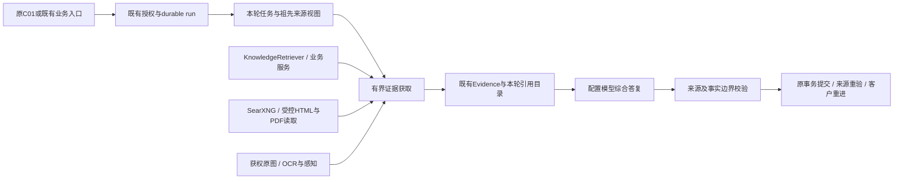

# 小K第二期：需求整理与人工交接

<!-- xiaok-v1-02-proactive-current -->
## 当前V1-02：确定性私人报告基础（Limited）

<!-- v1-02-report-history -->
**简报记录05：V1-02内限定Implemented，整体仍Limited。** 原C01聊天/根面板纸页新增当前获权项目、上海月份及日报/周报筛选，沿原20条beforeId分页。月份归属按不可变报告周期起点的Asia/Shanghai计算，跨月周报不按投递月归档。GET /api/miniprogram/assistant/followups/:bindingId/reports接受projectId/month/kind/beforeId；原绑定context接受afterProjectId/projectId，返回每页20个获权工地、projectsNextCursor及独立重验的selectedProject，支持选中首屏以外的工地。全部沿FollowupService、原followupProjects/RLS与来源投影；非法/重复参数拒绝，正文不能选择租户/主体。项目筛选索引只保留该项目当前有效段且不返回已阅令牌；打开仍重验同一报告的完整收件人获权快照。没有新增报告中心、Agent、知识/权限或引用管线。

共用controller将历史与聊天卡片分开；读取失败保留筛选和旧有效列表，同范围重读，旧筛选响应不能覆盖新选择，撤权清除名称/内容。沿原跟进设置、鉴权详情和原记录入口；只有详情实际渲染及原journal准确已阅回执后更新阅读状态，筛选/列表不写已阅。同一session重进恢复选择，换身份/企业清缓存。事实仍facts_ready、知识not_generated，追问禁用。

证据：tmp/v1-02-report-history/verification.json。HTTP02索引/分页/月界有效范围保留，03补权限/已阅，05用原服务创建的21个标记合成项目250–270验证真实两页选项；04缺数据的驱动假设失败保留。Native04项目/筛选/几何有效范围及06余项5/5、最终07叠层3/3覆盖手动同范围传输503恢复、真实渲染已阅/重进与当前身份拒绝，产品/helper/官方CLI/窗口绑定drift[]。原夹具、状态码、运行时读取、选择器、轮询竞态及wrapper失败分别保留。未变逻辑复用Mini91/91、日历/月份11/11；最终包体13/13、当前定向lint0、源码lint0错误/25警告，类型原82/受影响0，均有影响/源码绑定。未重启完整build，原类型失败及compile-only边界保留。

设计继续沿批准05-report-history-v001.png及原README，853×1844→390×844。限定原生叠层实测纸页(0,145)/390×699，标题32px Black、内容宽331px、项目/类型44px操作区、行标题17px/元信息13px、普通行93.23px；字形、分隔、grip/关闭及完整宿主已选审。复用requirement-home.png/x.png；5820B/22字形标题/日期子集来自获批Noto Serif SC Black/OFL，放styles/assistant-report-history.less，原Chat Serif字节不变。无生图/设计图切片。助手源包1989938/1998848，真实编译/上传包、根面板05、实体picker/键盘/真机与全聊天光学未验。队列0、计划关闭/version122，248–270归档/对客关闭，测试账号停用，原生身份/存储/传输及自有资源恢复。providerMax4114/knowledgeMax3753及3753 unknown/input_tokens null不变，模型/摄取0次。后继11再04；V1-01停测/费用与生产边界不变。

<!-- v1-02-enterprise-plan -->
**企业报告计划10：V1-02内限定Implemented，整体仍Limited。** enterprise_admin及明确所选企业的admin/super_admin从原C01历史进入批准10纸页，复用同一页面/组件、原生switch/时间/星期/checkbox、请求journal及管理守卫。GET/POST `/api/miniprogram/assistant/followups/plan`重验签名Mini身份、当前管理角色、密码、所选企业与RLS；请求正文不能指定租户/主体。GET仅给当前计划及获权工地选项，30条cursor分页。明确选择最多20工地，空筛选表示全部适用工地，仍保留原20个活动工地上限；紧凑表单保留原stageKeys筛选。

0106在原设置增加stage_enabled、weekly_day(1–7)、audiences、inactive_policy、dispatch_epoch，原字段及省略新字段的内部configure调用兼容。全部用Asia/Shanghai；修改周报发送星期不改变上一完整周一至周一的事实周期。角色/阶段/范围/时间仅影响后续任务，已排队范围保持原快照；停用总开关推进投递代际，重新开启后旧run、pending/held投递和自动补充不能成为新消息。必需日/周事实保存与个人接收偏好分开，发现/入队执行所选角色，成员/业主/来源权限独立保留。批准生命周期模式仅pause_inactive：paused/archived项目状态及原completion/move_in阶段键暂停新增调度/投递；自定义终态阶段需沿原项目状态处理，不猜阶段名称。历史阅读仍沿原权限。

草稿可前后台重进；关闭/换范围先确认放弃。409保留选择，显式重读核对后才可再保存；未知保持原键/正文并禁止另一操作，精确租户/版本/字段回执验证后才提示保存。撤权清除计划、选项与草稿。没有新Agent/来源/引用管线、生图或截图切片。Chat Serif原字节移到主包共享样式；同获批Noto Serif SC Black/OFL生成4464B标题子集放在共用计划样式，原README记录映射与逐元素校准。助手源包1983308/1998848；真实编译/上传包字节仍未验。

证据绑定组合脏checkout，不声称干净commit包含全部本机依赖。证据：`tmp/v1-02-enterprise-plan/verification.json`。HTTP01前7项通过（角色、真实CAS/同键/并发保存、可控日周调度、角色/阶段、生命周期及旧代际拒绝），最后保留停用账号实际401而驱动预期403及原清理失败；cleanup01与定向permission02分别完成，drift[]，cleanup02另恢复最初夹具的进度备注。Native02功能5/5，但旧未生效样式帧仍保留；最终native07为3/3，28px标题、16px行、纸页(16,88)/374×756、选择器、44px操作、长名省略及宿主，产品/直接驱动/adapter/官方CLI/exe/asar/窗口helper前后绑定drift[]。Native01选择器、03/04校准、05长名换行目视失败、06不支持的查询均不改判。Mini84/84、日历9/9；源码npm lint0错误/原27警告，定向与驱动lint0；类型原82/受影响0。未限定目录的lint误扫生成缓存，已停止并留原日志；原完整build类型失败与compile-only限制保留，不重启全构建。队列0、策略关闭、合成夹具/账号/原生身份与传输恢复；模型/摄取0次，无外部消息/生产变更。根面板10、物理picker/switch/键盘/真机及全聊天光学仍未验；facts_ready/knowledge not_generated仍仅事实，追问禁用。批准05筛选现已完成上述限定验证，下一步11再04。

<!-- v1-02-personal-settings -->
**个人跟进设置09：V1-02内限定Implemented，整体仍Limited。** 批准09纸页及01“管理跟进”补充沿同一C01定义/组件。`GET /api/miniprogram/assistant/followups/manage?beforeId=`每页最多30条当前仍获权的绑定最小元数据，包含停止、删除、保留期脱敏；不返回旧会话/报告正文、项目计数、未读或摘要。业主保留当前项目归属/开放检查，工人/设计师保留有效成员检查，所选企业owner/admin/super_admin沿提取后的原关系谓词，不另建权限系统；会话正文仍检查关闭、删除、参与者和脱敏状态。普通列表为空也能进入管理；自动发现不重开tombstone。

0105迁移在原绑定增加默认开启的三项提醒布尔值及`list_hidden`。`POST .../:bindingId/preferences`验证三个布尔值、expectedVersion和原幂等键。偏好仅改变本人阶段/日/周站内接收，调度与事实保存继续；投递落为`muted`，不插入消息或未读，历史仍沿原来源权限读取，详情实际展示可确认该报告已阅但不确认消息可见。重新开启只影响后续接收，不补刷旧静默记录。收起仅写`list_hidden`，不取消会话或改变上下文；真实新投递可重新显示。停止恢复同一目的地；删除关闭/撤销旧目的地，删除或脱敏后只有本人明确重开才把原绑定移到新代际，不复制旧上下文、报告、序号或未读，并保留原模式；旧任务、详情、更正和回执不能迁入新代际。

共用客户端保留前后台重进的未保存选择，切换/关闭/生命周期操作前确认放弃；409保留选择，显式重新读取核对后才可再保存。保存中/结果未知禁止竞争写入，同原持久键/正文恢复并验证准确回执后才显示成功；当前撤权清除设置名称和草稿。09复用原home/x素材与原生线条几何、switch/picker/modal，无须新插画或设计截图像素。证据在`tmp/v1-02-followup-settings/`，完整依赖绑定及原失败范围见下。这是个人接收/管理范围，不是AI报告/追问或完整V1-02验收。

当前限定证据：0105在原acceptance锁内沿canonical本地迁移成功。最终`http-06-bound-dependencies`为9/9，绑定2201路径、drift[]，覆盖六身份最小投影、CAS/同键保存、真实阶段/日/周队列与事实保存/静默投递、只影响后续接收、收起/停复、并发删除重开/旧任务拒绝、实际定向保留期脱敏、成员/业主关闭/强制RLS及清理。保留HTTP01入口token/数组清理、02当前阶段夹具、03旧任务错误码期望、04保留期基线守卫的原失败，cleanup-only及后续余项不改判原批。native03限定6/6，覆盖真实保存、成功回执丢失/重进/同键恢复、取消放弃选择、停止恢复、删除/实际脱敏/新代际。native01误点专业端返回；02保留SDK switch tap错误预期及旧sheet级联，03功能证据与最终光学校准分别保留。最终06逐元素采集沿同一副屏Stable2.02.2608080/base3.17.2/390×844，绑定产品/直接驱动/CLI/窗口；05/06使用相同32px Noto Serif SC Black标题、16px行文字、44px偏好label热区、64px管理行及44px保存操作，纸页(16,88)、374×756。新增四字WOFF2为2544字节，来自获批原字体并沿现有OFL许可，仅嵌入共用设置样式，原124字Chat Serif不变。switch变化使用官方trigger/change，物理手势/键盘/设备仍未验。03及最终帧共选审7张页面、2张宿主，过程帧保留。Mini71/71、身份/鉴权14/14、定向lint0；类型仍原82/受影响0，后续仅字排/label与采集驱动改变，影响检查复用未变服务/客户端行为，不重跑业务矩阵。助手源分包1998612/1998848，真实编译/上传包字节、根面板09原生及完整聊天光学仍未验。没有重启完整build，原类型失败及compile-only边界保留。队列0、策略关闭、合成账号停用，原生身份/存储/传输恢复、自有资源释放。providerMax4114/knowledgeMax3753及3753 unknown/input_tokens null不变，无模型/摄取、生产或外部消息。

<!-- v1-02-selected-enterprise -->
**小程序所选企业管理：V1-02内限定Implemented。** 原身份切换/刷新/bootstrap与`MiniProgramIdentityRepository.selectContext`现为admin/super_admin保留明确选择的有效企业，不建立雇佣或项目成员关系；普通员工明示其他企业会被拒绝。0104迁移替换原`construction_miniprogram_access`函数，所选企业管理继承仍经当前手机号/用户/会话版本/菜单/密码及租户检查，不另建权限解析器。批准follow-up-v1第08图的企业选择沿纸页面板、原生搜索和原platform-enterprises接口20条分页；原App hydration前先清旧报告/照片，之后只打开所选私人目的地。切企不再触发普通离开跟进的跳转；未选企业时提示选择，不误称人工接待。原户型控制器移到主包utils并保留子包包装入口，行为/路径合同不变；无新插画或截图切片。

证据为`tmp/v1-02-followup-management/verification.json`。HTTP-01的驱动bootstrap层级及无效企业状态清理失败保留；后续已补停用合成账号/控制企业，3917–3920的合成手机号保留为夹具，因首批前值未保存，不宣称精确恢复。HTTP-02为8/8、drift[]，覆盖三管理角色真实选企/刷新/读写、同键open、身份/改密、本人及租户拒绝和清理。native-01保留真实意外跳转失败；修复后native-02为5/5，但其两次搜索图同名覆盖且新Less当时未刷新，不作最终光学证据。native-03核验刷新后的样式；最终native-04同时绑定产品、直接/嵌套驱动、CLI适配器及窗口脚本，在同一副屏Stable2.02.2608080/base3.17.2/390×844限定4/4。3张348×752页面和2张1700×960宿主图已审看；搜索区实测(31,250.03)、331×45px，企业操作保留44px热区。入口样式失效更新后才刷新Less，原帧保留。这是组件验证，不代替完整报告/卡片逐字形校准、根面板、实体键盘/真机、真实编译包字节或阶段验收。最终Mini63/63、身份/鉴权14/14、定向lint0，类型仍原82/受影响0，绑定均drift[]；助手源分包1994826/1998848字节。未重启构建/模型/摄取批，providerMax4114/knowledgeMax3753及3753 unknown/input_tokens null保持。队列0、策略false/version62、合成248已归档、管理账号停用，原生身份/存储/传输恢复。个人接收偏好/恢复管理见上文；批准05筛选及09/10设置见上文，人工接待与报告追问仍未完成。


本项是[唯一计划第2节](./xiaok-renovation-agent-development-plan.md#2-唯一当前任务)明确允许先行的独立确定性工作，不重开V1-01停止的收束批，也不宣称四端用户旅程完成。没有新增供应商、模型、摄取或校验管线；KnowledgeRetriever/Evidence及原未知结果/用量合同保持。员工获权事项/安排与业主公开记录节选复用同一事实服务。初轮纯事实客户端与原记录/照片导航已有下述限定HTTP/原生证据；知识生成、完整客户端接入及完整语义/原生验收仍待完成。

- **入口与配置：** 原鉴权`POST /api/internal/assistant/jobs/run`推进配置任务并消费原assistant队列；内部响应新增`constructionReportChecks`，该内部基础原未新增用户HTTP路由；现已由下述客户端分支补充本人报告HTTP入口，没有新增页面或菜单。`ConstructionReportService`沿`constructionAccess`校验所选企业的负责人/admin/super_admin，不借用知识预览权限。配置默认关闭，绑定至多20个项目及企业阶段；有效且可写的配置现于同一事务立即发现目的地，无须等任务到期或客户打开；禁用/不可写助手只保留配置而不建绑定；员工不能改企业策略。项目列表为空只代表有界的有效在建范围，配置/发现时越界则启用及新绑定一并回滚，之后调度范围溢出仍保存策略错误。停工/归档项目不生成，历史读取仍须当前有效关系。
- **调度与版本：** 固定`Asia/Shanghai`，默认日报20:00、周一08:00周报；周报周期为上周一00:00至本周一00:00，日报为当日00:00至截止，结束时刻不包含在读取区间内。每种周期仅补最近一期，不回放全部积压日期。改时刻影响后续任务，已建任务保留原范围。按精确周期/受众键去重；明确更正沿同reportId新增版本，保留已保存项目集合并从最新版本结束时刻推进；日报只延至不含上海午夜的结束/读取截止，周报截止不随请求时间延后，阶段事件也不含截止时刻。发布时间仍是记录时间边界，不推断实际施工日期；没有业务发生日期模型。
- **自动日终补记：** 上海午夜后的首次Worker tick检查已完成日报的仍获权迟到发布；沿原facts-ready outbox/消费回执、原发布事件/版本及本地队列，每tick最多检查20份、仅最近7个已结束自然日。只有符合条件的发布才沿同reportId新增版本，结束/读取截止均不含该日午夜；无变化或失效检查只保存内部消费回执，不冒充用户投递，排队/失败/unknown运行不重建。更正冻结已保存的项目集合，沿最新版本结束时刻推进，日/周读取不回填次日事项或阶段。仍验当前原件/成员移除历史、停止/删除、保留脱敏和原范围；不新增表、游标、路由、Agent、模型调用或知识摄取。
- **获权事实：** 不可变版本保存周期/截止/生成时间、原记录ID/版本/hash与阶段事件定位。先授权取数再序列化：业主限本人的精确对客发布，员工限当前项目权限内已发布的内部/对客记录；排除草稿及客户私聊。每份至多20项目、每项目50记录/30阶段事件，返回截断标志；未知历史阶段保持未知。事实为`facts_ready`，知识为`not_generated`；任务成功只代表本地事实快照已保存，不代表AI报告、施工完成或验收。
- **事项/安排历史：** `report-items.ts`沿原`site-issues`、`site-plans`、`site-resolution`服务新增可选的不含结束时刻的截止读取；默认调用仍取当前状态。员工/老板日、周事实使用`aggregated`，保留事件ID、修订/hash、期内变化/期前遗留；每项目最多50事项候选及50最新方案候选，分别标识截断。期前未完事项保留为遗留，期前已终结且期内未变的不再列入。只有截止前明确获同意的方案才算已确认安排；截止后回复、决定、落实或关闭不能回填。同意不代表落实、验收或付款，没有记录的期限不推断。当前原件、房间/材料、发布人/成员及移除历史仍验；撤回/替代方案或已保存事项依据失效时隐藏项目段，不改旧事实。没有事项字段的旧快照保留。业主回传/方案授权仍仅限原咨询；业主公开记录的待处理/协调节选按下项接入，不复制那些消息或扩大授权。阶段事实仍为`not_aggregated`。不新增表/迁移/路由/权限解析或引用管线。
- **业主公开记录来源：** 业主回传/方案授权仍绑定原咨询。业主周期事实的`issuesStatus`现为`published_records_only`，`publishedRecordItems`只取当前获权精确对客发布中的pending/coordination原文，保留原记录/版本/hash、发布时间、房间及期前遗留标记。先按收件人和不含结束时刻的截止筛选，再限50个候选并独立标识截断；排除空字段、草稿、内部记录和其他收件人。这些是发布原文，不推断当前事项状态、分派、期限、完成或批准。`arrangementsStatus`仍为`original_consultation_only`，不转移私聊/内部回复、回传节选、方案或原图授权。每次重读/投递沿原记录解析器重验全部原件，包括不在当期记录列表的期前遗留；撤回即隐藏项目段并撤销待投递，不改已保存事实。旧快照的原字段/状态保留。
- **私人目的地与生命周期：** 0103新增强制RLS的`construction_report_settings`、`construction_followup_bindings`、`construction_reports`、`construction_report_versions`、`construction_report_deliveries`五表，在原会话/参与者/消息中增加`construction_followup`。业主每项目一条，工人/设计师/企业负责人按企业、本人、受众固定；平台账号须所选企业显式启用。S04仍共享，C01仍普通私人咨询，新建普通聊天不改变目的地。沿原租户队列、租约/次数与终态事件；授权未能确定时不会把本地报告路由到模型。真实阶段变更现不依赖业主可见或到场提醒开关，即保存outbox事件。
- **投递与阅读：** 报告版本/收件人唯一，消息与投递原子提交。消息正文只存`report:id:revision`引用；列表/详情/投递都重验原件和关系，包括移除后重新加入的历史。失效段不泄漏名称、计数、摘要或正文。原retentionRedacted标记同时阻断列表/详情、来源投影、后续建任务和投递，不删除原业务记录，也不静默复活旧绑定。 只有本人明确且获写权限的resume才能在同一绑定上原子更换全新私人会话；保留旧脱敏标记、撤销旧参与者、不复制旧上下文，重置未读并保留人工模式。报告列表/详情、重试/更正、投递及日终补记均核对运行所属的当前会话代际；新代际的周期键独立，原目的地的既有周期键保持。新代际消息可见确认须携带conversationId并绑定幂等体，阻断旧序号/旧回执碰撞。配置、发现及tick都不能执行这种重新开启。 重试/更正的幂等旧成功回执同样重验当前目的地，不能绕过执行分支检查而返回旧代际的排队回执。报告已阅须当前详情token，会话消息可见确认另行处理；列表/详情本身不自动标记。归档只在真实新投递时重显，停止/删除不自动重建，恢复须明确操作。人工接待保留结果、暂停插入且不自动恢复AI，恢复时合并较早积压，避免集中刷屏。已知本地失败沿原job/run重试，provider-started/unknown不适用这条恢复。
- **设计边界：** 运行时接入位于共用C01页面/组件（`packages/assistant/chat/chat`及`pages/index/index`的小K面板）。代码加入私人跟进分组、按收件人裁剪的纸页卡片/详情、原记录/照片读取、详情实际渲染后的已阅、可见卡片序号确认，以及沿新分支的收起/停止/重开。普通咨询草稿、焦点和目的地独立，前台列表轮询不切会话。原工地项目简报入口沿批准卡片/专业角色变体进入`chat?followup=1`。用户已于2026-11-01明确批准follow-up-v1全部01–11、管理入口补充和共用状态规则并授权实施，无须再次确认。当前首轮纯事实接入已有真实HTTP/原生证据，尚非完整还原：纯事实报告追问仍禁用；人工接待交互与报告追问仍待完成；批准05筛选及09/10设置见上文。来源服务/代际边界不变，没有打包整屏设计像素或新增插画。

确定性基础内的业主公开记录来源已接入；仅原咨询获权的来源继续从原咨询访问，报告获权原件导航已接通；完整报告追问和管理交互仍未完成。绑定现于有效启用/配置、调度/事件到期或本人显式open时建立；保留脱敏后本人明确resume现沿原绑定更换新私人会话，无新增schema或HTTP入口。这些仍属V1-02，不能据此进入V1-03。

架构采用保持聚焦：[LangGraph工作流/Agent](https://docs.langchain.com/oss/javascript/langgraph/workflows-agents)区分确定性步骤与模型自主编排，[持久化](https://docs.langchain.com/oss/javascript/langgraph/persistence)说明按会话的持久状态。本项保留现有运行时与事务型业务outbox/队列，不新增图、Agent、知识存储或投递队列，也没有新增供应商协议补丁。

工程证据保留在`tmp/v1-02-proactive-foundation/`。时钟检查6/6；固定确定性矩阵service-02为13/13，时间精度/订阅边界service-03-boundaries为5/5，当前service-04-retention为6/6并补脱敏兼容。每批有各自固定源码/驱动/配置且drift[]；未变service-02范围按影响复用，不改写成同版首稿通过。provider/knowledge attempt增量0，原3753不变。首服务批员工/老板误走预览授权的失败及驱动前置失败各自保留；只有明确本地流程跳过无关预览检查，当前身份/参与者/项目/原件/策略不放宽。修正后的源码lint通过（27项既有警告）；类型检查仍原82项，受影响0新增，驱动3处类型声明修正的JavaScript完全一致。初次工程批因Next生成类型配置漂移而无效，单独保留；原脏配置已精确恢复。普通独立构建仍在既有xiaok-manual-fixture.ts43的state.keys类型错误处失败。最终受控Webpack compile-only检查exit0，完整源码/配置绑定drift[]，原配置精确恢复；不把原完整类型构建失败改记为通过。

事项有界证据在`tmp/v1-02-report-items/`。service-04保留前5块通过：截止/历史、四角色队列/写入/投递/重进、事实不变/幂等及本人/跨企业拒绝。第6块先通过方案撤回，随后成员撤权重进因未来来源事件与未平移的当前合成审计时钟比较而失败；该块仍记失败，末块用量未执行。service-05-revocation复用原report80/hash，以新写且明确控制时刻的合成移除/再加入审计定向2/2通过，不重新生成报告或改判service-04。两批binding均drift[]，批间只有测试驱动变化。service-01/02夹具前置失败、service-03前2块通过后过早断言队列的失败均保留；后者2任务完成/2尚未领取的原状态见queue-diagnosis.log。驱动现有界等待原任务终态并保存owned run，不为驱动/时钟问题放宽源码或权限。最终static-closed定向lint为0，全量类型仍原82/受影响0新增，binding drift[]。没有路由/schema改动，不另跑完整构建；旧compile-only仅保留原范围，原完整构建失败不改判。provider/knowledge最大ID仍4114/3753，3753保持unknown，没有新调用或费用清零。各批结束均策略关闭、复用项目242/243归档、5395–5397停用并释放acceptance锁。这是后台工程证据，不是自然对话/原生验收。

首次启用证据：`tmp/v1-02-first-enable/service-01/`真实服务5/5通过，覆盖助手禁用门、即时四角色发现（两项目5目的地）、同键重进、员工拒绝及停止/删除/保留脱敏不复活。无到期tick、客户端open、新报告或provider/knowledge attempt。binding drift[]；5410–5414停用、248/249归档，策略及临时非夹具老板抑制恢复，acceptance锁释放。最终静态lint为0，类型仍原82/受影响0新增，drift[]。本次仅改配置/发现时机，原事实/历史/投递证据按未变范围复用。


保留脱敏/代际证据在`tmp/v1-02-retention-reopen/`。service-02-correct-fixture固定10项业务检查全部通过：原归档拒绝及回滚、自动不复活、租户/本人/版本/写门、并发只更换一次、同周期新任务/保存/投递、报告已阅与消息可见分离、停止后原任务失败、真实定向retention、删除后脱敏重新开启、旧报告/更正/重试/回执/待投递阻断、重进及用量不变。但其整体exit1保留：清理驱动误用DTO的`customerAccess`而非`customer_access`，不能把整批改判为绿。service-03-cleanup-only复用原10项、仅清理检查1/1通过，不重放业务；批间只有驱动变化、产品hash相同，各binding drift[]。实际核实策略false/version32、助手enabled、全队列0、248/249归档且customer_access=false、5410/5411停用、27/29停止并分别指向新会话878/876；旧863/865脱敏标记保留，原82–85事实/hash不改。service-01错误的报告夹具映射仍为前置失败。static-pre仅诊断（未绑定、5处驱动DTO联合类型错误），最终绑定lint0无警告、类型仍原82/受影响0、drift[]。无路由/schema改动，不新增完整build/原生/语义通过声明。provider/knowledge最大ID仍4114/3753，3753保持unknown且input_tokens null，无新调用或费用清零。acceptance锁释放，临时空抑制36删除。


最终service-04-receipt-replay仅验证审查新增的幂等回执边界，3/3通过、drift[]：真实服务先保存同代际失败任务的成功重试回执（原run1711）及report96更正回执（run1712），实际retention后明确换到新会话880；重放原键均被context_changed拒绝，新增运行0、旧待投递0，原运行仍succeeded/report96仍revision2。只增加followup重试前置检查、report-service更正结果后置检查与驱动，其他代际/角色/事实/未读证据按影响复用，没有重跑10项。最终static-closed lint0无警告、类型原82/受影响0、与上包诊断一致，drift[]；此前static-final保留其原版本范围。清理核实策略false/version34、队列0、助手enabled、248/249归档/对客关闭、5410/5411停用、27/29 stopped并指向880/876；旧863/865/877/878脱敏，新空抑制已删、菜单恢复、acceptance锁释放。

业主公开记录来源证据保留在`tmp/v1-02-customer-sources/`。service-01通过准备/来源筛选，随后驱动把咨询/跟进能力混在同一身份而导致普通咨询夹具创建回滚，原失败保留。service-02-purpose-fixture只修驱动并复用原发布记录，真实团队回传/已同意方案的原咨询授权检查通过；随后立即投递断言失败：原日报run1713/report98其实已成功保存，conversation880因保留human模式而正确held。service-03-held-remainder剩余6/6通过，复用这份已成功/暂存原运行及前两批来源检查，只控制标记夹具模式用于投递并在finally恢复human。日报不重新生成即可投递/重进，周报report99/run1714真实保存，其他用户/企业拒绝；撤回不在当期记录列表的期前原件后，两份项目段隐藏、周报待投递撤销，两份快照不改；51候选返回50项及截断。三批源码/驱动/配置绑定均drift[]，批间产品hash相同；不把原失败合并改判为首稿全过。最终static-final lint0无警告，类型原82/受影响0，与上包static-closed诊断一致、drift[]；static-pre保留8处驱动DTO类型诊断，修正后的types-02已回到原82。无路由/schema/UI变化，不新增完整build/原生/语义通过声明。清理读回策略false/version40、队列0、5410停用、248/249归档/对客关闭、绑定27 stopped/880，human模式恢复、临时空抑制删除，acceptance锁释放。provider/knowledge最大ID仍4114/3753，3753保持unknown且input_tokens null；原82–85/92/94–97报告hash及费用保留。

### 客户端接入检查点（2026-11-01，Limited）

原catch-all现分派`/api/miniprogram/assistant/followups`：GET本人私人绑定列表/范围、`/:bindingId/reports?beforeId=`、`/:bindingId/reports/:reportId?revision=`，以及报告获权的`.../projects/:projectId/records/:recordId[/media/:mediaId]?revision=`。POST支持本人明确open、带版本archive/stop/delete/resume、携conversationId/throughSequence的消息可见确认、携revision/readToken的报告已阅及明确本地失败重试。全部沿FollowupService和原租户仓库、代际/脱敏、项目/原件及成员守卫；Mini身份与所选企业来自原鉴权或已验证的客户入口token，不信任body传入principal/企业/受众/delivery能力。工人只放行followups分支，不开放普通客户conversations/runs/citations，保留密码修改门。范围只返回当前获权项目/阶段与私人目的地元数据；原件须属于同一仍有效报告快照的精确记录/媒体定位。偏好字段及原关系谓词提取见上文，没有另建权限、Evidence或引用管线。

当前证据在`tmp/v1-02-followup-client/`。static-01原失败及static-02-package-sharing222/222保留。HTTP-01–06各夹具/合同失败保留；HTTP-07前7块通过后因驱动遗漏原普通咨询body.entryToken失败；HTTP-08沿同产品hash复用这7块、原报告/原件，仅准备+剩余4块5/5通过，不重生成或改判首稿。真实微云1454写入/重读覆盖四角色日周事实、human结果held后不重生成投递、原件照片、JWT/角色/版本/改密门、消息可见与报告已阅分离、同键恢复、收起停复/普通咨询隔离、成员移除再加入及来源撤回。该批全局Mini403保留为历史；当前所选企业聚焦修复见上文。native-01/02/03注册项/窗口/旧9420失败保留；native-04-cli用仓库既有官方注册wechatideNativeClient适配器，在唯一已核实副屏Stable2.02.2608080、base3.17.2、390×844下限定7/7通过：历史草稿、卡片详情/实际渲染已阅、认证原件照片、停止丢回执/同键恢复、工人设计师老板、重进/human只读与撤回清空。各完成HTTP/native批binding均drift[]。11张348×752页面PNG及一张1700×960宿主图已审看；另两宿主图已保存但图片查看工具阻塞后未审看。几何已保存，完整逐元素/字形校准、根面板跟进原生、实体键盘/设备和全部新增状态还原仍未验。新驱动定向lint0，类型仍原82/受影响0。compile-01在独立NEXT_DIST_DIR=.next-v1-02-followup-client退出0，绑定源码/配置drift[]，原tsconfig/next-env hash精确恢复、acceptance锁释放；仅compile-only，原完整构建类型失败保留。助手分包源文件仍1996029/1998848字节，真实上传/编译包字节未验。closed-fixtures.json记录队列0、策略false/version62、248/249归档/对客关闭、5410–5419停用、自有跟进停止、880恢复human及23个自有CLI临时参数文件已清。providerMax4114/knowledgeMax3753及3753 unknown/input_tokens null不变；无模型/摄取调用，不声明语义/完整阶段/生产完成。

可复现入口（在admin/运行）。仅出现新的明确变化/失败时另取标签；不重跑未变证据，不执行V1-01停止批。最终汇总为同目录verification.json；仅本地后台证据，非完整原生/语义验收。

迟到发布证据在`tmp/v1-02-late-reports/`。service-03-formal-room保留前6块通过：四角色真实快照/投递、迟到及恰在午夜的排除、并发单版本、历史不变、日/周更正截止及撤回投影。第7块因驱动试图移除唯一工地负责人而被`construction_manager_required`拒绝，仍为失败，该批末尾用量块未执行。service-04-lifecycle-remainder定向3/3，复用report82–85及原6块，只补非负责人设计师移除/再加入、停止/删除/脱敏、7日界限和组合用量检查；两批产品hash相同、仅驱动改变，各binding drift[]。service-01企业事务读全局用户及service-02无房间正式事项的前置失败保留，不改判。合成发布时间同时控制记录、不可变发布版本和outbox事件，新增成员审计另留原时钟/控制时钟。Node时钟8/8；最终lint0无警告，全量类型仍原82/受影响0新增，与static-node日志逐字相同、drift[]；static-pre的Bun运行器错误及5处驱动类型错误保留。不新增完整build/原生通过声明。provider/knowledge最大ID仍4114/3753，3753保持unknown、input_tokens仍null。自有策略/任务/夹具已收束、acceptance锁释放，没有新模型/摄取调用或费用清零。

```powershell
node --import tsx --test src/lib/construction/__tests__/report-calendar.test.ts
# 原10项业务证据复用，清理已完成；只为新的明确行为变化运行新批。
node --import tsx scripts/xiaok-v1-02-retention-reopen-check.ts --development --output=../tmp/v1-02-retention-reopen/service-NAMED-CHANGE
# 复用原六块，不重放旧批或覆盖证据。
node --import tsx scripts/xiaok-v1-02-late-reports-check.ts --development --day=2026-11-21 --recheck-lifecycle=../tmp/v1-02-late-reports/service-03-formal-room/report.json --output=../tmp/v1-02-late-reports/lifecycle-NAMED-CHANGE
node --import tsx scripts/xiaok-v1-02-reports-check.ts --development --first-enable-only --output=../tmp/v1-02-first-enable/service-NAMED-CHANGE
node --import tsx scripts/xiaok-v1-02-reports-check.ts --development --output=../tmp/v1-02-proactive-foundation/service-NAMED-CHANGE
node --import tsx scripts/xiaok-v1-02-reports-check.ts --development --delivery-boundaries-only --output=../tmp/v1-02-proactive-foundation/boundary-NAMED-CHANGE
node --import tsx scripts/xiaok-v1-02-report-items-check.ts --development --day=2026-11-11 --output=../tmp/v1-02-report-items/service-NAMED-CHANGE
node --import tsx scripts/xiaok-v1-02-report-items-check.ts --development --recheck-revocation=../tmp/v1-02-report-items/service-04/report.json --output=../tmp/v1-02-report-items/revocation-NAMED-CHANGE
npm run lint -- --ignore-pattern '.next-*/**'
npx tsc --noEmit --pretty false
```

<!-- xiaok-v1-knowledge-current -->
## 当前V1-01：企业知识自然对话（Limited）

**当前自然解释修复包（默认关闭，2026-11-01）：** 显式agent_config.knowledgeExplanation启用的新建非原生结构化收尾reply/site.question快照绑定reviewed-knowledge-explanation-v1。有界模型问项计划只是数据，不要求逐字子串；未改写的当前用户原话另行复核。逐Q沿原综合回答/引用目录，经原引用/数值/现场事实/回执守卫及同一配置模型对覆盖、依据、条件、义务强度的语义复核。首稿、获权来源及用户原话绑定持久证明，提交重新鉴权且须匹配成功证明。逐字原文及历史快照保留旧摘录；复核和一次修复共用原预占token/派发/现金边界（最多五次），不扩容或另建Agent/引用/摄取/表/UI。采用维护中的[LangChain收尾工具策略](https://docs.langchain.com/oss/javascript/langchain/structured-output)，不迁移框架；继承D2计数仍2。

**有界收束与归属：** 1603–1608六批16次对话调用的首稿/修复全部保留，新增unknown4101/4104/4107/4111/4114，另保留五项旧unknown。仅保存1608实帧证明完整JSON实参后多一个右括号；识别字符串/括号的解码器只规范化官方qwen3.7-flash/final_response这一种完整帧并私有保存原始实参，截断/内容更改/其他工具或供应商仍拒绝。tool_calls:null按无调用处理；安全诊断仅形状/计数/hash，显式待验路径的无效帧沿原private_checkpoint留存。零调用回放不算语义通过。Knowledge另修点名资料选段：在既有五来源上限、硬授权/适用性之后，先保留获权精艺2835基层/2837管根再资料分散；《精艺》只取用户原话，不取模型追加检索词。不重新摄取/发布、不改权限。

定向离线135/135、lint通过，全量类型仍原82/受影响新增0。service-named-01实服务8/8覆盖六角色/来源/草稿/跨企业/撤回撤权及真实503恢复；此后仅原生驱动改变，未变服务证据复用。Stable预检4/4核实唯一副屏注册项目、390×844/3.17.2。**唯一最后**closure-business-01预先绑定262文件及原两条三轮旅程各两次（HTTP→原生，保留并列/为什么/改口及断言），但在夹具资料419/version425索引job2125的**chunk attempt3753 unknown**即停止，0新对话run、12个计划run未执行。不重试或重开诊断/业务批；资料已retired、5389停用、策略/配额恢复、无活动任务，drift[]。V1-01仍Limited、开关关闭；对话保守账册CNY32.828897/100及10个unknown保留，3753的token/费用单列未知，不能写0。见tmp/v1-01-weiyun-jingyi/closure-business-01/{fixed-plan,binding,report,index-audit}.json及explanation-implementation/closure-offline.log。按唯一计划第2节拥有本交付。本地默认测试企业为微云1454，来源为用户指定的`装修施工标准手册制度规范/精艺.pdf`，SHA-256 `efcdc6f1e01ec848d0908e99ddd08929a7f0f07b3942f5b539864361f4aa049b`。保留原页图像的30份本地OCR副本为文档376–405；对照原图校对的第29/30页工艺正文发布为404/405、版本410/411，共55索引段，其余28页为OCR/表格待复核的内部草稿。原图/完整PDF及既有知识未改，原件180mm与≥1800mm印刷冲突保留。这是本地预处理，不是在线OCR或扩大上传能力。证据`tmp/v1-01-weiyun-jingyi/`；导入不算语义验收。

已核实S04缺口，正在沿同一Agent、已发布知识的KnowledgeRetriever/Evidence和持久任务/用量/恢复链补齐。项目问答只读，保留原施工记录/动作的核对流程和业主私聊边界；每次读/提交重验有效成员及所选企业，草稿不转成项目知识。实际阶段/修订为服务端来源依赖，派发/提交和重进时重验。界面沿S04原PPT22/38主设计和既有C01来源弹层状态规则，不改Less/素材或新建导航/视觉方向。四端实模/原生整链仍待完成；D2两轮失败、unknown和累计费用保留。

**保留失败与机制判别：** `http-fixed-01/run-1596.json`记录自然提问“我在看《精艺》这份装修手册，卫生间防水前要准备什么？”。Evidence正确包含版本411的2835/2837段，回答把“地基放坡找平”转述成“需对地基进行放坡找平”；要求义务句逐字对应的原文守卫判为`ungrounded_response_scope`，原有一次修复仍失败。三次供应商结果均已知，用量8460 tokens，按原保守账册费率记CNY0.042300，均不计为首稿通过。这是Agent消费/收尾缺陷，Knowledge无需重新摄取。保存trace的`excerpt-diagnosis.json`以零模型调用证明同一守卫接受原文完整条款。新建非原生结构化收尾的reply/site.question任务绑定`validated-source-excerpts-v1`：本轮成对真实检索后，原文问题暴露既有片段ID，模型选择、原服务渲染；继续执行全部综合回答/来源/数字/承诺守卫和实时Evidence鉴权，旧快照保留旧协议。这是复用既有选择器的机制调整，不是第三次提示词/正则修补；继承D2失败计数仍为2。重新开启的固定范围为相同业主三轮和共享四角色三轮旅程各两次，保留全部首稿与实际配置。

参考维护中的[LangGraph JS成对工具测试](https://github.com/langchain-ai/langgraphjs/blob/main/libs/langgraph-core/src/tests/prebuilt.test.ts)，继续使用成对消息和应用端鉴权，没有框架迁移收益。[Qwen流式片段合并](https://github.com/langchain-ai/langchainjs/issues/9237)、[流式工具调用丢失](https://github.com/langchain-ai/langchainjs/issues/10937)、[Ollama推理历史](https://github.com/langchain-ai/langchainjs/issues/11908)涉及不同适配器/流式路径，不能据此认定本次非流式DashScope的原因；采用决策以本地响应trace和零调用判别为依据。

**原生来源状态检查，2026-10-31：** 用户已确认副屏位置。注册Stable CLI/官方SDK对本绝对项目新编译，基础库3.17.2、390×844，无重复开窗或9431依赖；`native-confirmed-01`前检通过。保留native01点击超时和native02负责人失败：后者是自有合成账号缺少现有非空手机号条件，不改权限规则。`owner-contact-diagnosis.json`在回滚探针内证明Web owner/Mini拒绝→补入未验证的合成联系号码后Mini owner。仅复用native02业主/工人/设计师出处点击重进、native03负责人出处及真实确定性项目查询写入/重进的未变范围，原完整批次仍失败。该查询如实返回范围内暂无现场记录，不能证明已施工。

native03暴露真实缓存撤权缺陷：现有4秒页面轮询跳过所有已打开弹层，使原文可能在成员移除后留存。定点修复仅允许非加载中的只读来源弹层刷新，编辑/发布/忙碌/隐藏规则保留；原守卫回归失败，修复后Mini组28/28。`native-reentry-04`专项9项通过（含显式证据复用），实测出处点击、真实延迟HTTP503的加载/失败/重试、成员移除清历史/原文、KnowledgeService撤回清已开原文及重进。复用前检查产品/辅助代码影响，最终源码绑定drift[]，选审14张核route的390×844/PNG348×752帧。见`tmp/v1-01-weiyun-jingyi/native-final.json`。自有合成来源411恢复retired且版本正文hash不变；观察员关系、原生身份/存储/请求/route及锁/故障监听均恢复，临时负责人停用。本批Agent任务/模型步均未增加，原1602输出hash不变。真机、真实微信授权和完整宿主/PPT光学还原仍未验证，不新增人工验收门槛。

**2026-10-31历史快照——V1-01剩余缺口：** 后端52/52及原角色/租户/检索/撤回/恢复服务证据复用，全量类型仍为原82项、受影响/新增0。一次业主三轮旅程通过但1599原始首稿失败及修复保留。1602在Evidence完整时仍漏答穿线顺序，Agent选择/语义完整性缺陷及停止的第二次正常用户试验不因原生UI检查而转为通过。D2计数仍为2，原五项unknown及累计保守CNY31.078857/100保留，本轮模型调用/费用新增0。继续语义完整性机制和固定受影响试验后再V1-02；未部署/推送。 **以上保留原证据和费用；该快照的旧下一步已由唯一计划第2节2026-11-01有界收束决定取代，不再按旧段继续试验循环。**

<!-- xiaok-notebook-ui-current:start -->
## 当前手账聊天与显式户型范围（2026-10-30）

**获批UI范围内为Implemented；Agent整体仍Limited。** 客户根入口 `pages/index/index` 默认小K，另保留服务／我的两个逻辑Tab；原五个注册Tab及专业角色导航沿既有权限。异步 `chat-panel` 与旧 `packages/assistant/chat/chat` 共用聊天定义和控制器，切Tab保留会话、草稿和户型选择。`pages/mine/mine`仅变更客户导航，其账号主体及专业工作台仍沿既有设计源。

当前设计权威为[手账设计与逐元素台账](../design-references/xiaok-chat-redesign-20261029-v1/tab-context-v1/README.md)；活动目录 `design-references/xiaok-chat-redesign-20261029-v1/tab-context-v1/` 包含01–04主变体及05–11生成／停止／失败／人工等待、探索入口、公开工地与设计师结果补稿。纸页、装订、字排、照片装裱与控件用原生结构／Less实现；欢迎角色和叶片为两张独立生成的透明PNG，没有设计图切片。工地照片、阶段／区域、作者和作品参数沿原获权投影；查看工地、作品、设计师主页分别走原路由。加载、无结果、定位拒绝、失败和撤回沿共用状态规则；未完成回答及人工接待不露探索入口，不虚构距离、认证、预约或完成状态。

`GET/POST /api/miniprogram/assistant/conversations/:id/floorplan-context` 实现默认**不结合档案**。GET只列本人当前正式v4主户型，或按精确版本只读详情；浏览不选择。POST必须带 `expectedVersion` 及显式 `selection`（leadId/floorPlanId/layoutHash）或null，复用原幂等账本，将 `floorplanContext` 存于 `entry_snapshot`，不新增表或迁移。选择按客户／企业／会话／版本隔离，不授予权限；忙碌／人工／关闭及费用未核对任务拒绝写入，回执丢失沿同键核对。重进及materials/business两条读路径重验实时所有权、主图关系和layout hash；失效选择清除并停止正式户型注入。用户原话和自行发送图片仍沿原来源规则。根入口仅从该客户已有线索／本人开放咨询中解析唯一企业；多企业时不自动选最新。

证据 `tmp/xiaok-chat-restoration-20261029/final-checks.json`：原生 `attempt-14-less-invalidation` 12项／16张应用截图＋宿主截图，最终定向 `attempt-16-bound-final` 5项／5张截图（重复范围保留）。Stable2.02.2608080／基础库3.17.2、390×844逻辑／348×752编码、单副屏窗口／控制器，真实隔离HTTP／数据库写入及认证媒体，清理和源码绑定均保留。早期Less缓存／卡片错排截图为失败视觉证据；最终校验真实卡片display／照片尺寸并审看宿主胶囊。Mini定向161/161、后端单元8/8、资料兼容7通过／1项实模跳过；Mini全量2053/2054，保留既有surveying Phase0审计不一致。源码lint为0错误／27项既有警告，受影响lint通过；类型仍56项既有诊断／受影响0。隔离webpack编译通过且配置恢复、drift[]；仅该验证进程关闭standalone复制，不声称干净产品构建。验收业务Agent／供应商调用均0；设计使用内置ImageGen，另计。物理设备、真实微信授权、实际软键盘几何和生产未验；D2原两次失败与唯一D7执行记录不变。

档案选择是确定性的应用状态，不是另一套Agent／Knowledge管线。保留原runtime／context／读工具分层，参照[LangChain上下文工程合同](https://docs.langchain.com/oss/javascript/langchain/context-engineering)。每次读入／回放重新授权，checkpoint持久化不代表持久权限。[上游runtime context序列化讨论](https://github.com/langchain-ai/langgraph/issues/8417)只作为Python侧新调用权限的参考，不声称本项目JavaScript存在同一缺陷。没有框架迁移、新引用解析器、供应商专用补丁或付费fallback；零模型的UI／范围检查不重评既有实模语义质量。
<!-- xiaok-notebook-ui-current:end -->

## 当前D6：核对后本地语音（Limited）

**D6核对后语音：Limited（2026-10-29）。** C01／S04已接显式配置的本地录音／真实转写、原输入框纠错、作者另行发送、认证原音回听、删除和持久重进；师傅语音＋本人照片已完成原核对／发布链。完整D6不关闭：客户需求实际保存，Agent随后自添无来源桌面尺寸，回答被正确拒绝；D2仍为两次失败修补，不重采客户回答、不弱化守卫。0099强制RLS语音资产表复用原权限、任务、用量及消息／记录写服务。已验隔离CPython3.12／faster-whisper1.2.1／CTranslate2 4.8.3 CPU及已有medium模型hash；默认关闭，无模型下载／付费ASR／fallback。现场动作解码仅剔除schema合法且逐项恰为空串的非当前动作字段，非空／畸形字段及原角色／来源守卫不放行。当前单元7、真实服务7、兼容37＋1项事先声明的实模跳过、Mini157通过；lint通过，tsc原54项逐字相同／受影响零新增。原生原失败单列；native06员工真实链与回听通过，native07验证客户纠错／错误状态及真实回听／删除，native09／10／11零新增推理补齐原音HTTP404、撤权清空和可滚动查看的原失败反馈。保留3次成功／5次失败本地ASR、5个未执行即取消的队列探针；Qwen6次／25583tokens，保守累计¥30.633887/100。本地文字／费用预留均0且已结算，原付费unknown保留。13张核route的390×844逻辑／348×752截图审看；沿C01／S04批准主设计、U01及宿主弹层，无Less／素材／还原等级升级。见[二期D6合同](./xiaok-assistant-phase-2.zh-CN.md#当前d6核对后本地语音limited)与tmp/d6-speech-20261029/final-checks.json。后继D7先确认订单／报价／安装验收设计源；硬件、支付、商业条件及生产未验。 完整隔离构建已编译，但standalone复制媒体耗尽磁盘且自动tsconfig漂移使原批无效；本轮副本可逆移至E盘，原配置按hash恢复，仅验收进程禁用standalone的compile03已exit0／drift[]，产品output配置未改；不称干净生产构建。

### 合同与职责

- 入口／设计：原C01麦克风、消息长按，S04麦克风、原话长按。C01当前P4B README继承chat-first-batch1 README“已接入后才使用标准录音／取消／回放”；S04原PPT22／38及U01提示、宿主弹层。853×1844按宽映射390×844。无新页面、CSS、插画或设计方向。utils/assistant-client.js／utils/speech.js下沉主包供两分包共用，原assistant/lib路径兼容转导出，沿用原pending-operation协议。录音／处理中／失败／可编辑／已发／删除／撤权复用批准组件；长C01历史需正常滚动查看既有失败页脚，不能把初始截图未纳入页脚误称没有错误状态。
- GET／POST /api/miniprogram/assistant/conversations/:cid/speech及/api/miniprogram/construction/projects/:pid/chat/speech列出／上传；GET／DELETE :speechId保护原WAV／删除来源；POST :speechId/retry只在明确操作及同一配置下重转原音。JSON base64在解码前限量；严格RIFF／PCM单声道16kHz／16bit，0.3–60秒、≤2MiB、每会话终身20段，不信后缀／客户端时长，不返回公开原音地址。
- 0099 assistant_speech_assets保存企业／会话／项目／作者、请求键、原音及hash／实际时长、配置／run、原始转写、分开的作者更正文、原消息、版本／deleted_at。复用复合外键／强制租户RLS、原咨询／接待参与者或项目权限；未发草稿仅本人，已发原音仍按实时原参与范围。enterprise_admin／admin／super_admin在所选企业继承管理，无需入职／成员。删除清字节及双份文字、脱敏原消息、按原审计撤下关联现场记录，并保守屏蔽同咨询中该原话之后、删除之前的衍生助手正文；原记忆／来源校验排除撤回原话。保留期清理同时清语音。S01原音UI不在本次入口范围。
- 原speech.transcribe runs／jobs沿用租约／心跳、来源／配置校验和私有草稿完成，不在用户另行发送前创建业务消息或派发Agent。人工／待接管可转私有草稿，不插入AI答复。上传未知保留原键／原音体，重试不换录音；本地结果丢失如实失败、显式恢复。audio_input_ms计实际输入，外部ASR费用0、不伪造文字tokens；ASR成功不能覆盖原未核清付费回答。真机麦克风、微信真实授权／扬声器、广泛识别率、分包发布尺寸和生产仍未验非阻塞。

### 显式本地环境与原失败

启用前按授权迁移流程执行0099，本轮仅迁移隔离55432/xiaok_embedding_eval。在自有隔离CPython3.12环境安装scripts/assistant-speech-requirements.txt；显式配置ASSISTANT_ASR_PROVIDER=local-faster-whisper、绝对ASSISTANT_ASR_PYTHON／ASSISTANT_ASR_MODEL_PATH及ASSISTANT_ASR_MODEL_SHA256。admin运行目录须保留scripts/assistant-speech-local.py；缺配置／文件不进入录音。本轮仅验收子进程配置，未启用普通.env.local／远程／生产。CPU int8／4线程、local_files_only／offline、90秒进程界限，模型SHA、config／tokenizer／适配器指纹及前后绑定；不自动下载模型、不接外部ASR备用。实际模型SHA256：9b45e1009dcc4ab601eff815b61d80e60ce3fd8c74c1a14f4a282258286b51ae。

native01保留Anaconda3.10／CTranslate2 4.8.2在模型构造处的原生访问冲突；旧环境4.8.3仍失败。已保存判别检查排除原音／解码、单一模型、工作目录及简单MKL／ISA假设；隔离CPython3.12／4.8.3用同适配器／模型／原音成功。这是环境隔离后恢复的事实，不能断言某DLL为根因或所有Python3.10均失败。复用维护中的[faster-whisper](https://github.com/SYSTRAN/faster-whisper)及[CTranslate2硬件配置](https://opennmt.net/CTranslate2/hardware_support.html)；已读[上游模型读取修复](https://github.com/OpenNMT/CTranslate2/pull/2110)，但它不能解释本次路径读取复现。不迁移Agent框架／知识管线。

native02两条有效真实转写、静音失败／重进／原音显式重试和上传丢回执已保留；该批role选择器失败。03／04保留旧夹具身份及单元素误作列表的驱动错误。native05两项业务原失败：C01 record_need实际保存房屋／人数／次卧办公位，离线原稿复核回执校验通过，拒绝来自额外无来源60–70cm／55cm桌面尺寸；该Agent／D2失败继续保留，次数2不清零、不做第三个文案变体／重采样客户。知识侧真实返回资料缺项／项目歧义，无需重建入库。S04实际选对report，却附带空的非当前plan／assignee／resolution；schema先验后仅规范化恰空字段，非空仍拒绝，不增加业务授权。native06新语音／照片草稿、真实内部发布、重进及native onPlay通过；预期撤权被旧open助手抛错，原批仍失败。native07客户回听onPlay1／errors[]、实际删除及失败run状态有证据；07／08保留序列化__name驱动错误，改用官方SDK callWxMethod。09／10／11零新增推理补齐原音HTTP404、删除／撤权重进、空历史及正常滚动后的既有失败页脚；不复活删除来源／成员。

### 检查、边界与后继

固定命令node scripts/assistant-d4-sharing-acceptance.mjs d6-speech-unit <唯一label>（7）、d6-speech-service（7）、d6-speech-compat（37过／1项事先声明的实模跳过）。原compat01缺retention环境、service01／02失败单列。Mini157、lint、逐字相同54旧类型／受影响零项见preflight-06；随后仅驱动变化另有影响核验、当前lint及原生证据，不事后缩绑定。构建及资源审计见final-checks.json。13张原生图审看，不升级宿主／真机／高屏／完整视觉还原。保留10合成企业、所有原失败／attempt；启用设置／员工／成员／jobs及自有3118／controller连接均0。ASR实际8次＝3成功／5失败，加5个未执行取消探针；13条本地额度均settled且文字／费用0，音频实际39900ms、供应商费用0。Qwen6次／25583tokens、保守累计¥30.633887/100，原账单／unknown保持。

D6在正常客户答复处仍Limited；显式开发配置下核对语音／现场服务能力可用。复用D5基线72fd0b4f及此前限定旅程。独立后继D7先需订单／报价确认／安装验收的批准界面源：仓库及PPT27–34核查只有服务介绍及现有视频查看，无该订单运行设计或模型／写服务。设计源决策待答时不自创UI、不重跑D2、不模拟设备／付款／退款成功，不生产部署。


## 当前D4自然语言资料共享

**D4自然语言资料共享：限定闭环Implemented，完整D4仍Limited。** C01先持久展示精确项目／房间、原文需求节选或紧邻本人点位图的私有预览；只有客户明确同意已展示的项目团队范围才写入原grant。指定个人、普通确认词、疑问、更正和收件限制不静默扩大授权。团队含有效设计师／经理／师傅／observer及获权enterprise_admin/admin/super_admin，当前不支持仅某个人可见。独立原文／确认hash、30分钟待确认期限、实时范围／版本重验、原键恢复及撤回后的派生读取／原件限制保留。定向撤回按本人原咨询实际项目／房间／资料类型或明确资料号解析，不能套用最近预览或模型选错的ID；带收件表达的旧命令进入同一私有预览，普通缺图校验保持。无新路由／表／迁移、Agent或知识管线；沿用C01／S04结构、样式、素材与导航。实际检查、原失败及证据复用见[二期合同](./xiaok-assistant-phase-2.zh-CN.md#当前d4自然语言资料共享)、`tmp/d4-natural-sharing-20261028/final-checks.json`。

模型只选择私有预览资料，不提供授权标记。原咨询唯一当前指针引用不可变construction.material.proposed.v1快照；确认重验真实成功run输出、原文／确认hash、实时项目房间权限、同类资料前版本和期限。后续更正／新图片使旧预览不能确认，普通“好”不授权。只有完整的本次指代取消可定位最近预览；命名范围走实际grant目录，模型ID与请求不一致时不撤回。

原生收口后的全消息授权收紧单独验证：typed撤回按完整持久客户原话授权和解析，不按模型截取句子；疑问、否定、额外条件不能省略。`tmp/d4-sharing-revocation-20261028-01/report.json`定向1/1、drift[]，其余8项明确未重跑、不重计分；同时复核正常定向撤回及选错ID拒绝。native08／10当时执行的字节一致源码保存为`tmp/d4-natural-sharing-20261028/material-sharing-before-whole-input.ts`；其后产品仅此typed守卫变化，prepare／grant／confirm／reader及原生通用本次撤回不变。此前稳定40项按未变范围复用，不把不同版本计数混成一批。 检查绑定合并工作区源码hash；任务开始前已有的synthesis／当前问题指令顺序调整仍保留未暂存，相关本地提交不夹带该旧改动，也不宣称独立干净检出／发布验收。

复用原LangGraph、LangChain原生schema／工具配对守卫及有审计的非流式Qwen；核对[官方工具](https://docs.langchain.com/oss/javascript/langchain/tools)、[原生测试](https://github.com/langchain-ai/langchainjs/blob/main/libs/langchain-core/src/tools/tests/tools.test.ts)、[9450参数问题](https://github.com/langchain-ai/langchainjs/issues/9450)、[9237流分片问题](https://github.com/langchain-ai/langchainjs/issues/9237)。供应商报告不证明本项目有同一故障；不强转参数、不monkey-patch、不迁移框架、不新增事实库；KnowledgeRetriever／Evidence无需改动。

最终检查：单元20/20；原角色／媒体／真实服务6/6按未变范围复用并记录影响；当前兼容40项中39通过、0失败、1项明确可选旧实模跳过，含定向撤回、限制收件不写grant、旧缺图错误、期限／替换／hash竞态及租户／成员／三管理角色。Mini68/68；定向lint零错误，源码lint零错误／26条旧警告；TSC仍54条旧诊断、本次文件零新增，不宣称全仓类型或生产构建通过。

固定四条自然输入保留原Qwen：两条需求在原04中选中正确私有预览，但04原生整批仍失败；两条图片在冻结配置native08中2/2通过。共6次真实派发／46,710tokens，参数和最终答复修复均0。native10以新C01消息、完全相同的已存需求prepare参数及真实Worker／grant／S04／撤回／重进写入，零供应商调用回放2/2；这是原稿采用验证，不算新首稿采样。复用范围的prompt／工具定义及两组成功原生批次产品源码一致。native08收口保守账册¥28.480732/¥100，实际账单未知，历史预留不清零。

保留首次循环导入、确认／旧命令探针、旧注入需求夹具错误、compat01／03漂移（03另有原始缺图回归）、compat04空闲守卫拒绝、native01–06前置／驱动失败、native07虽执行流程但配置漂移，以及native09中止和显式原生／合成身份恢复。09零供应商调用，未完成报告不改判。后续显式冻结实际tsx配置且不改共享tsconfig，等待close收齐stdout，按run去重并要求新消息落盘；最终通过组均drift[]且自持资源清理有回执。

C01 P4B README与S04 PPT22/38设计源保持853×1844→390×844；12张核路由／stack截图为348×752并已审看，见native-visual-review.json。C01最新撤回回执已回读，但选定重进帧停在较早历史，不据此宣称屏外回执完整光学可见。完整宿主／高屏／键盘／真机／真实微信／BLE未验证且不阻塞开发，不升级还原状态。证据：`tmp/d4-sharing-unit-20261028-07/report.json`、`tmp/d4-sharing-service-20261028-03/report.json`、`tmp/d4-sharing-compat-20261028-05/report.json`、`tmp/d4-natural-sharing-20261028/mini-final.json`、`tmp/d4-sharing-native-20261028-04/report.json`、`tmp/d4-sharing-native-20261028-08/report.json`、`tmp/d4-sharing-native-20261028-10/report.json`及tmp/d4-natural-sharing-20261028/final-checks.json。完整D4施工／现场事项两条旅程、D2次数2与后继仍归唯一计划，不追加D2第三次提示词修补，不生产造数／推送／部署。

## 当前D4施工记录打回补拍

原生复审控件排查已闭合：native-25记录同一Page 67/67、publish状态、直接子代数量0/后代数量1及实际按钮边界，只点击原批准弹层内唯一可见启用的“核对并发布”，并核对持久发布、三代照片和撤权。保留13/14原失败。续接21/22的只读503另由原生网络记录确认源于共享测试驱动硬编码3006，现显式传入并记录隔离3112、先验签名工人读取；原失败不改判，产品鉴权/租户/模型/设计不变。此机制修复后重新开放限定原生检查；未使用Computer Use或桌面键鼠输入。

用户2026-10-28明确授权本次功能。新增可用动作：管理者填写补拍要求，作者按要求补交新照片并关联原记录，再由管理者复审。复用现有S04共享项目、Worker、照片权限、配额、用量及幂等，无Agent/KnowledgeRetriever/Evidence或模型提示词架构变更。

| 触发 | 可见反馈与操作 | 恢复/重进及权限 |
| --- | --- | --- |
| 管理者在草稿或发布记录点“打回补拍” | 沿原撤回原因sheet填写必填要求，确认后显示待补拍；旧业主发布立即失效 | expectedVersion/原键回执，项目经理与三管理角色；空白不写入 |
| 作者进入本项目 | 原卡片及输入区提醒/定位入口显示要求与“按要求补拍”，沿原输入区添加1–4张新照片及说明 | 原记录不在近期消息页也回读；选定原记录/版本、输入/照片按员工企业项目持久，丢回执按原键核对 |
| 作者补交 | 新记录指向上次及最初记录，小K沿原site.record整理；生成后显示待复审 | 原话/旧图不覆盖；同链旧图hash、他人/他项目/已使用照片拒绝；每次退回至多一个子提交 |
| 管理者复审 | 核对后明确发布或再填要求打回，原记录与版本可看每轮原话/照片 | 作者不能自行发布补交记录，observer只读；成员/客户/项目权限动态校验，撤权清除页面媒体 |
| 整理服务失败或结果不明 | 原件仍在；可核对状态，或明确人工核对内容后交管理者复审 | 既有费用held/reconciling禁止重复派发不放宽，失败不伪称模型成功 |

数据/API：0098在construction_site_records增加review_requirements、returned_by/at、resubmission_of_id、original_record_id及changes_requested状态；同企业/项目组合外键与单子提交唯一索引，原强制RLS和企业清理不变。原record_versions动作增加request_changes/resubmit/submitted，历史片按同根记录读取原件。POST原…/records/:id/request_changes接收expectedVersion/requirements；POST…/resubmit接收expectedVersion/text/mediaIds。其余消息/媒体/编辑/发布/撤回/重试/回执API复用。无新增后台页面、菜单或角色。

设计映射：唯一主图仍是家客来小K方案PPT22/38的853×1844画布；使用现行record-card、record-note/helper、record-links/actions、sheet/.field、composer、photo-grid与feedback。新增状态只改变文案、数据和获权操作，无新布局、颜色、图标、素材或截图切片。长要求在可滚动记录卡阅读，输入区仅显示关联记录提示。此共享组件状态规则是本次设计源；不为普通状态另造整屏设计。

原生输出一致性：schema可选roomId缺省在原生JSON-schema文本与final_response入口统一映射null；领域解析继续拒绝数字/房间名/越权ID及未知业务字段，仅明确关联补交才沿用原记录已知房间。参考[JSON Schema可选/必填属性](https://json-schema.org/understanding-json-schema/reference/object#required)与[LangChain结构化输出策略](https://docs.langchain.com/oss/javascript/langchain/structured-output)，复用已有原生/schema能力，只修输出边界；不迁移框架、不改提示词、不增Agent，Knowledge无须改动。供应商实际行为以保留原稿与试验为证，不从参考示例推定。

验证：限定补拍交付Implemented。恢复后的隔离库应用0098后service-08为2/2，原service-06证据继续有效。两项固定Qwen成功原稿仍为native12/run9687（751tokens）、native13/run9688（731tokens），原批保持部分通过。native-25原生7/7通过，新增模型0次：显式隔离3112签名工人读取、管理者复审发布、持久重进、三代原话及受权照片控件点击、真实下载和previewImage调用记录、移除工人后的历史/媒体清理。沿既有Stable2.02.2608080/SDK3.17.2唯一副屏窗口，通过官方simulator_refresh重新编译；逻辑390×844、PNG348×752。源码/驱动/配置绑定drift[]，合成夹具/配置/传输/服务/锁清理恢复已核对；定向TypeScript和lint通过。schema5/5、Mini24/24和build-final exit0保留为既有补拍范围证据，continuation-impact.json保留源码对照。原失败分别保留：native11的732tokens可选房间解析失败；13/14直接子代选择失败；15–17的SDK/队列/前台守卫；18旧隔离schema、19跨盘绑定、20异步窗口就绪和21/22转发错误端口的只读503；23缺少预览监测、24源码变化守卫。扩展回环探针退出连接滞留及核实归属后的自持进程清理另存，不把失败批次改判通过。修复后两项原实模共1482tokens；保守累计账册¥28.480732/100，实际账单和历史unknown保留。来源/命令/原迹/清理见tmp/construction-retake-20261028/；未推送/部署，不追加模型采样。 复用边界：continuation-replay-impact.json保留通知源码前后精确hash与service-08证据；变化仅涉及客户关注通知的咨询选择，草稿生成/解码不变。保存原稿明确作为合成前置夹具，当前发布/权限走真实服务验证。真实私有下载后记录预览API调用，原生系统图库界面、实体相机及真实微信授权仍未验证，对开发非阻塞。

边界：补拍待办在本项目对话内收到，不宣称微信外部推送或实体相机/真机授权已验；照片不代替质量判定、正式节点、验收或客户批准。D4其余缺口、D2失败计数/原费用未知保留，未推送/合并/部署。

复跑与步骤：admin下`node scripts/construction-rework-acceptance.mjs --rework-only --wait`；原生执行同目录`node scripts/construction-rework-native.mjs --development`，显式配置见`tmp/construction-retake-20261028/native-25/replay-config.json`（重现配方，不是新增试验）。先核对隔离库/源码绑定、唯一副屏窗口和串行锁，再核对负责人发布与重进、三代原话/图片控件及私有下载/预览API、工人移除后的拒绝/清理；finally恢复本人数据/会话/配置并释放资源。已保存两份原稿的回放不产生新模型调用；无人工验收门禁。


## C01定位辅助推荐

重复检查：在`admin/`运行`node scripts/assistant-location-acceptance.mjs location-<唯一名称> --location-only --wait-for-lock`检查隔离数据库竞态；`node --import tsx scripts/assistant-location-live.ts`沿已批准评估连接、原项目/窗口、串行锁及原累计预算守卫运行固定四条Qwen/Stable旅程。在仓库根运行`node --test miniprogram/test/assistant-location.test.js`检查定位客户端。最终快速检查的精确参数保存在`tmp/xiaok-location-20261028/final-checks.json`；这些命令不扩大生产或追加模型预算授权。

当前状态：**限定本地定位链路Implemented；不关闭完整D4/D2。** 用户动作是询问附近在建工地或点击既有设计师推荐。已核实缺口：旧C01目录强制口述城市及风格/户型，完全没有定位输入。新服务在既有会话快照保存核验后的粗粒度行政区，与客户需求分开；明确房屋城市优先。沿用唯一C01 P4B设计的卡片/提示，未修改WXML/Less/素材，不宣称完成新一轮视觉还原。

数据/API：本人GET/POST/DELETE `conversations/:id/location`；严格GCJ02输入，复用平台高德配置，结构化区划代码/城市/区县核验，供应商响应限制5秒/64KB，不含坐标的限额回执；服务端有效30分钟，客户端最多复用5分钟。无坐标请求nonce阻止DELETE或更新查询之后的迟到结果；供应商/配置失败只清除本请求的旧上下文。DELETE可重复执行，必要时递增原context revision；有待确认/未知操作时正常发送不刷新定位。拒绝/失败清除旧定位，重试可恢复。定位不授予公开资料权限、不修改房屋地址、不成为需求事实。附近工地指对应城市/区县内当前获权公开项目，不声称米数、半径或最近。非高德逆地理编码尚不支持，走既有降级。租户、参与者/contextVersion、有效项目、精确公开版本/同意、来源撤回及设计师许可仍实时核验。

Agent复用：使用现有LangGraph开轮上下文及只读公开来源依赖，对照[LangChain运行上下文](https://docs.langchain.com/oss/javascript/langchain/runtime)；核验地区由服务端提供，不让模型猜城市或经纬度，沿用`recommend_designers`/真实目录。没有框架迁移、第二Agent、事实库、知识解析/检索或引用管线。地图协议依据[高德逆地理编码](https://lbs.amap.com/api/webservice/guide/api/georegeo)，未实现的供应商明确降级。

有界验证：受影响小程序66/66、定向后端15/15、验收锁守卫5/5及定向ESLint通过。真实数据库nonce/撤销/乱序/供应商失败批`tmp/location-race-fixed-20261028-04/`为3/3、drift `[]`，本人夹具清理；该批预先绑定实际`contracts.ts`依赖并在执行前后核验持锁。早期02源码漂移及03遗漏依赖路径绑定分开保留。正常`tsc --noEmit`去除行号后仍逐项相同54项旧诊断，无增减；完整Webpack生产构建随后退出0，证据范围见下方最终记录。原隔离兼容批`tmp/location-service-20261028-01/`为30通过/2失败、drift `[]`：定位持久、本人/租户、限频/坐标不落盘及真实同区县工地匹配通过；旧工地清理及after-hook因隔离库缺少`app.construction_recordings`失败，保留原批，不迁移无关录像表或改称全通过。遗留的本人合成夹具已单独清理。全量未限定ESLint纳入既有`.next-qa/d3-copy-build`生成物（16,560项错误），与定向检查分开。

原实测批及原始派发分别保留在`tmp/agent-contract/trial-location-live-*.json`与各`tmp/location-live-*`：传输/编译/窗口/选择器/就绪失败、配置/源码漂移均不合并成通过。03:52 UTC批的无地区设计师响应是原失败断言：模拟`getLocation`成功却未把权限改成已授权，下一次普通发送便在工具执行前正确清除地区；该批另有无关资料共享源码漂移。现已修成有状态模拟，并在每次原生问题派发模型前核对必需地区。03:59 UTC批公开工地回答及原生拒绝路径通过后SDK命令超时，临时标记消失不算恢复回执。当前驱动允许SDK传输超时后一次明确重编译/重连，保留原错误，只复用本批同一绑定内已持久成功回答，不重新采样那些问题。原中断批与最终成功批分开保留；真机GPS/微信真实授权未验证，对开发非阻塞。本条不关闭D4/D2，不授权生产。

最终有界验收：`tmp/agent-contract/trial-location-live-2026-10-28T04-09-34-199Z.json`固定自然语言配置Qwen旅程4/4（附近公开工地、设计师推荐各两次），共6次供应商调用/43,502tokens。Stable使用原项目390×844：实际输入/点击、API/Worker实写、真实发布卡片、拒绝/失败/恢复及原咨询重进4/4，6张PNG为348×752。本批未触发SDK恢复，drift `[]`，本人夹具清理、模型配置精确恢复、原生传输/会话恢复及锁/服务释放均有回执。失败提示由数据/控件断言验证；长消息截图不作为屏外提示的完整光学证据，也不构成新一轮视觉还原验收。原生权限/坐标响应是合成条件，高德逆地理编码、业务服务及模型真实；真机GPS/真实微信授权仍未验证，对开发非阻塞。`tmp/xiaok-location-20261028/final-checks.json`前后绑定源码/测试/驱动/配置：Mini66/66、后端28/28、锁5/5及定向ESLint通过、drift `[]`；正常tsc仍逐项相同54项原诊断，无增减。续接影响检查见`tmp/xiaok-location-20261028/continuation-check.json`：复用上述有效原生/模型批，后续仅三处补拍列表/审计与补交房间继承变化，不在定位/附近公开读取或原夹具的新记录路径；保留全部原绑定，当前合并代码Node回归再次通过Mini66/66、后端28/28、锁5/5及定向ESLint，drift `[]`，暂存代码语法检查无错误。首次续接驱动误继承Bun，Node测试未能启动，其失败报告/日志单独保存在`continuation-check.bun-driver.json`和`continuation-*.bun-driver.log`；本次未新增模型调用或操作原生窗口。`build-final.log`记录`npm run build -- --webpack`退出0，含编译、Next类型、页面及打包；该构建未单独绑定前后源码，仅作补充构建证据，不视为另一次绑定版本的发布门。原批收口时累计试验账册保守预留¥28.236112/¥100，历史unknown全保留，实际账单未知。Knowledge无需变更；没有新设计、生产种子/迁移、推送或部署。唯一计划中的当前D4及D2失败不变，本插入优化完成，后继仍为该D4。

## 当前聊天队列停滞恢复

2026-10-30真实企业追报收口：**本次恢复限定Implemented**。客户645于12:14发出的真实消息run1588在qwen3.7-flash明确响应后，因本机127.0.0.1:18089拒绝Embedding连接而失败；企业1454的profile1一致。先前合成无profile旅程跳过了真实知识依赖，不能作为此路径充分证据。已恢复原严格主机校验的tunnel.ps1监管进程到获批远端8089；鉴权health200，1024维模型/profile/revision均不变。原咨询802检索返回5条获权资料，观测26 query tokens。

显式重试现区分“已知响应后检索失败”与未知派发：全部模型尝试须成功/已接受且有数字整数用量，存在已观测tokens记录，且没有未知结果；原reconciling预留及空结算保持，新任务重新占预算，原配额仍阻断超支。取消、未知attempt、缺用量/响应及其他未决失败继续阻断；未伪造账单或释放费用。沿批准手账失败/重试组件，不改小程序结构/样式/素材/文案、API形状、schema或角色。

最终真实企业旅程：原1588仅重试一次为1589，仍在咨询802、原用户消息只有一条，回答已持久保存并回读；1588保持失败且原费用仍reconciling。第二条采用同一企业1454的明确合成用户，实际使用active profile和已发布知识，结束后身份撤权。runs1589/1590，7次已审计qwen3.7-flash尝试，输入54806/输出564 tokens；两次真实检索与重进回读通过，源码/配置drift[]。隔离库用量/重试回归10/10、小程序聊天44/44、修改文件lint0通过。全量lint为0错误/27警告；当前全量TypeScript仍有其他文件57项诊断，本次三份代码/测试文件无诊断。当前IDE的SDK虽存在，但CLI未映射项目且未取得可核验的CDP项目路径，未操作窗口，不宣称新增原生截图通过。证据：tmp/xiaok-chat-queue-20261030/real-knowledge-recovery.json、user-802-retrieval-probe.json、retrieval-retry-tests.log、retrieval-fix-mini.log、retrieval-fix-lint.log。下文同日早先队列/模型限定证据保持历史身份，不能替代本次真实企业检查。

2026-10-30，限定修复 **Implemented**。使用原统一开发启动器后，C01文字咨询不再因缺失Worker长期排队。所报1580/1581已保存，但旧Next-only进程未带Worker；恢复消费者后暴露原总时限/参数失败，原迹保留。现场3006现由scripts/dev.mjs联动监管原Worker；退出清理、消费者重启、租户/参与人/来源、租约、配额和未知结果守卫保持。

读取工具现先返回字段级纠错信息，再做通用JSON Schema校验，避免原字段反馈被泛化错误遮住；修正后的调用仍须通过完整注册schema才可派发，授权与单次纠错限制不变。纯读取批次若调用了当前未开放的已知读取能力，unavailable-read-tool-v1只给一次成对的“整批未执行”反馈，合法同批项也不执行，共用原参数/轮数预算；未知/混合写入、耗尽读取、收尾、原文读取与授权守卫仍硬拒绝。参考[LangGraph可恢复工具错误模式](https://docs.langchain.com/oss/javascript/langgraph/thinking-in-langgraph)，保留PostgreSQL租约、原请求和有界恢复。原1581 invalid_tool_arguments、重试1582 unsupported_model_commitment（旧模型回复带内部档案标识）及新模型基线1585（空读取后调用未开放recommend_references）全部保留；1585真实接受三次供应商响应，输入21129/输出76 tokens，不能记为回答通过。其观测脚本也误用了不存在的顶层token列，现从assistantResponse元数据读取真实用量。机制改变后才执行最终两次固定旅程，不靠重采样替换原失败，Knowledge/Evidence无须修改。

用户明确将此前保留Qwen的选择替换为 **百炼qwen3.7-flash**。开发企业1454与平台聊天连接现使用官方北京DashScope及该精确模型，图片/工具输入保留；独立VLM端点、模型和凭据已核对未变。带认证模型目录及一次合成图片/工具/关闭思考wire探针通过（输入350/输出23 tokens）；精确模型表仅启用验证过的工具与思考控制路径，原生final JSON、原生搜索、显式缓存、Batch和前缀续写对该模型继续关闭，不借用Qwen3.8证据。官方说明：https://help.aliyun.com/zh/model-studio/qwen3-7-flash 。未改产品UI、公开API、schema、角色或批准C01设计，未部署生产。

限定验证：后端75/75，修改文件ESLint零错误/警告；完整TSC仍56项既有诊断，涉及文件零诊断；复用未改范围的小程序44/44、启动器4/4。native-03另行完成确定性实发/排队/轮询/重进、失败/按钮重试/重进及真实身份撤权，不作为模型语义通过。最终 **qwen37-http-live-03** 使用真实鉴权HTTP3006→受监管Worker→qwen3.7-flash，固定两次自然风格咨询：无房源线索、两条本人房源线索均未选择。runs1586/1587，共8次已审计供应商尝试，观测输入54354/输出621 tokens；两次回答均持久保存，并以新令牌重进回读。同键发送无重复任务/原话；他客404，同一真实HTTP令牌在实际context-version撤权前200、撤权后401，源码/配置绑定drift为空；合成企业关闭、身份撤权。native06前原项目窗口已消失，未重开窗口，新配置模型的新增原生验收仍未验。真机/真实微信、广泛图片/D2语义和实际账单未验。

模型实测后的影响核验：只收紧恢复checkpoint时的耗尽读取守卫，最终回归75/75、定向lint0；两条真实HTTP旅程没有恢复checkpoint。并发七牛供应商/价格标签修改另行审查，百炼/模型绑定定向19/19及源码稳定检查通过，当前企业/平台仍为qwen3.7-flash、活动任务0。保留原实模证据，不重新采样；见tmp/xiaok-chat-queue-20261030/evidence-reuse.json。

证据：tmp/xiaok-chat-queue-20261030/（qwen37-probe.json、model-switch.json、qwen37-recovery.json、qwen37-http-live-03.json、read-protocol-tests.log、final-lint.log、native-03..06/report.json）。两条原失败存在reconciling费用预留，重试在新增供应商派发前被正确拒绝；未清除费用、改写失败或绕过守卫。native04在页面栈瞬态中断，native05因驱动在加载env前签JWT被拒，均未调用模型；native06因项目窗口不存在而在建fixture/派发前停止。首批HTTP在3006停服时于entry-context失败，也未调用模型；通过原统一启动器恢复服务后再执行HTTP02，原失败全部保留。2026-10-28的1578/attempt4050恢复（6563/104 tokens）、1576/1577失败、native01/02驱动问题、旧54项TSC诊断和旧漂移继续保存在tmp/xiaok-chat-queue-20261028/，不与本次稳定批混算。D2失败计数2、唯一计划D7范围和后继均不变。

## D2图文上下文（Limited）

唯一执行记录为开发计划第2节。初始实现提交c60fa76d通过conversation-images-v1/quoted-native-images-v1，在准确DashScope/qwen3.8-flash、tools/native-sourced-final配置下接通当前/历史获权图。规划及最终答复使用真实原生图片块，引用目录/checkpoint只存ID/hash和空像素；恢复/派发/提交重验私有归属与正式来源。空上传通知不作文字原话，纯图不造需求回执，已有文字主张仍绑定真实状态。C01沿批准P4B README与既有图片、气泡、来源、未知/重试/重进组件；未改结构/样式/素材、公开API/schema/角色，不增Agent或知识管线，不自动切换原开发企业/生产。

新图文run绑定conversation-images-budget-v1，同一原配额行预留128000tokens/1777778微元，覆盖四次主/最终/修复调用和一次可选摘要。仅实际有图请求使用25600，按原48KB/四图/输出/工具结果包络确定；无图/旧snapshot仍16000。图片字节/数量、2048输出、完整工具对、当前来源和未知结果账务保持守卫。explicit-image-object-schema-v1仍是有界候选：仅新run实际有图时显式对象kind根，按真实已存目标裁掉不可能的编辑分支；合法历史新增/替换来源仍保留，删除须有真实已存目标和当前可写原话。该机制没有解决本次模型不遵循合同的问题，不宣称修复成功。

既有正式资料/业务读取现提供有效闭合房间的原图lengthMm、层高和门窗尺寸，缺项保持未知；不从照片/坐标/渲染包围框补净尺寸，不将照片匹配到墙，不写几何。原layoutHash绑定新增文字；图形/名称未变时保留旧资料依赖version，实际变化仍失效。下一批合成图明确保存4000/3000毫米墙边记录，03/04旧夹具/结果保持原样。Knowledge解析/索引/检索/Evidence不变。

| 固定批 | 实际结果与原证据 |
| --- | --- |
|03原两旅程各两次及原生 |17回合、48请求/351031实测tokens，11/17完成；知识6/6、纯图2/2、原生3/3通过，图文/户型追问9496–9498/9500–9502因agent_input_limit失败。原checkpoint/completion/claim目录离线复现六例16226–17343估计拒绝；单独预留的图文预算解决此上限。 |
|04首次机制修复 |8图文回合、26请求/195829tokens，6/8完成。9515在对象Schema下输出数组；9520两次把原话分句作为不存在的已存删除目标，均被原守卫拒绝。累计保守¥26.601567。 |
|05第二次机制修复 |11图文/原生回合、33请求/240144tokens，6/11完成。9533/9536/9538为native_schema_unverified；9534/9541选择该次请求中不存在的工具，assistant_capability_forbidden。要求的追问已取得正式尺寸。原生新编译/上传2/3通过；实际追问写入9541后失败，最终重进/截图未执行，仅上传图存在且已审看。 |

三批保留所有首稿、已知供应商结果、实测用量、源码/配置前后绑定、清理与精确恢复，drift[]。没有无效最终答复落库；真实待采用提案仍未写入需求草稿并独立审计。最新严格对象/kind声明下仍有空数组；离线存在合法uncertainty对象可满足原schema，不将它替换成业务答复。来源/权限/回执守卫不放宽。当前工程证据：90/90绑定单元、6/6真实HTTP/DB/Worker服务（配额原子429、图片幂等/恢复/删除、正式只读/租户/旧version/图变更失效）、D1确定性兼容5/5及lint0；TSC退出2，仍逐项相同54原诊断，本次0。新增两次当前JWT/HTTP重进验证原知识撤回后6条派生答复均隐藏；原确定性/原生/正式媒体证据保留各自版本。见tmp/xiaok-d2-context-20261027/下schema-final-bound-status.json、services-schema-formal/report.json、schema-trace-replay.json、knowledge-retirement-readback.json、d2-loop-stop.json；D1为tmp/agent-runtime/services-composable-d1-2026-10-27T18-04-23-084Z.json。

**停止与归属：** 同一完整图文旅程两次机制修复仍失败，不执行第三次换措辞/正则/提示词补丁或通过性采样。剩余归Agent/供应商协议集成，不归Knowledge入库。共同原因假设为真实图片与工具/历史/目录组合下，供应商解码/绑定或模型对当前合同的遵循存在限制；具体上游原因未证实。未来机制决策的判别检查已固定为保存请求的同载荷有图/无图及最小对象schema对照，禁止业务写入，本批未执行。串行推进独立D3内容入口/明确无电话接待路径，无须生成图文答复；保留本阻塞和修复次数。用户授权“继续必要实模调用，累计不超¥100”；累计保守¥27.802287/100，实际账单未知、历史失败/未知预留不清零。本批不再追加D2调用，不切后备模型、不推送/生产发布。真机/真实微信/BLE/完整光学未验证，不转为人工过关门槛。

复用决定：沿安装LangGraph有界路由与LangChain类型工具校验，对照[短期记忆说明](https://docs.langchain.com/oss/javascript/langchain/short-term-memory)、[transformer实现](https://github.com/langchain-ai/langchainjs/blob/main/libs/langchain-core/src/messages/transformers.ts)、[消息形状测试](https://github.com/langchain-ai/langchainjs/blob/main/libs/langchain-core/src/messages/tests/messages.test.ts)、[千问结构化输出合同](https://help.aliyun.com/zh/model-studio/qwen-structured-output)及[Qwen Code对象校验](https://github.com/QwenLM/qwen-code/blob/main/docs/design/structured-output/structured-output.md)。保留对象/工具校验并拒绝数组，不据文档推定本批供应商遵循。既有工具上限issue10090仅为提醒，非本失败已证实原因；不重写框架、不加事实存储、不把修复稿算首稿通过。

## D1需求来源、采用状态与原生验收（限定Implemented）

D1限定Implemented（2026-10-27）：C01正常咨询、需求更正与量房答疑共存，C02仅采用预算、保留瓷砖/地暖，实写草稿、丢响应按原键恢复、重进及他客拒绝已贯通。显式开发白名单/run配置复用native-sourced-final-v1、requirementClaims=requirement-claims-v1、reviewCompletion=review-completion-v1，准确百炼qwen3.8-flash、工具开/图片关；旧在途策略保留。主张ID绑定实际原话及草稿/待采用/失效状态；同一Agent显式声明剩余问题或纯真实回执，纯回执没有自由最终模型入口。既有负向守卫仅限制单个可写分句，不替代整轮理解；来源、回执、租户、版本与客户同意守卫保持。75单元、5/5当前确定性服务、未变读取器6/6边界、固定实模10/10回合（34请求/269672tokens）及Stable原生7/7（7请求/54279tokens）通过，绑定均无漂移；2个纯更正回合按真实回执重建。4张C01/C02核路由截图已目视复核，逻辑390×844/PNG348×752。最新webpack构建退出0、配置精确恢复；TSC仍54项原诊断、本次0。批准C01 P4B/C02 slide06及共享状态组件沿用，WXML/Less/素材/API路由/角色无变更；无新表、Agent、知识管线、设计或生产部署。全部原失败/未知预留保留，累计保守¥23.867267/¥100，实际账单未知。原配置/投影、临时会话/传输恢复，合成企业停用、身份撤权及资源释放完成。证据tmp/agent-contract/trial-composable-d1-2026-10-27T14-46-20-203Z.json、tmp/agent-contract/composable-native-d1-claims-completion-live-20261027-01/report.json及tmp/xiaok-d1-claims-20261027/delivery-evidence.json；唯一后继见开发计划第2节，D2尚未开始。

### 历史机制、失败与实现检查点（不是当前队列）

已完成的主张目录固定批`trial-composable-d1-2026-10-27T14-17-44-653Z.json`保留37请求/281961tokens、首稿7/10、drift[]及配置精确恢复，供应商结果全已知，累计保守¥22.247512。run9423/9428绕过可选主张ID，在自由建议中写出被去掉数字的预算完成变更；原回执守卫拒绝原稿及原唯一修复。run9429则把“预算先保持原来”直接提案为替换预算。`completion-saved-traces.json`离线区分两因：真实待采用主张可直接装配回执、不需要自由最终调用；既有分句负向写入守卫能拒绝保存的错误替换，同时保留独立量房问题。原结果不重评，归Agent规划/合成，不重新入库知识。

显式`agent_config.reviewCompletion=review-completion-v1`现将同一Agent的finish工具绑定到`receipt_only`或`answer`及本轮准确问题分句ID。仅在实际需求工具回执且无其他业务/读取结果后允许纯回执：服务端重建待采用主张/真实回执，该轮不再有自由最终模型正文入口；原图/checkpoint在恢复时重验重建，不重放提案。混合问题继续既有最终生成。既有保留/未定/询问负向守卫仅限制单个可写来源及工具原话枚举，不接管整轮或代写答疑；旧主张目录/legacy在途run保持原策略。75项相关单元及定向lint通过，TSC为同54项历史诊断；未变来源读取器复用6/6边界。首个新确定性驱动错误地在注入模型回调中构造审批workflow，两条内部indeterminate保持失败、外部调用0；修正驱动在派发前绑定当前分句ID。随后只做一次受影响固定实模复验（原两旅程各两次、最多40请求）及Stable最多8请求的整链，仍为累计¥100；相同期望再失败即停止补丁/采样，原2/2和OS11历史计数保留。无新设计、数据表、知识管线或生产发布。

复用决定：已核对安装中的LangGraph1.5.0 `dist/prebuilt/react_agent_executor.js`及其独立`generateStructuredResponse`、当前[结构化输出合同](https://docs.langchain.com/oss/javascript/langchain/structured-output)与[上游结构化结果/checkpoint测试](https://github.com/langchain-ai/langgraph/blob/main/libs/prebuilt/tests/test_react_agent.py)。保留分离方式、原有界图与业务服务的同意/提交职责，schema不等于采用决定。[issue41304](https://github.com/langchain-ai/langchain/issues/41304)是Python动态ProviderStrategy的旧结构化状态问题，不是本次Qwen失败的证据；用它提醒逐run核对状态，不迁移框架或另加答复缓存，不新增Agent/编排器。

当前机制：`agent_config.requirementClaims=requirement-claims-v1`与原生最终策略一起显式绑定，旧在途run保持原配置。复用需求服务的条目出处、原消息和`requirementProposalIsCurrent`构造只读主张目录；每条绑定准确原话、hash、草稿/版本及实际草稿、待采用、已失效或历史原话状态。模型只选`claimId`，不能提供数值、quote、状态或完成回执；解释部分仍由模型生成，复用既有非客户来源协议。展开后继续经过原引用、数值、回执、租户和来源撤回守卫，无放宽。既有run-step1012保存目录，派发/恢复/提交均向当前业务重验；不新增事实表、解析器、KnowledgeRetriever、API或客户端布局。来源保持既有41原话/24KB边界。原9397/9400错误正文仍被拒绝；离线按真实原话验证状态绑定的机制见证，模型0调用、不重评历史8/10。来源/协议/schema聚焦回归69/69、定向lint通过，TSC仍为完全相同的54项历史诊断、新增0。真实隔离服务10/10、无模型调用且清理完成；新增持久恢复、他客拒绝、撤回、原话hash失效和草稿脱敏边界6/6通过。单次修复与崩溃恢复在原始provider输出之外使用确定性展开视图，客户主张仍须与原目录逐字匹配；不增加调用轮次。最终构建和固定Qwen/原生批正在完成；用户本次明确指令重开机制级工作，累计¥100上限及原两轮失败历史计数保留。

P0后固定批trial-composable-d1-2026-10-27T12-09-46-413Z.json保留32请求/248080tokens、首稿1/10；机制1 trial-composable-d1-2026-10-27T12-40-42-517Z.json保留37请求/269696tokens、首稿4/10。两批均drift[]、配置精确恢复。实际纯文字、非思考strict json_schema仍返回无引用数值、顶层数组等结构错误，native_schema_unverified已拦截，另有原来源语义失败。归Agent最终生成，知识入库无缺陷、不新增KnowledgeRetriever/Evidence管线。原OS11两轮计数保持停止，原稿不重评。

原LangGraph使用零参数本地finish_context、配对结果和持久finalizing checkpoint，原四次调用内独立final-only原生Schema。采用已安装createReactAgent的generateStructuredResponse分离及[上游说明](https://github.com/langchain-ai/langgraphjs/blob/main/docs/docs/agents/agents.md)/[测试](https://github.com/langchain-ai/langgraph/blob/main/libs/prebuilt/tests/test_react_agent.py)，不新增Agent或迁移框架；[issue1017](https://github.com/langchain-ai/langgraphjs/issues/1017)只为Bedrock兼容性提醒。官方[Qwen关键词](https://help.aliyun.com/zh/model-studio/qwen-structured-output)声明支持条件/anyOf/pattern，不据此假定实际调用必然遵循。

冻结诊断trial-native-schema-2026-10-27T12-57-40-793Z.json从run9375/attempt2602准确重建原payload hash43df5dacc1b062c1566287d2064708749bb994e3c11b2c5356e88f064d5c23fb：同复杂schema去原生tool-history角色、同历史最小constant、同历史等价direct-anyOf，三项各一次均原生schema有效；21175tokens、无漂移、精确恢复，累计保守¥19.466717。它们不能单独确证唯一供应商原因，更不是业务首稿通过。机制2 quoted-native-schema-v2合并两个已验证的兼容表示：来源目录/schema仍从完整原工具消息选择，之后将所有非system消息的角色/调用/结果/原文完整序列化为单个user引用数据；原可信system保留，不提升任何资料权限、不改checkpoint。原数值引用合同改为等价直接anyOf分支；引用ID枚举、原约束、逐原文/数字/回执/租户/撤回/实写验证保持，不添加修辞或regex放宽。显式开发structuredFinal开关仍绑定run snapshot，非C01不变。63项聚焦单元通过；真实隔离服务services-composable-d1-2026-10-27T13-02-17-204Z.json为10/10、drift[]、清理完成、模型0；之后仅补齐测试image的mediaId/hash类型字段，5/5复核，生产代码未变。TSC保留54项历史诊断、本次文件0项。原固定两旅程各两次的第2机制批现已完成，结果与两轮停止诊断如下，不追加第三次改词采样。

第二机制固定结果：trial-composable-d1-2026-10-27T13-11-12-988Z.json保留37次实际请求/274198tokens，10份最终JSON/schema全过、首稿8/10，原服务为8成功/2失败，drift[]、用量全已知、设置精确恢复、合成企业禁用及用户context撤权。累计保守¥20.837707，实际账单未知；原全部失败/未知预留不清零。本轮不再派发模型，Stable实模整链未执行；原生确定性7/7仅在原绑定范围复用。

两轮失败停止诊断（Agent域，计数2/2；OS11旧计数不清零）：期望客户“还是别用刚才那个数，预算先保持原来。量房时我要带哪些资料？”得到撤回后的当前状态及准备建议，不采用未确认10万。原run9397却写“之前提到的10万不采用，仍沿用原记录中的12万”，所选两原文只有当前撤回句和预算12万，没有10万来源；保存输出逐段parseSynthesis复现unsupported_model_commitment。建议段编号不是该次失败原因，原编号假设被区分检查排除。期望“预算提高到15万……老房量房……”只生成待采用提案及建议；run9400却写“整体预算意向调整为15万”。其parseSynthesis全包及15/90原文引用可通过，但空记忆对照assertRecordedReply拒绝此已变更表述，实际服务同code失败；不是已保存回执。离线证据saved-output-discrimination-final.log保留解析出的原文和各守卫结果，模型原响应/attempt均在原报告中不改写。共同假设是最终自由正文尚未结构绑定“逐主张来源/当前采用状态”，shape与ID枚举不能代替语义。不能用知识重新入库、放宽守卫或第三个措辞/regex变体解决；需要明确新的机制级合同及能区分假设的离线证据后才重开本路径，下一ID仍D1。

工程保护：原生驱动保留预留改为从现有授权报告逐ID/原hash核对，禁止把新未知自动列入可继续集合；新增授权/通道依赖进入原绑定。失败HTTP/非法JSON也先保存准确rawResponse与hash；返回首页、断开控制器、服务/fixture清理、配置恢复和锁/数据库释放独立处理，fixture错误不能跳过配置恢复。该脚本不在上述模型派发依赖中，未产生新调用，不宣称已做新的原生故障验收。末次驱动lint通过，d1-native-driver-cleanup-tsc.log仍为相同54项历史诊断、本文件0项。63聚焦单元、测试类型修正后5/5、原预算守卫6/6及定向lint通过；真实隔离服务10/10无漂移，TSC为54项原诊断/本次文件0。新webpack生产构建退出0，230项绑定、drift[]，只为构建添加的generated-types include精确恢复原hash；最终TSC仍同54项原路径/行/代码、本次文件0。证据d1-build.json及d1-final-tsc.log，不把历史原检查变成新全产品验收。

## P0模型能力合同（2026-10-27；限定实模验收Implemented）

唯一执行记录仍为`xiaok-renovation-agent-development-plan.md`第2节，本节只记实现合同，不新增队列。`bailianBinding`校验百炼官方compatible-mode/Generation端点、地域和安全模型ID，不再限制单一模型；每个精确模型ID对应能力表中一条记录，qwen3.8-flash保持已登记状态，未登记模型仍经同一传输接通，但不启用原生final、显式缓存、原生搜索、Batch或前缀续写。新增模型属于数据/文档变更，必须附该模型自身的wire证据，不从平台或其他模型推断。Batch仅北京；带来源原生搜索使用单独的DashScope Generation绑定。实际复用已安装LangChain core1.2.18 `tool`校验与LangGraph1.5.0有界图，对照上游[工具源码](https://github.com/langchain-ai/langchainjs/blob/main/libs/langchain-core/src/tools/index.ts)、[测试](https://github.com/langchain-ai/langchainjs/blob/main/libs/langchain-core/src/tools/tests/tools.test.ts)及[provider/tool策略](https://docs.langchain.com/oss/javascript/langchain/structured-output)。只将无副作用校验器的`ToolInputParsingException`转为原预算内一次参数纠错；已执行服务错误、撤回、过期审批和未知派发不进入该catch。原业务事务、引用、最终语义校验及持久工具回执重建继续负责相应边界；不宣称采用完整`createAgent`或安装第二运行时。

`agent-chat.ts`仅对能力表登记所选schema通道的模型执行final-only原生`response_format`（当前为Qwen3.8-flash）；未登记模型保留function tools并拒绝显式原生schema请求。`outputMode`区分JSON Object与strict JSON Schema，普通业务工具回合分开。只在wire移除供应商不支持的`uniqueItems`，完整本地schema仍校验。JSON有效、schema有效和业务语义分别检查，原正文/用量在语义接受前可审计。隐式缓存区分hit、供应商报告0和缺字段；可选`cacheControl=ephemeral_system`将文档参数放在首个可信system最后一个text content块，默认不启用；`postgres-workflow-chat.ts`的`explicitCacheControl`把该开关接入普通C01，仅`ASSISTANT_TEXT_EXPLICIT_CACHE=1`、能力表登记显式缓存的DashScope绑定（当前qwen3.8-flash）且首个system块全为text时生效，咨询及其他供应商保持未启用。输入/输出/read/write缓存token、延迟及稳定system/tool前缀hash进入原attempt metadata；实际费用待账单证据，不猜折扣或新增业务事实缓存。

`node --import tsx scripts/assistant-model-capabilities.ts inspect`为离线入口。内部命令包括`prepare-batch <synthetic.json>`、`prepare-search <public-query.json>`、`prepare-draft <approved-draft.json>`、`read <id>`、`submit <id>`、`sync <id> [original-remote-id]`、`cancel <id>`、`recover-upload <id> <original-file-id>`、`search <id>`、`continue-draft <id> <version> <consent-version>`、`revoke <id>`；须用`ASSISTANT_P0_ENTERPRISE_ID`/`ASSISTANT_P0_ADMIN_ID`明确选择合成企业及当前管理人，无新增REST/UI角色。沿用原隔离连接记录、loopback55432/xiaok_embedding_eval保护、acceptance锁和idle queue规则。`migrate-isolated`只应用0096并在原Drizzle日志记录hash。两张强制RLS表保存创建人、原键、准确绑定、不可变请求hash、预留、远程ID及逐item原`ai_provider_attempts`关联，企业reset/purge删除任务及其独占审计。复用原manager guard覆盖enterprise_admin/admin/super_admin、当前身份、选中租户和原菜单边界，不新增权限解析器。

[联网官方文档](https://help.aliyun.com/zh/model-studio/web-search/)明确`enable_source`仅支持DashScope，因此带来源搜索独立绑定`api=dashscope-generation`。原生搜索只提交经原隐私校验的公共查询及`enable_search`/`enable_source`，丢弃模型正文/摘要；候选必须经原`searchWeb`/读页提取，才进入网址/hash/时间Evidence，区分空结果、缺来源和读页失败。普通C01现可经`native-search.ts`使用该原生入口：按与文本调用相同的平台覆盖/供应商顺序解析，仅当前运行时准确匹配Agent的DashScope绑定且该模型能力表登记原生搜索时生效（当前为qwen3.8-flash）；`ASSISTANT_WEB_SEARCH_PROVIDER=bailian-native`显式选择，未设置时精确绑定优先，显式`searxng`保留原路径，其他值不回退。每次搜索经现有`ai_provider_attempts`按`assistantRunId`独立审计（只存查询hash），成功/4xx/超时截断分别记为succeeded/failed/unknown；咨询`read_web`因依赖私有discovery候选ID而排除。主路径真实原生搜索+公网读页+数据库attempt整链未验。Batch使用`/files`、`/batches`、查询、output/error文件和取消，最多20项无业务工具的合成文字输入；乱序/缺失项、重复下载、内容变化、并发提交和丢上传/提交响应均保留持久身份与完整预留。恢复须核对原输入文件/hash及返回的task metadata；未决工作不能重提。薄适配和原生任务持久表只补现有core框架的供应商能力缺口，复用原事务/审计/清理，不替换业务队列或新增Agent。

草稿续写绑定prefix/hash/owner/version/expiry/knowledge epoch/consent，生成后重验，拒绝完成业务声明；`partialBody`同时要求模型能力表登记Partial支持，未登记模型在创建任务和派发前即被拒绝。[Qwen3.8模型页](https://help.aliyun.com/zh/model-studio/qwen3-8-flash)与[专门Partial清单](https://help.aliyun.com/zh/model-studio/partial-mode)不一致，因此默认仍拒绝派发。按最新明确授权，北京/非思考准确绑定已完成两次真实Partial调用，含持久任务/重进。内部CLI的`--partial-evidence <file>`只在`assistant-partial-evidence.ts`重解析原始成功响应、核对绑定/请求/当前解析器和前缀源码hash、近期时间及安全后缀拼接后放行；无布尔环境开关或模型/地域切换。现允许在原累计¥100账册内追加必要调用，全部历史未知预留、原始失败及OS11两轮失败计数保留。同步请求和Batch item均在I/O前进入原`trial-*`账册；取消或明确拒绝不等于零扣费。2026-10-29收口复核：实现与闸门未变，`ModelTaskService.continueDraft`仍返回`partial_protocol_unverified`；专门Partial清单仅列到3.7且刷新实模证据需可用隔离库与追加调用，当前均不具备，不探测、不换模型。

实模协议证据见`tmp/xiaok-p0-live-20261027/`：首轮固定14项派发/item绑定源码和配置无漂移，13项检查11过，文本端点400及Batch待下载保持原失败。两组自然语言工具/结果往返、原生JSON Object/strict Schema通过。隐式缓存观测未命中及3584/3072命中，显式创建3334、下次命中3334 token，不猜测实际扣费折扣。[原生搜索官方说明](https://help.aliyun.com/zh/model-studio/web-search/)明确Qwen3.8需要multimodal-generation端点和SSE；修复直接复用已安装LangChain[流分帧](https://github.com/langchain-ai/langchainjs/blob/main/libs/langchain-core/src/utils/event_source_parse.ts)，保留前置来源和末次累计usage，搜索前预留1050000 token。修复后真实搜索成功；系统DNS给出198.18/IPv6特殊地址，原SSRF校验正确拒绝。已有`ASSISTANT_WEB_DNS=alidns`解析到公网并已独立读取真实标准页。内部retry-search-read现用已有Evidence读页器恢复保存候选/原失败URL，保留当前所有者、撤回、域名/SSRF校验和两次纯读页重试上限。读页历史归task projection，原推理item、response hash、attempt和usage保持不可变。首轮服务9/10触发immutable-item约束，保留失败；改存projection后10/10通过，没有放松约束。真实AliDNS恢复/持久重进通过，新增推理0，见recovery-2026-10-27T11-59-43-181Z.json；最终recovery-2026-10-27T12-05-07-161Z.json无漂移通过2/2：原Batch33/batch_546dc461-b37a-44dc-b84a-e409262e5344返回两项成功输出，重复下载一致，原预留按观测176 token核账；取消未知及失败搜索预留保留。配置和管理员状态精确恢复。限定P0六项实模验收已收口，代码本地提交6ce1c632；不重评原待完成/失败检查。D1现恢复另行冻结的配置模型与原生范围。真实异步提交/重进/取消已有证据，原remote ID和未知item预留保留。流/证据单元15/15、模拟transport的真实隔离服务10/10通过，新的类型检查没有本次文件诊断。D1配置模型/Stable旅程仍待执行；不暗示Mini/后台视觉、业务权限、知识入库、Evidence管线或生产变更。

证据`tmp/xiaok-p0-20261027/service-evidence-native-api.json`绑定24项无漂移：真实隔离库+模拟原生transport9/9，覆盖强制租户RLS、三管理角色、不可变原键、异步/取消/未知恢复、并发CAS、不追加调用、实际原文Evidence和草稿过期/撤回。合成IDs、清理和实际供应商调用0均明确记录。首轮7/8因为断言未读取Drizzle包装的PostgreSQL cause失败，保留`services-first.log`/`service-evidence-first.json`，不重评分；`verification-native-api.json`绑定98/98单元、65/65客户端及工程检查输出。最终`verification-native-api.json`绑定451项、drift[]；稳定webpack构建退出0，首次Turbopack Windows qiniu junction错误87及首次webpack的自动include漂移另存，不计稳定验收；临时tsconfig include已精确恢复原hash。定向lint0错误/0警告，全仓lint0错误/26原警告；TSC保留54个原路径/行/代码（7条仅推断属性展示顺序变化），本次文件0诊断。D1工具/runtime合入后的确定性兼容10/10、模型0，见`tmp/agent-runtime/services-composable-d1-2026-10-27T09-57-36-785Z.json`；其后原生搜索API/纯用量提取修正仅影响内部native任务，C01/审批/Worker执行依赖无行为变化，复用原证据且不升级为实模。复跑新能力检查可从`admin/`执行`node --import tsx --test --test-concurrency=1 src/lib/assistant/__tests__/model-capabilities.test.ts src/db/__tests__/assistant-model-tasks.test.ts`，自动生成/清理合成数据，不触发真实模型。原C01 P4B/C02 slide06结构/样式/素材/导航和回执合同保持，无新原生/光学或配置模型验收。上述为原零模型工程批的范围；后续六项原生实模、实际缓存命中及准确绑定Partial协议证据已按本节前文收口，限定P0已Implemented。实际折扣/账单仍未知，复杂业务Schema和完整D1保持各自实测限制。

**D3联系恢复：客户端合同已修，完整交付仍Limited。** 原`packages/assistant/work/work`联系/重试动作复用批准的D-02 v2壳与P2C.2共用反馈、未知结果及重进状态。联系回执须绑定原咨询、包含已知接待状态、匹配的会话模式和请求ID，才清除待核对原键；结构错误或串会话回执保留原键/原body并显示既有错误/重试态。反馈现与HandoffWorkflow当前回执一致：等待不等于接通或预约，接入后接待人可能不可用，取消保留需求，结束不再虚报新提交。首次联系和原键重试确认后都返回原C01；隐藏或换身份后的迟到结果不导航。无WXML/Less/素材、路由、REST body、权限或模型变更。新增离线回归先复现4失败/3通过，修后7/7；受影响兼容合计39/39，15项源码/测试/配置绑定、drift[]。合成服务投影不能证明真实写入、租户校验或渲染/原生验收。D3固定8项真实隔离服务现已通过，前置schema由用户明确批准的一次性隔离owner初始化；原28P01仍保留，原实例sfp_migrator凭据未改。完整D3/模型/原生验收仍Limited；原服务pending.patch保留为不可变审阅证据，收口见tmp/d3-connection-repair-20261027/handoff.json。证据`tmp/d3-contact-client-recovery-20261027/`，原服务失败保留在`tmp/d3-portfolio-reception-20261027/`。D1/完整D2/D3仍Limited，未付费调用、推送或部署。 这是既有D3依赖内的有界修复，不新增交付或框架变更；KnowledgeRetriever/Evidence及入库无需修改。复用来源`design-references/designer-portfolio-publishing-v1/frames/v2/d02.png`、规范作品路由台账和P2C.2状态表。仅切换既有反馈数据及原咨询返回路径；因继承的DevTools审批限制，未验证新的390×844渲染。固定7项覆盖当前状态文案、终态重放、未知重进原键/原body、原咨询返回、错误回执、隐藏/换身份边界和确定性归属冲突。

## D1可组合咨询：有界实现，整体Limited

新增仅开发可启用的`composable-business-review-v2`，复用原Agent图、类型审批工具和C02逐项采用服务。保留的v1候选路径不变；v2不再把整句话划为预算追问/照旧，也不以提案回执终止答题。工具结果回到模型，最终持久正文同时附上依据持久效果及当前授权独立重建的服务回执；原保存/正式确认守卫仍校验模型正文。普通C01创建仅由`ASSISTANT_REVIEW_DEVELOPMENT_ENTERPRISE_IDS`启用；清空后新run回滚，生产始终禁止启用，在途策略继续绑定。无框架迁移、第二事实库、客户端布局或引用管线变更。

原OS11“已记录/已确认”首稿失败保留两轮修复计数。吞题的具体共同原因是整句分流加终结式提案回复；本次机制允许同轮行动和问题共存，不再增加一句措辞例外。`admin/scripts/composable-review-acceptance.ts`中的确定性实际Worker旅程核验答题与预算提案共存、瓷砖/地暖原值、旧提案拒绝、单独草稿同意、写后丢响应/原键恢复及持久重进。聚焦图/需求单元、原客户端和选择边界各自作为工程证据；注入答复不计为配置模型验收。

D1当前实模证据（2026-10-27，Limited）：恢复后的开发主库选硅基流动GLM9，隔离库选DeepSeek官方`deepseek-flash`。用户明确批准的隔离固定批次仅发1次请求（run9321/attempt2399），收到HTTP402/failed/accepted=false即停；这不能说明百炼额度不足。用户随后明确选择百炼`qwen3.8-flash`，按本次新指令在进程内复用已记录测试通道loader，认证目录返回200，仅临时绑定隔离LLM/VLM投影与设置。`trial-composable-d1-2026-10-27T08-37-38-593Z.json`记录30次请求/226237观测tokens，10份原始首稿4过、6次unsupported_model_commitment；不追加采样、不改写结果。提案服务已成功，但合成答复中的客户数字没有可引用原话来源。其后机制把提案已读原话接入原HistorySnapshot/H目录、hash/memory-version/本人校验和持久步骤恢复；未修改数字、承诺、审批、租户守卫，不新增知识解析/检索或事实库。最多41份原话/24000字节，原请求预算不变。`services-composable-d1-2026-10-27T08-55-08-145Z.json`为10回合确定性引用选择的真实隔离服务通过，供应商调用0；聚焦回归仍拒缺引用及编造数字。当前单元45/45、客户端56/56、lint0，原54项TypeScript诊断逐项一致，本次文件0项。用户不追加模型调用，连接修复无新托管模型验收。原OS11两轮失败计数、R1 run1174/1175和全部未知预留保留；原ID属于已分离的数据实例，不可对恢复库中同号数据误核账。累计保守¥11.102482包含原¥8.771297、新402预留与本批观测用量，实付仍未知。隔离配置/投影恢复hash一致，开发主库未改。首次零模型恢复预检因写generated identity列报428C9，排除id后精确恢复核验通过。版本、授权、原失败及清理证据见`tmp/xiaok-d1-resume-20261027/`和唯一计划。参考[Qwen3.8 Flash官方合同](https://help.aliyun.com/en/model-studio/qwen3-8-flash)、[LangChain工具/消息合同](https://docs.langchain.com/oss/javascript/langchain/tools)，沿用原图与引用链，不迁移框架。

供应商诊断合同（内部Implemented，D1仍Limited）：既有attempt metadata新增`agent-request-diagnostic-v1`，仅保存载荷字节数/hash、字段名、消息角色/内容类型、工具名/schema hash、输出上限和思考模式；`provider-http-diagnostic-v1`仅保存白名单HTTP状态/供应商代码/类型/参数位置、公开trace、有限分类及响应字节数/hash。不保存原始响应正文、提示词、图片、凭据或工具参数值；Agent异常文字同样省略上游原文，未知分类保留unspecified。客户端通用失败文字、provider disposition、accepted状态、不重试/不fallback及账务/审批守卫保持。隔离本地假响应脚本`admin/scripts/provider-http-diagnostics-acceptance.ts`写入明确标记为synthetic的attempt1384（不是真实供应商响应），核验单次审计/无fallback、禁用夹具，并逐字节保留历史行。证据`tmp/d1-contract-recovery-20261026/service-2026-10-26T17-46-05-301Z.json`（真实调用0、drift[]）；相关单元12项与限定lint通过。`accounting.json`核实run1174/1175无usage/review、reservation1170/1171为reconciling，保守¥8.771297及两笔未知保持，派发守卫继续阻止新请求。原响应在补丁前已被丢弃，不能重建，更不能用假响应推断原根因。参考[SiliconFlow响应/trace/错误合同](https://docs.siliconflow.cn/docs/api/chat-completions-post)。无架构或知识域变更。

D1当前原生证据（有界，整体Limited）：用户已批准现有Codex CLI访问请求。准确仓库小程序项目、副屏上的Stable2.02.2608080、注册CLI0.3.11/基础库3.17.2完成新编译、390×844实时systemInfo、非空page.data、正元素查询及实际输入/点击/导航。`composable-native-resume-20261027-cli-02/report.json`通过7/7：C01答疑/提案→C02仅预算实写、丢响应原键恢复、持久重进和其他客户拒绝；保存4张核对路由的348×752 PNG，已目视检查代表性C01/C02。session、pending storage及transport恢复，夹具禁用，3108桥接/锁已释放；未关闭/重启窗口或发送桌面输入。该批注入确定性模型，先于后续H来源连接，不构成实模整链、完整光学/真机/真实微信验收。编译未稳定前的首次CLI驱动失败保留在同级cli-01报告；cli-02等待编译并保留一次明确重编译恢复。下文旧SDK/CDP/CUA失败及授权仍归各自历史范围，不再调度当前验收。

复用依据：[LangGraph官方工具结果回合](https://docs.langchain.com/oss/javascript/langgraph/quickstart)、[LangChain.js工具上限路由问题10090](https://github.com/langchain-ai/langchainjs/issues/10090)。保持当前显式持久路由、授权、账务及只读/审批边界；该问题只提示终结路由风险，不证明本安装受到同一库缺陷影响。唯一实施所有权和剩余检查只放在开发计划第2节。

维护中实现核对：[Dify FunctionCallAgentRunner](https://github.com/langgenius/dify/blob/main/api/core/agent/fc_agent_runner.py)以原call ID追加ToolPromptMessage后继续模型回合；[OpenHands SDK Agent](https://github.com/OpenHands/software-agent-sdk/blob/main/openhands-sdk/openhands/sdk/agent/agent.py)在重新采样前先消费尚未匹配结果的原pending action。采用这些契约，不引入其整套编排。原不透明proposal ID/digest、同键批准参数及持久工具marker已冻结批准动作，恢复时不重新生成参数。[LangGraph interrupt/resume](https://docs.langchain.com/oss/javascript/langgraph/interrupts)要求同thread且会从节点开头重跑，检查点本身不能提供业务exactly-once；保留独立C02审批图和原服务幂等，不为追随框架而中断整轮混合咨询、再次延迟答题。以上是main浮动代码核对，不编造固定版本保证或实模通过。只读/假设预算不得产生写入；未决语义覆盖仍属于D1，不另开大型模型矩阵。

## 当前交付：OS-CONTRACT-12实际接待提案与客户取消（2026-10-27）

**候选路径有界Implemented；完整咨询和默认迁移仍Limited。** 客户在C01自然提出找设计师继续沟通且不分享手机号。实际Worker把明确、单一的接待请求限制为`propose_designer_reception`和最终回复；混合需求更改、拒绝和假设句不进入此窄范围。模型只能暂存待确认提案，客户用既有C01控件批准，仍由原`POST /api/miniprogram/assistant/conversations/:id/handoff`实写。进入等待接待后，C01明确提示小K暂停自动回复；取消通过既有客户按钮确认并回到AI，不虚称等待状态仍有Worker取消回合。原需求草稿不变，手机号为空且联系授权为false。无Mini布局/样式/素材、路由、表、角色或知识存储变更。C01批准设计源为`design-references/xiaok-p4b-public-sites-v1/README.md`。

**证据与原失败。** 首批固定配置模型`tmp/agent-contract/trial-handoff-runtime-os12-2026-10-26T15-54-10-578Z.json`两次已知调用/14896tokens：首条接待提案通过；第二条原始首稿误选`propose_requirement_changes`并暂存未批准`usage`提案，整批仍失败。纯接待工具收窄是机制级修复。次批`tmp/agent-contract/trial-handoff-runtime-os12-2026-10-26T15-55-41-708Z.json`两次已知调用/11503tokens，2/2实际Worker提案、客户批准、等待回执、取消、重进、租户拒绝、原键重放、草稿不变及无电话授权通过，drift[]且合成夹具/checkpoint清理。确定性Worker `tmp/agent-runtime/services-handoff-runtime-os12-2026-10-26T16-04-02-513Z.json` 2/2通过；初始失败驱动预检和首批原失败均单独保留。当前源码的Stable SDK C01重跑`tmp/agent-contract/review-native-os12-sdk-current-20261027/report.json`通过12/12客户端/真实HTTP、4张截图、请求/取消丢回复恢复、拒绝弹窗、身份撤权与草稿保留，drift[]/清理。只连接既有`9420` SDK（Stable2.02.2608080/base3.17.2、逻辑390×844），不声称新编译、Computer Use或真机。原生首条接待是既有精确文本快捷路径；实际Worker模型/审批由独立源码绑定实服批证明，不虚称一次原生实模贯通。OS12新增4次已知调用/26399tokens；累计1618792tokens/保守¥6.371297，实付未知，低于¥100。

**OS-CONTRACT-11保留Limited语义边界。** 金额未定和明确维持原值回合只提供单个`final_response`；服务端显示回执如实说明草稿不变，C01仅在提案仍匹配来源/epoch/基础摘要时投影待处理入口。`tmp/agent-runtime/services-review-multiturn-os11-2026-10-26T16-03-48-617Z.json`确定性Worker10/10，`tmp/agent-selection/services-2026-10-26T16-04-11-064Z.json`需求选择22/22、`tmp/agent-review-next/services-2026-10-26T15-49-28-260Z.json`接待26/26隔离实服通过。纯SDK `tmp/agent-contract/review-native-os11-sdk-current-20261027/report.json`通过C01/C02待处理、失效、预算选择实写及重进6/6、5张截图、drift[]/清理，无新编译。配置模型原始首稿仍未达到仅回复语义：`trial-review-multiturn-os11-2026-10-26T15-40-21-789Z.json`供应商尝试不可用写工具，并说未批准更改已确认；修复为唯一最终工具后，`trial-review-multiturn-os11-2026-10-26T15-42-40-805Z.json`仍在无写入时说“已记录/已确认”。期望输入输出是追问缺失金额，或告知原草稿未变；实际原文虚称记录/确认。两轮修复都未通过相同首稿期望，停在第三次模型采样前。缺陷属Agent消费/表述域，KnowledgeRetriever/Evidence正确；保存的请求证明已指定唯一`final_response`，仍有虚称，因此区分了工具协议与语言行为。只有新机制级变更才能重开该期望。末尾分类优先级修复只有确定性证据，不追认先前实模通过。OS11三批合计30次已知调用/213779tokens，原首稿失败保留；安全显示回执不授权默认Agent或生产上线。

## 历史交付：OS-CONTRACT-10实际聊天运行时组合（2026-10-26）

**OS-CONTRACT-10：候选实际聊天闭环Implemented，默认迁移及完整咨询仍Limited。** 客户在C01自然说出已有需求的更正；真实`agent/worker.ts`经`runRenovationAgent`调用官方LangChain类型`businessReviewTools`，形成未批准提案及服务端真实回执。C01只在获权候选会话存在待处理提案时，沿台账批准的`design-references/xiaok-p4b-public-sites-v1/README.md`既有底栏文字按钮进入C02；C02沿唯一slide06-needs.png行/铅笔、批准的原生保留/采用菜单，默认保留，客户选字段后才用原`POST /api/miniprogram/assistant/conversations/:id/requirements`写草稿。所选预算更正不改变瓷砖、地暖、面积原值/ID/来源，不代表正式确认。新行为仅对本人`customer_consultation`且`agentReviewCandidate=true`、`requirementReviewMode=true`、`requirementWorkflow=langgraph`并在run policy绑定`candidate-business-review-v1`的会话开放；普通会话与默认Agent不迁移，无新表、路由、角色、知识存储或设计方向。

**组合及验收边界。** Worker隐藏候选中的旧`record_need`/直写`request_designer`，从当前客户分句/已存条目构造类型工具目录，提案使用run确定性键并在事务中重验lease、来源/epoch、摘要版本及租户。提案时只调用原RequirementService；待外层Agent图结束再准备独立LangGraph审批图，避免嵌套interrupt提前中断回执。工具步骤只存协议/ID/hash，最终回复由当前获权提案重读生成；客户批准时才恢复原Command/PostgresSaver，规范`selectedFields`/body哈希、原键恢复、未选保留和草稿/正式分离沿OS09。两条自然预算更正各重复2次、每份只允许一次配置Qwen3.7-Flash首稿：`tmp/agent-contract/trial-review-runtime-os10-2026-10-26T14-12-31-709Z.json` 4/4提案/客户选择/实写/回执通过；`tmp/agent-runtime/services-review-runtime-os10-2026-10-26T14-12-20-096Z.json`确定性实际Worker4/4，均drift[]、合成企业停用/自有checkpoint清理。原生`tmp/agent-contract/review-native-os10-sdk-final-20261026/report.json`在既有Stable2.02.2608080/base3.17.2、逻辑390×844/PNG348×752通过C01按钮→C02仅选预算→真实草稿→重进及他客拒绝；3张包含宿主层截图已审看，transport/会话/锁/夹具清理，drift[]。仅纯SDK连接现有9420；无Computer Use、桌面新编译、真机、真实微信、完整光学校准。末次源码绑定重跑模型4次/29266 tokens；初批tmp/agent-contract/trial-review-runtime-os10-2026-10-26T14-02-08-123Z.json的4次/29296 tokens单独保留首稿评分，OS10合计新增8次/58562 tokens，累计1378614 tokens、保守费用上界¥5.170407/实付未知，低于¥100；原OS08/09错误瓷砖首稿和失败计数不改判。候选接待提案暂存事务同样运行Worker lease守卫；隔离接待26项实服含撤销租约不留提案，见tmp/agent-review-next/services-2026-10-26T14-11-23-761Z.json；不声称本批新通过Worker接待模型语义。知识域无变更，依赖只更新指针。下一交付尚需定义授权范围；本次不启用默认路径或生产。

## 历史交付：OS-CONTRACT-09（2026-10-26）

**客户掌握的字段审批Implemented，默认Agent组合Limited。** 用户明确批准复用C02行/铅笔，微信原生菜单“保留原需求／采用本次提案”，默认保留；保存按钮只提交选中的字段。设计源仍唯一slide06-needs.png，加本次批准的状态规则；未改Less、布局层级、素材或导航。新增/删除的可选字段也保留核对行，同一提案前后台保留选择，新提案清空选择；身份切换及迟到菜单/历史弹窗不能授权新上下文。

**API及恢复。** 原POST requirements的apply_proposal新增可选selectedFields：非空、枚举、去重且限本提案实际变更字段，按固定字段序规范化。新客户端总是显式提交，全部保留不POST；省略仅兼容原整份审批客户端/旧checkpoint。服务先重验完整提案、来源hash/seq/epoch/base版本，再按客户所选字段编译原命令，未选字段保留原存储对象及ID/文本/来源；只选历史字段才要求restoreConsent。原LangGraph interrupt/Command/PostgresSaver继续执行，decision及已应用标记绑定规范body哈希；checkpoint仍只有ID/哈希/决定，无字段值/聊天/选择数组。跨进程/写后丢checkpoint沿原body/键恢复，不同键也不能用不同选择重放。保存仍为draft/confirmedFields=null，正式确认另一步，回执投影真实当前状态。未新增表、路由、授权、模型审批循环或知识存储。

**限定服务与代码证据。** `tmp/agent-selection/services-2026-10-26T11-18-29-342Z.json` 22项、`tmp/agent-workflow/services-2026-10-26T11-00-39-703Z.json`原需求兼容21项通过，均drift[]/清理完成/模型0；复用两份OS08真实首稿的错误room替换/删除，仅重绑定ID，不改原args含义、diff或失败评分。覆盖只选预算、原瓷砖/地暖否定/面积/来源不变、无效/未改字段拒绝、跨进程写后恢复、改选择幂等拒绝、租户/客户/身份、来源/版本/epoch撤回、所选历史确认及真实正式回执。19服务端/17客户端单元、1417依赖限定类型0、限定lint、完整隔离webpack构建通过；cssstyle可选依赖告警属既有打包范围。最终另修旧direct请求省略restoreConsent的哈希兼容，由22项实服/类型/lint覆盖。原生与webpack在此兼容修复前通过；新客户端本来显式传false/true、选择/UI/依赖不变，按影响核对复用，不宣称补丁后重跑原生/构建。源码/夹具只读复核tmp/agent-selection/audit.json通过：16个合成企业均禁用、身份递增、活动job/provider attempt/拥有的checkpoint各0，最终服务依赖drift[]。

**原生证据分开保留。** `tmp/agent-contract/review-native-os-contract-09-sdk-01/report.json`完成第一份错误提案的6项真实SDK/HTTP检查后，驱动误用redirectTo跳首页，整批仍failed；已完成的预算选择/瓷砖保留/200丢响应/跨页原body原键恢复可按限定范围复用。只改驱动为reLaunch并选择second-only，`tmp/agent-contract/review-native-os-contract-09-sdk-02/report.json`补齐第二份错误记录及所选历史确认7项通过；两批业务源码相同，仅驱动hash不同，均drift[]、transport/会话/锁/checkpoint/夹具清理完成。新请求真实selectedFields=[budget]，丢响应重放同body/键，历史拒绝无写入、弹窗排除未选瓷砖。Stable2.02.2608080/base3.17.2，逻辑390×844/PNG348×752，已审看第一份选择/恢复与第二份持久草稿截图，沿原设计行/按钮/引用区。仅SDK、未抢焦点/移窗/桌面输入；实际新字段证明加载新控制器，freshCompileVerified=false。原生菜单/弹窗像素、完整宿主光学校准及真机未验证。早期测试缓存/类型/lint和只读审计CJS/NODE_PATH预检失败保留，不作业务通过或新增模型调用。

**复用、预算及后继。** 复用[LangGraph原生审批/恢复](https://docs.langchain.com/oss/javascript/langgraph/interrupts)；客户编辑在原服务形成所选字段/body，框架只绑定哈希并恢复审批，不声称安装了新的HITL中间件。本批新增模型调用/tokens/费用0，累计1320052tokens/保守上界¥4.877597/实付未知，原未知现金预留不清零；费用硬上限¥100、旧token硬上限取消。完整问答、八轮记忆、原首稿语义和默认Worker迁移仍Limited；已继续OS-CONTRACT-10的实际运行时缺口审计，未启用默认路径。

## 历史交付：OS-CONTRACT-08（2026-10-26）

**OS-CONTRACT-08：结构守卫Implemented，完整需求提案旅程Limited。** 用户动作是改已有草稿并保留未修改事实；LangChain类型工具/原生LangGraph审批仍调用原租户/来源/epoch/幂等RequirementService，C02结构/API和默认Worker不变。模型自报的保留/修改分区不等于真实客户授权；不能将本交付标完成或启用受影响的默认编辑路径。

**两组冻结结果，不合并评分。** 原操作协议`tmp/agent-contract/trial-requirement-proposal-os08-2026-10-26T09-30-02-332Z.json`：4次已知Qwen3.7-Flash/7421tokens，混合更正2/2通过，预算恢复0/2，瓷砖被改写成“瓷砖留着”或删除。机制改动后的`tmp/agent-contract/trial-requirement-plan-os08-2026-10-26T09-57-16-189Z.json`：4次已知/8939tokens，混合1/2、恢复1/2；一份保留与修改冲突在暂存前被拒，另一份结构合法仍误改保留的瓷砖。测试侧客户没有确认错误提案，错误变更未写入需求草稿；每份首稿原样保留，无评审/纠错/强制工具调用。两组均drift[]、checkpoint/夹具/锁清理完成。混合准备问答及隐含历史指代未评分；成功的明确预算恢复引用本轮明确12万原话，不是新增“选择旧来源”的恢复确认语义通过，旧服务/原生证据单列。

**具体守卫与验证。** `requirements/plan.ts`要求现有ID完整且互斥地归属保留/修改，保留项按原ID/文本/来源引用不变；删除须有本轮客户分句，编译到原业务命令。`agent/review-tools.ts`另绑定捕获的summary版本及来源/epoch，无模型同意/执行参数。7项计划单元、5项费用单元、25真实服务（`tmp/agent-review-next/services-2026-10-26T09-49-26-416Z.json`）、1457/1434源限定类型0/限定lint通过。未变范围复用21需求兼容、C01纯SDK12、C02原生15及既有构建；无UI/路由/运行时打包改动，不宣称新原生通过。批后仅测试驱动新增“已关闭协议禁止再次live”守卫，在DB/供应商派发前拒绝，已验证新增调用0。第一组原命令虽用例失败却退出0，驱动现已修为失败live退出1；这个汇报/封批修正不修复或改判已保存输出。

**归属、共因与停测。** `tmp/agent-review-model/{reversal-diagnosis,retention-plan-diagnosis}.json`将预期/实际I/O归于Agent意图/提案。原模型args已经含错误room操作，提供了完整原话/条目目录，供应商回执已知且无截断；不是知识或checkpoint执行问题。分区可拒绝自相矛盾，但不能让同一个模型自报的“可改范围”成为可信授权。两次机制组仍未满足保留瓷砖预期，第三轮提示词/schema/模型采样停止，由封批守卫执行。知识无需修改，原失败仍失败。

**费用与边界。** 用户现已批准累计¥100，明确取消旧批次/累计tokens硬上限。`assistant-review-budget.ts`统一汇总所有原试验账及保留的869762micros现金基数/未知预留；未知至少按完整reserve记账并阻止新派发，每批案例/调用次数/单次上限仍固定。本交付8次/16360tokens，连同OS-CONTRACT-07本次接续共12次/18138tokens；累计1320052/保守费用上界¥4.877597，实付仍未知。保留历史每token5micros的保守口径，绑定小上下文Qwen价格已核对[官方价格页](https://help.aliyun.com/zh/model-studio/qwen3-7-flash)，不对旧调用重定价。禁止Computer Use/窗口/焦点/桌面按键；无生产发布、知识入库重建或三框架矩阵。

**下一决策：先支持客户编辑审批，再组合运行时。** 唯一批准C02源仍为`design-references/xiaok-assistant-phase1-ppt-v1/sources/slide06-needs.png`，已有逐行铅笔/编辑/原话/确认组件可复用。当前WXML在提案中明确隐藏铅笔、控制器拒绝编辑，只能整份确认或回聊天。[LangChain HITL](https://docs.langchain.com/oss/javascript/langchain/human-in-the-loop)已有approve/edit/reject，拟借其编辑决策模式接现有ID-only interrupt/Command，不把原聊天存进框架checkpoint。下表是可审阅的新交互提案，未实现为UI/API，也不是另一组模型通过；后续编辑完成必须与原首稿失败分开评分。

| 状态 | 可见反馈/操作 | 写入权限与恢复 |
| --- | --- | --- |
| 打开提案 | 原C02需求行及原值→提案原话；结果默认保留已存值 | 不写入已接受草稿 |
| 点变更行铅笔 | 微信原生菜单“保留原需求/采用本次提案”，复用已有行控件 | 只执行客户最终选择的变更字段；未选择字段的原ID/文本/来源完全不变 |
| 保存所选更改 | 原确认按钮及真实草稿回执；选择旧来源恢复仍需明确同意 | 绑定选择/body哈希、来源/epoch/base版本和原键；不自动正式确认 |
| 拒绝/过期/未知 | 既有返回/错误/未知组件 | 拒绝不新写草稿；过期重验；未知重进沿原选择/原键读真实结果 |

剩余OS-CONTRACT-09为客户掌握的编辑范围，须先选择这项新增提案审核交互；应先用已保存错误提案走真实C02/客户端/服务选择及恢复，新增模型调用0。完整问答、八轮记忆、正式编辑值来源、实际Worker组合和生产仍Limited。

## 历史交付：OS-CONTRACT-07（2026-10-26）

**OS-CONTRACT-07：配置模型的限定接待/取消提案Implemented，完整对话/默认迁移Limited。** `1f542032`提供未变业务基础。`admin/scripts/business-review-model-acceptance.ts --live`将原“找设计师但别给手机号”“取消但保留需求”各试2次，每次独立合成会话、一次Qwen3.7-Flash首稿请求。复用既有ChatOpenAI1.7.0/core1.3.0测试适配器，业务工具仍core1.2.18/Zod4.3.6，审批用LangGraph1.5.0/PostgresSaver1.1.2；默认生产运行时未切换。默认预检供应商调用0，按实际body字节/输出预留，禁止重试和语义评审调用。

**原始结果与真实效果。** `tmp/agent-contract/trial-proposal-os07-2026-10-26T09-08-38-432Z.json`固定四份首稿全部通过：都只选正确的原生零参数提案工具，正文为空、无无效调用；工具只暂存提案，确认前接待状态及已有需求不变；另由测试客户确认，才写真实waiting/cancelled并回数据库回执，手机号为空、contactConsent=false、原草稿完整。请求/响应/usage/首稿均保留，无纠错、评审、强制工具或继续采样。源码drift[]、checkpoint/夹具/锁清理完成。四次200且用量已知，共1778tokens（443/446/443/446），累计1303692，原批准批次累计193414；含原未知预留的保守费用上界¥4.795797，实付仍未知。两次零调用预检均保留；首次失败仅因SDK包装了故意抛出的本地拦截异常。

**验证、范围及预算变更。**1431源限定类型0、脚本lint通过。本交付只加测试驱动/证据，无路由/API/权限、默认Agent Worker、C01 UI或知识入库变化，复用有效24服务/21需求兼容/12纯SDK，不改还原台账。只证明这两类动作选择及确认链，未证明八轮记忆、问答、隐含历史指代或原全部场景。本次执行完成后用户提高累计费用至¥100并明确取消原200000/1400000tokens限制；`contract-scope.json`保留新费用/固定案例政策及历史批准，原OS-CONTRACT-07证据仍绑定当时预算/源码。该已闭合原预算驱动仅为历史，后续需求试验使用新政策，旧矩阵仍禁用。

## 历史交付：OS-CONTRACT-06（2026-10-26）

**OS-CONTRACT-06：候选业务机制Implemented，配置模型语义/默认迁移Limited。** 沿用C01客户“找设计师”和取消按钮，接入需求已有的LangGraph interrupt/Command/PostgresSaver；接待专页仍仅员工使用。RequirementWorkflow与HandoffWorkflow共用`core/review-graph.ts`，原RequirementService/HandoffService继续负责真实事务；仅entry_snapshot.requirementReviewMode=true且entry_snapshot.requirementWorkflow=langgraph选择候选机制，无生产迁移或默认运行时切换。

**提案与确认合同。** 直接用官方LangChain tool和严格Zod schema，提供有客户原话依据的需求改动、零参数接待/取消提案。客户source/target枚举及来源hash/epoch复核与企业引用分开；模型没有同意、手机号或执行参数。原明确联系快捷分支改为待确认提案，不直接授予接待；原运行时工具也不能绕过服务内部的原生审批能力。客户POST `/api/miniprogram/assistant/conversations/:id/handoff`绑定expectedVersion、完整原body哈希、来源hash、epoch、上下文revision及原请求/状态。C01点击明确提交接待同意，contactConsent=false、phone为空；只有可信客户点击能恢复graph并调用原服务。checkpoint只留ID/digest/决定，成功回执读当前获权状态及真实接待人可用性；旧接待/取消重放不会重新打开或取消更新的接待。需求草稿、正式确认仍分开；同时统一需求apply/readback省略restoreConsent时的false规范值，避免同一操作哈希冲突。

**限定证据。** `admin/scripts/handoff-workflow-acceptance.ts`复用`tmp/agent-contract/trial-2026-10-25T06-01-28-936Z.json`的createAgent联系/取消动作。原正文、错误企业引用及旧预算恢复失败保留，不改判；这里只回放业务动作。`tmp/agent-review-next/services-2026-10-26T08-54-17-192Z.json`通过24项真实隔离服务，含独立进程批准/写后恢复、改body拒绝、不分享手机号、重复/过期原键、租户/身份/来源边界、需求不变和接待人失效回执。原“找设计师但别给手机号”复合原话仍需模型解释，未算语义通过。早期驱动失败均保留；另查前四次服务的8个夹具：provider attempts/活动jobs均0、已禁用。需求未变路径的21项兼容通过：`tmp/agent-workflow/services-2026-10-26T08-20-00-627Z.json`。本轮Server9/Mini53通过、1456源限定类型0、限定lint和全仓lint0errors/26个范围外warning；隔离webpack构建通过，之后的接待人失效回执/擦除型返回声明有服务/类型/lint证据，复用未变打包/UI范围。

**客户端与用户限制。** 沿唯一批准C01源`design-references/xiaok-p4b-public-sites-v1/README.md`、原按钮/未知提示/取消弹窗/气泡，无结构、样式、素材或视觉层级新设计。用户明确禁用Computer Use后，停用窗口/焦点/桌面按键回退。`tmp/agent-contract/review-native-os-contract-06-sdk-04/report.json`在原Stable2.02.2608080/base3.17.2通过12项真实SDK/HTTP：自然语言只提案、客户点击、接待和取消回包丢失、新页面原body/原键恢复、弹窗拒绝、持久重进、草稿不变、身份拒绝及真实1接待/1取消/0模型run。实际version/consent字段证明执行了新控制器；源码drift[]，transport/会话/锁及夹具清理完成。逻辑390×844/PNG348×752的等待/取消截图已审看。桌面重新编译、完整宿主/光学/弹窗像素、真机及配置模型理解仍未验证。早期最小化/焦点/截图和驱动源码canary、消息字段、HTTP状态断言失败独立保留，不算业务通过。

**复用与下一交付。** [LangChain官方tools](https://docs.langchain.com/oss/javascript/langchain/tools)负责类型工具，[LangGraph interrupts](https://docs.langchain.com/oss/javascript/langgraph/interrupts)负责暂停/恢复；显式固定已安装core1.2.18/Zod4.3.6和既有LangGraph1.5.0/PostgresSaver1.1.2，不另建Agent、事实库、审批循环或重做知识入库。本交付新增模型调用/tokens/花费均0，旧批191636、累计1301914、保守费用上界¥4.786907不变。下一OS-CONTRACT-07固定联系/取消各2次配置模型提案测试，受已批准批次/累计/费用余额约束；不恢复三框架矩阵，也不采样到通过。

## 历史交付：OS-CONTRACT-05（2026-10-26）

**OS-CONTRACT-05：隔离审批链Implemented，新模型语义及默认迁移Limited。** 用户授权固定LangChain/LangGraph，直接复用原生审批/恢复，先重放已有失败记录，不再反复换框架跑整套矩阵。入口仍为批准的C02需求页和原GET/POST `/api/miniprogram/assistant/conversations/:id/requirements`；既有候选review会话另设`entry_snapshot.requirementWorkflow="langgraph"`，普通会话保持原行为。下一OS-CONTRACT-06为有界的类型化提案工具/咨询回答接入，未启动；不恢复三框架矩阵、付费采样、旧R0–R4/知识入库或生产部署。

**复用与状态合同。** 直接使用已装`@langchain/langgraph@1.5.0`的StateGraph、`interrupt`、`Command`及官方`@langchain/langgraph-checkpoint-postgres@1.1.2`。提案仍由RequirementService生成；图在接受前暂停，仅由获权客户请求恢复，apply节点调用原租户/参与者/来源hash与水位/epoch/摘要version/幂等事务。另一次正式确认才写confirmed字段。新工作流HTTP成功增加可选`receipt.effect/summaryId/text`，从真实获权数据库记录组成；模型原话不再充当执行回执。同键、不同键和并发重试均保留同一业务实体。每次操作重建进程内图，由官方Postgres checkpoint恢复，不自写推理/恢复循环或另一套业务库。

**持久化与边界。** 显式官方setup在`assistant_requirement_workflow`建四张checkpoint表，客户请求不执行DDL；本轮仅用既有owner连接初始化批准隔离库，给予app角色schema USAGE及表CRUD，不授schema CREATE或public访问。checkpoint仅保存提案/digest/摘要ID、决定和原request key，不复制聊天、需求值、企业资料或模型答复。每次访问沿原身份/参与者/租户守卫；共享tenant advisory事务串行跨进程恢复，业务写入早于checkpoint时仍由原服务幂等保证。已知错误仅留code，SQL参数错误先净化再进入checkpoint。来源epoch失效、他客/他租户及身份撤销均不能恢复接受。清理用官方deleteThread；不宣称生产建库/迁移或全量保留策略运营接入已完成。

**固定保存输入验证。** `admin/scripts/requirement-workflow-acceptance.ts`重放`tmp/agent-contract/trial-2026-10-25T06-01-28-936Z.json`中createAgent第一组save/mixed/reversal原始首稿；只按相同原话及条目field/value重绑定资源ID，不修补动作、字段、值或原答复。企业问答引用是独立且仍未验证的通道，不再连带阻断本来合法的预算提案；原记录/hash及逐项映射均保留。`tmp/agent-workflow/services-2026-10-26T07-16-25-908Z.json`21项真实隔离服务通过，drift[]/清理完成，实际provider attempts和active jobs均0。这证明确定性业务/恢复链，不把原模型答复修复或改判为新语义通过；早先建库权限、驱动/命令预检失败保留。

**客户端、验证与限制。** 继续复用唯一批准`design-references/xiaok-assistant-phase1-ppt-v1/sources/slide06-needs.png`的C02布局/素材/动作，不改Mini markup/样式/文案或新设视觉。Server13/Mini13单元通过，限定1888源类型0及限定lint通过；Admin全仓lint退出0、26个warning位于本次变更范围外。隔离webpack生产构建通过；Turbopack的Windows junction失败保留，未替换现有开发输出。原生`tmp/agent-contract/review-native-os-contract-05-native-03/report.json`15项真实HTTP/页面/写入/重进/故障检查通过，drift[]/清理完成/实际模型0，使用既有Stable2.02.2608080/SDK3.17.2副屏窗口；旧9431查询端口不可用时由用户核实确切目录，沿既有native助手编译同一窗口，未替换窗口。逻辑390×844/PNG348×752，已对照批准源审看pending及恢复后草稿截图。历史弹窗决定使用SDK回调；弹窗像素、完整光学校准和真机登录未验证。本轮无新增模型调用；原191636tokens批次及累计1301914tokens/费用上界¥4.786907记账不变。

**维护中来源与采纳。** [LangGraph审批/恢复](https://docs.langchain.com/oss/javascript/langgraph/interrupts)提供实际interrupt/Command，[官方Postgres checkpoint例](https://docs.langchain.com/oss/javascript/langgraph/add-memory)提供持久化。按上游重放警告，将副作用放在批准后且保留业务幂等。固定依赖、逐批绑定源码/配置/驱动、保留旧失败，不把旧模型评分混入本轮零模型验收。KnowledgeRetriever/Evidence及资料发布/入库未变。

**最终影响与闭合。** 21项服务另证明两个独立Node进程恢复，以及旧操作回执随之后的正式确认/清理而投影当前状态、不缓存私密正文。末次运行时修正仅选择这些后续状态的receipt effect/text，由最终服务/类型/lint覆盖；未变C02/UI/普通草稿路径及依赖/打包形状复用先前有效原生/构建证据，不宣称最终小分支重跑原生/构建。历史三Agent驱动的live模式已在数据库/供应商调用前拒绝，拦截检查通过，原trace/预算不改。本轮保存输入的提案→确认→写入→真实回执切片闭合，新配置模型的语言理解仍未验证。

## 历史交付：OS-CONTRACT-04（2026-10-25）

**OS-CONTRACT-04：候选机制Implemented；配置模型整链Limited。** 用户已授权三层分离、已有草稿幂等、历史值恢复确认及重测AnythingLLM、官方createAgent、PydanticAI。本次按批准预算闭合有界测试：计划54轮、实际发出52轮，没有候选完整达标，不据此迁移默认运行时。下一项OS-CONTRACT-05是基于保存trace的共享协议/回答组成决策，未启动；旧R0–R4、企业知识入库及生产仍暂停。

**实现与权威。** 聊天记忆仍保存在原messages；候选会话`entry_snapshot.requirementReviewMode=true`停止自动建摘要。内部`RequirementService.propose`只在既有entry snapshot存一份待核对diff，绑定已存摘要/version、客户sourceSeq、有序来源消息整体hash和knowledge epoch。需求GET新增`reviewMode/proposal/sourceSeq`，读取隐藏hash或绑定已失效的提案；POST `apply_proposal`仅接收提案ID/digest/consent/restoreConsent，在原租户/参与者事务内重验来源并重算diff。模型没有apply/confirm工具。客户接受后只创建`confirmed_fields=null`的draft；另一次正式确认必须绑定GET展示的`reviewedSourceSeq`。未新增表、权限权威、Agent、facts库或KnowledgeRetriever/Evidence管线。

**幂等与限制。** 提案request key仅保存标识，不缓存私密正文；重放只返回当前授权内容或superseded标记，不能复活已被替换/处理的提案。已有同值草稿的确认回执清理旧pending；精确重复add、同键回放、不同键确认同一提案及并发确认均不重复建摘要。Mini journal跨页恢复原key/body以核对丢响应的同一次操作。客户正式确认时自己修改的值受到保护：目前Agent非空变更若无法保留其来源则明确拒绝，不改回旧摘录。精确引文重复已处理，语义等价归一化和无标点多事实拆分仍Limited。

**历史恢复与客户端。** 用较早原话替换较新条目，包括remove+add等价写法，必须额外确认恢复。C02沿`design-references/xiaok-assistant-phase1-ppt-v1/sources/slide06-needs.png`既有卡片/原话区/按钮/原生弹窗展示当前值、拟改值和来源，样式素材未改。提案、已存草稿、正式确认分开；接待/取消也仅是提案，执行仍走原客户接待动作，waiting、接通、预约、手机号同意彼此独立。默认运行时未迁移。

**开源借鉴。** 参考[LangChain approval/resume](https://github.com/langchain-ai/docs/blob/main/src/oss/langchain/human-in-the-loop.mdx)和[PydanticAI deferred tools](https://pydantic.dev/docs/ai/tools-toolsets/deferred-tools/)的外部决定模式，保留原生类型输出/已知拒绝纠错，AnythingLLM仍用custom skill且不补丁核心。持久确认由既有业务服务承担，不宣称已完整集成框架checkpoint。模型原文与真实回执并存并独立审计，冲突状态措辞判失败，不用在线裁判悄悄改写。

**工程证据。** Server13/13、Mini13/13、限定1551源类型0及限定lint通过；Admin全仓lint退出0，25个既存warning。真实服务`trial-2026-10-25T05-19-55-994Z.json`30项、旧兼容`tmp/agent-comparison/trial-2026-10-25T05-55-29-577Z.json`10项、原生SDK协议`trial-2026-10-25T05-25-14-324Z.json`6项均通过，模型调用0/drift[]。Stable原生`review-native-os-contract-04-native-05/report.json`15项真实HTTP/页面/写入/重进/故障检查通过，逻辑390×844/PNG348×752、drift[]；已审看pending、草稿、历史取消/接受及正式确认截图。弹窗决定用SDK回调，真机/BLE/真实登录/完整光学还原未验证，不变成手测推进门槛。两本还原台账保留唯一C02源。早先断言错误、21项但源码漂移的服务批、窗口位置/运行时预检和原生驱动断言错误均保留失败。旧兼容断言改为严格比较已存业务实体，同时单独断言新增聊天水位增长，未修改导入的运行时辅助函数。

**固定实模结果。** `trial-2026-10-25T06-01-28-936Z.json`：54条case记录、52轮实际dispatch、91调用/191636tokens、34个已交付且结构校验通过的输出、4928前后绑定/drift[]/unknown0。AnythingLLM实际16/18轮、状态通过9；createAgent18/18、状态通过10；PydanticAI18/18、状态通过10。六次重复整理均维持同一草稿；六套首次保存+混合修改共12份草稿，均在独立测试侧客户确认后创建。所需预算恢复/联系/取消路径均未完整交付；AnythingLLM第二组最后联系/取消两轮因剩余本批额度不足以覆盖保守预留而未dispatch，应记未执行而非模型能力失败。每候选计划范围整链仍0/2；测试没有修好错误提案再代为接受。

**审计与共同原因。** `confirmation-review-2026-10-25T06-01-28-936Z.json`v2把缺少安全检查点和断言失败分开，原v1保留。41行有确认边界直接读回；13行SDK异常没有当轮原始读回，不能宣称其逐轮安全观察通过；独立只读`review-final-effects.json`通过16项：数据库恰好12个摘要ID逐一匹配客户接受草稿的12份回执，全部仍为draft/confirmed=null，最终保留90平/10万/瓷砖/不做地暖，六会话均无接待；清理、空闲jobs和3109关闭已核对。累计审计不能补造13行缺失的逐轮快照。三份`semantic-*-review-01.json`保留原回答/被拒提交。43次已知拒绝是`source_not_authorized`，多为把客户`c...`编号填入企业Evidence字段。预期：客户原话用于需求修改，企业结论只用当前资料目录；实际：反复混用引用命名空间、确认前说已保存/更新/安排、撤回后自行编出1–2小时或30–60分钟时长，PydanticAI一份首稿还把仅恢复预算扩大成恢复木地板。真实数据库回执不能证明相邻正文真实。归Agent契约/回答消费，不是已证实的知识入库缺陷。下一判别工作先离线复放类型化引用目录、拆开咨询正文和服务权威状态文案，不进行第三轮措辞/regex修补、放松守卫或另一轮广泛付费采样。

**预算与清理。** 用户批准本批≤200000、累计≤1400000tokens、累计≤¥5。本批191636tokens/上界¥0.958180，累计1301914tokens/上界¥4.786907，包含未变的旧unknown预留，实付仍未知。本批剩8364tokens不足以覆盖最后请求的保守预留，不自动加预算或付费回退。合成企业AI停/身份撤权、临时API key撤销、skill停用、桥和验收锁释放；仅停止自有18089隧道PID201004。付费运行中源码/配置冻结；付费后代码复查另发现提案键重放跳过调用方guard及epoch/base检查，已单独作确定性修补：重放也核对guard、会话模式/状态、epoch、来源hash/水位及草稿ID/version。`review-replay-final.json`隔离服务8项通过，drift[]/模型0/清理完成；从admin运行`node --import tsx scripts/agent-contract-replay.ts`。最终1551源类型0及限定lint通过，早先驱动写错mode的失败另保留。付费/原生证据继续绑定原源码；经影响核对复用未变的客户端/apply路径，新增重放分支用本次服务证据覆盖，不宣称最终guard补丁再跑过付费或原生；运行后评分修正只影响报告，不改判原回答或补造缺失快照。

**合并影响核对（2026-10-26）。** 暂停期间基线进入独立作品集/推荐提交69d103b0；其client新增仅格式化推荐消息，AssistantClient写入/journal方法及C02需求页未变。候选对照仍调用RequirementService/HandoffService，不走被改动的正式Agent worker。保留该提交及其他既存脏改动。合并源码上Server13/Mini13单元、8项确定性重放服务（新合成fixture、清理完成、模型0/drift[]）、限定1551源类型0及限定lint通过，日志见`review-*-integrated.log`。付费/原生证据保留原绑定，仅复用未变范围，不混合不同版本的结果。

## 历史对照：OS-CONTRACT-03（2026-10-25）

**OS-CONTRACT-03：隔离对照完成／产品迁移Limited。** 用户要求参考成熟开源Agent改功能设计，再重测AnythingLLM、官方createAgent和PydanticAI。复用KnowledgeRetriever/Evidence、RequirementService、HandoffService及隔离合成库。用户范围仍为自然咨询、明确整理草稿、局部更正、撤回/重进、接待与取消；旧计划/R0–R4继续暂停，正式默认运行时未切换。下一项OS-CONTRACT-04提案/同意设计决策未开始，不自动推进生产迁移。

**采纳的设计。** 区分客户对话和已存业务状态；在现有draft_fields JSON内存带出处的独立条目，add/replace/remove只针对一个条目。保留汇总text兼容现有小程序摘要与确认。宿主提供完整限定资料句子，沿真实服务绑定来源/版本/参与者/租户检查，并给原答复附真实读回回执。安全近期话语与持久客户需求分别处理撤回；不增加新表、公开REST提案入口、事实库、权限权威、前端设计或正式对话/任务迁移。

| 维护中的参考来源 | 复用方式 |
| --- | --- |
| [LangChain middleware](https://docs.langchain.com/oss/javascript/langchain/middleware/built-in) | 官方createAgent的afterModel、匹配ToolMessage及jumpTo:model恢复已知拒绝，beforeModel结束已核验终态。 |
| [PydanticAI output function](https://github.com/pydantic/pydantic-ai/blob/v2.61.0/docs/output.md) | 原生有类型终态和ModelRetry；未知结果终止，不自动重放。 |
| [AnythingLLM固定源码](https://github.com/Mintplex-Labs/anything-llm/blob/3e4f9411b67f2dd7fa9fc6f2b95dfacbda0633ba/server/utils/agents/aibitat/index.js) | 现有custom skill对已知拒绝保留skipHandleExecution=false，核实成功/未知终态才结束，不改核心。 |
| [Agno session state](https://docs.agno.com/state/agent/overview)／[memory](https://docs.agno.com/memory/overview) | 借鉴对话、记忆、应用状态分离；不安装第四候选或第二存储。 |

**撤下的机制与持续修复计数。** 新增在线LLM裁判被否决，不是从框架采纳的基础能力。首批trial-2026-10-25T01-58-42-956Z.json消耗32533tokens，384输出截断，缺操作/状态/历史上下文导致误拒；补齐目录与上下文后trial-2026-10-25T02-03-43-940Z.json仍返回空函数参数，2936tokens。trial-2026-10-25T02-05-38-942Z.json四次保存输入对照中，指定工具与严格JSON均两次格式有效，不能证明指定工具存在确定性缺陷。结构化输出批trial-2026-10-25T02-06-39-756Z.json消耗101761tokens，仅八轮AnythingLLM和createAgent一条未完成输入，最终裁判2048输出仍截断。裁判还对同意与否自相矛盾、重复要求回答历史问题，并要求将“预算改成10万”等带出处原文改写后才能保存。这是共用试验评估器的失败，不是框架排名。两个机制修复已耗尽，不进行第三次语义提示词/正则修补；原调用、失败与费用全保留。

**新机制与固定验收。** three-agent-native-contract-4把执行与评估分开：原八轮自然问题、原断言、每引擎两组均保留，不删除或改判历史失败。原生框架负责执行/恢复，宿主确定性检查与真实读回保留；语义授权/答复质量在测试侧评估，不伪造通过标志，verdict为null。此有界比较接缝限SFP_COMPARISON_ISOLATED隔离环境，不是生产同意策略；误保存/误联系仍按原断言失败，绝不等于获权，生产意图/租户/来源守卫不变。第二组真实制造版本冲突；仅有保存回执且恰好新增一个摘要，才记实际保存恢复。重进加载试验话语和真实业务状态，不宣称小程序迁移/原生验收。当前以标点形成来源条目，无标点多事实仍有限制；默认旧字段提案未悄悄迁移。

**已完成范围与判断。** OS-CONTRACT-03完成隔离原型与固定原生对照，产品迁移仍Limited。每候选两组原八轮，共48条、63次配置模型调用、119829tokens，43条输出与真实服务核验结果绑定、5条输出失败。六次混合更正均恰好新增一份真实摘要，保留10万/瓷砖/90平/不做地暖；六次撤回均无旧时长输入/输出，需求保留。六次waiting、六次取消有真实状态，contactConsent=false且无手机号；30条回执均匹配实际实体。完整链三者仍各0/2：六次咨询擅自建草稿，随后六次明确整理均未新增写入（一次如实返回已有草稿、四次SDK重试失败、一次本地上限），createAgent第一组还恢复旧木地板却声称保留瓷砖。保存失败部分是误保存的连锁影响，不能说六次都证明“从未保存”。另有把量房追问答成施工、waiting措辞过度承诺、等价瓷砖条目重复；真实回执不验证相邻全部措辞。

**证据与覆盖。** 原生trial-2026-10-25T02-15-21-855Z.json共4923绑定、drift[]、无新增未知供应商结果。review-v2比较接待业务状态/mode；初版派生评分误比随用户消息递增的会话version，原文件保留。semantic-review.json逐条审看48原文；参数/服务核验不冒充语义通过。实模“版本冲突保存恢复”未通过：两次仅在第三次action=none才触发冲突并耗尽容量，另一个SDK始终未过参数校验。trial-2026-10-25T02-31-55-523Z.json的10项条目服务另验真实SAVE过期写入前拒绝、重试仅一写、幂等重放；tmp/agent-comparison/trial-2026-10-25T02-30-08-569Z.json的10项旧兼容通过。这些是工程证据，不替代失败实模链。

**检查、费用与清理。** 服务端9/9单元、小程序8/8控制器、20真实服务、6原生SDK恢复、1093源码类型0错误及10文件限定lint通过。末次服务首次启动有重复局部变量、未开始执行，保留console并修复后通过。本任务含被否方案共136调用/262470tokens，保守费用上界¥1.312350；含旧hold累计1110278tokens/¥3.828727，未超新30万/累计120万/¥5。实际账单未知、旧hold未动。旧pilot/对照/诊断守卫已补计全部新实验，不提高旧额度；只改账务不改导入助手；反向还原services回归块能精确重建原生冻结driver哈希，见impact-final.json。合成身份停用/递增、临时key撤销、本人技能停用、桥与验收锁释放。按批准记录恢复原18089→8089并验health/profile后，仅停本人SSH PID580912，无远端服务/端点/凭据变更。02-14-12零调用Embedding预检在绑定前失败，不算模型成绩。

**下一功能设计OS-CONTRACT-04：提案，未实施。** 采用提案/确认流程：对话笔记沿现有消息保存，创建业务需求为独立可审核提案；已有相同草稿应返回真实状态；修改显示当前值/拟改值及出处，恢复历史值前需确认。接待请求、实际接通、预约、手机号共享维持独立状态/同意，服务仍为权威。参考[LangChain原生批准/恢复](https://github.com/langchain-ai/docs/blob/main/src/oss/langchain/human-in-the-loop.mdx)，不另建Agent/权限库。本段不新增画面，不批准未经复核的UI/生产迁移；不再跑宽付费矩阵或第三次裁判提示词修补。上述消费/编排缺陷无需改知识解析/检索。

供应商参考：[Qwen官方Function Calling](https://help.aliyun.com/zh/model-studio/qwen-function-calling)不保证required一定调用工具，末批用auto；[结构化输出](https://docs.modelstudio.console.alibabacloud.com/en/model-studio/qwen-structured-output)不等于语义正确。四次对照不能证明指定函数有确定性缺陷，改JSON格式也未修复被否裁判的业务理解。

## 历史诊断：第三候选与共因（2026-10-25）

**当前交付 OS-DIAGNOSE-02：有界诊断已交付，原固定矩阵部分未验，产品迁移仍Limited。** 用户要求第三候选实测并判断功能/共因问题，取代历史“不新增第三个平台”的建议。选用[PydanticAI](https://github.com/pydantic/pydantic-ai/tree/v2.61.0)2.61.0官方Agent及output function；未切换正式运行时。旧Agent/企业知识计划、R0–R4和OS-MIGRATION-04继续暂停。

**选型与归因结论。** 现有证据不支持为提升业务智能迁到PydanticAI，也不能把三套试接失败概括为开源项目本身无能力。自然咨询、局部更正、否定接待和真实回执是合理的用户目标；已证实的问题在共用需求存储、授权/回执边界及试验接缝，模型仍有错误选择和虚报。全部试接使用同一Qwen3.7-Flash，未做跨模型对照，因此不能分离模型本身的责任；小样本也不是原生产品排名。

| 已验证共因 | 证据与归属 |
| --- | --- |
| 复合字段替换会删掉其他事实 | 零模型真实服务对比：room存“木地板，地暖不做”再替换为瓷砖，地暖必丢；同一地暖原话独立存devices则保留。PydanticAI原协议两次真实更正均复现，拆工具的一次真实更正也复现。归需求更新契约，不应靠换SDK或重建知识入库解决。 |
| quote不是语义授权 | 合成试验接缝允许逐字否定原话通过出处检查并真实写入waiting；这证明来源检查不等于同意。此接缝故意测模型选择，生产意图守卫没有放宽，不代表生产已允许否定请求。 |
| 回执直出只覆盖成功调用路径 | 11条交付回执均与最终回复及真实实体一致，但四条纯文本仍虚称存在草稿、已取消或已更新。原始供应商message无tool_calls，排除框架漏执行已有工具调用；正式完成答复还需要覆盖纯文本路径。 |
| 已知参数错误被当作最终回复 | 三次咨询误选保存，片段删掉前置量房限定，被invalid_answer_evidence正确拒绝；适配器却统一输出“无法核实”并终止，未提供参数修复机会。本轮沿旧契约关闭验证重试，不能算PydanticAI原生纠错能力的失败。保留原文守卫，后续需区分已知拒绝与真正结果未知。 |
| 撤回过滤正确不等于接续完整 | 两次撤回后的供应商输入都无失效90分钟原文，但答复未完整回答当前政策与地暖问题；context只投影客户原话/已存需求/当前资料，未保留可安全接续的助手话语/来源状态。归Agent消费/投影，知识原文与检索正确。 |

**固定范围与结果。** scripts/agent-comparison/diagnosis.json在付费前固定原协议2×8轮及拆工具2×4轮；用户问题与旧scenarios.json相同，预期不进入模型。只将action统一工具拆成四个命名工具，保留其余参数、系统指令、真实服务与模型设置；Qwen3.7-Flash、temperature0.2、关闭思考、2048输出、auto工具选择、无传输重试/付费回退。复用KnowledgeRetriever/Evidence、RequirementService、HandoffService及原合成企业工厂；Python官方Agent拥有循环，业务output function直接返回服务回执。SDK/依赖完整锁定，使用隔离Python3.12.14，不影响Admin依赖。

| 本轮首稿范围 | 原协议 | 拆工具对照 |
| --- | --- | --- |
| 已完成自然答复 / 调用 / tokens | 13 / 13 / 18694 | 8 / 8 / 21549 |
| 完整流程 | 第一组8轮失败；第二组仅5轮，后三轮未验，不能记0/2完整流程 | 两组4轮均失败，0/2 |
| 更正时保留地暖否定 | 0/2；预算/瓷砖实际更新但地暖丢失 | 一组真实更新后丢失；另一组没更新却声称更新，不能算保留成功 |
| 真实回执一致 | 8/8 | 3/3 |
| 纯文本错误完成回执 | 1条：无草稿却列为待审核草稿 | 3条：两次虚称取消、一次虚称已更新 |

原协议第一组真实联系/取消与不分享手机号通过，只是该子项1/1；不能填补第二组未执行项。拆工具没有显示改善，反而加大schema与token成本；本次不再改提示、路由句式或追加采样。

**证据与检查。** tmp/agent-diagnosis保留所有原始请求、供应商message、SDK轨迹、逐次工具/读回、fixture及绑定，review只派生结果，不改写trial。审看[官方output/ModelRetry机制](https://github.com/pydantic/pydantic-ai/blob/v2.61.0/docs/output.md)、[工具测试](https://github.com/pydantic/pydantic-ai/blob/v2.61.0/tests/test_tools.py)、[Agent重试隔离测试](https://github.com/pydantic/pydantic-ai/blob/v2.61.0/tests/test_agent.py)及[多output执行问题](https://github.com/pydantic/pydantic-ai/issues/3485)；本轮parallel关闭、每答复单调用，没有该上游缺陷的触发证据，不能用它解释本次失败。

| 证据 | 结果 |
| --- | --- |
| trial-2026-10-25T01-23-55-856Z.json | 初次零模型驱动被55秒外层超时终止，未完成、不算通过；0供应商调用。后续在验收锁内回收这份报告所列合成身份，原报告保留。 |
| trial-2026-10-25T01-25-49-973Z.json | 跨租户拒绝及三项共因真实服务复现通过，3606绑定无漂移；全部合成身份停用。 |
| trial-2026-10-25T01-27-40-492Z.json | 两种工具schema的官方SDK本地模拟传输/回执直出均通过，0付费调用，3606绑定无漂移。 |
| trial-2026-10-25T01-28-29-319Z.json | 唯一固定付费批：21首稿/21调用、40243tokens、provider unknown0、3606绑定drift[]。第二组reversal请求在本地预留守卫409被拒，未调供应商；该轮及其contact/cancel保持未验。 |
| review-2026-10-25T01-28-29-319Z.json | 独立核对11/11回执、四条原始纯文本虚报及真实读回、撤回输入、预算；node scripts/agent-comparison/review-diagnosis.mjs可重算。 |
| tmp/agent-comparison/trial-2026-10-25T01-34-41-644Z.json | 当前组合的原10项真实服务兼容回归通过，0聊天模型调用、drift[]，合成身份停用；旧入口已把40243tokens诊断用量计入共享额度。 |

最终限定TypeScript覆盖1539源文件、诊断0；新增/调整TS限定ESLint通过，10项当前服务兼容回归通过。付费批后仅修改旧comparison入口的跨脚本预算聚合及新增离线review，不改变任何模型输入、协议、服务或客户状态逻辑；原批证据沿其固定版本保留。旧303项对照中另有既存的业务repository/技能启停差异，旧批只作历史、不拼接通过率；本轮冻结的是当前组合版本。文档只更新本当前记录与四份模块清单，不纳入同文件已有的其他领域脏改动。

**核账、清理与复现。** 新增21调用/40243tokens，保守费用上界¥0.201215，实付null。两次旧对照93363＋本轮40243＝133606/140000，余6394不足下一次完整预留，按原规则停止而未提额。含旧预留累计847808tokens/¥2.516377上界，旧unknown/hold保持。全部本轮及中断批合成身份已停用，桥已关闭，未创建供应商/AnythingLLM新密钥，无生产写入。安装Python3.11+隔离venv及scripts/agent-comparison/pydanticai-requirements.txt；默认tmp/agent-diagnosis-venv/Scripts/python.exe，可由SFP_PYDANTIC_PYTHON指定。node admin/scripts/agent-diagnosis-run.mjs services/transport为零聊天模型检查，live消耗剩余额度，不能无变化重跑；沿原共享验收锁、空闲队列和唯一localhost:55432/xiaok_embedding_eval限制。

**下一项 OS-CONTRACT-03（仅建议，未实施）。** 优先复用现有需求模型实现独立需求条目/局部更新、主机绑定已知身份与版本参数、区分已知拒绝/未知结果及可修复反馈、所有完成声明以真实回执为准，并保留撤回后的安全对话指代。稳定后再对照模型能力，暂不继续换第四个框架。知识侧无须重建解析/索引/检索；没有新增产品路由/API/model/权限/UI，无小程序迁移或原生验收声明，不恢复旧队列/生产部署。

## 历史对照：AnythingLLM 与官方 createAgent（2026-10-25）

**当前交付 OS-COMPARE-01：有界对照已Implemented，产品迁移仍Limited，未通过正式接入。** 用户明确保留AnythingLLM，只增加LangChain官方createAgent，使用同一模型、企业资料和业务工具，以自然语言测试追问、更正、反悔和混合请求。旧Agent/企业知识计划及R0–R4继续暂停，OS-MIGRATION-04宿主集成尚未开始；下方历史“当前/下一项”不派发任务。

**选型结论。** 保留AnythingLLM作为当前试验基线。本轮受控样本没有证明换成createAgent能改善业务智能，不据此开展替换迁移，也不再增加第三个平台。保留隔离createAgent适配器供复现；两者完整业务流程都未通过。下一项有价值的范围是共用的本轮意图授权、完整需求更新及带来源的上下文接续，应先于持久会话/计量和小程序集成。这是建议，不代表恢复旧队列或批准生产发布。

**对照实现。** AnythingLLM继续固定v1.18.0、源码3e4f9411b67f2dd7fa9fc6f2b95dfacbda0633ba和原镜像。独立scripts/agent-comparison包锁定langchain 1.5.19、@langchain/openai 1.7.0、@langchain/core 1.3.0及解析出的@langchain/langgraph 1.5.2，直接使用[官方createAgent](https://docs.langchain.com/oss/javascript/langchain/agents)的工具循环和returnDirect，没有拿项目手写StateGraph冒充。AnythingLLM使用原生导入技能及[直出分支](https://github.com/Mintplex-Labs/anything-llm/blob/3e4f9411b67f2dd7fa9fc6f2b95dfacbda0633ba/server/utils/agents/aibitat/index.js)。参考了[官方returnDirect修复及测试](https://github.com/langchain-ai/langchainjs/pull/11712)、[已报告的Qwen工具解析问题](https://github.com/langchain-ai/langchainjs/issues/9450)，不能据此认定本次失败来自这些上游问题。

- 两边均用既有DashScope的Qwen3.7-Flash，temperature 0.2、关闭思考、max_tokens 2048、自动选择工具，无provider降级或传输自动重试。业务桥提供相同系统指令、JSON工具schema、获权上下文结构，保留框架本轮原生工具消息。这是同一业务契约下的宿主集成比较，不是比较两个应用所有开箱功能。
- 每个候选固定两组合成企业/会话，发布相同企业原文，复用同一KnowledgeRetriever/Evidence、RequirementService和HandoffService；第二组反转引擎执行顺序。每组8次普通自然提问，scenarios.json中的预期只用于验收、不进入模型指令。@agent仅是原版激活前缀。
- 共用客户逐字原文/sourceSeq、租户/参与者/身份、事务内epoch/version、幂等、持久读回、不给手机号及取消机制。成功动作/状态回复直接来自真实业务回执；混合回复可附经校验的当前企业完整原文句子。没有另建生产API、知识入库或权限解析器。
- 试验接缝只在admin/scripts，校验隔离数据库和synthetic-agent-comparison企业标记；生产源码没有引用它。本轮刻意不用此前按句式判断意图、强制选择工具的适配逻辑，而是独立评判模型选择。逐字quote只证明来源，不能证明语义授权，因此模型把否定误作同意时，可以在合成库中观察到真实错误写入。生产意图守卫没有放宽；此接缝不能作为真实客户授权机制开放。
- 历史客户原话保持带编号的获权数据；企业资料撤回后排除旧原文，AnythingLLM按epoch换线程。原版历史UI仍未接入生产级撤回；本轮createAgent各次调用之间无持久checkpointer。两者均不宣称已迁入小程序。

**固定范围与一次共因机制修正。** 8轮依次覆盖：量房时长咨询；带“先别联系设计师”的追问；保存待审核需求；12万/木地板改成10万/瓷砖并询问准备事项；撤回企业资料后的接续；预算改回12万且保留瓷砖、暂不找设计师；请求接待但不分享手机号；取消接待且不改需求。没有把测试句子加入路由规则。

第一完整配对批暴露共同输入问题：历史原话重复作为连续user角色消息，两边频繁把整段历史拼成当前授权quote。其32次首稿及费用独立保留。只做一次机制变更：移除重复的历史user消息，历史仍是编号数据，仅本轮输入保留user角色及原生工具协议。问题、系统指令、工具定义、服务守卫和模型参数均未变，然后两边重跑同样固定两组；没有第三轮补丁/采样循环。

| 最终固定范围（18-05-24-632Z） | AnythingLLM | createAgent |
| --- | --- | --- |
| 完整8轮业务流程 | 0/2 | 0/2 |
| 遵守否定的联系设计师请求 | 1/2 | 1/2 |
| 更正需求并保留“不做地暖” | 0/2 | 0/2 |
| 真实取消接待、保留当时已存需求 | 2/2 | 2/2 |
| 已交付服务回执与最终回复/读回一致 | 9/9 | 7/7 |
| 模型调用 / observed tokens | 16 / 22215 | 16 / 22386 |

取消子项可以在此前错误发起接待后通过，不会修复整段流程得分。每个引擎都有一组将“先别联系设计师”真实写成waiting，随后保存被既有人工作业模式守卫阻止。另一组都把地暖否定混入room地面字段，改瓷砖时该字段被替换，导致地暖需求丢失。AnythingLLM混合回复选到了相关准备资料，但仍丢需求；createAgent选了泛化流程句，也丢需求。撤回后AnythingLLM只回状态未回答两个问题；createAgent一度错误否认先前说过时长，并暴露sourceMessageId内部字段。这些属于Agent/上下文/工具契约问题，企业检索正确，不应因此重建知识入库。最终输入均无撤回的90分钟原文。真实回执能证明执行结果，还必须核对用户是否授权了这个动作。

**证据与验证。** tmp/agent-comparison保留原始provider输入/输出、每次工具尝试、读回、fixture IDs和绑定。

| 证据 | 结果 |
| --- | --- |
| trial-2026-10-24T17-55-22-314Z.json | 10项零聊天模型真实服务检查通过：获权检索、跨租户拒绝、伪造出处不写入、幂等、旧version、稀疏合并/混合回执、epoch撤回、取消、waiting控制及脱敏。 |
| trial-2026-10-24T17-57-10-790Z.json | 自有容器未就绪的启动失败原样保留，无付费调用、无fixture。 |
| trial-2026-10-24T17-58-16-836Z.json | 两个真实框架均通过本地模拟模型的传输/工具/回执直出检查，零付费调用；只证明接线，不算语义验收。 |
| trial-2026-10-24T17-59-27-775Z.json | 原诊断批32答复/调用、48762tokens，无成功业务回执；20次当前quote、3次需求原文、3次回答资料校验拒绝。4个最后的取消答复均虚称已保存/取消，而数据库requirements与handoff为null。旧报告receiptProjection=true是空集合计算，实际回执0条，不能算通过。 |
| trial-2026-10-24T18-05-24-632Z.json | 最终批32答复/调用、44601tokens，16条真实回执一致，语义失败如上。AnythingLLM全部16条回复重进可读；createAgent写入证据文件的trace不等于产品持久会话。 |
| negative-handoff-original.png | AnythingLLM原版UI可见否定请求及随后真实waiting回执。 |

两个付费批分别绑定303项源码/测试/配置/已部署技能，drift[]，provider unknown为0；不同版本结果不拼接通过率。共因修正仅改变驱动上下文投影/报告统计，复用未变服务证据。最终限定TypeScript覆盖1087源文件，诊断0；两个新增TS脚本限定ESLint通过。不宣称全仓tsc或原生小程序验收。先前OS-MIGRATION-03回执验收（提交da6ca806、8答复、13服务检查和20单测）仍是限定历史证据，不能代表本轮更广表达通过。

**核账与清理。** 用户明确同意本次最多增加14万聊天模型tokens，原累计100万tokens/¥5上限不变。实际新增64调用/93363 observed tokens，新增上限余46637；保守费用上界¥0.466815，不是实付。加旧试接195717、旧observed/reserved 518485，合计807565tokens；计入旧869762micros后上界¥2.315162。旧unknown/hold未结清；本地Qwen3-Embedding-0.6B用量单独记录。全部合成身份停用、临时API key撤销、业务桥关闭；历史保留可读。冻结批结束后停用已安装的对照专用技能，prepare会显式重新启用。

**复现与限制。** npm ci --ignore-scripts --prefix scripts/agent-comparison安装独立锁定依赖。空闲的自有试接环境运行node scripts/agent-comparison/prepare.mjs，确认sfp-anythingllm-pilot健康。node admin/scripts/agent-comparison-run.mjs services和transport执行非付费检查；live执行固定语义矩阵，将全部既有对照尝试计入剩余上限。沿用共享验收锁、空队列守卫，只允许127.0.0.1:55432/xiaok_embedding_eval；不要无变化重跑求通过。未改变默认运行时、产品UI/API/schema、生产配置或旧计划。迁移所需持久身份/会话映射、任务/计量、投递/历史撤回、未知结果恢复和已批准小程序完整流程仍未实现或未验证。

<a id="当前架构复盘与重构计划2026-10-23仅计划待批准实施"></a>

## 当前架构复盘与重构计划（2026-10-23，已批准实施）

**实施决策：保留 LangGraph 和现有业务内核，对咨询链路作有界重构。** 本节是方案/协议/预算的详细权威；[Agent计划第1节](./xiaok-agent-engineering-plan.zh-CN.md#1-范围与优先级)负责顺序，[知识计划第1节](./xiaok-enterprise-knowledge-plan.zh-CN.md#1-当前判断与可复用基础)只登记知识依赖。用户已授权R0–R4自动顺序实施；最新授权将免费短测与Qwen长链分账，具体双上限见下文，覆盖旧“全部DeepSeek/现金0”表述。无自动付费回退、模型矩阵或生产部署；CONSULT-02/KDEP-CONSULT-02仍Limited。

### 当前执行：R1小交付（恢复闭环已实现，网页接续已独立验证；原固定验收未通过）

**本轮交付｜2026-10-24，2369隔离例外已获用户明确批准。** R1保留原C01和原2问链×2的完整标准。A核账恢复和B既有网页接续复用已通过证据；当前执行C。2369原未知状态、全部未决预留及失败原稿保留，不重放、不用替身结清；仅新场景按原100万tokens/¥5累计双上限运行，出现新的未知立即停调。该授权覆盖下方历史“2369核清前不新增模型”的停止条件，不取消厂家PDF、企业/本人项目条件或混合撤回检查。

| R1交付 | 用户动作与完成范围 | 当前状态 / 依赖 |
| --- | --- | --- |
| R1-A 核账后恢复提问 | 授权核账确认总tokens和费用后，客户刷新/重进原C01，主动发新问题；旧未知run仍indeterminate、不可重试，原键只返回原结果 | 限定Implemented；真实核账服务＋Mini控制器＋Stable串行闭环通过。真实2369未核清，未用合成依据结清它 |
| R1-B 保存来源打开与接续 | 原C01点网页/PDF来源、查看原URL/读取时间/页码/引文，重进并沿获权来源追问 | 既有证据复用；新增同页远距引文分段保存/打开已通过定向真实服务及原Stable零模型闭环、撤回/权限保持。自主技术原件与原固定混合来源语义验收仍属C |
| R1-C 原固定综合验收 | 原2问链×2＝4答复，企业规则＋本人项目/偏好＋厂家技术原文，数值引文、严格schema、追问、来源/重进、混合撤回 | Limited；live-09/10首问均失败、追问未执行。9294保存缺陷已修；9293修复协议失配缺原始出站证据，停止重复采样，不跨到R2–R4 |

**固定验收预算机制（以下为live-09开跑快照）。** 最新live-10改为每链250000tokens、联合预检951861tokens/¥3.183170；批次已结束且失败，当前累计518485tokens/含预留¥0.869762，后续不得沿旧快照开跑。 两条链各用独立budgetGroup及300000tokens硬总额，原每链两问/10个调用槽、每请求≤60000tokens、4次主循环＋1次最终修复均保留。链内accounted＋held＋下一请求完整预留不能越界或借用另一链额度；300000不是保证所有槽都能用满60000，耗尽时明确停止且验收不完整。开跑前同一设置行锁下为两链一并预检：原企业4536/authorization累计314444＋59497＝373941tokens、396702＋285586＝682288micros，再分配600000tokens/2880000micros，合计973941tokens/¥3.562288上界。scenarioTokenLimit和isolatedUnknownAuthorization仅为服务器绑定；配置旗标单独不能放行。只读原账必须精确匹配run9216/attempt2369指纹、状态、预留version11/89596tokens/323790micros、已知30099tokens/38204micros、5attempt/4usage/0核账，并且未知run仅9216；任一变化或第二个未知立即拒绝。原59497tokens/285586micros不释放，unknownUsage仍true、实际费用仍null，旧会话不因此解锁。无新表、核账替代、默认授权、UI/API/权限或知识入库变更。

**预算机制验证。** isolation-allocation-01的14项定向单元通过；首次类型1项诊断保留，修正只读行undefined类型后，02的2项真实服务及218实际依赖类型0通过，03的原8项consultation兼容与定向lint通过，均0供应商调用、绑定无漂移。真实服务验证同group共享硬额度、另group仍共用原campaign及新增未知拒绝派发；测试企业不冒充4536核账。日志工具中断的兼容检查保持未完成，精确合成夹具4580/4581确认0attempt后取消遗留作业/关闭AI，再以持续命令完成同范围检查；不混为额外通过数。驱动类型0；plan-qwen-long-03保留02原问题/期望/确定性检查/client/oracle，仅更改已批准预算安排。后续实模证据见本节收尾记录，所有首稿和未知结果独立保留。

**恢复机制与边界。** 原consultation预算忽略settled核账结果；混合run把已知小计误当总数；客户端单看indeterminate永久锁输入。现在只从原reservation及匹配的不可变cost-review审计投影确认状态：全已知用量仍须精确相等；存在未知结果/缺usage（包括连接失败无usage行）时确认总数不得低于已知小计。保留原observed行，新增只读accountedTokens计入已确认总数，已核账部分释放原hold、计实际确认费用；未核清部分继续保留hold并阻断。跨日期/阶段/group仍沿原authorization累计100万tokens/¥5，超预留的确认用量也计入上限。裸settled或审计不匹配不能解锁。原GET /api/miniprogram/assistant/conversations/:id及/runs/:id只增加usageReconciled布尔投影；C01仅在严格true时允许新问题，不自动提交/重放，旧run状态/错误/attempt/usage不改。核账仍沿原显式权限、180秒在途保护、版本/幂等/设置行锁，无新表/菜单/默认授权或生产部署。保留LangGraph检查点与业务内核；[上游故障恢复](https://docs.langchain.com/oss/javascript/langgraph/fault-tolerance)的重试能力不能证明未知外部请求未执行，因此这里不启用retry/resume来补未知，不另建调度器。

**本轮证据与可复验命令。** reconciliation-recovery-before-01保留6项新服务失败和客户端失败；其中一项客户端计数误含entry-context，修正测试范围后保留原日志。after-01的14真实服务（含原usage 8项）、29 Mini客户端及216实际依赖类型0；final-01的241相关单元、原8项consultation兼容及定向lint通过。首批native-01保持其原范围通过，不与后批相加；补齐已安装SDK运行源码和Node可执行文件绑定后，以相同行为/测试替身在native-02重验，1439项含11个SDK运行文件无漂移，作为最终原生证据。recovery-native-02在原Stable2.02.2608080/基础库3.17.2/390×844执行10项，合成企业4578、咨询8372、旧run9267核账后新run9268/9269实写/反馈/来源打开/保存重进/他客拒绝通过；模型替身3轮、供应商attempt0，不是Qwen语义验收。6张PNG中4张已审看：核账前/后、网页来源、追问重进；沿唯一批准设计design-references/xiaok-p4b-public-sites-v1/README.md的C01/C02/U01状态，WXML/样式/素材/文案/导航未改，不升级整个还原状态。首尾绑定drift[]，原2369/预算快照逐值未变；原生传输/会话恢复、测试AI关闭/身份撤权、服务/锁释放。原生启动缺NODE_PATH仅是0调用导入失败，已保存后使用原admin依赖，无安装/模型配置变更。admin下运行ASSISTANT_CONSULTATION_STAGE=R1、独立ASSISTANT_CONSULTATION_BATCH，再node scripts/assistant-consultation-check.mjs recovery/client/unit/types/consultation/lint；原生驱动为tmp/xiaok-consultation-r1/recovery-native.ts，NODE_PATH指原admin/node_modules。全仓既有161个vendor lint错误仍保留，不称全仓通过。

**2369只读核查｜2026-10-24 12:44（UTC+8），更新后仍未核清。** 在源码/前次核查提交d7a96740b1eb3ae989f872cc2029bf85a7fdb0da上复核百炼北京审计记录和当日完整账单。无状态筛选、全部API Key的审计日志仍为原9条200，Request ID、逐次tokens/输出及时序均未变，仅对应2360–2368，共71154tokens（未缓存输入57511、缓存12032、输出1611）。刷新后2026-10-24账单仍共34项/2页；这批10:47–10:51的10个账项及参考金额¥0.01327228逐项未变，没有服务区间起点在10:51及之后的新账项。最新可见账项服务区间结束于10:51:00；这不是账务完整性的水位证明。2369在10:51:03.580发起，仍无可归属的受理/结果、usage或费用结论，不能据缺记录、accepted=false或经过时间认定零费用。provider-reconciliation-readonly-02.json保留新观察及与01的对比；unknown-readonly-2369-02.json复用原基准作16项只读核对，通过且数据库/绑定源码/原预留均不变，AI停/队列0/三自有端口闭、2369后0派发，整链预检仍provider_outcome_unknown。保留59497tokens/285586micros预留，本轮仍314444 observed＋59497＝373941tokens、含预留费用保守上界¥0.682288，实付未核清。未重放、新模型/业务写入0，1337文件绑定drift[]；复用原工程证据，不重跑产品/实模。R1严格schema固定场景及R2–R4须待2369适用的受理/用量/费用依据核清后继续。账单直链/目录首次空加载不当空结果；本轮经费用概览→账单费用明细→模型调用查看明细成功读取。无UI/API/schema/权限/配置或模块清单行为影响。详见[审计说明](https://help.aliyun.com/zh/model-studio/model-telemetry/)和[账单说明](https://help.aliyun.com/zh/model-studio/bill-query-and-cost-management)。

R1仍是原C01企业＋本人项目＋厂家原文咨询、沿前轮来源追问、点来源和持久重进。已接入run绑定8192 profile、原quota/usage派发预留、候选发现与read_web分离、真实出链/4MB/50页HTML/PDF读取、服务端祖先Evidence重验及当前目录。没有新增Agent、facts store、权限解析或引用权威；原C01视觉/路由、正式v4图与知识入库保持；既有来源端点扩展run绑定的网页/PDF定位及Evidence.web，仍沿原会话/租户/来源重验，无数据库schema迁移。静态Crawl4AI/pypdf读取已接，动态浏览器/CAPTCHA读取未实现，不声称通过。

**最新测试策略与授权（2026-10-23）。** 用户明确改为按测试类型固定选模型，并批准Qwen长链本轮合计¥5，随后批准分账：免费短测R1/R2/R3保留60k/80k/100k；Qwen长链跨R1–R4共用1,000,000 observed＋unobserved-reserved tokens及¥5，达到任一即停。零模型单元/离线/真实服务先验证权限、幂等、撤回、回执、重进与错误恢复；需要模型的短语义用百炼`deepseek-v4.1-flash-1017`免费额度/用尽即停；多工具研究、连续追问、图纸版本链及压缩长聊在场景开始前固定`qwen3.7-flash`，thinking=false/max_output8192。不是免费失败后自动付费回退；不扩矩阵、不部署生产，不合并不同模型/配置的首稿成绩。

长链开跑前预检整条场景的所有主循环/修复、摘要和必要感知请求，沿同一合成企业的原usage/reservation累计跨阶段tokens、保守费用上界及未知预留，不能换企业/批次/日期清零。Qwen采用[官方北京价格](https://help.aliyun.com/zh/model-studio/qwen3-7-flash)最高档未缓存输入1.2/输出4.8元/百万tokens估算上界；每次请求按60k tokens封顶、全部按更高输出价预留，实际usage返回后收敛上界。`settled_cost_micros`仍为null直到真实账单核对；未知usage/accepted结果停止调用并保留完整预留，不把null计零。Qwen免费额度页“暂无数据”不当作余额0或付费成功证明。R1每条完整2问链预留最多10请求×60k＝600k tokens/¥2.88上界；两条独立试验分别开跑前复核同一累计账，原题和所有失败保留。

**已执行证据。** R0内部提交`36f1c29ba669acd0da98d7047851061aa437fa8c`：`tmp/xiaok-consultation-r0/final-audit.json`记录192单元、65真实服务断言、193源码类型0、51旧wire及20重进/目录回放；历史251487tokens与R0新增调用0分开。原全文件批60通过/7实模跳过/3失败保持失败或未完成；三失败在提取前worker也重现，独立建议`unsupported_model_commitment`带R3，AG05旧kind/AG08硬编码v8已在R1两项兼容回归通过，未删除幂等/撤回断言。

R1 `integration-final-01`的217单元、`split-research-01`的6真实服务/200源码类型0、`budget-audit-01`的1选定账务断言及`compatibility-01`的2原兼容回归通过，均0新模型。最新分流`strategy-03`：220单元、200源码类型0及1选定跨阶段付费服务通过；`strategy-02`完整7服务通过；首轮BigInt字面量导致5个类型错误，修正为项目target兼容的BigInt()后0诊断，原失败不覆盖。原账务与免费守卫不放松。 scope-projection-02的最新222单元、201源码类型0、7真实服务和定向lint通过；域名猜测过滤与原文去重复保留服务器Evidence/locator，零模型回放和两组实模失败分别记录，不相互改判。收尾原账务向上取整knownCostMicros166985/held0/unknown=false，实计134593tokens，0行已核账。

**真实模型/原生记录。** `live-01`原窗口最小化、`live-02`测试驱动过早claim为空，均0模型调用，原失败保留；只修自有驱动有界等待/清理，原队列机制未改。`live-03`在Stable2.02.2608080/390×844原C01真实输入和服务写入run9110，DeepSeek实际2调用/14552tokens。第三次本地请求预留46785，与已用合计61337＞原R1上限60000，`agent_budget_guard.dispatched=false`拦截；attempt2326虽有记录但未发网络，不是第三次调用或真实unknown。未取得最终答复，R1不通过。额度页仍显示436.37K有延迟，不能称免费余额用尽或账单已核销。

`plan-qwen-long-01.json`的独立Qwen批`live-04/report.json`已收尾：run9122/9123/9124共11真实调用，输入86368/输出1262＝87630tokens，最高档未缓存估算上界¥0.1096992，实际账单null。两条完整场景开跑前600k/¥2.88预检通过，未因额度中断。首答真实服务/原生保存、知识来源打开及重进通过，但无厂家原文/网页引用；追问agent_input_limit、第二试验首问unsupported_model_commitment，第二条追问因此未执行，R1不通过。配置/投影精确恢复、队列0、验收锁和自有3107/18095/18097资源释放、源码无漂移；同一Qwen合成企业4536原usage累计保留，后续不得换企业清预算。旧段落2/书桌2/预算1与1430/3862/8673/1948/1949 unknown保持。下一先复用保存请求作机制判别，不新增措辞/正则补采；R1业务完成前不进入R2，知识无新入库缺陷，不重建索引。CONSULT-02/KDEP-CONSULT-02均Limited。

**同一期望的有界收口与下一判别。** live-05复用同enterprise4536原账，两个整链预检纳入前批87630/111106已用，分别687630/711106tokens及¥2.989700/¥3.018253上界后才启动。域名来源约束已实际去掉猜测限制，受控读取取得4页，但run9134/9135仍在第三次模型后agent_input_limit，两个追问未执行；该批6调用46963tokens。两批Qwen合计17调用，输入133073/输出1520＝134593tokens，最高档估算上界¥0.1669836，原账单仍null；不是额度中断。live-05配置/投影恢复、队列0/自有资源及锁释放、源码无漂移。第一版R1获取/投影与域名＋重复Evidence正文机制修正均未完成同一正常三源期望，停止第三次补丁/实模循环，不重置失败或称R1完成。Agent侧共享原因是读取私有artifact与模型可读正文的边界仍未完整编译；不是KnowledgeRetriever丢原文。唯一零模型判别read-packet-discriminator-01对9134/9135保留所有来源正文，候选100→8→0时实际模型视图分别78990/61303/58492和79013/61326/58515bytes，全部超过原48000；候选裁剪不是充分修复。下一项必须先定义完整的来源artifact/模型正文有界投影及48k字节、32k估算上下文、60k请求预留的一致关系，保持原文/条件/locator/引用/权限和账务，离线原失败回放与服务兼容通过后，才以新的机制决定是否重开固定验收；不加一句提示、调regex、截断原文或直接提高守卫凑通过。该依赖未解除，R2–R4未启动。

**当前修复｜2026-10-24，仍属R1。** 用户恢复容量修复，离线后按原场景验收。tool-content-artifact-v1在opt-in、完整可信综合合同且仅有来源只读/最终回复工具时生效；写入、转人、案例动作或未知合同不改。来源正文/引用ID及UTF16范围/适用条件/locator/原记忆/未知字段/回执完整保留；重复hash、相同Evidence定位、原文hint离开模型正文，导航在可读时显示前沿最多8条、收尾时省略。原checkpoint/Evidence/全部导航仍供权限、恢复、打开与提交重验。旧诊断重复final schema的误差已保留并修正；不提高48KB/32k估算上下文/60k请求守卫。采纳[LangChain content/artifact](https://docs.langchain.com/oss/javascript/langchain/messages)与[临时上下文投影](https://docs.langchain.com/oss/javascript/langchain/context-engineering)边界，保留现有LangGraph、存储和业务内核。

`content-artifact-replay-02/03.json`按真实唯一final工具/收尾规则重放9123/9134/9135：31059/44331/44354bytes、19313/23737/23745估算tokens、42835/55595/55618请求预留。48k字节/32k估算上下文/60k预留均未提高，全文/目录/记忆/配对通过，0模型。content-artifact-01当时224单元、202源码类型0、7服务/lint通过。该离线阶段0新增调用，原累计134593是live-06/07前快照；旧9134/9135仅得品牌资讯，容量与读取检查不当业务完成。最新账务和阻塞见live-07收口。

**本轮零模型完成检查。** content-artifact-replay-03在最终源码上复验三个原失败输入；pdf-context-replay-01先保留六页真实PDF时仍62352bytes失败，投影扩到只读工具后02/03为46121bytes、24334估算tokens、57897预留，全文不变。capacity-final-01的226单元/202源码类型0/lint通过；新服务断言放在原文专用夹具时contentProjection=null导致6/7，原失败保留，改用同一普通综合问答入口的夹具后capacity-final-03完整7/7通过。该修正不修改产品守卫或改判旧原文场景。批内绑定稳定；Python独立stdout回归另记。

**公开原件机制与平台缺陷。** discovery-gap-probe-01保留中文/英文技术长词均只得泛结果的失败；02从真实候选标题的英文品牌标签查公开目录可发现厂家站点，不猜域名/预装文档或提升authority。实际查询（含细化）仍共≤3，读取≤6/深度≤3/共60秒；保留原查询和细化来源。目录查询使用自己的前沿，不混入旧资讯排序；待访问URL先去重，再保留排名前100，修复重复菜单占满队列使后续手册无法参与排序。CMS地址仅为导航线索，类型仍核下载内容。遵循[Crawl4AI有界优先导航](https://docs.crawl4ai.com/core/deep-crawling/)；静态抓取/pypdf与原SSRF/TLS/4MB/50页边界不变，不增加另一Agent或浏览器回退。

acquisition-preflight-01..04仍保留失败；原始HTML否定“读取器100条截掉这次PDF”的初始假设，实际是前沿容量/重复URL及CMS线索。04已导航到真实PDF却pdf_parse_failed。pdf-child-framing-before.log离线复现Windows子进程GBK输出遇fi崩溃；显式UTF-8字节后after.log通过，未删改原文。acquisition-preflight-05从原9134 query自主2查询/4读取/深度2取得完整六页PDF、1,009,260原字节、hash2cf948a6aba13a30cb3590412b4b4e3aa75602eee6e6334f949c9692b36a533b；原件/页码/所有条件保存、资源释放/无漂移/0模型，不是模型答复验收或旧六页文档hash的延续。该零模型获取证据不等于R1业务通过；随后live-06/07固定验收与收口如下，资金继续企业4536原账跨日累计，不部署生产。

**当前实模收尾与机制判别｜live-06。** 新容量编译在实际run9162/9163均走完4次模型调用，最大输入44855/26798bytes，未再agent_input_limit；两首问均unsupported_model_commitment，两追问未执行，R1仍不通过。原生实际输入、生成反馈/服务实写已执行，未交付有效最终答复或来源/重进/混合撤回通过。该批8调用56709tokens；同企业4536跨日累计25次191302tokens、held0/unknown=false、knownCostMicros238734/实际账单null。配置/投影精确恢复、队列0、验收锁/3107/18095/18097释放、源码无漂移，所有首稿/尝试保留。

commitment-root-cause-01逐段重放证明两份原稿只有同一个advice段失败：工程数值视图把CommonMark列表编号1/2/3当成无依据量数；一般完成承诺校验和其余段落均通过。归Agent正文消费，KnowledgeRetriever/Evidence无缺陷。source读取run9162则把PDF文件类型优先用于产品画册，未得到安装条款；正确URL发现不等于正确原件接纳。保留此前来源修补两次及本批失败，不另换提示/正则抽样。

**live-07机制重开范围（本批已结束且失败）。** 使用[mdast-util-from-markdown](https://github.com/syntax-tree/mdast-util-from-markdown)2.0.2的CommonMark AST，仅在工程数值分析视图中识别真正的ordered-list marker；原正文/引用/量数/日期/代码与完成承诺仍受原守卫，单位紧邻等歧义保留为数值，不自动改写回答。根因02重放两原稿相应段落不再被编号误拒，但两原稿仍缺技术来源，不改判业务通过。公开导航另按技术文档/技术页面/实际目录/其他文档分前沿，完整短页/空白PDF页也保留；在工具读取结束前接纳完整有界文档，所有读取原件仍在原artifact，未更改已提交Evidence。原预算、安全、授权与原题不变。仅在这些离线/服务判别通过后重开同一2问链×2；若同一期望仍失败，按原有界失败规则收口，不启动第三次措辞修补或扩大模型矩阵。

captured-navigation-replay-01因新增技术路径尚无录制传输而未完成；补足acquisition-preflight-06真实读取后02使用原首跳原件和新增路径记录，0网络/0模型到达完整四页安装手册，只是传输夹具判别。06从实际发现中复现先前模型选中的中国站候选，经真实安装页面/链接4次读取取得165829字节四页原件/hash50f341fde6ce22e29d970f2ed0059f7ba7171a2ab8ede047a596f7eed28f75cd，未向自主臂预置文档URL。purpose-and-prose-01的229单元/204源码类型0/lint通过；首个进程单元中歧义单位前缀未拒的失败保留，收紧该歧义后10个定向检查通过。purpose-and-prose-01/02最终完整7真实服务、229单元、204源码类型0/lint通过，另1选定服务审计通过，均0模型。提交前index-type-audit-01仅从暂存区读取源码/配置，203个实际源码类型0；排除未暂存的平台/供应商改动后仍可编译。11文档/32链接核对通过；后续仅文档状态收尾，不扩大模型验收。完整npm run lint首次误扫既有.next-camera生成目录，按已核实父进程结束自有ESLint，原日志保留为未完成；排除.next-camera/.next-camera-build后full-lint-02仍失败：2528项（161错误/2367警告），所有错误仅在既有hls-1.6.13.js/mpegts-1.8.2.js压缩vendor；R1仅consultation-projection测试的_hint未使用警告，无lint错误。未修改无关第三方或摄像头代码，不将定向lint说成全仓通过。完整live-07绑定2789个文件在提交前复核仍无变化；之后只改文档，不重开模型。原生固定结果与收口如下。

**最新固定验收与有界收口｜live-07，2026-10-24。** 同一原题/配置的两条完整2问链分别预检后执行；首问9175/9176各4次Qwen调用，最大输入26798/35522bytes，均无agent_input_limit，但均unsupported_model_commitment，两追问未执行。本批8调用51988tokens。strategy-close-04确认企业4536本轮33调用243290tokens、knownCostMicros305516（¥0.305516保守上界）、held0/unknown=false、核账行0/实际账单null；剩余756710tokens/¥4.694484，并非额度中断。配置/投影恢复、AI停/身份撤权、队列0、自有3107/18095/18097和验收锁释放，完整依赖含169个mdast运行文件，首尾drift[]。原生输入、生成反馈和服务实写已执行；没有有效最终答复，点来源/持久重进/追问/混合撤回未执行，R1仍Limited。

**期望、实际与判别。** 期望是企业规则＋本人项目/偏好＋厂家原文的分层解释和沿源追问。9175实际query“快步地板 地暖 适用性 安装说明”没有可细化的英文品牌标签，6次读取停在泛资讯，原件0页。9176从实际标题发现厂家目录，4次真实链接读取完整四页165829字节PDF/hash50f341fde6ce22e29d970f2ed0059f7ba7171a2ab8ede047a596f7eed28f75cd，但1.5/0.3/27/5未选对应原文引文，正确触发数值拦截。两稿行内1./2./3./4.不是CommonMark有序列表，现AST只解决多行列表。live-07-diagnosis-01/02以保存首稿/来源和稳定代码逐段重放，0网络/0模型：只在诊断副本屏蔽编号后9175可过校验但仍缺原件；9176仍因技术数值引文不足失败。各段一般完成承诺校验均通过。副本不交付、不替换首稿或改判原失败。

前轮live-06/07两次机制修补未完成正常三源期望，已按有界规则收口；原失败和计数保留。用户2026-10-24明确恢复下述机制修复，覆盖前轮停止调用的执行状态，不覆盖历史失败或放宽守卫。

**当前剩余机制修复｜2026-10-24，用户明确恢复，仍属R1。** `recovery-baseline-01`对9175/9176保存首稿/目录零网络零模型定位：行内编号并非CommonMark列表；公开PDF没有进入原有文件修复判据；四次主循环用尽而无最终修复槽。9176的1.5/0.3/27/5都在原目录，所选四个引文却集中第一页。归Agent消费/编排，无知识入库缺陷；旧失败、次数和unknown不重置。

`structured-list-marker-v2`复用CommonMark AST，只在纯文本段落中用完整、保守的行内列表语法识别冒号后分号分隔的连续1..N编号；单位歧义、代码/引用块、正文量数/日期及完成承诺保持原守卫。原正文、引文和ID不改。采纳[mdast节点/位置协议](https://github.com/syntax-tree/mdast/blob/main/readme.md)及[上游位置/嵌套列表/CommonMark测试](https://github.com/syntax-tree/mdast-util-from-markdown/blob/main/test/index.js)；行内语法是本地保守扩展，不宣称上游把它解析成列表。沿[LangGraph显式状态/条件转移](https://docs.langchain.com/oss/javascript/langgraph/thinking-in-langgraph)保留当前框架，不迁移或复制调度器；未把上游测试当成本仓执行结果。

`numeric-span-coverage-v1`只从获权原文的真实catalog span建立数值索引；按尚缺数值作最多四片的覆盖选择，避免候选全落在同一数值。模型仍须显式选择ID，不能自动加引用或改首稿。`tool-content-artifact-v2`在完整核心正文后，以最多1600字节且受实际48KB剩余容量约束的可选标注提供索引，按双层JSON编码计费；原文/条件/locator/目录ID及范围/记忆/未知字段完整保留。typed公开PDF仅让原有一次修复可达，不放宽数值、权限、SSRF/TLS或实际适用性校验。`shared-auxiliary-final-repair-v2`每答复共用五次派发：最多四次主循环加一次仅final_response修复，每个durable摘要/感知占用一次主循环额度；恢复时核对原分配及修复baseHash，不重放工具或未知请求。原48KB/32k估算上下文/60k请求、递归上限、免费/付费双账务保持。

公开发现补上原查询实体前缀的目录分解；只用已检查的公开输入/实际候选，不猜域名。`acquisition-recovery-01`发现全球目录的真实中文站出链因相关度0被排除，保留失败；现在查询语言匹配的实际目录出链可在泛搜索根候选之前读取，技术链接仍优先，不提升authority/适用性。02从原9175 query自主2查询/4读取/深度3取得完整六页厂家中文PDF，原件1,098,211字节/hash553258c147a1934d9822f4ab3e4fedd42dec9a867d639e9a3297deb46a568edd；导航中超模型正文预算的HTML仍留私有原件，不截断。新原件`pdf-context-replay-07`追问43911bytes/55687预留通过，六页全文保持；旧六页06为47625bytes/59401。`recovery-replay-03`保留五个原失败，9176正确拒缺引数值且可受限修复，0新模型/网络，不改判旧业务。

当前零模型`recovery-navigation-02`为237单元、207源码类型0/lint及8真实服务通过，1336文件首尾绑定稳定。02/03原夹具误把合法祖先来源算成仅两条导致受控假unknown，按当前run选新PDF并用实际第四参数final schema后04/导航02通过，不过滤产品祖先来源。可空类型/PDF magic失败保留，修正夹具不放宽守卫；原plan-qwen-long-02只在派发前明确共五调用分配，原题2链×2/10×60k预检不变。

**最新固定验收｜live-08，未通过，已停止真实模型调用。** 同企业4536/原authorization按原2题×2串行Stable执行，整链预检分别843290/884345tokens、¥3.185516/¥3.238498上界。两首问9215/9216自主取得完整四页英文/六页中文厂家技术PDF，最大逻辑输入43180/47977bytes，均无容量错误；两首稿仍因数值所选引文不足被正确拒绝。9215第五次仅最终修复实际执行，但Qwen把edits返回字符串，invalid_model_answer；9216第四次后进入预留修复，attempt2369约1055ms报PROVIDER_CONNECTION_FAILED，无返回wire/usage，run为provider_outcome_unknown/indeterminate。accepted=false不当作未发网络或零费用证明，不重放、不清预留。两个追问、有效答复点来源/重进/混合撤回均未执行；原生截图仅证明真实输入和生成中反馈，未等到失败状态，不冒充失败UI验收。两试验与原稿/错误修复分别保留，R1仍Limited，R2–R4未开始。

strategy-close-05保留未知导致原“unknown=false”收尾断言失败的记录；其真实账务为累计314444 observed Qwen tokens＋59497未知预留＝373941，42次已确认模型调用＋1次未知派发。knownCostMicros396702＋heldCostMicros285586＝¥0.682288保守上界，实际账单/settled_cost_micros仍null，核账行0；并未触及100万/¥5，而是未知结果阻断后续调用。本批新增9次已确认模型调用71154tokens，另1未知；本地Embedding另计，不混入Qwen额度。live-08配置/投影精确恢复，AI停/身份撤权、队列0、自有3107/18095/18097及锁释放，完整绑定drift[]。旧失败、次数、1430/3862/8673/1948/1949与新2369未知保持；不换企业/日期/批次清账。

**停止后的离线协议修复，未作新实模验收。** 已按[百炼严格结构化输出及支持关键词](https://help.aliyun.com/en/model-studio/qwen-structured-output)为服务器绑定Qwen3.7 Flash、非思考、仅final_response时使用`qwen37-final-json-schema-v1`，直接复用原动态schema/baseHash/真实ID枚举，省去同次function通道；业务工具/其他模型沿原函数协议。provider只移除其不支持的uniqueItems关键词，本地仍拒重复ID；不把字符串edits转成数组，不修正文义、不自动加引用、不加调用/输出预算、重试或回退。官方“不设max_tokens”建议不覆盖既有8192费用上限，截断仍失败。final-schema-replay-02从完整服务器checkpoint而非去重模型视图重放9215/9216，0网络/0模型，仍拒原错稿且未知不重放；新wire要求edits=array，不宣称已解决语义或实际托管可用性。01重放未带私有文档hash的记录保留，02只修正诊断输入来源，不改判业务。recovery-final-schema-02的240单元、208源码类型0和定向lint通过，8真实服务全部通过，1337文件绑定稳定；01的两个response_format联合类型属性诊断及一个重复ID错误码期待失败已保留。index-type-audit-02仅从暂存源码/配置独立编译207实际源码/0诊断，排除未暂存平台/供应商改动；Bailian作用域的temperature仍为0，未捎带无关温度适配。后续仅文档收尾，源码与模型证据不变。新schema未运行真实模型；未知解除前不得派发下一场景或进入R2–R4，不部署生产。

**隔离例外固定验收收尾｜live-09，2026-10-24，仍未通过。** 原Stable/C01和原2问×2、严格schema不变；原题/期望/确定性检查逐值复用。9289/9290两首问各5次Qwen调用，均invalid_model_answer，两追问未执行；没有有效答复的来源/持久重进/混合撤回通过项。严格输出已将两份edits约束为数组；repair-state-replay-01以原checkpoint/原Evidence离线证明两份原修复都满足当时schema但仍被原本地校验拒绝：9289原段4引用加2成6，9290同时删除整段和修改其引用。共享原因是动态schema未表达已有段落状态的组合约束，归Agent，不是KnowledgeRetriever原文错误；原首稿数值引用不足保留。停止同版本重采；下一只把每段四引用总量/删除互斥等既有规则编译入schema，并在保存trace上判别容量与协议一致性，原本地语义/引用守卫不放宽。百炼[严格schema关键词](https://help.aliyun.com/en/model-studio/qwen-structured-output)支持组合/条件约束，但仍需真实配置验证，不能用离线替身称语义通过。

live-09新增10确认调用77920tokens，累计392364已用＋59497原预留＝451861tokens；known497584＋held285586＝¥0.783170保守上界，52确认＋1旧未知、实际费用null。2369/run9216/预留逐值不变，新未知0；不重复查询无新证据的账单。2798绑定含驱动/SDK/Node/读取器依赖首尾drift[]；配置/投影恢复、AI停/身份撤权、队列0、自有资源/锁释放。前置启动缺NODE_PATH为0模型导入失败，单独日志保留后沿原依赖运行；无安装/模型切换/生产。原A/B证据继续复用，R2–R4仍须C通过。

**补丁状态机制修复｜2026-10-24，仍属R1-C。** compileModelRequest只对原Qwen长链profile、answer且仅final_response的可信synthesis_repair，根据不可变baseHash对应原稿编译allOf/if/then/anyOf约束：整段删除只能有segment/remove；只能移除该段已有引用、不能重复添加已有引用；新增容量＝4−原引用数＋显式移除数。不替模型选引用、不改正文、不把非法修复转为合法修复，本地resolveSynthesisRepair及完整语义/数值/来源/权限守卫逐字保持。额外schema在原上下文编译和预留估算前加入；普通/业务工具/免费profile不改变。沿[LangChain原生结构化输出](https://docs.langchain.com/oss/javascript/langchain/structured-output)使用共享JSON Schema及现有LangGraph，不新增框架、重试/模型回退或放宽守卫；供应商支持的条件关键词仅用于固定Qwen协议。

repair-state-replay-01保留旧schema接受而本地拒绝的两原失败；02在同原trace/Evidence上改为schema先拒绝，原本地失败及首稿不改判，0网络/模型。完整逻辑输入分别46436/46628bytes，仍低于48000；无裁剪条件/原文或抬预算。repair-state-01的31项协议/范围单元及定向lint通过；测试中response_format联合类型未先收窄的一项类型错误保留，增加已存在属性断言后02的219实际依赖类型0通过。02仅重验受影响的真实profile派发及四主调用＋唯一PDF最终修复两服务，通过/0模型；原8兼容和A/B不受影响的证据复用，不冒充新增覆盖。后续plan-qwen-long-04保持原问题/期望/确定性检查/client/oracle与10槽/链，按新累计451861tokens为两链各分250000，开跑前合计951861tokens/¥3.183170上界；原2369预留不动，预算耗尽或新未知即停。

**当前固定验收收口｜live-10，2026-10-24，仍未通过。** 原2问链×2/严格schema/问题/期望/确定性检查保持，plan-qwen-long-04两链各250000tokens。9293首问5调用38906tokens，最终修复输出path而非必填segment，invalid_model_answer；9294首问4调用27718tokens，invalid_model_citation。两追问未执行，没有固定实模有效答复/来源重进/混合撤回通过项。新增9确认调用66624tokens；原4536累计458988＋59497＝518485tokens，known584176＋held285586＝¥0.869762保守上界，61确认＋1旧未知、实付null。2369/run9216/原预留逐值不变，新未知0；2799源码/配置/驱动/SDK/Node/读取器依赖drift[]，配置/投影恢复、AI停/身份撤权、队列0、自有资源/锁释放。预算机制提交8ad2c7c10baf0843b1587809c9ff157fc9319259；不重查无新证据的供应商账单。

**保存trace判别与分段来源修复。** schema-wire-diagnosis-02重建9293严格schema拒绝path/缺segment，逻辑输入47124bytes与记录一致；原完整HTTP出站body未保存，不能证明供应商收到的response_format或据此归责。9294原首稿schema及完整parseSynthesis均通过、六引用ID均唯一有效。web-span-discriminator-01证明保存/重开把同页701–1067与1410–1706两段366/296字符扩为1005，超过原600上限而丢失答复。归Agent组装，KnowledgeRetriever/Evidence无缺陷。webAnswerQuoteSpans只派生已存answer/原Evidence：有界组合保留w:run:index，过宽组合按已选原文拆为w:run:index:part（最多24段、每段≤600），保存和原来源端点共用。要求已存消息包含该ID，并继续会话/tenant/hash/页码/撤回校验；不接收客户端offset、不改正文或自动补引、不抬限。02以9294未改原稿得到399/366/296三段、所有选引文保留，原run仍失败。诊断启动错误及01/02原失败保留。

**完成检查及剩余阻塞。** web-span-01的14单元通过；初次测试类型缺少属性收窄的3条诊断保留，增加quote/sourceLocation存在断言后02的219源码类型0、定向lint、4真实服务通过（旧ID兼容、追问/重进、他客/他租户/伪造part拒绝、撤回）。web-span-native-01原Stable2.02.2608080/基础库3.17.2/390×844的9项通过：合成企业4588真实C01输入/写入、两段PDF来源点开、追问/持久重进、他客拒绝、撤回后两答复/全部引用不可用。3轮注入答复、供应商attempt0，只证明协议，不算PDF解析/模型语义。1442依赖drift[]；两片重进和撤回PNG已审看，对应design-references/xiaok-p4b-public-sites-v1/README.md的C01/C02/U01，WXML/样式/素材/文案/导航未改。finally恢复原生传输/会话、自有服务关闭、AI停/身份撤权、队列0/锁释放；A和未受影响B复用，不重跑全仓。当前缺9293/attempt2384（providerRequestId=e3708099-a596-9b48-ae1e-caf0bcf1b22e）的原始出站response_format与返回关联证据，保存trace不能区分最终派发和供应商执行；停止第三轮提示/regex/同版采样，不把替身计入原固定成绩，C未过不进R2–R4。

### 复盘依据与归因

本次只读核对当前工作区、原始`providerWire`/首稿、两张原PNG和已保存的清理记录，没有恢复服务、访问远程开发机、调用业务模型或运行原实验。接手分支`codex/xiaok-public-site-lifecycle`、HEAD `6596fc734fda71a384c0b654786f6efc8f426125`、index `8fdd8cf5b226129dcf09583121d1e4a06d803b20`与交接相符；工作区含未提交产品改动，因此HEAD不是本次所读代码的完整版本。编辑前，排除本次7份计划/合同/交接文档的161个已有修改/未跟踪文件内容摘要为`88598ff051e0941d7db10bd7a938e0b0e7006bb420bac2a7a8cc530e5f5f0d5d`，用于交付时检查保留情况，不代替未来验收的完整依赖绑定。

**收尾漂移核对。** 共享工作区期间另有`35e07debf7d56b47eb6aa8c5b2eaa1189cef81f8`（施工录像覆盖检查）提交，index变为`7fdb1f9939f6bad0b23c23abd68b70f22cc1cc63`。其18个提交路径不含下列Agent审读源码或本轮7份文档；全工作区摘要已变化，不能声称全树无漂移，也未回滚/暂存/提交该工作。最终23个审读文件的排序`[path, sha256(bytes)]`数组摘要为`2cb675e3bfca6878e4aff43ddf5ca256160a51e68cd7c62149bb2d35dc751908`：`admin/package.json`；`assistant/contracts/{index,model,web-source}.ts`；`assistant/agent/{config,runtime,worker,web,web-evidence,synthesis-sources,citation-catalog,synthesis,synthesis-review,model-policy,independent-advice-context,vision,media-context}.ts`；`ai/providers/agent-chat.ts`及`ai/postgres-workflow-chat.ts`（前三组模块路径均在`admin/src/lib/`下，package.json除外）；`admin/src/lib/assistant/__tests__/{agent-vision,agent-runtime,web}.test.ts`及`admin/src/db/__tests__/assistant-web.test.ts`。此为只读规划快照，不是新运行验收。文档`git diff --check`通过，35个当前本地链接/锚点有效，双语15个上游链接及阶段/预算字段一致；未运行产品或上游测试套件。

| 具体输入/输出或代码事实 | 已证实的归属与结论 | 尚缺的判别；不扩大结论 |
| --- | --- | --- |
| mature首批16答复中RPC指向Docker内`127.0.0.1`；另有前置向量IP占用错误 | 对照环境/测试驱动错误，不是模型能力失败。修复后4个受影响答复独立保留 | 复用配置与传输记录；不重跑首批或把修复稿并入首稿成功 |
| 同题“查快步厂家地暖说明”，修正传输后的8962/8964只读代理资讯；独立实际链接导航及原版Tool读到6页原厂PDF | 正文获取机制可用；自主原厂发现0/2。搜索候选、链接排序、停止策略与模型选择共同构成未完成链路 | 离线重放原候选/真实出链，记录原厂路径在哪一层丢失；批准后固定“给正确证据”与“自主获取”两个对照臂，各同题2次。前者过、后者失败定位获取；前者也失败继续查协议/消费，不能说原厂不存在 |
| 8963/8965原始模型响应沿用`[4][5]`/`[5]`，保存答复仅2个来源；真实UI为`undefined` | Open WebUI此次扩展/目录生命周期的可复现缺陷；不是KnowledgeRetriever丢失内部全文，也不是纯CSS问题 | 原对话祖先→来源全文→当前目录→显示映射的离线回放足以定位丢失边界；真正分支/撤权仍须真实服务验收。小K有严格目录校验，不能直接声称它也显示同一错误 |
| 8954/8958原始首稿把未定类型的5400×4200mm称净尺寸；8954推算22.7㎡；8956把V2书桌说成仍在窗下 | 正确PNG字节到达托管模型，错误已在原始响应中，未由UI或小K解析器添加；图像消费/语义约束失败。V2原像素确为窗左侧 | 原图输入完整不证明正确理解。原图＋OCR定位＋明确`unspecified`的受控输入，固定2次，区分识读与未经支持的尺寸/空间推断；不能把托管输出错误进一步归因到权重或内部视觉路由 |
| 51条wire均为`deepseek-v4.1-flash-1017`、`enable_thinking=false`、输出上限8192，原响应无`reasoning_content` | 本批是百炼托管/关闭思考的具体路径；不是小K2048输出上限下的试验 | 思考字段兼容是未来适配风险，**不是这批失败的已证实原因**；不自动开启thinking、更换模型/平台配置或推断完整DeepSeek能力 |
| 一般选材答复出现家具可随意拖动、美缝不发黑等无条件保证 | 原始生成内容过度概括，来源目录修好也不会自动消失 | 在固定普通问答中验条件和限定，不能以“advice”标签或禁词正则代替语义验收 |
| 32项内部全文、8份图像输入、20次重进完整性通过 | 对照的输入/存取完整性有证据；无新知识解析/入库/Evidence缺陷证据 | 不证明真实图纸理解、小K多租户/撤回、正常客户端发送或完整咨询通过 |

对应原件集中在`tmp/xiaok-intelligent-consult/`：`openwebui-mature-{review-01,ui-01,acquisition-02}.json`、`openwebui-mature-live-04-ready.json`（16答复/34调用）、`openwebui-mature-transport-live-04.json`（4答复/17调用）。`openwebui-continuity-{mechanism-check-01.log,ocr-02.json,preflight-04-prepare.json,live-04-prepare.json,close-01.json}`只支持零模型协议/OCR/208依赖预检与清理；业务runs0。模拟祖先排除检查不等于真实分支验收。当前`scripts/openwebui-comparison/`不是旧51调用的已测字节，不直接移植或继续运行。

### 小K实际结构与改动取舍

| 当前模块 | 复用的能力 | 计划处理的具体边界 |
| --- | --- | --- |
| `agent/runtime.ts`、`agent/worker.ts`、`contracts/model.ts` | LangGraph 1.5.0；4轮主循环、最多4个同轮工具、一次参数/最终修复；逐步授权、checkpoint、去重、最后一轮收回工具 | 保留图与durable dispatcher。worker拆清上下文投影、获权读取、模型适配、提交职责；不是再写一个Agent。摘要/视觉在主循环外，须纳入同一总用量/时限台账 |
| `agent/web.ts:136–213` | 免费SearXNG、URL/DNS防护、原文快照及明确失败 | 搜索即尝试读取最多3候选/接纳2页；HTML提取移除导航且无出链/PDF合同。拆为候选发现、受控读取、证据接纳；不能只调大`maxModelTurns`或文本上限 |
| `agent/synthesis-sources.ts:32–74`、`agent/web-evidence.ts`、`agent/citation-catalog.ts` | 当前run的服务端获权来源；网页`run:step:index`身份、`w:run:index`既有引用入口；提交/重进重验 | 保留身份和端点；补“前轮来源经当前授权重新绑定到本轮目录”，不是复制历史答案或把显示编号当来源主键 |
| `agent/vision.ts`、`worker.ts:655–661`、`agent/media-context.ts` | 图片hash/身份、恢复重取像素、媒体撤权；已有独立感知入口 | 当前`providerKey === 'deepseek'`条件路径把每图约150字自由观察替代原像素，缺标注类型/位置/关系/版本结构。按实测能力选择原图直入或结构化感知，保留已有媒体授权；该小K分支**没有参与原版对照** |
| `agent/synthesis*.ts`、`model-policy.ts`、`independent-advice-context.ts` | 引文、量数、业务状态、客户原话、唯一修复与完整检查点 | 把多处投影/修复职责收敛为一个上下文编译入口和有类型事实合同；逐项迁移已有回归，不删除有效守卫。明确独立建议的持续任务范围，避免只看当前短追问丢失前提 |
| `ai/providers/agent-chat.ts`、`ai/postgres-workflow-chat.ts` | 真实工具配对/图像传输、供应商attempt与用量、unknown不重发 | 按供应商及实际模型能力做可逆wire适配；现ModelMessage无opaque reasoning扩展，未来如需要应隔离保存/回传，不能塞到普通正文或伪造。原始结果与解析失败的计量单独验 |

三种选择：**纯局部补丁**可快速补一个引用或排序问题，但无法同时收口跨轮身份、感知与重复投影，且已达到同类提示修补上限；**推荐的有界重构**只替换上述咨询边界，可复用现有服务和回滚点；**全量换Open WebUI/Dify/另一框架**会重做Mini、来源撤回、tenant/participant、幂等账务和人工接管，原版对照又没有证明其完整业务更好，目前不选。若R0发现现有运行时无法承载这些协议，才另提交有实测收益的迁移决策；代码文件大或模型排名均不是重写理由。

### 已查的维护中实现、测试与采用决定

检索日期2026-10-23。下列是源码/测试审读，**未在本机运行上游套件**；最新上游不等于项目锁定版本，不自动升级依赖。

| 来源 | 实际机制/测试 | 采用与限制 |
| --- | --- | --- |
| [LangGraphJS ToolNode](https://github.com/langchain-ai/langgraphjs/blob/c6675bf03f353ff32fb2ee0a82adb3541c0aee40/libs/langgraph-core/src/prebuilt/tool_node.ts)、[prebuilt测试](https://github.com/langchain-ai/langgraphjs/blob/c6675bf03f353ff32fb2ee0a82adb3541c0aee40/libs/langgraph-core/src/tests/prebuilt.test.ts) | tool_call_id配对、artifact、信号/错误与中断；默认工具执行包含并行 | 复用标准消息/工具结果概念与合同用例；写工具仍串行经过本项目真实回执。不能把unknown/接管异常吞成普通Tool错误或直接开启并行副作用 |
| [Dify app_runner](https://github.com/langgenius/dify/blob/44564a1dec7d183b44a959a7f5fb531988132d2e/api/core/app/apps/agent_app/app_runner.py)、[测试](https://github.com/langgenius/dify/blob/44564a1dec7d183b44a959a7f5fb531988132d2e/api/tests/unit_tests/core/app/apps/agent_app/test_app_runner.py) | 工具身份匹配；无身份结果不附到上一工具；可信知识receipt去重送到来源展示；用量持久化测试 | 借用“结果/来源receipt/展示分离”的合同，映射已有run steps；不引入Dify数据库、会话或第二引用系统 |
| [Open WebUI v0.12.3 middleware](https://github.com/open-webui/open-webui/blob/v0.12.3/backend/open_webui/utils/middleware.py)、[Agentic Search](https://docs.openwebui.com/features/chat-conversations/web-search/agentic-search/) | `get_citation_source_from_tool_result`把真实工具内容转来源；每次处理建立sources；本地原版Tool零模型证据和真实UI失败已存 | 作为独立协议对照，复用工具返回实际链接/正文的思想；平台本身不提供小K业务撤回/账务合同，不能把持久聊天等同持久有效来源 |
| [Crawl4AI BFS](https://github.com/unclecode/crawl4ai/blob/30165f1ee1fb61f6cce1477feed2acc5e2181e25/crawl4ai/deep_crawling/bfs_strategy.py)、[PDF实现](https://github.com/unclecode/crawl4ai/blob/30165f1ee1fb61f6cce1477feed2acc5e2181e25/crawl4ai/processors/pdf/__init__.py)、[下载限制测试](https://github.com/unclecode/crawl4ai/blob/30165f1ee1fb61f6cce1477feed2acc5e2181e25/tests/unit/test_pdf_download_limits.py) | visited/深度/页数/取消/恢复；重定向逐跳验证、peer IP、大小/页数边界的测试 | 复用受控HTML/真实出链和PDF解析；不直接运行无限深爬。原0.9.2实测需去掉忽略证书参数的实例guard，浏览器和PDF均走受控出口；新源码测试不追认旧配置安全 |
| [Docling RapidOCR](https://github.com/docling-project/docling/blob/main/docling/models/stages/ocr/rapid_ocr_model.py)、[options测试](https://github.com/docling-project/docling/blob/main/tests/test_options.py) | OCR文字、置信度、坐标与缩放换算；测试含文件/页数/超时和OCR缩放。审读blob分别`481ed787548c49bfb93e6d347d5ebc5d897a143b`/`a8d53eee9ba59c3afbc8813358cc2ad83c2f3f8d` | 先复用已有RapidOCR隔离组件与坐标合同，不整体迁移知识解析到Docling。OCR能读数字，不能认定净尺寸、墙几何或验收；采用前重新锁定兼容版本 |

供应商专属事项单列：[DeepSeek官方thinking协议](https://api-docs.deepseek.com/guides/thinking_mode/)要求有关请求完整回传reasoning字段；[Open WebUI #20926](https://github.com/open-webui/open-webui/issues/20926)报告旧v0.7.2官方reasoner工具后停止，现为closed，不能套用到本次百炼关闭thinking的wire。[Docling #3265](https://github.com/docling-project/docling/issues/3265)记录RapidOCR升级与模型文件名不匹配，说明OCR依赖和权重须同时锁定，不是本次几何错误的原因。[SearXNG百度实现](https://github.com/searxng/searxng/blob/master/searx/engines/baidu.py)把验证码识别为引擎错误；备用360成功不能宣称百度通过。

### 推荐数据、消息与工具合同



以下是版本化合同；R0已登记类型/离线profile，运行消费按R1–R4逐步接入，并非新表或已完成API，不增设Agent、facts store或权限解析器。

| 合同 | 必须携带/校验的内容 |
| --- | --- |
| `TaskContext` | 服务端run、conversation、trigger、实际祖先/序号上界、当前目标/仍有效偏好、获权project、禁止写入等本轮授权、Evidence引用、未解决缺口、剩余预算。任务摘要是可重建投影；客户需求仍须原话/原记忆服务，短追问不自动切回本人项目或保存 |
| `ModelMessage / ToolResult` | 保持user/assistant/tool及callId完整配对；工具入参只含业务参数，不接受模型给tenant/user/权限。结果包含调用身份、`ready/partial/empty/unavailable/denied`、真实receipt、sourceRefs、失败原因和剩余预算；可读内容与服务端artifact分离。网页/图中文字永远不是system指令 |
| `EvidenceHandle / SourceCatalog` | 继续引用原`Evidence.ref + version + hash`、原定位、授权域、epoch/受众；网页记录实际URL/重定向链、快照时间、正文hash及parser版本。引文区间与展示编号属于本轮投影，不能成为来源主键；不能因内容相同而跨企业/受众去重 |
| `DrawingObservation` | 原mediaId/hash、图页/版本、坐标系/旋转/缩放、原文标注及bbox、value/unit、`net/axis/overall/unspecified`、类型依据、对象与关系、置信/歧义。OCR置信度不是事实置信度；标注值不是实测值。空间关系必须有各对象定位，V1/V2同对象匹配存为候选，歧义不得强配 |
| `AnswerDraft` | 沿现segments/citations，增加可追溯的事实类型/支持范围：企业规则、项目记录、图中标注/观察、一般建议、未知。只能选当前服务端目录；数值、单位、对象/条件和业务状态分别核验，只有真实业务receipt能支持“已保存/已安排”等说法 |

**跨轮来源。** 新turn从服务端持久的实际祖先run和来源依赖恢复原Evidence，重新核tenant/参与者/epoch/受众/版本/保留期，再编译本轮目录；模型只选择当前目录中的ID。历史`[4]`不是授权。当前引用映射反查原source并用现有端点展示；源撤回、媒体删除、成员移除后，缓存、摘要、导入目录、派生答复和重进一起失效。DB控制的引用无需照抄原型HMAC；跨进程签名只能证明完整性，不能替代当前权限。现有线性会话按真实序号限定，不能为了测试创建产品分支功能；真实存在的分支必须排除兄弟/未来来源。

**公开来源。** 将查询、导航、正文读取与证据接纳拆开，模型可给公共检索意图，受控读取器按实际候选/anchor导航；优先匹配厂家、产品与安装/技术文档，保留代理来源的真实性质。禁止把标准答案里的URL、域名或PDF内容预装进自主臂；显式给定原文的判别臂另标为oracle，不算自主发现。全文超预算时保留不可变原件和页/段定位，选完整条件/例外段；不把摘要提升为原文，也不将公开网页伪造为企业知识条目。KnowledgeRetriever接口不变。

**图纸与现实。** 当前两图5400/4200mm只能得到`dimensionType=unspecified`，不能乘成净面积；V2书桌位于窗左侧，不能沿用V1“窗下”。尺寸类型只能由明确图注/图例或正式v4测量合同确定，读不到就未知；不按像素比例推物理尺寸。图上S5、新草图上传、较新文件名都不能证明插座安装、材料适配、正式版本批准或水电验收。业务状态只读现有获权正式图纸/现场/签认服务。先扩展现有`vision.ts`，不另建视觉Agent；原图直入与感知路径按实测能力选择，不能只按provider名字切换，不能偷偷换VLM。

**事实校验与表达。** 保留引用/权限/真实receipt等硬守卫，把尺寸类型、版本与业务状态等可判定约束移到结构校验；原数值和状态回归在等价替换前不得移除。自由文本语义不能由schema、模型自评或禁词表证明；固定业务审读仍检验推理是否准确、有用。至多一次已计预算的修复；修复稿、保守缺口反馈不算首稿语义通过，正常场景不能只靠拒答交付。

**已批准验证配置。** 只用百炼`deepseek-v4.1-flash-1017`、关闭thinking、输出上限8192；固定试验绑定相同实际消息/图片能力与参数，不铺模型矩阵。8192咨询接入已获本次实施授权，须R1按run绑定真实能力/profile及预留后启用；原交付业务profile/默认预算与共享模型设置保持。输出上限不是目标用量，额度/实际用量未知即停，不把null计零。R4复用原68输入/判据，不继承旧Qwen模型字段；参数不一致不作严格对照或合并通过。

**网络与调用预算（拟议默认上限，不是已测吞吐）。** 每个公开研究任务最多3个公共查询、每次最多8候选、最多6次页面/文档读取、导航深度3、每次重定向3；规范化URL和正文hash去重。搜索/普通HTTP各12秒、浏览器20秒、PDF解析15秒，均受研究任务60秒共同截止约束；PDF最多4MB/50页，浏览器子请求及PDF下载逐跳核DNS/连接IP并禁止私网、假IP、凭据URL、证书绕过和验证码绕过。保留已批准的安全DNS/出口，失败按原因降级到获准的静态读取或另一免费引擎，不降TLS或启付费服务。主Agent仍最多4轮，最后一轮留给答复，修复在内；最多1次已有摘要和1次必要感知也计入总调用（至多6）/token/账务，整run拟上限180秒，实际剩余时限优先。新工具循环不得拥有独立无限重试。Provider被接受后超时/中断为unknown，不自动重发；DNS/读取失败、无结果、额度不足分别记账。

### 有界实施与验收顺序

R0–R4实施及固定验收已获用户明确授权，无需阶段间例行确认。R0是内部准备，不是用户阶段；R1起每步包含原C01入口、真实服务写入答复/来源、可见反馈、重进、权限/失败恢复及Stable自动化，不能等到R4才接客户端。各步在唯一负责人下串行，局部提交、保存失败和回滚点后进入下一已授权步。

| 步骤 / 依赖 | 用户可用结果、保留/替换范围 | 有界完成检查 | 回滚 / 已批准模型预算 |
| --- | --- | --- | --- |
| R0 合同与离线归因 | 内部：固定上述原稿、input/output与上下文/目录差异，给每个缺陷确定边界；提取worker职责但保持行为 | 旧wire离线配对/解析、原图hash/OCR定位、目录回放；相关runtime/vision/web/synthesis及真实服务合同，不运行旧对照 | 保留兼容导出和旧checkpoint读器；0业务模型调用 |
| R1 来源获取与跨轮引用 / R0 | 客户在C01问企业＋本人项目＋厂家说明，能获得真实原文与准确缺口，追问/点来源/重进仍能定位原页；复用知识/项目服务、替换web读取与目录投影 | 原综合2-turn链×2=4答复；另仅在离线证据不能区分时运行预登记oracle判别，最多同题2次，单列结果；真实混合知识/项目/网页撤回、他客户/跨企业拒绝 | 按run固定协议，保留旧来源端点/数据，不重放unknown。免费短测上限60,000；原完整2问链固定Qwen，跨R1–R4共用1,000,000 tokens/¥5；开始整链前预检 |
| R2 图纸事实 / R1 | 客户原C01传V1、追问、传V2、问现实状态，得到有依据的点位变化和未定尺寸；扩展现有vision/media，不改正式v4图或知识索引 | 原4-turn图链×2=8答复，图像/坐标/类型/版本/状态逐项核对；原图与新图撤权、损坏/看不清/无图分别验，真实服务和原生重进 | 保留原图/来源，关闭新感知仅影响新run；观察不写正式事实。免费短测上限80,000，本地图像/OCR另记；原完整图链固定Qwen，共用上述双上限 |
| R3 任务范围、普通建议与组合收口 / R1–R2 | 一般地板取舍及短追问保持原范围，无过强性能保证；真实资料与版本比对可用。统一context/answer入口，保留原需求、事项、接管能力 | 一般2-turn链×2=4答复；另固定一个已有获权真实图纸/版本对照2-turn链×2=4答复，禁止把真实图当合成图通过。重放不受影响证据；写入/接管/丢回执/重启/撤权兼容必验 | 在途run沿原协议。免费短测上限100,000；连续一般建议/真实图版本链固定Qwen并共用双上限；没有合法可用于该模型的真实资料则该范围保持未验 |
| R4 长聊/压缩与剩余F-06/F-07 / R3 | 客户自然讨论、更正、跨35/60轮后仍能回读原约束、最新更正和未解决事项 | 保留`tmp/xiaok-consult-02/normal-history-plan.json`的68输入×2条真实会话（含61讨论），不插历史或模型代答；实际至少2次压缩，非仅消息计数；余下QA/XK按依赖清单验。可复用证据先逐项确认版本/语义范围，历史失败仍失败 | 固定Qwen，和R1–R3长链共用本轮1,000,000 observed＋unobserved-reserved tokens/¥5，并非再追加100万。完整会话预算预检不足则不启动，保持Limited |

**两类预算独立、同类跨批累计。** 免费R1–R3合计上限240,000 tokens，必须新鲜核验对应模型余额及用尽即停，R1已用14552；Qwen长链本轮跨阶段另共用100万tokens/¥5，固定同一合成企业原账，费用上界/未知预留同步累计，不能换企业清零。历史51调用/251487tokens/具名日账单¥0与逐attempt null均保留；本次按量估算不是账单已付金额。主循环/修复、摘要/必要感知共享每run至多6次/180秒，Qwen每请求预留封顶60000tokens。未能覆盖整条场景、用量未知或任一上限耗尽即停止；不自动换模型、付费补额或宣布业务通过。

**验收判据。** 每个新增/实质改变的语义核心题预先固定两次独立试验，保留全部首稿、工具请求/结果、来源hash、配置和失败；不能换题或多抽几次凑两次通过。分别记录协议、证据获取、引用完整性、语义和用户操作结果；守卫拒绝正确但正常用户拿不到答案仍未完成。综合题必须有实际厂家原文、正确项目/企业条件、有效引用与不可推断的现场状态，图题须正确识别版本变化且不误报净/轴线或已施工。资料内注入、伪造来源ID/tenant/receipt及缓存/摘要撤回都走真实服务；记录“不保存/不安排”时零业务副作用。

Stable DevTools沿现有唯一项目/窗口/锁/空闲队列纪律串行，使用批准C01/C02/C05/U01与现有Admin预览/共享反馈；真实输入、上传、发送、来源打开、刷新、重进和失败恢复要实际执行。所有可见用户阶段有服务真实写入/回读；需求写入与接管等受影响兼容用有效本人、同企业他客户、跨企业及owner/admin/super_admin身份核验。编译/检查前后绑定实际依赖、测试驱动、配置、媒体、资料；漂移批保留失败并仅复测受影响范围。无新设计、无HTML原型门槛、无例行手测/截图要求；真机/真实微信/BLE限制只记未验证。

同一业务期望两次机制修复仍失败即停止该补丁循环，保存预期/实际I/O、归属、共同原因假设及唯一判别检查；本次规划不清零旧“段落2/书桌2/预算1”计数。安全/撤权/虚假回执阻塞全部受影响路径；正常语义失败只阻塞依赖它的范围，不能删必需用例或借其他阶段通过宣称完成。

**批准边界与当前交付。** 用户已批准R0–R4产品实施、指定配置模型固定试验及上述免费额度上限，按当前记录自动推进；任何新模型/供应商、提高现金上限、新视觉设计、知识迁移/重新发布或生产部署仍需另行授权。R0只做保持行为的内部提取与离线合同，不新增Implemented业务声明；后续完成状态依实际客户端、服务和模型证据更新。

## R0之前的已提交历史证据

**执行入口（2026-10-22）：** 当前交付、完成条件和下一项只取[Agent计划第1节](./xiaok-agent-engineering-plan.zh-CN.md#1-范围与优先级)与[知识依赖记录](./xiaok-enterprise-knowledge-plan.zh-CN.md#1-当前判断与可复用基础)，按[交付执行规则](../AGENTS.md#xiaok-delivery-execution)执行。下文能力顺序、历史版本中的“当前/下一步”、旧停止通知与测试矩阵均不另设执行队列。已完成业务复用证据；原失败及未验范围仍有效，不因调整顺序改成通过。

## 当前CONSULT-02：原题与长聊证据（Limited）

**当前最终合同与固定验收，2026-10-23：** `tmp/xiaok-paragraph-contract/offline-before.json`回放1517/1518、1535/1536及1567–1570的8份原失败稿：本条明确要求一两句，`currentMessageReplyFeedback`只验形状仍全部接受。`offline-after.json`拒绝同8稿，并保留4份原保存模型视图hash不变。`current-message-scope.ts`仅识别一条无歧义、仅回应当前段落且显式句数上限的请求，排除引号内、逐字复述及冲突请求，以终止标点/换行计句，逗号/分号/小数点不拆句。超限返回`invalid_model_answer`进入既有唯一最终修复，保留被拒checkpoint，第二稿仍错则正常失败。该校验限定实现，不证明通用语义正确，不改首轮指令/工具、不截断或服务端代答，不增加预算/工具/知识权威；沿原Graph/checkpoint、租户/撤回与账务，无框架迁移或供应商专属补丁。

`red.json`保留3项因果失败/5项通过对照；`green.json`在242项稳定绑定下通过68项定向单元/兼容及lint。`service-ready.json`在244项稳定绑定下通过4项确定性真实服务8674–8677：一次修复成功，再超限恰2次注入调用后失败，无无效客户稿，持久API重进/幂等、有效异客户/跨企业拒绝、记忆v0/零写入、真实供应商attempts0。夹具4466/8964/8010及4467/8965/8011已停AI/身份递增/队列0。初次驱动把legacy tools当成第四参数dispatch tools断言，隔离8673仍indeterminate/provider_outcome_unknown且0 attempts；`service.json`和`service-preflight-review.json`保留且不重放。后续隧道拒连及PowerShell语法前置均未执行服务批；已沿批准记录恢复开发隧道/Next/Worker。以上不作实模语义通过。

`plan.json`固定原1517/1535各2次、共4次免费siliconflow/THUDM/GLM-4-9B-0414，已全部执行为1571–1574。`native-preflight.json`复核原242/244项服务绑定无漂移、两库队列/锁0及精确Stable原项目；前次CDP先于IDE监听失败、Windows PowerShell5 UTF-8失败仍原样保留在`continuity-audit.json`。本次沿授权只关闭已核对的无automator原窗口、确认消失后对同一正斜杠path执行cli auto，唯一原项目放副屏。每轮新编译，SDK0.13.0/基础库3.17.2、逻辑390×844/编码348×752。驱动在执行前补齐实际C01客户端依赖绑定，并将技术投递与待人工语义审读分开；`native.json`275项源码/测试/配置/驱动/客户端稳定。4次原生真实输入、持久API/两次原生重进、幂等、有效同企业异客户/跨企业拒绝、旧token401、记忆v0/零需求及业务工具通过；14原生/2清理检查和4张逐张审看C01气泡图通过。2747/3865/785、2748/3866/786已停AI/身份递增，transport/auth恢复，两库jobs0/acceptanceLocks0、controller0。`typing.json`两受影响入口及完整181项依赖0诊断。68单元/lint及4确定性服务复用稳定证据，不重跑无变化范围。

`review.json`保留4份首稿及唯一修复、8次真实尝试4042–4049、6605 observed tokens/null费用，**checksCompleted=true，normalJourneyPassed=false；首稿语义0/4、修复后1/4**。4首稿仍照抄原段，被句数合同拒绝且不投递；每份恰1次修复后均1句、正常持久投递。1571/1573仅说“展示作业与长期学习的位置安排需要区分”，没有实际解释偶尔展示不等于餐厅长期学习定位；1572仅摘抄“我会先把近期不常用的东西归到一起”，丢失准备与最终决定的关键区别；只有1574“归到一起只是准备动作，不是已经决定永久收存”直接解释核心否定，未把省略的柜体/处理物品变成决定，限定语义通过。相关原话的准确摘取可以回答问题，不能只因逐字相同而判错；句数、JSON和投递合格也不能替代回答本题。此机制证明原最终合同可执行，未解决整体理解能力。保留段落2/书桌链路2/预算1和1430/3862/8673未知；固定4次已用完，停止本轮修补/采样，不以第三轮措辞或错误围栏代替正常解释。

用户进一步要求小K具备装修智能体的推理与联网能力。只读代码核对：目前没有互联网搜索工具；一般建议的部分路径优先`search_knowledge`且无依据仅给非量化建议，不能把模型支持工具调用等同已联网。后续同一CONSULT-02先复用保存轨迹审计模型理解、工具/上下文路由和回复约束，不把缺口误归知识入库；方案沿现有LangGraph及KnowledgeRetriever/Evidence，按模型通用知识、企业制度、本人项目实况、外部网页区分来源和适用性。参考[Agent工具循环](https://docs.langchain.com/oss/javascript/langchain/agents)、[检索/工具/记忆基础](https://www.anthropic.com/research/building-effective-agents)与[联网搜索及来源](https://developers.openai.com/api/docs/guides/tools-web-search)，仅用于方案说明，不声称已接入或授权模型/供应商切换。批准C01源/结构/样式/素材/固定文案/导航/台账保持，非新还原、完整宿主光学/真机/真实微信/完整咨询/生产通过。下方覆盖/通道段落保留各自历史版本，不另设当前队列。

**当前历史覆盖结果，2026-10-23：** `recall_history`在最多2条匹配的当前需求来源后，按时间优先同咨询保留记忆中已记录的原话，再补词面聊天。记忆只提供来源ID，不把superseded断言变成当前事实；企业/本人/咨询/截止、`projectMessage`、不可用更正及完整原文/hash/版本重验保持，最终仍4条/7000字节，无归档语义检索或新知识通道。`coverage-red-ready.json`真实复现最初房间原话被重复问题挤出及过长原文标记遗漏的2项失败，另2项截止/撤回通过；修复后`coverage-green.json`为4服务/42记忆历史兼容单元/lint全通过，绑定稳定。`coverage-saved.json`在隔离55432回滚合成事务中复用1561/1562保存的原文/记忆/查询/截止，仅重映射身份与ID，分别选出10869/10873/11037/11151及10871/10875/11039/11152对应的完整原话，各958字节，模型0调用。定向2根类型0诊断，181项完整绑定见`coverage-typing-complete.json`；首次导入顺序失败及初次路径筛选仅4项类型绑定均独立保留，不作业务通过。

`coverage-plan.json`在机制证据后固定仅原66题两次免费GLM9；不重跑67题、35/60讨论、更正保存、入库或OPS/P5。原776/777来源保持撤回；新标记开发合成咨询782/783只复制保存的客户原话并重映射既有记忆，不复制无依赖的旧派生答复，不宣称新的提取或长聊验收。Stable2.02.2608080/SDK0.13.0/基础库3.17.2、副屏唯一项目/新编译下，原生C01输入1565/1566的两份首答均区分最初书桌靠窗/保留收纳/客厅不要投影及后来只改到内墙，无新日期或保存动作。真实保存/幂等/API回读/两次原生重进/有效客户租户拒绝及**新增最初客厅来源撤回**后的答复不可用通过，0需求写入、记忆v8不变、最终修复0。251项源码/测试/配置/驱动稳定，8次真实尝试4030–4037、52133 observed tokens、费用null；16项原生及清理检查、6张路由确认390×844逻辑/348×752编码图已逐张查看。AI停用/身份2/队列0/transport/auth/controller/验收锁清理；1430仍indeterminate、3862 accepted unknown，不重放清账。审读入口`coverage-review.json`；review缺NODE_PATH的0检查启动失败单列，正确回读不重试模型。批准C01源`design-references/xiaok-p4b-public-sites-v1/README.md`、结构/样式/素材/固定文案/导航/台账、路由/API/权限/schema、VLM/1454/凭据未改；只核对既有气泡/source_unavailable状态，非新还原、完整宿主光学/真机/真实微信/生产通过。历史覆盖限定完成，整体仍Limited。

**普通段落共同原因判别，计数2保持：** `paragraph-mechanism-audit.json`保存1517/1518、1535/1536的预期和实际I/O：预期一两句区分展示作业与长期学习、准备归拢与最终决定；实际供应商final_response参数已含107/137/92/92连续照抄字符，逐字等于已存答复。同版本临时视图仅system及本条原话，排除这四稿的UI重复、服务器替换及旧长聊污染。继而在245项稳定绑定下保持完整system/user原文及同一免费GLM9，只换为无业务工具的JSON答复，每题固定2次，共1567–1570/attempt4038–4041；协议4/4、语义0/4，仍分别照抄107/107/92/80字符。`paragraph-channel-ready.json`保留4份首稿、实际用量1341 observed tokens/费用null；平台配置未变，合成2746/784停AI/身份2/队列0，无客户答复、原生或产品代码改动，不冒充正常Worker验收。首个hash表示比较错误在0夹具/0模型调用前停止，另存`paragraph-channel.json`及前置审读，不覆盖原失败。`paragraph-channel-review.json`否决仅换输出通道的修复：强制函数不是照抄的必要原因，未证明规则允许复述与模型任务遵从哪一项为主因。归Agent生成，不归KnowledgeRetriever/Evidence；原本段2、书桌链路2、预算1保持，不补采或第三轮措辞。下一先离线核对剩余任务语义/模型能力假说，缺少新机制证据不再派发这些题；不扩大为供应商全面失效结论，也不改当前免费GLM9、知识或已通过范围。

复核维护中的[LangGraph记忆](https://docs.langchain.com/oss/javascript/langgraph/add-memory)及[消息/工具协议测试](https://github.com/langchain-ai/langgraphjs/blob/main/libs/langgraph-core/src/tests/prebuilt.test.ts)，沿原checkpointer和消息身份，只调整服务器只读候选优先级；租户/撤回/回执/账务仍由既有服务持有，无框架迁移或供应商专属补丁。开源示例不替代上述实模/原生证据。下方均为前序版本的独立证据，旧未通过叙述不追认通过。

**当前执行，2026-10-22：** 用户指定免费GLM9开发文字模型，排除重复已通过范围。沿原平台服务保存/回读siliconflow/THUDM/GLM-4-9B-0414，凭据、独立VLM和enterprise1454保持。配置时间戳与1439旧夹具探针前置失败单独保留，1430/3862不重放。`tmp/xiaok-consult-02-glm9/through35-aligned.json`保留244项稳定绑定下31条真实答复1440–1470、需求无变化；1456–1458及后续照抄/未直接回答仍是普通语义失败，不算事实通过。零调用`legacy-read-view-red.json`发现具体更正缺口后，原批在settings锁内核对空闲并安全停止；1470已完成，但随后的幂等HTTP收到403，没有取消或重放供应商。该批不算35轮验收完成。

定向修复在现有只读解释中识别已存`书房书桌从靠窗改为靠内墙`的目标及其记录前缀，覆盖旧未分房书桌位置、保留不可变历史和独立收纳/设备/日期事实，并在更正来源撤回后保留当前不可用状态。无写入提取器、服务器代答、守卫放宽、第二记忆权威、schema/API/角色/UI或知识变化。原输入红测的当前/撤回两种投影均失败，修复后33项受影响记忆单元通过。真实隔离服务验证更正写入和幂等后，驱动无效负控身份返回401而非404；`repair-followup.json`用有效合成身份复用这四次成功写入，6项检查通过：当前目标、撤回不回流、独立事实、派生答复不可用、原记忆不变及客户/租户隔离；模型调用0、保存重放0、源码漂移0。定向lint通过，不新增全仓类型或无关套件复测声明。

`resume-plan.json`绑定清理后的实际持久数据并排除31条已完成答复。`through35-resume.json`在246项稳定绑定下只执行剩余34条输入1471–1504：30条普通回复仍保留照抄问题；1501/1502各一次GLM9调用真实保存四个字段，更正及只读当前值通过，不重放。1503/1504的摘录式摘要均成功，但各自四次并行recall_history后最终输入超限，无交付答复；3936–3939四次accepted成功供应商调用和用量保持，不能把摘要成功记为回读通过。清理后两个身份context_version=8、AI停用、旧token401、队列0，源码无漂移。1430/3862未知及段落机制计数2保持。

2026-10-23预算机制修复的离线判别复用这两个完整checkpoint，未调用模型：同轮四个历史工具包重复当前需求、说明和原文，投影后仍为17,243估算token。现有`current-turn-sources-v9`只在完整历史文本、message/hash/memoryVersion/seq逐项相同且没有未知元数据时以historySourceIds指向已保留原文；完全相同currentNeedView/instructions沿实际前一个callId引用，不跨版本合并。完整原文、查询成员/完整性标志、工具配对和持久checkpoint仍保留，预算16,000/48,000字节不变。保存记录重放降至13,912token；2项新回归及28项受影响兼容检查通过，lint通过。测试夹具最初未建立获权只读interpretations导致测试断言失败，修正夹具后仅重跑失败的2项，不把首次组合29项记为全通过。`budget-recall-plan.json`固定一次机制修复、原问题各一次共2次；`recall-budget-repair.json`的1505/1506已交付正确旧值/当前更正和独立三字段，两次阈值触发摘要均选择6条完整原话，真实API回读/幂等/记忆不变通过。8次真实GLM9尝试3940–3947、51,742 observed tokens、费用全null；1505的两次相同查询请求被现有去重吸收，仅一次真实历史读取，最终沿原四轮预算完成，没有唯一修复调用。249项源码/驱动/配置绑定无漂移，AI停用、身份版本9、旧token401、队列0。`review35-budget-repair.json`只确认本次事实核心；旧1503/1504及普通照抄仍失败。现只在`through60.json`执行原40–67索引，不重做更正、保存或前半段长聊。

`through60.json`在249项稳定绑定下完成52条原后半段普通讨论1507–1558，没有需求写入，仍保留1517/1518、1535/1536等整段照抄语义失败。1559/1560的实际摘要成功，模型生成最初靠窗→后来靠内墙，但被`ungrounded_response_scope`拦截，原尝试、唯一修复和费用保持；67索引尚未派发，整批不是通过。离线`temporal-red.json`证明当前需求/原文正确，缺口在Agent最终校验器：按逗号切分丢弃独立历史时间标题；已有“最初，”也复现，因此不是仅增加“最开始”的措辞补丁。现有校验按句携带历史表达范围，在句末/换行及明确当前/后来标记处重置；仍须命中实际获权旧值，撤回和当前旧值不放行。2项新时间范围用例、2项受影响预算投影用例及7项既有书桌兼容通过，lint通过。补显式history空值保护后，6根定向TypeScript程序从3项可空诊断到0；非全仓tsc声明。4个保存checkpoint的模型请求投影哈希逐字节不变，`temporal-green.json`仅离线证明误拦截修复，不重标旧run成功。

`final-recall-plan.json`固定书桌原话/当前更正链路修复计数2（预算机制另计1，普通段落机制原计数2不重开）：只在`recall-final-repair.json`重验原66题各一次及从未派发的67题各一次，共4条；若仍失败，第三轮前停止。52条讨论、1501/1502更正和1505/1506事实回读/压缩全部复用。新批与前批分别绑定，不缩小或追改旧绑定。恢复时DB/Next/Worker按批准开发路径/端点恢复，无付费兜底或生产变化。复核维护中的[LangGraph记忆](https://docs.langchain.com/oss/javascript/langgraph/add-memory)及[协议/恢复测试](https://github.com/langchain-ai/langgraphjs/blob/main/libs/langgraph-core/src/tests/prebuilt.test.ts)，保留编排/checkpoint与来源/租户/账务权威，不迁移框架或新增知识权威。原C01/还原台账不变；本批原生仍待完成。

**本轮最终限定结果，2026-10-23：** `recall-final-repair.json`在251项稳定绑定下交付1561–1564，四次实际摘要、记忆v8不变、0需求写入、API回读/幂等及原16,000/48,000字节预算均通过；20次真实GLM9尝试4010–4029、134053 observed tokens、费用null，未调用最终修复。旧1559/1560仍是原误拦截失败。`review60.json`仅接受初始/当前书桌及当前收纳/设备/日期核心；1561/1562前半段未单列最初客厅说法，完整历史叙述不记通过。离线`history-coverage-audit.json`确认原始客厅消息存在，但四原文结果由旧书桌、当前更正和重复问题占满；原客厅字面得分2，重复原题得分39。归Agent历史选择，无KnowledgeRetriever/Evidence缺陷。已完成机制判别，不启动第三轮措辞/正则/提示采样；后续需先证明同一来源/字节预算下的历史覆盖机制。

原生复用Stable2.02.2608080/SDK0.13.0/基础库3.17.2、副屏原项目、9420/9431及新编译。两咨询C01实际重进、异客户/跨企业拒绝、更正来源撤回后相关答复不可用均完成；4张路由确认图已逐张查看，逻辑390×844/编码348×752。首次启动路径斜杠比较、CLI关闭成功但未关闭的拼写问题均在保护检查处停止，使用已登记的正斜杠路径确认旧窗口消失后才auto，无重复窗口；证据分别保留。第一咨询全项及第二咨询重进已通过，随后第二负控沿用了已被第一咨询清理递增的身份版本，401不是404通过；`native-final.json`读取真实版本只补第二负控和撤回，0模型调用、供应商尝试集合不变、独立绑定无漂移。最终AI停用、身份版本12/13、队列0、transport/auth/controller/锁清理。批准C01/台账、路由/API/角色/schema/VLM/1454均未改；无新视觉还原、全仓类型、真机/真实微信授权/完整宿主光学或生产通过声明，也不设人工手测门槛。当前CONSULT-02仍Limited：普通照抄与完整历史叙述保留未通过，已验证的长聊、更正回读和压缩范围不再重跑。

## 前序独立建议与候选证据（历史绑定）

前序限定改动为原Agent循环中的`independent-advice-context-v1`。明确独立的一般建议从首调用起仅投影任务规则、当前原话及同轮知识/修复，完整原检查点和来源依赖仍权威；工具收窄为search_knowledge/final_response，系统规则6030→517字。不代写答案、不删数放行、不放宽守卫，不新增Agent/存储/知识管线；混合及有事实前提的请求保持原路径。批准C01组件/设计源、路由/API/角色、Mini文件和还原台账状态不变。以下原35/60等未完成表述保留其当时绑定，不替代本节当前结果。

当前证据统一见`tmp/xiaok-consult-02/task-context-final-review.json`：241项真实依赖稳定下67单元/lint通过；全量tsc294/涉及0（较原292新增3/移除1条，涉及无关camera测试和生成类型，不称全仓通过）。早期check-03的7项服务观察、1项空检索修复前提失败及外部源码漂移独立保留，不算组合通过。用例已改为读取实际发布的完整办公原文并移除无用导入，但不虚报补修后的宽套件通过：共享施工清理已引用55432尚不存在的摄像头表。后续真实链路用独立标记夹具且不依赖该无关清理，不丢弃历史必需失败。

当前配置Qwen1431/1432均完成真实知识查询后仍补无据色温（2700–3000K/3000–3500K），被守卫阻止且无客户答复；4次accepted尝试/4515 observed tokens及2条query_embedding，费用null，241项稳定。说明收窄上下文不足以解决本题，不推断模型普遍能力。用户明确选择评估现有渠道其他免费模型后，固定独立对照中：Xing1433/1434为畸形空白结构（协议失败）；Qwen2.5-7B1435/1436选择继续查询（非终态，不判专业语义失败）；GLM91437/1438给出有用的非量化建议，无无据量数。6次调用的首稿、实际计量及null费用均保留；目录/配置URL/适配表示前置失败均为0推理调用，分别保留。

选定GLM9在隔离正常服务8666/8668沿原持久Agent/Provider/配额执行，验证答复实写/重进/幂等、已存需求不变、同企业异客户/跨企业拒绝及原需求来源撤回。两次各2条真实provider attempt，共4次/4250 observed tokens/费用null，无最终修复，245项源码/测试/驱动/配置稳定。初始化record_need明确标为确定性合成夹具，不冒充模型提取。两稿照明建议核心切题且非量化；第二稿附带的“增加私密性”无单独来源，保留措辞质量限制，不证明完整专业语义。`glm-integration-resources.json`证明隔离LLM配置及托管投影精确恢复，共享开发模型/VLM/1454未改；两合成企业AI关闭/context2/active0/unknown0。无新原生验收或阶段提交。

参考采用[LangChain临时模型上下文](https://docs.langchain.com/oss/javascript/langchain/context-engineering)及其[中间件覆盖测试](https://github.com/langchain-ai/langchainjs/blob/main/libs/langchain/src/agents/tests/middleware.test.ts)，沿原按调用投影而不迁移框架。[issue9426](https://github.com/langchain-ai/langchainjs/issues/9426)仅提醒schema重试边界，不证明本供应商故障原因；[硅基当前价目](https://www.siliconflow.cn/pricing)与实时目录共同限定免费候选，Xing官方支持工具不代表当前托管适配已可用。原本段计数2、旧数值/8B失败、1430/3862 unknown/reconciling及未验长聊/原生全部保留。下一先核对GLM9接入涉及的既有探针、工具/图片/VLM边界，再只固定剩余事实输入，不再扩大候选矩阵或改措辞重测。

### 当前事实前置与有界恢复

先读AG-01，再固定`tmp/xiaok-consult-02/normal-history-plan.json`：两条全新咨询、三条初始原话、61条独立正常客户讨论、持久更正、35/60轮回顾与重进，以及固定的新咨询隔离题。每条客户消息均真实HTTP发送并等待现有Worker，不插入历史或模拟答复。首批在讨论前停止：1392–1395保存书桌/收纳及客厅否定要求；1396/1397各把空room的timeline拆成两次写入，整批被拒后又重复两次，最后假称已记录，均被unsupported_model_commitment拦截。日期0/2、记忆v3未变。12次供应商尝试/12条observed token记录/75021 tokens、费用全null，无unknown。源码/配置首尾稳定，2734/2735已停AI、身份撤权、active0。这是正常聊天前置失败，不是35/60轮、更正、压缩或原生验收通过。

Agent负责的`need-batch-conflicts-v1`是这项故障的第1次机制修复。原needWriteFeedback重新解析已拒绝的整个批次，导致提交参数的诊断也丢失。现用仍为invalid_message422的类型化错误，只保留逐项结构已合法的模型参数和重复room/field的精确位置；沿原配对工具结果返回批次冲突，区别于原话子串错误。重复批次仍原子失败，任何修正参数仍由模型选择；无自动合并、推断字段/值/房间、放宽quote枚举、增加工具/轮次、第二Agent/存储、回执绕过或知识改动。原日期题及旧建议失败全部保留。

各版本证据分别保留：normal-check.json绑定70/70单元、9项服务通过，另2项测试断言失败原样保存（现有保存回执快路径实际2次调用却期待3次；旧断言依赖“更正”文案词）。normal-check-02.json的修正后两项服务、涉及lint和tsc基线比较通过：292项原有错误/涉及0，诊断行与advice-types.log完全相同。仅修正这两处断言及尚未派发的r1驱动入口；70单元和9项未改服务正文通过影响核对复用，不合并成新一批11/11。两批源码无漂移、供应商调用0；更早未绑定的70单元观察不加入统计。

原输入不变、预定两次的normal-history-r1-plan.json已在固定配对1410/1411失败后结束；不重启脚本、不替换采样。这是诊断修复迭代1，日期恢复2/2，1396/1397及跨聊天计数不清零。CONSULT-02/KDEP-CONSULT-02保持Limited且未提交，1390/1391数值建议及用尽的8B对照继续停。无UI/API/角色/模型/设计/部署变化，C01沿唯一批准design-references/xiaok-p4b-public-sites-v1/README.md组件，还原台账完成状态不变。

r1最终14个run：12个技术终态成功、2个失败，不能称12个语义通过。日期1402/1403最终恢复2/2、首提案0/2；各拒绝两次重复键提案后，在原第3次调用选择一条合法timeline写入，记忆v3→v4、各一次实写和真实回执（仅两日期共6 attempts/39046 tokens）。随后每咨询只完成3条正常讨论。1410/1411当前段落明确不保存、不查资料/工地，却各两次query_materials，把数字1398/1399（历史run号）填作leadId，invalid_message失败、无答复/写入。1409虽技术成功仍追加未请求的固定插座/灯光/收纳前提，范围语义失败；1408只部分切题、超句数并附加假设判据，不算语义通过。整批23 attempts/23 observed token记录/149219 tokens、费用null、unknown0，源码/配置稳定。2736/2737已停AI/身份撤权，active jobs/锁/自有进程0。35/60阈值、更正、压缩、原生均未验。工具/来源投影及1408/1409原稿已在current-message-review.json审读；本批结束，不重启或归因知识。详见normal-history-r1.json和normal-conflict-review.json。

当前实现为`current-message-scope-v2`：明确仅回应本条消息时，不开放查询/保存/转人工；临时模型视图用实际user角色逐字传递当前原话，来源编号/原始包装和完整历史仍留服务端；保留同轮修复、general格式、租户/租约/来源重验、真实回执、用量及原预算，混合请求沿原路径，不派发无关摘要/视觉调用。最新`current-message-check-03.json`通过79单元、3项当前范围服务、lint及原292项类型基线/涉及0，首尾无漂移；7项未变兼容按原绑定复用，不称新10项全跑。check.json的首批7项测试类型错误及错误JSON键/空值记忆断言，与check-02修正后3服务分别保留。

固定v1前段1412–1425已结束：6项真实需求保存、8项范围守卫通过，usage-process及钥匙题各2/2，餐桌1422/1423仅部分切题，纸质书1424/1425均答成人、语义0/2。18 attempts/18 observed token行/68161 tokens，费用null、unknown0，2289项源码/配置稳定。随后只改变当前原话的角色呈现，未改客户字句；v2固定原题1426–1429均技术成功、无查询/写入/摘要且记忆未变，餐桌仍部分，纸质书1428/1429仍答成人、0/2。4 attempts/4 observed行/2903 tokens，费用null、unknown0，2298项源码/配置稳定。去掉JSON包装不是充分原因；保留读者/所读内容二义性与模型理解假设，不以此断言通用能力。当前段落机制修复计数2，停止第三轮措辞/正则/呈现/模型采样；两批原稿和各自版本不合并，原prefix/tail语义gate仍false。

测试夹具撤权声明另有真实校正：current-message-raw.json在身份前置处停止、模型调用0，租户事务看不到app.users，旧identityRevoked=true并非更新证明。`fixture-context-repair.json`核对2730–2739的精确合成企业/昵称后，在平台事务用RETURNING将context1→2，并真实HTTP验证10个旧令牌均401；历史报告保留并由此记录纠正。v2最终2738/2739平台回收至context3，postflight再验context2令牌401，2730–2737保持context2；全部AI关闭、队列/验收锁/controller0，无真实客户或业务内容修改。

CONSULT-02/KDEP-CONSULT-02保持Limited。顺序owner01a162a7-3655-7743-9ca6-fb9530b58f3f核对咨询776/777实际持久记录：各9 runs/18消息/4个不同话题/记忆v4的4项事实，core2282/e1328e98及继承源码/文档无漂移。旧失败段落无读写、不提供所存事实，因此以`factual-history-plan-02.json`另固定剩余原话、更正/35/60回读各两次；不重开旧r1/prefix/tail的false gate、不改旧失败判定。零调用前置失败保留：审计最初遇到继承的已删除文件；数据前置随后发现pg Date毫秒与repository PostgreSQL微秒时间戳表示不同。递归比对仅created_at/updated_at存在等价表示差异，新绑定保留repository完整数据，不删除字段。

首个新输入为原计划index7/discussion-4/run1430，仅产生1次accepted模型尝试3862；91415ms后`PROVIDER_TIMEOUT`，结果为`unknown`/`provider_outcome_unknown`/`indeterminate`，无输出消息、无observed计量。实际token和费用未知；reconciling的1请求/72000 tokens/1000000 cost_micros是预留，不是实际费用。批次立即停止，第二次及后续输入均未派发。`factual-history-through35-02.json`绑定2308项源码/测试/配置/数据且首尾不变，平台配置和记忆不变。没有回答不能判语义通过或失败，35/60、更正/回读/压缩仍未验。

`unknown-recovery.json`在2310项稳定绑定下通过9项真实HTTP、模型调用0：run/会话/消息重进仍为同一unknown且retryable=false；同键重试两次409，异租户读取404，实际平台RETURNING/回读撤权后两组旧令牌401。runs/attempts/usage/记忆前后逐字等价。2738/2739最终AI关闭/context5，2730–2737仍context2。原生仅做只读前置：精确原项目Stable CDP目标/9420/9431仍在，但screenX/Y=-32000、outer160×28表明窗口最小化，无法确认副屏窗口；未接入SDK controller、编译、导航或截图。真机/真实微信仍未验且非开发阻塞。产品源码/UI/API/角色/知识/Evidence/模型配置及还原状态不变，未阶段提交、push或生产部署。

当前证据与后续边界见`tmp/xiaok-consult-02/factual-final-review.json`，旧语义计数2/失败仍见`current-message-final-review.json`。两个已结束驱动不重跑、1430不重放、不无据消除reconciling或补采替代双次。未来获权事实接续须按实际持久数据仅固定未执行输入/核心次数，保留诊断重复、失败和版本分离。原生待精确原项目恢复到可核对的副屏窗口，不复制项目、不设置例行人工验收。知识未发现缺陷，不重建入库/检索。输入形式参考[Qwen官方消息示例](https://huggingface.co/Qwen/Qwen3.5-4B)，不据此证明故障原因。

参考采用：已检查[LangGraph ToolInvocationError与模型可控参数诊断](https://github.com/langchain-ai/langgraph/blob/main/libs/prebuilt/langgraph/prebuilt/tool_node.py)、其[错误处理/注入参数测试](https://github.com/langchain-ai/langgraph/blob/main/libs/prebuilt/tests/test_tool_node.py)及此前记录的[schema重试issue9426](https://github.com/langchain-ai/langchainjs/issues/9426)。沿原持久工具循环保留精确参数诊断，注入身份不进入模型参数；采用校验实践，不迁移框架，也不推断Qwen具有该issue。实际配置模型行为仍以本项目原稿为准。完整I/O、用量、边界与下一命令见`tmp/xiaok-consult-02/normal-conflict-review.json`。

当前范围还检查[LangChain上下文工程](https://docs.langchain.com/oss/javascript/langchain/context-engineering)、[AgentNode工具身份校验](https://github.com/langchain-ai/langchainjs/blob/main/libs/langchain/src/agents/nodes/AgentNode.ts)及[中间件测试](https://github.com/langchain-ai/langchainjs/blob/main/libs/langchain/src/agents/tests/middleware.test.ts)，沿现有端口采用每次模型调用的临时上下文/工具投影；不迁移框架、增加Agent/存储或重试。schema服从仍由服务端核验，issue9426不证明本次Qwen故障原因。

| 已执行范围 | 结果与边界 |
| --- | --- |
| 当前history/budget依赖 | 11/11单元、8/8真实隔离服务通过，服务注入模型适配器，无供应商调用。保存的1381/1383步骤无摘要/裁剪：估算11996→13871→14173/14125，消息未变、omitted IDs为空；两次检索均ready/零来源且低于0.3，未证实KnowledgeRetriever/Evidence缺陷。 |
| 配置Qwen3.5-4B历史 | 两个固定合成归档各105行、各两次触发阈值的提问：1384–1387均保留不拆墙/夜间不用音箱/比较不代表同意。每次选到recent60之外早期原文、裁去11条近期消息；四稿都另用recall_history，不能把成功单独归于摘要。两次摘要还选入无关厨房原文。实写回读、同键重发、重进及原文撤回通过；未测更正写入或原生。12次尝试/12条observed usage/79785 tokens，费用全null。 |
| 明确授权Qwen3-8B对照 | 严格两次固定合成原输入，重建后匹配1381/1383首稿指纹；仅改model，不执行工具、修复调用或客户交付。1388通过解析器，却把收纳/阅读角/书桌位置/预算原话引用到LED/调光建议，语义失败；1389仍编造3000K，被unsupported_model_commitment拒绝，另有台灯建议自相矛盾。语义0/2，不替代默认模型验收。2次尝试/2条observed usage/17122 tokens，费用null；目录免费不等于账单已证实为零。 |

预期与实际：保存的1388用真实但无关的客户原话给LED/调光建议背书。`question-source-scope-v2`仅对明确独立的一般建议排除未经请求的历史/项目引用，模型投影、最终schema和服务端审查共用该范围；明确事实前提、混合请求及结合项目条件的建议保留原路径，知识原文/条件和已查来源撤回保持。这是有界来源范围，不是任意语义蕴含判断。唯一有界修复可在目录收窄后移除原错误ID，不增加来源或重试；离线重放1388现被`ungrounded_response_scope`拒绝。

已执行65/65单元；integrated-02的五项兼容服务通过，新增服务仅因测试错误地在history source_refs寻找全文而失败。修正后分别检查消息/hash依赖和独立synthesis快照，service-03单项通过真实写入、唯一修复、幂等、重进、异客户/租户拒绝及原话撤回。不同版本不合并成一批六项全通过。受影响lint通过；tsc仍292项基线错误/受影响0，与OPS-01错误行完全一致。原测试失败及版本绑定保持。

预先固定的配置Qwen3.5-4B两稿1390/1391（attempt3803/3804）复用原1381/1383合成回答输入，仅应用新投影/策略/schema。两稿均已空引用，但仍编造色温/照度/亮度数值，均被`unsupported_model_commitment`拒绝，语义0/2。无工具执行、修复调用、客户交付、补采或替代样本；2 attempts/2条observed usage/9373 tokens，费用null，全局配置未改，原输出不覆盖。来源收窄修复了独立归因缺陷，却不是无据量数的共同原因。保留v119/v120首稿/唯一修复及已用尽的8B对照；停止这条补丁/重测循环，不继续措辞/照明正则变体或第三次采样。

CONSULT-02内下一独立范围：沿获权个人事实完成正常35/60轮、持久更正和原话回顾；它不依赖自由技术建议，之前四稿配置模型合成历史结果只支持该有限独立性，不是正常长聊验收。先读AG-01并固定有界试验再执行，不重跑归档历史代替正常对话。KDEP仍无需知识代码改动。未取得新控制器/原生证据，无付费fallback、push或生产；交付未完成，相关变更不提交，无关脏改动保留。

实现参考：已检查维护中的[LangChain结构化输出](https://docs.langchain.com/oss/javascript/langchain/structured-output)、[响应策略](https://github.com/langchain-ai/langchainjs/blob/main/libs/langchain/src/agents/responses.ts)、[对应测试](https://github.com/langchain-ai/langchainjs/blob/main/libs/langchain/src/agents/tests/responses.test.ts)及[schema修复问题9426](https://github.com/langchain-ai/langchainjs/issues/9426)。复用既有工具schema、应用校验和一次修复；框架结构有效不证明语义支持，不迁移框架、不新增引用管线或重试循环。历史issue仅作参考，不声称当前Qwen发生同一供应商缺陷；配置模型事实以1390/1391为准。

## 已交付OPS-01：双工地事实简报（限定Implemented）

经理从原项目总览进入`packages/construction/brief/brief`，比较获权工地的实际节点、最新已发布记录和持续事项，再进入原S04明确发送“事项编号现在在等谁？为什么？”。接手、转交、回复、核对与正式处理沿原命令；简报重读同一事实。GET `/api/miniprogram/construction/brief`复用ConstructionService租户及管理权限，admin/super_admin继承所选企业owner；普通成员不获管理简报。最多20项目/各50事项并标明截断，no-store。最新记录署名取原作者，不能把发布管理者显示成作者。

`constructionBrief → projectSiteIssues/projectPlans/currentRecord`重验原来源、房间、媒体和权限；合法无房间总记录可进简报，正式事项默认房间要求保持。原事项问答runId=null，独立于失败的一般建议链。无新表、Agent、事实库、权限解析器或引用管线，不读客户私聊。KDEP-OPS-01无需知识源码改动；期限未知，不推断逾期，自由生成经营建议仍未覆盖。CONSULT-01的1381/1383原失败、同类修复计数、unknown及null费用保持。

设计继续使用PPT20/25的`proactive-service/boss.png`（853×1844，68d5db47355d7eec）、PPT26的`cloud-site/manager.png`（935×1683，eb5ff5c3681da40f）及原S04 PPT22/38，PPT23提供事项语境。按各自宽度映射390，不拉伸经理稿。实际数据替代示例图和示例声明，不提供未交付语音/泛化建议输入。品牌、浅绿小K容器、白纸卡、项目行和既有动作保留；素材复用独立生成`packages/construction/assets/xiaok-site-assistant.png`（37,896字节）与`xiaok-project-scene.png`（51,118字节），无页面切片。

证据：`tmp/xiaok-ops-01/verification.json`。最终14eff582/2278项下2项定向服务通过，含作者与发布人分离的署名回归；101项Mini复用未变客户端版本，37项兼容仍绑定67deea7c并附影响分析。Stable native-06通过11项（7业务步骤、3前置及1外层检查），含每工地固定问题各2次、实际写入/回读/重进、1次丢回执恢复、来源/成员撤权与重试；工地1使用原生输入，工地2为真实HTTP。native-07补5项视觉/前置检查及元素测量、两张完整宿主图。包体12/12，施工分包源码234,702字节，复用素材均≤300KB。模型调用0。早期失败分别保留；tsc292基线/涉及0复用原证据，不称最终源码重新执行。

**原生与元素核对。** 全部native-06/07原图已查看：逻辑390×844，模拟器PNG348×752，宿主1700×960；同一Stable2.02.2608080窗口/SDK0.13.0/base3.17.2、副屏、单控制器、新编译。native-07逐元素数据在native.json：品牌x57/y51、20px，章节17px，正文14px/22.4px行高，项目名16px，状态12px、次级11px；与源稿映射20.8/17.7/14.6/16.6px层级对照，记录原生取整，不缩字塞屏。简报外层x14/y151.5/w362、纸卡x21/y250.9/w348、首行x31/y322.5/w328/h117；两行间9px，原记录动作y573.5，底部双动作y655.1，均按内容排列。品牌右界176，胶囊左界296；完整宿主确认无交叠。图像盒和可见小K/文档图形已分别目视核查。项目总览入口复用PPT26原容器，实际两项目与简报可见；不把2行无照片内容等同原3行示例。高屏/真机/真实微信仍未验，整个PPT和生产未放行。

启动CJS/模块解析、签名环境、合成手机号、清理状态、前台截屏和包体断言失败均保留；native-03补清理凭据在cleanup-recovery.json。宿主后改用已验证HWND的PrintWindow，不抢前台；native-07绑定辅助脚本首尾hash。最后作者署名修复先红后绿，只改author_id投影；此前原生夹具作者与发布人相同，页面行为不变，其证据保持原版本而非冒充最终hash。开发/隔离队列、验收锁、控制器及合成有效员工均归零。下一交付CONSULT-02/KDEP-CONSULT-02，先审查未完成原题和压缩证据，不再重跑已通过OPS链。

| 触发 | 可见反馈与可用动作 | 恢复/重进 | 权限边界 |
| --- | --- | --- | --- |
| 首次进入/刷新 | 原批准容器加载；成功显示当前项目事实 | 每次重进重新读取 | 仅当前企业管理范围 |
| 无获权项目 | 原纸卡空态，不沿用旧项目 | 身份/成员恢复后重读 | 普通成员不获得管理权限 |
| 读取失败 | 清空旧简报并显示重试 | 原重试动作重新读取 | 失败不继续展示撤权前内容 |
| 点击事项项目 | 打开原S04并预填精确事项追问 | 用户明确发送，原消息持久化 | 原项目权限及可写状态 |
| 处理回复/正式处理 | 沿原S04回执；简报读取新状态 | 返回、轮询或重进更新 | 回复不等于解决或关闭 |
| 来源/成员撤回或切换身份 | 失效来源不沿用、撤权项目移除 | 拒绝旧会话或重读新范围 | 迟到响应不得回填旧身份数据 |

## 当前v120：统一最终响应协议

**当前v120：统一资料回答与目录修复投影；整体Limited。** 纯户型读取和已解析的材料读取向模型提供既有`synthesis`最终结构，用实际原文/引用目录回答本题；操作卡和房屋/房间未明确时仍保留business回执展示。去重后的模型视图保留材料`data.resolution`。目录首稿按完整结构识别，空引用数组也使用原有从0开始的正文路径修复，避免混入旧协议段号；删除相冲突的旧查询结果收尾指令。回答、引用和编辑仍由模型选择，四次调用/一次修复、来源/数值/承诺守卫、租户权限、持久回执/恢复及计费保持。KnowledgeRetriever/Evidence、解析/检索/发布、公开路由/schema/角色和Mini结构/样式/素材/固定文案/导航不变。C01沿`design-references/xiaok-p4b-public-sites-v1/README.md`和批准C01/C02/C05/U01组件，无还原台账完成状态变化。

**v120已执行证据。** 固定源码/测试/配置`80086579363dfe56468a0f3a645600701fee8633a0b66a3cd83edf34b6df74be`（2270项）下，390项Agent单元、1项定向真实服务、8项兼容服务、99项Mini及涉及lint通过；全量tsc仍292项基线错误/涉及0，与v118逐字节相同。两次串行Stable窗口中，原户型题与独立建议题各固定执行两次，均用既定Qwen/Qwen3.5-4B：1380/1382首稿依据获权合成元信息回答户型核实；1381/1383各唯一修复后失败（invalid_model_citation / unsupported_model_commitment）。修复已收到正确0基段落定位，仍未删除无依据照明数值，因此协议修复不是完整共同原因；没有新的机制证据不再做第三轮措辞/正则采样。CONSULT-01仍Limited，阻塞带入CONSULT-02，下一步只核对一次OPS-01实际依赖。10次accepted模型尝试对应10条observed token记录，另有2条query_embedding，费用全为null；无需求写入，记忆保持v6。源码/配置/驱动首尾稳定。七张390×844原生C01图（PNG348×752）已逐张查看，核查依据摘要、持久重进、失败反馈及实际解除主户型关联后的撤回；不冒充知识弹层或完整宿主光学验收。批准C01/C02/C05/U01源仍为`design-references/xiaok-p4b-public-sites-v1/README.md`；无小程序结构/样式/素材/固定文案/导航或还原台账变更。复用已发布合成PDF，未重做上传/索引或修改知识源码。transport/auth还原，测试AI/身份/员工停用撤权，队列/锁/controller为0。真机、真实微信及完整宿主仍未验。原红测、服务/模型失败、unknown和null费用分别保留。见`tmp/xiaok-final-protocol-v120/verification.json`、`semantic-review.json`、`live.json`及`postflight.json`；未生产发布。

本次有界改动参考[LangGraph工具配对/结构化响应实现](https://github.com/langchain-ai/langgraph/blob/main/libs/prebuilt/langgraph/prebuilt/chat_agent_executor.py)、其[Agent测试](https://github.com/langchain-ai/langgraph/blob/main/libs/prebuilt/tests/test_react_agent.py)及[LangChain结构化输出策略](https://github.com/langchain-ai/langchain/blob/master/libs/langchain_v1/langchain/agents/structured_output.py)，保留既有Graph和应用权限/检查点/计费边界，不增加生成调用或迁移框架。[Qwen XML/解析问题报告](https://github.com/QwenLM/Qwen3.8/issues/125)涉及其他部署配置，本批有效JSON调用未复现该问题，因此不加入供应商解析绕行。

## 历史v119：材料/建议数值引用的既有修复

**历史v119：有界材料/建议数值引用修复；整体Limited。** 当前客户原话/正式主户型来源中的数值漏引可进入原有唯一一次绑定稿件hash的最终编辑修复：evidence段每个缺失数字均须存在于这些实际原文；advice中的无据量数可删除。该诊断前仍检查完整结构/引用和既有承诺守卫，最终数值/来源/范围校验保持严格。正文、引用和编辑均由模型选择，不增工具/轮次、不服务器填答案、不降级general绕过校验、不换模型或付费兜底。v118仅原文上下文保留。项目/历史来源沿既有“本轮依据”类别摘要及服务端精确原文绑定，不是知识文件引用行/弹层。未改解析/检索、路由/API/schema/权限、记忆/任务/用量及批准C01/C02/C05/U01标记/样式/素材/固定文案/导航/几何，无还原台账影响。

**v119已执行证据。** 工作区源码/测试/配置5795e4353dec55d72b80fe456a5769cb6595005a179609b59c2bc1e22361fbbc（2269项，含原有脏依赖）下，387/1/2项Agent单元/定向隔离服务/受影响兼容及scoped lint通过；全量tsc仍292/涉及0，完整诊断与v118逐字节一致。服务通过真实预算保存、当前正式v4户型、模型明确编辑、忽略修复拒绝、记忆/写入不重复、跨客户/租户拒绝及解除主户型关联后的撤回/重入。三组red由2失败/1通过转为3通过。pre-service-review1/2保留测试回调断言导致的8285/8287未知状态，无真实聊天provider派发；review3保留误把项目来源当知识引用行的错误预期，均不计最终检查，也未重评产品/模型结果。两次原生窗口各核验官方freeOnly目录，并各执行一次相同户型/建议题，均用既定Qwen/Qwen3.5-4B。1373交付一次限定资料元信息解释；1375仅列户型，没有回答尺寸核实问题。1374/1376各在唯一修复后失败（重复引用且数值未改；错段且数值未改）。无需求写入、记忆仍v6；10次实际accepted尝试3769–3778对应10条observed token记录，费用均null。源码/测试/配置及驱动哈希稳定，五张原生截图已查看，解除主户型关联后旧答复重入撤回。复制脚本误把非原文题断言为原文专答协议，作为脚本失败保留，不是源码漂移或项目引用API故障。本批正常路径仍失败。v118原文件1371/1372首稿、来源弹层/撤回及98小程序对未改客户端/原文路径保持独立有效；v115原通过和全部旧失败/真实unknown/费用保留。证据`tmp/xiaok-material-citation-v119/`。独立P3B当前授权负责人接续缺口已实施并经真实原生结束/重新授权/原咨询回传重进验收；专业咨询/F-06/F-07仍受v119工具结果收口和唯一修复遵循问题阻塞，不扩新模型/提示词矩阵或兜底。 pre-type-review另保留两处测试类型错误，修复后重新完成最终同源387/1/2/lint/tsc批次。

**独立保留的v117证据。** 最终工作区源码/测试/配置55fb104e38d89d76fbb0f4dc3d0f2302702e513b4df71735e070c5d6b69a0b2f（2267项，含保留的原有脏依赖）下，379项Agent单元/4项定向隔离服务/8项知识兼容/98项小程序及scoped lint通过。全量tsc仍exit2/292/涉及0，完整诊断与v116一致。服务涵盖1363/1366原稿六类basis变体、真实唯一编辑修复/忽略修复拒绝、来源/权限/重入/撤回及受影响保存回执；较早pre-scope-review和red2独立保留，不计最终检查。新免费Qwen/Stable1369/1370均实际读取文档370/版本376并选择正确第2页，同时回答未请求的第1页、添加项目缺项/查询段。实际第1页的批准否定句及额外项目段触发unsupported_model_commitment，修复反馈入口抛出，未提供既有唯一修复；无答案交付、无来源弹层、未到达原生撤回。两份首个最终稿均失败，无最终修复调用，无需求写入，记忆v6。4次actual accepted Qwen3.5-4B调用/4条实测token记录，4条费用保留null，不按零。2张原始C01/U01失败PNG已逐张实看，逻辑390x844/编码348x752；fresh compile/SDK/精确路由及transport/controller/锁清理通过，不算业务验收。复制后的helper拒绝未观察citation ID，代码仅放行自有会话真实HTTP消息返回的ID；因无交付，其正向引用通路仍未执行。会话HTTP本人200/同企业他客404/跨企业404通过，不新增引用HTTP通过声明。夹具清理=true；原生=false、逐条语义=false。parser-diagnostic.json离线接受孤立第2页段、定位第1页/项目段失败，仅作诊断，不是修复后实模或重评通过。证据`tmp/xiaok-answer-scope-v117/`。v115预算通过、全部v116原失败及历史unknown/费用独立保留。下一步用1369/1370实际原稿修仅原文model context/相关性及现有反馈路径，再修F-07材料引用组合/独立建议；不得放宽数值/承诺，也不能误报引用API故障。

保留[LangChain结构化输出/校验反馈](https://docs.langchain.com/oss/javascript/langchain/structured-output#schema-validation-error)和[维护中的配对工具测试](https://github.com/langchain-ai/langgraphjs/blob/main/libs/langgraph-core/src/tests/prebuilt.test.ts)的既有协议能力，应用掌握唯一修复预算、权限及持久化，未迁移框架；DeepSeek reasoning_content上游问题不当作Qwen已复现缺陷或通用规避。当前实测失败须由上述真实轨迹继续定位，不能用上游示例宣称效果。

**历史v115已完成预算恢复：按当前预算范围收窄最终修复并拦截内部编号；整体Limited。** 既有唯一最终修复携带可信、绑定原稿hash的current_budget_available/unavailable格式范围：有预算沿general，无预算沿一个synthesis uncertainty段与空citations。答案仍由模型生成，不提供预算值/服务器答案，不加工具/轮数、不换模型、不恢复旧预算、不放宽租户/来源/回执检查。当前预算正文拒绝内部来源/消息编号及无据更正日期；用户/工具副本、被改原稿与未知控制不能授权范围，v1无范围checkpoint及catalog编辑兼容。稳定370/3/8/98项Agent单元/定向隔离服务/知识兼容/Mini与定向lint通过；服务涵盖十个撤回分支、四个日期/内部ID分支及受影响回执回归。全仓tsc仍exit2/292/涉及0，完整诊断与v114一致。新免费Qwen/Stable保存1353/1356、回顾1354/1357、撤回1355/1358：原生=true、逐条语义=true、实际最终修复run=1355/1357/1358、语义未通过=none。13次attempt实际均Qwen3.5-4B，accepted=true；13条token费用保留null。12张独立命名、精确路由原生PNG已逐张实看，逻辑390x844/编码348x752。原始输出与失败保留，不重放、不混合计数。C01/U01结构/样式/素材/固定文案/导航/几何、公开API/角色/数据库schema、KnowledgeRetriever/Evidence及PostgreSQL job/授权/计费保持，无还原台账变更。证据`tmp/xiaok-budget-repair-scope-v115/`及[二期合同](./xiaok-assistant-phase-2.zh-CN.md)。本批不代表F-06/F-07、全PPT、真机或生产验收完成。 各run真实写入/重进证据：1353:v6/writes1,1354:v6/writes0,1355:v6/writes0,1356:v6/writes1,1357:v6/writes0,1358:v6/writes0。U01读错误/重新连接恢复=2组，权限结果={"positiveOwn":200,"sameTenantOther":404,"crossTenant":404}；首个最终候选仍被拒绝=1355/1357/1358，修复后通过不计首稿通过。已执行的来源撤回及未到达/出错分支保留在live.json/native.json，未执行状态不记通过。

**独立保留的v116证据。** 稳定源码2538066e5d25d413fb37ecad5d19c214391b4a9fcb894c8a5a2be16b99f0308d（2266项）下，Agent单元/定向隔离服务/知识兼容/小程序分别375/3/8/98及scoped lint通过。覆盖原1360/1362首稿的六类绕过、真实空读取、真实预算保存/回顾/来源撤回、普通只读重入及失败回执恢复。全量tsc仍exit2/292/涉及0，完整诊断与v115一致；较早测试/范围调整批次单独保留，不计入稳定批次。新免费Qwen/Stable1363/1366均先实际search_knowledge，再引用文档369/版本375/第2页；但两次均在advice新增无据关闭条件，1366还写入结算/签字确认，逐条语义验收失败。真实引用HTTP本人200/同企业他客404/跨企业404且原文为实际第2页；现有synthetic transport拒绝/citations/:id，两次原生来源弹层等待超时，仍未验证。1364/1367查询真实材料后，最终同段版本/金额缺对应引文；1365/1368对独立照明建议仍检索，生成无据色温/流明/Ra量数；四次均被unsupported_model_commitment拦截、无交付。六条原题均只执行一次，无需求写入、记忆保持v6、未触发最终修复，无本批原题漏执行。 原生=false，逐条语义=false；实际配置Qwen3.5-4B attempt共12次，实测token记录12条，其中费用null为12条，未知费用不按零处理。8张原始且路由核对的PNG已逐张实看，逻辑390x844/编码348x752。首个最终稿失败=["1363","1364","1365","1366","1367","1368"]，不与修复后通过合并。夹具/transport清理=true。证据：`tmp/xiaok-source-read-v116/`。既有v115预算原生恢复及原1359/1361安全宽度记录独立保留；1360/1362仍为原始失败，不重放或改判。

**历史v115原题来源失败：Limited。** 在同一已提交v115源码（摘要20f7e6309ceb881de521d9571675fafa91af58d30d3df3156b2e156b5a03aac5）下，新免费Qwen/Stable run1359/1361展示实际水电记录及缺少现场量测/验收完成记录，不虚构宽度或批准、不新增需求写入，记忆保持v6。原`合成手测点位说明.pdf`字节/文件名/hash保持，新文档368/版本374经真实服务导入、解析到实际第2页、审核、索引、发布，并下载核对字节一致。两次确切第二节提问均绕过search_knowledge：1360生成无据关闭流程，被unsupported_model_commitment拦截且无交付；1362虽技术成功，却给出无引用的一般解释，新增原文未支持的费用结算等关闭条件，逐条语义及确切版本/第2页验收失败。由于未执行检索，不能据此认定解析/索引/检索缺陷。6次attempt实际均Qwen3.5-4B且accepted，6条实测token费用保持null；4张原生PNG已逐张实看，逻辑390x844/编码348x752，未到达来源弹层。两组户型/首个长聊问题均因PDF失败尚未执行。本人200/同企业他客404/跨企业404、源码/配置/driver hash不变、transport恢复、合成AI/员工停用、身份撤销及自有队列/controller空闲见`tmp/xiaok-original-sources-v115/`。离线基线脚本最初未处理原有已删除文件，现以null记录且保留原删除，当时未触发模型。本验收窗口无产品代码/UI/API/角色/数据库schema或还原台账变化；前一v115预算恢复与其首稿失败单独保留。

**后续已授权范围。** 先用实际1363/1366首稿继续一项有界Agent最终范围修复：advice标签或真实PDF引用不授权原文未支持的业务前提。复用现有工具/收尾schema及唯一修复/四轮预算，正文/引用仍由模型选择，保留数值与承诺拒绝。下一新原生窗口前，将已验证helper复制到新证据目录，只放行当前自有合成会话实际返回的citation ID，保留串行SDK/CDP/精确窗口/锁/finally纪律。随后按实际输入修复F-07引用组合与独立建议过度检索，不改解析器、不补造引用或服务器答案，也不通过降级general绕过数值校验。 来源表达覆盖、完整F-07长聊/压缩、全部PPT/专业能力/真机/BLE/真实微信/生产验收仍未完成。1132/3196及1184/3327仍未重放/新审计且费用未知，本批夹具不结清历史全局未知任务。不付费/换模型兜底、不push或部署。

复核维护中的[LangChain结构化输出](https://docs.langchain.com/oss/javascript/langchain/structured-output)、[LangGraph ToolNode](https://github.com/langchain-ai/langgraphjs/blob/main/libs/langgraph-core/src/prebuilt/tool_node.ts)、[配对工具测试](https://github.com/langchain-ai/langgraphjs/blob/main/libs/langgraph-core/src/tests/prebuilt.test.ts)与[历史1440](https://github.com/langchain-ai/langgraphjs/issues/1440)。沿用结构化工具及应用自有授权/持久化/预算，保留配对结果并独立校验模型实际输出；不迁移框架，不把历史ToolMessage状态问题当成本次Qwen原因。最初context-mode抓取结构化文档遇证书错误，官方网页读取成功；未放宽证书或供应商边界。

prompt xiaok-renovation-v115保留need-source-input-v2、原子写入/回执、工具对、current_request/history_original身份及既有免费Qwen。final-answer-repair-v2仅给紧邻原稿hash控制添加服务端校验器拥有的格式范围，有/无预算分支收窄同一个final_response，不替模型选答案文本、事实值、来源或引用。服务端授权与完整最终校验仍是权威，生成后重新检查来源；旧v1无范围控制兼容，未知/伪造范围、被改原稿及v1携带范围不能改变工具。catalog synthesis-edit-v1优先且合同保持。初始两个红测、一次过宽断言及测试角色类型未收窄分别保留；最终2265项摘要20f7e6309ceb881de521d9571675fafa91af58d30d3df3156b2e156b5a03aac5下重跑相关检查。参考维护中的[LangChain结构化输出](https://docs.langchain.com/oss/javascript/langchain/structured-output)、[LangGraph executor](https://github.com/langchain-ai/langgraphjs/blob/main/libs/langgraph-core/src/prebuilt/react_agent_executor.ts)及[工具/消息测试](https://github.com/langchain-ai/langgraphjs/blob/main/libs/langgraph-core/src/tests/prebuilt.test.ts)复用有界工具schema；供应商是否遵守以本批实际Qwen输出为证据，不从文档推定。无框架迁移或额外编排/事实库/引用管线。共享验收锁、idle guard、精确Stable项目、fresh compile、副屏与finally传输/controller清理保持。

真实范围：1330:succeeded/1写入/v6；1333:succeeded/1写入/v6。回顾1331:succeeded；1334:succeeded；撤回1332:succeeded。真实来源重试反馈run无、数值修复run无与单元/服务分支覆盖分开记录。attempts 3689,3690,3691,3692,3693,3694；无付费备用或重放。源码/测试/配置2265项，摘要f835fab2e2bc8a6c977ff6d4cd34fc09a3c08dbcedf7d6011acd3555f93a39b4，最终检查/原生前后相同；模型配置b8e4c1e06526f9ec6ad9552b56ebcad81488e8eb641f952587811fd044c47ef7。C01/U01截图核对已有批准框架及真实反馈/重进，不宣称新视觉还原。真机/BLE/真实微信、完整原多域题及生产仍未验证。

服务端仅经availableNeedMemory与needSourceRefs构建内部currentNeeds；history来源须匹配H+消息ID、完整原话hash、当前记忆版本，包含实际保存quote/value，且value确有本段缺失的阿拉伯数字。原话其他位置的假设量数或相同单位不能开启恢复。来源仍由currentSynthesisContext读取重验，不信任模型/客户端包。模型沿既有synthesis-edit-v1明确编辑被拒稿；最终全量校验、四次模型/四项写入/一次修复、真实回执、撤回与持久计量保持，不增加事实库或知识职责。

原未改动v107批次先真实保存1325；1326虽读对18万元，却在附加20→18比较段漏引当前原话，最终unsupported_model_commitment无交付。1327在预算单项保存中反复带入无关书桌参数，0写入，未执行安排的预算回读；两故障分开，原批HTTP恢复/撤回均未执行。保留1326 raw hash c92c354abab5defc12edd1f62a2d7fcf0f3f93224dd1ef822a19b206f323ccf3，离线诊断仍拒绝同一原稿、仅给反馈，无provider/业务重放或改分。初始单元2/5红测、两次服务callback/夹具失败和涉及类型2/全仓294均保留，最终证据另绑定。新增测试措辞“当前记录的预算”触发了既有现场记录范围守卫；服务夹具已改为1326逐字原句，因此本批不证明该额外措辞已通过。

历史v110失败证据。新开发企业2688/2689、用户3762–3764、咨询703–705按原1223前五项canonical desk/storage/客厅/budget准备记忆v5，并提供真实获权正式v4户型；为新夹具准备，不重放旧模型run。两次真实预算更正1328/1329均在预算原话下反复选择desk/靠内墙，need_source_mismatch整体拒绝；最后原稿错误暗示已保存，被unsupported_model_commitment阻止，0写入/记忆v5。两道原预算回顾未派发，撤回/U01及新当前需求数值修复真实分支均未执行。本人200/同企其他客户404/跨企404和既有失败UI独立通过。8次provider attempt全成功，非供应商连接故障。下一原话字段恢复归Agent AG-04/05，不改知识解析，保留唯一工具/schema协议及原写入权限。

历史v110失败证据。真实答复run attempts3681,3682,3683,3684,3685,3686,3687,3688状态{"succeeded":8}，observed用量{"tokens":8}，其他用量{}，费用全null。原失败及unknown1132/3196、1184/3327未重放或重新审计。2265项源码/测试/配置摘要eb8004a653820bcd2622f6ec955ce40494b8956f267e59f04a61747da522b3f2，六项完整检查与原生首尾同源。Mini markup/styles/artwork/固定文案/导航/几何及还原台账无变；本失败批次U01恢复未执行。

复查维护中的[ToolNode](https://github.com/langchain-ai/langgraphjs/blob/main/libs/langgraph-core/src/prebuilt/tool_node.ts)、[协议测试](https://github.com/langchain-ai/langgraphjs/blob/main/libs/langgraph-core/src/tests/prebuilt.test.ts)及[已关闭1440](https://github.com/langchain-ai/langgraphjs/issues/1440)，沿成对工具/结果、模型显式选择及已有绑定编辑；Postgres仍负责权限/来源/job/计量。安装LangGraph1.5.0/core1.2.18保持。1440为历史问题，非本provider根因；API403检索已回退实际问题页。

## 历史v108：原始F-02追问在未改动v107上复测通过

**当前v108验收记录：F-02原始缺尺寸追问两次通过，整体Limited。** 产品源码与prompt保持xiaok-renovation-v107，包括其绑定本轮原话的数值恢复。新免费Qwen/Stable1321/1324在两次书房原题后，各一次模型调用回答同一道原始追问：无现场尺寸不能直接确定插座位置，无编造点位/验收或需求写入。新合成企业2684/2685复现原KA/KB正文及v4墙图，不重放旧完整夹具。历史GLM1242首败/1243通过分开保留；旧范围拒绝分支本轮未触发，不重评分。6次安排的原生对话/重进、2次HTTP U01重连、本人/同企业其他客户/跨企业隔离及实际知识退役通过；11张截图均已审看，逻辑390x844/PNG348x752。10次Qwen attempt3663–3672均成功accepted，答复run含10条observed token及4条observed query_embedding记录，费用全null；索引job用量不在该合计。2264项摘要0a954f285087bb47140b44e86f0d5069ebed6a52a8d94a2c5ee322969cb06c54未变，352单元/27服务/8兼容/98 Mini/lint明确复用v107结果、没有重跑；全仓tsc仍失败292/涉及0。KnowledgeRetriever/Evidence、路由/API/角色/schema及批准C01/U01 markup/styles/assets/固定文案/导航/几何保持，无还原台账影响。夹具AI关闭/身份撤权、队列0/自有锁释放。无新产品功能，不宣称完整F-02/F-04/PPT/专业/真机/生产完成，无push/部署。下一F-06原始预算/宽度与验收/指定文件题，再F-07。见[二期合同](./xiaok-assistant-phase-2.zh-CN.md)、`tmp/xiaok-missing-dimensions-v108/`。

两次原始追问均用kind=general、无读写工具/修复；不同provider request/attempt身份保留。它们证明当前配置模型的一般缺量测边界，不是对旧混阶段稿的修复。前四次书房问题为真实前置对话，不作广泛专业质量认证。trial0经既有版本API实际退役364/365，依赖答复变不可用，独立一般F-02答复仍可用；两次既有U01重连恢复持久历史且无新run。真实合成项目/知识/消息/回复写入、重进、权限和错误路径见live.json与semantic-review.json；没有新增运行行为或设计。原失败及preparation-error-1.json保留。代码/文档影响核对确认只更新验收记录。

## 历史v107：绑定已保存本轮原话的数值恢复

**有界内部实现，F-04及整体Limited。** prompt xiaok-renovation-v107将服务端已知trigger ID/content hash加入内部综合校验上下文。只有唯一获权history来源与本轮ID、hash、完整问题一致，且每个数值缺引段都有原话实际出现的缺失数字，才进入既有单次最终修复；“万元”单位相同不能开启恢复。来源仍为既有保存回执的原话，经过currentSynthesisContext重新校验，不以标题或旧历史授权。反馈定位正文路径/已有citationOptions，由模型明确补引或删除无据旧金额/附加段，并保留独立取舍回答。不服务器选引、不改稿/引文、不重放保存、不加工具/轮数/Agent/事实库/引用管线或DB/API schema。原最终数值/承诺/来源/租户/房间/版本/回执校验保持。

已复查维护中的[LangGraph ToolNode](https://github.com/langchain-ai/langgraphjs/blob/main/libs/langgraph-core/src/prebuilt/tool_node.ts)、[协议测试](https://github.com/langchain-ai/langgraphjs/blob/main/libs/langgraph-core/src/tests/prebuilt.test.ts)及[已关闭issue1440](https://github.com/langchain-ai/langgraphjs/issues/1440)，继续标准成对工具结果、JSON Schema与既有有界编辑最终协议；安装LangGraph1.5.0/core1.2.18及框架保持，不把1440当本provider已证根因。初次错仓库1440检索已弃用。

| 核验 | 实际结果 |
| --- | --- |
| 稳定检查 |2,264项源码/测试/配置摘要`0a954f285087bb47140b44e86f0d5069ebed6a52a8d94a2c5ee322969cb06c54`，352 Agent单元、27隔离真实服务、8知识兼容、98 Mini和定向lint通过。全仓tsc退出2/292，涉及0，完整诊断集与v106相同；定向5项为单元子集，不另累加；初始/中间红测分别保留 |
| 定向恢复 |原1311首稿hash4eb0b6b3adb42338fb2250f8015fead24ca1a1720acaed8df7cb676bf3020f66仍被数值校验拒绝；离线v107现返回绑定当前原话的反馈，无provider/业务重放或旧run改分。真实服务补引/删段/仍非法/撤回分支保留取舍，仅提交一个两项批次，非法交付被拦；错误身份/hash/文字、无关量数、正向承诺仍关闭 |
| 免费模型/原生 |再次只读实时官方目录确认Qwen/Qwen3.5-4B为8免费候选之一，0连接探针/配置写入。新Stable1314/1317各一次按原文提交书房desk靠内墙+全局budget18万元、v5→v7，交付有界通用取舍与现场未知；1315/1318重进回顾书桌/收纳/阅读角/预算，0新写入。5项题均通过，0未执行。两组自然混合题均未触发数值最终修复/不完整重试，不称真实provider相应分支已通过 |
| 撤回/恢复 |1316模型原稿在撤回后错误保留“靠内墙”；既有step1011/unavailable-desk-view-v1重建获权部分视图，仅交付书桌当前位置无法确认和独立收纳。首稿/实际交付分开：运行交付通过，不给原模型语义改分。重进后旧依赖答复已隐藏。两组各注入一次HTTP读取失败，用真实U01重连恢复持久历史，无新run/写入；不是provider故障恢复。本咨询200/同企业他人404/跨企业404 |
| 原生/设计 |复用副屏唯一Stable2.02.2608080/automator0.13.0/base3.17.2窗口，新鲜DOM编译及SDK/system/page正控。10图全部实际审看，C01精确route/stack、逻辑390x844/PNG348x752；批准来源design-references/xiaok-p4b-public-sites-v1/README.md C01/U01。Mini markup/styles/assets/固定文案/几何/导航保持，无视觉还原或台账影响 |
| 用量/清理 |attempt3651–3662均succeeded/accepted=true/实际Qwen/Qwen3.5-4B；12条实测token+2条query_embedding(unavailable)，费用全null，两条agent_need_write另计。v106交接此前把2条query_embedding误称需求操作用量；原始v106实为8 token+2 query_embedding和独立2写入步骤，原证据不覆盖。enterprise2682/2683 AI关闭，user3752–3754上下文撤权，咨询693–695保留；fixture active0/unknown0不是全库审计。session/transport恢复、SDK断开、自有锁释放；模型配置hash b8e4c1e06526f9ec6ad9552b56ebcad81488e8eb641f952587811fd044c47ef7及8驱动稳定 |

证据tmp/xiaok-current-numeric-v107/的baseline、各次原始红测、六类检查manifest、live/native、diagnosis、semantic-review和verification。历史v1061311失败、v105/模型失败及未知1132/3196、1184/3327分别保留，不重放、不改分、不把未知费用补0。KnowledgeRetriever/Evidence、API/角色/DB schema及部署环境保持。

**下一有界项：** F-02原缺少现场尺寸的追问，再F-06/07；保留1242首败和1243通过，继续已授权单owner流程，容量轮换按两计划执行。完整F-04/PPT/专业/真机/BLE/真实微信/生产验收未完成，无push/部署。

## 历史v105：原文quote选项内部已验证，原生被供应商拒绝

**内部可恢复检查点；F-04及整体仍Limited。** prompt `xiaok-renovation-v105` / `need-original-quotes-v1`从已有明确断言块提供最多四个连续原分句、每句最多1,000字符；主字段与additionalNeeds的quote使用同一字符串enum，已有错误反馈返回quoteOptions。既有断言范围排除独立假设问题。每项room/field/value/quote仍由模型选择；未修正参数、补缺项、推断事实或增加工具/轮数/Agent/存储/引用管线。超界/无明确块输入沿原自由quote schema及独立持久校验。原四项原子/原话/值/房间/租户/版本/回执、完成断言后耗尽写工具与单次最终修复保持。

| 核验 | 实际结果 |
| --- | --- |
| 稳定源码 | 2,263项源码/测试/配置，SHA256 `ef6276d00135ae565b3b688e67fe13948ba873b16b7e674d233c333e0677b49a`；六类检查及原生前后相同，8份原生驱动及数据库模型配置hash未变 |
| 自动检查 | 344 Agent单元、25隔离服务、8知识兼容、98 Mini及定向lint通过；涉及类型0/全仓292，整体tsc未通过。新增服务验证真实原子写入/重进、两个schema位置实际派发、改写原话拒绝、原始错误参数保留及无服务器填参的恢复 |
| 红测证据 | 首次19项16过/3败仅保留工具输出计数：后次调用误覆盖首次原始red日志，不声称已重建原始日志。修后red19/19、定向服务1与完整检查分别记录；定向1已含在25内，不累加 |
| 原生执行 | 唯一Stable2.02.2608080、SDK0.13.0、base3.17.2；实际项目路径/可执行文件/标题、副屏、新鲜DOM编译及SDK正控已核实。C01真实输入1307/1308（trigger10149/10150）各一次provider attempt3633/3634被拒绝：HTTP_402、accepted=false，应用provider_payment_required。请求模型仍THUDM/GLM-4-9B-0414，不证明模型已执行 |
| 结果 | 无模型稿、实测用量记录、需求写入或助手交付；两咨询记忆仍v5/预算20万元。原生题0通过/2失败/3未执行（recap-0/withdrawn-0/recap-1）；两项预备读取故障/重连未执行。没有可评语义答复；供应商拒绝与v104原始语义失败分开 |
| 客户端/权限 | 本人HTTP200、同企业其他客户404、跨企业404。两张精确route/stack、390x844/PNG348x752失败图已审看：既有“这次回答没有完成”，无虚假成功。批准来源 `design-references/xiaok-p4b-public-sites-v1/README.md` C01/U01及既有markup/styles/assets/固定文案/导航/几何保持，未作新视觉还原或台账修改 |
| 清理/用量 | 合成enterprise2676/2677 AI关闭、user3743–3745上下文撤权、咨询684–686保留为标记证据，仅fixture active0/unknown0。session/transport恢复、SDK断开、验收锁释放。attempt estimated_cost/actual_cost为空对象且无用量记录，不推断零tokens/费用/结算。旧1132/3196及1184/3327未重放或重新审计 |

复核[LangChain工具schema转换](https://github.com/langchain-ai/langchainjs/blob/main/libs/langchain-core/src/utils/function_calling.ts)、[LangGraph ToolNode](https://github.com/langchain-ai/langgraphjs/blob/main/libs/langgraph-core/src/prebuilt/tool_node.ts)、[协议测试](https://github.com/langchain-ai/langgraphjs/blob/main/libs/langgraph-core/src/tests/prebuilt.test.ts)与[已关闭issue1440](https://github.com/langchain-ai/langgraphjs/issues/1440)，并检查已安装LangGraph1.5.0/core1.2.18及当前传输。复用JSON Schema、成对可控错误和独立服务校验；不假设供应商严格遵守schema，不把上游issue归为GLM根因；未迁移框架/配置/供应商。

证据：`tmp/xiaok-original-quotes-v105/`的baseline/check/validate/verify、六类result manifest、initial-red-observation.json、native.mjs/ts、live.json、semantic-review.json、provider-rejection.json及两trial目录。v1041305/1306原稿、v103/v102失败与未知账务分别保留。下一项仍Agent F-04：须供应商实际恢复（或用户明确指定新配置），再用新证据目录/新夹具执行两组同配置GLM9/Stable；不重放1307/1308、不自动重试HTTP402、不自行换模型/购买或仅凭单元宣布验收。先完成原子保存、实用采光收益+风险、持久回顾/撤回、权限及U01恢复，再F-02/06/07。已告知用户外部恢复条件，未回复不算恢复。接近容量按两计划顺序轮换新聊天；完整PPT/专业/真机/BLE/真实微信/生产验收仍未完成。

## 历史v104：获权当前回顾已验证，混合原生验收失败

**内部可恢复检查点；F-04及整体仍Limited。** prompt `xiaok-renovation-v104`把真实当前问题传给原完成态更新守卫，普通与synthesis两个最终提交均用`availableNeedMemory`。明确只回顾聊天原话时，允许描述前run仍获权的当前书桌/预算目标；“本次/本轮/刚刚”、助手代办、错误/失效目标及通用“已保存/已记录”不能借只读作用域放行。“已将”完成态与“将”未来表达区分。保留已有有界历史/否定/未来与旧书桌键控制，不新增事实抽取/存储/引用管线；原四字段原子合同、来源/租户、同run幂等回执、工具关闭及唯一最终修复保持。

| 核验 | 实际结果 |
| --- | --- |
| 同一完整稳定窗口 |341 Agent单元、24隔离真实服务、8知识兼容、98 Mini单元及涉及lint通过；涉及类型0、全仓292，整体tsc未过 |
| 版本绑定 |2,263项源码/测试/配置，SHA256 `c2613485f9946d0002e9c1175d11e8d65f48c820dad7071fbe634e95fa439222`；六类检查及原生前后逐项一致，8份原生驱动hash一致 |
| 原离线误判探针 |传入真实只回顾问题后accepted；合成纯校验，无客户端/供应商/数据库写入 |
| 前窗口失败 |初始red16项14通过/2失败；首轮完整341单元340通过/1失败，发现“我已将”被误认未来；首轮24服务23通过/1失败，注入回调误把追加的user当前问题当工具结果，形成注入indeterminate，后改按role=tool/精确H来源取值。red.log及attempt-1原日志/快照保留，不并入最终窗口或称真实供应商失败 |
| 新Stable/GLM9 |run1305/1306均unsupported_model_commitment失败、0需求写入，记忆仍v5/实际预算20万元；各4次真实provider attempt成功，合计3625–3632，用量observed保留，cost仍null不填0 |
| 原生语义 |模型题0通过/2失败/3未执行：recap-0、withdrawn-0、recap-1未执行；两个预备的读取失败恢复子项也因前置失败未执行 |
| 权限/清理 |本人咨询正控200、同企业其他客户404、跨企业404；合成2674/2675企业AI关闭，3740–3742身份context撤销，新夹具active0/unknown0；原会话/transport恢复、SDK断开，不重放unknown |

两组实模均把quote写成`更正：书房书桌改为靠内墙。`和`更正：预算改为18万元。`，实际连续原话是`更正：书房书桌改为靠内墙；预算改为18万元`。重复的原话/参数诊断未纠正标点/前缀，初稿还试图保存独立假设问题；各三批原子尝试全拒。最终稿均虚认18万元并把“假设不保存”当成不回答取舍，原守卫在原四轮预算内拦截交付。完整性保护有效不等于业务动作验收通过，不重放失败run、不把拒绝当成功。

实际审看两张348×752原生图，逻辑390×844：C01沿现有U01显示“这次回答没有完成”，没有虚假成功稿。唯一批准来源仍`design-references/xiaok-p4b-public-sites-v1/README.md`，Mini结构/样式/素材/固定文案/导航/几何及还原台账未改，不新增还原/完整宿主/光学/真机通过声明。KnowledgeRetriever/Evidence、知识生产、公共API/schema、权限、人工接续、lease与用量边界保持。

上游沿安装LangGraph1.5.0/core1.2.18复核[ToolNode实现](https://github.com/langchain-ai/langgraphjs/blob/main/libs/langgraph-core/src/prebuilt/tool_node.ts)、[协议测试](https://github.com/langchain-ai/langgraphjs/blob/main/libs/langgraph-core/src/tests/prebuilt.test.ts)及[已关闭issue1440](https://github.com/langchain-ai/langgraphjs/issues/1440)，继续成对工具结果和有界应用校验，不迁移框架，不据该issue推定GLM根因。

证据/命令：`tmp/xiaok-current-recap-v104/check.mjs`（unit|service|compat|mini|lint|types）、`validate.mjs`、`verify.mjs`、`read-boundary.ts/json`、`native.mjs/ts`、`live.json`、`semantic-review.json`、`prior-observations.json`、两个trial目录及原attempt-1。v103两个稳定窗口及原失败探针仍在`tmp/xiaok-mixed-reply-v103/`；v102原1301/1304与历史unknown1132/1184不改。新夹具unknown0不代表全库unknown0。

**下一项仍是Agent F-04：** 在原工具/schema/结果协议内让精确连续原话quote选择/恢复有效，不由服务端补需求、不增加轮数。有界原话quote enum/catalog仅是待检查候选，尚未实现或验证。保留原子/来源/房间/租户、真实回执与唯一最终修复，实际回答独立假设问题；按新完整版本重跑相关检查及两组新配置实模/Stable夹具后，再处理F-02/06/07。按两计划容量规则顺序轮换唯一负责人，不启动竞争聊天/worktree/并行测试，不生产发布；完整PPT/专业/真机/BLE/真实微信及生产未完成或未验。

**内部限定改进；F-01/F-04及整体Limited。** 明确更正块在“另外/此外/顺便”等独立问题前可跨分号/句号保留多条断言；完整性仅检查该块，不保存假设尾句。模型仍须提交逐字value/quote及字段，服务器不补写漏项。同包全是record_need时沿原四字段原子合并，原provider包单独保存。预算只取自身分句作用域，拒绝借用书桌分句的书房。完整保存后沿既有exhaustedTools关闭重复record_need；底层相同run/原话/room+field/value/quote复用当前事实和回执，不增加版本/归档/事项补充。原键、来源/租户、事务回滚及当前视图/撤回保持，无schema/API/知识生产/权限/批准UI变化。版本xiaok-renovation-v102、same-turn-need-batch-v2；紧凑策略v13/最终协议v3保持。

检查：初始5项红测3通过/2失败保留。首轮服务17项15通过/2失败，新增测试误用了不存在的lease.triggerMessageId；改用sent.messageId，原日志在attempt-1。最终330单元、17真实服务、8知识兼容、98 Mini、涉及文件lint通过；涵盖漏项整批回滚、完整保存后问答、同包原稿、预算错房间拒绝、跨租户、跨轮/原键不增版本、失效恢复及旧复合other/错键style当前回读。涉及类型0，全仓292错误，整体tsc未通过。所有最终检查与原生前后2,263项源码/配置完全相同，摘要eeff7af618a6607efeecc1d135cb6661f2234d312605ad800e6bb47ddc20ed49；8份驱动及模型配置hash稳定。测试针对实际工作树/配置，不是仅干净HEAD。

Stable2.02.2608080/SDK0.13.0/基础库3.17.2、副屏唯一原项目、DOM唯一按钮新编译、390×844/PNG348×752；未另开窗口/项目或桌面输入回退。沿用siliconflow THUDM/GLM-4-9B-0414，不改收费/VLM。合成企业2672/2673、用户3737–3739、咨询678/679/680，种子原话/ID保留于live.json；本人200，同企业其他客户/跨企业404。

| run | 实际结果与结论 |
| --- | --- |
|1301|3次provider调用，错误quote先被拒，后一次原子保存desk=靠内墙及全局budget=18万元，记忆v5→v7。但最终只说假设未保存，没有解释靠窗取舍：混合问答失败。|
|1302|2次调用、0写入；内墙/收纳/阅读角/18万元齐全，20万元明确为历史，重进一致：限定回读通过。|
|1303|4次调用、0写入；实际撤回1301更正原话后，旧派生答复失效。现有服务器受限投影说无法确认位置、保留收纳，不复活旧位置/18万元：限定恢复通过，不算原模型首稿正确。|
|1304|4次调用、三批参数被拒、0保存，记忆仍v5/预算20万元；canonical回复却说“书桌位置已更改”“预算也调整为18万元”，仍漏答取舍：虚假更新确认与漏答失败，不能按succeeded算通过。|

语义核对2通过/2失败/1未执行：1304记忆5≠7导致第二组回读未派发。1301驱动/光|反光|眩光|窗/误把重复“靠窗”计作回答，semantic-review.json明确否定该命中，后续须检查实质答复。1304有真实原生输入/HTTP/Worker/provider/持久证据，但断言在最终截图/重进前失败，未声称其视觉通过。已审看trial-0四张图（保存、回读、旧回复失效、受限恢复）；沿唯一批准design-references/xiaok-p4b-public-sites-v1/README.md及既有C01组件，未改Mini结构/样式/素材/固定文案/导航/几何或还原账本，无新还原完成声明。

下一项仍是Agent F-04：以1301/1304原输入补精确原话/预算作用域参数恢复；按本run真实回执验证完成态更新措辞，覆盖已更改/调整为，同时保留历史更正/否定句。assertRecordedReply收到parseAgentReply解码后的文本，标准JSON Unicode转义不是根因。沿现有唯一最终修复和有界循环补答独立假设问题，不新增保存、循环、Agent或引用管线。先修复再进入F-02/F-06/F-07，尚未完成。

核对[ToolNode源码](https://github.com/langchain-ai/langgraphjs/blob/main/libs/langgraph-core/src/prebuilt/tool_node.ts)、[协议测试](https://github.com/langchain-ai/langgraphjs/blob/main/libs/langgraph-core/src/tests/prebuilt.test.ts)、[已关闭status问题1440](https://github.com/langchain-ai/langgraphjs/issues/1440)：复用配对结果、受控错误与现有持久幂等，未迁移LangGraph1.5.0/core1.2.18，上游问题不是本批GLM根因证据。

证据与命令：tmp/xiaok-mixed-needs-v102/的check.mjs（unit|service|compat|mini|lint|types）、*-result.json、red.log、attempt-1、native.mjs/native.ts、live.json、trial-0/1/native.json、原provider/用量、semantic-review.json、verification.json。finally恢复transport、断开SDK并释放验收锁，9420 established=0。合成企业AI关闭、身份context撤销、新夹具active0/unknown0，不表示全库unknown0；原失败/unknown/费用不重放、不结零、不混合不同版本或修复后成绩。按两计划前部规则顺序移交新对话继续，非完成交付或发布。完整PPT/专业、真机/BLE/真实微信及生产仍未完成或未验。

## v101：空引用目录的身份与引用约束

**内部限定修复，整体Limited。** v100的1296在真实撤回后取得空Evidence，却伪造默认引用，因此本期归Agent输出协议，知识管线不改。保留v100按真实配对结果选择synthesis的机制；仅当知识收尾且实际引用目录为空时，模型schema将basis限制为advice/uncertainty、citations限制为[]，描述及可信紧凑指令明确ready不代表有依据。仍有获权项目/历史引用时保留evidence能力，不误禁其他来源。服务端继续拒绝伪造ID，不自动删引用、改basis、猜出处或放宽数值/权限/撤回校验。提示词`xiaok-renovation-v101`、策略`trusted-synthesis-v13`、最终协议`source-final-kind-v3`，配置仍为siliconflow的THUDM/GLM-4-9B-0414，未更换模型/计费或VLM配置。

**已执行检查。** 先保留红测2条中1条失败；最终325单元、13真实服务、8知识兼容、98 Mini和lint全部通过。服务覆盖企业未ready与实际创建/索引/发布/退役后的ready空Evidence、持久化/重进、伪造ID仍invalid_model_citation、跨租户拒绝及0需求写入。受影响类型错误0，全仓292个既有错误，不能声明全仓tsc通过。各检查窗前后源码/测试/配置清单均稳定，并与最终原生窗同一2261项版本一致。

**Stable原生与实模3/3限定通过。** 企业2670/2671、用户3734/3735/3736、会话675/676/677；真实两页PDF文档363/版本369/原件105/块2790，第1页排除、第2页实际索引，引用原文不靠数字2凑页码。原C01 `packages/assistant/chat/chat` 的run1298/1299分别3次供应商调用，原稿均synthesis、顶层仅kind/segments、basis=evidence及真实ID；来源面板显示实际第2页/原文，重进保持，真实退役后旧答复和引用失效。run1300在撤回后4次调用，原稿synthesis、basis=advice、citations=[]，标明一般建议并说明企业资料缺口，回复持久化且重进保持。三条均0修复、0需求写入，需求记忆前后v0/facts=[]；此三题不代表完整PPT或专业语义全部通过。

**原生前置失败与恢复。** attempt-1在fresh compile的Input.dispatchMouseEvent超时；attempt-2遇窗口最小化而guard计0；两次均0新文字模型请求、三题未执行，原日志和夹具保留，不并入最终业务分母。随后先核验唯一同仓project/CDP与已验证exe/title，程序化恢复其最小化窗口到副屏，再通过唯一“编译”按钮DOM click进行fresh compile，SDK systemInfo/page.data正控通过。临时native-helper仅替换原编译点击方式，产品脚本与UI未改，不关闭/重启其他窗口、不新建项目副本。Stable 2.02.2608080、SDK 0.13.0、base 3.17.2、逻辑390×844/PNG348×752；前后7份驱动及配置hash相同、2261项源码无漂移，真实provider step均绑定v101/v13/v3。单controller与既有锁仍在finally释放。最终夹具active0/unknown0、AI关闭、身份上下文撤销、资料已退役，transport restored；这不改变全库历史unknown。

证据：`tmp/xiaok-empty-catalog-v101/`中的`*-result.json`、`live.json`、`native.json`、截图、前后manifest、provider原稿/用量、`attempt-1/`、`attempt-2/`及`recompile.json`；命令为`node tmp/xiaok-empty-catalog-v101/check.mjs <unit|service|compat|mini|lint|types>`和`node tmp/xiaok-empty-catalog-v101/native.mjs`，使用既有隔离锁与开发合成夹具。旧1296及更早失败/unknown保留，不重放、不结零、不与修复后成绩混算。C01批准设计源与既有渲染组件保持，本期仅约束模型数据，未改markup/styles/assets/固定文案/导航或恢复账本；已检查原生一般建议状态，无伪来源chip，来源/撤回状态按既有路径通过。KnowledgeRetriever/Evidence、解析/检索/发布/权限/API保持，无生产发布。下一有界任务回到Agent的F-01/F-04更正与混合问答完整性，再处理F-02/F-06/F-07；完整PPT、专业质量、真机/BLE/真实微信与生产仍未完成或未验。上下文轮换按两个计划前部的用户新指令顺序移交新对话。

## 历史v100：知识结果使用一个适用的最终结构

**内部限定修复，整体Limited。** 1292/1293真实原稿取得正确PDF Evidence却混用knowledge/segments，故归Agent，不改知识管线。`finalToolForMessages`只根据当轮已配对的真实工具结果收紧生成schema：search_knowledge具有synthesisSources且没有其他真实业务/案例resultKey时，顶层只保留kind=synthesis与必需的segments，至少一段；专业解释和原文查询共用原引用段落。空结果也沿这个结构保留一般建议/待核实能力。已有真实展示resultKey继续保留原格式；用户文本、未配对消息和未执行的参数失败不能扩大格式。唯一修复的synthesis_repair仍优先，当前citationOptions原ID和完整来源不改。服务器的旧格式兼容、引用/数值/承诺/租户/撤回校验保持，不把模型选择当授权，不把错误kind改名、猜ID或丢弃顶层未校验正文后交付。

prompt v100 / trusted-synthesis-v12 / source-final-kind-v2同步工具结果、紧凑合同和最终schema；同轮所引实际PDF页码继续与工程量分开。新测试通过可选第四参数requestTools观察真实provider收到的最终/修复工具，原前三参数的业务工具含义保留；真实provider路径无额外测试适配。最终323单元、12服务、8兼容、98 Mini和涉及文件lint通过，本次类型0/全仓292；各窗2,261项源码/测试/配置无漂移，最终组合版本检查已重跑。12服务含真实两页PDF的解析/核对/embedding/发布/召回、页码交付/重进/撤回、无据工程量拒绝、参数错误恢复/真实展示键和原稿混合格式仍拒绝。命令`node tmp/xiaok-final-envelope-v100/check.mjs <unit|service|compat|mini|lint|types>`。

最初schema红测3失败；服务首轮10通过/2失败来自新增测试误用旧注入参数读取final_response，回调在返回结果前断言抛错，Worker保守标unknown。这些注入回调未调用远端文字模型，真实embedding仍执行；原日志、状态与hash保留在service-attempt-1，不回填成功，不重放历史unknown。修正测试观察接口后使用新夹具完整重跑；原测试after清理只作用隔离合成资料。较早8兼容和最终8兼容分别记录，不混作一次结果。

Stable2.02.2608080 / SDK0.13.0 / 基础库3.17.2、副屏、同仓唯一项目、新编译、精确C01及390×844（PNG348×752）。最终2664/2665企业、3725–3727用户、665–667会话；文档360/版本366、原件102、片2787只提供人工核对的实际第2页，quote没有数字2。1294/1295为与v99相同的两条询问，各3次provider调用、首个最终答复均只有kind/segments且0修复，正文与来源面板实际第2页、逐字原文和重进通过。真实退役后两条旧回复/引用均不可用，原生来源面板和撤回截图已审看。1296再问一般布置：两次实际检索均ready但Evidence=0，模型仍把通用建议标evidence并捏造current_citation_1，4次调用后invalid_model_citation失败；错误截图/原稿/用量保留，整批2/3，不能算原生全部通过。三题0需求写入、记忆v0不变；本人200，同企业其他客户/跨企业先正控再404。AI关闭、context撤销，active0/unknown0，原件退役，传输恢复；LLM配置、源码、两驱动前后相同。

原生attempt-1仅窗口前置失败，未发新模型请求：同一项目处于最小化，尺寸守卫误计0，不是项目关闭。验证CDP路径/Stable版本和唯一exe/句柄后恢复原窗口，没有关闭/重建其他窗口。2662/2663身份已撤销/AI关闭，文档359追加真实退役一次；清理首断言误以为published指针清空，原失败保留，随后只读审计确认status=retired/v3、历史指针365保留，未重复退役或重发任务。最终使用新夹具与固定驱动。证据`tmp/xiaok-final-envelope-v100/live.json`、`native.json`、attempt-1及各结果。原C01批准`design-references/xiaok-p4b-public-sites-v1/README.md`保持，无Mini结构/样式/素材/固定文案/导航或还原台账变更。

参考[OpenAI Agents JS工具schema/输入校验源码](https://github.com/openai/openai-agents-js/blob/main/packages/agents-core/src/tool.ts)及[测试](https://github.com/openai/openai-agents-js/blob/main/packages/agents-core/test/tool.test.ts)：采用适用object schema与独立服务校验的边界，复用原Gateway/LangGraph与持久步骤；未迁移SDK、未给当前供应商增加未经验证的strict/联合schema参数。已验证配置GLM9的上述有限结果，不推断其他模型可靠性。下一有界修复是Agent在当前引用目录为空时仍可选择evidence/伪造引用的生成约束；知识返回0条正确，不能放宽引用校验或另建管线。F-01/02/04/06/07、完整PPT/专业质量、真机/BLE/真实微信与生产仍保持原未验/未完成状态。

## 历史v99：可信PDF实际页码与工程数值分离

**内部限定修复，整体Limited。** 真实故障是PDF定位页码不在原段文字中，却被当成无依据工程量。Agent的`engineeringClaimText`仅从本段实际引用的knowledge Evidence中读取`format=pdf`和有效正整数`file.page`，识别精确“第N页”（允许横向排版空白）；不把页码加入quote或通用数字白名单，不改原文、引用ID、原始定位和公开DTO。无引用、其他来源/格式、非法页码、不同页码及裸数/尺寸/金额/时长仍沿原校验；不声称字面数值校验已解决所有语义归因。提示词v99同步这一区别。知识解析、索引、检索、发布和撤回无生产代码变动。

分窗证据为320单元、9真实文件服务、8知识/Agent兼容、98 Mini及涉及文件lint通过，执行窗内2,261项源码/测试/配置均无漂移。本次类型0、全仓292，不能声明全仓类型通过。最初新增页码红测1失败/2通过；服务前置隧道断开时未执行数据库操作；类型首轮新测试可选字段1错修复为String断言后，最终9服务/lint/types重跑通过。单元/兼容窗早于该测试断言的类型修正，生产实现相同，保留各窗hash，不拼为一次未执行的全仓结果。命令`node tmp/xiaok-pdf-page-v99/check.mjs <unit|service|compat|mini|lint|types>`。新服务用实际两页PDF的无数字原文，经过上传/本地解析/核对/真实embedding/发布/召回，交付第2页、重进和撤回；附加“厚度2mm”在原一次合法修复后仍失败且0需求写入；原K02/03/06/07/08覆盖继续通过。

Stable2.02.2608080 / SDK0.13.0 / 基础库3.17.2，唯一同仓项目/副屏/新编译/精确C01路由/390×844（PNG348×752）。新2660/2661企业、3719–3721用户、659–661会话，真实知识358/364、原件100、片2785仅含人工核对的实际第2页（排除原第1页b1），quote不含数字2。配置GLM9的1292/1293均已检索到正确原文和页码，最终却输出`kind=knowledge`与`segments/text`混合结构，以`invalid_model_answer`失败，分别3/2次provider调用；原稿/尝试/用量保留，不记成页码守卫失败、成功首稿或整批业务通过。两个预定题均只提交一次，0需求写入、记忆v0不变。原生来源面板和成功答复撤回因无成功答复未执行；仅完成夹具真实退役与错误反馈/重进截图，不能以空循环补成撤回验收。本人200、同企业其他客户/跨企业正控后404；fixture AI关闭、context撤销，active0/unknown0；传输恢复，LLM配置、源码与两份驱动前后相同。证据`tmp/xiaok-pdf-page-v99/live.json`、`native.json`及各结果，已审看错误截图。

原C01批准设计`design-references/xiaok-p4b-public-sites-v1/README.md`继续权威；Mini结构、样式、素材、固定文案、导航和还原台账均无修改。核对[LlamaIndex节点元数据/正文源码](https://github.com/run-llama/llama_index/blob/main/llama-index-core/llama_index/core/schema.py)和[对应schema测试](https://github.com/run-llama/llama_index/blob/main/llama-index-core/tests/schema/test_schema.py)：参考元数据与正文分离，保留本项目Evidence/权限/撤回/持久任务/用量，不引入框架或把定位拼进原文。上游元数据分隔回归不是GLM格式失败的根因证据。下一有界工作归Agent最终回复协议，处理本批真实`knowledge+synthesis`混用；知识返回正确，不另建检索、权限或引用管线。历史unknown、F-01/02/04/06/07、完整PPT/专业质量、真机/BLE/真实微信和生产保持原状态。

## 历史v98：只读咨询、需求完整性与知识兼容

**限定内部修复，整体Limited。** 2026-10-21按用户要求恢复统一推进。`need-write-intent.ts`共用“不新增或修改我的需求”“我想问/了解”等已登记表达，工具列表与`applyNeedDelta`同时拒绝错误写入；原话quote/value不能绕过。保留明确保存与先更正再提问，沿原Graph/PG步骤、原键、租户/参与者、来源撤回和用量。已有未提交的同轮四字段原子投影、缺项整批回滚/反馈作为相关依赖一并纳入；完整复合value可把room单列，不能因此漏掉另一房间。当前提示词v98针对咨询补充一般建议/知识证据的区别，不放宽引用或数值守卫。

最终工作区分窗记录317单元、5定向服务、8知识/Agent兼容、98 Mini及涉及文件lint通过；本批类型0、全仓292。每窗2,261项源码/测试/配置前后无漂移；原生另绑定两份驱动。早期26服务通过/7实模开关跳过仅属于早期版本；原红测、合法复合原话红测及前置缺失/旧版号导致的兼容失败分别保留，不拼成最终全量成绩。K08夹具改为实际读取文档版本，保持必须`context_changed`，另断言真正撤回一次和版本+1；知识生产服务及权限未改。重复入口`node tmp/xiaok-write-intent-v98/check.mjs <unit|service-final|compat|mini|lint|types>`与`native.mjs`。

Stable 2.02.2608080 / SDK 0.13.0 / 基础库3.17.2、副屏新编译、精确C01路由、390×844（PNG348×752）中，GLM9 run1287实际保存书桌靠窗；1288/1289“不改需求”、1290/1291普通询问均0需求写入，工作记录版本始终1。1288/1290/1291交付并重进；1289捏造`current_citation`，以`invalid_model_citation`失败，原错误反馈/重进截图保留，不能算整批业务通过。已审看原生一般建议和错误反馈，原C01气泡/输入/来源组件及批准`design-references/xiaok-p4b-public-sites-v1/README.md`保持，无Mini结构、样式、素材、固定文案、导航或还原台账变化。本人200、同企业其他客户/跨企业先正控再目标404。新2658/2659企业AI关闭、3716–3718身份context撤销，active0/unknown0，LLM配置一致。

原1283不当证据/数值失败保留在attempt-1；1284–1286窗口因队列切换期间驱动修改仅作诊断，1286格式失败及未执行题不覆盖。固定驱动最终窗口前后源码、配置和驱动均一致，四题全部执行；不混入上述漂移窗口。证据`tmp/xiaok-write-intent-v98/live.json`、`native.json`、各`*-result.json`、`compound-red.log`和attempt-1/2。历史1132/1184等unknown不重放、不结零。正式图、知识版本/epoch/audience/原始定位器、KnowledgeRetriever/Evidence、原API/菜单/角色与生产保持。

核对[LangGraph ToolNode源码](https://github.com/langchain-ai/langgraphjs/blob/main/libs/langgraph-core/src/prebuilt/tool_node.ts)、[工具协议测试](https://github.com/langchain-ai/langgraphjs/blob/main/libs/langgraph-core/src/tests/prebuilt.test.ts)及[历史status问题1440](https://github.com/langchain-ai/langgraphjs/issues/1440)：沿现有受控工具和真实结果协议，不把模型选择或状态字段当授权，也不将旧上游问题认作GLM根因。未迁移框架或增加Agent/事实库/知识管线。F-01/02/04/06/07、引用/收尾稳定性、完整PPT/专业质量/真机/BLE/真实微信及生产仍未关闭；下一有界修复是可信PDF页码被当成工程量。

## 独立自动化接续收尾（2026-10-21）

**2026-10-21独立自动化接续已收尾，整体仍为Limited。** 当前HEAD为`f1f40339cde71238c3601321ed3e74b0e6cb4d37`，1693项相关源码/测试/配置绑定摘要`b339d685e11ddcfe6c880a92d7911186aab7077dc1c7103a2c9c193528b3bc1f`，沿用siliconflow / `THUDM/GLM-4-9B-0414`。有效子窗口首尾及模型配置无漂移；父调度文件曾发生短暂独立驱动编辑，原启动字节已恢复，D10明确不声称父窗口连续hash未变，各子窗口独立绑定。未纳入另一工作树的v96开发。后端纯测试316/316、Mini客户端单元98/98；31/31维护服务文件337通过/18失败/16跳过。当前合同副本、诊断及补充控制单列，不覆盖维护断言或并入其通过数；本轮未重跑lint/全仓类型，旧批次记录不充作新检查。

实际Stable2.02.2608080 / automator0.13.0 / 基础库3.17.2在390×844执行原生输入、上传、引用、重进、接待及已记录业务分支；后台知识运营补充使用真实HTTP，不冒充Chrome页面操作。逐次客户run 126、管理员摘录run 0、现场记录run 4分层审读；技术终态不等于语义通过，生成前取消不计实模调用。146条完整索引的当前状态为failed=40、passed=31、not_executed=6、partial=30、area_regression_only=36、driver_failure=3，未覆盖条件逐例保留，未宣称全部146例或整PPT验收通过。已确认普通问询/明确不改仍写需求、多字段保存/更正漏项，以及历史顺序、引用支撑、阶段适用性、答复完整性和协议收尾问题；旧失败/原稿/驱动失败全部保留。详见`tmp/xiaok-auto-20261020-01a159e6/report.zh-CN.md`、`case-results.zh-CN.md`、`findings.zh-CN.md`及`model-run-results.zh-CN.md`。

两个补充HTTP运营模式在空闲队列预检阻断，0/2派发；当前修复协议/读后补问对照、历史attempt4及遗漏分支的新原生窗口也未执行，准备文件不计成绩。详见本轮deferred-work.json。

最终只读核对中的provider结果未知run为1132/1184；原1132/3196及本轮1184/3327不重放，不把未知费用填0。结果已确定但账务仍reconciling的run另列，不计为供应商结果未知。结束时队列/共享验收锁/DevTools连接为0，合成企业AI及员工已停用、上下文撤权，正式v4图hash未变；前轮305份原始文件逐份hash保留。真机、BLE、真实微信授权、语音转写/OCR、实际跨日及未触发条件维持未验证，不转为强制用户手测。此次文档仅登记独立测试事实，无产品源码、UI、API、模型、权限、数据合同、设计恢复或发布变更。

## 独立自动化中断收尾（2026-10-20）

**本轮未通过，且未完成全量用例；不是新的实现或发布批次。** 按`docs/manuals/xiaok-stage-tests/automation.zh-CN.md`在明确标记的开发/隔离夹具上执行，沿用siliconflow / `THUDM/GLM-4-9B-0414`。889项相关源码、测试及配置绑定摘要为`59c110642cd8659587f6483a4d6cb487e3a527e7f0e01f454138c55a8ebd12c0`，有效窗口首尾无漂移。独立后端纯测试300/300、Mini客户端单元98/98、4/31个服务文件62通过/7个实模选择项跳过/0失败，lint通过；全仓类型检查仍292处错误、40文件。这些数字不并入其他批次，也不替代Stable原生或实模语义验收。

实际Stable页面输入、上传、引用、重进、共享、真人接续、精确V1/V2决定与原键恢复已执行。S04人工核对发布、同事项回传，以及另一明确完成措辞下的落实→解决→关闭→原件回传和撤回通过；原手册完成措辞被路由为`clarify`、没有草稿的失败仍保留。7项问题（3项P1）包括纠正后旧值回读、部分字段未保存却全量确认、完成原话无草稿、普通问答未交付、条件式澄清误拒、读取域偏离问题和`agent_input_limit`。全部原稿、人工改稿、版本和首次失败分别保留；未修改产品源码、UI、API、权限、设计或模型配置来覆盖失败，整体状态保持`Limited`。

长聊只派发5/61条：4条输入预算失败，run`1132`/真实触发消息`9716`/provider attempt`3196`为`indeterminate/unknown`，未重放，预留保持`reconciling`、结算用量/费用为null。剩余56条、更正/历史依赖分支、后续阶段变更及27个服务文件未执行；584内被该未决运行阻断的后续尝试没有新消息或run，不能算模型回答失败或无泄漏通过。中断后在服务文件边界退出，主库/隔离库queued、running及共享验收锁为0；合成企业AI关闭、5名合成员工停用、上下文撤权，正式v4图哈希未改。真机、BLE、真实微信授权及未触发分支不升级为通过。

本轮持久索引：`tmp/xiaok-auto-20261020-01a15876/`中的`report.zh-CN.md`、`case-results.json`、`findings.json`、`run-input-index.json`、`interruption-closeout.json`与`evidence-manifest.json`。触发消息以数据库`trigger_message_id`索引为准，原分页audit.input误取旧消息的元数据原样保留并单列纠正；不得据此重放模型。服务/单元、原生、配置实模、驱动故障和未执行范围分开记录，不宣称全部146条手册用例完成或整PPT验收通过。此次模块清单更新仅登记测试事实，无运行合同变更。

## Agent与知识库的开发边界

**当前分工合同；代码物理解耦尚未完成。** 用户已授权本对话统一负责两个专项的持续实施、共享接口、集成和验收；Agent与知识划分保留为领域边界，不再分配给两个并行聊天。按用户确认的方向保留同一产品、仓库、主线、数据库与既有权限/任务基础。现有`KnowledgeRetriever`、`Evidence`、`conversationKnowledgeRetriever`及知识来源重验是接口基础，不另起一套Agent、知识事实库或任务系统。按实际依赖完成业务批次后继续，不新增逐批确认；设计与生产部署仍守原授权。

| 责任面 | 唯一开发归属 | 接入边界 |
| --- | --- | --- |
| 意图、对话/需求记忆、工具循环、模型协议/预算、回复、接管和恢复 | Agent领域，由本对话实施 | `admin/src/lib/assistant/agent/*`及对应客服链路；知识任务发现此类问题时保留固定问题、原始Evidence与结果，按Agent领域修复 |
| 上传、解析、分块、索引、排序/检索、知识版本/发布/epoch/受众、原件及页/段/表格定位 | 知识领域，由本对话实施 | `knowledge/*`中的纯知识服务、文件/专业合同、知识schema/路由及后台知识UI；Agent通过既有接口消费，不在生成层修补解析/检索算法或知识发布数据 |
| 多来源综合、实时项目/客户原话的组合、模型可见目录、citationId选择及最终引用/数字/承诺校验 | Agent专项 | H/B/K引用在Agent侧统一；知识侧提供完整获权原文、精确身份/版本/hash、定位、适用性与缺项，不生成客户最终答复或改Agent prompt来补检索缺陷 |
| 知识运营问题集、检索诊断与证据回归 | 知识专项 | 可保存并展示现有Agent联调结果，按失败归属转交；不在知识批次里直接改模型上下文、记忆或回复校验 |
| 接口、鉴权、任务/用量/保留期基础 | 沿既有共享合同，由接口集成负责人一次接入 | 保留租户/参与者、来源撤回、原键/租约和未知费用权威；一方所需字段变化先登记，再由明确负责人改公共合同与适配，不由双方同时编辑公共文件 |
| 端到端兼容 | Agent侧维护薄集成入口，知识侧提供稳定证据夹具及Provider检查 | 各自先验本域；接口/语义/权限变化再联测受影响路径。用户阶段仍须真实小程序/HTTP/Worker/重进与权限证据，分层通过不升级整阶段 |

调用方向是`Agent → 知识工具适配器 → KnowledgeRetriever → Evidence → Agent综合回复`。请求身份/企业/会话范围、epoch、条件及预算由服务器约束，知识侧继续在服务端校验，不能信任模型传入身份或把未查到当作没有发生。完整原文/条件/否定不因降低模型输入而被篡改。知识返回没有可用证据、存在冲突或来源失效时明确返回对应状态；Agent决定本轮解释、最小澄清或既有失败反馈，不自行补造企业规则。

当前遗留交叉包括`knowledge/sources.ts`同时处理知识、消息/媒体及工地来源，`knowledge/applicability-context.ts`读取项目阶段，`knowledge/batches.ts`直接读取Agent版本，以及历史/摘记复用知识侧词法工具。后续按实际触达逐步提取纯知识Provider与Agent/业务适配，保留原导出兼容并验证租户/来源/重进；过渡期混合来源/项目适配由Agent负责人写入，知识批次由知识负责人写入，通过固定元数据接口读取Agent版本。通用纯函数收敛为稳定共享接口，Agent历史定位与知识术语扩展分别归域；语义变化也须声明兼容范围。当前记录不宣称已经消除全部跨模块import，不以全量搬移作为本期PPT推进前置。

失败归属：原文解析/条件/版本/召回不对归知识库；正确Evidence已返回却未用、答错、引错、丢上下文、错误操作或反复调用工具归Agent；来源撤回则知识侧撤销证据、Agent侧停止派生使用并验证兼容。两域使用独立夹具/输出，隔离库仍沿既有互斥锁与空闲队列；不增加接口服务部署或生产授权。

## 历史v95：按用户指令收尾并停止开发

**Limited；代码封存，最终服务/原生验收未完成。** 用户要求“这个阶段收尾下，停止开发”。不再推进下一阶段，也不自动重启排队测试。原v93/v94已执行证据继续有效；本批不能作为完整用户阶段或生产验收。

现有NeedMemory增加只读当前视图：有明确书房/书桌/位置及后续更正原话时，把旧复合记录中的位置片段与独立收纳要求分开；历史保留完整原话，不修改持久事实或补写缺项。覆盖旧other/style错键、再次更正回旧值及来源失效；显式仅回顾本次聊天不开放施工/企业知识工具。失效更正不泄露隐藏的新值或复活旧位置，当前书桌问题只返回经重新授权的受限服务器反馈，并记录`agent_need_unavailable_reply`，原模型输出、provider用量和失败证据单独保留。引用偏好请求仍保留`record_reference_preference`能力，不被纯记录回执抢占。

参照[LangChain结构化输出实现](https://github.com/langchain-ai/langchainjs/blob/main/libs/langchain/src/agents/nodes/AgentNode.ts)、[结构化输出合同](https://github.com/langchain-ai/docs/blob/main/src/oss/langchain/structured-output.mdx)和[LangGraph工具协议测试](https://github.com/langchain-ai/langgraphjs/blob/main/libs/langgraph-core/src/tests/prebuilt.test.ts)，在现有桥接层处理实际读工具与虚拟`final_response`同包：保留原provider包，只执行并配对真实工具，再反馈最终输出协议；不提前交付同包答案，不新增循环/预算或重放。只在应用桥接层生成`toolProtocolFeedback`，不把provider任意字段当可信控制信号。仍用原Graph、租约、来源撤回、租户、用量及接管围栏；KnowledgeRetriever/Evidence、知识版本/epoch/audience/原始定位器及发布操作均不改。未迁移框架，也不把观察到的同包输出推广为所有GLM问题的原因。

最终275单元、98 Mini、涉及文件/全仓lint通过，889项源码/测试/配置前后一致；本批类型0，全仓292与v94错误集合一致。最终服务、兼容、原生三个进程均等待共享隔离锁，没有子用例启动，按停止指令取消并清除仅本批数据库等待连接。旧版本9服务/4兼容通过不能算作最终275单元源码的服务证明。早期红测、失败与不同源码窗口保留在`attempt-1`至`attempt-4`，不合并成功率。

独立的上一原生窗口（274单元源码，免费文字GLM9）中，run1149当前需求、run1150当前与旧说法分别成功并重进；run1151在合成更正原话失效后仍提出旧靠窗，被围栏阻止，整批未通过。新增受限反馈只获得最终单元覆盖，未再运行最终服务/真实模型/原生验收。该窗口新2648/2649企业AI关闭，3693–3695身份context撤销，active0/unknown0，配置不变；最终排队原生未创建新夹具。批准C01及S04设计、Mini结构/样式/素材/导航/恢复台账未修改，旧截图只作对应旧源码的功能证据，不能代替本批最终渲染验收。

收尾只读审计保留原1078/1080/1081/1084/1086/1092/1100/1132、错误回复9639与F-03原消息9636无草稿的状态；原3196仍unknown、reservation reconciling且结算null，不重放或结零。独立305文件manifest不改，其他聊天持有的锁/Worker/进程未终止。证据入口`tmp/xiaok-current-needs-v95/interruption-closeout.json`、`stopped-queues.json`、`stopped-database-waits.json`和`original-audit.json`。F-01最终当前值/失效恢复、F-02测量缺项、F-04提取完整性/混合回执、F-06其余来源域及F-07输入预算保留未完成；完整PPT、图片理解、真机/BLE/微信授权、全仓类型和生产均未通过。后续仅在用户重新要求后恢复。

## 历史v94：纯记录请求的实际保存回执

**内部限定Implemented，F-04及整体仍Limited。** 原F-04/run1084三次只保存靠窗，却由模型确认收纳也保存。新路径只处理当前明确、无问题/其他动作/引用/假设的纯记录请求：仅开放`record_need`，先执行完整工具批次并保留调用/结果配对，再由服务器从已有、仍获权的NeedMemory读取本run/本触发原话的current事实，列出实际保存内容，注明未列出内容不视为保存；不替模型补写缺项。混合更正+专业问题沿旧综合流程，不由此宣称其回执已修复。

参考已检视的[LangGraph returnDirect实现](https://github.com/langchain-ai/langgraphjs/blob/main/libs/langgraph-core/src/prebuilt/react_agent_executor.ts)、[工具协议测试](https://github.com/langchain-ai/langgraphjs/blob/main/libs/langgraph-core/src/tests/prebuilt.test.ts)及[Agents SDK工具结束策略](https://openai.github.io/openai-agents-js/guides/agents/#forcing-tool-use)，采用工具结果可直接结束这一通用协议。保留现有Graph/PG租约、原键、来源撤回、用量和接管围栏，新增可选`resolveToolReply`与`durable-tool-reply-v1`、`finalFromTools`检查点标记和`agent_need_receipt`审计步骤；校验/恢复时重新授权读取，来源不再可用则拒绝，不回模型修复、不重放写入。服务器结果的provider/usage均null，原真实模型步骤/用量另存；不把它算作一次模型生成或免费结清。不是GLM专属reasoning补丁，也不迁移框架/增加Agent、facts库或引用管线。

原问题在修复前红测重现；最终266单元、完整Agent服务18通过/7 opt-in实模跳过、4知识引用/撤回/租户及施工兼容、98 Mini、涉及文件/全仓lint通过，本批类型0/全仓292。包含部分保存、原子批量、混合提问保留、整组配对、恢复不重放、撤权和服务器结果不转模型修复的检查。889项源码/测试/配置前后一致；早期263单元窗口单列，不混源码计算成功率。重复入口`node tmp/xiaok-receipts-v94/check.mjs <unit|service|compat|mini|lint|lint-full|types>`及`node tmp/xiaok-receipts-v94/native.mjs`，沿共享隔离验收锁与双库空闲队列，仅新合成夹具。

Stable2.02.2608080/SDK0.13.0/基础库3.17.2、副屏新编译、精确C01 route/stack和390×844下，真实免费文字GLM9 run1145/1146各一次provider调用并重进。第一条只实际写desk=靠窗，服务器未虚认收纳；第二条同轮两次record_need均完成后合并确认desk=靠内墙和budget=18万元，旧desk有真实supersedes。回复是持久实际操作反馈，不是模型首稿正确率；收纳仍漏提取，F-04不能整体关闭。合法本人200、同企业其他客户和跨企业先验证本人咨询后目标404。两张348×752原生截图已审看；原C01批准气泡/输入区数据路径不改结构、样式、素材、导航或恢复台账。helper通用容量/历史/撤回标签本批仅覆盖上述两次回执/更正写入/重进，不能计为其他原生场景通过。

新2642/2643企业AI关闭，3684–3686身份context撤销、active0/unknown0，配置完全一致。只读复核原1084/1086及错误回复9639未改，1092仍失败、1132/3196仍unknown/reconciling且结算null，原F-03消息9636仍无草稿；305文件独立manifest不改。证据`tmp/xiaok-receipts-v94/core-freeze.json`（136631409fbed99be9623db1bd87997ad46e1b490eda83707cb79fbb3a05a66d）、`semantic-review.json`、`original-audit.json`。下一步仍处理F-01旧错键/复合记录更正投影及F-04提取完整性/混合问答，再推进F-02/F-06/F-07；完整PPT、图片理解、真机/BLE/微信授权、全仓类型和生产未通过。

## 历史v93：完成记录待人工核对入口

**内部限定修复Implemented，整体Limited。** 独立F-03原句“合成手测：书房本次调整已按当前获同意方案完成，待人工核对记录”被分为clarify而无草稿。`construction/site-queries.ts`只将已有`待核对`谓词扩展为`待(?:人工)?核对`；查询、跟进请求、普通确认优先级保持，图片不变成自动完成/正式同意依据。现有Mini/Admin项目chat API仍返回recordId/runId，沿原Worker、内部draft、作者/管理者编辑、版本与显式发布合同；不增表、迁移、接口或权限。

修复前两项因果红测失败；修复后262单元、12施工服务、8 Agent兼容服务、98 Mini及涉及文件/全仓lint通过，本批类型0/全仓292。889项源码/测试/配置全窗一致，隔离服务及主库原生窗口沿共享验收锁/空闲队列。`node tmp/xiaok-completion-v93/check.mjs <unit|service|compat|mini|lint|lint-full|types>`与`node tmp/xiaok-completion-v93/native.mjs`为本批重复入口；仅新标记合成夹具，不重放旧run。

Stable2.02.2608080/SDK0.13.0/基础库3.17.2副屏新编译，390×844下精确`packages/construction/chat/chat` route/stack；原生真实选图上传、输入原句后免费文字GLM9一次调用生成run1144/record205内部草稿，设计师重进同记录且无编辑权，管理者经既有“修改内容”核对再显式内部发布v4并重进。observer读200/写403、合法跨企业正控后目标404、客户内部会话403。模型把整句放在completed、pending空，字段语义整理质量不计通过；照片仅保留原件，不声称图片理解或正式方案批准/落实/解决/客户发布。相册与合成发布确认的SDK替身范围单列。

批准设计仍为原PPT22/38、853×1844→390×844及既有S04组件；两张原生草稿/发布截图已审看，PNG348×752。不改Mini结构、样式、素材、文案、导航或恢复台账。原生helper只增加可选定向exercise和可输入状态等待，默认原场景保持。首轮响应断言错误与上传后输入前超时在attempt-1保留；当时无消息POST、run或provider调用，不算模型失败。

原F-03消息9636仍无草稿；旧1092仍失败、1132/3196仍indeterminate/unknown，预留reconciling、结算null。新2640/2641企业AI关闭，3677–3683身份context撤销、员工停用、active0/unknown0，配置完全一致。证据`tmp/xiaok-completion-v93/core-freeze.json`（558ea394dad78612ba555d2b9141970eae5881ec025451ebcc29d016312f9c75）、`semantic-review.json`、`original-audit.json`；305文件独立manifest不改。下一步处理F-01/F-04需求更正与真实保存覆盖，再处理F-02/F-06/F-07；两计划、完整PPT/真机/生产及全仓类型仍Limited/未通过。

## 历史v92：条件记录澄清

**内部技术修复Implemented，整体Limited。** 独立F-05/run1092证明`assertRecordedReply`将条件未来动作误当保存完成。当前只在句界分析投影中识别完整条件能力/后续动作需求谓词，原回复/引文和同run持久操作ID不改。已覆盖的完成后缀、反问/双重否定、无条件回执和独立真实保存声明仍校验；来源/租户/人工围栏、预算、prompt版本、schema、公开API和批准UI保持。参考已检视的[LangGraph工具消息测试](https://github.com/langchain-ai/langgraphjs/blob/main/libs/langgraph-core/src/tests/prebuilt.test.ts)和[Agents SDK输出守卫测试](https://github.com/openai/openai-agents-js/blob/main/packages/agents-core/test/guardrail.test.ts)，保留应用端领域校验，不迁移框架或新增判官循环。

262单元、8定向隔离服务、73 Mini、涉及文件/全仓lint通过，本批类型0/全仓292，889项源码/测试/配置稳定。原句及过渡表达真实持久/重进，无写入/修复；独立完成声明仍拒绝，实际歧义写入被拒后可交付澄清，租户/引用/撤回保持。两个红测窗口分别保留。`attempt-1/`为驱动导入前置失败，尚无夹具/模型/原生派发；`attempt-2/`保留首版工程检查和实模1142因“然后我们可以帮您记录需求”仍失败的结果，不追认通过。

最终新文字GLM9 C01 run1143共4次模型调用，交付“请先确认具体是哪一间房间的书桌需要改动，然后我们才能为您记录需求。”需求仍version0/空，无成功写入；真实重进、合法同企业其他客户/跨企业客户的拒绝及各自咨询正控通过。新稿用“为您”，被拒“帮您”形式的因果验证来自纯/服务，不是1092/1142的反事实原生通过。Stable2.02.2608080/automator0.13.0/基础库3.17.2核副屏、新编译、精确C01 route，逻辑390×844、PNG348×752，已按`design-references/xiaok-p4b-public-sites-v1/README.md`审看截图，无Mini源码或新还原变更。共用helper泛称容量/更正/历史/撤回的步骤本批只执行传入的F-05澄清/重进，不能推定这些额外原生业务通过。

新合成企业AI关闭、身份context撤销、active0/unknown0，配置前后精确一致。原独立305文件manifest、未覆盖用例与整体未通过结论分开保留；只读审计确认1092仍失败、1132/3196仍indeterminate/unknown且预留reconciling/结算null，不重放或核清为0。证据`tmp/xiaok-clarification-v92/core-freeze.json`、`semantic-review.json`、`original-audit.json`。重复被拒工具和其余六项发现仍未解决，下一步沿既有S04组件修复F-03完成记录分流；完整PPT/图片/真机/生产及全仓类型不升级通过。

## 历史v91：明确否定完成谓词与免费模型复测

**内部技术子阶段Implemented，整体Limited。** `parseAgentReply`原有完成承诺守卫将资料原文“不证明点位已落实”误认为现场完成。先用v90 GLM9原稿对应的纯函数反例复现`unsupported_model_commitment`，记录`tmp/xiaok-denial-v91/red.log`。当前仅在明确句界投影有限主语后的“不代表/不证明/不能证明/不足以证明/不能说明/不意味着”及其紧邻完成谓词；原回复、引用和数据不改写。后续独立动作、双重否定、反问“吗”、报价/安全承诺继续交给原守卫，来源归属、原文、适用条件、撤回、租户和真实操作回执不放宽。没有新Agent、框架迁移、知识管线或权限解析器。

259单元、13定向隔离服务、73 Mini及涉及文件/全仓lint通过，类型本批0/全仓292；173项源码/测试和各驱动执行前后稳定。服务覆盖真实发布、原文引用、持久重进、否定句无需修复、同段真实完成声明拒绝、租户与撤回。首次服务仅因另一整套回归占锁而55P03超时，子进程/夹具/模型尚未派发；独立保留后排队成功，未把它记作业务断言失败。证据`tmp/xiaok-denial-v91/core-freeze.json`、`queue-attempt-1.json`。两份旧稿纯校验不再误拒，人工加肯定声明仍拒绝；不重评或交付旧运行。离线诊断首次预期和审读首次漏纳既有bound-material快照的错误分别保留，后续修正只影响诊断驱动，不改原模型记录。

用户明确允许测试已保存渠道免费模型。同版源码、原四轮/16000/2048、无故障注入下，GLM9/Qwen4各两个隔离夹具共8题/20次模型调用。GLM9四题均交付且审读合格，无最终修复；两份规程回答保留尺寸/插座/通道、水电阶段前提、点位图/现场记录、需求不等于落实验收、查无不等于现实没有及不承诺日期，原文引用/重进/撤回通过。其解释仍偏逐字复述规程，不代表更复杂个性化推理已完成。Qwen4四题交付3、直接审读合格2；一题结构通过却把缺项写成“已完成正式主户型”，另一题输出无据内部消息ID66912被原守卫拒绝。未交付题不冒充已审读的正确/错误语义；正式记录分别给尝试/交付/审读数，不混源码、旧稿或仅修复稿。20次响应无新增unknown job，各夹具AI关闭/管理员disabled/资料retired、active0，配置和两份投影精确恢复。现有结构守卫尚不能排除全部语义误述，该缺项留给AG-09，不因选模消失。

核心窗口关闭后单列开发配置窗口：选硅基`THUDM/GLM-4-9B-0414`为当前免费**文字**基线，主后台已保存且真实连接回复“收到”；沿原配置服务复用凭据，独立VLM及企业1454授权/配额/原Qwen图片能力探针保持。`ASSISTANT_TEXT_MODEL`清为空值，SF关闭思考标记保留；核实PID/路径/命令/所有者和空闲主库后仅重载本地Next，原HTTP Worker续连jobs/run 200且重载后健康。`configuration-selection.json`/`configuration-post.json`保存配置、映射和环境标识，核心173项中只有此时明确修改的`.env.local`不同，不倒填核心窗口。切LLM不等于业务企业探针自动升级；新原生测试使用匹配GLM9文字合同的明确合成夹具，图片理解未通过，未默改企业1454或购买付费备用。

验收绑定集成工作树实际源码/测试哈希，包含另一已结束任务的供应商/配置改动；单个本地提交不代表干净检出版本已独立验收。共享隔离库沿原锁与空闲队列守卫；独立测试聊天的窗口经用户明确授权协调，本批结束已显式交还，并承诺其新窗口期间产品/测试源码、环境和配置保持。其独立300纯测试/98 Mini与漂移窗口不并入本批数字。批准C01/C02/C05/U01/S04组件与结构/样式/素材/API/导航不改，本批无新增原生/真机/完整PPT/生产通过；整体两个计划仍Limited。旧v85/v89/v90未知任务/费用与员工发布/原件保持，不重放或核清。

## 历史v90：免费渠道初筛与价格核对

价格修复提交`7b6068654abd10ad1f01c560bd48cbd695f408c5`。硅基广场把`zai-org/GLM-5.3-Flash`展示为零价，但[官方价目表](https://www.siliconflow.cn/pricing)及[上线公告](https://www.siliconflow.cn/news/ok5ja7brf921kgf1644yyedz)列输入0.80/输出2.80元每百万token，因此未调用该争议型号。Chat目录现在交叉核对可见价目表，正价格覆盖展示零价；价目表不可用/格式不识别时不凭广场补判免费，原价格标签和控件保持。

已保存智谱/硅基渠道的11个候选执行17次纯合成初筛，三款Qwen通过简化工具/来源题；不支持工具、下线或价格冲突型号单独排除。随后5个独立隔离企业/10道自然题/31次Agent调用为5成功、4失败、1unknown；它们是原结构/交付状态，不是专业或PPT通过率。Qwen8有一次超时（run6215/attempt1814）且原unknown保留；Qwen2.5重复错选保存/读取与格式失败；Qwen4和GLM9部分原稿遭完成守卫拒绝，GLM9逐字否定句已单独复现为应用误判，不追认旧运行成功。17项LLM、257项联合单元、12定向服务、73 Mini/lint通过，类型0/292，173项源码/测试无漂移；每个夹具AI关闭、管理员disabled、资料retired、active0，配置及两份供应商投影精确恢复，未改主开发配置/凭据或核清费用。完整原始结果和限定范围在`tmp/xiaok-free-models-v90/manifest.json`，后续另建v91，不覆盖本批。

## 历史v89：会话绑定身份的只读工具上下文

**AG-05/09内部技术子阶段Implemented，整体Limited。** 新运行的`conversation-read-v1`从获权咨询`entry_snapshot`取得房屋身份。绑定咨询向模型提供的`query_materials`仅要求`room`、`query_business`仅要求`domain`；模型携带的任何`leadId`（数字、字符串、空串或本人ID）均按额外字段拒绝，不丢弃或转换后执行。服务端在原工具适配器内注入绑定字符串ID，再走原严格应用解析器与租户/本人/参与者/来源校验；未绑定咨询继续使用原严格`leadId`合同，房间歧义和多项目规则保持。

模型派发记录和原应用checkpoint的`input_summary.readContext`保存协议及绑定；模型派发后、预检/工具、来源校验、检查点与交付沿原`scoped`重复核对当前绑定。已派发但尚无checkpoint的恢复从原`agent_model`标记恢复相同格式；旧运行没有标记时保留原模型参数/缓存响应，不把旧数字ID自动转型。绑定变化或未知标记按`context_changed`停止；原同run读取复用、一次参数纠正、四轮、唯一最终修复和16000预算不变。知识`KnowledgeRetriever`/`Evidence`、原文/条件/版本/epoch/受众/撤回及公开API、schema、角色和批准UI保持。

采用决定：对照[LangChain ToolRuntime注入测试](https://github.com/langchain-ai/langchain/blob/master/libs/langchain_v1/tests/unit_tests/agents/test_injected_runtime_create_agent.py)和[OpenAI Agents本地上下文](https://openai.github.io/openai-agents-js/guides/context/)的运行身份注入/模型参数分离方式，在现有应用ports与Postgres恢复基础内实施。现有[无效工具参数序列化问题11490](https://github.com/langchain-ai/langchainjs/pull/11490)主要涉及流式适配；本次应用侧绑定不是某供应商的自动转型或重试补丁，不迁移框架，不另建权限、记忆、知识或判官链路。v87/v88原数字ID实模失败及历史unknown证据保持。

最终证据在`tmp/xiaok-bound-read-v89/manifest.json`：235单元/12定向隔离服务/73 Mini及涉及文件/全仓lint通过，类型本批0/全仓292；172项源码/测试、94项供应商/环境及711项Mini文件无漂移。早期完整窗口57通过/1失败/7跳过遇到配置层源码漂移，且新增组合测试误将项目来源计入公开知识引用列表；原结果在attempt-1保留排除。用例改为分别验证原综合来源合同内的K/B逐字依据和公开知识引用，新旧恢复、绑定漂移、真实需求/业务/知识组合、租户及撤回均在最终12项通过。attempt-2的235单元有两项配置文件漂移，attempt-3早于最终用例hash，也独立排除；不合并这些窗口的统计。新GLM企业3883/咨询5982/run6212仅一次真实请求，attempt1807为failed/accepted=false/HTTP_429，应用run/job仍按原合同保留indeterminate，未读取资料、未产首稿/交付，第二题未执行；不重放、不改旧费用结论，不是专业语义失败率或模型比较。隔离运行配置与两份供应商投影精确恢复。原自动清理错误使用inactive账号状态导致事务回滚，该错误仍保留在live.json；独立cleanup-restoration.json绑定原报告hash并按实际active/disabled CHECK禁用唯一合成管理员，确认AI关闭、资料retired、active0/unknown1、原job不变，不新增模型调用。原16项attempt、四份员工发布及2567内部原件均未变，v85/v87/v88报告不刷新。无新原生/完整构建/全仓类型/生产通过，批准C01及Mini结构/样式/素材/固定文案/API/导航保持。

本窗口内用户明确把后续测试模型改为后台当前的智谱官方`zhipu / glm-4.7-flash`。自然实模启动前只读核对主开发配置，再将该配置临时投影到隔离库；测试子进程显式覆盖旧Qwen测试模型值，并移除只适用原供应商的关闭思考覆盖，使用当前供应商默认设置，保留16000/2048及原调用预算。不改主开发凭据、企业能力记录或部署配置；实际remote_model、首稿、调用用量和恢复凭证分别落盘，旧Qwen报告不重评、不混作模型比较。配置层另一任务的源码变化使此前完整回归窗口失效；保留原结果后在稳定集成上重跑受影响的兼容/租户/撤回检查。

## 历史v88：可信字段诊断

**AG-05/09内部技术子阶段Implemented，整体Limited。** v87受控模型收到整份schema后仍重复数字ID，v88沿原read-input恢复增加只来自已注册工具schema的issues：可信字段path、错误类型、expected及received类型，不复述参数值或未知字段名；应用解析器仍唯一判定有效性，超出schema的业务拒绝只给application_contract，不猜ID/房间。`read-input-v2`显式说明JSON字符串需双引号，旧v1 checkpoint错误身份兼容。仍一次参数纠正/原四轮/唯一最终修复/16000预算，不转换ID、不新增来源或工具，既有租户/来源撤回与KnowledgeRetriever/Evidence保持。新配置窗口先保存受限ACL下的原始加密配置及投影，再精确恢复，避免沿保存接口重加密漂移；原v87报告及模型失败保持。

稳定源码232/232单元、8/8定向隔离服务、73/73 Mini及全仓lint通过；类型本批0/全仓292，79项source/test和92项provider/环境文件无漂移。新增字段诊断反例先在旧实现失败；参数错误值/恶意字段名不进入反馈，缺字段/类型/枚举/长度和JSON错误均有固定验证。真实知识创建/发布/检索、参数纠正后单次读取、原文引用/重进/撤回、修复撤权和跨客户/租户拒绝通过。只计本次8服务，不继承v87的55服务数。首次服务准备中18089隧道不监听，索引7892保守unknown导致8条hook失败、业务断言未执行；原记录保留attempt-1，现有测试清理其专属夹具，原任务未重放。按既有Embedding脚本恢复转发后使用新夹具通过，无端点/SSH配置更改。

新独立隔离企业3874/咨询5893先固定Provider真实保存厨房保留冰箱，再以明确注入的数字ID故障开启run6116；当前Qwen3.5-4B只有一次真实调用6069输入/42输出，仍返回数字6722，被第二次错误终止。受控纠正/读取/交付0，active/unknown0，不算自然首稿或专业问答验收。原始加密配置快照受限ACL，运行配置与两份供应商投影精确恢复。原v87 live.json hash不变，v85的16项attempt/原job、四份员工发布及2567原件保持，1073 unknown不重试、不推定已核费用。证据tmp/xiaok-input-diagnostics-v88/manifest.json与live.json；本批稳定窗口已结束。公开API/schema/角色/KnowledgeRetriever/Evidence与C01/C02/C05/U01/S04批准UI不变，无新原生/真机/build/生产或全仓类型通过。下一项先核对由服务端注入会话已绑定身份、减少模型重复生成ID，不能自动转型错误ID或放宽租户/项目验证；话题选择、显式修复编辑及完整条件仍待接续。

## 历史v87：执行前的只读参数恢复

**AG-05/09内部技术子阶段Implemented，整体Limited。** v85 run1072的数字leadId反例继续保留。新增`read-input-v1`仅在query_materials、query_business和recall_history执行前复用现有严格解析器；JSON/字段/ID/房间/历史长度错误返回带原工具schema的配对tool错误，不自动转型、补ID或执行查询，不新增成功读回执。一个run最多接收一次此类错误反馈，`argumentFailures`沿原私有checkpoint持久化，恢复不重置；仍用原四轮模型预算和原一次最终格式修复，最后一轮只收尾。写操作、执行后的任何错误、越权/撤权/未知供应商结果不进入该恢复。

非法查询不再被视为已取得来源，可沿原general组件最小澄清；同轮已有真实来源时仍收窄最终kind，不能借参数错误绕过来源校验。服务端原有参数、租户、本人项目、来源版本/撤回、原键/租约/用量检查继续执行。Agent消费知识Evidence的接口、解析/检索/发布、公开API/schema和批准UI均未改；无新增视觉设计，沿原C01/C02聊天与状态组件，本批不新增原生/真机/生产通过。

参考并采用[LangChain工具错误反馈](https://docs.langchain.com/oss/javascript/langchain/tools#error-handling)、[结构校验错误](https://docs.langchain.com/oss/javascript/langchain/structured-output#schema-validation-error)与[LangGraph工具/消息测试](https://github.com/langchain-ai/langgraphjs/blob/main/libs/langgraph-core/src/tests/prebuilt.test.ts)中的配对错误消息及有界继续模式，未安装/迁移框架或运行上游套件。当前直接使用已固定LangGraph StateGraph和应用PostgreSQL恢复；因此复用应用解析器的纯执行前端口，不照搬会捕获执行后异常、重试副作用的宽泛中间件。此能力是供应商无关的输入校验；Qwen4B的可信system投影仍仅限既有已验证型号，1073未知结果不重放。配置实模执行与失败范围如下，不由上游示例推定通过。

稳定源码通过231/231单元、55/55隔离服务（另7可选实模未启用）、73/73 Mini及全仓lint；类型本批0/全仓292。79项source/test与92项provider/环境文件hash一致。服务真实创建/发布/检索知识并保存引用，参数纠正后只读一次、重进可见、撤回失效；连续错参不执行，纠正为其他客户/租户ID仍拒绝。纯离线预检识别1072原调用，原报告hash/评分不改。此验收窗口已结束。

独立配置实模使用隔离企业3869/咨询5879：固定Provider先真实保存一条“厨房保留冰箱”需求，随后新run6104由明确标记的数字ID故障checkpoint起步，不算模型自然首稿。当前硅基流动Qwen3.5-4B仅一次真实调用，输入6017/输出42，收到反馈仍重复数字leadId，被第二次错误终止；查询/交付0，active/unknown均0，模型纠正未通过。旧1073不重放，旧16项attempt/原job状态、四份员工发布和2567内部原件前后相同。配置脚本最初重新保存导致临时profile/密文hash漂移，原失败报告保留；在原互斥锁内用既有隔离备份候选重建且完整哈希精确匹配后，仅恢复LLM配置，不回滚整库。中途5432/55432隧道中断，按既有remote-dev/tunnel.ps1恢复，端点/SSH配置未改；无新模型请求。原始报告、恢复证明、锁等待失败与manifest独立保存在tmp/xiaok-tool-input-v87/。下一批具体字段诊断、话题/修复编辑及完整条件仍待接续，历史业务评分不升级；原生/真机/完整build/全仓类型/生产仍未通过或未验。

## 历史v86：引用文件名与工程量分离

**AG-08内部技术子阶段Implemented，整体Limited。**

原v85诊断把获权文件`03 金螳螂家施工工艺手册2.0.pdf`中的03/2.0列为无据数字：旧版号别名替换将扩展名当量数后缀，数字前缀也不属于别名。v86仅在工程量分析视图中识别本段已引用知识的可信title/file.name内、成对引号包围且逐字一致的`.pdf/.docx/.xlsx`完整文件名，支持书名号、中文/ASCII引号及字面标点，不规范化/剪裁原文。文件名外的数值/单位、未引用来源、项目名称、未知/部分/改写文件名、版本小数拆分及正式完成声明继续走原校验；不改变引用目录、存储正文、来源重验、工具协议或模型预算。

真实反例先在旧实现中断言失败，记录见`tmp/xiaok-filename-v86/red.log`。稳定源码最终221/221单元、4/4定向隔离服务、73/73 Mini与全仓lint通过，类型本批0/全仓292；77项source/test、92项provider/环境文件hash一致。原服务用例真实创建/索引/发布、按完整文件名首稿交付并保留原正文/逐字引用，重进可读，资料撤回后引用/旧回答不可用；跨客户/租户及修复撤回路径也通过。公开API/schema/角色与批准的C01/C02/C05/U01/S04 UI不变，不新增视觉/原生通过。

以v85原始报告hash绑定的三份未改首稿/完整历史来源做纯离线校验：1067/1070不再因文件名被拒，1071仍因真实无据数字失败。这里只验证解析器，不重新评分或交付已退役来源；两份防水首稿漏事先联系楼下等语义缺项仍存在，原v85交付0/5、完整条件0/3、余3题/9项未执行不改。本批新实模聊天调用0，未重放1073；只读重审确认16项provider attempt与原job ID/状态一致、unknown1保留，四份员工发布数据及原2567内部资料不变，两企业AI关闭/资料retired且无活动run/job。未切模型/配置，不核清未知费用。证据`tmp/xiaok-filename-v86/manifest.json`；后续先处理实际话题/工具参数与修复编辑、完整条件覆盖，再以新原键/新夹具运行实模，旧unknown保留，原生/宿主/高屏/键盘/真机/微信/BLE/build/全仓类型/生产仍未验或未通过。

## 历史v85：模型投影末尾的绑定修复任务

**AG-05/08/09内部技术子阶段Implemented，整体Limited。** `xiaok-renovation-v85` / `bound-repair-tail-v1`仅修改hash绑定的目录引用修复在模型视图中的末尾提醒。被拒绝的首稿、完整反馈、客户原问题、获权来源原文/目录及工具配对保持；固定应用任务明确要求纠正文稿，不再重复原问题。提醒不插入用户/工具值、不授新权限、不创建客户消息或run；普通回答、不可信控制副本及旧式修复保留原末尾。编辑解析器、全部校验、四次调用/一次修复及16000/48000预算不变。实际Worker步骤仅在应用时记录`current-turn-sources-v8`与修复投影版本。

对八份未修改v84 checkpoint的离线投影确认：Qwen3.5适配将可信控制移到首部后，八次旧修复仍以原问题收尾；新投影保持绑定任务最后、完整反馈仍在。这是可复现的输入问题，不证明它导致所有业务失败。沿用[维护中的LangChain结构化输出指南](https://docs.langchain.com/oss/javascript/langchain/structured-output)中将具体验证反馈作为下一次模型任务的原则；本次定点修改保留现有权限、持久任务、未知费用及引用边界，不迁移框架或新增循环。

技术收口：217/217单元、4/4定向隔离服务、73/73 Mini及全仓lint通过，类型本批0/全仓292，最终80项source/test hash一致。定向服务首轮3/4，一个旧有界编辑用例单独运行时缺少前序用例配置的施工阶段；现已通过原服务创建本用例的标记阶段夹具，首次失败独立保留，稳定源码重新通过全部受影响检查。

窗口`2026-10-20T05:49:19.880Z–05:57:25.931Z`使用新企业2624(A)/2623(B)，各74原段/10向量批、两份员工编辑/发布观察，四个现场job取消且现场provider调用0。实际执行A1067/1071/1073、B1070/1072，计划8题中仅5题执行，交付/自动首稿0/5；三份可审读synthesis首稿完整条件覆盖0/3。三次修复均实际应用bound-repair-tail-v1/current-turn-sources-v8，却仍复制原文并重复add已有引用。两份防水首稿保留主要量数及检查/漏水处理，但漏事先联系楼下；厨房首稿将未量测屏蔽说成不完整、比较/数字建议未选本段引用，并写入无据记录199/版本3。文件名中的03/2.0误判已纯函数复现，不冒充工程量错误，下一批定点修复。完整原文、逐题审读与原修复见`review-view.json`/`semantic-review.json`。

1072未产首稿：模型先在厨房问题查防水检索词，再用数字leadId调用query_materials，被原字符串ID合同拒绝为invalid_message，不转型ID；1073第三次模型调用HTTP_503，attempt为failed/accepted=false，运行仍以provider_outcome_unknown/indeterminate保留，未重放、不推定无费用。16次模型attempt中15次已知成功、1次503；请求预算峰值15271/16000，无输入超限。已知输入109581/输出2576，查询embedding483输入token，费用及一个unknown job未核清。父级9项实模租户/独立撤回断言全部未执行，不能拿清理当通过。两企业AI关闭、资料retired，活动员工/run/job/客户可读资料为0；四份员工数据及原2567内部原件保持。最终80项source/test、92项provider/环境与运行配置hash一致。证据`tmp/xiaok-repair-tail-v85/manifest.json`；阶段源码与四计划索引按原规则本地提交，不push/部署。

公开API、schema、权限、`KnowledgeRetriever`/`Evidence`与批准的C01/C02/C05/U01/S04 UI保持。本批不新增原生/真机/真实微信/BLE/build/全仓类型或生产通过，v84/v82原始尝试和评分各自独立。

## 历史v84：来源查询后的最终kind与问答隔离夹具

**AG-05/08/09内部技术子阶段Implemented，整体Limited。** `xiaok-renovation-v84` / `source-final-kind-v1`将来源查询后的模型最终响应枚举与原服务端合同对齐：保留synthesis/business/knowledge/references；普通聊天、历史、记忆和图片仍保留general/vision/unavailable。当前引用目录ID、旧结果展示形式、完整原文、来源重验、四次调用/一次修复预算及全部服务端校验保持。沿既有[LangChain结构化输出参考](https://docs.langchain.com/oss/javascript/langchain/structured-output)对当前运行器作有界约束，不把schema当供应商遵循或语义保证。公开API、数据库schema、权限和批准UI保持。

仅开发验收使用`--manual-site-fixtures`选项，合成员工通过原服务明确编辑/发布标记观察，复用已有生成中编辑取消路径，不接受/转型供应商草稿，不将现场生成计为通过；实际attempt/取消/未知用量保留。默认模型草稿验收不变，报告/恢复模式不可混用。真实客户HTTP/Worker运行必须实际记录本prompt/read/final协议，不能只看磁盘hash。新唯一`xiaok-final-kind-v84-live`窗口沿两企业、原两场景各两次，独立保存首稿/末稿审读、九项租户/撤回断言及精确清理；共享锁/非越权角色/空闲队列和原模型/配置边界保持。证据归`tmp/xiaok-final-kind-v84/manifest.json`，下列实际结果不继承v83/v82评分。

v84收口：214/214单元、3/3定向隔离服务、73/73 Mini及全仓lint通过，类型本批0/全仓292；最终80项source/test及92项provider/环境文件hash一致。`2026-10-20T05:04:43.223Z–05:14:26.745Z`受控窗口使用新企业2621/2622，各74原段/10向量批和两份员工明确发布的合成记录。四个现场生成job经原编辑路径取消，实际现场provider调用0，不能计S04生成通过。A运行1058/1060/1062/1064，B运行1055/1059/1061/1063：八份首稿均为synthesis且实际记录v84/read/final协议；初次校验均unsupported_model_commitment，八次唯一修复均invalid_model_citation，交付/自动首稿/本对话原文语义首稿与末稿均0/8。26次模型响应全部已知成功，无输入超限、供应商未知或新增未知job，请求预算峰值15616/16000；观察到204018输入/6417输出token，查询embedding825输入token，费用未核清。引用目录成员均为本轮可用ID，但多段漏48小时条件、将未量测屏蔽判不符、计算无据日程或缺少本段实际/条款引用。八份修复都重复add原有ID，七份未实质改变正文/新引用，一份把段0改成安排结论，不能把结构或引用存在当专业正确。原文/引用及逐题审读分别见`review-view.json`/`semantic-review.json`，原始报告不改。

父级只完成双企业/同原件/同源码1项准备核对，随后因没有可交付citation在`assert.ok(citation)`停止，计划其余8项实模跨企引用/独立撤回未执行；不能拿清理或确定性检查替代。独立审计确认两企业AI关闭、资料retired，活动员工/run/job/未知job/客户可读资料均0；四份员工发布数据未被取消的生成任务覆盖，原2567内部资料不变。当前4B运行配置hash及完整环境文件保持，没有切换模型或重放旧未知任务。Stable原生、宿主/高屏/键盘、真机/真实微信/BLE/build及全仓类型保持未验/未通过，不要求用户手测或截图。整体业务Limited，源码提交和两计划索引按既有规则本地保存，不push/部署；下一批先复现修复任务投影与原问题的末尾重复，保留完整原文、目录和唯一修复预算。

## 历史v83：同一获权运行内复用成功只读查询

**AG-05/09内部技术子阶段Implemented，整体Limited。** `xiaok-renovation-v83` / `same-run-read-v1`只识别现有应用明确列出的只读工具。查询成功后，私有checkpoint绑定工具名称、规范JSON参数hash及完整结果消息位置；相同调用收到指向原结果的`already_queried`工具回执，原文、条件、定位、引用和消息配对完整保留。不同参数或工具仍可查询。明确只读列表之外的操作正常执行，成功后清空已有读回执。不跨run缓存，不新增证据来源。

复用前后、模型派发和最终投递仍逐次授权；原知识版本/epoch/受众及项目/历史来源检查可撤销复用。恢复时回执须匹配实际工具请求及配对结果；无回执的旧checkpoint保持可读，只在之后新成功查询时建立回执。失败/结果未知不标记完成。原4次模型调用/1次修复/16,000估算输入/48,000文字字节不变；模型诊断记录读协议，embedding/服务用量只按实际执行记录。参考[LangChain工具调用次数约束](https://docs.langchain.com/oss/javascript/langchain/middleware/built-in#tool-call-limit)及[LangGraph工具消息/恢复测试](https://github.com/langchain-ai/langgraphjs/blob/main/libs/langgraph-core/src/tests/prebuilt.test.ts)，保留已装StateGraph与应用持久化，不另建运行器；上游[DeepSeek问题10883](https://github.com/langchain-ai/langchainjs/issues/10883)是独立供应商问题，不作为本缺陷的证明。

KnowledgeRetriever/Evidence、解析/检索/发布及既有C01/C02/C05/U01/S04批准UI、公开API、角色和schema保持。固定验收覆盖同批/跨轮重复、不同查询、写入、恢复、撤权、损坏回执、旧checkpoint及原修复/未知结果边界；隔离服务须真实知识写入、单次检索、回复/引用持久重进和正式退役撤回。配置实模沿原两场景、每个合成项目各两次，首稿/末稿与未改原件证据分别保留。证据归`tmp/xiaok-read-dedupe-v83/manifest.json`。本批只收口内部确定性检查；新实模与原生未执行，下一最终协议组合窗口单独留证，不新增业务评分、真机或生产通过。

最终收口：211/211单元、3/3定向隔离服务、73/73 Mini及全仓lint通过，类型本批0/全仓292；最终源码/测试与92项供应商适配/环境文件hash无漂移。真实知识创建/索引/发布、单次检索、完整引用/重进、正式退役和复用前撤权均已执行；三条旧超限原记录只离线回放，请求预算估算17,877–17,881降至15,860–15,864，原原件/报告/评分不变。`attempt-1/`保留旧预算测试漏用既有可信投影的210/211失败；`attempt-2/`保留51服务通过/1条新增断言错误/7跳过，错误把撤回引用应返回available=false写成抛错。按原接口合同校正后新稳定窗口3服务通过，不混算旧组。复现见本目录`final-checks.mjs`；已提交固定入口为`node scripts/assistant-memory-acceptance.mjs --unit --source-integrity --evidence=<new-prefix>`及带隔离锁的`--source-integrity --wait-for-lock`。没有新开发库实模夹具或配置实模业务问答、没有切换模型或修改旧未知job；原8B评分与原生限制独立保持。下一批接续最终输出kind及引用，并统一跑组合后的稳定版本。

## 历史v82：有界原段校验与严格现场草稿

**内部技术子阶段Implemented，整体Limited。** 由当前唯一集成人共同修改知识原段校验和Agent现场草稿序列化。`fileChunks`最多并发校验4个独立原段，结束后恢复原顺序、Unicode偏移、完整正文/条件及文件定位；首个失败停止新增派发，等待已在途校验结束后返回失败。每次原回调仍重验当前企业/job/版本并持久记录attempt；原80秒chunk/110秒embedding派发时限、租约、profile及未知调用不重放保持。未增加OCR、分块策略、第二检索器或发布能力。

`xiaok-site-record-v2`复用既有明确指定`final_response`的输出传输，5个文本字段必填，`roomId`是当前获权项目的可选string枚举。没有明确房间时省略字段，序列化明确解码为既有null状态，不转型数字、不猜名称/外企ID；无房间的项目schema不暴露该属性。只解码一次同名输出调用，仍交给原严格`parseSiteDraft`，额外字段、未知/多个调用和截断均拒绝。持久checkpoint保留原provider响应，兼容历史纯JSON checkpoint，恢复不重发provider。这里只序列化，不执行业务工具、自动核对/发布或重试。已知安全拒绝标记终态失败，真实未知受理继续隔离；不为清零而改写历史1039/1040未知job。原作者/经理/成员、租户、来源和用量围栏保持。

咨询prompt升级`xiaok-renovation-v82`，综合policy/catalog/transport/repair沿`trusted-synthesis-v10` / `source-catalog-v1` / `final-tool-choice-v1` / `synthesis-edit-v1`及全部原预算。沿用[LangChain结构化输出合同](https://docs.langchain.com/oss/javascript/langchain/structured-output)和[Qwen模型工具输出合同](https://huggingface.co/Qwen/Qwen3.5-4B)，不新增运行器，不把provider schema当授权或语义证明。未改Mini/Admin结构、样式、素材、固定文案、导航、路由、公开API、角色或schema。既有C01/C02/C05/U01、PPT22/38 S04及真实写入/核对/失败/重试/重进仍是客户端基线，不新增原生或部署通过声明。

`tmp/xiaok-setup-v82/`首个准备批次的两份74段原件均索引成功，但新增末尾system指令引发硅基流动HTTP400/20015，咨询题0/8。独立合成探针保留精确拒绝，[Qwen官方模板](https://huggingface.co/Qwen/Qwen3.5-4B/blob/main/chat_template.jinja)确认system只能在开头。`qwen35-leading-system-v1`仅在已验证供应商/型号发送层合并可信system，不改运行器checkpoint/修复相邻关系、完整原文、其他角色或工具配对，不把user/tool内容升格。合并后仍验完整文本预算，其他模型/供应商保持原路径；这是provider/template兼容，不替换编排。nullable与纯string schema均保留数字ID失败，也有一次纯string成功；schema不能保证模型/provider始终遵循。[维护中的vLLM解析器测试](https://github.com/vllm-project/vllm/blob/main/tests/tool_parsers/test_qwen3coder_tool_parser.py)覆盖此类类型转换。硅基流动实际服务版本/解析器未知，不能断言它采用了某个上游bug。

v82收口于`tmp/xiaok-setup-v82/manifest.json`：198/198单元、23隔离服务通过/1实模照片跳过、73/73 Mini/全仓lint通过，类型本批0/全仓292，源码/测试/provider首尾及收口hash一致。中途类型收窄修改造成漂移的服务批次保留并排除，只计final-*。2615/2616各74原段/10向量批成功但现场HTTP400失败，AI关闭/资料retired，历史2条保守未知job保留，provider实际failed/accepted=false。最终2617/2618导入超时，无文档/模型调用，咨询0/8、新实模隔离0项，活动/未知/客户可读计数全0。原2567未变，窗口2026-10-20T03:19:41.306Z结束释放，businessBatchPassed=false。窗口后核对队列/近期调用为空及进程身份，以原命令/配置恢复本地3006，鉴权401/56ms，未操作生产进程。

用户要求的免费8B实际为Qwen/Qwen3-8B，不是Qwen3.5-8B。[官方目录](https://www.siliconflow.cn/pricing)列3-8B免费/仅文本/支持工具，无3.5-8B，3.5-9B收费。tmp/xiaok-free-model-comparison/独立保留Xing默认思考90s未知、4B数字roomId拒绝及8B草稿/工具往返探针成功。原单次lookup断言比既有最多4调用合同更窄，失败manifest保持；只接续明确已返回的lookup，未重放provider。探针未改配置或证明质量排行；后续明确8B业务窗口与原4B精确恢复记录如下。

技术复现：在admin运行`node ../tmp/xiaok-setup-v82/check.mjs <mode> --final`，mode分别取unit、service、mini、lint-full或types；service沿既有隔离锁/角色/空闲守卫。相应测试源码已提交，包括`src/lib/__tests__/construction-site-contract.test.ts`及Agent运行器/文件测试；实模沿带守卫驱动、唯一新夹具及原文/模型边界。

## v82接续：Qwen3-8B业务验证

**独立验证、源码未改；业务未过，整体Limited。** 用户授权的硅基流动Qwen/Qwen3-8B临时文本模型试验以a88ed26d实现为基础，同时绑定实际工作树/provider/测试hash，不宣称全仓洁净重建；旧4B准备失败和探针独立保留。受控窗口2026-10-20T03:34:51.509Z–03:50:13.551Z持有共享隔离验收/开发锁，核验非super/非BYPASS角色及初始空闲队列。新2619/2620各用同一原件完成74完整段/10向量批索引；4份原生final_response现场草稿均为获权string房间ID、每份恰1次成功provider调用，再经合成企业主明确编辑/核对/发布。原响应/版本保留，不自动发布或转型ID。

计划内8次客户请求均执行，固定/首稿通过0/8，未交付答案：1044/1048为invalid_model_answer；1047/1051为invalid_model_citation；1046/1049/1052为agent_input_limit；1050为indeterminate/provider_outcome_unknown。原4次调用/1次修复/16,000估算输入/48,000文字字节/6段/每段4引用保持。相同只读查询重复累积输入；两条kind=general防水原稿保留48h/20mm/24h/楼下检查/漏水停止等条款，但混用项目与手册而没有必需目录引用，也未明确带出记录中完工/保养未核实的限制。semantic-review.json直接核对原文/原稿；其他6次没有有效最终正文。0/8是集成通过数，不是通用智力排行或所有原句均错，未做独立人工认证或同条件完整4B业务对照。

B的未知调用使其在parent隔离屏障前停止，计划9项实模跨企/引用/独立撤回断言实际执行0项，保持未验。provider attempt2953在91,165ms后记PROVIDER_TIMEOUT；原run1050/job1454保留未知，不重试或清零。两合成企业关闭AI/退役唯一文档/停用员工/撤销测试用户context；活动员工/run/job/客户可读资料全0，2620新增1条未知job保留。原2567和历史2615/2616未知job未动。实际用量保留，未知token/费用未核销；含排队耗时不冒充provider时延或P50/P95。

tmp/xiaok-qwen8-v82/manifest.json绑定首尾稳定源码/测试/provider及原始输出；窗口释放后model-trial-restored.json/restore-proof.json验证平台原Qwen/Qwen3.5-4B配置及完整环境文件hash精确恢复、凭据/视觉保持、后续源码无漂移，重载后鉴权401。上文同hash的198单元/23隔离服务/73 Mini/lint技术检查沿用；本次未改源码/UI/API/角色/schema/知识边界，未新增原生/真机/微信/BLE/build/全仓类型/生产通过。下一Agent AG-05/08/09增量处理重复读工具/输入增长与最终协议/引用，本结果未建立新的KB解析/召回缺陷。

## v81历史AG-08：唯一修复中的显式来源编辑

**v81内部技术子阶段，整体专业客服仍Limited。** 当前`xiaok-renovation-v81`沿既有`trusted-synthesis-v10` / `source-catalog-v1` / `final-tool-choice-v1`加入`synthesis-edit-v1`。仅在本轮结构有效的目录式综合首稿已被原校验拒绝、且进入原唯一修复时，服务端控制消息与前一份完整首稿的hash绑定。模型按原段落下标显式修改text/basis、增删citationId、删除段落或追加必要段落；没有指明修改的正文和引用保持原值，不整体替换引用数组，不自动拼接候选。目录之外、换版/歧义ID、错误baseHash、重复段落编辑、越界、额外字段和首轮伪造修复均拒绝。

完整重建结果仍通过原来源、数值、机理身份、状态、正式承诺和范围校验，以及6段/每段4引用/24,000字节限制。原4次调用、1次修复、16,000估算输入及48,000文字字节预算保持。保留原供应商回复和原checkpoint中的编辑响应，重启只重做确定性重建并重验当前来源，不重发模型或业务写入；最终综合上下文保存完整规范回答，历史与撤回沿原路径。旧逐字quote修复兼容；已明确提供编辑协议的目录首稿不能用整答重写绕过。项目来源继续保存在综合上下文及既有来源说明中，知识来源沿原引用卡，不改变C01可见结构。

本批未改变KnowledgeRetriever/Evidence、知识解析/分块/检索/发布、版本/hash/epoch/受众、公开API、schema、菜单、角色或小程序WXML/Less/图片/导航。C01/C02/C05/U01沿唯一批准的`design-references/xiaok-p4b-public-sites-v1/README.md`与既有气泡/来源/错误重试/重进，不新增视觉还原或原生验收。本对话仍为两计划唯一集成写入者。复核[LangGraph消息/恢复测试](https://github.com/langchain-ai/langgraphjs/blob/main/libs/langgraph-core/src/tests/prebuilt.test.ts)及[Agents SDK输出检查测试](https://github.com/openai/openai-agents-js/blob/main/packages/agents-core/test/guardrail.test.ts)，保留现有StateGraph、持久任务、租户/撤回/用量/人工围栏；没有引入第二Agent或模型判官。上游[DeepSeek工具元数据问题10883](https://github.com/langchain-ai/langchainjs/issues/10883)不作为本批已复现缺陷。

用户于2026-10-20先手动保存硅基流动R1，再明确授权切回历史`Qwen/Qwen3.5-4B`并做能力探针。R1-0528-Qwen3-8B两次合成诊断均HTTP400，其中完整保留的供应商错误为`20037: Function call is not supported for this model.`；这是该模型的具体能力限制。Qwen的必需工具、工具往返/最终工具及合成红色图片3项探针通过；原硅基流动凭据保留，平台模型、本机助手覆盖和已批准开发企业1454同步，policy_version=4。企业图片/工具开关保持，其他旧夹具不批量改配置；探针不等于专业语义、原生或生产验收。新实模只能创建新前缀及独立合成企业，不复用已retired的2611/2612；测试驱动按当前显式模型建夹具，切模型后拒绝续接旧模型的夹具/报告。

技术和新实模收口证据写入`tmp/xiaok-bounded-edits-v81/manifest.json`；执行命令仍沿`assistant-memory-acceptance.mjs --unit --source-integrity`、`--source-integrity --source-repair-only --wait-for-lock`及带共享锁/空闲队列/非越权角色守卫的本批`live.mjs`。既有真实手册、两企业/两场景各两次的固定标准保留；新模型不与v80合并评分。初次隔离回归7/8的唯一失败是测试误把知识引用卡数当作知识加项目全部依据数；按原合同修正断言并保留`attempt-1/`，不改UI或历史通过数。当前源码的最终结果与未覆盖项以本节收口记录及manifest为准；完整专业客服、1034归因/1035电话范围、run913普通指代及PPT整体仍未因此宣告完成。阶段完成后按两计划新增Git规则自动提交并回填提交号，不push或部署。

v81收口：最终138/138单元、8/8隔离服务、50/50知识定向单元、73/73 Mini及涉及文件/全仓lint通过，类型本批0/全仓292；source/test运行内与收口均无漂移。原5份首稿离线回放中3份需要修复的请求估算15,667–15,748/16,000，未裁原文或改旧评分。硅基流动3能力探针通过后，企业2613/2614新窗口于2026-10-20T02:35:17.677Z结束并释放；0/8咨询题执行、0项新实模隔离断言执行。A原件仅完成20/74次原段校验即`index_deadline_exceeded`；B原件索引成功，现场草稿run1038将有效房间ID输出为JSON数字256，原严格string/null合同以`invalid_construction`拒绝。该次草稿用量实际407输入/113输出token，费用未核清；不能当咨询答题评分。两企业均AI关闭、原件retired，员工/活动run/job/未知job/客户可读资料均0，源企业2567未变。manifest的`businessBatchPassed=false`保持；下一内部子阶段采用有界并发原段校验与严格模型输出合同，不强制转型、抬高时限/预算、追加模型修复或绕过真实服务。新失败不得用旧首稿或探针补算通过。

## v80历史AG-08：状态问句、机理身份与明确比较

**限定校验Implemented，整体专业客服仍Limited。** 本对话单独负责两计划的共享写入、接口、集成和验收；当前模型可见规则为`xiaok-renovation-v80` / `trusted-synthesis-v10`，引用及传输仍是`source-catalog-v1` / `final-tool-choice-v1`。知识库继续通过原`KnowledgeRetriever`/`Evidence`返回完整获权原文，不修改解析、检索、发布、版本/epoch或受众合同，也不把本批计为KB-1～4新增交付。

v80沿下方保留的v79失败继续：保养适用性等疑问形式的字段本身也可能缺资料，对象中的“是否”不再掩盖实际记录缺项断言；补正确节点后，试验/保养/检查记录缺项仍须选实际记录。有明确共享来源类型时，不因文字像现场记录而改成现场观察。这些仍是有限字段/来源检查，不是通用语义蕴含。`selectedCitationContext`只保留错误段原选项，合并数字/来源修复也一样；精确匹配应用自有可信规则后压缩重复表达，不改原文、检查点、身份/版本/条件、工具schema或服务端权威。16000输入/4轮/一次修复/6段保持。

v80实模窗口已结束且未完成，证据`tmp/xiaok-source-scope-v80/manifest.json`：企业2611/2612计划8题尝试7题，交付4题，1032修复后丢记录依据被拒绝，1036/1037因`provider_payment_required`停止，a组第二轮厨房题未执行。自动首稿2/7、固定4/7与本对话审读分开：5份实际首稿仅1可用，4份交付仅2可用；1034把现场100mm/同槽主张只交给条款引用，1035保留引用但电话等待范围不清。`businessBatchPassed=false`，9项新实模隔离/独立撤回断言均未执行。只读清理核验AI关闭、资料retired，员工/活动run/job/未知job/客户可读资料均0。未记录新输入超限，估算峰值15946/16000余量仍窄，不是大上下文认证；原窗口source/test无漂移并已释放。未付款、切供应商或自动重试。

窗口结束后发现定向验收仍要求6题，新增共享`assistant-manual-cases.mjs`场景注册，统一默认6题/定向4题的选择与不同场景/轮次完成判定，拒绝缺题/重复/失败，首稿严格模式独立。当前128单元/6隔离服务/73 Mini及涉及文件/全仓lint通过，类型本批0/全仓292；窗口后证据独立绑定于`tmp/xiaok-source-scope-v80-harness/manifest.json`，20个Agent运行文件与已结束窗口一致。原脚本字节保存在`tmp/xiaok-source-scope-v80/harness-at-window/`，原实模报告/manifest/语义不改，不宣称脚本改后新实模通过。供应商恢复后用新前缀/夹具，保留1032/1034/1035原文并补新实模隔离，不复用retired企业2611/2612或合并分数。后续可评估原一次修复中的模型显式增删引用/改正文操作，结构上保留未改依据，不能由服务端自动拼接候选；新协议本身不授予额外判官/修复或权限。

`tmp/xiaok-source-scope-v80/budget-replay.json`绑定2份未变v79报告：1019/1025现拒绝；1021/1022/1024保留完整原文，估算输入从16291/16035/16124降为15420/15133/15349，无供应商/数据库调用或历史重判。原实模窗口125单元/73 Mini及涉及文件/全仓lint通过，类型本批0/全仓292。定向服务、新配置模型首末稿/语义、hash及清理见`tmp/xiaok-source-scope-v80/manifest.json`。新可选`--case-set=repair`保留原蓄水追问和厨房布线题，各独立企业各跑两次，计划8条新客户题，不当作新的12题/全场景分数；默认全量场景不变，恢复报告不能混用场景集。v79失败和原报告独立保留，不以新源码刷新。

v79接续v78保存的引用选择失败：长来源的引用候选新增原完整text内精确UTF16 `[start,end)`范围，原文、目录ID及持久quote不变。原唯一修复提供各段原选项的`selectedCitationContext`，增加状态/条款引用时保留仍支撑保留主张的引用，不自动合并候选、改写quote或接受未知ID。显式节点断言同时按实际返回的字段值检查，不依赖具体连接动词；非数值记录主张及有界施工记录缺项须选记录摘录，不能用需求/图纸缺项或节点摘录替代。定性手册比较也须有本段实际条款。这些仍是有限检查，不是通用语义蕴含或专业认证。写作规则只在影响本题时说明节点/电话，不为展示查询而附加清单；输入/轮次/一次修复/6段和来源重验边界保持。

采用决定仍是沿现有Agent路径执行最终回复检查，参考[Agents SDK检查边界](https://openai.github.io/openai-agents-js/guides/guardrails/)及其[测试](https://github.com/openai/openai-agents-js/blob/main/packages/agents-core/test/guardrail.test.ts)；已维护的[Parlant回复路径](https://github.com/emcie-co/parlant/blob/develop/src/parlant/core/engines/alpha/engine.py)只作对照，不引入新运行时。DeepSeek[问题10883](https://github.com/langchain-ai/langchainjs/issues/10883)涉及thinking/tool往返元数据，本批不宣称复现或修复；租户权限、持久任务、用量/未知费用和人工接续继续由本项目服务端控制。

v79已收口于`tmp/xiaok-citation-selection-v79/manifest.json`：122单元、6隔离服务、73 Mini及涉及文件/全仓lint通过，类型本批0/全仓292。企业2609/2610的run1014/1016–1026共9/12服务及固定检查通过、自动首稿4/12；本对话原文/引用审读首稿4/12、末稿7/12，非独立人工复核，`businessBatchPassed=false`。1019仍用需求/图纸缺项解释试验/保养记录缺项，1025补实际节点后丢失本段记录缺项依据；1021/1022在修复调用前触及原输入上限，1024在首份综合稿前超限，不评分未见的修复或升级词检查。9项隔离/独立撤回通过，员工/活动run/job/未知job/客户可读资料均0，资料retired，source/test运行内及收口无漂移，稳定窗口已结束。120份离线原稿绑定10份未变原报告，不计新模型输出；中断服务尝试不计通过，释放锁后已精确删除其企业3819/3820及7名合成用户。v78及更早报告保持原状。下一批补记录缺项归因并移除可信规则/诊断重复开销，不提高预算、删原文或增加修复；普通回复run913/B918仍独立接续。

`parseAgentReply`仅在内部办理断言投影中排除紧邻“是否”的具体状态谓词；原回答不改写，不整句删除。“楼下是否已联系，本次资料没有记录”可正常返回，同句或相邻句的真实已办理断言仍拦截，包含“联系完成”等无“已”字的完成表达。general/vision/unavailable及synthesis各basis共用此边界，不能借标签或修复绕过真实操作回执。

`synthesis-review.ts`在原有限复核中补充非数值现场观察的来源检查、已观察机理词的evidence/advice身份，以及明确同单位量数与上下限的直接比较。知识条款不能证明现场；无关项目记录、需求意向、历史原话和正式方案不能替代对应现场观察。资料对照说明不算现场断言。条款没有解释的干扰/检修/返工等通用机理另放advice，不能由真实引文变成原文事实；未量测不能判为不足、不符或达标。比较只核对明确对象、同一单位和含等号/严格边界，不换算、推算、输出差值或判断整项工程合格；歧义、同义机理、房间对应和一般专业语义仍需实模复核，不是通用语义判官。

v76在保存的run954–962上继续补回归：有界汉字量数也必须有本段原文，不能把原小时换成“两天/一天”；原文确实写汉字量数仍可引用，不做数值转换。明确现场与手册的高低比较须引用实际要求，标题或只引项目记录不够；总括不符不能带入明确未量测项。复用原量数/上下限提取作同单位精确小数对照，仅在原一次修复中给出原值、原边界、来源ID和未知项，不输出差值、推算值或工程合格结论。多项含糊/不同对象不充当通用判断。修复还给最多4个已有原文引用候选，优先实际项目资料，候选数值相同不证明主张；补对来源后保留正确数值，不简单删掉。机理合并为一个advice段，整答最多6段；未增加工具、检索、修复或模型轮次。

本批问题与数值缺证沿原唯一一次修复一起反馈具体正文路径。原quote/目录/ID、提交时来源重验、企业/客户/项目/撤回、用量/未知费用、租约及人工围栏保持；现有final工具已经带当前引用ID枚举，未知ID仍拒绝，不作模糊修正。先以原保存文本和危险相邻断言复现失败，再修复；不改原始报告或把离线回放说成新模型回答。

v77沿run967–978继续限定修正：有明确一般原理语境、条件因果、advice身份且同组分句没有现场主语时，“延伸不足会削弱效果”不算当前未量测现场不足；同句/相邻现场断言和确定无效结论仍核对来源。未量测不能推出“没形成有效屏蔽”，包括主语在前一分句的原失败。“两遍涂层/涂刷两遍”须有本段涂刷原文，普通“再说/核对两遍”不受影响；汉字量数可选原已有对应条款，候选不自动证明。已观察的“代价”因果也保留advice身份。修复只携带涉及比较/未知项的诊断，全局去重相同原值/边界/未知项并保留所有错误路径，不删除原文、历史或工具配对，不提高输入预算。最终写作规则强调本题必要段落、实际条款及通用风险身份，不添加业务固定答案。

v78接续983–994的明确失败：非数值“记录只写了/只写到抽测高度”等说明也核对本段实际项目观察；显式当前节点和阶段电话状态须选包含同字段、同状态的原摘录，同一sourceId下的记录合集不代替它。提问、条件假设及普通阶段说明仍可用，不能用相邻否定或免责声明消除实际断言。原单次修复最多提供2个本轮已有状态引用候选，候选不是自动证明，未知ID不改写；未量测项也不能混进“全部不一致”。`assistant-acceptance-report.mjs`只对同一`.next`文件的瞬时EPERM/EACCES/EBUSY重命名最多尝试5次，累计等待最多150ms；持续失败保留旧完整报告和待提交文件，不重放业务/供应商、不补改991的原判定。报告工具和两实模驱动纳入source/test hash。

v78已收口于`tmp/xiaok-source-roles-v78/manifest.json`：最终117/117单元、6/6定向隔离服务、73/73 Mini、涉及文件及全仓lint通过；类型本批0/全仓292，未跑完整构建。最终单元/服务在`tmp/xiaok-source-roles-v78-final/`；96份首/末稿回放绑定8份未变原报告，不能计为新模型回答。企业2607/2608、run999–1010共11/12服务及固定检查通过、自动首稿4/12；本对话逐条原文/引用审读首稿3/12、最终6/12，非独立人工复核，`businessBatchPassed=false`。9项隔离/独立撤回通过，员工/活动run/job/未知job/客户可读资料均0，资料retired，源/测试运行内及收口无漂移；本批稳定窗口已结束。未记录报告重命名失败、输入超限或第二次修复，原v77 run991的EPERM判定仍保留不改。

当前未完成项有具体原文：1000补入实际状态摘录时丢失1600/1100mm观察引用，原唯一修复后被拒绝；1010补状态引用后丢失同段“整改/验收未完成”的非数值记录依据；1001/1008“节点只显示处于/只表示处在防水阶段”仍引用记录合集，当前有限句式检查漏检；1006重复的定性“与手册数值有差距”段只引现场；1007用需求/图纸缺项摘录解释施工时间/试验记录缺项。999/1002/1003/1004/1005/1009通过本批最终语义范围。下一批先处理修复时保留同段其他主张的引用、实际字段和引用的关系、定性比较与缺项来源，再补原run913普通general回复的历史指代及B918电话入口范围。正确原文已返回，职责仍归Agent，不把有限词句校验当成完整语义认证或转交知识解析；不增加修复预算或自动拼接候选引用。

无schema、迁移、公开API、权限或视觉变化。C01/C02/C05/U01及原来源操作、失败/重试和持久重进继续对应批准`design-references/xiaok-p4b-public-sites-v1/README.md`；Mini结构、样式、素材、固定文案、导航、几何及Admin界面未改。历史v77最终110/110单元、6/6定向服务、73/73 Mini、涉及文件及全仓lint通过，类型本批0/全仓292；较v74多的5项来自`.next`生成路由，不宣称全量类型/构建通过。证据在`tmp/xiaok-risk-v77/manifest.json`及`tmp/xiaok-risk-v77-final/`。无新Stable原生/宿主/真机/微信/BLE证据，非开发阻塞，不要求人工截图或手测。

v77企业2606/2605、run983–994共12条服务成功，固定检查11/12、首稿5/12；run991因Windows `EPERM`报告重命名失败，原固定/首稿判定不完整，不补改通过数、不重发模型。独立语义首稿2/12、最终3/12，整批`businessBatchPassed=false`。984/987/988通过本批语义范围，其余仍有只引知识说明现场记录、当前节点/电话选错摘录，以及994把未量测项概括为“与手册不一致”的问题。9项隔离/独立撤回通过，员工/活动run/job/未知job/客户可读资料均0、资料retired，源/测试运行内及收口无漂移；稳定窗口已结束。下一批由同一Agent负责人接续这些确定失败，完整原文和实际状态已返回的引用选择问题不转嫁知识解析服务。

v76已独立收口于`tmp/xiaok-repair-v76/manifest.json`：最终103单元/6定向隔离服务/73 Mini/lint通过，类型本批0/全仓292。企业2603/2604、run967–978共9条服务成功/固定场景通过、2条首稿通过；独立原文/来源审读仅4条最终通过，业务未过。失败包括附带涂刷条款引错段、成本机理混入evidence、未量测屏蔽被判无效、一般风险建议误拦，以及重复修复诊断触发输入上限。9项隔离/独立撤回通过，源/测试无漂移，员工/活动run/job/未知job/客户可读资料均0、资料retired；保留失败、未知费用和`businessBatchPassed=false`，不改记v77验收。

v75固定基线在`tmp/xiaok-grounding-v75/manifest.json`收口：94单元/6定向隔离服务/73 Mini与lint通过，原48/24小时被写成汉字天数、修复超过6段、比较来源不足、总括误判、正确现场数值被删除及未知引用仍使业务未通过。双企业2602/2601、run951–962中9条服务成功，8条通过固定场景检查、3条首稿通过；分开审读仅4条最终回复通过。9项隔离/独立撤回通过，源/测试无漂移，测试员工/活动run/job/未知job/客户可读资料均0，测试资料retired。原失败和`businessBatchPassed=false`保持，不转计v76通过。

当前离线回放在`tmp/xiaok-risk-v77/replay.json`，绑定6份未变原报告和72份首/末稿JSON：run943状态问句保留，run971/977通用风险建议不再误拦，run967涂刷条款缺证、run970成本机理身份及run972未量测无效断言拒绝；不代表新增模型回答。v76的48份回放、v75原文回放及v74两份JSON保持。完整16项服务是v75最后收窄前的历史检查，不转记当前源码。沿[LlamaIndex引用实现](https://github.com/run-llama/llama_index/blob/main/llama-index-core/llama_index/core/query_engine/citation_query_engine.py)及其[测试](https://github.com/run-llama/llama_index/blob/main/llama-index-core/tests/query_engine/test_citation_query_engine.py)的来源映射，复核供应商工具协议问题，复用现有ID枚举和唯一修复，不迁移框架或新增模型判官。历史run913原话指代、B918电话入口范围仍是独立AG-08待补项。

复跑在admin目录使用`node scripts/assistant-memory-acceptance.mjs --source-integrity --unit --evidence=<新的唯一前缀>`，服务另用`--source-integrity --source-repair-only --wait-for-lock --evidence=<新的唯一前缀>`。配置模型使用`node --import tsx scripts/assistant-citation-protocol-development.ts --development --evidence=<新的唯一前缀> --allow-bounded-repair`，不得复用完成/retired夹具或覆盖报告。规则投影变化已升级版本，新模型结果不能由历史回放替代。

## v74历史AG-08/KB接口：版号排版与现场量数的来源身份

以下是接续前已结束的v74固定批次及原始失败，不作为v75源码验收。原停止点见[交接入口](./xiaok-assistant-handoff.zh-CN.md#新对话接续入口与停止点)，当前实施与新证据见上节。

**限定校验Implemented，整体专业客服仍Limited。** `citation-catalog.ts`只在内部工程数值校验投影中，将已引用知识的可信名称与版号之间的横向空白视为排版差异；普通空格、制表符及Unicode横向空格可匹配，不跨行、不拆版号数字、不匹配未获权版次。带工程量纲的标题不获版号豁免。原始标题、正文、quote、citationId、目录及`source-catalog-v1`保持不变。

`synthesis-review.ts`对明确“现场记录/实测/这条记录”等量数或对照表达核对本段引用的实际`project`原文。手册碰巧含相同数字不能证明现场；需求意向和正式方案不能充当现场实测。量纲只作同单位文字归一，不换算、不推算。显式假设、提问、转述与本次无法确认的缺项说明保留原边界。这是有限表达的来源身份检查，不是通用语义判官，也不保证房间、因果或所有同义句均正确。

原一次修复同时反馈数字缺证和现场来源错误：可补选本轮已经获权返回且支持主张的来源，保留其原文支持的正确现场数值；删数字后仍保留“现场低于要求”等比较也必须有现场来源。没有依据则撤去该现场断言，明确本次无法确认。引用校验、提交时来源重验、企业/客户/项目/受众、撤回、用量、租约与人工围栏保持；不增加检索、业务动作、修复次数或模型轮次。知识解析、检索及发布服务继续返回完整`Evidence`，不为生成问题另建事实库或Agent。

无schema、迁移、公开API、权限或视觉变化。C01/C02/C05/U01及既有来源操作、失败/重试、重进状态沿批准`design-references/xiaok-p4b-public-sites-v1/README.md`；Mini结构、样式、素材、固定文案、导航和Admin界面未改。最终固定源码65/65单元、4/4定向隔离服务、73/73 Mini通过，运行内和收口哈希一致；本批类型0诊断/全仓287项，涉及9文件lint通过，完整生产构建未跑。15/15服务是合并修复反馈前的历史证据，不能升级为最终全回归。

真实HTTP/Worker/DeepSeek最终组为企业2599/2600、用户3609/3610、项目165/166、run934–945：每家只发布同一份9页工艺手册测试副本和两条明确合成的真实服务现场记录，原企业内部资料未改。12条交付11条，首稿结构8条；9项本人可见/跨企业拒绝/分别撤回与重进检查均通过，最后测试员工、活动run/job、未知job及客户可读资料均为0，资料副本保留retired。`tmp/xiaok-source-integrity/manifest.json`绑定源码、测试、原始回答及独立`semantic-review.json`。整组业务/专业语义未通过：run938在一次修复内补上正确现场来源，但多条风险机理仍混入evidence；run939把200mm误说成满足300mm下限，并把未量测屏蔽判作不符；run943的“楼下是否已联系、本次没有记录”被既有已办理防护误拦。不得据引用/词命中改称语义通过。

合并反馈前实模11/12交付、7/12首稿与唯一修复后的失败单独保留；两组导入HTTP超时发生在客户模型题执行前，清理后0资料/活动任务，不算通过。12组历史模型视图/24份JSON离线回放保留目录、schema和模型视图hash，接受结果变化只证明校验改变，不是新增模型成功率。Stable原生、真机/微信/BLE仍无新证据，非开发阻塞，不要求用户手测；未提交/推送/生产部署。该验收窗口已结束，下一批继续已观察到的状态问句误拦、机理身份及错误比较，历史指代/电话入口范围仍待核实。

复跑：admin目录`node scripts/assistant-memory-acceptance.mjs --source-integrity --unit`、`--source-integrity --source-repair-only --wait-for-lock`；实模`node --import tsx scripts/assistant-citation-protocol-development.ts --development --evidence=xiaok-source-integrity-merged-recovered --allow-bounded-repair`。实模保留首稿与最终交付分别计数，`validationFailureCount`与唯一`repairAttempts`分别记录；不因修复后成功改写首稿率。参考[LlamaIndex引用引擎](https://github.com/run-llama/llama_index/blob/main/llama-index-core/llama_index/core/query_engine/citation_query_engine.py)的来源映射及[测试](https://github.com/run-llama/llama_index/blob/main/llama-index-core/tests/query_engine/test_citation_query_engine.py)，沿当前目录/引用协议校验，不迁移框架或放宽本项目权限。

上述实模命令记录已执行组；后续实际复跑必须改用新的唯一`--evidence`前缀，不覆盖原报告或重新激活已retired测试资料。校验原证据/收口哈希用根目录`node tmp/xiaok-source-integrity/finalize.mjs`，不派发新模型调用。

## 当前AG-01/05/06：空历史查询与有界收尾

**v74限定恢复闭环Implemented，整体专业客服仍Limited。** 原LangGraph/Worker在历史查询返回0条后，只在当前run关闭`recall_history`；非空结果仍可在原预算内细化查询。即使`hasMore=true`也不在空结果后换词重查，未命中不解释为客户没说过。`exhaustedTools`作为可选字段保存在原v1私有checkpoint，恢复/同批重复调用保留工具配对，不再次执行关闭的工具。下一用户轮次重新按权限选工具，不锁住咨询。

原四轮模型上限不变，最后一轮仅收尾；无可用工具时立即追加固定系统收尾指令，仍由原`final_response`、引用/范围/回执校验和最终授权事务提交。传输`final-tool-choice-v1`仅在必选且仅剩`final_response`时具名选择该函数；其他工具策略不变。实际派发在`agent_model.input_summary`记录`transportProtocol`、`activeToolNames`及`finalOnly`，不记录额外私聊或凭据。未知/已关闭工具不能执行，未知供应商结果不重发，原用量、租约、人工接管和来源撤回边界保持。无schema、迁移、公开API、权限或客户端视觉变化；C01沿原批准`design-references/xiaok-p4b-public-sites-v1/README.md`及C01/C02/C05/U01组件。

最终固定源码为49/49单元、4/4隔离恢复、73/73 Mini确定性通过，运行内及交付时哈希一致。此前20/20历史服务与24通过/8可选实模跳过的共享回归无执行期漂移，但其后增加了收尾/传输措施，只保留为历史组件证据。ESLint全仓前置0错误/30既有警告，最终涉及文件lint通过；类型本批0诊断、全仓287项，非全量类型通过。无路由/schema变化，完整生产构建未重跑。

真实HTTP/Worker/DeepSeek最终企业2592、用户3602、咨询503的run910–913四条均成功：两次原子更正到version302/304，保留厨房冰箱且不保存假设；撤回当前原话后依赖回复重进失效；两次只读回答保持人数/位置未知，无新写入/转人。run912空查一次；run913先读到上一轮问题，再空查，空结果之后均不再查询，最后实际仅允许`final_response`。结束时AI关闭、活动job为0。用量、原文、哈希、耗时与费用未知见`tmp/xiaok-bounded-recovery/manifest.json`及`semantic-review.json`。结构通过不算专业语义通过：一般安装建议缺少机型依据，run913把上一轮问题称作本轮提问，仍归AG-08。两个真实协议失败及一次断言范围错误的报告独立保留，不与最终四条累加。Stable窗口/CDP9431/SDK9420不可用，原生预检在造数前停止，无新原生截图或生产批准。

复跑：admin目录`node scripts/assistant-memory-acceptance.mjs --bounded-recovery --unit`、`--bounded-recovery --recovery-only --wait-for-lock`；实模`node scripts/assistant-history-development.mjs --development --bounded-recovery`，原生另加`--native`。沿原隔离目标/非特权角色/互斥锁/空闲队列及开发夹具保护。对照[LangGraph工具/恢复测试](https://github.com/langchain-ai/langgraphjs/blob/main/libs/langgraph-core/src/tests/prebuilt.test.ts)、[DeepSeek工具选择合同](https://api-docs.deepseek.com/api/create-chat-completion/)及既有问题10883，采用应用层有界收尾与具名最终工具，不迁移框架或把供应商选择当授权。当前配置关闭thinking，其他模式/模型不据此宣称兼容。验收窗口已结束，继续下一授权批次。

## v73历史AG-04/05：先更正、再提问的同轮接续

**限定实现，整体Limited。** `xiaok-renovation-v73`复用C01/C02/C05/U01、原`record_need`四项原子批次、真实回执、LangGraph循环和引用目录。对以“更正/纠正”明确开头、随后用“另外/此外/顺便/再问/还有个问题”分开的独立问题，前部更正仍可保存；后部的假设、疑问不进入需求。仅在完整quote属于前部明确陈述且room也在该范围内时使用该边界；更正本身的条件、转述、疑问、回指前述更正的附带条件，以及全消息“不记录”仍拒绝。普通无明确独立边界的复合句不据此放宽。人数/位置分别保存，其他房间/设备保持；一个字段无效整批回滚，重试沿原操作键回读回执，不重新写入。

同轮综合解释从本run已成功`agent_need_write`的真实回执及原`source_refs`读取完整触发原话，严格绑定企业、本人、咨询、run/trigger和原内容hash。该原话沿既有`HistorySnapshot`/H来源和`source-catalog-v1`进入模型及服务端目录，标题为“本轮已记录需求的客户原话”；完整原话中的后续假设仍是问题，不是savedFacts或正式批准。没有把当前原话伪装成`recall_history`旧消息，也未放宽该工具严格早于触发消息的截止边界。恢复、提交、重进和撤回沿原hash、memoryVersion、参与者/租约/人工围栏；未提交、其他客户/咨询/run或失效原话不能成为来源。无新schema、迁移、公开API、权限、队列、框架或额外模型判官；一次修复、轮次、预算、用量和未知调用规则不变。

设计映射仍是`packages/assistant/chat/chat`唯一批准`design-references/xiaok-p4b-public-sites-v1/README.md`及既有气泡、来源片、失败/重试和重进状态；Mini结构、样式、素材、固定文案、导航及几何未改。本轮新增的原话引用沿既有来源操作，不新增视觉设计。Stable进程/9431 CDP及9420 SDK当前不可用，原生预检在夹具创建前停止，无新截图或桌面窗口；不升级历史原生证据或生产批准。

固定验收：两次真实多字段更正后继续讨论厨房加洗碗机的一般进排水问题；分别核对真实两字段回执、当前人数/位置、厨房冰箱保留、假设未保存、重进和撤回后两次只读回答。一般建议不得冒称现场情况、企业规则或正式批准。隔离服务另验整批回滚/重试、原键回放、来源及客户/咨询/企业隔离。复跑：`node scripts/assistant-memory-acceptance.mjs --mixed --unit`、`--mixed --capacity-only --wait-for-lock`、`--mixed --regression --wait-for-lock`；实模`node scripts/assistant-history-development.mjs --development --mixed`，原生另加`--native`。证据独立存`tmp/xiaok-mixed-correction/`，最终检查以未漂移的status/manifest及逐轮原文审读为准，不累加失败/重叠组。

开源复核沿[LangGraph记忆与作用域](https://docs.langchain.com/oss/javascript/langgraph/add-memory)、[上游工具/恢复测试](https://github.com/langchain-ai/langgraphjs/blob/main/libs/langgraph-core/src/tests/prebuilt.test.ts)及[DeepSeek问题10883](https://github.com/langchain-ai/langchainjs/issues/10883)：采用同一有界循环、成功工具结果及应用持久化/授权权威，不迁移框架或新增事实库。供应商thinking问题仅作协议参考，本轮非thinking配置独立实测。完整复合字段、多房屋/无标记歧义及整个QA-05/08、专业客服/PPT仍未完整交付。

本批固定基线检查：44/44单元、10/10隔离服务与73/73 Mini确定性通过，单元/服务绑定全部20个Agent文件，运行内及该批结束核对无漂移。后续校验器修改不能继承这些组为新源码验收。既有Agent/事项/保留期回归断言为24通过/0失败/8可选实模未启用，但运行中`citation-catalog.ts`变化，整组作废待重跑，不能计作当前源码通过。ESLint0错误/30既有警告；排除生成Next声明的全量类型程序287项，本批触及文件0诊断，不记全量类型通过；无路由/schema变更，本轮完整生产构建未运行。

实模整组**未通过**：固定v73、20个Agent文件及驱动hash的真实HTTP/DeepSeek在合成企业2588/用户3598/咨询497执行run888/891，两次各一条真实原子回执保存use+desk（version302/304），厨房冰箱保持，洗碗机假设未保存，原话H引用交付且均无格式修复。撤回最新原话8045后，派生回复8050重进失效；后续run894连续四次`recall_history`返回0条/hasMore=true，模型换词重复查询导致`agent_iteration_limit`，没有最终客户回复。第二条撤回回答未执行。该故障属于Agent工具预算/恢复，不能把来源失效正确等同完整错误恢复通过。原文审读还发现run888把排水口高低直接推成需另装提升泵的通用工程结论，不能据此判专业质量通过；[制造商说明5.2节](https://media3.bosch-home.com/Documents/9001831461_A.pdf)使用机型相关的高位回路/空气间隙与允许管路高度，不支持该一概判断。此项留作Agent专业语义问题，不加洗碗机专用规则，完整QA/PPT仍Limited。

本次10条观察到的模型用量合计输入58,760/输出1,300 token，费用null；两次成功完整回读为103.6/66.3秒，失败55.9秒，不是首字时延或生产SLA。`manifest.json`绑定各status/报告与源码，`semantic-review.json`保留逐条结论，`development-audit.json`只读核对四个本批合成企业2585–2588均AI关闭、活动员工/run/job为0、正式事件0；六条未知费用预留保持reconciling，不填零或释放。Stable SDK/CDP仍不可用，无新原生夹具/截图/桌面操作。真实微信、宿主/高屏/键盘/真机/BLE及生产保持未验。当前用户要求的领域划分只调整计划/开发归属，未把上述未完成Agent检查改记为知识库任务或验收通过。

保留`live-attempt-1/-2/-3.json`：分别记录“考虑什么”漏开更正工具、已保存后的空引用格式失败、缺失import导致工具回滚；均不计最终实模。首次隔离包装器外层超时后，已核实原子测试子进程退出，并在共享锁/目标/角色保护内精确清理自己的合成企业3775/3776（`interrupted-cleanup.json`）；没有清理其他任务。较早9项漂移批次及未覆盖全部Agent文件的10项预检另存，不与最终10项累加。当前未完成项是Agent撤回后空召回的可恢复收尾、一般建议/主张的语义支持及当前源码的既有回归重跑；整体仍Limited。

知识侧交接的Agent待修复项还包括：比较知识与现场时，每个主张分别具备知识/业务来源，不能因另一来源含相同数字就证明现场事实；可信文档版号和名称之间的排版空格不能误报未支持数字。通用负例`engineeringClaimText('厚度3.2可直接施工。', [title='厚度3.2 mm参数表'])`将工程量误作可信标题版号而豁免，已由原协议集成负责人完成两文件临时收尾并交回Agent，详见本合同引用协议的“通用守卫收尾”及`tmp/xiaok-citation-protocol/metadata-guard-after.json`；其余项继续由Agent复现、修复及通用回归。只改服务端校验且模型协议不变时，可绑定新源码hash逐条重放保存的首稿/最终JSON，同时保留原实模hash；改模型可见字段或prompt则另建实模批次，不重写历史验收。这不恢复两个聊天同时写Agent，也不扩成手册专用规则或数字全局放行。

## 当前AG-02：需求投影与不可变更正归档

**限定实现，整体Limited。** `need-memory-archive-v1`复用现有LangGraph执行器、C01/C02/C05/U01、原HTTP/Worker和`record_need`。旧累计300条上限改为最多300个当前room+field；已有键在满载时仍可更正，新增第301个当前键继续沿既有失败反馈，不淘汰独立需求。每次原子批次最多四项；累计投影超过300条时，仅把完整superseded记录（含原quote、来源ID、时间及supersedes链）移入既有`assistant_run_steps`的`agent_need_write`私有checkpoint，当前投影与归档在同一事务提交，语义版本不因压缩额外增加。

`memory-store.ts`沿共享`AssistantRepository.conversation`锁定有效参与者，绑定企业、本人、本咨询、当前run及触发原消息；不从会话虚构owner字段。原工具序号1200+turn×10+index保存输入/来源hash、版本、归档计数和真实回执。原键恢复先核对持久回执，不重写需求、归档或事项补充；输入/来源变化拒绝。任一后续字段无效则整个批次与归档回滚。归档不进入模型、公开API或客户投影，历史仍通过原`recall_history`回读获权原消息。原保留期清空private checkpoint及摘要、企业清理删除原run/step，无新表/迁移/事实库/队列。

当前更正来源失效时，按原room+field同时阻断内存及归档中的旧消息ID。近期上下文、`recall_history`、抽取式摘记和持久历史引用均使用同一阻断；不能因归档复活旧值。其他房间/字段继续保留。AG-04另收紧明确“只回顾聊天原话、不查图纸/进度/业务资料”的当轮只读工具，避免无关业务读取；本人当前显式保存及找真人仍沿原权限，不因历史措辞新增操作授权。普通混合业务问题保持原工具集合。

已观察到的“旧书桌位置与当前有效更正不同，却要求客户重新选哪版”接入原`ungrounded_response_scope`一次修复；仅在明确聊天原话范围、当前有效desk更正仍获权及已覆盖的重复确认措辞下触发。来源缺失或正式版本/费用/工期/批准的问题不套用这一检查；修复禁用业务工具、重验来源并沿原预算/四轮上限，不新增模型裁判或无限循环。这是已知表达形式的有限检查，不是通用语义判定。

同批`need-memory-sources-v1`补普通派生回复的来源链：step1009/`agent_need_context`保存当轮模型已用当前需求原消息的ID/完整hash，原`agent_need_write`另绑定本次实际保存的原消息。派发、工具、checkpoint恢复、提交和客户/员工历史投影均沿原授权重验；普通保存回复复制的其他当前需求也不能绕过撤回。只校验原来源，不以旧memoryVersion阻止本轮合法更正。旧无依赖清单的普通回复在当前来源失效时仅给模型中性回合；旧无清单的provider/checkpoint若已有缓存则拒绝恢复，不假造过去依赖。新元数据不进入公开API或模型，原保留期/清理覆盖。现有气泡沿批准来源失效提示收起派生文字，Mini代码、固定文案及视觉几何不变。

入口和设计仍为`packages/assistant/chat/chat`及唯一批准`design-references/xiaok-p4b-public-sites-v1/README.md`。Mini结构、样式、素材、固定文案、导航、几何及Admin界面/API/角色未改；保存回执、失败/重试及持久重进沿现有组件。没有新增还原完成或生产发布声明。

开源复核：2026-10-19阅读[LangGraph记忆/namespace](https://docs.langchain.com/oss/javascript/langgraph/add-memory)、[上游工具状态与恢复测试](https://github.com/langchain-ai/langgraphjs/blob/main/libs/langgraph-core/src/tests/prebuilt.test.ts)及[DeepSeek reasoning_content问题#10883](https://github.com/langchain-ai/langchainjs/issues/10883)。采用“有界当轮状态与持久历史分层、每次工具恢复仍需应用权限/幂等”的原则；保留现有LangGraph和PostgreSQL权威，不另装store/checkpointer或更换供应商。该问题不等于本项目复现；本批配置模型实际工具往返独立留证。

当前固定v71及新来源保护下，单元41/41、需求隔离服务7/7、历史/摘要14/14；既有Agent/事项/保留期回归24通过/0失败/8项可选实模未启用。各批运行内及最终核对源码hash均未变，覆盖旧累计300条、650次纯更正/归档、独立需求、真实回执/批次回滚、跨客户/企业、归档/普通派生回复撤回与旧文本过滤、调用中撤回、摘要失败/恢复、人工与租约围栏及保留期清空新来源清单。Mini既有聊天/需求/媒体38/38、全量ESLint0错误/30既有警告；全量类型292项，本批触及文件（含media-context）0项，完整生产构建未重跑。独立批次分列，不累加旧组或定向重叠组，最终status/hash/日志、语义审读及夹具审计由`tmp/xiaok-memory-capacity/manifest.json`绑定。

真实HTTP/配置DeepSeek最终为固定`xiaok-renovation-v71`及`need-memory-sources-v1`的8/8，12个Agent源码hash全程未变。企业2577/用户3587/咨询476从300条原话开始，run833/834两次真实更正书桌，835/836新增设备与采光；回读version304、四个当前字段、五条投影及299条完整归档，共304个唯一ID，厨房冰箱保留。837/838两次区分历史靠窗与当前靠内墙，不重新要求选版本；撤回原消息6070后，两条对比回答6077/6079及三条普通保存回复6071/6073/6075均在重进时失效。839/840两次回答位置未知，明确新提问中的旧说法不是确认；持久模型checkpoint的旧assistant文本也不再含失效位置，未重写需求或发起人工接续。逐条原话审读见`semantic-review.json`；对比中仍有多余一般提示/标签，不宣称完整QA-05、专业客服或PPT验收。跨客户/企业负例来自隔离服务，本组没有新增跨客户HTTP探针。21次实际模型用量含2次摘要，输入122,420/输出2,129 token，费用均未知；完整回读14.1–46.9秒，估算输入峰值12,892，非首字或生产SLA。

Stable进程为0，9431/9420 SDK/CDP预检不可用，在原生夹具创建前停止，无新截图/桌面操作；历史v68/v67原生结果保持原范围。只读`development-audit.json`核对本批八组合成企业2570–2577均AI关闭、活动员工/run/job为0，角色non-super/non-BYPASS；52条未知费用预留保持reconciling，不填零或自动释放。功能、原生和生产证据分别记录，未验原生不变成人工手测要求。

保留失败及旧组：首轮错误假设会话含user_id，合法写入被拒，已改共享参与者授权；较宽历史比较曾触及原输入预算且未发布回答。先前撤回断言误把新提问中的旧位置引述当成当前值复活，已改为未知/禁止肯定当前值并另审原文。保留期包装器按既有OPERATIONS开关、独立目标及同一隔离库/锁修复，不放宽数据库或角色保护。`live-attempt-1`至`-6`包含失败、源码hash变化或v70→v71漂移，不能算最终实模；`-7`的回答虽未恢复旧值，审查发现旧普通保存回复仍把失效位置带入checkpoint，不能替代新增来源链验收。现已补原消息hash、普通派生回复投影及旧文本过滤，并重新执行固定源码场景。旧19项服务、定向7项和旧回归另存基线，不与本次独立批次累加。

复跑：在`admin`执行`node scripts/assistant-memory-acceptance.mjs --unit`；需求服务用`--capacity-only --wait-for-lock`，历史/摘要用`--history-only --wait-for-lock`，既有Agent/事项/保留期用`--regression --wait-for-lock`；完整相关服务可省略两个only参数。`--targeted`是重叠定向组，不能再加到通过总数。沿共享锁、空闲队列、55432/`xiaok_embedding_eval`、non-super/non-BYPASS保护。配置模型与真实HTTP为`node scripts/assistant-history-development.mjs --development --memory-capacity`；加`--native`沿原Stable SDK/CDP、精确路由/副屏/编译及可恢复合成transport，端点不可用时在夹具创建前停止，无桌面键鼠回退。

边界：仅解除累计更正耗尽容量，不承诺无限独立需求、跨房屋身份、复杂复合字段、归档级语义检索或300个当前键的模型容量。自由过程摘要和完整AG-01/02/PPT仍未交付；多余一般建议与完整专业解释质量另验。原生/完整宿主/高屏/键盘/真机/真实微信/BLE按实际证据保持未验，不变成人工测试门槛。

## 当前AG-01：可重建的客户原话语义摘记

**限定实现，整体Limited。** v69在原C01/C02/C05/U01及现有HTTP/Worker、v68完整回合预算和`recall_history`上建立`extractive-history-v1`抽取式语义摘要；当前v72 / `extractive-history-v2`的定向候选扩展见下。仅在工具已开启、当前可用工具不含`record_need`、`request_designer`或`record_reference_preference`的只读轮次启用；显式更正/保存、转人工及工具关闭沿原路径，不让历史摘要干扰当前写入。

先按原预算确定完整近期回合，再从较早的本咨询客户文字中读取最多60条候选，完整原句合计不超过24,000字节；图片、员工及模型生成文字不进入该摘要。配置模型只通过内部`select_history`选择最多6个已存在ID，服务端回填合计不超过5,000字节的完整原句，不接纳模型生成的摘要正文、截句、重复/伪造ID或额外属性。相关条件、否定、假设及问句随整句保留；问句不因此被认定尚未解决。范围不足用`hasMore`/`oversized`标记，当前有效需求与实时业务来源继续各自权威，摘记不是新保存、找人、正式批准或现场事实。

每个新run从当前获权原文重建，不反复压缩旧摘要。原`assistant_run_steps`的1008/`agent_summary_context`保存原范围、会话修订、scopeHash、进入摘要请求的全部候选原ID/hash/当前记忆修订、选中原句及覆盖诊断；1006综合解释、1007词面召回保持独立。摘要模型调用用1080/`purpose=summary`，沿原provider attempt、用量、租约和人工围栏，缓存请求hash必须一致；未知调用不重发。恢复、后续调用、提交、客户/员工历史展示重验全部候选依赖，来源变化收起派生文字。摘要提交后、图checkpoint前的重入复用已保存摘记；未完成的供应商回执仍按原未知结果合同处理。

摘要解析/供应商/预算失败只降级到原完整近期回合及`recall_history`，保存失败标记避免重启重发；权限、来源或模式变化仍阻止投递。每次摘要及回答请求都经过原16,000/14,500/13,000估算预算、48,000字节和工具配对守卫，原文及持久工具/图checkpoint不裁剪。现有保留期对所有run step统一清空private checkpoint/来源和摘要输入，企业清理不增例外。没有新schema、迁移、公开API、角色/菜单、事实库、队列或checkpointer。

采用依据：核对[LangChain摘要实现](https://github.com/langchain-ai/langchainjs/blob/main/libs/langchain/src/agents/middleware/summarization.ts)、[阈值/摘要调用标识/工具配对测试](https://github.com/langchain-ai/langchainjs/blob/main/libs/langchain/src/agents/middleware/tests/summarization.test.ts)及[LangGraph记忆](https://docs.langchain.com/oss/javascript/langgraph/add-memory)，借鉴分开标识摘要调用、完整近期交互和工具配对；继续使用已安装LangGraph1.5.0和项目provider-neutral合同，把摘要纳入现有来源撤回、任务、用量及人工围栏，不另装上层Agent中间件或框架持久化。DeepSeek[10883](https://github.com/langchain-ai/langchainjs/issues/10883)仍仅为thinking工具往返问题参考，本批配置的非thinking路径另做真实回归，不声称复现或普遍修复该问题。

入口与设计：`packages/assistant/chat/chat`仍沿唯一批准`design-references/xiaok-p4b-public-sites-v1/README.md`及现有气泡、来源片、失败/重进反馈，Mini结构、样式、素材、固定文案、导航及几何不变。本批未做UI还原；Stable DevTools进程及9431/9420端点当前不可用，SDK/CDP预检在创建原生夹具前停止，没有桌面操作、重开窗口或新截图，旧v68原生证据不升级为v69。

复跑：`node scripts/assistant-summary-acceptance.mjs --unit`；隔离服务使用同命令加`--wait-for-lock`，既有Agent回归加`--regression --wait-for-lock`；共享锁、空闲队列、55432/`xiaok_embedding_eval`及non-super/non-BYPASS角色保护不变。开发HTTP/配置模型为`node scripts/assistant-history-development.mjs --development --summary`；加`--native`仅走原Stable SDK/CDP。原始日志、运行源码hash、逐轮回答与清理记录在`tmp/xiaok-summary-v69/`。本批仍不覆盖自由改写的过程摘要、归档规模语义召回、员工/图片摘要、多房屋消歧或300条需求容量扩展；不声明完整AG-01/PPT或生产发布验收。

### 定向早期原话候选（extractive-history-v2）

当前沿用`xiaok-renovation-v72`，以`extractive-history-v2`扩展AG-01/02的有限接续：当前问题的前600个Unicode字符最多提取12个词面定位词，只查原企业/本人/本咨询、严格早于近期保留边界和触发消息的原话。数据库分别取最多61条近期及61条相关候选；相关前30条优先，再以近期原话及剩余相关项补齐，逐项重验权限与当前需求来源，去重后仍最多60条/24,000字节，按原顺序交给同一次`select_history`。仅搜索可读块正文/文字回退，不把JSON字段名当命中；没有词面命中仍保留近期候选。模型仍只选最多6个已有ID，服务端完整回填≤5,000字节，不截断条件/否定/假设。原1008步骤及scopeHash增加查询hash、相关候选数及旧60条窗口外候选数；原失败降级、未知调用不重发、来源撤回、接管、保留期及预算继续权威。没有新Embedding/模型调用、公开API、schema、迁移、角色、权限、事实库或队列。原C01入口/批准组件接真实服务，Mini视觉未改。

本批只验QA-05/06/07与XK-01/07/08的片段：超过60条较早客户消息后完整回顾原约束；排除其他咨询、未来消息、生成文字及被无效当前更正阻断的旧原话；重进不重发、撤回收起派生答复。配置模型沿原HTTP/Worker，以135条合成历史执行两次早期回顾、一次真实更正、两次当前回顾和撤回重进。复跑：`node scripts/assistant-summary-acceptance.mjs --directed --unit`；隔离服务`--directed --wait-for-lock`，新增场景另加`--directed-only`；实模`node scripts/assistant-history-development.mjs --development --directed`，原生预检另加`--native`。证据归`tmp/xiaok-history-directed/`；初次外层超时及精确清理单独保留，不计验收。最终执行结果以本节后续核对及当前状态文件为准。词面候选＋语义选择不等于完整归档语义检索：没有定位词的指代/同义表达、复杂多房屋/复合字段及整个AG-01/02/PPT仍未完整验收。

首轮配置模型验收的run851暴露当前需求原话被重复问题挤出`recall_history`四条结果，随后模型的事实段缺引用，服务端以`invalid_model_answer`拒绝且未投递。`live-attempt-1.json`保留该失败，不能算通过。修复沿原召回权限/词面条件，从有效当前需求的原messageId中最多取2条匹配原话优先，再补原25条词面候选；最终仍4条/7,000字节，不扩大受众或把记忆当正式事实。当前原话仍须早于触发消息，当前来源撤回继续阻断旧值；新增30条重复问题挤占的隔离回归同时检查原话完整和截止边界。没有新增空引用放行或自动批准。

第二次实模run856已正确引用当前原话，但“属于已保存的客户表达”被本轮保存回执守卫拒绝，失败保留在`live-attempt-2.json`。当前仅当综合解释先通过来源/数字/正式承诺校验，且本轮已有当前有效需求原话时，在最终投递前提前执行原回执守卫；缺本轮回执的历史保存措辞沿既有唯一一次格式修复改成“当前工作记录中的表达”，保留原引用，关闭业务工具，不重新保存或增加循环。最终回执校验保持，修复后仍声称保存成功则失败、不投递。新增隔离用例验证一次修复成功与重复假回执被拒绝，需求版本/工具执行次数保持。

采用复核：再次阅读[LangGraph记忆](https://docs.langchain.com/oss/javascript/langgraph/add-memory)、[工具往返/错误/恢复测试](https://github.com/langchain-ai/langgraphjs/blob/main/libs/langgraph-core/src/tests/prebuilt.test.ts)和[DeepSeek问题10883](https://github.com/langchain-ai/langchainjs/issues/10883)。仅借鉴按范围检索相关记忆及完整消息协议，保留安装的LangGraph1.5.0和本项目数据库任务/来源/用量权威，不安装Store/checkpointer或新增Agent循环；词面候选是本项目的有界适配。DeepSeek thinking协议问题不等于本批非thinking路径已复现或修复，仍按配置模型实测。

v72共享引用目录接续中，实模run860因同一原话同时出现在摘记与召回中，被目录当作歧义拒绝；`live-attempt-4-catalog.json`保留失败。`currentSynthesisContext`现在仅按完整来源包指纹合并完全相同的来源，版本/hash/受众/其他元数据不同仍独立且不能取得无歧义引用。两份原获权快照及撤回依赖继续保存、重验；摘记的模型视图显式提供与工具一致的`citationOptions`，不让模型猜编号。未放宽目录解析、旧逐字引用兼容、正式承诺、真实保存回执或来源撤回边界。新增摘记＋召回共用目录且双依赖仍在的服务回归。

最终限定检查：`tmp/xiaok-history-directed/`的当前单元20/20、隔离定向5/5、小程序确定性73/73、真实HTTP/配置DeepSeek5/5；各组独立列出，不累加早先16/17项全组、漂移批次或重叠定向组。最终实模企业2582/用户3592/咨询483、135条前置合成历史、run861–865，固定v72 / extractive-history-v2；早期原话6661和真实更正6800进入同一咨询。更正一次批次保存两个字段，memory version2；撤回早期原话后，四个派生输出6797/6799/6803/6805在重进均不可用，原消息数保持20。run865沿原一次回执措辞修复成功，无重复保存。直接原文审读见`semantic-review.json`，仍保留位置/设备概括过宽及多余一般标签的质量观察，不据此升级完整QA-05或专业客服验收。

15次实测模型调用共输入78,364/输出1,815 token，费用null；完整回读33.2–68.0秒，不是首字时延或生产SLA。运行内关注源码hash未变；最终校验由当前status及manifest绑定，`live-attempt-1/-2/-3-drift/-4-catalog.json`分别保留空引用、历史保存措辞、v71→v72漂移和目录歧义，均不算最终通过。测试旧式目录编号曾硬编码，已改为选择实际提供的编号，不放宽解析。只读`development-audit.json`核对本批五个合成企业2578–2582均AI关闭、活动run/job为0；未知费用不填零、不作生产造数。全量lint0错误/31警告；类型程序288项、本批触及文件0项，不记全量类型通过；完整生产构建未运行。Stable SDK/CDP仍不可用，原生预检在造夹具前停止，无新原生截图/窗口/桌面操作；完整宿主/高屏/键盘/真机/微信/BLE仍未验证、非开发阻塞，不要求用户手测。双语模块与C01唯一还原台账同步；Mini视觉和生产批准保持原边界。

### v69历史执行证据

| 执行组 | 实际结果与边界 |
| --- | --- |
| 单元 / Mini确定性 | 20/20及59/59通过，分组不累加。覆盖整句/否定保留、伪造/重复ID与错误字段拒绝、空选择/超限、请求预算及工具配对；Mini使用既有聊天/媒体/需求/方案/公开授权/人工组件测试，未执行原生还原 |
| 隔离服务 | 最终14/14，源码hash在运行内未变；覆盖两次真实阈值压缩、完整早期条件、原文数量不变、失败降级、已提交摘要在图checkpoint前恢复、来源变更阻止提交/隐藏历史/按原文重建、咨询/企业越界、真实更正唯一写入及tools=false跳过。共享锁排队后正常执行，没有抢锁或清他人夹具 |
| 既有Agent回归 | 12通过/0失败/7项可选实模未启用；源码hash在运行内未变。覆盖记忆/重进、真实回执、未知调用、租约恢复、人工接管围栏、图片撤回及受控业务原结果，未启用项不算通过，不与14项相加 |
| 配置模型 / 真实HTTP | 最终5/5，企业2566/客户3578/咨询448/早期原话3451，45条合成前置消息，run743–747。两次早期回顾、一次实际保存、两次更正后回顾、持久重进/原话撤回通过。四次摘要请求三次成功，run747返回错误参数`messageId`而非`messageIds`，被严格拒绝后用原话召回完成；不记为摘要成功。HTTP覆盖本人链路，跨咨询/企业隔离由服务测试覆盖，没有新增跨客户HTTP探针 |
| 源码 / 语义 / 用量 | 最终九个Agent源码hash与回读一致，逐轮原文审读见`semantic-review.json`，当前更正和早期条件/否定均保留，无新批准/正式处理效果；部分答复仍多补一般流程建议，run744有多余“待核实”标签。14次模型调用实测输入95,893/输出1,674 token，费用均未知/null；完整回读18.4–44.5秒，仅五条样本，不是首字/生产SLA |
| 夹具 / 原生 / 工程检查 | 只读`development-audit.json`核验本批三个本人合成企业2562/2564/2566：AI关闭、活动员工/run/job均0；15条预留保持reconciling，不清零未知费用。Stable SDK/CDP预检不可用，无原生夹具/截图/桌面重开。全量lint0错误/30既有警告；全量类型292项，触及文件0诊断；无路由/schema变更，本批未重跑完整生产构建，旧全量构建限制不升级 |

保留失败：首次测试启动误用了Bun，在执行测试前失败；随后统一使用Node。首次隔离启动器55秒超时，其精确合成企业3679/3680在确认无测试进程后、共享锁内按代码/身份核对清理，见`first-interrupted-*`。恢复夹具最初按裁剪前输入构造provider缓存，12/13后改为验证真正已持久化摘要的恢复，失败日志保留；最终14项包括工具关闭边界。包装器改为等待stdout/stderr关闭并要求非空测试计数，避免截尾日志误算通过。首组实模运行期间共享`synthesis.ts`改变，保留`live-mixed-source-attempt-1.json`但不计最新源码验收；工具关闭守卫前的成功组另存`live-before-tools-guard.json`，也不冒充最终源码组。当前检查以最终status/manifest及`live.json`为准，不能把重叠组或旧失败合计成额外通过数。

## v68历史证据：完整回合预算与本咨询原话召回

**限定实现，整体Limited。** prompt `xiaok-renovation-v68`复用原C01/C02/C05/U01聊天及API。Worker仍取最近30条消息，去掉窗口开头的不完整交互，在同轮来源去重后对每次实际模型请求计算预算。`complete-turns-utf8-third-v1`按消息/工具序列化UTF-8字节除以三估算，另计每图1,536、输出2,048及下次工具结果768；应用输入预算/触发/目标分别16,000/14,500/13,000。这是估算，不冒充供应商tokenizer或窗口。仅移除较早完整交互，最近三个客户回合、当前问题、系统规则、图片及当前工具/修复链保持完整，调用/结果成对。必要输入或单个工具结果超过硬预算时，在供应商调用前走既有可恢复`agent_input_limit`反馈；不裁剪/删除聊天原文、持久工具结果或checkpoint。`agent_model.input_summary.budget`保存策略、前后估算和省略原消息ID。

`recall_history({query})`仅向已获权的本咨询客户开放只读原话查询。企业、客户、咨询及触发消息之前的序号上限由服务端绑定，参数不能选择身份或扩大范围。中文词面字面匹配最多25条候选，在7,000编码字节内返回最多四条完整原话，必要时标记`hasMore`/`oversized`。只读本人原文字，不读取生成回答、内部/项目员工消息、图片或已失效当前需求来源；更正来源不可用时，同时排除该房间/字段的更早原话，不能复活被替代值。原消息ID/hash及记忆修订保存在既有run step引用中；读取、恢复、模型调用、最终提交及客户/员工历史投影均重验依赖。当前有效更正优先；历史请求、假设和比较不产生新写入、转人或正式决定授权。此前生成的回顾在新轮仅保留问题指代并要求重读，避免旧记忆修订阻碍本轮合法保存。

不新增schema、迁移、公开端点、租户授权、事实库或任务队列；`agent_history_context`使用step1007，与综合解释1006分开，沿现有保留期和企业删除流程移除/脱敏私有数据。查询来源后误用普通文本提交时，复用原四轮内单次无业务工具的格式修复，最终来源/引用校验仍执行；修复不重试未知供应商调用或业务写入。

历史原话在原综合回答合同内使用明确`H<messageId>`、`kind=history`来源，只证明当时原话，不能证明企业规则、当前项目状态或正式同意。来源集仅由本轮已持久保存/获权的`recall_history`结果重建，并在恢复/提交/重进时复验；把原消息数字ID猜成综合引用ID仍拒绝，不放宽引用校验。答复沿现有来源文字/反馈组件展示，不新增历史来源界面。

采用依据：已阅读维护中的[LangGraph记忆文档](https://docs.langchain.com/oss/javascript/langgraph/add-memory)及[上游消息/工具测试](https://github.com/langchain-ai/langgraphjs/blob/main/libs/langgraph-core/src/tests/prebuilt.test.ts)。在既有供应商中立消息合同和PostgreSQL恢复链内采用完整交互与工具配对，不安装第二checkpointer、模型摘要服务或迁移框架。[DeepSeek问题10883](https://github.com/langchain-ai/langchainjs/issues/10883)涉及reasoning-content工具循环，仅作供应商兼容回归参考，不写成本项目已复现或通用规律；实际配置的非思考DeepSeek路径另验。

复跑（`admin`目录）：`node scripts/assistant-history-acceptance.mjs --unit`；去掉`--unit`运行隔离服务真实写入，`--regression`回归既有Agent，`--image`仅跑单图重叠子集；`node scripts/assistant-history-development.mjs --development [--native]`运行批准开发库的真实HTTP/Worker/配置模型/C01。证据归`tmp/xiaok-history-v68/`，环境包装器先加载Next配置再导入JWT，开发写入严格限制loopback5432/`smart_floor_planner`。预登记要点包括早期不拆墙/夜间不使用音箱、位置比较不等于同意、实际电脑使用更正、不重复副作用、持久重进及来源撤回。

| 执行组 | 实际结果与范围 |
| --- | --- |
| 单元与Mini确定性 | 45/45、73/73通过；预算覆盖工具schema/单图、两次实际阈值跨越、完整工具配对、H引用及否定谓词反例，分别计数，不替代实模/原生 |
| 隔离服务与Agent回归 | 最终6/6真实写入/恢复/来源变更/越界/更正/唯一修复通过；既有Agent12通过、0失败、7项显式实模用例未启用。单图子集1/1通过，与12项重叠不累加；共享锁、空闲队列及non-super/non-BYPASS角色检查保留 |
| 配置模型服务 | 最终5/5，run707–711，合成企业2557/咨询438/早期原话3158，45条前置消息；两次早期回顾、一次实际保存、两次当前更正回顾及撤回后重进，来源hash未变 |
| Stable原生SDK | 最终8/8，含run712–714三条实际模型回答，合成企业2558/咨询439/原话3257；真实输入/保存/反馈/重进/撤回，原会话及transport恢复。四张C01截图逐张审看，精确route/stack、逻辑390×844、PNG348×752；品牌右214小于胶囊左296，输入/发送底799 |
| lint / 类型 / 构建 | 全量lint零错误/30既有警告，最终八个相关文件零错误/警告；全量类型292项诊断，本批相关文件无诊断，不声称全量类型通过。完整构建未重跑，既有`AiDesignerLegacyPage`导出阻断保留 |

源码范围：上述5条实模服务/8项原生、既有Agent回归对应v68/`current-turn-sources-v6`，运行内hash未变，且在当时的`development-audit.json`回读核验。此后共享工作区的`worker.ts`/`synthesis.ts`增加v7知识摘录投影；保留该独立改动。`checks-v7.json`补验记录单元45/45、Mini73/73、类型292及lint零错误，但运行期间综合解释源码再次变化，不能视为稳定最新版本验收；v7隔离复跑又被活动队列保护在测试前拦下（`service-v7.stderr.log`），未抢锁/清理他人任务。原6/6记录保留于`service-mixed-v6-v7-status.json`/原日志，不能升级为v7复跑通过。最新源码差异及本人夹具状态见`development-audit-latest.json`；v6实模/原生不升级为最新共享版本验收，未来仍只走SDK/CDP，不通过桌面输入补验。

上述8个run/18次供应商attempt逐条原文审读见`semantic-review.json`；输入147,899/输出3,076 token有实际计量，另两条query_embedding计量不可用，费用保持null。服务完整回读26–34秒、原生29–33秒，原生已保存run首反馈1.64–1.67秒，仅为五条服务/三条原生样本，不是流式首字或生产SLA。`development-audit.json`对报告内精确11个本人合成企业复核AI关闭、活动员工/运行/任务及施工记录/正式事件0；包括旧失败的总29个run/66次attempt与上述8个run分开，29条预留沿原reconciling保留，不把未知费用清零。

原生最终流程使用用户禁止computer-use之前取得的新编译证据，后续只走SDK；用户现已明确禁止computer-use。脚本已删除桌面焦点/键鼠编译回退及外部编译证明参数，未来仅走已核对绝对项目/Stable/9420的CDP9431编译和SDK3.17.2；CDP不可用时保留未验证，不聚焦、重开或打断用户窗口。四张截图及原生层胶囊已审看，但完整宿主光学、高屏/键盘、真机/BLE/真实微信授权/C01 Chrome无新增验证，不转成人工门槛。Mini设计源及几何未改，不新增光学还原完成声明。

准备/JWT、格式、历史引用ID及“而不是已批准的方案”否定误拦截的失败各自保留；仅对该明确否定子句做窄化规范化，正向/双重否定与其他正式承诺守卫保留。单图预留从1,024校准为768后，单图及既有Agent回归通过。`before-final-freeze/`混入源码变更的流程、业务执行前的原生焦点准备失败均不计最终验收。尾轮隔离复跑首次接库因转发未运行失败，恢复原批准隧道后最终6/6通过；未抢锁或清理他人数据。旧中断本人隔离夹具3635/3636精确清理记录保留于`interrupted-fixture-cleanup.json`。

语义/可重建摘要、归档规模语义召回、更广话题/房屋消歧、同轮先召回再写入组合、300条需求记忆容量及完整AG-01/02验收仍未交付或未验收；完整回合裁剪不等于语义压缩。run710/714仍多补一般建议；声学效果/骨传导等专业推荐未作工程验收，不能把本批约束回顾通过当完整专业问答质量通过。Mini结构/样式/素材/导航未改，路由设计源仍是`design-references/xiaok-p4b-public-sites-v1/README.md`，不新增还原完成或生产批准声明。

<!-- continuity:start -->
<a id="当前p3bp4a客户更正与原事项接续"></a>
## 当前P3B/P4A：客户更正与原事项接续

### 跨阶段明确接续待核对事项（2026-10-22；限定Implemented）

实际缺口是recordNeedIssueReview在旧节点补问不可用后直接跳过事项：原客户补充与S01核对已持久保存，同一事项却一直失效。本项归Agent/当前项目接续，在既有施工事项适配器实施；知识解析/检索/发布及KnowledgeRetriever/Evidence不变。

S01已有POST `/api/miniprogram/assistant/handoffs/:id`的correct动作只有通过当前客户同意的接续、员工授权、原消息/字段和乐观版本围栏后，才能给原事项追加一次修订。必须确为不同当前节点，配置版本不变，客户可见活动项目/线索/房间/参与授权有效，原存储current事实及完整原话hash未变。历史进展没有sourceMessageHash时，只能凭既有成功agent_need_write回执的savedFacts和source_refs原hash；缺证据就拒绝，不能补造hash。已撤回记录、其他房屋/房间或变化配置不能当旧节点上下文替换。stageReview在原append-only outbox绑定当前范围、核对人、操作及完整原话hash，无新表/schema/路由/角色。

| 触发 | 复用反馈/允许动作 | 恢复、重进与边界 |
| --- | --- | --- |
| 实际节点变化 | 原问题/派生答复不可用 | 依赖记忆仍不可用，不改写原记忆 |
| 获权S01明确修正 | 原内部核对记录；同事项一次修订 | 只开放待核对/有效负责人，旧值/问题/来源ID为空，不对客展示内部核对原文 |
| 当前员工另行明确发送回复 | 原咨询已有员工消息 | 真实持久重进，不代表正式批准或解决 |
| 已提交核对丢回执 | 原待确认/错误及“核对结果”控件 | 沿同key/body/expectedVersion恢复，只一条核对/修订，不另开操作或自动升级版本 |
| 新的有效客户补充 | 原来源化需求路径推进同事项 | 可展示新current事实，不复活旧补问 |
| 再次节点/进度/配置/房间/授权/原话变化 | 原不可用状态 | 核对快照及旧AI答复继续撤回；已提交旧key只回确认，不改变当前范围 |

设计来源为已有S01/B01核对编辑器和C01/C02/C05/U01聊天组件：[S01](../design-references/xiaok-assistant-chat-first-batch1-v1/single-screen/S01-01.png)、[当前聊天来源](../design-references/xiaok-p4b-public-sites-v1/README.md)及唯一还原台账。无小程序结构/样式/素材/固定文案/导航变化或新还原完成声明。本项为有界持久状态适配，保留既有Graph/Postgres授权、工具回执与恢复。已复查维护中的[LangGraph工具/恢复测试](https://github.com/langchain-ai/langgraphjs/blob/main/libs/langgraph-core/src/tests/prebuilt.test.ts)及[历史工具状态问题](https://github.com/langchain-ai/langgraphjs/issues/1440)；后者不是当前供应商缺陷的证据，也不构成迁移理由。

固定源码/测试/配置33f08fb06d15910f76f4df6730825ebe847e0e7259e54b4150da81f93008d81f/2270项（含保留的原脏依赖）下，3跨阶段服务/8兼容/387Agent单元/99Mini及涉及lint通过；全量tsc292/涉及0与原基线逐字节相同。Stable2.02.2608080/SDK0.13.0/base3.17.2串行10项原生检查通过，九张S01/C01原图已逐张查看（390×844，PNG348×752）。真实核对/回传、丢回执原键恢复、重进、跨客户租户拒绝、再次换节点撤回及安全退出通过。只有1个明确标记合成前置run，实际provider attempt/usage均0，不作模型质量声明。原失败/中断/类型/夹具/原生脚本窗口在tmp/xiaok-need-stage-recheck/分开保留；最终见verification.json、semantic-review.json及native-attempt-3/。transport/auth恢复，测试AI/身份/员工停用撤权，队列/锁/controller归零。无新路由/schema/表/角色、Agent/模型/提示词或KnowledgeRetriever/Evidence管线，小程序结构/样式/素材/固定文案/导航及还原完成状态不变。专业咨询/v119/F-06/F-07仍Limited，真机/真实微信/完整宿主光学及生产仍未验。 同事项3732由修订2只推进到3；awaiting_review/当前负责人有效，旧值/问题/来源ID为空，记忆仍v1；再次实际换节点后核对快照及旧AI答复继续失效。首个真实核对提交丢回执后，两次POST沿同key/body/expectedVersion恢复。正控客户可读各自咨询200、读本咨询404，员工撤权后读写404；picker及退出确认的SDK事件单列，不冒充实体操作/真实微信。pre-compat-fixture保留5通过/3失败：旧模型leadId参数及单独运行只建一套房的多房屋夹具；现四处正向回调不传服务端身份，夹具真实创建第二套房，产品守卫和原内容/撤回断言均保留。根目录原生查找失败及native-attempt-2生成脚本时$$→$错误均发生于S01写入前，保留原截图/hash及完整清理。最小化窗口预检及更早红测/中断/错误预期/pre-type-review分别保留，不重评原结果或历史模型unknown/费用。

确定性服务复跑（批准隔离库、既有验收锁与idle守卫；另建新证据窗口）：

```powershell
$env:XIAOK_MATERIALS_LIVE='0'
$env:XIAOK_MATERIALS_TEST_PATTERN='P3B cross-stage'
node admin/scripts/assistant-materials-acceptance.mjs --issues
```

**限定实现，整体Limited。** 沿路线图3.1及PPT15/23/37/38，复用原咨询、获权来源、精确正式版本与处理链；当前授权负责人接续缺口限定Implemented。专业咨询/F-06/F-07仍按上方失败证据保留阻塞，更早执行记录仅用于各自历史范围。

- 当前接待必须同时满足精确活动接续请求、有效且获本次客户授权的handoff_staff参与者、同企业有效接待账号及密码状态，并在读写中共用行锁。C01详情、客户接续包、query_followups负责人、员工列表/读取/回复及客户人工态发送现统一沿本请求授权。撤权或旧请求grant触发已有不可用状态，事项当前负责人清空、等待对象回到unassigned，文字/原件拒绝访问；不伪造接续已结束或事项已解决。客户可明确结束、重新请求接待，员工幂等回复仍只回到原咨询；issueId/修订及已存需求保留。复用原路由/服务/客户同意和参与校验，不增角色授权、表/迁移、模型/提示词、权限框架或UI。
- 固定源码/测试/配置1546b907eea02ba06b75c44c54d65a2e8d1fc7301bbf9e07e0aca330a18a10ac/2270项（含原有脏依赖）下，两项red失败在最终387单元/25隔离服务/98Mini中转为通过；scoped lint通过，全量tsc292/涉及0、完整诊断与v119逐字节相同。Stable2.02.2608080/SDK0.13.0/base3.17.2串行执行9项原生检查，七张C01原图已逐张查看（390×844，PNG348×752）：有效负责人、撤权/拒收反馈、结束/新等待、员工幂等回传及客户回复/重进、旧请求拒绝和安全退出。合成事项3675/修订2始终awaiting_review；两天前时间戳为明确标记夹具，不冒充真实等待两天。真实HTTP覆盖跨客户/租户和撤权/过期请求员工文字读写/原件拒绝；实际AI run/provider attempt/token均0，需求记忆仍v1。transport/auth恢复，测试AI关闭，身份/员工/参与授权撤销，活动/未知任务及验收锁/controller归零。沿唯一chat台账继承C01/C02/C05/U01及原不可用/结束组件，结构/样式/素材/固定文案/导航未改，无新还原或台账状态。证据`tmp/xiaok-handoff-owner-continuity/`。专业咨询/F-06/F-07及v119模型失败/未知费用仍独立阻塞，不重评；真机/真实微信/完整宿主光学及生产仍未验证。

- 明确更正后紧接专业提问仍可调用`record_need`，服务端绑定实际当前消息/房间，拒绝假设和转述建议。原参数兼容，新增可选`additionalNeeds`最多三条，合计四个独立房间/字段；先核验全部原话及重复字段，再同事务保存记忆、自动草稿及对应原事项进展。四条原话不必耗尽四个模型轮次，任一条不合法则全部不写。首条操作键保持，附加条目用`:need:n`；已提交批次恢复不重复事实、进展或供应商调用。单条/重进也返回`savedFacts`，高版本回执优先于开轮旧记忆，不形成正式批准。
- 存储的`NeedMemory`更正链仍是不可变原话记录。材料的need元数据携带字段/值/supersedes及客户表达身份。只读`qualifiedBy`限定兼容desk/other混写人数与位置的旧行，仅关联同咨询/房间、后续明确且当前有效的use更正，只限定人数；原话、桌型、靠窗、设备、其他房间均保留。仅使用当前获权原话，来源失效时关系不复活旧内容。更正来源不可用时保留无值interpretation屏蔽标识，不能回退旧人数；`NeedMemory.interpretations`及材料的`need.interpretation`为只读`{ factId, field: 'use', currentFactId }`，不可用时`currentFactId: null`，不由`applyNeedDelta`持久化。`query_followups`事项也经`availableNeedMemory`读取，不能从另一适配器带回失效值，不暴露不可用更正的值或来源ID。不是第二套记忆、正式变更或共享grant。其他复合字段增删、隐含更正和复杂多房屋/跨阶段冲突仍Limited。
  可用性继续沿用原消息及其run的工地来源依赖；本轮共享图撤回使同轮更正的既有依赖链失效，当前use按未知投影，原更正链仍保留。这不是客户明确撤回其人数更正的业务决定，未新增需求撤回入口。
- 绑定房屋的`search_knowledge`现复用`queryNeedIssues`，将`synthesis.bound_followups.v1`与原材料、实际施工快照一起持久化，保留原咨询、稳定issueId/revision、真实负责人/等待对象及来源版本。显式和绑定路径共用缓存/恢复、每次模型调用、提交、历史及接续包守卫。需求补充、团队明确回传的现场事项与正式决定分别溯源；普通解释不新建/分派事项，也不批准、落实、解决、关闭或共享。
- 事项模型来源按业务内容描述当前状态，正文不展示内部事项编号，ID/修订仍用于来源核对。当前用途、旧混合记忆、旧共享原话、团队图纸关联及精确正式决定不混用；旧版描述不覆盖后来客户更正，更正也不改该版决定或冒称送达内部负责人。靠窗意向已知则沿用，可量测坐标/检查记录缺失只说明本轮查询未知，不认定现实没有做。电话缺失不成为原聊天沟通前置；内部负责人姓名不证明客户已获直接拨号/私聊渠道。
- `current-turn-sources-v4`只改变模型视图：保留标准工具配对、结果键、完整原文和全部权限/版本元数据；显式与绑定查询中完全相同的来源共用一份完整正文，并保留来源ID/结果键别名映射，不合并不同版本、决定、受众或元数据。材料汇总只说明范围/缺项，不再复制全部原文。触发消息之后的修复反馈按原顺序只保留一次，压缩重复协议文案，不删引文修正数据、不增加修复轮次或放宽守卫。持久检查点/快照、来源重验及原48,000 UTF-8文字字节/四轮上限不变。被拒入参离线复放49,133→40,698文字字节，原未知attempt不重试、不回写；本地预检失败不冒称供应商故障。
- 对“同意这一版不等于现场/现场点位已经落实”及“不把这一版当作已落实”等已覆盖的紧邻否定谓语，仅等义转为仍需核对处理结果；独立正向完成句和双重否定仍拒绝，无据数字、越权来源ID及非原文引述仍由原守卫处理。不增加重试或授权正式动作。
- 带来源综合回答及普通自由回答现于最终提交事务共用真实保存回执守卫。出现“已记录/已按你的更正记为/更新为”等已覆盖的回执形式前，须有本轮实际记忆/偏好操作，旧事实与引文不能替代；假设性写入被拒后不能发布虚假保存回执。这是必要操作检查，不保证任意回执改写，也不证明每个自然语言字段/值或推断都已有语义支持。历史需求只说沿用原记录，已存私聊更正与未改正式版本分别表述；客户说明不说成图内观察，授权查询缺项不说成现实现场尚不能施工。仅将“无需/不用/不必再次确认已保存的…”这类相邻否定指代排除出新保存回执识别；原正文与来源校验不变，同段独立“我已保存”仍要求本轮实际操作。

- v62在原来源、引用、数值、正式承诺和冲突校验之后增加`reviewSynthesisResponse`，只识别实模已复现的限定形式：未限定到本次查询的可量测/现场尺寸缺项、已知当前人数却让客户重复说明或否认更正、内部检查/存储术语。按句检查范围，后一句免责声明不覆盖前一句；请团队核实/请设计师复核属于团队工作，不作客户重复追问；明确团队记录、条件假设、不同房间和多人房间歧义不混成同一已知需求。仅正文进入检查，不改写原引文、事实或持久记忆。已去除旧提示词中固定断言缺现场尺寸的句子；反馈只包含命中问题的具体改法。失败码`ungrounded_response_scope`沿既有唯一一次验证修复，修复时不开放业务工具，仍在原四轮/48KB预算、每步验权和来源重验内；再次失败或无剩余额度则拒绝回答。原未知调用不重试，未授权来源及正向正式承诺不能借措辞问题进入修复。`agent_validation.input_summary.scope`按实际错误记录`authorized_response_scope`或原`authorized_citation_only`。这不是通用语义裁判；未覆盖措辞、无必要建议和专业推理仍须逐轮实模审读。 修复位置以零起点JSON路径明确给出（`segments[0].text`为第一段）；不能用相邻段落补充声明代替修复原错误。 重复确认检查须有明确请求语气，正式版本/历史需求转述不作客户请求；紧邻否定完成语句与独立正向断言、双重否定分别处理。

- v64在同一回答校验中补齐已观察的范围错误：`reopened_unavailable_need`区分人数来源不可用与客户尚未决定，`unsolicited_unknown_plan`阻止据该未知主动建议点位预留，`unsupported_work_absence`不将未分配推成现实无人处理/没有待办，`unscoped_work_readiness`不将等待核对扩大为不能施工。仅以当前有效`customer_need`的无值interpretation和原followup状态判定，不恢复失效值。服务端原触发问题作为可选校验上下文，同时用于修复前和最终提交事务；问题明确唯一房间时，后续省略房间的句子沿该对象检查，来源含其他房间不导致漏检，歧义仍不猜。用户明确要求假设/比较/预留或重新说明人数时，可沿既有组件讨论；这不授予查询、保存、正式操作或恢复来源的权限。条件解释及逐字引用的获权现场原文保持可用。所有新问题仍走原`ungrounded_response_scope`唯一一次修复与原四轮/48KB预算，第二次失败不发布；没有新的循环、模型裁判或自动施工安排。该范围对应AG-04/05/07/08的本批子项，未实现AG-01长历史压缩/召回。

- v65保留原拒绝规则，给已保存的私聊更正与未改正式版本提供明确表述：不以“我不替你改需求”否认客户更正；修复时说“私聊更正不自动修改团队这一版”。这只修改提示及原一次修复的具体指引，不改原引文、真实保存校验、来源/权限或正式动作边界。v64实模拒绝及尝试用量保留，不改写为成功。

- v66补已复现的条件式重开：来源不可用时，“人数定下来之前”“你希望按哪种使用方式来定”“方便时把几个人用说一句”，以及主动以“如果两人/按一人主用预留”拟定点位的已覆盖形式，分别进入原`reopened_unavailable_need`/`unsolicited_unknown_plan`检查。条件句或“一般建议”标签不替代本轮明确请求；有来源的历史说明/普通条件解释及用户主动要求比较的分支保留。修复指引删除自行拟定人数的建议段，保留有效知识和独立需求；原引文、来源、一次修复及四轮预算不变。v65八次服务结构通过中两次撤回回答仍有该语义问题，保留原文，不计作撤回语义通过。

- v67复用原模型视图投影为`current-turn-sources-v5`，保留v4的完整原文/元数据、别名和工具配对。只在服务端原问题明确问人数可确认性/可沿用需求、对象唯一且当前来源标记不可用、又未明确要求比较/重述时，在既有系统消息末尾附固定范围指引；不插入房间名、原话或值，避免将不可信资料提升成系统指令。提示只区分本次可用性、既有独立意向与历史共享身份，不建记忆/事实/任务；原消息与持久检查点不改写。`agent_model.input_summary.responseScope=unavailable_occupancy_evidence`登记实际启用。另以`misattributed_shared_need`检查已复现的“原文只写尺寸待核对，却声称人数和尺寸都标待核对”；仅对本段引用的该类共享原件判断，原文确实同时标人数待核对时不拦。人数“核对后才能定”的已覆盖重开句与其明确否定分开。所有来源/引用/数值/正式承诺守卫先执行，仍共用唯一一次修复、四轮与48KB。

  采用依据另复核[Parlant情境化guidelines](https://www.parlant.io/docs/concepts/customization/guidelines/)、[LangGraph工具/消息测试](https://github.com/langchain-ai/langgraphjs/blob/main/libs/langgraph-core/src/tests/prebuilt.test.ts)及[DeepSeek回放元数据问题10883](https://github.com/langchain-ai/langchainjs/issues/10883)。只借鉴按本轮情境装配规则，沿现有LangGraph/投影和供应商适配；不引入第二引擎、额外模型裁判、重试或迁移，不把供应商问题泛化成本项目已复现。配置模型及原生仍须实际验证。v66保留的两次撤回回答仍有再定口径或历史原文范围误述，不计作完整语义通过。

| 触发 | 沿用可见反馈/动作 | 恢复及边界 |
| --- | --- | --- |
| 明确更正后提问 / 多条独立原话 | 原C01气泡、真实保存回执后解释，不强制摘要/共享步骤 | 同字段链及原子批次；原话持久保留，失败不假报保存 |
| 存量混合书桌行与当前人数 / 旧共享或正式描述不同 | 同一批准回答/来源面板说明具体差异与保留意向 | 只读限定；supersedes仍精确同字段，不自动正式改版或外发 |
| 专业问题及未解决事项 | 企业依据与实际节点解释条件；相关原事项分别显示真实等待状态 | 同ID/版本重进，不编负责人、期限或结束状态 |
| 已复现的范围扩大/重复追问/内部措辞 | 原生成中状态内修复一次，成功后才出现回答；失败沿U01反馈/重试 | 原话保留；共享原有修复预算，修复不再保存需求、不调业务工具，接管/撤权阻止迟到回答 |
| 人数来源不可用 / 等分配 / 等现场核对 | 原气泡只区分本次未知、仍有效意向及真实待办；按本轮明确问题决定是否讨论假设或重新补充 | 不把未知当客户重做决定，不主动预留点位；不将系统未分配或待核对扩成现实无人处理/不能施工 |
| 来源换版/撤回、成员/客户变化、人工接管 | 原失效/重试/真人态及受保护原件/卡片清理 | 原守卫重验，别名/缓存不能复活来源或插入迟到AI |

无新API路由、schema/迁移、角色/菜单、Mini WXML/Less/素材/导航或正式v4写入。C01/C02/C05/U01沿唯一批准台账，S04仍为原PPT22/38，853×1844映射390×844，PPT23提供资料语境。无整屏切片、新设计或新增视觉还原声明。原生证据逐张登记精确route/stack、副屏/重新编译、逻辑视口和PNG编码尺寸。编译仅选择绝对项目路径匹配的唯一CDP目标并校验同一连接ID，保留其他项目窗口且不操作它们；真机/真实微信/BLE/完整宿主光学/高屏/键盘/Chrome按实际证据未验。

v67当前证据：55/55单元、2/2隔离服务、92/92 Mini确定性；22/22 Stable原生检查，含四条逐轮审读的配置模型回答及15张逐张审看截图。定向服务另有两条撤回回答及一次前置更正，均达到本批登记的有限标准。原生记录源码hash与最终文件一致；三组精确合成夹具测试AI关闭，活动员工/运行/任务及落实/关闭事件均0。费用仍为null，12条预留保留既有reconciling对账口径。首轮目标选择及类型失败明确保留；不代表完整PPT、AG-01或发布验收。

在`admin`复跑，以下命令均附`--evidence=xiaok-response-scope-v67`保留本批独立证据（复跑可换另一个`xiaok-`前缀目录）：`node scripts/assistant-continuity-acceptance.mjs`（隔离核心）、`--unit`、`--scope`、`--response`（仅QA02/05修复及重进）、`--claims`（拒写后虚假回执反例）、`--regression`、`--agent-regression`（受影响Agent来源回归）、`--mini`；实模`node --import tsx scripts/assistant-continuity-development.ts --development`，Stable原生加`--native`；审计`node --import tsx scripts/assistant-continuity-audit.ts --development`；同源类型`node scripts/assistant-continuity-typecheck.mjs d0238543`。隔离用55432/xiaok_embedding_eval、共享锁及非superuser/non-BYPASSRLS角色；开发/原生用批准5432/smart_floor_planner、localhost:3006、原Worker及配置DeepSeek，二者串行。全部夹具明确合成；存量混合行的显式准备复用生产记忆校验，不计作AI或客户业务动作。实际次数、被拒原输出、装配/类型失败、逐轮语义审读、来源/用量及限制统一见[交接](./xiaok-assistant-handoff.zh-CN.md)与`tmp/xiaok-response-scope-v67/acceptance-summary.json`；结构或基本原生冒烟通过不等于完整专业/PPT或发布验收。 `--scope`只执行本批QA02/05及旧混合需求撤回后的修复/假设讨论/无副作用两项隔离服务验收。首反馈分记HTTP接收确认或原生已保存run状态，完整耗时含服务回读；不作为流式首字或生产SLA。 实模`--withdrawal`只执行一次前置更正及两次撤回后核心问答，前置回答单列、不冒充其他场景；默认完整服务流及原生`--native`流程不变，两者不能同时使用。

实施前复核[LangGraph记忆/工具消息配对](https://docs.langchain.com/oss/javascript/langgraph/add-memory)、[维护中的工具/检查点测试](https://github.com/langchain-ai/langgraphjs/blob/main/libs/langgraph-core/src/tests/prebuilt.test.ts)、[已关闭ToolMessage status问题1440](https://github.com/langchain-ai/langgraphjs/issues/1440)。v62另对照[Parlant回答校验与缺项/重复表达处理](https://github.com/emcie-co/parlant/blob/develop/src/parlant/core/engines/alpha/message_generator.py)及[DeepSeek工具协议](https://api-docs.deepseek.com/guides/tool_calls)：采用先验来源/回答检查和有限修正的做法，不照搬第二套生成循环，不把工具响应状态当业务成功。沿已安装LangGraph及本项目唯一修复额度，PostgreSQL继续掌握租户/撤回/持久任务/用量/真人权威；不安装依赖、迁移框架或另建记忆库，不把已观察DeepSeek措辞泛化成所有供应商结论，配置模型端到端验证仍须实际执行。
<!-- continuity:end -->


<a id="当前p3bp4a获权需求与点位图原件投影"></a>

## 当前P3B/P4A：团队核对与精确正式版本进入专业问答

**限定实现，整体Limited。** 按现行路线图3.1/知识完善计划继续PPT23/38。原C01 `query_materials`及`search_knowledge`绑定房屋上下文，在本客户/本咨询/明确项目房间中组合有效原话、共享参考、团队明确回传的图纸核对关联和已送达的精确正式方案。复用原事项、发布/决定和来源重验服务，不新建知识副本、授权系统、表、迁移、路由或客户端页面。

- `MaterialSource`增加`shared_need`/`shared_drawing`，保存精确grant ID/版本、原消息/hash、原咨询、项目/施工房间、图片ID/hash、`customer_reference`身份及`imagePixels:false`。同客户/房屋的其他咨询仍排除；同名不建立正式v4房间映射。多房屋/项目/重名房间仍澄清；全房最多20个房间，超出明确要求指定房间。
- 原服务继续决定最新同类grant、撤回/替换、消息/图片hash、图片删除/用途、房间更名、客户归属/访问、咨询用途/参与者及保留期。最新撤回不回退旧版。原材料/业务快照守卫覆盖工具缓存、模型提交、历史/派生回答及原有任务来源检查，旧snapshot或摘要不能复活来源。
- `team_review`只从`customerMaterialReviews`读取已送达原咨询、当前仍有效的管理者明确回传。复用`validResult`、当前事项修订、原共享需求/点位图、materialVersion、成员审计与实时权限；保存独立回传event ID/版本、客户回执messageId、issueId/revision、needGrantId/drawingGrantId与资料hash。内部核对/回复本身不开放给客户，只投影回传节选及关联核对身份，不复制内部原话、共享对话或未发布现场记录。
- `formal_plan`复用`customerPlans`/`readPlan`，只读发给本客户原咨询且已经送达的当前精确正式版本。独立sourceId绑定版本ID/hash、方案号、状态修订、真实客户决定、前版ID、原件ID/hash、事项修订及资料hash；保留该版差异、费用/工期变化和原文。待决定、稍后、不同意、要求修改、同意分别保留，新版不继承旧同意，撤回最新不恢复旧版。原件继续走既有受保护方案API。
- 原件继续使用C01私有媒体和S04获权原件API；正式图原件沿已有版本卡。当前材料投影不发送图片像素：`imagePixels:false`不关闭已有图像协议，也不证明读过图内位置/尺寸。团队关联核对、正式版决定、实际落实/解决/关闭分别溯源；实际落实与正式结束仍经`query_followups`读取明确回传，方案同意或一般解释不执行这些动作。
- `businessSynthesisSources`对参考、`team_review`、`formal_plan`分别给逐项sourceId/原文/身份，显式与知识绑定路径一致。prompt `xiaok-renovation-v43`要求在专业解释中引用实际使用的独立核对/正式版本来源；需求与方案不一致时保留双方，不把正式差异改成客户需求或默许其生效。费用/工期只解释该版已写明的变化，不承诺总价、实际延期或完成日；事实、企业依据、一般建议和未知分开。无新来源/业务变化时保持旧材料依赖hash，避免仅因代码升级整批隐藏旧历史。
- 真实联调发现重复工具正文使模型输入超过原48KB预算。`focusedSynthesisMessages`的`current-turn-sources-v2`仅精简模型视图：完整来源正文/ID/版本/权限元数据、冲突/缺项、知识条件/定位和标准tool_call配对保留；删除已由来源文本覆盖的重复data/displayText、相同的material.text及整段相同quote提示。持久快照/检查点、引用校验和提交/重进授权不变，不提高预算或重放未知调用。原失败入参复放由52,092降为39,819 UTF-8文字字节，并通过原输入校验；原DB保守未知状态不改写，不把本地预检失败当已证实供应商故障。
- 逐段数值引用仍严格校验。若某段已经引用当前正式版本，仅漏在同段引用真实方案编号/版号的标题，复用原有唯一一次格式修复，提供同一来源的逐字标题或完整短原文；不自动修改回答、不增加模型轮数或放宽数值规则。此例外只涵盖精确ID/版号，未引用的费用/现场尺寸、未知来源和正式完成宣称仍拒绝。已拒绝的原输出保留为失败，不当作有效客户回答。

PPT23资料原件与PPT38关键事项由团队核实映射原C01/C02/S04/U01。设计仍以唯一还原台账、C01 `design-references/xiaok-p4b-public-sites-v1/README.md`及S04原PPT22/38为准；WXML/Less、素材、字号、导航和胶囊布局未改。Stable原生自动化核对唯一副屏窗口、新编译、真实输入/点击、上传/来源片、持久重进及撤回，逻辑/编码尺寸分记；不据模拟器推断Chrome、真机/真实微信/BLE通过。

在`admin`复跑，以下命令均附`--evidence=xiaok-response-scope-v57`保留本批独立证据（复跑可换另一个`xiaok-`前缀目录）：`node scripts/assistant-team-materials-acceptance.mjs`、`--regression`、`--mini`；实模`node --import tsx scripts/assistant-team-materials-development.ts --development`，原生加`--native`；同源类型`node scripts/assistant-team-materials-typecheck.mjs 26a3664f`。隔离库固定55432/xiaok_embedding_eval、非superuser/non-BYPASSRLS及共享锁；实模固定已批准5432/smart_floor_planner、localhost:3006及现有Worker/provider。场景依次比较未核对、明确回传关联、正式待决定、精确同意、新版与原话冲突及撤回；普通解释不产生落实/解决/关闭事件。业务/图片均为标记合成夹具，HTTP/模型/数据库真实；未知费用为null。实际检查、失败、截图和限制统一见`tmp/xiaok-team-sources/`及[当前交接](./xiaok-assistant-handoff.zh-CN.md)。

本轮已执行：隔离服务15/15＋综合解释单元10/10，最终整组25项通过；Mini单元92/92；开发实模六种状态各两次，共12/12次回答；Stable原生20/20，另含六次真实回答。实模驱动末尾单页历史断言失败，单独以真实GET分页复核全部36条消息，确认12条回答均失效；没有重跑模型/业务写入。相关回归首组87通过/3失败/2显式跳过；确定性适配器改读精简后的模型视图，并另验完整持久来源后，材料整文件12/12复跑通过；按原测试标题去重为90通过/2跳过，不伪称单次92项全通过。全量lint0错误/30既有警告；同源类型诊断287→287无新增；Webpack仅编译通过，完整构建仍被既有AiDesignerLegacyPage非法导出阻断。原本地输入预算、编号引文及测试驱动失败均保留为失败，详见交接及原始日志。

上一轮原件投影17项隔离服务、8项综合单元、Mini92项、六次实模及原生20步的历史证据仍在`tmp/xiaok-material-projection/`，不改写或计作本轮检查。图内识读、复杂多房间/多阶段矛盾、完整客服/PPT、Chrome、完整宿主光学/高屏/键盘、真机/真实微信/BLE及生产边界按实际证据分别记录，不以有限通过升级状态。

复用原LangGraph工具消息/有界循环与业务快照，无框架迁移。实施前复核[ToolNode](https://github.com/langchain-ai/langgraphjs/blob/main/libs/langgraph-core/src/prebuilt/tool_node.ts)、[上游测试](https://github.com/langchain-ai/langgraphjs/blob/main/libs/langgraph-core/src/tests/prebuilt.test.ts)、[已关闭status问题1440](https://github.com/langchain-ai/langgraphjs/issues/1440)及[OpenAI兼容序列化11490](https://github.com/langchain-ai/langchainjs/pull/11490)。只补业务来源投影，工具成功不替代授权/专业结论；既有DeepSeek适配不泛化为框架规则。

## 当前P4A：同事项取消、恢复与原咨询状态回传

接续总路线图3.1和KB-4交接的现有P3B/P4A优先项，补共享现场事项的取消后续；不另建阶段号。限定实现，整体仍`Limited`。PPT17/20/24/36对应原事项有下文及真实等待安排，23对应同房间底盒/需求/设计师上下文，38对应团队确认及非批准边界；合成企业做法不是PPT施工标准。原PPT哈希`9221a83057fb1b2aa691ecde6cf60a0aa2dfb0d352aad4b6eab2cb6f15209af4`，单屏853×1844映射390×844。只复用S04原输入/文字回执、C01/C02/U01消息与失效状态，未改Mini WXML/Less/素材/导航或批准源。

### 命令、修订与来源

| 触发 | 真实反馈、可执行动作与重进 | 权限及恢复边界 |
| --- | --- | --- |
| `取消事项123：原因` | 同一issueId追加cancelled修订；旧处理回复及图纸核对不再沿用，原命令保留原因/操作者/关联回执 | 原发起人或当前项目管理者；取消不关闭正式业务、不取消其他照片关注 |
| `恢复事项123：原因` | 仅对已取消事项追加同一ID修订，重绑当前原记录版本/hash/房间和资料hash；恢复awaiting_owner，保留仍有效负责人，否则未分配 | 沿原取消权限；必须带当前事项、记录及房间资料快照，即使资料集合已空也核对hash。清空旧回复/图纸关联；原正式方案、决定、落实/关闭不能借此复活 |
| 管理者`回传事项123：明确节选` | 支持已取消、待处理/未分配及原已回复待核对；保存本次精确状态/负责人/等待对象与节选，原咨询站内收到一次回执 | 当前有效客户需求共享和同项目/房间来源；原已回复状态仍要求回复、必要的图纸核对。仅管理者选择披露，不自动搬运内部原话/照片或开放共享聊天 |
| 失效、冲突、未知回包及真人模式 | 冲突拒绝并保留原输入，未知回包核对同body/key；真人模式延后同事件，恢复AI时淘汰旧修订，不重复投递 | 来源、客户/参与者、负责人及发布者实时验权；成员移出/降权后的再加入不复活旧回传，须新核对/明确回传 |

仍走原`POST /api/{miniprogram/construction,construction}/projects/:id/chat/messages`与原GET聊天/versions；不新增API、表、迁移或后台菜单。`construction.site.issue.progress.v1`延续原ID/revision/原命令correlation_id，新增action=resume；GET的IssueView额外返回当前sourceAvailable，不作为客户端授权。`construction.site.issue.result.v1`新普通回传保存state、ownerId、ownerName、waitingFor；旧无state事件仍按原awaiting_review投影。旧普通回传与原正式结果保留既有sourceVersion/lastProgress形状，代码升级不批量作废旧有效问答；真实来源/业务/权限变化仍失效。取消回传waitingFor=none，待处理按真实有效负责人为team或unassigned；负责人失效后的明确未分配回传会清掉旧分派/回复，不能靠再加入复活。正式resolved/closed继续原P5协议。回传以精确事项修订、资料hash和来源为准，状态再变使先前回执/派生解释失效，必须另行明确回传新版本。恢复和回传均沿原幂等事务、租户RLS与Worker/outbox，不自动扩大订阅或对外通知。

`query_followups`只读原咨询实际收到的有效状态与节选，加入既有construction source_refs/恢复/提交/历史/记忆守卫；与当轮有效企业知识及本人项目实际节点一起进入synthesis。prompt`xiaok-renovation-v39`明确已取消没有待执行安排、恢复仍需重新核对；模型没有取消/恢复/批准/解决/关闭写工具。没有期限不推断逾期，阶段推进不复活旧工作；普通聊天或知识建议不能冒充状态改变。owner/admin/super_admin继承所选企业管理权限，不要求成为项目员工；普通负责人、原发起人、observer、不同咨询/企业边界保持。

GET版本快照为当前最多50项现场事项补足原记录的当前版本元数据，即使原记录已滑出当前聊天分页；不复制旧原文或依赖页面缓存。records最多150个键（当前页最多100条＋事项来源最多50条），issues等原有上限保持；写入仍在事务内重查实际版本/资料，不能把“有版本元数据”当作正式核对或批准。

### 验证、采用与剩余范围

复跑（admin）：`node scripts/construction-issue-continuation-acceptance.mjs`，`--regression`、受影响单组`--materials-regression`与`--mini`；实模`node --import tsx scripts/construction-issue-continuation-development.ts --development`，原生加`--native`；同源类型对照`node scripts/construction-issue-continuation-typecheck.mjs 9210a012`。隔离套件固定55432/xiaok_embedding_eval及共享锁；实模/原生固定已批准5432/smart_floor_planner、localhost:3006、现有DeepSeek/deepseek-flash与Worker，只创建标记合成数据并在结束停用账号/提升context_version/关闭开关。命令不授权真实客户导入、供应商/凭据变更、生产或全PPT完成。

| 检查 | 本批最终证据与边界 |
| --- | --- |
| 隔离真实服务 | 12/12：同ID恢复、原键并发/回包恢复、当前资料/记录版本（含分页与空集合）、撤权再加入、真人模式、三类管理者、租户/参与者及旧结果兼容 |
| 相关回归 | 63项按最终执行结果汇总：61通过、2显式跳过、0失败。初轮58通过/3失败/2跳过日志保留；修复旧mock与既有聚焦策略冲突后，受影响材料组12/12，逐题替换结果，未将跳过算通过 |
| Mini专项 | 92/92；只指本次assistant/construction-chat相关套件 |
| 配置实模 | 4/4，同题取消/恢复各2次（run382–385）；真实DeepSeek deepseek-flash、HTTP/Worker/知识索引。另有最终原生真实run392/393，逐条读原回答/工具来源独立核对，不是人类施工验收 |
| 最终Stable原生 | 17/17；逻辑390×844/编码348×752，原输入/按钮、两端重进、来源撤回及权限拒绝。当前五张分路由截图和控件/胶囊边界已核对；长文尾段捕获不等于完整光学验收 |
| 工程 | 变更路径lint零错误/警告；全量lint零错误/30既有警告。同源类型287→287、无新增诊断；隔离Webpack编译通过。完整构建仍被既有AiDesignerLegacyPage非法页面导出阻断，未宣称通过 |
| 夹具及用量 | 5个标记开发企业全部关闭、active_staff/runs/jobs=0、正式事件0。13个实际run/21次成功供应商调用共108,062 text tokens；8次查询Embedding607输入tokens；费用未知/null，索引工作另计，未编P50/P95 |

证据：`tmp/xiaok-issue-continuation/acceptance-summary.json`、`regression-final.json`及保留的初轮/重跑日志、`semantic-review.json`、`development-audit.json`、`usage-summary.json`、`native.json`、`native-driver.json`、`native-visual-review.json`。只读开发审计复跑：`node --import tsx scripts/construction-issue-continuation-audit.ts --development`。初轮夹具/幂等键错误、原生截图重名及测试mock失败的处理见当前交接，不用失败样本填通过数。

范围仍有限：显式命令和管理者本次回传，不自动公开后续私有处理；单独共享需求/点位图尚未进入query_materials的有效原话/图纸投影，不把共享节选自动写成已确认事实；正式墙图、图纸/照片主链按原授权合同。原咨询节点需求事项的跨阶段再绑定、更多自然表达、完整S05/P6及外部微信通知仍接续。持久化重建/阶段变化测试不冒充实际跨日运行或新的完整恢复演练。Chrome认证态、完整宿主/光学/高屏/键盘、真机/真实微信/BLE等未获得新证据者保持未验证、非开发人手门槛。全量构建既有AiDesignerLegacyPage非法导出未因本批消失。

本批复核[LangGraph持久执行](https://docs.langchain.com/oss/javascript/langgraph/durable-execution)、[维护中的工具/消息测试](https://github.com/langchain-ai/langgraphjs/blob/main/libs/langgraph-core/src/tests/prebuilt.test.ts)及[历史已关闭1440问题](https://github.com/langchain-ai/langgraphjs/issues/1440)：采用幂等副作用、原键核对和标准工具/结果协议；Postgres继续负责权限、不可变事件、来源、租约与用量，工具status不代替业务成功。不迁移框架/checkpointer，不添加供应商专属补丁；历史问题不是当前版本存在缺陷的证据。实际配置模型与确定性工程测试分别登记。

## 当前 KB-4：知识运营核心（限定闭环，整体 Limited）

原`/assistant-knowledge`增加「问题集与健康」，沿用Ant Design/Admin Pro、720px Drawer、原来源诊断与共享操作反馈。范围来自最新双语企业知识计划的KB-4运营核心，对应K-06/10/11及K-05格式能力如实披露。PPT5/6/15提供自然提问/接续场景，23/38提供资料缺失、冲突和团队核实边界；PPT没有新增运营看板设计或工程标准，功能后台仍以双语Admin UI合同为批准设计源。C01/C02/C05/U01的构图、WXML/Less、素材和导航保持。

### 有界批量回归、恢复与取消

- `0089_assistant_knowledge_batches`新增两张强制RLS的本人私有批次/关联表，只分组既有evaluation；每批1–20题、并发上限1–3（默认1）、本人列表最近20批，仍占原企业2,000条回归记录上限。创建原键重放不增批次/题目；全部题目、修订、必需来源版本/hash、知识epoch、profile配置hash及模型标识/端点hash在同事务固定，任一题不就绪或版本冲突则整批不创建。配置无凭据。预览协议和登记的Agent提示词版本分记；批次执行仍是原保守摘录试问，不冒充客户Agent语义验收。
- 原Cron保护的Worker每次循环检查至多一批；复用原试问、run/job、额度预留、lease与provider attempt，不另建模型任务队列。批次/企业设置行锁仅覆盖本地数据库派发；`ConversationService`可在已有租户事务内复用原身份/会话/发送校验，单题非批次的原多事务恢复边界保持。每题savepoint保证本地失败不留下半条消息/预留；失败暂停后用原evaluation/create/send键恢复。模型调用只在原任务提交后发生，页面关闭不影响后续执行；状态从原run投影，批次结束不代表逐题通过或专业核对通过。
- 原`/api/assistant/knowledge/operations/`增加GET/POST `batches`、GET `batches/:id`、POST `batches/:id/cancel|resume`；写命令使用原幂等与版本校验，不接受任意租户/来源过滤器。企业负责人、admin、super_admin沿所选企业管理继承，批次及试问始终仅创建者可读。来源/问题修订、profile/执行配置变化收起批次和关联回归结果并停止后续派发；运行中来源、受众与权限仍由原Worker/投影守卫重验。实际provider/model调用审计与固定标识再核对，不宣称固定了供应商内部权重。
- 取消复用原`cancelRuns`：尚未派发的题不创建run，排队/运行中的原任务被取消，晚到提交仍受原lease限制。未调用预留释放，已开始调用的预留继续reconciling，未知费用不记零或自动重试。完成题保留当前获权记录；不会自动核对专业含义、关闭缺口、建立施工事项或改写企业规则。
- 设计源为双语Admin UI合同、既有Ant Design/Admin Pro的问题表、共享反馈及720px Drawer；原表增加选择和批次入口，逐项结果仍打开原同题回归与来源诊断。C01/C02/C05/U01不新增标记、样式、素材或导航，沿唯一台账原源及原服务投影。后台四屏V1草案仍待审，不作为本批实现源。
- 当前隔离服务19/19通过：9项批次新增检查及10项原运营回归，真实数据库/Embedding与确定性摘录模型分记；包括原键/并发、闭页后的Worker推进、局部失败回滚、取消/未知预留、三管理角色、撤权、修订/config失效、不可变来源及跨位数ID的最近历史排序。随后定向K-06补测1/1通过，停用profile后隐藏旧结果、阻止新建和派发，恢复原配置后清理；与原19项重叠，不累加为20项。供应商开始后的未知预留检查是明确注入状态，不冒充真实未知账单。初次8项因SQL数组空值/列表插值失败，已修正并保留`service-attempt-1*`，不计通过。0089已应用开发主库与批准隔离库，hash/两表强制RLS/non-BYPASS通过；主库16,427,580字节与隔离8,318,824字节备份通过PGDMP/目录核验，ACL限制到当前用户/SYSTEM/Administrators。首次备份目录读取提前结束的SSH EOF发生在DDL之前，原失败保留；改为先完整接收归档再核对。完整0089恢复及生产兼容仍未验证，未生产部署。
- 本批复核[LangGraph Functional API](https://github.com/langchain-ai/docs/blob/main/src/oss/langgraph/functional-api.mdx)和[维护中的重放测试](https://github.com/langchain-ai/langgraphjs/blob/main/libs/langgraph-core/src/tests/time_travel.test.ts)，采用原键副作用、确定的快照与恢复边界；批次只是本地持久分组，Postgres/原任务仍负责租户、来源撤销、租约和用量。不迁移框架或checkpointer，不添加供应商专属补丁；阅读这些实现/测试不等于运行其上游测试套件。
- 配置DeepSeek/真实HTTP/原Worker：企业2536、负责人5219、客户3539，批次1–4共8次保守摘录试问通过，修订前后各两轮；总耗时75,600/41,531/180,356/252,048ms包含真实排队与回读，不作容量或P50/P95基准。客户Agent另跑4次，run655/657引用原版本267，664/665引用修订270，均为v67；18,826/82,115/19,805/20,850ms。逐句审读区分一般屏幕/家具通道建议与实际点位批准，没有把无现场记录说成检查通过。撤回后本人回归、缺口核对和客户历史均失效；最后在途run/活动测试员工均0。每次模型/Embedding实际调用及未知费用保留原attempt/usage，不把8条最终摘录当全部调用数。证据`tmp/xiaok-kb4-batches/live.json`。
- 认证Chrome沿用户现有super_admin会话、所选合成企业2540，无测试企业员工身份；批次5两题并发2，闭页刷新后两条原run671/672完成并可打开原evaluation/诊断/私有试问。批次6并发1，原run674取消、第二题未创建run，未调用预留释放；完成题的reconciling不抹成已核清。修改问题修订后旧批次只显示失效反馈，后续调度可取消。XLSX文档272/版本275核对12.50%/2.35 mm及原值/格式代码、工作表/范围和发布只读。截图[批次重进](../tmp/xiaok-kb4-batches/chrome-batch-reentry.jpg)、[数字原结构](../tmp/xiaok-kb4-batches/chrome-number-formats.jpg)、[原次结果](../tmp/xiaok-kb4-batches/chrome-original-evaluation.jpg)、[取消](../tmp/xiaok-kb4-batches/chrome-batch-cancelled.jpg)、[修订失效](../tmp/xiaok-kb4-batches/chrome-batch-stale.jpg)已审看；详情`chrome-verification.json`/`chrome-fixture.json`。恢复原「所有企业」选择，测试AI/员工停用、在途0。浏览器文件选择本轮未测，原件由真实HTTP导入/核对/索引/发布，不改变既有扩展权限。
- 原C01 Stable串行10/10通过、两条真实v67回答：合成企业2541/负责人5230/客户3553/咨询425/文档273，run676引用276、677引用修订278，耗时27,499/27,972ms（实际队列及回读），输入到发送返回547/553ms不作流式首字或SLA。SDK0.13.0、Stable2.02.2608080、基础库3.17.2；逻辑390×844、PNG348×752。原题/同题修订、来源展开、持久重进及撤回失效通过，原图/来源片/修订回答/失效四张截图均核对route/stack并直接审看；[来源片](../tmp/xiaok-kb4-batches/native-citation.png)。来源版本、逐句审读和范围见`native.json`/`native-driver.json`/`native-visual-review.json`/`semantic-review.json`。恢复原会话/传输，测试AI/员工停用、在途0。没有Mini批次管理页或新UI，不新增完整宿主光学/高屏/键盘/真机/真实微信/BLE或生产验收。
- 工程检查：文件单元22/22、文件服务17/17、原知识/权限回归38通过/4历史可选实模跳过、小程序确定性73/73；全量lint零错误/30既有警告。当前全量类型292条诊断，精确受影响文件过滤为0，不声称全量类型通过。隔离Webpack编译通过；完整构建仍由既有AiDesignerLegacyPage额外导出类型阻断，不改无关页面。
- 复跑：`node scripts/assistant-knowledge-operations-acceptance.mjs --batches --wait-for-lock`；`--profile --wait-for-lock`只跑K-06定向补测，同入口还支持`--unit|--regression|--mini|--lint|--types|--build|--compile`，可用`--evidence=xiaok-…`保留独立失败。迁移核验`node scripts/assistant-knowledge-operations-migration.mjs --batches`；实模/HTTP/原Worker `node --import tsx scripts/assistant-knowledge-operations-development.ts --development --batches`。原C01客户接续单独用`--development --native --evidence=xiaok-kb4-batches`，不重复后台批次，不冒充Mini批次界面；原生帮助器只选当前项目绝对路径/Stable/9420的唯一CDP目标并校验连接ID，等其他控制器释放再全新编译，不操作其他项目。合成Chrome夹具加`--batches --fixture`，验后同参数`--close-fixture`停用并审计原批次/run/预留。执行证据集中于`tmp/xiaok-kb4-batches/`。

### 问题、来源版本与缺口回归

- `0087_assistant_knowledge_operations.sql`新增企业隔离、强制RLS的`assistant_knowledge_cases`和`assistant_knowledge_evaluations`，复用管理者引用保护，采用租户复合外键与不可变评测快照。企业重置/删除先清这两表，再清关联会话/run/知识。无新供应商、凭据、业务事实库、Worker类型、prompt或Agent循环。
- 管理者明确整理固定问法、应有据/应缺依据、各最多5份必需/禁止文档及共享缺口备注。问题与备注是企业共享运营资料，私人咨询不会自动复制入库。编辑推进问题修订并重新打开缺口。每企业最多100题、2,000次回归记录；列表有界游标，来源选择最多展示200份。有界批量见上节，不宣称实测生产容量或定时计划。
- 每次复跑固定问题修订、knowledge_epoch和必需来源当前发布版本ID/hash，只用`customer_public`、无草稿，连接操作者本人原`knowledge_preview`、`ConversationService`、任务、额度、取消和供应商计量。未发布/内部/过期/索引未就绪的必需资料不能开始客户范围回归。单题操作与批次均沿该逐题协议；不能把后台摘录试问冒充绑定实际项目的客户Agent验收。
- 服务端持久create/send键覆盖关页、丢包和已提交发送后的崩溃；恢复继续原试问/run，不新建并行模型调用。版本冲突保留输入，未知HTTP回执复用`AssistantMutations`原键。企业问题集共享不开放他人试问，回归历史只列本人执行链接。
- 结果分开登记获权召回、最终入选、真实引用、禁止候选/引用、生成执行和必须另行核对的专业含义。缺资料预期单独计，不计正向回答覆盖；索引未就绪或诊断不完整不能算预期缺口通过，未写回执行链接只表示回执待核对。结构通过不能证明语义支持。管理者可保留缺口，确认核对需当前结构证据及明确备注，写入校验版本。发布/撤回/受众/有效期/profile/epoch及问题修订变化使旧回答、诊断、核对投影失效，知识变化后已核对缺口变为`needs_recheck`。回读证据和登记核对前再次检查精确候选/来源。

### 接口、健康与权限

回归重进按原outputMessageId投影回答，不依赖最新一页聊天记录。首次实模审阅还发现既有C01来源尾注缺陷：本人房屋资料为空时仍可能追加正向的户型/现场资料类别。现保留原缺项快照与不确定性证据，仅在缺资料时以`summaryTitle:null`省略该正向尾注；资料不全时只列实际返回的原话/正式户型/发布记录类别，批准回答组件保持，无新视觉模板或prompt版本。

| 触发 | 可见反馈/动作 | 恢复与边界 |
| --- | --- | --- |
| 保存/编辑或版本冲突 | 共享成功/失败反馈，冲突保留输入 | 重读后修改，复查租户管理者权限 |
| 排队/运行或关页 | 原run状态、本人历史 | 重进轮询原run，未完成dispatch复用原键恢复 |
| 必需资料未就绪或额度满 | 原明确错误，不假报成功 | 修订/索引/发布或等待额度，适用时恢复同一次评测 |
| 结构失败或专业缺口 | 召回/入选/引用/禁止项分开显示，保留缺口 | 改来源、复跑并明确核对 |
| 问题/来源变化 | 收起旧回答/诊断/核对，缺口待复验 | 当前版重新执行，不回退旧引文 |
| C01缺少实际房屋材料 | 原不确定性回答/合法引用，无正向户型/记录尾注 | 原聊天继续，缺项查询不提供实际尺寸/批准 |

接口均在`/api/assistant/knowledge/operations`下：`GET/POST cases`、`GET/PATCH cases/:caseId`、`GET/POST cases/:caseId/evaluations`、`GET evaluations/:evaluationId`、`POST evaluations/:evaluationId/resume`、`POST evaluations/:evaluationId/review`及`GET health`。新增效果/核对写入要求原操作键及严格字段校验；resume仅恢复本人既有执行。响应no-store。所选企业`admin/super_admin`继承知识管理，本企业当前显式授权`enterprise_admin`保留原边界；停用/待改密、跨企业和他人私有回归均拒绝。

健康读取真实发布索引就绪/不一致、当前profile/epoch、解析/索引队列状态/过期租约及30天attempt次数、已知输入token小计和未知次数，不是外部服务实时探测。索引费用保持`null`；企业聊天用量仍走原独立`assistant-usage`接口/授权，索引单列，未决预留不冒充实测。界面不增加平台管理者的用量或费用核对权限。原诊断改为如实披露正文/FAQ/DOCX/文字PDF能力，扫描OCR和复杂PDF表格尚不支持。扫描/复杂表格/旧格式、影子profile重建/切换/回滚和更大容量按实际材料继续，不阻塞前批限定场景。

### 采用与复跑

本批查阅维护中的[Haystack评测文档](https://docs.haystack.deepset.ai/docs/evaluation)、[文档召回测试](https://github.com/deepset-ai/haystack/blob/main/test/components/evaluators/test_document_recall.py)及[Dify检索测试](https://github.com/langgenius/dify/blob/main/api/tests/unit_tests/core/workflow/nodes/knowledge_retrieval/test_knowledge_retrieval_node.py)，采用检索/生成分层评测和预先声明必要来源的做法，保留本项目硬授权及撤回重验。未安装/替换框架、包或服务，不用模型自评分关闭知识缺口。

在admin执行`node scripts/assistant-knowledge-operations-acceptance.mjs`运行隔离服务核心；`--unit/--regression/--synthesis/--unready/--mini/--lint/--types/--build/--compile`对应各检查。`--compile`仅验证Webpack编译/追踪，不代表完整类型或静态生成通过。构建复制源码/配置到忽略目录`tmp/xiaok-kb4-build`，不覆盖运行中`.next`。`node scripts/assistant-knowledge-operations-typecheck.mjs f2651bd6`与KB-4前基点对比同一源码程序，保留无关工作区文件，双方排除生成Next声明。迁移核验`node scripts/assistant-knowledge-operations-migration.mjs`；只有明确`--apply`才备份并迁移两个既有批准开发目标，已应用SQL不改写。

实模`node --import tsx scripts/assistant-knowledge-operations-development.ts --development`，可加`--native`沿原Stable自动化。明确标记的合成企业/用户/知识，真实HTTP/Worker/Embedding及既有配置模型；后台试问与客户Agent解释分别登记，夹具中的核对写入是模拟运营操作，不是人类专业批准。当前结果、逐轮实测耗时、早期失败/修复及未验证项见[交接](./xiaok-assistant-handoff.zh-CN.md)和`tmp/xiaok-kb4/`。完整专业客服、全PPT和生产发布仍Limited。

## 当前 KB-3：实况综合检索（限定闭环，整体 Limited）

本批按最新企业知识计划的KB-3，复用已交付KB-1/2，不新定义阶段。场景对应原PPT17/18的实际节点与检查安排、19的铺贴前材料沟通、23的底盒/需求/图纸关联、38的缺失/冲突先由团队核实，以及6/15的连续追问。水电/防水铺砖前提与书房摆放题是清楚标记的合成验收资料，不是PPT原文中的工程标准；本批不代表完整PPT19审美沟通、识图或P5完成。

### 检索、实际事实与恢复

- 同一`retrieveKnowledge`路径注册配置升为`professional-hybrid-v5`。仍先按企业、受众、当前发布版本/hash/profile/有效期及来源权限硬过滤，原1024维Embedding、每路30候选、RRF k60、相关度0.3与最终最多5片不变。融合后先选择当前适用/条件未知依据，明确不适用条目后移；每份文档首轮最多2片，再补齐剩余名额。不适用来源有剩余名额才用于解释为何不能套用；未知条件不当作已满足或直接丢弃。适用性只取原服务端实际阶段，不接受模型/用户新过滤器，不按分数决定规则权威。
- v37实跑暴露模型检索词遗漏“书房”，必需的办公依据在原0.3门槛下相似度0.297而未进入上下文，故该正向题未通过。相同合成夹具/真实Embedding探针保留当前原问题后为0.378并入选，未降低门槛。v38的Agent将服务端当前客户原问题（最多600 UTF-16长度、不拆Unicode字符）与模型检索词合为最多1000长度的一次查询；不增加Embedding次数，不取代原硬授权或把提问当实际条件。原后台试问已直接使用原问题，继续共享同一检索实现/配置；诊断记录实际查询，长输入预算和边界有单元覆盖。
- 诊断继续保留原融合顺序、条件/缺项及最终入选，另记`selectionRank`区分融合与上下文调序，原本人试问Drawer可查看同一配置及结果。候选、授权和来源精确校验不变。原文件块仍包含本批已验证的表头/单位/脚注与真实定位，无需为本批额外父子索引或改写原片；未接外部重排、BM25、术语库服务或无限补检，不宣称解决全部检索长尾。
- 绑定房屋的Agent知识检索现在同轮刷新两份有权业务快照：原`queryMaterials`的本人原话/正式v4主户型/已发布记录，以及原`queryBusiness(construction)`的实际节点/项目版本/公开给本人的记录。即使模型只搜索知识或问“那现在呢”，实际节点仍进入同轮综合解释。未绑定房屋不自动选项目；多项目保留分开/澄清，不拼接他人的资料，不创建新事实库或将项目资料入通用知识。
- 原`assistant_run_steps`增加`synthesis.bound_construction.v1`检查点，沿用原材料检查点、run/租约/短事务/权限和使用量，无迁移、第二套任务或新模型调用。恢复优先读取原检查点并重验；已给模型的旧快照发生变化即`context_changed`，不静默换证据后提交。当前项目关联继续复用`construction_links`，幂等不重复。
- 配置模型实跑出现引用元素嵌套段落、把“直对”改成“正对”或删掉客户原话标点的失败，均由原严格校验拒绝，失败日志单独保留。工具额外提供最多8个、每个4–400字符的逐字`citationQuotes`复制提示，完整原文与条件仍保留；不改写原件或自动替模型修引文。原一次格式修复扩展到当前获权的普通知识/现场引用，仍在原LangGraph总轮数/截止时间/用量内，只能final_response，原结果与validationRepairs持久留存。未知来源ID、真实正式承诺、无文件数值支持错误、撤权/来源变化及未知调用不进入修复；文件数值修复仍按KB-2已有窄边界。最后必须再过同一严格校验，不能把有修复的成功称为首次模型全对。
- 版本回归查到数据库时钟比应用主机快约5.4秒，原替换发布用应用`Date.now()`，与检索/有效期的数据库`now()`不一致，刚复制的有效版本可能被误判未来。替换就绪谓词统一使用数据库`effective_from<=now()`；仍拒绝真正未来替换、不提前隐藏当前有效版本，首次未来发布原语义保持。回归显式模拟应用钟落后，已应用迁移不改写。
- 逐条语义复核发现v35一轮将书房底盒待核对扩大为基层/防水检查“无从谈起”，尽管结构、来源存在与服务断言通过，仍将该轮语义验收记为未通过。v36明确记录的房间/对象/版本范围、旧记录与当前全面实况的区别；缺检查记录仅表示本轮依据不足，不推断现实中未检查或其他部位无法检查。按原固定核心重跑，不用引用存在或模型自评替代语义核对，实际最终结果见交接。
- v36实跑另出现一次在唯一格式修复后仍删除原话句号的终止失败，未放宽逐字标准。v37的同一修复反馈提供具体错误引文及同一获权来源的`copyExactQuote`；字符相近度只用于选择精确复制提示，不参与引文接受、原文改写或新来源检索。提示仍为原文数据，最多4项纠正、原一次修复及全部最终校验保持。
- prompt `xiaok-renovation-v38`说明两份已查询快照可直接使用，按本轮阶段解释影响，不继承历史节点或重复查询同一节点。正式批准/费用/工期/验收仍受原验证守卫；一般说明不建事项、不安排施工、不承诺检查结果。所有实际供给模型的知识和业务快照在模型继续、提交、历史重进和人工接续中重验；阶段/记录/图纸/需求/权限/来源变化使相应派生回答失效。

| 状态/触发 | 原C01反馈与动作 | 恢复与权限 |
| --- | --- | --- |
| 当前资料齐备、专业提问/追问 | 原气泡组合解释并可点知识引用；事实/建议/未知分开 | 实际HTTP/Worker写入原会话；重进回读当前授权投影 |
| 缺点位图、检查记录或对象歧义 | 原气泡给有据部分与最小缺项；必要时澄清 | 正式墙图不替代点位图，文字记录不冒充看过照片 |
| 阶段变化/来源收紧或撤回 | 原来源不可用/回答失效状态，重新提问取得当前依据 | 不复用旧结论；候选、源片、快照及历史均重验 |
| 工具/模型失败、取消或人工接管 | 原错误/重试/模式反馈 | 沿原幂等键、未知结果和租约；不自动重试未知外部调用，不迟到AI回复 |

### 两路实际排名融合与诊断

- 当前配置为`professional-hybrid-v5`、`fusion=actual_branch_ranks_v1`。原实现合并候选后再次给整个并集排两路名次，使未进向量前30条的词法候选获得虚构向量分，或给未进词法前30条的向量候选补词法分。现在数据库在每路有界查询内保存`row_number`，按原ID合并去重；只有实际入路的1～30名贡献`1/(60+rank)`，另一排名为`null`。融合、诊断与本地纯检索包装器共用同一规则；诊断不再从并集反推排名。 既有v4历史trace不回填新排名，继续保留原配置标识；需要当前排序时由本人原试问重跑。
- 租户/受众/当前发布/版本hash/profile/有效期/撤回仍先于排名；每路30、总候选最多60、相似度0.3、上下文最多5片、阶段适用性和文档覆盖均保持。原1024维索引、Embedding原问题、查询词形权重、用量和持久任务不变，不新增供应商、模型调用、迁移、API或界面。C01仍复用批准C01/C02/C05/U01与原`packages/assistant/chat/chat`，后台仍为原知识管理/本人诊断。
- 2026-10-19对照[Haystack DocumentJoiner](https://raw.githubusercontent.com/deepset-ai/haystack/main/haystack/components/joiners/document_joiner.py)及[原分支列表融合测试](https://raw.githubusercontent.com/deepset-ai/haystack/main/test/components/joiners/test_document_joiner.py)，采用按实际输入分支累计RRF及去重的做法；保留本项目的硬授权、原排名常数和撤回合同，没有安装或迁移其框架。上游测试不代替本项目SQL和模型验收。
- 复跑：`node scripts/assistant-professional-acceptance.mjs --fusion`为隔离服务；加`--unit`执行相关纯合同，`--regression`执行原知识/回答/平台权限回归。`node --import tsx scripts/assistant-synthesis-development-acceptance.ts --development --terminology --fusion`执行原C01真实HTTP/Worker/配置模型，加`--native`复用Stable原项目/副屏/新编译及真实输入点击。证据目录为`tmp/xiaok-kb3-fusion/`；60片夹具通过真实入库/索引Worker/发布/SQL，但分块与向量为明确注入的确定性测试，不冒充真实Embedding质量。配置模型与原生另行记录。 并行验收时可加`--wait-lock`，在同一数据库session advisory锁上排队（最多15分钟）；默认仍快速拒绝占用，目标库、非superuser/非BYPASSRLS、迁移及空闲队列校验不变。
- 本次还保留了材料问答偏题的复现：`tmp/xiaok-kb3-relevance/baseline/live.json`，合成企业2509、run553，服务端v54被`unsupported_model_commitment`拒绝；模型草稿仍混入点位/阶段资料。本轮只修正排名及诊断一致性，没有修改并行路线图任务的Agent prompt/回答校验，不把该失败或后续术语链结构通过计为专业语义通过。
- 最终纯测试37/37；隔离套件15/15（11项真实服务、4项纯专业合同，与37项中的4项重复，不累加）。60片专用查询夹具为隔离企业3555、文档1005/版本1127；已验证两路各30条且互不重叠、缺失分支为null、融合去重、最终上下文同时保留两路。索引Worker/发布/真实SQL与三管理者继承、跨企业/内部受众排除、实际阶段、诊断重进、换版/未来稿和Embedding期间撤回均通过；60片的分块/向量为显式注入，其他既有检索用例使用真实Qwen。清理后企业/文档/片段/任务计数均0。首轮14/15因通用“瓷砖胶”命中同套件已有资料而失败，现改成专用随机锚点并保留全部原断言；`service-attempt-1.log`及对应status保留失败，最终为`service.log`、`service-status.json`。
- 配置实模原HTTP两轮run557/559（企业2511、负责人5170、服务端prompt v55），原生两轮run569/570（企业2516、负责人5179、服务端v56）均通过本批融合/来源/未知材料断言，四轮都记录v5实际排名；两组来源撤回均使原回答失效，活动管理者/run为0，无施工处理副作用。这不表示完整材料解释或全部语义通过：服务轮仍有与材料题无关的点位/节点文字。Stable原生9/9，SDK0.13.0/基础库3.17.2，路由每次核对为`packages/assistant/chat/chat`，逻辑390×844、PNG348×752；真实输入、发送、引用展开、导航重进和撤回重进已执行。原气泡/来源片截图与既有批准组件对应，未作新的视觉还原。首两次窗口准备失败分别保留`native-attempt-1.json`/summary、`native-attempt-2.json`/driver；核实原窗口最小化及副屏正常边界后无激活恢复，并显式传入已核实安装目录，最终新编译后完成检查，再恢复原最小化状态。未重启或另开项目窗口，临时会话传输已恢复。
- 全量ESLint为0错误/30条既有警告，最终修改文件零错误零警告；当前同一源码程序排除生成Next声明后仍有287条全库类型诊断，受影响文件0条，不宣称全库类型或生产构建通过。`unit.log`、`lint.log`、`typecheck.json`、`live.json`、`native.json`及`native-driver.json`保留各类证据。双语计划/模块/合同、相关本地链接和`git diff --check`通过；完整宿主光学/高屏/键盘、认证Chrome、真机/真实微信/BLE、OCR与生产兼容/完整恢复仍未验证。没有生产部署。

### 来源、验证与剩余范围

小程序仍为`packages/assistant/chat/chat`，设计源为唯一台账的`design-references/xiaok-p4b-public-sites-v1/README.md`所继承C01/C02/C05/U01；本批只改服务数据路径和自然回答，不改WXML/Less/字号/素材/导航。后台仍为原`/assistant-knowledge`与本人试问，原共享操作反馈和三类管理者继承权限不变，无新路由、权限、解析格式或数据库迁移。可见普通状态复用已批准组件，不另画一套状态或新建审批流程。

2026-10-18复核维护中的[Dify检索节点](https://github.com/langgenius/dify/blob/main/api/core/workflow/nodes/knowledge_retrieval/knowledge_retrieval_node.py)、[Haystack过滤测试](https://github.com/deepset-ai/haystack/blob/main/test/components/retrievers/test_filter_retriever.py)及[LangGraph工具/中断/恢复测试](https://github.com/langchain-ai/langgraphjs/blob/main/libs/langgraph-core/src/tests/prebuilt.test.ts)。采用元数据适用判断与最终上下文选择分开、标准工具消息和恢复前重验；Haystack运行时过滤可覆盖默认条件的行为不能覆盖本项目硬授权。不安装/迁移其平台；当前配置DeepSeek协议/格式与已知引用修复限制仍以本项目实际回归为准，供应商示例或上游测试不当作本项目语义证据。

复跑：admin下`node scripts/assistant-context-acceptance.mjs`（隔离数据库/真实Embedding/确定性模型），可选`--unit/--regression/--synthesis/--mini/--lint`；`node --import tsx scripts/assistant-synthesis-development-acceptance.ts --development --context`为现配置模型/真实HTTP/Worker，另加`--native`复用已授权Stable原生流程。固定必要来源、禁止推断、逐轮证据及执行结果见[交接](./xiaok-assistant-handoff.zh-CN.md)和`tmp/xiaok-kb3/`；实模与模拟、合成与真实资料分别记录。范围外复杂PDF/OCR、任意语义归因、真机/真实微信/BLE、认证后台视觉和生产仍未验证/非本批开发门槛，整体专业客服仍Limited。

## 当前 KB-2：企业文件入库与结构引用（限定格式，整体 Limited）

**独立D2注释条件修复（2026-10-26，内部Implemented；D1/D2仍Limited）。** 保存的合成DOCX证实旧解析的三项缺口：显式`w:type="normal"`脚注丢失、尾注不读取、标题注释不能进入所属章节片段；悬空引用也被静默接受。现有界本地解析器保留脚注/尾注独立ID、完整多段正文、可见引用、实际标题级别（含跳级）的祖先与表头条件；未引用注释不入正文，已删除引用不恢复内容。缺失/重复ID、嵌套引用、复杂布局及超大注释明确拒绝。仅支持既有常规`word/footnotes.xml` / `word/endnotes.xml`部件；自定义部件路径和复杂注释布局仍不支持，不抓网络或OCR。新解析身份带`notes-v2`，原文件字节、旧解析版本及已发布hash不回写，原文件/块/正文/token/子进程上限不变。参考[OOXML注释引用合同](https://learn.microsoft.com/en-us/dotnet/api/documentformat.openxml.wordprocessing.footnoteendnotereferencetype.id?view=openxml-3.0.1)和[Mammoth独立脚注/尾注读取](https://github.com/mwilliamson/mammoth.js/blob/master/lib/docx/docx-reader.js)（2026-10-26核对），不替换解析依赖、框架或Agent架构。 当前段落大纲支持读取当前直接`w:pPr`：0–8为标题层级、9为正文，直接值优先于样式，旧`pPrChange`不能提供当前层级/样式。非法层级明确失败；未新增完整样式`basedOn`继承/编号。新上传/替换报告`notes-v2:outline-v1`；既有原件/已发布解析仍不可变，不自动重解析/重索引。新增6个大纲用例及受影响注释/来源兼容合计29/29单元；直接大纲真实隔离上传/审核/索引/发布/重进、来源鉴权200/401/404/404与失败替换/撤回3/3。证据`tmp/xiaok-d2-docx-outline-close/`，328项绑定无漂移、外部fetch/供应商attempt0；分词/向量/摘录答复明确注入。定向lint0、原54项类型诊断逐项不变；修复前0/5与首次夹具类型错误独立保留。未改UI/API/schema/模型，无原生或完整D2验收。

实现来源：[OOXML OutlineLevel](https://learn.microsoft.com/en-us/dotnet/api/documentformat.openxml.wordprocessing.outlinelevel?view=openxml-3.0.1)定义段落大纲0–9；[Mammoth body-reader](https://github.com/mwilliamson/mammoth.js/blob/master/lib/docx/body-reader.js)按直接子节点读取当前段落属性。本次在既有有界解析器复用结构读取原则，保留非法元数据、注释/定位与发布守卫，不迁移Agent或改为HTML转换。这是针对保存的失败XML输入的机制修正，不是又一轮prompt/regex/模型重试；原模型失败/费用预留及前DOCX失败不改写。

`cd admin; node scripts/assistant-source-file-acceptance.mjs --docx-notes --unit --evidence=xiaok-d2-docx-notes-close`为23/23；同命令去掉`--unit`真实隔离服务3/3，覆盖原键上传、本地解析、必须审核、确定性索引、发布/重进/原件hash、表行及注释逐字引用持久化、有效/未登录/他客户/跨租户200/401/404/404、替换失败保留旧发布，以及撤回后引用/派生正文/检索失效。运行时/数据库/鉴权真实；分词、向量和旧摘录选择明确注入确定性实现，不冒充配置模型、Agent语义或原生验收。fetch禁止守卫及`ai_provider_attempts`为0，证明无新增供应商/模型/Embedding请求。两批绑定324项依赖、无漂移；测试AI禁用、用户上下文撤销，所持锁/连接池释放。定向lint0错误0警告；类型诊断与原54项逐项相同、本增量0项。无路由/表/公开DTO/UI变更，不重建完整bundle。原C01 P4B与C02 slide06及来源片状态仍是设计源，无新渲染/原生证据或台账升级。

原证据分开保留：`tmp/d1-native-d2-20261026/docx-notes-before.log`为修复前1/4；`tmp/xiaok-d2-docx-notes/`为1/3，新确定性选择器误把逐句候选当完整块，造成一条合成indeterminate run和后续引用失败，网络/供应商attempt均0，原行/预留保留且夹具已禁用。驱动现只选同一实际来源的两个已提供句子ID，由原服务解析器拼回中间完整原文；`tmp/xiaok-d2-docx-notes-final/`与`tmp/xiaok-d2-docx-notes-verified/`保留此前独立22/3版本；只有`tmp/xiaok-d2-docx-notes-close/`绑定最终解析器/类型化驱动及23/3。另在`tmp/d1-native-d2-20261026/skipped-heading-before.log`保留跳级标题把同级误当祖先的原失败，改为按真实级别维护栈后通过，不改写原结果。首次类型超时/33项新驱动类型诊断及修复留在`tmp/d1-native-d2-20261026/`。历史run1174/1175、attempt1382/1383、¥8.771297预留及OS11两次失败计数均不动，无模型批、账务结算、cap更改、绕界面审批或部署。

原 `/assistant-knowledge` 增加企业文件类型，C01仍为同一个咨询与来源片。范围为DOCX、可提取文字PDF及下述有界文字/普通数值XLSX；原合成文件回归与下述用户指定原件验证并存，不批量导入混合开发目录，不向新外部解析/OCR服务发送资料。KB-1专业条目/诊断继续复用；文件知识与当前获权工地事实在原LangGraph同轮汇合，不建立新的项目事实库或把私聊/项目附件复制成企业规则。

### PDF连续正文与用户指定原件

既有微云开发企业1454的7条真实FAQ来自《开工九件事》《金螳螂·家 五步放线法》《水电施工标准（工程总监、管家）》，是按文件/页码整理的问答，并非整份PDF导入；此前KB-2材料表、防水PDF、数字/日期/时刻XLSX由`admin/scripts/assistant-file-fixtures.ts`生成，仅用于有标记的合成回归。两者与本轮指定原件分开保留。

用户指定`docs/装修施工标准手册制度规范/04 质量管理/00 管理文件/03 金螳螂家施工工艺手册2.0.pdf`，393,654字节、9页，SHA256为`fdbdaad5b5253c7b58c65e70c7fd49c584e7762323de03bf945bc72b78d73010`。纸面题名为“施工工艺标准2.0”，带“内部资料 严禁外传”；PDF创建元数据为2016年，不据此宣称现行国家标准或测试企业已采纳。只将该完整原件作为独立开发测试企业的`staff_internal`参考，不改成客户公开，不批量处理同目录或未下载完成文件。

原PDF解析按每个排版行计块，使该9页原件触发`knowledge_file_block_limit`。现`xiaok-file-v1:pdf:pdfjs6.4.299:flow-paragraphs-v1`仅依原TextItem的横排坐标/字号/行距保守归组相邻正文，在编号条款、标题/几何断点处分段，邻近完整短条款可在300字符内合包；不截断长条款、不跨页、不改字词/数值。仍保留PDF流的提取顺序及阅读顺序/表格/图片警告，不宣称多栏、复杂表格或图文理解。4MB/50页/128片/16,000字符/48,000字节/单片512-token及子进程资源限制不变，超预算仍明确失败，历史解析/hash不回写。原件得到74片，各页8/9/10/8/6/9/10/9/5；逐页去空白比对PDF.js原始文字流与最终片段，9/9一致。已渲染检查第3/6页；第3页强弱电、第6页防水高度和蓄水条件均完整保留。

`cd admin; node --import tsx scripts/assistant-real-manual-development.ts --development`固定核验loopback5432/smart_floor_planner及原件hash，沿真实HTTP/Worker/现配置模型与Embedding。企业2567/跨企业2568、管理者5241/5242，文档293/版本297、解析任务1098/索引1099；内部核对、索引与发布留痕只是测试，不替代企业专业审定。两轮各三道原文问题（防水高度、连续追问蓄水试验、独立问强弱电），run748/749/751及752/753/755为6/6 grounded，逐项核对300/1800/1200mm、保养48小时/水深20mm/蓄水24小时/楼下检查与渗漏处理、强弱电300/150mm及不得同槽共盒；定位分别为真实PDF第6/3页。两次“我家已验收合格可铺砖吗”及一次客户受众问内部条款均为insufficient_evidence、无引文。原键导入复用、下载byte/hash相等、未核对禁止索引、跨企业404、历史重进、撤回引用失效、原版本重新内部发布及已发布正文不可改写均通过。保留已发布原件供平台管理员在所选测试企业继续内部试问；测试管理者均停用、活动run为0。逐轮正文、来源、实际/未知用量及恢复状态在`tmp/xiaok-real-manual/live.json`；token/费用不可用不补零。

以上是后台既有保守摘录试问，**不是客户C01 Agent的自然综合解释验收**；不为内部手册扩大客户受众、改造试问为新Agent或声称整部手册专业语义已验收。原Ant Design/Admin Pro及720px Drawer/试问组件未改；认证Chrome超管核对企业2567原件出处/74片/已发布状态并新建本人内部试问，证据见[原件出处](../tmp/xiaok-real-manual/chrome-original-provenance.png)和[后台摘录问答](../tmp/xiaok-real-manual/chrome-manual-preview.png)。原件仍由真实HTTP导入，浏览器文件选择未验；重开本人试问及来源可读。后台原来源Drawer当前只显示标题/版本/摘录，文件名/实际页码已由引用API核对，不将API字段冒充浏览器可见定位。无API、Schema、角色、小程序标记/样式/素材/导航变化，原生窗口按用户选择继续暂停，旧原生证据不升级。

本增量复跑`node scripts/assistant-source-file-acceptance.mjs --unit --projection --evidence=xiaok-real-manual`为57/57（包含原55项，新增多页正文归组逐字/条件/Unicode页码及超长条款不截断两项）；`--xlsx --wait-for-lock`文件服务21/21通过（真实隔离数据库/Embedding，文本模型显式注入确定性实现，与上方配置实模分开），`--mini`73/73。四个受影响源码文件定向ESLint为0错误/0警告；`--types`仍292条仓库诊断，本增量受影响文件0条，脚本初次类型错误已修复。未改路由/Schema，未新跑完整构建，既有完整类型/构建阻断不记通过；无生产发布。

### 单一手册自然回答：v71历史基线

按用户明确要求，本轮知识语料只使用同一份《03 金螳螂家施工工艺手册2.0.pdf》，不混入微云企业1454的7条来源整理FAQ、联调文字或其他合成规则。企业2567保留原内部文档293/版本297、相同SHA256及74片；74是单份原件的片段数，不是74份资料。客户自然Agent沿现有`customer_public`权限读取，因此只在合成开发企业2569临时发布这一原件的测试副本294/版本298，结束或失败都撤回副本、停用测试设置/负责人并使测试用户上下文过期；原内部版受众不改变，不向真实客户或生产发布。脚本同时断言当前测试企业只有1份知识文档，模型实际咨询的全部knowledge来源都属于版本298和上述原件hash；相似段落不等于冲突，但不同文件的自由文本口径不由当前系统通用裁决，本轮不把多文档冲突算作已验收。

`node --import tsx scripts/assistant-real-manual-synthesis-development.ts --development`固定开发loopback5432/smart_floor_planner、来源路径/hash，使用原Mini HTTP/Worker/LangGraph和配置的deepseek-flash/Embedding；`--resume`只复用已验证的合成企业/同一文档/已核对记录，要求上次结束且活动run为0，不重放未知调用，先保存上一轮`attempt-*.json`。企业2569/负责人5243/合成业主3579/线索3018/工地160，主卫记录148和厨房149经原施工服务创建、模型整理、负责人按合成原材料明确核对并向该测试业主发布。它们是施工记录，不是额外知识文档或真实工地事实：主卫抽测1500/1000mm、未做蓄水且时间/结果待核实；厨房平行间距100mm、同槽共盒、交叉包裹长度待量测。每轮新咨询连续问防水高度、蓄水/铺砖追问、厨房强弱电，共两轮；不是同一咨询连续六轮或生产容量验证。要求自然解释同时使用实际获权项目来源和唯一PDF，不用后台摘录替代，保留逐轮正文、来源、校验、用量和失败。

真实首试run761在完整来源进入后触发原16,000估算token预算；未提高预算或裁掉原段/条件。当前prompt v71采用`trusted-synthesis-v3`，沿用v70的可信规则投影：仅在模型视图中把完整匹配的应用system综合规则换成集中表达，保留所有来源与当前提问、原工具配对、其他system规则/工作记忆、正式状态/数值/引文校验及原持久checkpoint。应用规则后若带问题数据，只识别原固定前缀加唯一字符串字段currentQuestion的JSON封装，并原字节保留后缀；不改写user/tool/assistant、未知规则或畸形/扩展封装。原指令和被查询原文仍完整持久化。初始摘要候选预检与真实answer派发均按相同投影视图核算，summary/vision调用本身不改，原阈值/输出/图片/工具余量、四轮/一次修复、租约/未知调用/费用及撤权均保留；每次真实派发记录policyProjection和实际预算。run761原数据离线复核从估算18,533降至约15,063，非容量或供应商计费token基准。 run793在第二轮厨房题的引文修复时仍被预算拦截，原5/6结果单独保留；v2只在原完整sourceId/text仍唯一可见时，把重复copyExactQuote换为copyExactSourceText指针，错误引文仍完整存在于前条拒绝回答。相同提示去重，未知/歧义来源或不同文案不替换；原完整诊断留在checkpoint。仅同轮已有可信综合合同已投影时，修复控制改用无重复规则的短表达，其他情况保留完整规则。该失败检查点离线复核为15,957估算tokens，距离16,000上限仍窄，不代表更大上下文可用。

v71另增显式完整来源选择：只有服务端工厂标记`fullTextCitable=true`、非history且完整text为4–400个UTF-16字符的同轮knowledge/project来源，模型才可提交`{sourceId,quoteFromSource:true}`；与`quote`严格二选一，来源ID必须唯一。服务端将这个明确选择归一为同一来源完整原文，持久回复/公开DTO仍为`{sourceId,quote}`；原字符串引文仍逐字校验，不自动纠正错字、空格或来源。未知、歧义、未标记、超长、history及额外字段均不接受。已知长来源误用完整选择时，原唯一一次格式修复只给同源逐字引文提示，不接受非法原提交、不替换未知来源，也不重跑业务工具。恢复、提交、重进与撤回仍使用原版本/hash/受众/来源链；不占用需求来源的step1009。`synthesis-source-selection.test.ts`覆盖明确选择/旧引文、伪造/歧义/超界、互斥格式、无据算术/版号/正式状态及已知长来源单次修复。

run772/777等实际失败暴露标题“2.0”、无引文建议段重写数值和自行计算差值的来源校验问题。现只改原一次修复反馈：`numericGaps`列每段缺少引文支持的数字，`numericTextPaths`定位确切正文路径并列现有引文数字；明确删除无据数字主张，可定性比较高低，不把文件标题当正文引文、不伪造计算依据，也不以汉字数值绕过。没有新增计算工具或放宽数值、金额、期限、正式状态校验；已有formal_plan编号原文修复范围保持。未实现通用带证明算术/单位换算。run776的回答已自然解释时间与漏水条件，但未主动写出深度，未计该组完整通过；后续蓄水问题明确问保养、水深、时长、楼下检查及漏水处置，保留原完整预期。造数首次“隐蔽检查记录”触发原S04查询路由，以及脚本在加载环境前导入JWT导致的身份失败，均单独保留；修复测试入口和明确进展表述后复用同一份原件，不修改S04分类器或业务权限，不把失败算通过。

采用边界复核[LangChain消息及短期上下文规则](https://docs.langchain.com/oss/javascript/langchain/short-term-memory)、[LangChain结构化工具输出](https://docs.langchain.com/oss/javascript/langchain/structured-output)和[LangGraph工具/恢复测试](https://github.com/langchain-ai/langgraphjs/blob/main/libs/langgraph-core/src/tests/prebuilt.test.ts)（2026-10-19）：保留配对消息、真实完整来源及本项目PostgreSQL任务/权限/持久恢复，只精简应用自有规则的模型表示；显式来源选择沿本项目已有sourceId选择协议并保留服务端解析，不假定供应商严格执行schema；不迁移框架、增加checkpointer、重试层或provider特例，未运行上游整套测试。

当前配置实模最终组为`xiaok-renovation-v71`／`trusted-synthesis-v3`，并实际记录`need-memory-sources-v1`的step1009；19个Agent源码hash在整组和收尾全程一致。复用同一企业2569、同一文档294/版本298、同两条核对记录，以`--recheck`仅重跑已完成成功夹具；它与`--resume`互斥，后者仍只复用结束的失败组，均要求活动run为0且无未知在途调用，先留存原attempt，不新导入资料。咨询477/478的run841–846共6/6通过本题固定检查：防水抽测1500/1000mm对照1800/1200mm；蓄水前保养48小时、深度至少20mm、至少24小时、楼下检查及渗漏停止处理；厨房平行100mm对照至少300mm、同槽共盒禁止、交叉两侧150mm及未量测条件。每题同时引用获权项目记录和唯一PDF，实际重进可读，撤回后6条派生回答均失效，未创建施工处理事项。收尾活动员工/run/对客知识均为0，知识文档仍1份，原企业2567内部文档293/版本297不变。旧企业1454仍保留7条三份来源整理FAQ及1条合成联调文字，未删除、未切换，本轮不混入。

本组5/6使用原唯一一次修复后交付，另1次首稿通过；17次模型调用观测输入133,449／输出9,148 tokens，6次查询Embedding共683 tokens，费用未知，18处显式完整来源选择。完整回读22.5–38.4秒，非首字延迟或生产SLA；估算输入峰值15,843/16,000，余量仍窄。旧run819–824及更早失败组按各自源码范围保留，不拼接为稳定成功率。独立逐句审读仍为Limited：回答偏长，厨房部分一般干扰/检修机理被放入evidence段，原条文不能直接证明这些因果；个别概括过强，未配置电话的措辞仍可能读成联系前置条件。固定数值/来源/权限检查6/6不等于这些专业语义已通过，不声称整份手册、多文档冲突、同咨询六轮、原生或生产验收。逐轮正文/来源/用量/hash见`tmp/xiaok-real-manual-synthesis/live.json`，独立审读见同目录`semantic-review.json`。

当前工程复核：`node scripts/assistant-source-file-acceptance.mjs --unit --projection --evidence=xiaok-real-manual-synthesis`67/67（原57项、四项投影信任/原文完整性/幂等/修复引用去重、一项数值反馈及五项显式来源选择检查）；`--synthesis --wait-for-lock --evidence=xiaok-real-manual-synthesis`29/29（14项真实隔离数据库/Embedding服务、15项与单元重叠的纯综合检查；文本模型显式注入，不与配置模型混算），`--mini`73/73。此前28/29的失败是旧测试硬要求copyExactQuote，而可信投影已用copyExactSourceText指向仍完整可见的同源原文；现断言两种允许表示、精确原文、原单次修复及不重放业务工具，本轮全组通过，不把旧失败删去。10个受影响源码/测试/脚本定向ESLint0错误/0警告；只读`tsc --noEmit --incremental false`仍292条仓库诊断，本增量文件0条，不声称全量通过。无路由/Schema/权限或Mini可见结构/样式/素材/导航变化，原批准C01来源片与失效态继续消费同一回复格式。原生窗口仍按用户选择暂停，旧截图不冒充本轮证据；未新跑完整构建，旧阻断/生产边界保持。

### 共用引用目录与类型化数值校验

当前使用`xiaok-renovation-v73`／`trusted-synthesis-v4`及`source-catalog-v1`。`citation-catalog.ts`从同轮获权完整来源建立确定性的原文范围；模型的每个引用只有`{citationId}`，`final_response`按当前目录提供enum，服务端只在当前获权目录中解析、装配原sourceId/逐字quote，随后重验原租户、参与者、来源版本/hash/epoch、实际业务版本和生命周期。显示标题与解析后的标题不参与引文身份；原文、来源ID、类型或范围变化使编号改变。未知、外企业、过期、歧义、混合格式均拒绝，编号不是授权凭证。公开回复/数据库引用不变，没有迁移、额外模型、框架/checkpointer、队列或重试层。

短原文完整引用，长来源按原行/完整句建立目录，不再让模型判断400字符阈值或复制换行空格；没有原八条提示截断。完整text始终保留一次，目录hint仅为最多24个Unicode字符加省略号的识别提示，不能作证据。超长完整子句及无法保留表头/条件的超长表行不裁成可引片段，保守保留原文且不提供该条编号。文档名称中的明确小数版号仅在本段所引知识的可信标题/文件名支持时作为元数据；裸数字、带尺寸/金额/时间单位的数字和未引用版号仍走原工程数值守卫。一般风险/机理放advice，事实段仅陈述原文支持的要求、观察及直接对照；未新增计算工具或语义事实证明。旧sourceId/quote及明确完整来源提交仅保留兼容解析，不再向新模型公布；唯一一次修复继续关闭业务工具，保留未知调用不重发及正式回执边界。

2026-10-19核对[LlamaIndex CitationQueryEngine源码](https://github.com/run-llama/llama_index/blob/main/llama-index-core/llama_index/core/query_engine/citation_query_engine.py)及[编号/原节点元数据测试](https://github.com/run-llama/llama_index/blob/main/llama-index-core/tests/query_engine/test_citation_query_engine.py)，采用细粒度编号来源与保留原文来源关系；不是安装整套Python检索平台。结合[LangChain结构化输出](https://docs.langchain.com/oss/javascript/langchain/structured-output)及[LangGraph工具/恢复测试](https://github.com/langchain-ai/langgraphjs/blob/main/libs/langgraph-core/src/tests/prebuilt.test.ts)，继续用已有LangGraph及项目PostgreSQL任务/用量/撤回/人工接续。schema约束帮助生成，服务端校验仍权威。[DeepSeek严格工具模式](https://api-docs.deepseek.com/guides/tool_calls/)目前为Beta并要求每层object全部字段required及additionalProperties=false；现有多kind工具未直接切换strict/Beta端点，不把供应商未保证的严格执行当作通过条件。没有针对指定手册名称、页码、数值或企业ID的运行时例外。

复跑入口：`node scripts/assistant-source-file-acceptance.mjs --unit --projection --evidence=xiaok-citation-protocol`；隔离服务加`--synthesis --wait-for-lock`，Mini契约加`--mini`。双企业配置实模用`node --import tsx scripts/assistant-citation-protocol-development.ts --development`，只接受loopback5432/smart_floor_planner、同一PDF hash及独立合成身份/项目；A/B各两个独立三轮咨询，原稿、唯一修复、交付和独立语义审读分开记录。先验证本人接口可用再双向拒绝外企业的会话/引文/知识原件；先撤回A检查B继续可读，再撤回B。隔离工程测试保留55432独立目标、共享锁、空闲队列及非超级/非BYPASS角色校验。证据在`tmp/xiaok-citation-protocol/`及`-a/`、`-b/`，失败和源码漂移批次均留存，不拼接成功率。C01/C02/C05/U01原批准气泡、来源片及失效态消费同一公开回复，未做可见界面修改；原生窗口继续按用户要求暂停。

本轮稳定实模范围：A企业2584／文档295版本299／工地161，B企业2583／文档296版本300／工地162；两边均仅同一9页/74片PDF及各自合成现场记录。A观察为淋浴1500、台盆1000、厨房平行100mm；B为1600、1100、200mm，手册原文相同。A咨询495/499的run886/889/892/895/897/899、B咨询496/498的run885/887/890/893/896/898各为两个独立三轮咨询，不是同咨询连续六轮。20个Agent文件在两企业、逐题和收尾hash完全相同。

首稿分别5/6，合计10/12（83.3%）；唯一一次模型修复后固定检查交付12/12。run886在对照/建议段重提现场数值却漏选对应现场引用；run885另出现可信文件版号前加空格的排版误拦截，且后段也漏现场引用。两次均保留首稿及修复，不是人工改资料，也不能计成首稿通过。未放宽成“整篇出现过的数字即可借用”；原文复制/长短引用模式错误已由统一编号避免，但逐段引用覆盖及名称版号排版仍有Agent缺口。`evaluation.json`仍为passed=false，不能用修复后12/12改写原验收结果。

独立逐段审读全部12条：8条限定可用、4条厨房回答需修改，专业语义整体未通过。run892/899/890/898将原引文没有的电磁干扰、信号、检修或散热机理放在evidence；run890把“未量测”先断成“范围不足”，run898有“唯一能补救干扰”的无据绝对化判断。run899现场100mm的对照段只引另一暗盒100mm规则，数字词面相同不证明该现场主张有正确出处。非厨房回答也保留一般受潮机理、旁支工序及冗长的注意项，不作完整工程认证。自然解释已超出摘录，但结构通过不等于专业质量通过；原稿、最终分段、原引文与逐例意见绑定在`tmp/xiaok-citation-protocol/semantic-review.json`。

隔离9/9：独立身份/项目/原件版本及同一hash校验；本人接口200后，双向会话、引文和知识文档各3次跨企业请求均404；先撤回A，A六答失效而B六答继续可读，再撤回B六答失效。两企业各知识文档仍1份；收尾活动测试员工、run、job、未知job、对客知识均0。原企业2567内部文档293/版本297及旧企业1454来源独立保留，不混入本轮。不会将这组有限探测宣称为所有企业/所有攻击方式的隔离证明。

v73冻结基线工程复核：目录/原文/元数据/数值/预算纯单元75/75；隔离服务30/30（15项真实数据库/Embedding服务及15项重叠纯综合检查，文本模型显式注入）；Mini回复/引用/重进契约73/73；相关记忆/回执纯测44/44，互有重叠不累加。11个相关源码/测试/脚本定向ESLint0错误/0警告；全量类型仍292条既有诊断，本增量及本轮共享Agent文件0条，不称全量通过。更新后的验收包装器记录全部Agent与本批测试/脚本的前后hash，源码漂移使外层失败；以上最终组changedDuringRun为空。独立质量与实模证据另记，不与注入模型/单元混算。原生窗口按用户要求继续暂停，未重跑完整构建或生产发布。

开发中断记录仍保留：首次准备阶段在发现目录身份依赖显示标题后停止新请求，未进入自然问答；同一原索引仅对确定assistant_disabled终态恢复，未重发未知调用或增加文档。后续源码漂移准备组、目录过细触发原预算及混入共享修复的11次问答另存attempt，不能拼接为稳定成功率。此前29/30的缺导入组、旧目录身份失败及过期断言日志保留；没有提高16,000预算或裁掉原文条件。当前目录打包相邻完整行/句、保留80-bit指纹的base64url表示并去重可信规则，以减少纯表示开销。后续按领域交接：Agent路线图负责引用覆盖、名称排版、主张支持/未知保持与表达质量；知识计划负责Evidence/原件/解析检索和版本受众，不通过加手册特例或导入更多资料掩盖Agent缺口。合同变更仍需联合回归。

冻结实模之后的通用守卫收尾单独记账：只读负例证明标题“厚度3.2 mm参数表”可能将正文“厚度3.2可直接施工”误当文档名而免除数值支持。经两任务明确临时交接，仅修改`citation-catalog.ts`及对应测试：可信标签中的数字若后接工程量形态，不作版号；保留PDF/DOCX/XLSX扩展名、正常指南版号和原裸数/单位拒绝。未改模型规则、工具schema、目录/ID或知识服务。最窄8/8、完整纯测75/75及两文件ESLint通过；新hash全量类型仍292条、两文件0条，未将原30/73/44或实模自动重标为新源码运行。

`tmp/xiaok-citation-protocol/v73-a.live.json`／`v73-b.live.json`冻结原始实模报告；`node --import tsx ../tmp/xiaok-citation-protocol/replay-metadata-guard.ts --after`在Admin目录离线重放12首稿和12最终JSON、比较12组模型视图。前后视图hash、10/12首稿接受及12/12最终接受、规范化输出hash完全相同，仅危险负例从错误放行变为拒绝；不重调模型、不写数据库或恢复已撤回访问，不能算一批新的配置实模。前后结果、独立语义及源码/日志hash绑定在`tmp/xiaok-citation-protocol/manifest.json`，守卫工程日志另在`tmp/xiaok-citation-metadata-guard/`。版号排版空格、逐段双来源覆盖和四条语义问题仍归Agent后续，本轮不冒称全部首稿/专业质量通过。

### 数据、解析、核对与发布

- `0086_assistant_source_files`增加一张强制RLS的私有原件表 `assistant_knowledge_assets`，同企业/文档复合外键、SHA256、真实格式、使用许可、实际上传者和不可变bytea。原版本增加 `source_asset_id/source_file` 与发布后不可变约束；解析结构、核对人/时间/排除片段随版本hash保存。原普通条目hash兼容。开发主库及隔离库已应用；迁移/备份证据和恢复边界见本轮交接。
- 解析使用原 `assistant_jobs` 的 `knowledge_parse`，共用管理身份、企业设置锁、并发上限、attempt、租约/取消/原键恢复与原Worker调度。原件先落库，页面关闭后可重进读取任务与结构；相同原键及同草稿相同hash复用结果，不把再次上传变成重复任务。解析失败保留原件，不自动索引/发布；本地已知失败/取消可显式重试，最多3次。旧租约、替换、撤回、操作者撤权均阻止晚到提交。外部Embedding/分块的未知结果协议不变。
- 本地子进程解析：stdin只含获权原件，无任意URL/文件路径或继承凭据，192MB V8堆/20秒/有界输出。文件≤4MB、企业≤100份/100MB、PDF≤50页、结构≤128片、DOCX表≤64行/12列；ZIP检查路径/重复名/加密/嵌入对象、压缩率、解压总量24MB、单项8MB及选取XML的CRC，XML禁止DTD/外部实体并限制深度/节点。没有安装或运行Dify/RAGFlow整平台。
- DOCX保留标题层级、正文段落、表格行/列/合并跨度、原表头、相邻注/例外与脚注。段落编号为正文段落次序；无固定渲染，**不生成页码**。图片、页眉页脚、修订/外链按实际警告核对，不抓外链；嵌套表/复杂容器明确失败。PDF保留实际页码及提取文字顺序，使用本地CMap/字体数据；不运行viewer/脚本/附件。无文字页明确需OCR；PDF表格结构、图示与扫描OCR未实现，不能把可提取文字当作结构理解。
- 后台沿原720px Drawer、Ant Design/Admin Pro与共享反馈，展示原件hash/下载、任务、结构/合并信息/警告、将进入检索的文字、核对与替换入口。文件默认内部受众；需明确核对范围后才允许索引，就绪后仍须有权发布。排除片段只减少独立检索片，原章节/表头/脚注仍可能作为同文件上下文保留。原文修订须上传有出处的新文件，不允许把模型改写或手填正文覆盖原件。第一批未提供任意解析文字改写器。
- 正文仍≤16,000字符/48,000字节。一个原段/表行连同必要原上下文必须能放进≤512-token片；超过时明确失败，不截掉前提/例外。每片保留同版本原表头/章节/脚注、blockId、真实页或表行列、原件hash/解析器、Unicode code point范围；引用回读另返回实际quote范围，重复原句保留歧义计数，不伪造唯一定位。未做通用复杂表/OCR/全格式、自由父子扩展或重排。

### 路由、权限与来源

- 新 `POST /api/assistant/knowledge/documents/import`：title/category/audience/fileName/fileBase64/authorization。原版本路径新增 `POST .../file`、`.../parse`、`.../cancel-parse`、`.../review`，均要求Idempotency-Key与适用expectedEditVersion；review只接受警告确认与排除blockIds，操作者/时间由服务生成。`GET .../original`下载受控二进制附件、no-store/nosniff，无裸存储URL；detail回读parse_job/source_file，原job入口包含解析任务。原index/publish/newVersion/metadata/retire复用。
- 当前管理者三角色仍继承原知识管理授权：选定企业的admin/super_admin无需成为企业员工；enterprise_admin仍需显式知识权限。原件每次读取重验当前企业/文档/版本/身份，撤回后拒绝下载。客户端不能传projectId、任意tenant、原件URL或内部草稿范围扩大权限。此接口管理企业资料；获权项目原件仍由原业务适配器守护，不通过知识分类倒推项目/私聊读取权。
- 普通客户只检索已核对、已索引、有效发布的customer_public版本；草稿/内部与本人管理试问边界不变。file元数据随实际工具证据到原模型，包含原件与结构定位，不包含私有许可备注/上传凭据。历史、引用、模型提交及工地上下文继续重验epoch、有效版本/hash/profile/受众/参与者；换版/收紧/撤回令派生解释失效。
- prompt `xiaok-renovation-v32`补充文件原段/表头/单位/脚注、合成示例身份、每段数字须由该段quote支持等规则；不放宽原正式状态、引用、用量、未知调用与人工接管守卫。模型解释/翻译/推断永不成为原文依据，普通说明不创建事项、施工安排或验收决定。
- 配置模型实跑暴露两种表面格式：advice/uncertainty省略空引用数组，以及“当前资料不支持‘已经验收’这个结论”这类明确否定句。只对模型解释做窄规范化：非依据段落缺省空数组，后者改为“当前证据不能支持该结论”。原文quote不改、依据段仍必须有有效引用、肯定式完成状态与同句夹带的完成宣称仍被原守卫拒绝；原模型checkpoint与规范化回答均留存。短文件工具另给完整有界citationQuote，帮助同段保留数值/单位/条件，未自动扩写模型引用。正式状态追问必须刷新获权工地依据；不强制给一个没有文件规则宣称的纯状态判断附无关知识引用。
- 文件引文/分段数值支持错误可在原LangGraph内做**一次**格式修复，沿原4轮总预算/截止时间/用量/租约。只有结果已明确返回且当前获权文件存在时进入；真正的正式完成/价格承诺、权限/来源变化和未知外部调用不修复/不重发。修复轮仅提供final_response，禁止业务工具；仍用原来源和完整验证，失败即终止。validationRepairs随原checkpoint持久化，原模型结果/校验反馈/修复用量可审计，无新会话、用户消息、任务或框架checkpointer。不得把有修复的服务闭环说成单次模型全对。
- 小程序设计映射：唯一chat台账源 `design-references/xiaok-p4b-public-sites-v1/README.md`继承C01/C02/U01。仅在原来源片版本说明之后复用 `.sheet-helper`（26rpx/1.6行高/原8–22rpx间距）显示文件名/真实定位，原来源标题30rpx、quote28rpx及其24rpx内距不变；无新页面/样式/图标/插画/导航。PPT6/15支持连续问答，18/19支持阶段/材料解释，23/38支持对应资料与缺失先核实；合成表数值并非PPT规定或真实工程标准。

### XLSX有界扩展

当前时刻扩展（`time-v1`，优先于下文旧批次“时间未支持”的记录）：复用原无凭据解析子进程、资料核对/索引/发布和C01来源片，不增加依赖、迁移、API、角色或小程序可见组件。支持内置20/21及明确的`h:mm`/`hh:mm`整分钟、`h:mm:ss`/`hh:mm:ss`，或原完整年月日格式后以一个空格接时刻。时刻序列最多17位有效数字，保留原始十进制值/格式；秒按十进制半入舍入，分钟格式只接受舍入后的整分钟。纯时刻限`0≤serial<1`，不能隐去整日；跨午夜舍入、累计`[h]`、AM/PM、小数秒、区域短日期/格式和伪时区后缀明确失败。日期时刻继续按1900/1904日历转换，拒绝虚构1900-02-29；原date-v1纯日期仍拒绝隐藏小数时刻，不推断时区、排期、到场或检查结果。

解析器当前为`xiaok-file-v2:xlsx:yauzl3.4.0:saxes6.0.0:decimal-v1:date-v1:time-v1`。`numberFormat={raw,id,code,dateSystem?}`沿用，dateSystem仅用于有日期部分的值，纯时刻不补日期系统或日期。原720px Drawer只更新既有说明/警告文案并复用原值/格式行，布局、Ant Design/Admin Pro、共享反馈、已发布只读和四屏V1待审边界保持；旧解析/hash不改写。表头、例外、Unicode范围、租户/受众/版本/epoch、幂等、租约、撤权和用量保持，复杂结构/OCR仍未交付。

实模首试run722正确引用日期时刻，但“24小时制”中的24被原数值校验误拒。现仅在同段已验证的time-v1 XLSX原时刻引文存在时，将这个格式名称从数值集合检查中区分；不改输出原文/引文，不许可额外24小时时限、工程数值或正式承诺，其他来源/无引用不能使用该例外。沿原完整来源和提交/历史撤权校验，无新循环、调用或预算。纯测试覆盖无文件/旧解析/不同格式/无时刻引文、无引用建议、额外数值/期限和验收承诺的拒绝。

2026-10-19复核[Microsoft数字格式](https://learn.microsoft.com/en-us/dotnet/api/documentformat.openxml.spreadsheet.numberingformat)、[SheetJS时刻实现](https://github.com/SheetJS/ssf/blob/master/ssf.md)与[日期夹具](https://github.com/SheetJS/ssf/blob/master/test/date.json)，只采用显式格式、分钟/秒含义及有限日期边界，不引入SSF或计算引擎。另核对[LangChain结构输出](https://docs.langchain.com/oss/javascript/langchain/structured-output)、[LangGraph结构/工具测试](https://github.com/langchain-ai/langgraphjs/blob/main/libs/langgraph-core/src/tests/prebuilt.test.ts)及[DeepSeek JSON边界](https://api-docs.deepseek.com/guides/json_mode)：结构有效不替代本项目的引用/数值/权限复验。未运行上游整套测试，不泛化为供应商补丁或迁移Agent框架。

当前时刻验证：`node scripts/assistant-source-file-acceptance.mjs --time-formats --unit --projection`为55/55（含原50项；不叠加为独立覆盖），`--mini`为73/73。全量ESLint0错误/30条既有警告，最终9个受影响文件另跑ESLint0错误/0警告；`--types`仍292条仓库诊断，受影响文件0条。无路由/Schema变化，未新跑完整构建，历史完整构建阻断不升级为通过。隔离文件服务最终21/21通过（含原DOCX/PDF、两日期系统的真实时刻写入/发布/条件引用/历史撤权和失败保留）；同一命令加`--wait-for-lock`，结果保存在`tmp/xiaok-kb2-time-formats/service-status.json`；首轮20/21的失败为测试把同片两句误当单一摘录，已修正为选择时间与同片例外并核对持久连续引文，原日志保留为`service-attempt-1.log`，不能把旧失败算通过。

配置实模/真实HTTP/原Worker：`node --import tsx scripts/assistant-source-file-development.ts --development --time-formats --fresh-rounds --evidence=xiaok-kb2-time-rounds`。完整两表/七片XLSX加原PDF；企业2565/负责人5240/客户3577/线索3017/工地159，咨询446/447各执行一轮三题。v69/v7，run737–742两轮6/6通过，12次有实际用量的文本模型调用、无校验修复，耗时18,692/17,887/17,004及13,710/14,964/28,725ms（含队列，非容量基准）。逐轮对照日期2026-10-19 09:30:00、纯时刻13:30:00、合成范围/地暖例外及当前防水事实；不推断时区/实际安排或验收。两咨询持久重进/受众收紧使派生回答失效、已发布原文禁止改写、无施工处理副作用通过；活动管理者/运行最终0。峰值估算15,992/硬预算16,000，18条用量费用仍未知，不填零。正文仍有多余电话/缺项及建议，完整专业语义未验收。证据`tmp/xiaok-kb2-time-rounds/live.json`。

以上是两个独立三轮咨询，不是同一咨询连续六轮验收。原同咨询复跑run728–730通过，第二轮run731触发`agent_input_limit`，证据独立保留在`tmp/xiaok-kb2-time-formats-final/live.json`；run722误拒也保留在`tmp/xiaok-kb2-time-formats/live.json`。没有提高硬预算、截断条件或把这些失败混入最终6/6，更长上下文仍Limited。认证Chrome原超级管理员对合成企业2561/文档287/版本291核对[时刻/原序列/1904系统](../tmp/xiaok-kb2-time-formats/chrome-time-provenance.png)，刷新重开仍可读；原件由真实HTTP导入，浏览器文件选择未验。临时标签及选择已恢复；原生窗口继续遵守用户明确暂停，旧原生结果不升级。真机/真实微信、完整宿主/高屏/键盘、生产兼容/恢复及部署均未获新验证，整体Limited、未生产发布。

日期与显示边界参照[Microsoft日期系统](https://support.microsoft.com/en-us/excel/date-systems-in-excel)及[SpreadsheetML数字格式/区域差异](https://learn.microsoft.com/en-us/openspecs/office_standards/ms-oi29500/17d11129-219b-4e2c-88db-45844d21e528)（2026-10-19核对）；只采用明确日期系统和显式格式，不安装整套表格计算或Agent框架。

明确年月日增量（`date-v1`）：原无凭据解析子进程、上传/核对/索引/发布、原件下载与C01引用链路复用，无新依赖、迁移、API或角色。自定义格式仅接受`yyyy`加完整月日（`m/mm`、`d/dd`，相同`-`、`/`或`.`分隔），或明确双引号的`yyyy"年"m"月"d"日"`（月/日允许补零）；按工作簿`workbookPr.date1904`的0/1/false/true确定1900/1904系统，缺省1900。十进制整日运算后以UTC生成日历文字，不依赖主机时区。1900范围1–2958465且拒绝虚构序列60；1904范围0–2957003。时间/小数日期、两位年份/缺年月日、内置区域短日期、无效系统标记/重复属性节点和范围外序列失败，原件/失败任务保留，不把底层序列或公式缓存当显示日期。 仅对数字序列按显式格式转换，General数值不推断日期，ISO日期单元格`t=d`仍未接入。

日期首版解析器为`xiaok-file-v2:xlsx:yauzl3.4.0:saxes6.0.0:decimal-v1:date-v1`；格式化日期的`FileBlock.cells[].numberFormat`保留`raw/id/code/dateSystem`，其中dateSystem仅为日期增加的可选字段，旧数字/历史版本兼容。原720px Drawer的说明、警告和元数据行展示显示值、原序列及系统，核对后仍须索引和明确发布；原表头/单位/例外、工作表/范围、Unicode引用及重进撤权保持。日期只是源资料文字，不确认真实排期、到场或检查。Mini继续采用C01唯一批准来源片和失效态，无WXML/Less/资产/导航变更。

实模暴露现有请求预算下文件复制提示重复计入上下文的问题。`current-turn-sources-v7`只扩展已有模型投影，保留每份完整`text`、sourceId和可读定位；重复引文提示及assetId/sourceHash/parser/blockId保留在原持久结果和服务端复验。XLSX标准定位文字已明确工作表/范围/行号时，不再重复发送相同坐标、连续列、相同章节/文件名及可由文件名和标准行定位确定的格式/行类型；自定义或不重复的定位字段保留。旧摘录编号可通过`selectionLines`引用原文中的精确位置（行号从1开始，句内为`[行号,UTF16起点,终点)`）；歧义/重复跨度、FAQ问题、额外字段、重复编号或不匹配来源均保留原摘录，只在数据确实更小时采用。服务端仍从完整原始摘录列表解析选择，绝不以模型偏移执行写入。投影前指纹包含完整身份和不可变文件chunk ID，不合并不同hash/版本/片；不截来源/条件、不扩大预算、不修改工具配对或checkpoint、不增加重试循环，提交/历史/撤权复验保持。沿[LangChain完整消息与工具配对规则](https://docs.langchain.com/oss/javascript/langchain/short-term-memory)及[LangGraph工具测试](https://github.com/langchain-ai/langgraphjs/blob/main/libs/langgraph-core/src/tests/prebuilt.test.ts)的既有聚焦投影增量修复，无框架迁移；更大上下文与修复余量仍Limited。

当前完整工作簿验证用原开发脚本加`--date-formats --multiblock --evidence=xiaok-kb3-multiblock`：两张表/七个解析片及原PDF，企业2560/负责人5237/客户3572/线索3014/工地156/咨询441。run716–721将三道指定题各跑两轮，6/6通过；v68配v7投影、十二次有实测用量的文本模型调用、无校验修复，耗时29,781/31,852/32,509及26,960/25,504/27,179ms（含队列，非容量基准）。原显示日期、合成身份/地暖条件、真实防水上下文、引用/历史重进、受众撤权、已发布原文禁止改写及无处理副作用通过；最终活动员工/运行0。应用估算峰值15,971、硬预算仍16,000，余量很窄，不等于任意更大上下文或修复验收。独立逐轮正文复核保留多余节点/电话/建议及个别缺项措辞未逐句限定范围的问题，完整专业语义未验收；实际用量和未知费用保留。证据在`tmp/xiaok-kb3-multiblock/live.json`及`semantic-review.json`。原run678和本批首次run715的预算失败独立保留；一次隔离测试中断只留下已识别合成夹具，独占锁在下次派发前拒绝了非空队列，确认进程/目标后仅用既有清理服务移除该两企业/两用户，不把中断算通过。

聚焦合同复跑：`node scripts/assistant-source-file-acceptance.mjs --unit --projection --evidence=xiaok-kb3-multiblock`（50/50）。已执行的原`--synthesis`综合/权限回归27/27，其中12项隔离服务及15项已包含在50项内的综合纯测试；新增`--synthesis --projection`单项另跑1/1，覆盖旧摘录选择的持久写入、引用/历史重进及撤回，使用真实隔离库/Embedding与显式注入确定性模型。默认综合套件现也包含新增项，重叠总数不相加为独立覆盖。下段日期基线保留自身精简夹具和结果，不能代替完整工作簿证据；原Admin/C01组件及来源路由保持，原生窗口仍按用户明确选择暂停操作。

当前工程检查：全量ESLint 0错误/30条既有警告；全量TypeScript仍有292条仓库诊断，本增量受影响文件0条，新增测试的联合类型断言已修正并复核。隔离当前工作区快照Webpack编译83秒成功，完整构建随后停在既有`ai-studio/designer/page`的`AiDesignerLegacyPage`额外导出类型错误；未跳过检查，原开发`.next`/配置保留。日志及status在`tmp/xiaok-kb3-multiblock/`，编译成功不等于完整类型/构建或发布验收通过。

日期复跑：`node scripts/assistant-source-file-acceptance.mjs --date-formats`，加`--unit|--regression|--mini|--lint|--types`或`--evidence=xiaok-…`；真实HTTP/Worker/配置模型用`node --import tsx scripts/assistant-source-file-development.ts --development --date-formats`。日期纯合同27/27（与聚焦48/48重叠）、文件服务19/19、原知识/权限回归38通过/4历史可选实模跳过、Mini确定性73/73通过。服务夹具覆盖两日期系统、真实核对发布/检索、原件/历史引用/受众失效及无效日期保留失败；聚焦48项含原synthesis/预算协议回归。实模采用独立精简两行1904合成表和原PDF，企业2550/负责人5235/客户3562/工地154/咨询431；run684/685/686和688/689/690两轮6/6通过，v68、各两次实际模型调用且无校验修复，耗时18,826/20,550/24,105及51,660/33,502/27,851ms（含队列，非容量基准）。逐轮核对原显示年月日、合成范围/地暖例外、获权防水节点及无检查记录不证明验收；一般建议和少量多余电话/资料说明仍存在，完整专业客服未验收。受众收紧使原引用和派生回答失效，已发布原文不可改写，无施工处理副作用；夹具最终活动管理者/运行0。原usage/attempt保留实际调用及未知费用，不填零。证据`tmp/xiaok-kb2-date-formats/live.json`；此前隧道中断和多片/精简表预算失败均独立保留，不混入最终6次通过，也不把精简表通过扩大为任意多片可用。

Chrome原超级管理员在合成企业2546、原720px Drawer核对已发布资料、显示值2026-10-19/2026年10月20日、原序列44852/44853、1904系统及A3:D3，刷新重进仍可读取，截图为[日期出处](../tmp/xiaok-kb2-date-formats/chrome-date-provenance.jpg)。本轮原件仍由真实HTTP导入，浏览器文件选择未验证。Stable启动自动恢复旧项目窗口后形成两个同项目窗口；按AGENTS要求询问后，用户明确选择“暂不操作窗口，先完成其他开发验证”，因此日期原生验证暂停，未关闭/重启/继续控制窗口，不升级历史数字原生9/9。真机/真实微信/BLE、完整宿主/高屏/键盘仍未验证，非生产发布。

最终工程检查：ESLint 0错误/30条既有警告；全量TypeScript仍有292条诊断，本轮受影响文件0条，不能作为完整类型通过。独立当前工作区快照的Webpack编译91秒成功，完整构建随后被既有`ai-studio/designer/page`额外导出`AiDesignerLegacyPage`的类型错误阻断；未修改无关页面或跳过检查，原开发`.next`/配置保留。证据为`tmp/xiaok-kb2-date-formats/{unit,service,regression,mini,lint,types,build}.log`及对应status，完整构建不是发布验收。设计源仍为原双语Admin合同与C01台账；未新增视觉方向或小程序还原。

既有数字显示（`decimal-v1`，日期范围以本节date-v1为准）：复用原件→解析/核对→索引→发布→C01原片，不增加格式迁移、供应商或依赖。支持内置0/1/2/3/4/9/10及有界自定义固定小数（最多6位）、千位分隔、百分比、最多12位整数补零和双引号/反斜线明确的前后缀/单位；文本`@`仅用于文本。格式化数值最多15位有效数字，指数范围±308；时间/区域短日期、科学计数显示、分数、缩放逗号、颜色/条件/多段/区域/隐藏格式、非零负数舍入到0及有歧义的继承明确失败。单元格、启用的行样式、列样式及清楚的基础样式按原优先级读取，不猜未支持显示。

数字显示首版解析器标记为`xiaok-file-v2:xlsx:yauzl3.4.0:saxes6.0.0:decimal-v1`，其历史验证如下。十进制整数运算保留原显示精度与百分比缩放；例如原`0.125`/`0.00%`进入引用为`12.50%`，原`2.345`/`0.00" mm"`为`2.35 mm`。`FileBlock.cells[].numberFormat={raw,id,code}`仅作原结构核对出处，模型证据和Unicode引用仍沿显示文字、原表头/单位/注/例外；不把底层值混入回答片段，也不改写历史已发布解析/hash。后台沿原说明、警告、元数据行和共享反馈展示范围及出处，未新增Mini可见组件。

本批命令：`node scripts/assistant-source-file-acceptance.mjs --number-formats`，可加`--unit|--regression|--mini|--lint|--types`及`--evidence=xiaok-…`；实模为`node --import tsx scripts/assistant-source-file-development.ts --development --number-formats`，原生加`--native`。当前纯合同22/22、文件服务17/17、知识/权限回归38通过/4历史可选实模跳过、配置实模两轮6/6、Stable原生9/9（2次真实模型回答）通过。实模企业2531/客户3525/工地144/咨询399，原生企业2533/客户3530/工地146/咨询402；运行时v64，8次最终回答不等于全部供应商调用数。实模run620/621/622与624/626/627耗时42,804/31,406/33,496及55,187/32,389/32,040ms；原生632/633为111,147/23,833ms，包含实际队列等待，不当性能基准。逐句核对显示值、地暖例外、合成身份和无检查记录不代表验收；部分回复仍追加无关点位图/电话说明，完整专业客服仍Limited。每次调用/修复/未知用量以实际步骤与usage记录为准，不填未知费用。SDK0.13.0/Stable2.02.2608080/基础库3.17.2、逻辑390×844、PNG348×752分记；精确C01路由、真实输入/发送/来源展开、持久重进与撤回重进完成，[数字原片](../tmp/xiaok-kb2-number-formats/native-citation.png)可见显示值和原工作表/范围，原会话/传输已恢复。当前Chrome原值/格式核对、类型及隔离编译/完整构建限制统一见上述KB-4本批记录，不把原生9项扩大成全格式/完整宿主/真机或生产验收。

- `0088_assistant_spreadsheet_sources`只扩充原件及版本JSON的格式CHECK，不增加表、角色、API、任务或发布通道；原RLS、原件/发布版本不可变、幂等、租约与撤回边界复用。`source_file.format`增加`xlsx`，原`FileBlock/FileLocator`增加可选`sheet/range`，单元格增加原`ref/rowSpan`。DOCX/PDF旧定位不改；XLSX按真实工作表/行/范围定位，不冒充Excel命名表或生成打印页码。
- 在原192MB/20秒无凭据子进程中复用固定yauzl/saxes、ZIP/XML/CRC及总文字预算，无新依赖或资料外传。Next standalone tracing显式保留原解析器及新增`assistant-xlsx-parser.mjs`，Docker仍复制原scripts目录；这不等于生产镜像兼容验收。最多8张表、每张A1:L64、全文件128片。支持共享字符串、富文本/行内字符串、General及下述有界格式数值与布尔值；保留稀疏坐标、合并跨度和续行的原锚点。完整宽度合并标题作为原章节，首个非标题行及其纵向合并续行作为待核对表头；注/说明/备注/例外/前提行作为同一工作表必要上下文，不能跨表拼接条件。排除独立注块不会移除其他行所需原注；条件连同原行超512 tokens时明确失败。
- 范围限常规UTF-8 OOXML包。公式（含共享公式/缓存结果）、时间/区域短日期、条件/多段/区域数字格式及有歧义的样式继承、隐藏表/行/列及零高度/宽度、批注、连接/透视/结构化表、未支持的SpreadsheetML编码转义文字与复杂结构明确失败，保留原件和任务供核对/替换，不执行公式或丢弃后假称成功；明确完整年月日仅限上述date-v1。共享字符串/样式必须与工作簿关系一致，不能把游离XML当原表来源；XML属性按命名空间读取，未知前缀的同名属性不能覆盖单元格坐标、工作表关系或Word属性。图示/外链/筛选/字体颜色与打印布局按警告核对，不抓外链；旧XLS/XLSM不支持。
- 后台设计源仍为双语Admin UI合同、原720px Drawer/Ant Design/Admin Pro、文件核对组件及共享反馈；只在原选择器、说明、结构定位和失败反馈中增加XLSX范围，不新设计页面。C01使用原来源片`.sheet-helper`显示文件名和工作表/单元格范围；未修改小程序标记、样式、资产、导航、Agent prompt或检索配置。
- 采用Microsoft官方[SpreadsheetML结构与关系](https://learn.microsoft.com/en-us/office/open-xml/spreadsheet/structure-of-a-spreadsheetml-document)、[共享字符串](https://learn.microsoft.com/en-us/office/open-xml/spreadsheet/working-with-the-shared-string-table)、[数字格式](https://learn.microsoft.com/en-us/dotnet/api/documentformat.openxml.spreadsheet.numberingformat)及[公式/缓存值合同](https://learn.microsoft.com/en-us/office/open-xml/spreadsheet/working-with-formulas)，2026-10-19核对。只借鉴原始包、坐标、数字格式和缓存非实时的事实，不迁移Agent/知识框架；范围外复杂Excel显示值/公式求值仍未实现。
- 复跑：`node scripts/assistant-source-file-acceptance.mjs --xlsx`（共享锁、批准55432隔离库、真实Embedding、确定性模型，含原DOCX/PDF与XLSX服务）；`--unit`、`--regression`、`--mini`、`--lint`，需排队可加`--wait-for-lock`。迁移/RLS核验`node scripts/assistant-source-file-migration-check.mjs --xlsx`。实模/HTTP/Worker为`node --import tsx scripts/assistant-source-file-development.ts --development --xlsx`，加`--native`沿Stable原项目/副屏/新编译/真实输入点击。明确合成双工作表数值/单位/地暖例外和原PDF/防水事实，原问题及连续追问不变；证据单独放`tmp/xiaok-kb2-xlsx/`，执行与未覆盖状态以下述当前记录为准。
- 当前检查：纯合同16/16（原6项＋XLSX10项），最终隔离文件服务16/16（DOCX/PDF8＋XLSX8），原知识/回答/专业检索/平台权限回归38通过、4项历史可选实模跳过，小程序73/73。使用共享锁与非superuser/non-BYPASSRLS角色，不与其他隔离验收并行改库。0088两库迁移/hash/格式CHECK/强制RLS通过，迁移前主库15,205,315字节和隔离库8,188,026字节custom备份通过PGDMP/目录核验，ACL仅当前用户/SYSTEM/Administrators；完整0088恢复和生产兼容仍未验证。全量ESLint0错误/30条既有警告；本批相关文件0错误/0警告。同源类型对照287→287，无新增/本批诊断；隔离Webpack构建66秒编译成功，完整构建仍被原`AiDesignerLegacyPage`额外导出的类型错误阻断。
- 最终配置实模为v62：企业2530/负责人5207/客户3524/工地143/咨询398，XLSX版本258、PDF259，原件hash`0bb58d30…`。run614/615/616和617/618/619两轮分别29,419/32,738/32,293和32,328/31,334/37,606ms，6/6本批断言通过；逐条对照原表和防水实际节点，正确解释2＋mm、地暖例外、示例身份及无检查结果不能确认验收。每轮为两次实际模型调用＋一次query_embedding记录，无验证修复；embedding token及所有费用仍有未知，不填零。部分回复仍夹带无关点位图/电话缺项，完整专业客服仍Limited。初版精简包`e05aff0f…`补齐OPC ContentTypes后原表内容不变；先前v61的6轮597/598/600/602/603/604保存在`live-initial-v61.json`，没有冒充最终v62验证。最终6轮＋原生2轮为当前8轮，连同初版共14轮最终回答，不能把回答轮数当全部模型/索引供应商调用数；也不是全量Excel兼容验收。
- Stable原生9/9：企业2529/负责人5206/客户3523/工地142/咨询397，XLSX版本256、PDF257，服务端v62；run612/613分别39,954/31,458ms、2/2本批断言通过且无验证修复。SDK0.13.0/基础库3.17.2、逻辑390×844，截图348×752；每次核对顶层`packages/assistant/chat/chat`，真实输入/发送/原引用展开、持久重进和撤回重进均完成，原`.sheet-helper`及段落内2/mm/例外在[native-citation.png](../tmp/xiaok-kb2-xlsx/native-citation.png)可见，无Mini标记/样式/还原源变更。前三次准备失败分别为跳转前过早断言旧路由、其他SDK连接占用及等待该连接超时，保留`native-attempt-{1,2,3}*.json`；改为等待目标路由、保留拍摄前精确断言，并等原控制器自行断开后新编译复跑，没有抢占或重开项目。所有本批实模夹具最终活动管理者/运行均0，无施工处理副作用，临时传输/会话恢复。
- Chrome合成企业2523/负责人5196、文档249/版本251，原720px Drawer显示真实7片/工作表/行列/合并与限制，保存核对、真实索引、内部发布、只读与刷新重进已验证。原件经真实createFile服务导入；浏览器文件选择触发后setFiles被扩展file URL权限拒绝，上传这一步未通过，未改扩展权限。浏览器高层鼠标调用未触发状态切换，后续用同一标签已确认DOM控件的CDP正常点击/键盘事件完成，不宣称物理鼠标验收。截图：[发布](../tmp/xiaok-kb2-xlsx/chrome-published.jpg)、[原文行列](../tmp/xiaok-kb2-xlsx/chrome-source-row.jpg)，`chrome-fixture.json`保存真实服务回读，账号验后停用。核对为合成运营操作，非人类专业批准；真实账号、完整宿主/高屏/键盘、真机/真实微信/BLE及全格式仍未验证，整体Limited、未生产部署。

### 采用、复跑与边界

解析器固定 `pdfjs-dist6.4.299`（Apache-2.0）、`yauzl3.4.0`（MIT）、`saxes6.0.0`（ISC）；保留原共享canvas1.0.7，PDF.js所需新canvas隔离在其依赖下。Node≥22.13，Docker构建文件使用24，未构建/部署生产镜像。参考[PDF.js API测试](https://github.com/mozilla/pdf.js/blob/master/test/unit/api_spec.js)、[官方分层API](https://mozilla.github.io/pdf.js/getting_started/)、[2026脚本安全公告](https://github.com/mozilla/pdf.js/security/advisories/GHSA-hq66-cqwq-w95j)、[yauzl资源与惰性读取](https://github.com/thejoshwolfe/yauzl)、[saxes](https://github.com/lddubeau/saxes)及[RAGFlow解析集成测试](https://github.com/infiniflow/ragflow/blob/main/internal/deepdoc/parser/pdf/parser_pipeline_integration_test.go)。采用本地有界结构提取与分层测试；保持当前PostgreSQL/pgvector、硬授权、LangGraph及持久任务，无框架迁移或新资料外传。生产镜像兼容、全量恢复、PDF复杂排版/OCR、XLSX时间/区域短日期/公式、复杂数字格式、隐藏和复杂结构、旧格式、任意段落语义归因及完整专业客服仍Limited/未验证。

另核对已安装LangGraph1.5.0及维护中的[ToolNode](https://github.com/langchain-ai/langgraphjs/blob/main/libs/langgraph-core/src/prebuilt/tool_node.ts)/[对应测试](https://github.com/langchain-ai/langgraphjs/blob/main/libs/langgraph-core/src/tests/prebuilt.test.ts)，并查[DeepSeek函数调用协议](https://api-docs.deepseek.com/guides/function_calling)。继续使用标准工具消息和原数据库恢复边界，不另造重试Agent或把所有错误交给框架重放。上述两项规范化是本配置实跑观察后的本地格式适配，不宣称是上游框架规则，也不把供应商文档例子当本项目语义质量证据。

从admin复跑：`node scripts/assistant-source-file-acceptance.mjs`（真实隔离数据库/Embedding，确定性模型）；`--unit`、`--regression`、`--synthesis`、`--mini`、`--lint`、`--types`。实模/真实HTTP/Worker：`node --import tsx scripts/assistant-source-file-development.ts --development`，加 `--native` 使用既有Stable流程。固定核心为合成DOCX材料行/单位/地暖例外、连续追问、中文文字PDF检查安排（另有英文页解析单元）与当前获权防水节点，每题两轮；不是规范级工程认证。实际结果、失败尝试、语义核对、原生/构建未测项与Git状态写入交接及 `tmp/xiaok-kb2/`，不将测试工具/模拟模型混为实模通过。

## 当前 KB-1：专业条目、适用条件与检索诊断（限定闭环，整体 Limited）

本批沿企业知识库专项 KB-1，使用原正文/FAQ、后台 `/assistant-knowledge` 和原 C01 聊天。没有新聊天入口或文件导入。PPT6/15的生活语言与连续追问、18的实际阶段/施工检查安排、19的铺贴前材料沟通、23的底盒/需求/图纸关联和38的缺失/不一致先核实，是本批场景来源；具体办公、铺砖前提、地暖材料与互斥规则题为标记合成验收题，不声称PPT原文包含这些专业规定，也不等于完整PPT19审美沟通或全PPT验收。

### 数据、写入与界面

- `0085_assistant_professional_knowledge`在既有 `assistant_knowledge_versions` 增加可空 `professional` JSONB、粗粒度形状约束和发布后不可变触发器；无新业务表/权限/菜单。原无专业元数据的版本/hash/索引继续有效。Drizzle Schema、journal和迁移核验脚本同步；`.gitattributes`仅固定0085为LF，保证Windows检出后仍保留已应用SQL的hash，不重写历史迁移。开发主库与55432隔离库已应用；迁移前备份/归档目录通过，完整0085恢复演练仍未验证，不据此升级生产状态。
- 原文档 create/edit API新增 `professional`：专业类型、主题/同义表达、最多8个 `stage/room/material/city` 的 `in/not_in` 条件、前置要求、例外、出处名称/版本/实际章节、依据性质，以及可选的互斥规则主题/明确口径。服务端拒绝未知字段、空值、重复条件和超限数据；不把分类当权限。依据性质仅区分企业规则、厂家资料与参考解释，不按性质/上传时间自动裁定优先级。
- 审校备注留在内部版本数据；实际保存操作者与时间由服务端生成，不接受客户端冒认。复制新草稿保留原审校出处，编辑时记录本次实际保存者；这是维护留痕，不是工程认证。专业元数据纳入不可变内容hash；公开条件、前置/例外和出处进入实际分块正文，内部审校备注不进入Embedding文本、客户回答或公开来源投影。引用继续使用Unicode code point定位，不伪造PDF页码或文件解析结果。
- 原720px知识Drawer以现有Ant Design表单/折叠区域维护专业字段，仍走保存→索引→就绪→发布、共享成功/失败反馈及输入保留。正文/FAQ与专业说明合计仍受16,000字符/48,000字节上限约束；专业JSON另有限额。发布版本只读，新稿或索引失败不影响有效旧版；未来生效稿不能提前替换现行发布指针。未来首次发布仍按有效期不参与当前检索，不提供定时切换服务。

### 专业检索、条件与失效

- `retrieveKnowledge`成为原Agent、保守摘录包装器和后台诊断的同一检索路径：既有1024维Qwen profile、先硬授权、每路最多30候选、RRF k=60、相关度下限0.3、最多5条。未接BM25、额外重排、父子分块、OCR或新向量库。专业主题随正文索引；没有新增客户端/模型任意过滤器，不能覆盖租户、受众、发布、profile、有效期或来源撤回。
- 专业证据附来源版本/hash、类型、条件和服务端适用结果：`applicable`仅表示登记的结构条件匹配，前置检查/例外仍待业务核实；`unknown`明确缺少哪些条件；`not_applicable`保留不匹配原因，用于解释不能套用。缺项不硬筛掉一般知识，也不表示现实不存在。原摘录执行器排除明确不适用条目；生成式Agent可解释其不适用原因，不得据此下当前项目施工指令。
- 当前只自动核对绑定房屋、唯一获权活动项目的实际阶段，复用 `customerProjects/currentStage/readStageSettings`。未绑定/后台试问不自动选项目；房间、材料/型号、城市本批保留未知，不从提问/模型或同名房间猜事实。项目阶段/访问变化重新核对证据上下文；原业务快照继续核对正式户型、发布记录、成员/同意及版本。内部的实际阶段删除保护仍由施工服务负责，知识模块不绕过。
- 同一已登记规则主题出现不同明确口径、且适用范围可能重叠时，服务端标记冲突并要求综合回答首段待核实，保留双方来源，不择较新上传/高分条目当企业口径。明确不适用的口径不制造同一现场的冲突。这个合同只识别登记的互斥口径和既有明确冲突标记，不声称完成自由文本语义矛盾检测。
- prompt `xiaok-renovation-v26`在原LangGraph循环里解释条件、前置/例外、一般建议与实际事实，保留工具消息、当前原话与原咨询。专业说明不会自动建施工事项、批准、通知、验收或关闭。所有实际提供给模型的专业依据及项目快照仍在最终提交/继续/历史/引用/接续包重验；换版、到期、受众/撤回、实际阶段或参与权限变化使相关派生解释失效。新增字段不放宽原用量、租约、未知调用及人工接管协议。

### 有界专业词形与完整代号检索

- 统一检索保留查询侧 `renovation-terms-v1`。四组词形限于瓷砖胶/粘结剂/黏结剂/粘合剂、闭水/蓄水试验或测试、等电位联结/连接和刮/批腻子；它们只提供检索表达，不裁定工程等效或实际适用。背胶、填缝材料、水压试验、材料等级/数值不因此互换。原签约意图继续兼容。
- 只对完整符合语法的显式C1/C2及T/E/S1/S2代号规范空格和全角写法；先读取整个ASCII代号再校验，未知后缀、厂家型号、连字符或数值不会截成较低等级。原问题仍原样做一次Embedding，原词权重3、普通扩展1、既有签约意图3；最多8条有效规则/64个新增词。SQL候选和内存融合共用权重，不更改分块、1024维profile、原索引或内容hash，不新增模型调用、外部服务、任务表或迁移。
- 原 `knowledge.search.v1` trace增加扩展版本、实际命中表达、增补词和权重；本人后台试问诊断继续逐次重验企业、会话、epoch、版本/hash/profile、受众、有效期及实际条件。C01沿原聊天/来源片/错误恢复/历史重进，型号出现在提问中仍不能证明现场材料或项目适用；没有新增UI、API、菜单、权限、正式施工写入或发布操作。
- 2026-10-19核对[Haystack QueryExpander实现](https://raw.githubusercontent.com/deepset-ai/haystack/main/haystack/components/query/query_expander.py)及[对应测试](https://raw.githubusercontent.com/deepset-ai/haystack/main/test/components/query/test_query_expander.py)，采用保留原问题、数量上限、去重和失败回到原查询的测试思路；本项目缺口可由可审计本地词形表解决，未引入其LLM扩写、Python依赖或额外模型调用。供应商JSON空内容/截断仍遵守既有恢复合同，不扩大为框架结论。
- 可复跑：后台原链路 `node --import tsx scripts/assistant-professional-admin-acceptance.ts --development`；C01限定术语链 `node --import tsx scripts/assistant-synthesis-development-acceptance.ts --development --terminology`，加 `--native` 复用Stable原项目/副屏/新编译、真实输入点击和路由核对。服务回归仍走 `node scripts/assistant-professional-acceptance.mjs` 的隔离库互斥，不抢占其他验收。合成夹具/原生证据位于 `tmp/xiaok-kb1/` 和 `tmp/xiaok-kb1-terminology/`；不导入真实客户资料，不将自动化冒烟视为完整业务或生产验收。
- 本轮增量检查：相关纯测试45/45；真实后台HTTP 17/17，覆盖直接词形/完整代号检索、资料索引发布、真实模型与来源重进、`enterprise_admin/admin/super_admin`继承、其他管理者试问与跨选定企业来源拒绝、受众撤回和普通员工拒绝。后台合成企业2507/对照2508、负责人5163、临时平台管理者5164/5165及实际请求/诊断见 `tmp/xiaok-kb1/admin-http.json`；临时管理者均在结束时禁用。
- 隔离专业套件14/14（10项真实隔离服务、4项纯合同）通过：真实Qwen索引/检索、SQL与内存权重排序、三角色继承、跨企业/内部资料排除、换版/未来稿、实际阶段、重进诊断和Embedding期间撤回均已执行。摘录模型在该套件中为确定性注入，不能冒充真实模型语义验收；真实模型另见上述HTTP及原生记录。前两次因其他施工接续验收占用而按互斥退出，释放后正常完成；日志及状态为 `tmp/xiaok-kb1/service.log`、`service-status.json`。全量ESLint为0错误/30条既有警告，最终修改文件为0错误/0警告；保留其他工作区改动、仅在内存还原本批文件的类型对照为364→364，新增0、受影响文件诊断0，不声称全库类型检查或生产构建通过。双语计划/模块/合同及本地链接、`git diff --check`同步核对。
- Stable原生9/9、真实模型2轮（run542/544）通过：企业2505、负责人5159，两个词形引用同一原版本220，内部同词资料未进入候选；真实输入/发送、引用点击、导航重进及来源撤回使两轮回答不可用均已执行。路由均核对为 `packages/assistant/chat/chat`，SDK0.13.0/基础库3.17.2、逻辑390×844；编码截图348×752，证据 `tmp/xiaok-kb1-terminology/native-{office,citation,followup,withdrawn}.png`。会话传输覆盖已恢复，测试企业禁用，活动管理者/运行均0，无施工处理副作用。首次CDP鼠标编译超时改为同一已核实按钮的DOM点击；第二次断言误要求对模型已提供的规范词重复增补，已改为核对原问题/完整代号并补后台直接查询。失败尝试另存 `native-attempt-1.json`、`native-attempt-2.json`，不覆写为业务通过。
- 本轮只核对词形/完整代号、原版本召回/引用、材料条件未知及无自动处理；回答仍出现与材料题相关度较低的办公/点位资料和扩大阶段判断的表述，保留为KB-1/KB-3专业语义与上下文相关性的后续评测项，不计为完整专业客服或阶段推理通过。C01界面/状态源仍是既有批准组件；没有进行新的视觉还原。认证后台视觉、完整宿主光学/高屏/键盘、真机/真实微信/BLE、OCR及生产兼容/完整恢复仍保持未验证/未实现边界。

### 后台试问诊断与权限

- 新增 `GET /api/assistant/preview/runs/:id/diagnostics`，仅本人原知识试问、当前有权的企业管理者读取；客户/普通员工、其他管理员的试问和跨企业请求不可读。`enterprise_admin/admin/super_admin`继续在选定企业继承知识管理，不要求平台管理员入职/成为项目成员。接口 `no-store`；不增加客户调试入口或无权候选缓存。
- 原试问“本轮回答”旁的“检索诊断”Drawer展示实际检索问题、注册配置/profile、查询耗时/可用Embedding输入用量、当前受众/固定草稿、合法排除的汇总计数，以及授权候选的来源版本/hash、真实各路名次、融合顺序、入选/低相关/排序未入选、实际上下文是否使用及按预算截取的字符数、条件缺项/不适用原因、原片段。未发布/受众/有效期/索引计数可重叠；只有已授权候选有ID/正文。费用未知保持null，不填零；已知Agent查询Embedding用量写回原operation key，不重复计量。
- 诊断复用 `knowledge.search.v1` 的原 `assistant_run_steps.input_summary`；没有第二套运行/任务表。每次打开核对当前身份、本人会话、knowledge_epoch、固定草稿、候选精确hash/版本、有效期/profile及条件上下文；旧资料失效时整份旧trace不再返回正文/标题。普通查询未检索、索引未就绪、候选未召回/低排/条件缺失与模型执行失败分别可见；手工录入不冒充已解析文件，生成语义正确性明确不自动判断。Admin试问仍是原保守摘录生成，C01是已验收的生成式综合解释；两者共享检索与授权，不把试问生成风格当线上语义验收。

### 上游采用与本批验证

2026-10-18复核[Haystack过滤实现](https://raw.githubusercontent.com/deepset-ai/haystack/main/haystack/components/retrievers/filter_retriever.py)及[运行时过滤测试](https://raw.githubusercontent.com/deepset-ai/haystack/main/test/components/retrievers/test_filter_retriever.py)、[LangGraph JS工具消息测试](https://raw.githubusercontent.com/langchain-ai/langgraphjs/main/libs/langgraph-core/src/tests/prebuilt.test.ts)。采用检索/生成分离、可记录条件与测试方法；上游运行时filter可覆盖默认值的行为不能覆盖本项目硬授权。保留现有LangGraph/pgvector/Worker，没有安装或迁移另一框架。[DeepSeek JSON输出文档](https://api-docs.deepseek.com/guides/json_mode/)仍列出空内容/截断注意项；本批不放宽原解析、未知结果和用量合同，不把供应商问题泛化成框架规则。

本批实际执行结果、合成夹具ID、逐轮必要来源和语义核对、原生截图、静态检查及剩余阻碍见[当前交接](./xiaok-assistant-handoff.zh-CN.md)及 `tmp/xiaok-kb1/`。复跑：从admin执行 `node scripts/assistant-professional-acceptance.mjs`、`--unit`、`--regression`、`--synthesis-regression`；`node --import tsx scripts/assistant-professional-admin-acceptance.ts --development`；`node --import tsx scripts/assistant-synthesis-development-acceptance.ts --development --professional`，加 `--native` 复用稳定原生流程。只允许批准开发/隔离库建明确合成数据，沿已有凭据/模型配置。

小程序仍只有 `packages/assistant/chat/chat`，复用批准C01/C02/C05/U01及唯一设计源 `design-references/xiaok-p4b-public-sites-v1/README.md` 的原气泡、引用片和不可用状态，WXML/Less/字号/插画/导航未改。后台视觉源为双语Admin UI合同及原 `/assistant-knowledge`；本环境没有可调用Chrome连接器，现有Chrome未开启CDP，认证态Chrome视觉仍未验证，不以HTTP/API代替视觉通过。原生业务截图不升级完整宿主/光学/高屏/键盘、真机/真实微信授权/BLE状态；不转人工验收门槛。

完整企业知识库仍 **Limited**：DOCX/文字PDF入库、实况检索和运营核心已有上文的限定实现；本轮补充有界词形与完整代号检索。XLSX/旧格式、OCR/复杂PDF结构、广泛专业长尾、自动条件抽取/自由文本冲突、通用父子补检/重排、批量运营及影子profile/定时替换仍未完成。按专项计划接续，不把全格式支持当专业问答前置。历史构建/类型/打包阻碍保留实际状态，未合并main、未部署或批准发布。


## 当前专业客服：知识与工地资料综合解释（限定范围，整体Limited）

当前主线按最新整合路线图3.1/4.1/4.4推进。PPT6/14/15的先答问题、生活需求和连续追问，结合PPT18/19实际节点、PPT23资料关联及PPT38缺失/说法不一致先核实，复用C01/C02/S01/U01。专业问答已接入原Agent，而不是新建聊天入口；旧知识摘录及业务快照模式继续兼容。完整专业客服、全PPT及P5仍为Limited，未生产发布。

### 行为、API与来源合同

- 原`packages/assistant/chat/chat`及`/api/miniprogram/assistant/conversations/:cid/*`、`runs/:id`保留，后台仍用既有知识发布/试问/接续接口，无新增路由、菜单、表或迁移。可选择LangGraph的企业沿原配置模型、开关、配额、用量、租约、上下文版本和人工接管执行；未选择Agent的企业仍用旧执行器。
- prompt `xiaok-renovation-v24`让自然专业问题主动`search_knowledge`，同轮向配置模型提供已发布知识完整片段和`query_materials/query_business/query_followups`获权结果。以`final_response(kind=synthesis)`逐段输出有据解释、一般建议、待核实内容；不再要求解释文字等于摘录。每段有据解释必须引用本轮sourceId和逐字支持原文；一般建议/待核实由服务端加标识。结构、引用/数字和正式承诺守卫与固定语义验收分开，引用存在本身不证明推理正确。
- step1006 `agent_synthesis_context`在原`assistant_run_steps`保存全部实际咨询的知识候选（包括冲突、未引用候选）、业务查询/项目快照、hash/版本、精确引用段及触发原话关联。材料快照保留原咨询、本人档案、项目/房间、原始message/media、正式v4主户型和已向本人发布的记录引用；同名不等于已核实映射，正式墙图不等于电气点位图，未传入像素不声称看图。
- 原知识citation表和C01来源片展示当前有效知识版本及支持原文；同一chunk的多段引用保存覆盖全部引文的连续原文。项目依据沿原快照/原消息/已发布记录及现有照片组件，不生成任意URL、图纸、尺寸或现场事实。普通专业解释不创建处理事项、批准、预约或通知；具体正式状态仍可用权威业务卡，模型不能据知识规则宣告现场已满足、已批准、已解决关闭、验收或付款。
- 模型前后、工具继续、最终事务及恢复均重验实际取回的来源。综合结论和知识引用在换版、撤回、过期、受众变化、项目/资料快照变化或撤权后失效；原消息、引用访问、重进及真人资料包走同一守卫。后续仅带此前客户问题用于指代，重新查询企业/项目事实，旧生成结论不当作新事实。不存在知识索引时，服务端先核对active_index_profile_id确实缺失并返回`knowledgeStatus=not_ready`，允许标明身份的一般建议及缺项；网络/供应商未知结果仍沿既有失败/核对路径，不伪装成无资料。
- 来源文字及工具结果仍是不可信数据，不能改变租户、本人/成员、发布、接待同意或角色权限。企业负责人/admin/super_admin管理继承、工程原件授权、source revocation、业务版本、用量与保留期保持；保留期清理同样清除新增step的source_refs/private_checkpoint。

生成上下文采用`current-turn-evidence-v1`：历史先用于选择工具，取数后保留当前轮标准工具消息对和同一真实原话，去除旧话题干扰，不生成新用户消息或第二套循环。资料显式声明适用范围未核实时，`unresolvedConflict`要求首段待核实，并拒绝伪称企业主流/倾向；这不是完整自动语义矛盾识别。当前房屋绑定从服务端会话读取，不由模型自行切换到另一套本人房屋。已有房屋绑定的客户咨询，search_knowledge同时经原材料resolver重查同一房屋，即使简短追问只选了知识工具。step1400系列synthesis.bound_materials.v1如实记录服务端主动查询，不伪造模型工具调用；Bbound来源加入相同重验和保留期规则。多项目仍先澄清，授权资料缺项不证明现实不存在；未绑定/后台咨询不自动选择房屋。

### 共用状态规则与设计映射

| 触发 | 可见反馈及操作 | 恢复/重进与权限 |
| --- | --- | --- |
| 普通专业问题 | 原气泡解释及既有知识来源chip；可继续追问、改话题或找设计师 | 真实原话/回答持久保存；不自动建事项或扩大授权 |
| 资料缺少/冲突 | 仍答有据部分；标明一般建议及一个最小待核实项，冲突保留双方 | 有效版本/条件优先，未知现场条件不补猜；重新查询 |
| 无知识索引 | 标明一般建议及企业依据缺口 | 不声称已检索到企业规则；真实外部失败继续显示原错误/恢复态 |
| 换版、撤回、过期或撤权 | 原U01来源不可用反馈；相关生成结论/原件不再提供 | 重进及后续上下文重验；失效旧结论不复活 |
| 真人接管/未知调用结果 | 原等待/接管/错误反馈，AI不插话，不假报办理 | 沿原run/job/回执核对，观察到的用量保留 |

设计源映射：唯一chat台账仍指向`design-references/xiaok-p4b-public-sites-v1/README.md`及继承C01/C02/U01；本轮只向已有文字气泡、来源chip/片、照片及失效态提供数据，不改WXML/Less/字号/插画/导航，无新图片或切片。动态长回答沿原消息区滚动，原生功能证据不升级完整光学/宿主/高屏/键盘还原状态。

### 本轮验证与可复跑入口

固定判据预先登记于`admin/scripts/assistant-synthesis-cases.ts`，核对专业要点、正确项目、实际来源、允许一般建议及禁止推断；保留逐轮工具/模型输出、结果、时延和可核验用量，费用未知记null。源码/工程和真实语义证据按下列入口分开：

- `cd admin; node scripts/assistant-synthesis-acceptance.mjs`：55432/xiaok_embedding_eval、非superuser/non-BYPASSRLS、共享advisory锁；真实事务/索引/检索，确定性模型适配器。它不算真实模型能力验收。
- `node scripts/assistant-synthesis-acceptance.mjs --regression`：已有Agent/资料/事项及PPT23/38处理链相关回归，配置跳过保持跳过。
- `node --import tsx scripts/assistant-synthesis-development-acceptance.ts --development`：仅已批准5432/smart_floor_planner、真实3006 HTTP/既有Worker/embedding及配置DeepSeek/deepseek-flash；清楚标记的合成企业、用户、工地、知识/墙图/记录，每个固定核心场景重复两次。
- 同命令加`--native`：唯一副屏Stable2.02.2608080、官方automator0.13.0、SDK3.17.2/390×844；实际输入/点击、回答、引用、持久重进及撤回，恢复内存网络/身份/存储。不是微信真登录或真机验收。

最终v24：真实模型核心**12/12**（6个固定组合各两次，run218–229）；Stable原生**9/9**，包含额外两轮真实模型、引用片、持久重进及撤回。数据为合成夹具，HTTP、配置模型、embedding、Worker与开发数据库真实。核心24次模型调用，observed input120862/output8139 tokens，费用未知为null。新增隔离数据库/解析**15/15**、纯单元**27/27**、Mini相关**98/98**。既有相关回归按已完成文件分组合计**71通过/9配置跳过**，原组合命令超时，不能说整组命令通过；最终Agent子组复跑12通过/7跳过。lint 0错误/30既有警告；类型检查仍失败，292条诊断与原集合完全相同。早期v21/v22语义失败、v23原生旧缺项误述、首轮服务/测试器失败均保留，不标最终通过。数据ID、实际文本及边界见本轮交接与tmp/xiaok-synthesis报告。历史构建阻塞、独立Mini打包3失败、真机/真实微信/BLE与完整发布保持原状态；完整KB-1/文件解析、未标记矛盾识别、自由建议的工程规范级评审及完整视觉/宿主/高屏/键盘核验仍Limited或未验证。

### 上游对照与采用决定

核对维护中的[LangGraph ToolNode](https://github.com/langchain-ai/langgraphjs/blob/main/libs/langgraph-core/src/prebuilt/tool_node.ts)、[消息/工具测试](https://github.com/langchain-ai/langgraphjs/blob/main/libs/langgraph-core/src/tests/prebuilt.test.ts)、[已关闭status问题1440](https://github.com/langchain-ai/langgraphjs/issues/1440)，以及[OpenAI兼容工具序列化问题11490](https://github.com/langchain-ai/langchainjs/pull/11490)。借鉴[Dify将检索结果作为模型上下文](https://docs.dify.ai/en/cloud/use-dify/nodes/knowledge-retrieval)，在已有有界循环内加入来源化生成，保留数据库的权限/业务回执/任务权威，不迁移框架或另建恢复系统。11490讨论流式无效工具参数与消息序列化不一致，当前非流式适配不据此更改；继续验证实际配置模型的工具协议/解析。DeepSeek已有关闭thinking/强制final_response为供应商适配，不推广成通用规则，也不把工具status当正式办理成功。

**当前P5/PPT38现场落实、正式解决关闭与原咨询回传：限定闭环Implemented，整体Limited。** 原S04以当前获同意的精确方案，关联同房间已核对发布、有完成内容且无待处理缺项的现场记录及照片原件；负责人/管理者明确记录落实，管理者分别正式解决、关闭并选择回传节选和是否开放这些原件。客户同意、普通回复、照片发布不自动推进正式状态，关闭不代表工程验收或付款。独立处理修订、原键恢复、真人延后/乱序去重、重新处理及换版/撤回/撤权守卫沿原事务/outbox/Worker，原件仅以JWT回传原授权咨询；移出或所需角色降权后再授权不复活原正式依据，member审计保留服务读取的previousRole/previousActive。prompt v20的query_followups只读实际结果并继承原施工来源链；方案决定来源按业务修订优先，晚到的原发布通知不改变当前决定的来源ID。不增表、迁移、页面、菜单、WXML、Less、插画或导航；复用批准S04/C01/C05/U01。当前接口、角色、状态、设计映射、复跑命令和验证边界见[二期当前合同](./xiaok-assistant-phase-2.zh-CN.md#当前p5ppt38现场落实与正式解决关闭)，证据tmp/xiaok-p5-resolution/。既有构建/类型/独立Mini打包限制保留，不声明完整P5、可发布或干净克隆全通过；未合并main或部署。本段当前限定范围优先于下文旧阶段“正式决定/落实关闭未交付”的描述，旧批次测试及未测记录仍按原范围保留。

**前批P5正式版本、差异与客户决定：限定闭环Implemented，P5整体Limited。** 原S04有权人员明确发布图纸原件、精确版本、前版、差异及费用/工期影响；原授权咨询C05完整查看后作本版本决定。原键恢复、真人延后、换版/撤回、权限及v19来源化追问已接通；没有新表/迁移/页面/Less/插画/导航或生产变更。客户同意仍不等于现场落实、解决、关闭或验收。当前合同和最终验证见下文P5节；此前PPT23客户资料及同事项回传合同继续约束其各自范围。

本次聚焦复用Postgres事务、原键幂等及现有outbox/消息协议，不增编排器或框架checkpointer。已复核维护中的[LangGraph工作流](https://docs.langchain.com/oss/javascript/langgraph/workflows-agents)、[消息/工具测试](https://github.com/langchain-ai/langgraphjs/blob/main/libs/langgraph-core/src/tests/prebuilt.test.ts)及[已关闭ToolMessage问题1440](https://github.com/langchain-ai/langgraphjs/issues/1440)，不以工具status代替业务回执。查询走确定性服务、不调用模型，原报告整理模型/提示版本不变。

## 当前P5/PPT38：现场落实与正式解决关闭

### 自然正式处理与服务快照恢复（2026-10-29）

D5指定PPT旅程现限定Implemented；全产品／全PPT与D2仍Limited。已证实缺口是原S04正式领域落实关闭及OPS-01已存在，普通员工请求仍只有编号命令。site.action v4现选择一个明确转交／落实／解决／关闭，保存原未执行预览。转交须原话明确且唯一有效同事；落实须精确当前已同意方案、同房间核对发布的完成记录／有效原图，不能含pending／coordination。prepareSiteResolution与executeSiteResolution共享来源／角色／版本／advisory锁，预览不写业务事件。只有原作者另发“确认转交／确认落实／确认正式解决／确认正式关闭”才实时重验并委托原写服务；普通收到、他人确认、确认另附新图、来源／负责人／处理修订变化或降权均不可执行。沿原键丢回执恢复，依据／lifecycle审计保留。

解决及关闭是管理者两个独立动作，各须完整处理原话、一段明确给业主说的带引号节选及引号外明确原图策略；缺项／冲突保持未提交。只回文字不开放落实原件，获准原件仍经实时来源／参与者／媒体检查。管理者包括有效项目经理及所选企业enterprise_admin/admin/super_admin，无须就业／项目成员；当前负责人或管理者可记落实。客户同意不能代替完成依据，关闭不代表验收／支付／结算。复用chat/messages/upload/operations/versions与brief API、RLS／outbox及批准S04/C01/C05/U01/简报，不增表／路由／迁移／Agent／KnowledgeRetriever或Evidence管线，不改入库。

固定自然员工旅程从真实双工地简报开始：甲已关闭事项与乙未分配待处理保持差异。精确事项下钻、自然转交、新负责人回复、真实完成记录／照片上传及内部核对发布、落实、分步解决关闭、转交／关闭丢回执及重进在原native01两组均通过。84ba966a既有自然V1/V2发布及C05精确决定复用；转交后新方案由原领域服务写入同意，不算新增原生发布验收。离线关注／取消／原咨询投递复用较新归属修复的有效证据，11个核心／客户端／测试／驱动hash相同；更早关注批保留原绑定，变化文件已由后续归属修复覆盖。当前节点连续性2/2验证过时补问及派生记忆失效；有效项目／房间照片关注可跨节点保留，过时节点问题不可继续。

原C01 run2439的closed V2 Evidence正确，否定验收付款段及实际唯一一次原样修正仍unsupported_model_commitment。继承D5否定守卫修复次数2，不开第三轮词句／regex。保存trace判别为首稿schema可选business，恢复却仅可编辑synthesis；零调用回放保留原失败，并证明已有服务的类型选择可表达。新机制formal-business-projection-v1允许同一hash绑定恢复选择已读query_followups formal_plan，原business解码器实时重验展示；native02仍1/2，失败组仍选自由编辑被拒。机制第二且最后一轮formal-business-projection-v2 source_only，仅在引用／数值有效且无advice／范围缺陷的正式状态失败中，接收kind/business_repair、准确baseHash及已列当前resultKey；不接收text/edits/append，不查询／保存，不增重试／工具／quota，不绕过引用或原final解码器。伪控制／过期／外来／撤回键、多带正文或二次恢复仍拒绝；v1旧控制保留原编辑权，普通／建议路径不改。归属Agent消费／final恢复；Knowledge无须改动。

| 触发 | 原批准组件可见反馈 | 恢复／重进与权限 |
| --- | --- | --- |
| 员工明确同事项有效同事 | S04持久转交预览，仍未执行 | 原作者独立确认；实时负责人／管理权限及精确目标／来源修订 |
| 负责人在同意方案及核对完成照片后记落实 | S04完整原话／精确方案／记录／修订预览 | 独立确认；草稿／待处理记录或推断完成均不可 |
| 管理者先解决再另行关闭 | 原预览／回执、精确客户节选及原图策略 | 各自作者确认；有效落实后解决、resolved后关闭；丢响应沿原键 |
| 管理者打开／刷新双工地简报 | 原项目行显示甲已关闭、乙待处理并精确下钻 | 实时项目／管理范围，不编到场／逾期或重复协调 |
| 客户问同意版本、实际处理及验收付款 | C01展示权威V2／决定／落实／关闭快照及财务未知边界 | 最终两组均实际经过原唯一一次source_only恢复，不采用或改判首稿 |
| 来源撤回／移出成员 | 原答复／原件失效态、S04清空权限错误 | 派生答复／卡／媒体／动作失效，审计保留，重授权不复活来源 |

检查分列而非合并成首稿通过：输入schema10/10、答复83/83、核心服务5/5、真实投影／撤回2/2、精确方案兼容8/8、当前节点连续性2/2及Mini64/64通过。原兼容29/35的六项为同密集夹具assistant_quota_exceeded，另以新夹具角色3/3与恢复／provenance3/3通过，未放宽生产速率或把原批改成35/35。原import／setup、投影DTO断言、诊断片段及Windows预加载错误保留。旧节点输入整段禁词误拒客户本人已标记history_original；同一用例现独立核对活动记忆清除、派生答复失效、旧词只能在本人历史原话，实际问题为current_request。不改生产历史／撤回合同。涉及lint通过；tsc与原54诊断逐字一致／涉及0，不当干净构建。无package／config／schema／route变化，不重跑生产bundle。

原native01为1/2、18次／56835观测tokens、19图，两组员工／简报／实写均过，仅第二C01失败；v1 native02仍1/2、6次／41935tokens、3图。最终固定C01 native03为2/2、6次／41988tokens、6图，run2528/2531；两条首稿均被拒，均在原唯一恢复中实际选business_repair。原成功组已真实撤回，末批另建标记合成已关闭V2上下文、经原领域写入，不重采样员工、不复活来源。首末249个施工／Mini产品hash相同，仅声明Agent恢复及测试／驱动／setup变更。28张核route／stack的390×844逻辑／348×752 PNG均审看，含只回文字／允许原图差异、撤回失效和成员清空。S04长原话滚动，完整DOM断言不代表每行光学可见；Mini结构／样式／素材／导航及设计源／还原状态不升级。批准源仍S04 PPT22/38与23语境、C01 P4B README／C05／U01、简报proactive-service/boss.png（853×1844→390×844）。

官方CLI刷新＋Stable2.02.2608080/SDK0.13.0/base3.17.2，原唯一副屏窗口／单controller／验收锁。原窗口可见而非最小化；准确位置、身份／传输／配置／3118／controller／锁已恢复。资源审计保留12合成企业／30条attempt／140758观测tokens；活动设置／员工／成员／任务及本任务端口／controller连接均0。累计保守¥30.505972/100含原unknown账单／预留，不当实际结账。全宿主光学、真机／真实微信／BLE、纯色原图专业理解未验／开发非阻塞。证据tmp/d5-lifecycle-20261029/{final-checks.json,source-impact.json,reuse-watch.json,native-visual-review.json,resources.json,recovery-state.json}及原tmp/d5-natural-plans-20261029/final-checks.json。D2次数2不变；后继原语音入口D6，不隐含付费ASR／供应商选择或生产部署。

沿此前复核的维护中[LangChain结构化输出](https://docs.langchain.com/oss/javascript/langchain/structured-output)、[LangGraph持久化](https://docs.langchain.com/oss/javascript/langgraph/persistence)、[工具协议测试](https://github.com/langchain-ai/langgraphjs/blob/main/libs/langgraph-core/src/tests/prebuilt.test.ts)及[已关闭ToolMessage状态问题1440](https://github.com/langchain-ai/langgraphjs/issues/1440)。保留原生schema与持久恢复，只补已有获权服务结果选择，不重写框架或声称供应商缺陷。admin复跑node scripts/assistant-d4-sharing-acceptance.mjs d5-lifecycle-unit|d5-lifecycle|d5-lifecycle-compat|d5-business-repair-service|d5-answer-unit <label>；原生node scripts/construction-site-actions-native.mjs <label> --live --lifecycle-check或--lifecycle-answer-check。固定付费范围和累计授权仍有效。

本节约束本轮限定实现，优先于下方旧批次“现场落实/正式关闭未交付”的限制。当前限定闭环Implemented；P5整体仍Limited，最终执行证据见本节。PPT38要求“先整理，再由人核对”“由负责人决定，再告知客户”，沿用PPT22/38的S04、C01/C05与U01共享组件，不新增S05页面或视觉方向。

原事项来源修订与独立处理修订分别管理。原来源失效并重新核对后，新事项修订可继续原有负责人处理路径；旧关闭仅留审计，不能永久覆盖新的待办状态。新outbox类型`construction.site.issue.evidence.v1`保存精确方案ID/hash及客户决定、事项/负责人、现场记录ID/版本/hash、作者/核对人、原件ID/hash和本次落实结论；`construction.site.issue.lifecycle.v1`保存implemented/resolved/closed/reopened及逐次操作者/结论。沿既有RLS与企业清理，不建表或迁移。正式方案仍按原来源修订验证，不因正式解决/关闭自动失效，也不因同意自动落实。

| 原S04输入/状态 | 可见反馈与持久恢复 | 权限、来源及下一步 |
| --- | --- | --- |
| 附图上报完成进展，原核对弹层发布内部记录 | 保留真实原话、原件和记录版本；模型整理不等于事实已正式确认 | 原作者/经理按既有记录权限核对；不自动开放私聊或内部资料 |
| 自然说明本次按同意版本完成，选择当前方案／核对完成记录；旧“落实事项123方案456记录789：结论”兼容 | 先持久预览、原作者另发“确认落实”；同一事项显示implemented及处理修订、方案/现场记录/原件依据，仍待管理核对 | 当前负责人或管理者；方案须当前有效且approved。现场记录须同房间、已发布、有完成内容、无pending/coordination缺项、有未删除原件，不能使用原待处理记录或草稿 |
| 管理者自然请求解决，明确客户带引号节选及原图策略；旧逐行命令兼容 | 预览后原作者另发“确认正式解决”；独立resolved，显示已正式解决、尚未关闭；明确节选进入原咨询outbox | 仅项目经理或所选企业owner/admin/super_admin；管理者无须成为员工/成员。必须已有当前有效落实证据，不能代客户批准 |
| 管理者另行自然请求关闭并明确节选／原件策略；旧“关闭事项123”兼容 | 预览后原作者另发“确认正式关闭”；独立closed，关闭请求丢包保留原body/key；先核对真实回执，不重写版本 | 仅管理者，必须先resolved；结论/负责人与原件仍需有效。关闭不等于验收通过、付款、结算或整项目完工 |
| “重新处理事项123：原因” | 同issueId新处理修订，旧结果、原件回传与派生回答不再沿用；重新提交落实、解决、关闭 | 仅管理者。原来源已变化时先沿原“重新核对事项”更新；普通回复/转交/取消/重新核对均不能绕过有效implemented/resolved/closed，先由管理者明确重新处理 |
| 换版/拒绝/撤回、记录更正/撤回、原件删除、成员/客户撤权 | 旧正式结论变为invalidated，旧原件与来源化回答不可读；原审计保留 | 不回退旧批准。正式方案及证据检查成员移出/observer及所需角色降级审计，恢复角色也需新版本/批准或新证据。member审计增加服务读取的previousRole/previousActive，不能由请求伪造；设计者降为worker、项目经理降为非manager后恢复均不复活旧授权；普通照片/回复不能修复正式状态 |

S04继续使用原Mini/Admin chat/messages/upload/operations接口；GET versions新增`resolutions[issueId]`，POST仍以既有versions及Idempotency-Key提交，精确校验原记录/事项/资料/方案/处理修订。操作回执在重放及查询时重验处理结果来源，旧成功不能复活失效事实。当前项目投影的处理修订上限100，事项/方案50，原咨询结果30；完整分页与更自然的命令理解仍待补。

解决/关闭复用`construction.site.issue.result.v1`，以独立aggregate_type防止与旧回复修订碰撞，绑定精确lifecycle/evidence/plan与原需求授权咨询。只回传管理者明确写的节选，不泄露内部结论、完整记录或成员ID；“回传原件：是”单独授予这次证据照片集合，默认不能推断分享权。原Worker真人期间延后，恢复AI后只投递仍有效的当前结果；旧/乱序结果记dead，重复Worker不重复送。客户端重进或关闭页面不丢业务状态；无站外微信送达承诺。

原GET `/api/miniprogram/assistant/conversations/:cid/construction-records/:recordId/media/:mediaId?version=N`复用JWT、本人咨询/参与者与no-store边界，额外接受已实际投递给该原咨询且明确开放原件的有效正式结果；不要求把内部记录整体发布给客户，不开放同客户其他咨询。独立合法记录发布授权仍按其原合同管理。客户消息复用既有原件照片网格，失效时清除缓存；没有新markup、样式或素材。query_followups的team_result显示实际resolved/closed、精确依据和未验收付款边界，并沿既有工具checkpoint/construction source guards撤销。模型无落实、解决、关闭、验收或付款写工具。

设计映射：S04原文字回复/输入/核对弹层/照片网格承载新业务内容；C01原结果气泡与site-record-photos承载明确节选及所选原件。PPT单屏853×1844按宽映射390×844；两路由唯一台账保留同一批准源，原生证据不宣称完整光学/宿主还原。

来源稳定性：`customerPlans`按当前版本的状态事件修订优先选来源消息，不按投递seq覆盖客户决定。原发布通知晚于决定或Agent回答送达时，事实未变则快照hash及回答可读性保持；真正换版/决定变更/重新处理/撤权仍撤销旧回答。同题回归保留迟到投递条件，未通过提前冲刷队列或放松来源校验消除失败。已用`provenance-root-cause.json`重算，唯一差异是formal_plan.sourceMessageId；修复前失败、修复后专项及完整组合分别留证。

复跑：admin目录`node scripts/construction-resolution-acceptance.mjs`、`--regression`、`--revocation`、`--provenance`、`--agent-regression`；原生`node --import tsx scripts/construction-plans-development-acceptance.ts --development --resolution`。隔离库限定55432/xiaok_embedding_eval、非superuser/non-BYPASSRLS和既有互斥锁；原生仅5432/smart_floor_planner合成企业与唯一副屏Stable项目。最终实际通过/失败/未测、数据ID、模型/用量、打包/构建和提交见本轮交接及tmp/xiaok-p5-resolution/，尚未完成项不计通过。

本轮最终实际验证：服务组合47/47（真实隔离库事务/业务服务，报告与模型输出采用确定性测试适配器）；组合内恢复用例2/2（已计入组合，不另加），覆盖有效正式状态不能被普通回复/取消/重新核对绕过、来源更正后同issueId重新核对→新版本决定→重新落实关闭。组合内降权恢复1项含设计者和项目经理，已计入组合；迟到通知来源专项1/1。Agent组合24通过/9配置跳过、0失败（协议/权限测试以模拟provider为主，不计真实模型质量验收）；Mini相关110/110，精确独立源码Mini逻辑98/98。Stable原生20/20，含真实上传、人工核对、精确决定、分步解决关闭、丢包回执、真人延后、原咨询JWT原件/hash、DeepSeek/deepseek-flash、langgraph-v1下两次v20追问、重新处理、撤回与成员失效；相册/原生确认注入合成结果，HTTP/Worker/模型/持久回读为真实链路，不计真机或真实微信授权。最终enterprise2424/project31/lead2889、原咨询176、事项592、方案609、现场记录44、run158–162，7次调用有observed tokens，费用未知。最终账户禁用、签名context_version提升，active_staff=0/active_runs=0；传输/SDK/存储与临时文件已恢复。

全量lint0错误/30既有警告；tsc292条且错误集合与前批一致、触及文件无诊断。精确独立源码Webpack compile模式通过，跳过类型/静态生成，不能当完整生产构建；普通构建仍被既有AiDesignerLegacyPage非法页面导出阻断。独立Mini打包12项9通过/3既有失败（business约2180KB、主包约2148KB及旧business登记断言），工作树打包通过依赖原未提交优化，不宣称干净克隆或可发布。完整Mini、完整宿主/光学/高屏/键盘、真机/真实微信/BLE、实际Worker进程重启、外部渠道和生产未重测；量房Phase0既有7通过/1失败保留。

早期SQL数组绑定导致原生发布503，已按相同查询/场景修复复验；SDK中途超时后在原窗口新编译重连；原件预览首轮断言过早，改为等待真实异步回调后复验。首批测试负例的空versions造成同步校验异常，已修正夹具并复跑。早期不完整/失败日志分别保留，不计入最终通过，也不通过换问法或换模型隐藏问题。首轮完整服务组合44通过/1失败未保留error_code，其直接原因仍未证实。第二轮45通过/1失败及同题专项0通过/1失败已精准定位：原发布通知晚于客户决定/回答投递，customerPlans按消息seq错误替换决定来源ID，使事实不变而快照hash变化。provenance-root-cause.json将该ID换回即可精确重算原hash；修复为状态业务修订优先，保留迟到投递、同一问题和全部撤销守卫。修复后专项及完整组合按上方实际结果记录。首轮、第二轮和定位失败分别保留在service-first-combination/、service-second-combination/、provenance-before-fix/；独立场景的咨询隔离只是夹具组织，不能当首轮失败的已证实原因。多项目大历史边界仍未验证。中断隔离夹具已按明确合成prefix与ID清理；原87项无关内容及5项删除状态保留，两份原脏模块文档仅暂存本轮增量。

消息/记忆协议17/17通过。已有自由生成承诺守卫覆盖无来源的“已落实/已解决/已关闭/已验收”；明确缺记录或否定表达仍可正常回复，正式事实只由已验证business投影显示。

已复核维护中的[LangGraph持久化](https://docs.langchain.com/oss/javascript/langgraph/persistence)、[工具/消息测试](https://github.com/langchain-ai/langgraphjs/blob/main/libs/langgraph-core/src/tests/prebuilt.test.ts)及[已关闭ToolMessage状态问题1440](https://github.com/langchain-ai/langgraphjs/issues/1440)。保留既有LangGraph、数据库持久任务/租约、用量与真人边界；只扩展确定性业务投影，不迁移框架，不用模型/工具status/checkpoint替代正式业务回执。这是项目边界选择，不声称新的供应商缺陷。

完整S05、CAD/PDF或自动识图差异、自动算价排程、工程验收/支付结算、外部通知、P6多项目简报与生产上线仍未由本轮实现。

## 当前P5：正式方案精确版本、差异与客户决定

本节为PPT19/23/38的当前限定合同，优先于下文旧批次“正式版本/决定未交付”的历史限制；P5整体仍Limited。现有 `ai_generation_publications` 是效果方案展示，不具有本事项的工程图纸、变更影响或客户决定合同。本批不将其、客户点位图或量房v4冒充正式变更；在原S04由有权设计师/管理者明确发布本次上传的图纸原件，形成一份独立不可变业务版本。

版本使用既有outbox的 `construction.plan.published.v1`（事项聚合、递增V号、事件ID为精确版本ID），绑定原事项/修订、同项目/房间、获准需求/资料hash、发布人、原件ID/hash、前一版本ID、明确差异、费用变化分及工期变化天。费用/工期必须明确填写，零变化填0；不由模型估算。`construction.plan.status.v1`独立保存预览、稍后、拒绝、要求修改、同意和撤回的修订及原因。没有新表/迁移/新页面；现有企业清理覆盖这些事件。新版永不继承旧版预览或决定；撤回不会回退旧版。客户同意、现场落实、事项解决和验收是不同事实，当前事项仍awaiting_review。

| 入口/触发 | 可见反馈和持久恢复 | 权限及版本边界 |
| --- | --- | --- |
| S04附一张本人本次原图，自然说明正式名称／完整变更／明确费用及工期影响；旧编号逐行命令兼容 | 持久未执行预览显示精确目标／V号／完整原话／影响，原作者另发“确认发布方案”；原图片网格与GET versions保持 | 当前负责设计师或所选企业管理者，沿原发布／版本／来源／媒体守卫；缺项／估计影响、他人确认、工人／observer及旧／已撤来源不可发布 |
| C01原咨询收到C05方案卡 | 显示版本、房间、差异、费用/工期变化；“查看完整图纸与差异”展开本版本原件，原件加载后才启用明确同意 | 只投递原共享需求的本人咨询；不转到“最新咨询”，不开放内部会话/员工身份ID |
| 同意/不同意/稍后/希望调整 | 决定绑定路径中的精确版本ID和expectedRevision；稍后持久化且仍可继续决定；要求修改使用既有原生编辑确认组件，须有说明；拒绝/修改不锁住聊天 | 服务端预览是同意前提，普通“好/可以”、发图和浏览不批准。拒绝或要求修改后由团队发新版本，不能对已处理版本另作相反决定 |
| 提交后回包丢失、重进或身份变化 | 原path/body/Idempotency-Key保存在既有会话操作日志中；重建客户端先核对同次决定；错ID/修订/状态/完整资料的回执不能清掉原键 | 原键重放前重验当前来源/受众；撤回/换版/撤权后不能用旧成功回执复活批准。迟到响应和缓存按身份隔离 |
| 真人接待、换版、撤回或来源变化 | 原Worker/重进消费者持久处理；真人期间延后，恢复AI后投递一次；无效候选记dead，不阻塞后续版本。受控历史、原件、模型回复和记忆重验同一来源 | 客户或发布/负责人访问失效、事项修订、资料替换/撤回使原版本不可继续使用；原审计保留，不承诺收回用户已保存的字节 |
| S04查询资料、C01追问版本/差异/决定 | S04原回复读取当前有效正式方案；`query_followups`组合本咨询实际收到的精确版本/影响/客户决定，沿construction来源链进入回复与撤销守卫 | prompt `xiaok-renovation-v19`；模型只读真实决定，没有批准/算价/改期/关闭工具；效果方案查询不能替代正式版本 |

既有Mini bearer适配器增加 `GET /api/miniprogram/assistant/conversations/:cid/plans/:versionId`、`GET …/media` 和 `POST …/{preview,approve,decline,request-changes,defer}`，POST只接收expectedRevision与可选reason。S04继续使用原Mini/Admin聊天消息/上传API，客户路径保留本人会话/企业/参与者权限；响应no-store，原件每次JWT授权。不新增管理员代客同意入口。当前标题80字、旧命令单行差异1200字／自然完整原话1200字、修改/撤回说明500字；费用变化绝对值上限100万元，工期变化绝对值上限365天。每事项一个当前版本，S04最多50个事项版本投影，原咨询查询最多30份实际收到的方案；完整分页仍待补足。

设计源仍为唯一台账中的C01/C05/U01和PPT22/23/38。C05复用现有card/quote/photo/primary/options/notice组件、同一导航/输入/字体/Less/插画；只新增本业务的内容及动作变体。两列次动作仍为拒绝/稍后，修改说明复用原生编辑确认；没有新画布、素材或截图切片。完整图纸在原消息区滚动，不缩小文字。本批覆盖“明确版本→看到差异和影响→必要决定→同事项可查/来源撤销”，不是自动识图差异、CAD/PDF、自动算价排程、完整S05、签约付款、现场落实/解决/关闭、验收或外部微信送达。

### 自然出图入口与精确版本答复（2026-10-29）

已证实缺口是普通员工方案发布入口：正式领域服务及C05决定已存在，S04仅接受带编号的逐行发布命令，也没有普通方案编辑器。现沿site.action v4（原自然出图验收为v3）从当前原话选择唯一事项及逐字名称／费用／工期短句；完整原话含待现场条件原样保存为不可变差异。影响必须是完整原句，截掉“预计／左右”不能变成确定金额；明确增减或明确不变才可写入，不能估算／默认补零。缺原图／名称／影响或原话超长，沿既有未提交回复要求补齐完整重交；当前不合并不完整多轮，也不自动算价／排程。“费用不增加／工期不延长”只有上限，不等于精确零变化；最后确定性边界检查拒绝这类输入，并确认已通过的四条自然原话解析逐项不变。

preparePlanPublication让预览及executePlanCommand共享原发布锁／权限／来源检查。持久预览绑定原消息／hash、本人本次原图、项目／事项／资料／方案修订、targetHash、作者及30分钟有效期；普通收到／其他人确认不发布。仅原作者另发“确认发布方案”重新取得实时write scope；确认时新附图、并发换版、来源撤回或降权不能替换已审原图。所选企业enterprise_admin/admin/super_admin继承管理权限，无须就业或项目成员；当前负责设计师可出图，工人／observer不可。旧显式命令复用同一写服务。不增API／路由／表／迁移／权限解析器／Agent／知识管线；Evidence正确，Knowledge无需改动。

两条固定原生发布旅程使用自然完整请求：V1分别明确正／负费用及天数，V2明确两项不变；实际上传原图、未执行预览重进、收到不写、原作者独立确认、原C05预览／同意／重进、新版不继承旧决定及两处丢响应原键恢复均在原native01通过，随后两条C01答复失败。收到或同意方案均不自动落实／解决／关闭／验收／付款。

| 触发 | 原批准组件可见状态 | 恢复及实时边界 |
| --- | --- | --- |
| 出图人提交完整自然方案及一张本人本次原图 | S04持久精确版本预览、完整原话、正负影响，仍未执行 | 原作者独立确认；原话／版本／媒体／发布权限重验，取消／过期不可写 |
| 原客户先决定V1，再预览决定V2 | 原C05版本卡／原图／决定控件及持久精确回执 | V2没有旧预览／同意；丢响应同键核对，身份／租户／参与者检查保持 |
| 客户问同意哪版、是否已落实关闭 | 原C01解释实际V2／决定与当前待核对条件 | 只有实际引用的有效正式来源或同事项回传才启用否定工作状态分析；肯定完成声明仍拒绝 |
| 撤回来源或移出发布成员 | 原回答／原件失效态及S04清空权限错误 | 实际重进清理卡片／原件／派生答复／动作；原审计保留，不复活已撤来源 |

原C01 run1971/1975的Evidence正确，否定首稿被unsupported_model_commitment拒绝。第一机制让普通正式文字状态诊断在精确引用／数值检查后进入原一次hash绑定final-only修正，不接纳被拒首稿；native03仍1/2，run2052实际修成“本次查询未显示该事项已落实、正式解决或关闭…”后仍遭词面守卫拒绝。保存的真实修正稿判别共同原因是命题否定范围，不是知识入库或换提示词。第二机制分析封闭工作谓词及有限已知主语／来源／否定算子和完整否定范围，仅在校验分析中投影该span，显示原文不变；须实际引用有效正式来源或同事项回传，原文专答／独立建议不启用。未知主语、外层／双重否定、后续肯定、费用／联络／预约、数值、引用及回执保持原守卫。保存1971/1975及2052实际修正零调用回放通过，不改判原失败；未开启第三轮修补／采样。该有界语言分析不是通用语义证明。

证据分列：原native01完整0/2、8次／32448tokens，其中两组S04 V1/V2／C05／丢回执段均通过；native02批准卡选择器失败新增0调用；首修native03为1/2、5次／34905tokens；最终固定C01 native04为2/2、4次／28174tokens、最终修正0次，含保护原图下载、实际提问／重进、来源失效及移出成员。原通过组已真实撤回来源，故末批另建标记合成资料，经原领域写出／同意V1/V2；不复活已撤来源，不重派员工模型或改判原生决定。首末批施工／Mini产品hash相同，仅声明的Agent机制与测试／驱动／夹具变化。输入schema单元6/6、答复单元79/79、集成36/36（含8新真实服务）、Mini62/62及涉及lint通过；完整tsc与旧54诊断逐字相同／涉及0。早期unit／service／setup／static原失败独立保留；无package／config／schema／route变化，不重跑生产构建。

设计沿S04 PPT22/38及23语境、C01 P4B README与C05/U01共享组件，853×1844→390×844。21张PNG348×752均审看；部分saved-original图为加载态或更早滚动位置，虽有认证下载断言，不当完整原件光学验收。Mini结构／样式／素材／导航不改，不提升还原等级。官方CLI刷新＋Stable2.02.2608080/SDK0.13.0/base3.17.2、唯一原项目／副屏／单controller／验收锁；原窗口位置、身份／传输／模型配置／3118／controller／锁恢复。8个合成企业留审计，17条provider attempt／95527观测tokens保留；活动设置／员工／成员／任务均0。累计保守¥29.802182/100，实际账单／unknown预留保持未知。全宿主光学、真机／真实微信／BLE及纯色原图专业理解未验，开发非阻塞。证据tmp/d5-natural-plans-20261029/final-checks.json及资源／视觉／回放记录；本地前序332b022b/72955dfd，完整D5仍Limited，后继现场落实与双工地协调，D2失败次数2不清零；未推送／部署。

复核维护中的[LangChain结构化输出校验／恢复](https://docs.langchain.com/oss/javascript/langchain/structured-output)、[LangGraph工作流](https://docs.langchain.com/oss/javascript/langgraph/workflows-agents)、[工具协议测试](https://github.com/langchain-ai/langgraphjs/blob/main/libs/langgraph-core/src/tests/prebuilt.test.ts)及已关闭[ToolMessage状态问题1440](https://github.com/langchain-ai/langgraphjs/issues/1440)，并核对已装ToolInputParsingException/toolSchemaIssue。复用原生schema及既有持久LangGraph恢复；业务授权、逐字影响解析和来源化完成状态仍是本项目合同，不迁框架／不声称供应商缺陷。复跑admin目录：node scripts/assistant-d4-sharing-acceptance.mjs d5-plan-unit|d5-answer-unit|d5-plans|d5-plans-integration <label>；原生node scripts/construction-site-actions-native.mjs <label> --live --plan-check或--formal-answer-check；付费仍沿既有授权／累计预算，不是无限采样许可。

重复命令：`node scripts/construction-plans-acceptance.mjs`；`--regression`顺序覆盖资料/共享/节点交界；`node --import tsx scripts/construction-plans-development-acceptance.ts --development`复用已核实唯一Stable项目。测试只使用批准隔离库及明确标记的开发合成企业。最终实际结果、模型轮次、原生截图、独立源码构建边界和提交见交接及 `tmp/xiaok-p5/`；早期设施/测试失败保留，不计入通过。

本轮验证：正式版本服务11/11；相邻组合40项39通过/1配置跳过（与专项重叠），相关Agent33项24通过/9配置跳过；Mini定向109/109。Stable最终21/21，含原件像素/hash不同的V1/V2、真实上传与JWT原件读取、稍后/要求修改/批准、原键丢包恢复、换版/撤回、双向重进、真人延后及两次真实v19追问；6次模型调用均有observed tokens，费用未知。相册选择与确认/输入模态由SDK传入合成结果，HTTP/业务写入/Worker/持久回读是真实链路，不计真实微信授权或真机通过。原生数据enterprise2420/project27/lead2885、原咨询168、方案504→509、run147–150；最终active_staff=0、active_runs=0，签名context_version已提升，临时文件/SDK/传输/存储适配恢复。

全量lint零错误/30既有警告；tsc仍292条，触及文件无诊断，排除隔离目录的绝对导入路径和诊断省略显示差异后错误集合一致。独立源码Webpack `--experimental-build-mode compile`通过，只跳过类型/静态生成的编译模式，不能称完整生产构建通过。普通独立构建仍被原有AiDesignerLegacyPage等非法页面导出阻断；Mini完整干净快照仍有旧business/主包体积和旧业务登记断言限制。仅补打包测试中小客分包预算及assistant/construction入口两个片段，独立快照小客预算1/1通过；旧AI组件搬移、素材压缩、其余打包/本机修改不整体纳入。精确记录见基础manifest与`tmp/xiaok-p5/`。全小程序套件、完整宿主/光学/高屏/键盘、真机/真实微信/BLE和外部投递未重测；量房既有失败保留，不作为用户必测或生产批准。

首轮真实模型虽答出了正确方案，却暴露正式方案未加入既有construction来源继承的问题；已扩展原查询守卫中的来源kind，并用实际工具回归、换版失效及相同两类真实问法复验。早期沙盒桌面不可见、模型来源缺口和一次并发隔离锁拒绝的日志保留；锁拒绝时没有执行测试或写数据，不将它们计为通过。没有依靠更换问题或框架掩盖失败。

本次复核已有[LangGraph工作流](https://docs.langchain.com/oss/javascript/langgraph/workflows-agents)、[工具协议测试](https://github.com/langchain-ai/langgraphjs/blob/main/libs/langgraph-core/src/tests/prebuilt.test.ts)和[ToolMessage status问题1440](https://github.com/langchain-ai/langgraphjs/issues/1440)：正式副作用使用确定性授权事务和真实回执；只扩展已有只读业务投影及来源链，不迁移框架，不用工具status或模型话术作批准凭据。

## 当前历史基础依赖审计

基点 `b9f7bc4f5f4d7352445e5c68387441b9083843e3` 的已提交功能仍引用工作树中的未提交代码。本次按实际导入、Next路由、原生分包入口、Worker、迁移序列和权限合同核对；精确文件/片段名单见 `xiaok-assistant-foundation-manifest.json`。仅纳入小客核心及其工地、作品来源、角色/会话保护、清理和自动化基础，没有整体暂存工作树。`.agents/skills` 在本检出不存在，使用根目录及admin指令和已确认设计。

隔离源码快照从该HEAD归档，只覆盖名单中的文件/片段，不借用工作树src。测试用依赖目录和隔离库连接是本机设施，不作为可独立安装证明。快照发现的缺失 `scripts/xiaok-embedding/recall-fixture.ts` 已纳入依赖。密钥扫描命中的三份测试只有明确的合成凭据；环境、SSH、私有连接和本机DevTools配置均未纳入。

独立打包仍有历史边界：HEAD中的business素材和主包组件使体积断言失败，打包测试也缺少后来新增分包登记；现工作树有旧素材压缩、AI组件搬移/删除及对应测试修改，本次不为消除脏状态将其整体带入。量房、AI设计、推荐网络其他界面、本机配置及图表缓存保持排除。不得宣称本批提交已是干净克隆完整可运行/可发布包；验收日志与剩余诊断在 `tmp/xiaok-p5/`，最终检查在交接记录更新。

## 当前PPT23获权资料与同事项回传合同

### 数据来源与授权

S01的客户接续同意只给原接待人读取本咨询，不允许其将整段私聊或私图开放给项目。项目资料来自客户在原咨询明确发出的共享命令：需求只共享本次原话节选；点位图只绑定该命令之前紧邻的本人上传消息。多项目/同名房间需精确说明“项目名·房间名”；无图、隔着另一条客户消息、跨咨询/他人媒体、已删媒体或带正式户型source_ref的快照均拒绝。没有合法来源仍明确缺项，不把v4墙图当点位图。

复用outbox的 `construction.material.shared.v1` 保存客户、原咨询、项目/roomId、房间名、原messageId、原话hash、mediaId/mediaHash及明确共享依据。事件ID为资料ID；每房间每类取最新一次共享，新的同类内容明确替换旧版，撤回不回退到更老版本。`construction.material.revoked.v1` 撤销具体资料。不是新建企业知识库或复制整段私人咨询；成员和管理者仍无私人咨询读取权。原件每次从同一assistant_media读取，不在工地媒体库另复制一份。S01结束不取消客户另行给出的项目资料共享；客户撤回资料、原咨询/参与者失效或项目客户范围失效时即停止使用。

### 既有入口、操作与状态

原客户路由 `packages/assistant/chat/chat`、员工路由 `packages/construction/chat/chat?projectId=…` 和既有消息/接续API保持。新增 Mini/Admin 适配器共用的 `GET /api/{miniprogram/construction,construction}/projects/:id/chat/materials/:grantId/media/:mediaId`，只返回当前项目当前有效共享图纸的原字节；继承有效成员/observer只读和所选企业owner/admin/super_admin管理边界，不授予私人图库权限。无新增页面、菜单或数据库迁移。

| 原输入/触发 | 可见反馈与恢复 | 权限/业务边界 |
| --- | --- | --- |
| 客户说“共享书房需求：靠窗书桌，偶尔双人办公” | 原咨询保存明确节选、资料ID、受众、替换/撤回方式；重进可查 | 当前本人获准项目中唯一房间；仅本次节选，不自动共享已有私聊 |
| 通过原发图按钮上传，再紧接说“共享书房点位图：V2书桌点位，须核对现场尺寸” | 保存精确原件与说明；S04资料查询显示来源ID/hash及原件，可查看原字节 | 客户提供的原件仍待员工核对，不把说明里的V2当正式设计版本或批准 |
| 客户说“撤回共享资料123” | 原咨询有持久回执；原件、查询、依赖回复与待投递结果失效 | 本人原咨询的具体共享事件；不恢复旧版，不撤销订单/记录本身 |
| S04查房间资料、“跟进记录123：具体要求”、接手/转交/回复/带原因取消 | 同一原记录的稳定issueId和outbox修订；请求原话/消息hash可在转交、翻页、重进和重新核对后查询；原键不重复、不覆盖原请求 | 继续原作者/当前负责人/管理者边界；普通确认或问题不执行动作；内部请求不自动回传客户 |
| “核对事项456图纸123” | 同一事项绑定当前资料hash；显示员工已核对关联和现场复核边界 | 当前负责人中的设计师，或有管理权者；worker/observer不能核对，旧资料不能使用 |
| “回复事项456：处理原话” | 回到原记录，仍awaiting_review | 当前负责人/管理者；不自动扩大客户受众、不标已解决/批准 |
| 管理者说“回传事项456：给业主看的明确回复” | 持久保存待回传事件；原授权咨询收到一次团队节选和非批准说明 | 必须有当前客户需求授权；已回复待核对仍须处理回复及必要图纸核对，取消/待处理/未分配按上方P4A当前合同回传真实状态；不搬运内部回复/照片/私聊 |
| 真人接待/等待、来源或权限改变、版本冲突 | 真人期间同一事件延后；失效事件终止投递，已投递派生文案重新检查；冲突保留输入，刷新后须再次发送 | 只回原咨询，不选“最新”咨询；记录/事项/资料hash均校验，移除的负责人和发布者不能继续投递 |

GET聊天的 `versions` 新增按roomId的 `materials` hash。POST原body/键一起保存记录版本、事项修订和资料hash；客户端重进清掉受保护图片/写权限。回复、图纸核对、重新核对和回传均检查资料快照，源撤回到空集合也不能绕过版本检查。来源变更后“重新核对事项456：原因”保留同一ID、重新绑定当前原记录/资料，清掉旧图纸关联及处理结果，再显式核对/回复。

原S04“跟进记录123：明确处理要求”现将requestText、requestMessageId、requestHash存入同一opened/progress outbox payload，绑定本项目/作者的实际请求消息，并与未改写的现场报告来源分开。转交、回复、重进及显式重新核对保留请求；重复跟进记录不覆盖原要求或另建事项。原请求离开近期消息页后，现有文字响应仍可查询请求原话。请求原消息缺失/变化则事项来源失效、旧要求不再展示；无这些可选字段的历史事项保持原形。客户query_followups和投递仍只开放管理者选定节选，不复制内部请求/回复。原记录/事项/资料修订、有效成员/observer/owner-admin-super_admin、租户/同意/撤回及幂等围栏保持；无新路由/schema/表/迁移、角色授权、Agent/模型/提示词或KnowledgeRetriever/Evidence管线。  第二次原生随后发现真实客户端缺口：服务端已提供翻页原记录版本，SiteClient却只按可见卡片重建records，导致重新核对409。现sourceVersions为后续命令合并获权服务端records；待确认body/键/版本仍冻结，版本历史sheet独立。Mini先失败后通过回归覆盖此点。前9/25/98及第二次原生部分通过/五图保留0801bb82原源码；最终9/4/99仅重跑组合客户端受影响服务兼容及完整相关单元/Mini/lint/types，并用新第三次原生验收，不重评旧失败。

固定源码/测试/配置428ec473e33199eb913ca194539b15b167d10b5b908bf97a042a583e64754a47/2270项（含原脏依赖）下，red1失败转为通过；9施工单元/4隔离事项-资料服务/99Mini通过，scoped lint通过；全量tsc292/涉及0与79497b26逐字节相同。Stable2.02.2608080/SDK0.13.0/base3.17.2串行11项检查，七张精确S04/C01路由原图已查看（390×844，PNG348×752）：原生请求/丢回执原键恢复、转交、原话翻页后查询重进、明确节选回传、真实记录更正/同事项重新核对、新结果及客户原生撤回来源。始终一个事项3698、请求原消息10475，实际AI run/provider attempt/token均0。前置报告/草稿与31条后续消息均标记合成，不冒充AI整理或实际跨日；成员/跨客户租户拒绝及清理通过。证据`tmp/xiaok-site-request-context/`，初始隧道缺失和关闭前bootstrap断言单独保留。执行首尾源码/配置/驱动哈希不变，transport/auth恢复，测试AI/身份/员工停用，活动/未知任务及锁/controller0。沿S04原PPT22/38及C01/C02/C05/U01文字/状态/输入组件，无结构/样式/素材/固定文案/导航变化或新还原台账状态。79497b26负责人接续及v118 PDF通过独立保留；专业咨询/F-06/F-07的v119失败/未知费用仍阻塞、不重评，完整PPT/真机/真实微信/完整宿主光学/生产仍Limited或未验。 首个根目录原生窗口在处理请求动作前停止：合成员工缺既有绑定手机号前置，正确返回403；原超时、同源/驱动/配置及完整清理保留。native-attempt-2仅补合成号码后独立开窗，不改产品/授权或重评旧结果。

### 回传、生命周期与限制

`query_followups`同时读取本咨询已实际投递的获准团队回传，返回最小的事项ID/修订、真实等待或取消/恢复后的状态及负责人、明确节选、原回执messageId和资料hash（扩展见上方P4A合同）；不读取未发布内部事项、原共享聊天或其他咨询。即使原回执已超过模型30条历史窗口，工具路径仍把它加入既有construction source_refs，按同一来源继承/内存/提交守卫撤销派生回答。节点补充事项与团队回传用kind区分，不把回复变成批准。

`construction.site.issue.result.v1`保存同一issueId/revision、精确共享来源/资料hash、原咨询/客户及管理者明确节选。既有Worker轮询和原咨询重进共用消费者；事件/原咨询consumer键与消息eventId去重，同事务写入delivery和消息。human/handoff_requested时不消耗事件；恢复AI后只投递仍有效的版本。来源撤回/替换、事项修订、记录失效、参与者/客户访问撤销、负责人或发布管理者失效会阻止投递；失效事件记dead而不反复占据候选队列。原始审计材料保留；受控历史、S01投影及Agent读取沿现有来源可用性守卫停用旧派生结果。用户自行保存的字节不能承诺收回。

**PPT范围**：23覆盖有效需求节选+客户图纸原件+现场记录的同项目/房间关联、同事项设计师核对与回复、原咨询限定回传；22覆盖原报告到草稿，33覆盖同项目负责人接续，38覆盖来源失效/非批准边界。没有把本轮写成PPT23整页完成。企业统一出图/当前批准图纸资料域、完整S05资料卡、ASR、外部微信通知及通用自由语义仍有未交付范围；正式方案版本/差异/费用工期/客户决定与落实/解决/关闭以当前P5合同的限定实现为准，不沿用旧批次的未实现判断。查询原记录最多10条、事项投影最多50条；需求/图纸每房间各保留一个当前共享来源，独立选择器/完整列表尚未补足。

**验证**：共享/资料组合20/20（与后续专项重叠），最终获权资料/回传/Agent来源专项12/12，相关Agent/资料/节点回归24通过/9配置跳过；既有现场16通过/1配置跳过；Mini59/59；Stable原生最终21/21（其中两次真实v18追问、原回传及两条派生回答撤销已验证），早先20/20限定主链单独保留，不累加场景数。lint0错误/30既有警告；全量tsc仍292条，与剔除本轮已修正3条后的起点错误集合一致，触及文件无诊断。隔离Webpack构建通过（27.4秒编译、111/111静态页；原有favicon追踪复制告警），不替代独立全量tsc或部署验收。完整宿主/高屏/键盘/光学、全小程序套件、真机微信授权/BLE未验证；既有量房1失败保留、本轮未重跑。

重复命令（admin目录）：`node scripts/construction-materials-acceptance.mjs`；`node scripts/construction-acceptance.mjs --site-only`；`node --import tsx scripts/construction-materials-development-acceptance.ts --development`。隔离服务只允许localhost:55432/xiaok_embedding_eval且持共享advisory锁；原生fixture只允许批准的localhost:5432/smart_floor_planner、真实本地3006、标记合成数据与既有Worker，签名/存储/临时图片最终恢复或撤销。支持文件沿用既有Stable窗口/CDP/SDK工具，不打开另一个项目。

**设计映射**：S04仍以PPT22/38和同deck的PPT23资料关联原屏为范围依据；C01沿唯一还原台账的主稿与共享状态。PPT23原屏853×1844→390×844已读取，不实现未批准的另一套资料页；原件使用既有照片网格，资料查询标签改为“资料原件”，文字/反馈/输入沿原组件。无样式、导航、新素材或页面切片。原生按实际路由/栈、逻辑390×844及编码PNG尺寸记录；完整光学还原仍未声称通过。唯一设计源及当前状态同步双语还原台账。

本轮复核已有[LangGraph工作流](https://docs.langchain.com/oss/javascript/langgraph/workflows-agents)、[上游工具测试](https://github.com/langchain-ai/langgraphjs/blob/main/libs/langgraph-core/src/tests/prebuilt.test.ts)及[已关闭issue1440](https://github.com/langchain-ai/langgraphjs/issues/1440)。采用确定性授权/事务/来源守卫与已有消费者，不迁移框架，不以工具status或模型文案替代业务成功。团队回传上下文更新为prompt v18，沿用原construction source_refs继承、内存投影及执行/提交守卫；两次当前配置真实追问核对来源和非批准边界，撤回后两条派生回答均失效；原报告路径两次真实模型回归另记。


## 当前P2M.3/P3B：资料关联与持续接续基础（限定Implemented，整体Limited）

资料关联由本人会话/明确房屋组合原话、完成的正式v4主户型与本人可见现场发布版本，带精确来源类型/ID/hash/版本、房间候选、原始消息/媒体ID、受众、依据与查询时间。只读且不建进度草稿。多房屋/多个项目/重名房间先澄清，同名不升级为已核验关系；点位图及共享设计资料仍缺业务来源，不能从墙图虚构。同一房屋多项目或重名房间目前安全停止并待员工核对，工具尚未提供项目/楼层选择器，不宣称完整消歧。当前查询限本人原咨询，未增加设计师共享卡或跨私聊资料读取。C01/C02/U01普通文字气泡与已有发布记录为设计依据，原PPT15/23实际内容已读取；无新布局/素材/导航。

持续事项复用原`construction.need.asked.v1`事件ID作为稳定issueId，初始revision1；有效`record_need`补充与S01明确sourceMessageId/field的核对分别追加`construction.need.progress.v1`修订。聚合记录只保存原话/事实指针和hash、项目、进展类型；不复制整段私聊，不建第二套Agent知识库或新增表/迁移/API。当前状态为待客户补充、待核对（未分配/原接续设计师）和来源已失效。普通讨论、可以/收到、一般人工回复不新增或关闭事项，不写正式方案/费用/工期/验收批准。原咨询事项转交、正式业务关闭/取消、定时催办及主动结果事件回传仍未实现；共享现场事项按上方P4A当前合同；页面关闭后的原S01回复和事项进展可持久重进读取，不宣称外部推送。

PPT16/35/37的“已知设备后补其他设备”仅在企业明确配置剩余设备问题时启用，沿用已知原话作简短上下文；已不确定、稍后或明确没有其他设备不追问，同一项目/客户/字段/房间只问一次。实际节点及配置/房间/客户范围失效时，旧事项与派生回复、Agent记忆投影和模型历史均重验；原始材料与更正链保留审计。既有业务查询历史仅带重新查询提示，避免自己保存新补充时误继承旧快照；未知工具结果、重复原键和提交后checkpoint前租约恢复不产生第二次记忆/事项写入。原租户RLS、本人参与者、接续授权与实时员工身份、人工暂停、用量和保留期边界保持。

继续采用现有LangGraph JS1.5.0的有界标准工具循环；已复核[工作流/Agent](https://docs.langchain.com/oss/javascript/langgraph/workflows-agents)、[维护中的消息/工具测试](https://github.com/langchain-ai/langgraphjs/blob/main/libs/langgraph-core/src/tests/prebuilt.test.ts)及[已关闭1440问题](https://github.com/langchain-ai/langgraphjs/issues/1440)。Postgres继续负责租约、来源/版本、幂等及用量，不新增框架checkpointer/编排器或供应商协议补丁，不把tool状态当业务回执。当前prompt `xiaok-renovation-v17`；v16为资料基础提交时的模型证据，历史v15/v14保持各期含义。

本批检查：原生主链9/9（副屏唯一Stable2.02.2608080/SDK0.13.0/基础库3.17.2/逻辑390×844，PNG348×752），真实HTTP/Worker5次运行成功、同一事项245由revision1→2→3；S01核对/回复后仍待核对，非正式批准。最终资料文字原生4/4另增1次成功真实run，共6次。资料专项v17最终7/7，含两次当前配置模型核心路径（v16此前7/7保留为历史）；事项专项6/6含两次v17模型核心路径，之后新增提交后租约恢复1/1。相关Agent19项：12通过/7配置跳过/0失败；施工67项：64通过、3配置跳过、0失败，原全量相同文件分5组顺序覆盖。此前一次进程消失且无完成结果，按中断保留、不算通过；其两条明确标识合成企业已在隔离验收锁下清理。Mini定向63/63；量房Phase0基线8项：7通过/1既有依赖审计失败，相关测试与autosave源均保持原内容；小程序全量未重跑。Admin全量lint0错误/30警告；tsc仍293条诊断，触及路径无诊断、首尾错误集合相同，未记通过。生产构建未重跑；完整宿主胶囊/光学/高屏/键盘、真机/真实微信/BLE及生产验收未验证，均非开发手测门槛。

可重复命令（admin）：`node scripts/assistant-materials-acceptance.mjs`；`node scripts/assistant-materials-acceptance.mjs --issues`；设置`XIAOK_MATERIALS_LIVE=1`执行当前已配置模型核心场景，各2次；只读复制原开发供应商配置到隔离库并恢复，不修改开发/生产供应商设置。固定隔离localhost:55432/xiaok_embedding_eval及闲置队列互斥锁，创建/清理有前缀的合成数据。`node --import tsx scripts/assistant-materials-development-acceptance.ts --development --native`固定批准的localhost:5432/smart_floor_planner，新建清楚标注的合成企业/用户/房屋/项目，不改其他企业；结束禁用合成操作账号并递增客户contextVersion撤销测试会话。原生依赖当前本机`tmp/xiaok-vector/materials-followups-batch/materials-native.cjs`、既有SDK/CDP/副屏辅助文件，不是脱离本工作区可运行的已发布测试包。凭据与传输/存储journal仅内存，完成恢复原身份/方法并读回transportActiveAfterCleanup=false，返回首页。

证据：`tmp/xiaok-vector/materials-followups-batch/`保留模型逐轮工具/来源/结果/实际token、原生及真实HTTP/Worker回读、日志/状态/截图、中断尝试及分组重跑/清理。Codex直接对照4条v17轨迹的限定目标，未见无依据项目承诺或重复已知问题；这不是独立人工审核或广泛质量评分。4次保存确认均多问一个本轮限定任务不需要的可选细节，记为体验改进。两轮轨迹耗时24.6–38.5秒；6次原生run创建→持久完成P50=15.660秒/P95=23.178秒，未测首反馈、不作生产基准。费用未知；旧原始trace占位0不是实测质量率。首轮原生401与后续临时脚本依赖错误均记录为验证装配问题，未改认证/安全。设计源仍为`design-references/xiaok-p4b-public-sites-v1/README.md`及继承C01/C02/U01，最终当前文字截图为`materials-native-final-source-text.png`。本批仅验证原组件数据/文字变体，不是视觉还原；无新增素材/markup/样式/导航，两份唯一还原台账保持。

## 当前P4B：公开副本、精确同意与企业审核

限定闭环Implemented，整体Limited；[总计划3.7](./xiaok-assistant-roadmap.zh-CN.md#37-p4b-公开工地具体授权与审核限定闭环)维护运行入口/API/5张新增强制RLS表/角色/状态/设计资产/验证/手测。C03/C05/S07经用户“确认”批准后实施，C01私聊和P4A内部工地仍隔离。三种管理角色审核不代替业主看全并同意精确版本；私人来源仍需原接待权限。新版本/来源失效收紧公开媒体、派生回答、历史与交接。本P4B交付使用prompt `xiaok-renovation-v15`，v14/v13为更早历史批次，当前版本见上方资料关联记录。原生/认证后台手测待测、非阻塞，未生产发布。

扩展前核对[LangGraph interrupts](https://docs.langchain.com/oss/javascript/langgraph/interrupts)、[官方检查点合同/测试入口](https://github.com/langchain-ai/langgraphjs/blob/main/libs/checkpoint/src/base.ts)、[持久化指南](https://docs.langchain.com/oss/javascript/langgraph/persistence)与[Redis has_writes问题1996](https://github.com/langchain-ai/langgraphjs/issues/1996)。保留现有消息/工具/有界恢复；授权审核仍用Postgres业务命令/outbox，不迁移框架、不用模型中断代替同意、不添加公开写工具。Redis案例是特定存储适配问题，本项目未采用该适配，也未加通用provider补丁。step1003 `agent_public_context`保存精确公开内容hash，恢复/工具/提交/投影重验；只读原文视为不可信来源，未输入照片就不声称视觉理解。注入与当前配置DeepSeek真实端到端回归分别9/9通过，不以示例代替质量评测。

## 当前P4A限定接续：项目共享对话、核对发布与原咨询关注

### 人工图纸核对、管理者节选及客户有据重进（2026-10-29）

员工说自己已人工核对书房共享图纸，并要求关联到底盒事项；管理者提供本人回传给原业主的节选。原自然解释器只有report/open/claim/reply。site.action v2增加check/return，沿原run/job、来源消息、quota、供应商审计、预览及executeSiteIssue。只选唯一有效获权图纸，check记录人工声明及精确grant，不是AI看图或正式批准。return要求共用实时manage权限及有效原咨询需求来源，预览目标和完整管理者原话，再独立确认；不复制内部讨论／回复。无新schema、路由、API、权限解析、facts或KnowledgeRetriever/Evidence管线；Knowledge无需变化。

| 触发 | 沿用的可见状态 | 持久恢复及权限边界 |
| --- | --- | --- |
| 员工明确声明已人工核对图纸 | S04回复显示唯一有效图纸／事项及完整原话，尚未执行 | 原作者另发“确认核对图纸”才写；图纸歧义／缺失、版本变化、取消或成员撤权不写 |
| 管理者提供给业主的本条节选 | 原预览显示原咨询／需求grant及完整新原话，明确确认后会公开该节选 | 原作者“确认回传”才委托领域写服务；选定企业enterprise_admin/admin/super_admin继承管理，普通成员不可回传 |
| 客户问底盒现在能否固定 | 原C01气泡／来源动作显示获权具体结果版本、待核对及条件 | 重进重验grant及回传；来源撤回使衍生回答失效，其他房屋及内部原话仍不可见 |
| 模型将resultKey混入synthesis或补无依据流程 | 原校验／恢复或回答失败状态 | synthesis原严格根字段沿LangChain校验，来源／回执守卫及最多一次最终恢复不变，恢复不带业务工具 |

原完整原生0/2在正确业务Evidence下暴露两个Agent缺陷：封闭批准主语列表的明确否定被误当批准，以及带resultKey的synthesis进入严格解码器时已在恢复回合之外。否定投影只在守卫分析里处理完整分句、已知主语列表及单个末尾批准谓词，不改展示文字；后续肯定、双重否定及未知主语仍受拦截。最终字段检查复用无副作用toolSchemaIssue；synthesis沿原严格根，旧服务投影包的闲置字段仍由原解码器处理。特别是business的text/selections不能替换获权快照；两份原阶段包零调用回放通过，实际服务注入批准话术也不会展示。

第一轮机制修复后固定客户旅程1/2：run1586在query_materials/query_followups/search_knowledge三次读取后，以无依据联系电话状态／联系安排建议耗尽第四次调用，authorized_response_scope正确拒绝，validationRepairs=0。归Agent编排／最终答复，不重做入库。第二轮机制home-read-four-call-reserve-v1仅写入新客户reply run；绑定本人房屋、无图片／原生final模式且仅白名单房屋／知识／历史只读工具时，原图得到三个主调用位＋一个最终修正位，持久summary/perception仍从相同四次扣除。原72000tokens预留不增；旧run、写入、网页、图片及原生审阅保持原分配。恢复／重进核对已记schedule，无新循环或调用上限增加。注入服务强制走第四次synthesis_repair，保留被拒首稿，验证不重放写入、不绕过来源撤回。最终两组配置C01无需修正，不据此宣称供应商模型本身实走恢复。

复用依据为维护中的[LangChain工具／测试](https://github.com/langchain-ai/langchainjs/blob/main/libs/langchain-core/src/tools/tests/tools.test.ts)及[结构化输出／错误反馈](https://docs.langchain.com/oss/javascript/langchain/structured-output)，由当前图原有最终校验预算承担恢复。[历史issue6374](https://github.com/langchain-ai/langchainjs/issues/6374)针对旧executor，不作为当前版本有同一故障的证明。无createAgent迁移、供应商结果删字段改写、付费fallback或新引用管线；普通C01沿原function-calling包，不新称provider-native最终解码。prompt v123、供应商适配器及原生schema不变。

证据分开保留：原native20261028-04仍0/2，真实Qwen3.8-flash24次／76483观测tokens；两组在最终C01失败前均完成原生实际节点、客户准备、原照片草稿／核对发布、自然跟进／本人接手／人工核对／完整回复及管理者节选回传。native05照片辅助选择器失败保留；产品不变、相同保存原件的native06零模型14/14补完精确结果／图纸版本、原图显示、来源及成员撤权。第一轮Agent修复native20261029-01仍1/2，8次／54511tokens；第二轮机制后native20261029-02为2/2、5次／32659tokens，包括客户真实输入、持久重进、衍生回答来源撤回及成员移除。后者以新标记夹具通过原服务写来源，记录整理为零供应商夹具，不重跑／改判S04理解；construction及Mini产品hash跨复用不变，原两份准备包已对当前校验回放。原失败、已知／未知结果及用量不合并成首稿全过。仅关闭唯一计划分配给D4的PPT旅程，不完成D2专业图文或D5正式决定／落实。

最终unit108/108、答复服务5/5、前序集成兼容69/69、自然结果服务6/6及Mini62/62通过，各有独立源码绑定。全量源代码lint在最后旧包兼容修正前通过；最终涉及文件lint及完整类型另验，完整类型仍与基线逐项相同54项／涉及0。原测试准备／断言、修复协议夹具、最小化窗口／import／照片选择器及资源审计查询失败分别保留。无package/config/route/migration变化，未重跑完整生产构建／发布。可在admin执行node scripts/assistant-d4-sharing-acceptance.mjs site-actions-results|site-actions-results-compat|site-answer-unit|site-answer-service|site-answer-integration <label>；原生node scripts/construction-site-actions-native.mjs <label> --journeys或--answer-check，--resume <原批> --continue-journeys为零供应商保存来源续跑。

设计沿S04 PPT22/38及23资料语境、C01 design-references/xiaok-p4b-public-sites-v1/README.md、管理者design-references/construction-workflow/cloud-site/manager.png；853×1844→390×844，37张PNG348×752均审看，含聚焦原图／结果、来源失效及撤权清空；原未聚焦C01图及失败气泡不改判。Mini WXML/Less/素材／导航不改。官方CLI新编译＋Stable2.02.2608080/SDK0.13.0/base3.17.2、原唯一项目／副屏／验收锁／单controller，无Computer Use。仅55432标记隔离库及3118签名传输，3006／真实客户／生产未改。controller／监听／本人活动任务0，身份／传输／原配置及原最小化窗口恢复；37条provider attempt／163653观测tokens保留审计，合成员工／设置停用、成员失效。累计保守¥29.324547/100，unknown账单／预留保持。完整宿主光学、真机、真实微信授权、BLE及纯色图专业理解未验／开发非阻塞。源码影响／图片／资源证据tmp/d4-customer-return-20261028/final-checks.json；前序本地332b022b，后继唯一计划D5，D2失败次数2保持，不推送／部署。

### 自然记录、跟进、接手及回复（2026-10-28）

用户动作是“帮我继续跟进书房底盒的位置，先别固定”，再由设计师本人接手并提交完整回复。原缺口为普通请求只返回编号命令提示，未走自然处理流程。原查询／资料读取保持；新增site.action目的沿原持久run/job、provider attempt及quota，仅形成一次模型选择的预览，不给模型业务写工具。report选择沿同一原话／照片进入原site.record整理器，不复制原消息。自然记录／跟进／接手／回复限定Implemented，唯一计划D4两条完整固定旅程仍Limited。

final_response原生schema及原toolSchemaIssue复用LangChain无副作用工具校验，候选记录／事项ID枚举，错类型／动作／目标、多余字段／多个调用及截断输出在预览前失败。已对照维护中的[LangChain工具测试](https://github.com/langchain-ai/langchainjs/blob/main/libs/langchain-core/src/tools/tests/tools.test.ts)，包括参数无效时回调次数0，以及[历史issue6374](https://github.com/langchain-ai/langchainjs/issues/6374)的输入错误被吞报告。该issue针对旧executor；本次不引入它的重试／异常处理，也不将旧报告视为当前安装版本事实。沿原Qwen final-only原生schema传输、LangGraph/runtime、Postgres事务及provider审计，无框架迁移、自主Agent、KnowledgeRetriever/Evidence、facts、权限解析或引用管线；Knowledge无需变化。

模型最多读取12条精确获权记录及12条活动事项和项目房间，输入UTF-8上限48KB，输出512tokens；候选摘要有界，真正确认使用完整原话。原conversation.entry_snapshot的siteActionProposals[adminId]保存本人最新run/source/hash/status；原construction.chat.response.v1 JSONB绑定actionRunId、原versions、projectVersion及sourceHash。原outbox增加construction.site.action.proposed.v1／.confirmed.v1，保留完整原话及独立确认消息，无新表／schema／API。预览30分钟过期，绑定原房间、来源、记录／事项／资料修订及hash、项目版本和有效原作者；成员移除再加回不能复活。Worker在同一事务调用SiteChatService.withWriteScope，共用HTTP写入的实时租户／项目／角色策略，确认再委托executeSiteIssue，旧编号命令兼容。

| 触发 | 沿用的可见反馈／动作 | 恢复及权限边界 |
| --- | --- | --- |
| 进展／照片记录请求 | 原S04草稿卡及私有原图 | 同一原话／附件、原整理器，人工核对后才发布 |
| 明确的自然跟进／本人接手／本人回复 | 原S04回复显示目标、完整原话及“尚未执行” | 仅原作者另行确认匹配动作，收到／好的及他人不能执行 |
| 匹配的明确确认 | 原事项当前回执及完整回复 | 重验原版本／hash／有效期，原话＋独立确认审计，不发布／批准／关闭 |
| 改口、取消或来源／成员变化 | 原保留／不可用反馈 | 只取消本人待确认动作，失效来源不自动采用新版本 |
| 已知输出后的Worker恢复 | 原已保存预览 | 沿step1110精确checkpoint，不重复请求供应商 |
| 推理中取消／撤权 | 不提交过期业务动作 | 返回的观测用量仍记账，未知结果及预留禁止自动重试 |

设计沿S04原PPT22/38及PPT23资料语境、C01 design-references/xiaok-p4b-public-sites-v1/README.md，853×1844→390×844。WXML/Less/素材/导航及视觉方向不变，使用原回复／草稿／确认／发布／失效状态。Stable沿官方CLI新编译、SDK0.13.0、Stable2.02.2608080/base3.17.2、原项目窗口／副屏、单controller和原验收锁。55432隔离合成库及3118签名路由执行实际写入／回读，3006／客户数据／生产不变。

派发前固定两组：每组自然进展理解及原记录整理、跟进、本人接手、完整回复各一次。两组首稿的语义／客户端步骤均通过，真实qwen3.8-flash10次、观测5110tokens，无修稿重采样。原native01仍失败：两组在经理点击发布前，驱动.sheet > .primary找不到节点。产品源码未改；native02 --resume只恢复同一已退役合成夹具／原件，禁止外部推理，补完原发布控件、客户精确版本认证照片／重进及成员撤权，两组12项、模型0次。付费批驱动逐字节保留，前后源码／配置及续跑产品对照drift[]；原批6图和续跑6图（逻辑390×844／PNG348×752）均逐张审看。完整宿主光学、真机、真实微信授权、BLE及纯色合成图的专业理解未验，不作为开发闸门。SDK身份／传输、controller／服务／锁及原模型配置已恢复；付费数据／attempt保留审计，设置／员工停用、成员无效、用户context推进，本人活动任务0。

最终unit2/2、service04 11/11、查询／资料兼容31/31及原任务／计费28/28通过。service01原8项失败（JSONB key类型、report分流及依赖失败）独立保留，02/03为中间通过，04绑定最终仅类型测试cast。Mini62/62及全量源代码lint通过，drift[]；首次lint扫入已有.next-qa生成物后停止，另批全量仅排除.next*/**生成物。完整类型仍54项，与前次诊断逐项相同／涉及0。无package/config/schema/route变更，未重跑完整生产构建／发布；预检语法／lint原错保留。复跑在admin下node scripts/assistant-d4-sharing-acceptance.mjs site-actions-unit|site-actions|site-actions-compat|site-actions-queue <label>；原生node scripts/construction-site-actions-native.mjs <label> [--resume <original-label>]。证据tmp/d4-natural-actions-20261028/final-checks.json；累计保守¥28.506282/100，真实账单及历史unknown预留不猜0。D2失败次数仍2，无新增D2调用。后继沿唯一计划第2节：实际阶段／准备及设计师到客户可见具体版本的完整旅程，本限定链及待核对回复不关闭完整D4。

### 同房间事项与资料组合查询（2026-10-28）

用户动作是“书房底盒现在在等谁处理，帮我找对应图纸和需求。”原事项／资料互斥分支会漏掉获权图纸和需求，并返回其他房间事项。SiteChatService现以一个明确房间范围组合既有实时事项读取与资料快照；这是确定性业务查询改动，LangGraph、工具协议、供应商prompt、KnowledgeRetriever/Evidence及权限／来源写入服务不变，Knowledge无须修改。

原response事件新增issueQueryScope={issueId,roomId,roomName,resolution}，不迁移schema。明确事项可绑定自身房间，不能覆盖另一个明确房间；缺房间／多房间沿原澄清，只有明确全项目才读全范围。明确编号可独立于近期50项概览读取；共用id校验在SQL前拦截零、过长及越界编号。旧事件从原员工问题恢复范围，不默认合并全屋。重进时事项显示当前有效修订，资料独立比较原快照hash并清理撤回图片；更名不能悄悄换成另一房间。原RLS、所选企业管理者继承、有效成员、原咨询共享授权、来源撤回、原键恢复及非批准边界保持。

| 触发 | 既有可见反馈／动作 | 重进及边界 |
| --- | --- | --- |
| 单房间事项状态与资料组合请求 | 同一S04文字回复及获权原图缩略图、版本 | 持久范围；当前事项与原资料hash分别重验 |
| 缺房间／多房间／编号与房间冲突 | 原房间澄清 | 不猜最新事项，不执行业务变更 |
| 改口另一房间 | 该房间实际事项 | 排除前一房间及私人咨询 |
| 房间更名／来源撤回 | 原澄清／失效反馈，旧图消失 | 重进检查房间、来源和认证原件 |
| 丢回包／成员移除 | 原键核对或既有权限失效态 | 一条已提交问题；移除后文字、原图、写权限全部撤回 |

批准源为S04唯一原PPT22/38、PPT23资料语境，853×1844→390×844；WXML/Less/素材/导航及文案模板不改。native04在原项目窗口／副屏以官方CLI新编译，Stable2.02.2608080/SDK0.13.0/base3.17.2通过9项检查：真实输入组合请求、签名HTTP／问题与回执实际落库、丢包原键恢复、同房间原图下载及缩略图渲染、重进、自然缺信息／改口、来源撤回与成员移除。5张核route的348×752图（逻辑390×844）均已审看；预览调用在认证下载异步完成后核对，不代表原生全屏看图器光学验收。仅合成媒体，身份／会话／传输／controller／服务／锁清理及drift[]已记录；不作配置实模语义声明。

service05 7/7。首批夹具的受限受众用语误入模型队列，原记录保留；service02的4项功能失败不并入最终通过。原58项兼容批51通过／6失败／1项明确可选历史实模跳过；6项均在原newRun每分钟30次限流（conversation.ts:110）创建夹具记录时失败，不是本查询失败。预先固定的角色、恢复两组独立夹具各3/3，限流未改，原失败批不改判。最终仅异常编号解析变化，已以重建原源码hash确认普通有效编号行为不变，复用前批兼容；最终7项服务及native04绑定最终源码。static02 Mini23/23／全量lint及最终定向lint通过；最终完整tsc仍54项旧诊断／涉及0。static01类型受api.js漂移影响，原批不改判。无路由／schema／打包变化，本次未重跑生产构建／部署。

native01有api.js漂移和失效页面节点；现场发现地址注释前15141使node --check语法失败，仅删除杂字符，用户原本地地址／环境选择保留并留在相关提交之外。native02合成员工漏填原权限必需phone，真实403；native03预览断言未等下载回调。各批原失败、绑定及清理均保留，native04单独通过。复跑：admin下node scripts/assistant-d4-sharing-acceptance.mjs site-context <label>，site-context-compat <label>、site-context-resolution-roles <label>、site-context-resolution-recovery <label>；原生node scripts/construction-site-context-native.mjs d4-site-context-native-<label>。沿55432隔离库、原验收锁、禁止外部推理和源码／配置绑定。证据、复用、限制见tmp/d4-site-context-20261028/final-checks.json。新增供应商调用／费用0，继承保守¥28.480732/100及unknown账单／预留。完整D4两旅程、超出原编号动作的自然处理、D2次数2、真机／真实微信／完整宿主光学及生产保持Limited／未验；后继仍唯一计划第2节，不新设阶段。

当前原咨询投递归属修复（2026-10-28）：客户在原C01关注后再开另一段咨询，旧后台候选会挑最新聊天，前台读取另一段聊天也可能消费同一客户的outbox回执。候选选择、事件资格及锁内写入重验现共同关联关注原消息、本人客户及原咨询。原项目／房间／照片限定／发布／版本／参与者／租户及去重继续生效。原咨询处于人工模式时暂缓，不回退到未订阅AI聊天；只有在另一段咨询明确重新订阅才更新原关注来源并迁移后续投递，不搬旧消息、不改变获权发布记录／媒体的主动查询。多个有效关注重叠时保留原最近获权咨询排序，但候选仅限实际订阅的原咨询。无接口／表／Agent／知识／权限或产品UI变化，沿同一C01 P4B批准状态和设计源。

当前证据：service01 10/10（前七项及新咨询前／后台不抢收、人工暂缓恢复、明确重订阅迁移）、compat01 25通过／0失败／1项可选旧实模跳过、当前绑定Mini62/62；原项目Stable native03五组／5张核路由与咨询ID图已审看，逻辑390×844／PNG348×752。实际另一段C01不出现通知，原C01重进下载并渲染同一认证原照片，丢包恢复和取消仍有效。真实服务／原生／客户端绑定均drift[]，传输／会话／夹具／锁清理完成，模型调用0。定向lint零错误且无漂移，稳定类型快照仍54项旧诊断／本次文件0。两轮较广lint均保留失效：一轮遇到无关补拍驱动并发编辑产生短暂语法错误，另一轮虽0错误／26警告但tsconfig原始字节漂移；补充config-impact核对显示有效解析后编译配置无变化，不把原批改判或追溯缩小绑定，最终定向lint另作声明清晰的检查。证据／影响核对／当前绑定见`tmp/d4-watch-origin-20261028/final-checks.json`。这只收口D4原咨询接缝，不把两条固定施工／现场事项旅程或D2次数2清零。

前序关注澄清／取消收口（2026-10-28，bf72463e；原版本／证据保留）：C01沿`design-references/xiaok-p4b-public-sites-v1/README.md`批准P4B消息／提示／取消组件（853×1844映射390×844），无产品UI文件变化。`site-watch-contract.ts`仅在实际获权项目／房间名外识别限定口语前后缀，`site-watches.ts`持久并重验追问，明确换房间不再混入旧提示。“不用提醒了”及人工模式下待取消对象的澄清仍走原服务，真人接待不因此允许新订阅。无新Agent／工具／知识架构、模型派发、接口、表或迁移；原企业、客户、线索、当前项目／房间、已发布受众、来源撤回、outbox、幂等及三管理角色边界保留。

| 触发 | 可见反馈／动作 | 恢复／重进及权限边界 |
| --- | --- | --- |
| 项目／房间歧义后说“就书房吧”或具体项目 | 原项目／房间追问，成功写入后原关注回执和取消入口 | entry_snapshot持久追问；只按当前获权登记名选择，待确认项目撤权不默认转到另一项目 |
| C01不在前台时团队明确发布匹配照片 | 原记录文字／照片及来源版本 | 持久outbox只投一次，照片限定及实时来源／受众重验保持，重进下载认证原件 |
| “不用提醒了”或指定项目／房间取消 | 原停止提醒回执，失效取消按钮隐藏 | 无对象沿当前咨询范围，指定对象保留其他关注；人工接待仍可取消 |
| 事务失败或HTTP回执丢失 | 原失败／待核对消息及重试动作 | 写入与回执同事务回滚或同键恢复；跨企业／他客拒绝不新建关注 |

已执行：unit02 3/3、service03 7/7、compat01 25通过／0失败／1项明确可选旧实模跳过、绑定Mini62/62，前后绑定均drift[]。真实服务覆盖订阅／回执写入、房间更正／项目澄清、离线发布回读、全范围／指定／人工取消、事务回滚重试、幂等及项目撤权／跨企业／他客边界；现场整理输出为确定性注入，不作实模语义通过。最终原项目Stable2.02.2608080／CLI0.3.11 native02新编译，live390×844 system／data／element RPC、实际输入点击、丢包同键恢复、导航重进、原照片下载／渲染、取消和清理通过，4张核路由348×752截图已审看。native01元数据断言虽通过，图审发现桥漏接wx.downloadFile，保留原批及其照片旅程未通过；修复传输并补原件／元素断言后，native02单列通过。service01夹具初始化查询失败；前置核对确认0098原hash已存在、applied=false，已有前置服务2项通过，初始查询根因未证实，不宣称已证明缺列。同源service02 6/6与末版service03 7/7分别保留。一轮lint忽略glob转义错误，仅核实后停止本人进程树中的该lint；修正后的源码lint和完整类型诊断单列。最终lint／类型、完整绑定、原失败及复用见`tmp/d4-watch-20261028/final-checks.json`。无供应商调用／新增费用，D2次数2、D4原用量／unknown预留及部署边界不变，知识域no change required。完整D4两条固定旅程及单独施工补拍原生检查仍按唯一计划第2节维护，不宣称完整阶段或生产通过。

实施/API/数据/权限/状态/设计映射及手测以[总计划3.5](./xiaok-assistant-roadmap.zh-CN.md#35-p4a-工地共享小k对话记录发布与关注限定闭环)为准；限定闭环Implemented、整体Limited。共享project_collaboration经数据库适配复用消息/运行/Worker/配额/用量，由应用装配层选择单步现场整理处理器；客户/员工接管及知识预览检查保持。客户Agent提示词xiaok-renovation-v14，现场整理xiaok-site-record-v1；来源撤回覆盖通知、业务查询和派生回答。

选型依据核对[LangGraph原始状态/人工核对建议](https://docs.langchain.com/oss/javascript/langgraph/thinking-in-langgraph)、[维护中的消息/工具测试](https://raw.githubusercontent.com/langchain-ai/langgraphjs/main/libs/langgraph-core/src/tests/prebuilt.test.ts)及[历史已关闭ToolMessage状态问题1440](https://github.com/langchain-ai/langgraphjs/issues/1440)。本批无需工具循环，不新增框架/checkpointer或Agent，不以ToolMessage.status推断业务成功；Postgres的权限、原材料/版本、租约、幂等及账务为权威。没有新增供应商专属协议补丁，真实配置模型回归与注入模型测试分开记录。下文P3B/P3A/v13及更早记录是各阶段历史基线。

## 当前P3B限定接续：节点补问、原聊天补充与设计师核对

本批Implemented范围及API/数据/角色/状态/设计映射/手测统一见[总计划3.4](./xiaok-assistant-roadmap.zh-CN.md#34-p3b-节点需求补问与原聊天核对限定闭环)，整体仍Limited。复用C01/C02/S01/U01和原接待授权；普通回答/图片/内部核对不变成正式方案、费用或工期批准。无新增小程序界面/资源/路由、数据库表或迁移；默认节点不配置补问，不会自行替企业设置问题。P4A发布/关注改由3.5维护，P5正式变更未实现。

Agent采用记录：已核对维护中的[LangGraph状态/上下文指南](https://docs.langchain.com/oss/javascript/langgraph/thinking-in-langgraph)、[消息/工具及恢复测试](https://github.com/langchain-ai/langgraphjs/blob/main/libs/langgraph-core/src/tests/prebuilt.test.ts)和[已修复的ToolMessage状态问题1440](https://github.com/langchain-ai/langgraphjs/issues/1440)。据此本项目沿用现有有界LangGraph及标准消息序列，只把已重验的节点问题投影为历史对话数据，不新增编排器、框架checkpointer或供应商特例。PostgreSQL仍负责租户/来源撤回、任务租约、工具幂等、用量及人工模式；`agent_construction_context`保存问题消息依赖，恢复/工具/提交和后续读取均重验。prompt版本`xiaok-renovation-v13`隔离旧缓存；真实配置模型由施工隔离专项覆盖，不能以工具status字段替代业务写入结果。

当前P3A施工员工入驻、阶段员工关联及三端共用云工地基础闭环Implemented，整体Limited，权威合同见[总计划3.3](./xiaok-assistant-roadmap.zh-CN.md#construction-staff-contract)。设计师、施工员工、老板共用packages/construction/projects/projects，角色/工地授权区分数据与操作；施工扫码角色不参与设计/量房派单、获客或分佣。复用原PPT与当前已还原组件，姓名/工种/手机号归员工资料，阶段只存有效成员关联；旧手填电话保留证据但不拨号兜底。原PPT18/21“联系管家”仍只电话协调到场，不写意向/预约。保留xiaok-renovation-v12、LangGraph有限工具循环、SQL权限/来源撤权/用量/outbox，不修改模型或供应商协议。P4A记录发布按3.5实施；语音与P6简报仍未实现；本人资料/头像/密码沿用原接口校验；共用工地支持原生下拉刷新、版本冲突后重读及旧token写回执丢弃。原生视觉/真实拨号待人工验收、非阻塞。下文v10/v9为各批次历史边界。

P3A工具扩展已核对[LangGraph持久化](https://docs.langchain.com/oss/javascript/langgraph/persistence)、上游[ToolNode错误/调用关联测试](https://github.com/langchain-ai/langgraph/blob/main/libs/prebuilt/tests/test_tool_node.py)及[JS历史status问题#1440（已关闭）](https://github.com/langchain-ai/langgraphjs/issues/1440)。Python测试仅参考协议行为，不据此假定JS API；历史问题不是本项目当前版本仍存在该缺陷的证据。本轮继续复用既有LangGraph有限循环、Postgres run/job/step/outbox、服务端权限/版本/幂等和用量，不增加第二套checkpoint或依赖ToolMessage.status判定业务成功。模型只能选工具，业务执行结果和完成文字由真实服务决定；一般模型“已记录”检查仍保留，已核验业务结果走专用来源校验。没有迁移框架或新增SDK。

## P2C.1后台发布与P2C.2公开读取基础

**P2C.1后台维护/审核Implemented，高德真实联调Limited；P2C.2限定客户闭环Implemented，原生人工/视觉验收待测、非阻塞。** 后台作品维护/审核保持；客户C01推荐→PPT设计室→作品详情→原咨询已接通，并包括明确偏好、站内联系和安全分享。首版仍无小程序作品发布页；既有P2A.3工具、v10提示词、归属和分佣合同保持。

- 页面：`/case-publishing`（作品分类/筛选、所选作品发布检查；作品集和小区核验Tab）、`/case-publishing/[id]`（资料、图片分组、许可及审核预览）。设计映射：`design-references/designer-portfolio-publishing-v1/01-admin-case-management.png`→列表/侧栏审核，`02-admin-work-editor.png`→编辑/预览；使用PageContainer/ProTable、共用绿色令牌、20px兄弟区块间距、响应式主/侧栏和96×72列表封面，不打包或切片复合设计图。普通加载/空态/失败/重试沿用共用Admin组件。因扩展连接未恢复，登录态Chrome渲染QA待测，没有宣称视觉通过。
- 独立`case-publishing`角色菜单，默认平台/企业管理员与设计师。后端每次重查在职状态、实际角色、角色菜单配置、首次改密状态及所选/所属企业；设计师仅本人原创/合作作品和本人作品集，管理员可选本企业真实设计师或维护不绑定设计师的企业授权参考。真实姓名、头衔和锁定规则沿用员工资料，作品集仅保存自述、服务城市/区县、风格和本人精选顺序，不虚构认证、客户数或评价。
- API：GET/POST `/api/portfolio/works`；GET/PATCH `works/:id`；POST `works/:id/{assets,draft,submit,publish,return,withdraw}`；私有GET `works/:id/assets/:assetId`；GET `authors`；GET/PUT `profiles/:authorId`；GET `communities`、GET `communities/search`、POST `communities/bind`；GET/POST `communities/requests`、POST `communities/requests/:id/review`。写操作使用Idempotency-Key及作品/资料expectedVersion，丢失响应保留原操作键，重放前重查当前权限。版本草稿→提交→退回/发布；发布正文和图片不可原地改写，新草稿审核通过前不替换旧公开版。提交自动校验图片/许可并准备确定性检索文本，无手动Embedding/索引按钮，也不宣称图像语义检索。
- ≤4MB的JPEG/PNG经像素上限解码、方向校正、去元数据，压缩为最长边≤1200px且≤300KB的JPEG。每作品最多20张有序图片，保存效果/实拍、AI效果图/样板间实拍、封面和说明；内部许可声明须覆盖整组图片及公开范围，可设到期时间，拒绝AI实拍或样板间效果图混标。每作品最多保留60张不可变上传素材，移除的草稿图片仍供历史版本使用；本批没有逐图物理清理界面。
- 8张租户表：`portfolio_works`、`portfolio_versions`、`portfolio_assets`、`portfolio_profiles`、`portfolio_communities`、`portfolio_community_requests`、`portfolio_audits`、`portfolio_provider_usage`。复合外键限制企业/作者/版本/图片归属；发布及图片触发器阻断原地改写，乐观版本与幂等事务锁防止旧提交和重复写。企业重置/删除先统计并清理这些数据再删员工/企业；不改派或自动导入旧知识库参考。
- 高德固定HTTPS `restapi.amap.com/v3/place/text|detail`，严格城市/住宅类别及5s超时；真实v3缺adcode时仅精确匹配本地名录的结构化cityname（直辖市可在cityname为空时精确匹配pname），已有区划码矛盾/非法、跨城、城市身份缺失仍拒绝，不从请求或地址文本猜城市；拒绝道路/出入口、缺ID、跨城或混合分期候选。先城市、至少2字、500ms防抖，客户端取消/代次校验忽略旧响应；5分钟候选签名绑定供应商/员工/企业/城市/POI/快照指纹，明确点选后补查详情再绑定稳定内部ID，浏览器不接收Web服务Key/签名Key。不抓全国库、不跨请求缓存候选、不接户型图库、不按名称迁移旧预约地址。 修复后真实已保存Key的宜昌诊断返回10条合格候选，未留存原始POI。字段/查询依据：https://lbs.amap.com/api/webservice/guide/api/search/ 。
- 城市/区县名称选择使用本地`@vant/area-data`2.2.0（MIT，[来源](https://github.com/youzan/vant/tree/main/packages/vant-area-data)、[许可](https://github.com/youzan/vant/blob/main/LICENSE)），行政区选择不调用供应商；直辖市编码统一适配高德，普通编辑界面不要求填写区划码。此包只提供行政区名称，不是小区/户型数据库。
- 地图服务统一在`/map-settings`配置，仅在职平台`admin/super_admin`可用；通过`GET/PATCH /api/platform/map-config`及`POST …/{import,test}`读写。默认检索供应商与正在维护的供应商分开，保存/测试可传`providerKey`，凭据加密、授权记录、版本及测试结果各自独立；脱敏`providerConfigs`支持重进，不回传密钥。保存即生效，已关闭/清除配置不静默回退环境变量，兼容显式导入旧高德Key及0076旧JSON。高德Implemented；天地图Limited：服务端适配与模拟回归已实现，真实Key、权益和运营城市召回未验证。适配依据[官方检索V2](https://lbs.tianditu.gov.cn/server/search2.html)、[POI分类](https://download.tianditu.gov.cn/download/xzqh/Type.csv)及[行政区码](https://download.tianditu.gov.cn/download/xzqh/AdminCode.csv)：固定HTTPS端点、行政区queryType12、小区类别120201、稳定hotPointID，严格结构化城市/类型校验。官方已文档化服务没有按ID详情，绑定使用已签名原名/城市复查，前10条必须含原ID；缺失、信息变化、跨供应商或配置版本过期均拒绝，同名不替代原ID，不自动切换供应商。按用户批准规则，已保存Key并显式开启即可检索/绑定，授权确认/依据/期限仅选填项目备注，不是供应商参数；未勾选、空白或过期均不阻断业务。可独立测试已保存Key；测试只存安全状态/耗时、不存POI，失败计次，额度跨供应商共享3次/分和30次/上海日。业务dailyLimit默认1000（1–10000），是应用保护值而非供应商配额；日计数及失败冷却按供应商隔离，应用3次/秒、企业30次/分、员工10次/分、页面8次/分继续共享。候选签名含供应商/配置版本，小区按租户/供应商/外部ID区分，不跨供应商合并。开发主库/隔离库0076/0078/0079核验通过，相关50/50回归、全量ESLint及涉及文件类型检查通过；Webpack编译成功，全量构建被既有AiDesignerLegacyPage导出错误阻断（全仓291项既有类型诊断）。本地3006已重启，页面/API鉴权200、匿名API401和Key无明文回传通过；原高德Key、默认供应商及授权备注保留，开发搜索已开启。人工/原生视觉验收及天地图真实查询待测，无采购或生产发布。 0079删除绑定必须有到期日的约束：缺日期存NULL，已有备注/日期保留，缺失或过期记录不隐藏小区草稿或公开同小区推荐；省略rights保留备注，作品/图片发布许可及租户/来源撤权规则继续保留。
- P2C.2读取API位于`/api/miniprogram/assistant/conversations/:id/portfolio/`：GET `recommendations?cityCode&style&communityId?`、`designers/:authorId`、`works/:workId?versionId?`、`works/:workId/assets/:assetId?versionId`。每读重查客户身份、本人会话、有效企业/作者、当前公开版本及许可；只推荐当前服务范围内原创设计师作品，同核验小区+风格优先、同城+风格回退，最多3位去重设计师，读取候选窗口上限500作品。图片绑定精确当前版本，下架、员工停用、许可到期或新公开版替代后旧读失效。公开DTO仅含批准的身份/风格/面积/室厅/图片元数据，不下发许可凭据或内部路径；第三方参考不算本人业绩，同小区不推断同户型。读取不建立线索、不改归属/分佣、不建预约或写偏好。
- 地图配置手测（待测、非阻塞）：授权勾选/依据/有效期留空，用已保存Key开启搜索、保存并重进，搜索/绑定宜昌小区后重开草稿/名录；过期备注不得隐藏小区或阻断公开同小区匹配，作品发布许可与跨租户拒绝仍有效。缺Key不能启用，关闭立即停止新供应商查询。独立维护/测试天地图，备好独立Key后显式切默认并切回核对原高德配置；设计源沿用既有Ant Design/Admin Pro设置页与双语后台UI约定。
- 尚待：真实高德权益/运营城市召回联调、P2C.1后台人工/视觉验收、P2C.2原生390×844/高屏人工验收。均如实记录，人工验收不阻塞本期代码交付；不控制Chrome/DevTools、不部署生产、不采购或扩展广泛模型评测。

P2C.1基线验证（保留原证据）：20/20作品/供应商/公开权限/企业清理测试、66/66助手纯测、47/47小程序聊天/参考/图片/接续/需求测试通过。`npm run test:portfolio`使用带互斥锁的55432隔离评测库，日志`tmp/xiaok-vector/portfolio-acceptance.log`，覆盖契约/供应商模拟、真实服务/HTTP持久化和权限、公开来源撤回、企业重置/删除。`npm run check:portfolio`核对开发主库及隔离库0071/0072 SQL哈希、8张强制RLS表及保护列。定向ESLint通过，涉及代码无TypeScript诊断；全仓保留291项既有诊断。Webpack编译成功，全量构建被既有`AiDesignerLegacyPage`导出类型错误阻断（`tmp/xiaok-vector/portfolio-build.log`）。主库/隔离库已迁移，迁移前主库备份`tmp/xiaok-vector/phase2-pre-migration-2026-10-16T16-36-04-388Z.dump`为6,389,460字节，PGDMP/归档目录校验通过；新0072恢复演练未执行。

### P2C.2 客户推荐、设计室与作品详情（限定范围Implemented）

#### D3作品文案与分享材料辅助（限定开发合同，2026-10-28）

后台作品编辑使用既有02-admin-work-editor及Ant Design/Admin Pro方向，增加同语言的侧栏文案辅助；小程序仍只读取审核后的同一公开作品，不新增小程序上传/编辑入口。员工先保存资料和许可，输入普通写作要求，任务在退出后继续；轮询/前后台重验、出错隐藏及采用前版本检查保留原草稿。未保存修改会禁用生成/采用，避免回读覆盖输入。分享文字只有采用后可复制，复制前再次检查当前来源；它仍是待员工核对的文字，不替代审核和签名内容入口。

GET/POST `/api/portfolio/works/:id/copy-drafts`及POST `adopt-copy`沿用原租户、有效身份/菜单、作者本人和三管理角色边界；平台管理者在选定企业操作，不要求员工/项目成员身份。任务只对创建人开放；采用同时锁定本人任务、当前作品/版本/hash及有效来源/作者/许可。幂等重放也重查权限；只更新标题/介绍并在原portfolio_audits记录copy-task ID，不修改图片、原作者、出处、许可、分类、旧公开版或客户/分佣事实。

0097仅扩展0096任务kind和对应当前portfolio actor引用guard，旧三种模型任务的manager guard保持；原两表强制RLS、不可变快照/item、attempt及企业清理复用。Worker空闲时串行领取prepared文案任务，派发前提交原attempt/running标记；失联/超时保留indeterminate及用量预留，不重发。返回正文和usage先原样保存，再解析与重查；撤权/改稿期间的结果不开放。已启用企业的日请求/tokens/费用与聊天双向计入相同设置锁下的预留，费用未取得账单不作零元或折扣；已派发但未结算的完成/失败/取消任务预留跨日保持，当前无文案任务账单清算页。

生成只接准确百炼qwen3.8-flash、原生final-only JSON Schema和原executeAgentChat传输；LangChain原生tool schema继续做本地无副作用验证，不另起Agent、KnowledgeRetriever/Evidence或权限解析器。出站仅员工已填的公开作品文字/风格/面积/户型/材料/配色与图片类型/说明，不送许可凭据、私聊、联系方式或图片像素。对照[官方structured output接口](https://reference.langchain.com/javascript/langchain-openai/ChatOpenAI/withStructuredOutput)及[原始响应问题11395](https://github.com/langchain-ai/langchainjs/issues/11395)，复用原审计传输并独立保留原文/usage，不把该上游问题当本项目失败结论。

文案是草稿，员工仍需核对事实。校验拒绝越界数值、虚假发布/授权/质量和履约承诺及外部参考的正向原创归属。原词面守卫将“非本企业原创”及“保证通道顺畅”混同为正向归属/履约承诺；现按完整所有权否定条款和具体业务承诺范围校验，双重否定、混合正向归属及保证交付/退款/质量/安全仍拒绝。它是有界守卫，不能宣称覆盖任意自然语言事实；原source/kind/author不可被文案替换。

证据分开保留：固定两场景各两次、4次真实模型调用2206tokens，原批3/4、全部原稿/失败不重评；第一次确定性修复回放03为18/19，第二次当前守卫/完全相同wire的原稿持久及采用回放05为12/12，模型0。当前9项真实文案权限/幂等/撤权/未知恢复/跨日预留服务（06）及8项获客接待兼容通过，源码/配置稳定。实际隔离Admin输入/采用/重进/审核发布已渲染；同一公开版本经Stable原项目390×844 D01/D02读取、同一入口咨询重进和下架清图3/3，4图已逐张查看。原生01 JWT静态初始化和02种子咨询断言错误保留；最终03、会话/传输及窗口恢复均有证据。工程检查见`tmp/d3-copy-development-20261028/`；新增守卫/回放见`tmp/d3-copy-service-20261028-05/`；原调用、UI及native-published-03见`tmp/d3-copy-live-2026-10-28T01-43-30-634Z/`及原trial ledger。全仓lint0错误（原无关警告保留）、范围lint0；此前全量TSC为逐项相同54个旧诊断/文案改动0。首轮隔离Webpack构建通过；最后固定源码快照编译通过、drift[]，类型检查被另行新增的scripts/assistant-location-live.ts:123未声明getApp阻塞（build-pinned.json/log），不计当前生产构建通过。中间构建虽exit0但三项无关源码漂移，结果无效；默认Turbopack的Windows junction错误87及全部原批/配置恢复保留。

本次仅明确授权隔离owner对loopback55432/xiaok_embedding_eval执行0097，RLS/角色前后不变；未改凭据/密码/全局角色或其他库。原3006 Chrome会话已退出，另开3112隔离Next、合成账号的独立登录会话验证后清理自持进程/配置/身份/锁，原3006与Worker保留。原¥100试验账册累计保守¥27.813317/100，实际账单未知、旧unknown保留；未增加D2调用，D2计数2及原失败不变。真机、真实微信、BLE、完整宿主/高屏及生产仍未验。本节记录限定实现，不提升完整D3或整个Agent的验收；后续按唯一执行计划的独立D4衔接。

#### D3原生接续与图片稳定性（2026-10-28）

内容到真人的限定路径Implemented；AI案例文案/分享材料辅助未交付，完整D3仍Limited。复用既有联系流程（客户端daeeb2d2/服务935929e4）、租户/认证/来源服务及批准D01 long-page README、D02 v2、C01 P4B、S01-01与S01-03/B01/共享状态。新代码仅修复还原S01的媒体生命周期：轮询重验来源但不销毁未变缩略图，并发读取合并；隐藏、错误、删除和撤权清理私有文件并阻止迟到回填。WXML/Less/素材、路由/body/schema、同意、角色、线索、归属、分佣、Agent或知识管线均不变；既有批准设计室无关脏改按实际绑定快照复用并保留。

固定自然旅程：设计师签名分享→真实设计室/作品→联系按钮→成功响应丢失一次→原键重试→同一客户C01无电话等待→厨房普通问句/照片→真实S01队列/接手/原话/看图/回复→客户重进。另一公司渠道客户独立等待、发普通文字，经真实按钮取消并重进AI模式。公开版撤回隐藏作品/图；设计师停用与他客拒绝私有访问。接手前队列不含客户原话；包含归属/分佣字段的原线索整行指纹不变。Bearer、handler、HTTP、DB写入/回读均真实；仅选图/确认框返回与临时合成token回环传输为DevTools边缘替身，未注入Agent生成答复或调用模型。

当前8/8真实隔离兼容见tmp/xiaok-d3-native-prereq-20261028/。原生01为客户侧实际点击、员工服务调用5/5；02使用真实S01控件功能5/5，但截图发现反复读取时照片未显示，分别保留功能结果与失败视觉观察。定向修前回归2/15失败；机制修复后一次VM原型断言错误作为测试错误保留，最终受影响小程序33/33通过。驱动ESLint0、4项Mini JS语法通过；Mini文件在后台lint基目录外，不能宣称已lint。TSC仍逐项相同54项原诊断，新增/移除0；未重跑无关模型或入库。

最终tmp/d3-content-human-native-20261028-03/report.json为5/5、12张核路由截图，通过真实S01照片元素与跨两次实际轮询文件路径不变断言；已按批准组件/状态源目视核对，逻辑390×844、PNG348×752，不升级完整光学/宿主/高屏/键盘/真机登录/BLE验收。副屏唯一原Stable项目新编译（基础库3.17.2），单控制器持验收锁/空队列守卫；源码/配置绑定drift[]，合成数据停用撤权、原会话/bootstrap/wx接口恢复，所属监听/锁在finally释放。失败保留、账务与依赖见d3-delivery-evidence.json。剩余D3为AI案例文案/分享材料辅助，完整D3后才D4。D2提交fc470e70、修复2次停止边界、原失败/未知预留及累计保守¥27.802287/100保持；无外部/模型/embedding调用或生产部署。

#### 保留的P2C.2实现与早期证据

当前工程验证：作品/供应商/真实数据库/HTTP/权限及企业清理25/25，小程序聊天/作品/图片/接续/需求/分包/字号72/72，助手纯测试66/66通过。离线检查230个JS、84个WXML模板、88个Less；wcc/wcsc均成功，不控制DevTools。Admin全量lint通过（0错误、28项既有警告），本次文件定向lint通过；本次文件无TypeScript诊断，全仓仍有既有诊断。`npm run build -- --webpack`编译成功，但全量构建仍被既有`ai-studio/designer/page.tsx`的`AiDesignerLegacyPage`导出类型错误阻断，见`tmp/xiaok-vector/p2c2-build.log`。作品回归日志为`tmp/xiaok-vector/portfolio-acceptance.log`。没有新迁移或数据库架构改动；原生人工/视觉验收未执行。

- 运行路由：C01 `packages/assistant/chat/chat` → `packages/assistant/designer/designer?conversationId&authorId&sourceWorkId?` → `packages/assistant/work/work?conversationId&workId&versionId`。返回优先回退同一原聊天栈；深链重进按本人conversationId恢复。顶部“找设计师”继续使用原接续，不新增一级找设计师页或小程序发布页。
- 推荐无参读取当前会话中明确且唯一的城市/风格记忆；否定、疑问、多城市/多风格不猜，提示在聊天继续说明。显式API仍接受cityCode/style/经核验communityId，按同小区+风格、同城+风格最多3位去重；没有核验ID不按小区名字猜匹配。当前推荐是有界确定性读取，不改变Agent工具、提示词v10或模型配置。
- 详情GET返回当前偏好及`preferenceVersion`；图片GET可用`format=base64`通过既有Bearer客户端读取。按效果图/实拍分组，明确AI生成/样板间标记。客户端临时JPEG绑定作品/精确版本/图片；隐藏页面、撤权或切换身份即清理，重进、预览和分享再查当前服务权限与许可，拒绝迟到响应。
- POST `works/:workId/preference`：`{versionId,sentiment:like|dislike,expectedVersion}`及Idempotency-Key。只在明确点击时写会话`entry_snapshot.portfolioPreferences`和`purpose=portfolio.preference`的客户选择消息，记录作者/作品/公开版/sourceMessageId/operationId/时间/supersedes，保留更正链；按钮对应文本是明确操作表达，不冒充用户额外口述或正式批准。浏览不写偏好、不改正式摘要/方案。活动Agent任务期间拒绝写入；网络结果不确定或回执缺失关键字段时保留原键和请求体，重进显示“核对操作结果”。
- POST `works/:workId/contact`：`{versionId}`及Idempotency-Key。重查作者可接待、精确公开版和已有负责人；复用HandoffService提交本次站内文字/图片接续，反馈在原咨询可见。原渠道来源保持，另存`handoff.source.portfolio={workId,versionId,authorId}`，作品作者与接待人分开记录，来源参与幂等指纹。已有负责人冲突返回409/portfolio_owner_conflict，保留原服务人并提示在原咨询协调。没有电话授权、建线索、改归属/分佣或具体预约日期承诺。 D3公开作品联系兼容在本次有界真实服务路径内Implemented，完整D3仍Limited。原签名作品审核入口曾409 handoff_review_required；现将明确联系按钮接入既有HandoffWorkflow，服务端专有作品/版本/作者来源及公开版/负责人/等待接待人实时guard绑定幂等摘要。旧body/hash重放与普通审核consent/expectedVersion仍严格；无新增REST body、电话同意、客户建档/归属/分佣写入或Agent。2026-10-27 05:43UTC用户明确批准仅本次使用既有隔离owner vector_probe_owner，范围仅localhost:55432/xiaok_embedding_eval。已核实端点/库OID16389/角色，补齐缺失0095头像及已安装PostgresSaver的6步checkpoint迁移，头像强制租户RLS，应用仅获精确表/对应序列及schema USAGE权限。sfp_app仍非superuser/非BYPASSRLS，无app/review/数据库CREATE；未改密码、认证、全局角色、持久凭据或原5432库。固定8项真实隔离服务通过：签名/公司来源、同咨询联系与重进、无手机号作者接手回复、原客户归属不变、丢响应原checkpoint/原键恢复、取消不复活、暂停时来源/负责人撤销、旧版/普通审核守卫、401/404/租户拒绝及等待作者冲突。tmp/xiaok-d3-portfolio-contact-20261027-ready/绑定326文件、drift[]及schema/配置不变；本批合成AI设置已禁用、用户上下文已撤销、queued/running jobs已取消、所属checkpoint线程已删除，供应商attempt/外部fetch0。原409、42P01、28P01失败独立保留；原32及后39客户端检查保持原绑定。4个代码文件未变，复用既有定向lint0/原54类型诊断，不扩额外矩阵。真实的是handler/JWT/数据库/发布/图写入；未宣称监听HTTP服务、原生、模型/embedding语义或生产验收。见tmp/d3-connection-repair-20261027/handoff.json。 作品联系REST仍为{versionId}，当前会话版本由服务端内部绑定，原checkpoint/thread恢复同一幂等操作；实测来源/负责人变化拒绝apply，旧版/他客访问拒绝，取消后旧键不复活。普通/handoff仍要求consent/expectedVersion，直调服务绕过审核仍拒绝。复用既有框架参考https://docs.langchain.com/oss/javascript/langgraph/interrupts，无框架迁移、供应商特例或新知识管线。
- POST `works/:workId/share`：`{versionId}`返回7天签名`portfolioEntry`及设计室路径。令牌仅含企业/作者/作品/公开版和签名时效；不含发送者、客户、原conversationId、手机号、私有图片或渠道收益人。C01和设计室/详情转发都固定使用独立品牌PNG封面，不使用聊天或偏好状态画面。接收者经entry-context和现有create建立本人咨询；本机重进缓存按登录会话+分享令牌隔离。每次进入/创建及后续读写均校验当前来源，下架、员工停用/强制改密、许可到期或版本替代即失效。分享本身不建立归属或分佣。现有活动码/推广码链路保持。
- 设计源：C01保留还原台账的C01-01及共享状态；主页唯一源`design-references/designer-portfolio-publishing-v1/ppt-sources/slide02-01.png`（PPT2/3/附40/42，853×1844→390×844）；详情为此案例卡的效果图/实拍分组变体及本节状态规则，不引入新主页方向。姓名、自述、城市、作品均来自真实公开服务数据；没有公开肖像时用姓名首字，不伪造人物照、认证、评价或业绩。
- 素材映射：内置imagegen以完整PPT主页为参考重新生成独立小K+空间材料书，优化后`design-references/designer-portfolio-publishing-v1/generated-assets/designer-studio-book.png` → `miniprogram/packages/assistant/assets/designer-studio-book.png`，1050×553、透明PNG、140,866字节。没有切片或复合UI像素。Lucide Share→`studio-share.png`（96×96、779字节），House/Armchair/JapaneseYen复用requirement-home/style/budget；许可见`docs/icon-sources/assistant/README.md`。新资产均低于300KB，无WebP。

390×844元素台账（源按宽归一；下列为实现目标，原生光学/胶囊验收仍待人工）：

| 元素 | 源映射与当前尺寸/间距 |
| --- | --- |
| 画布/原生导航 | 853×1844映射390×844；状态栏/胶囊实测动态预留右侧，导航至少44px，内容左右40rpx；详情相同 |
| 品牌/返回 | 品牌40rpx，副标22rpx；Logo可见裁框72×84rpx、独立原图96×96rpx；返回容器48×84rpx、字形34rpx |
| 真实身份/分享 | 姓名32rpx、自述24rpx、城市22rpx；身份头像114rpx、组间18rpx；分享字24rpx、图标30rpx，触区至少84rpx |
| 主标题/说明/主视觉 | 主标题52rpx/1.3，说明28rpx/1.5、间距10rpx；独立画作宽随容器、高354rpx，不随剩余视口拉伸 |
| 主/次CTA | 字28rpx，触区至少84rpx；上下CTA间14rpx，说明22rpx；动态内容可滚动，不压缩字体 |
| 精选案例/详情 | 标题28–30rpx、案例正文24rpx、业务值24rpx、辅助22rpx；卡内24rpx、图文间20rpx；封面47%×204rpx，只有图内三级标记20rpx |
| 话题/页尾 | 话题标题28rpx、按钮24rpx、图标42rpx；间距12rpx，必要时换行；页尾22rpx、头像68rpx，底部32rpx+safe-area |
| C01推荐变体 | 原头像气泡及消息阅读顺序保持；左侧88rpx对齐气泡，推荐卡内20rpx/间18rpx，封面156×170rpx；姓名28rpx、按钮/作品24rpx、理由22rpx |

| 触发 | 反馈/操作 | 恢复与权限 |
| --- | --- | --- |
| 读取/无匹配/信息不足 | 原共享加载、范围内暂无/在聊天补充；重新读取或继续原咨询 | 不造案例，不强制小区表单 |
| 图片失败/来源失效 | 重试图片；失效清空作品、缓存和分享 | 返回本人原咨询；每读重查 |
| 偏好/联系响应不明 | 保留原请求，核对同一次结果 | 禁止改正文后重复提交；幂等重进 |
| 已有负责人冲突 | 原负责人保持，回原咨询协调 | 不自动改派/建档/取得电话授权 |
| 身份切换/未登录 | 清除旧内容，去登录/返回首页 | 不沿用另一账号会话或临时图 |

聚焦手测（待执行、非阻塞）：① 在企业内已审核发布真实作品并维护服务城市/风格；客户C01说“房子在杭州，喜欢原木风”，等回复后打开推荐主页。② 看真实身份/精选作品，进详情核对效果图、AI标记及实拍分组；喜欢后退出重进，再改为不太适合，原咨询可见对应原话。③ 从主页/详情回原聊天确认会话和已有文字保留；申请联系后在同一聊天见等待反馈，员工按原S01接管；已有负责人冲突不换人。④ 转发设计室给另一个客户账号，只看到公开作品和自己的咨询；下架、停用或替换公开版后重进/预览/原分享不可继续读取旧内容。⑤ 断网重试/切身份/后台前台，核对原键恢复、无旧账号内容残留；人工检查390×844及高屏胶囊、字形大小和纵向间距。P2C.1既有手测也保持待执行。未操作Chrome或DevTools，未部署生产。

手测待执行、非开发阻塞：(1) 新菜单未出现时重新登录，在`http://localhost:3006/case-publishing`新建设计师作品，上传分组/封面、填许可，保存重进后提交。(2) 管理员退回→设计师修改再提交→管理员发布；创建新草稿核对旧公开版保留，替换后下架。(3) 其他设计师/企业不能读写，员工停用后失去访问。(4) 未配高德时输入至少2字核对明确回退，申请小区核验或不绑定发布；有独立确认权益后再验真实城市/分期及超限/失败。(5) 检查桌面/窄屏的列表、编辑、作品集、小区Tab及审核反馈。这些步骤不作为已执行人工验收。

**D4前置核对（2026-10-28，未实现/未业务验收）：** D3文案范围已本地提交`9c072d5d`。当前`construction/site-materials.ts`只接受旧完整共享命令；自然请求“把刚才那张厨房点位图发给幸福家苑项目的设计师看看，里面是我想保留的插座位置。”纯解析返回null。现有grant绑定项目/房间/本人原消息/原图，开放给项目成员；它没有单独收件人字段。“给设计师看”不能被解释为授权所有项目成员，后续应澄清团队受众或实现明确的收件人边界，再走原业务服务和可撤回回执。不新增第二权限/事实管线，不把S01接待同意当团队共享。已有C01文字/反馈及S04原件/草稿/发布共用组件和唯一批准源可复用；本次仅源码/纯函数核对，模型0、写入0，没有改客户端或关闭D4。第2节仍是唯一当前记录，下一步补精确授权写入口及两条固定旅程。

### P2C.3 作品集增强、职业头像与第三方3D（限定范围Implemented）

**P2C.3已在限定的开发/评测范围Implemented，整体Limited。** 本次接续为已发布设计师作品补充户型/风格维度、按空间分组图片、设计亮点/材料/配色、设计师本人同意的头像及最多3个第三方3D看房链接，并接入既有C01设计室/作品详情和只读Agent推荐。没有小程序发布界面、自建3D/全景上传、人脸识别、付费供应商、生产部署或新的归属/分佣行为。

- 作品内容增加受控辅助风格（≤2）、户型（≤3，取自统一分类）、按空间/效果实拍/AI/样板间标记的有序图片（≤20）、设计亮点（≤6条×60字）、主要材料（≤6条×40字）、配色（≤6个名称+`#RRGGBB`）及3D入口（≤3）。3D链接必须为HTTPS，禁止凭据、显式端口和IP字面量，并匹配已配置的域名后缀；供应商由服务端推导。`PORTFOLIO_TOUR_HOSTS`已在`admin/.env.example`说明，默认Matterport/Kuula/720云/3DVista。读取时过滤未知或已过期许可，已发布版本仍不可原地改写。
- 职业头像：`0095_portfolio_enrichment`新增`portfolio_portraits`，按企业/作者唯一，限制base64长度，保存内容哈希、`consent_at`/`consent_by`、作者复合外键并强制RLS。只有登录设计师本人可上传且必须明确同意；管理员只能移除，不能代为替换。PNG/JPEG统一为512×512封面JPEG（≤300KB、去元数据）。公开读取只返回鉴权JPEG字节或base64，同意记录和存储标识不进入公开DTO；无头像时沿用姓名首字。不引入人脸识别、认证、评分或自动抓取微信头像。
- 后台沿用`/case-publishing/[id]`及本人作品集面板，增加上述作品字段、3D入口，以及仅作者可操作的头像同意/上传/移除和服务城市/风格/户型专长。审核、退回、发布、下架、乐观版本、幂等及租户/菜单检查不变；不增加小程序发布页。
- 公开读取复用会话绑定接口：推荐/设计室/作品投影增加`layoutSpecialties`、`portraitAvailable`、风格、亮点/材料/配色、按空间分组图片及3D入口；`GET designers/:id/portrait`支持鉴权JPEG字节或`format=base64`。每次读取重查本人会话、有效企业/设计师/密码状态、精确当前公开版、撤回、`showOnProfile`/`recommendable`、租户范围及`rightsUntil`；DTO不下发许可证据、同意记录或内部文件。
- Agent：只读`recommend_designers`工具（提示词`xiaok-renovation-v121`）仅在当前消息明确找设计师，或紧接着上一轮设计师澄清时启用。`query`只可复述客户明确说过的城市/风格/户型；服务端按会话可见分类解析，拒绝否定/不确定/未见分类，并要求恰好一个城市加一个风格或户型。候选仅限当前已发布、可推荐、同城且同风格/户型的原创作品，核验小区优先；结果确定性排序、按设计师去重且最多3位。步骤2000快照仅对客户身份投影，读取时重验公开版/版本/许可/有效设计师，静默剔除失效卡。模型不能编造匹配、价格、档期或预约；`final_response({kind:"designers"})`展示真实卡片及明确参考说明。
- 小程序：D-01增加头像/首字、职业行、户型/风格专长、3D角标及卡片元信息；D-02增加3D入口、空间筛选、效果/实拍分组及亮点/材料/配色。作品页只向`packages/assistant/tour-view/tour-view`传`conversationId/workId/versionId/index`，由后者在鉴权作品读取成功后才挂载真实URL的`<web-view>`。C01 D-04最多显示3张卡，含封面、3D角标、姓名/头衔/经验、理由及风格/户型/城市；最新助手消息已有卡时隐藏旧底部推荐块。不打包任意URL、客户/私有标识或第三方看房画面。
- 设计/素材：最新设计源为`frames/v2/d01.png`、`d02.png`、`d03a.png`、`d03b.png`、`d04.png`，均按390×844并预留原生胶囊安全区。D-03a保留为读取前加载态；由于已挂载的原生`web-view`会覆盖应用UI，实现改为读取前小加载层再进入D-03b回退态。3D图标为独立Lucide 1.8.0 ISC PNG：`tour-3d.png`96×96/1,577字节、`tour-3d-ink.png`96×96/1,631字节、`tour-play.png`64×64/613字节、`copy-link.png`96×96/872字节，记录于`docs/icon-sources/assistant/README.md`。无复合图切片、WebP或远程图标地址；既有1050×553/140,866字节设计室画作保持。
- 证据：隔离评测库上`npm run test:portfolio`54/54（真实服务/HTTP/RLS/企业清理），定向Agent/契约41/41，小程序作品/3D/聊天/分包/字号聚焦62/62。小程序全量2002/2004，两项均为既有且与本功能无关的失败：`test/api-environment.test.js`期望`http://124.70.90.30:9966/api`，当前工作树选择`https://smartfloor.zlyun168.com/api`；已修改的`surveying-editor-autosave.test.js`未同步冻结的Phase 0量房审计。开发主库既无0071+作品集表，迁移哈希也不匹配；`scripts/portfolio-migration-check.mjs --target=evaluation`在`127.0.0.1:55432/xiaok_embedding_eval`核验6个作品集迁移、9张强制RLS表及头像同意列通过。Stable DevTools 2.02.2608080在390×844以自然语言“我在杭州，想找擅长原木风三居、有真实作品的设计师。”跑通真实评测流程：推荐卡→作品81/版本103→偏好写入/重进；3D回退、复制链接、重试和返回状态亦已执行。两个自然语言场景各执行一次并在修复后复跑，使用`Qwen/Qwen2.5-7B-Instruct`，因为已保存的SiliconFlow`deepseek-ai/DeepSeek-R1-0528-Qwen3-8B`拒绝函数调用（400/code 20037）。首次失败保留：场景B第1轮误调`request_designer`（`handoff_intent_required`），第2轮答复但无卡片；修复后先`needContext`再返回2卡。场景A两轮均返回3卡。没有反复采样至全绿。
- 未验/不阻塞：微信`web-view`内真实第三方3D需先将目标域名登记为业务域名；本次只执行回退态，不宣称在线看房通过。完整宿主光学/胶囊、真机/真实微信登录和生产部署仍未验；当前生产配置模型不支持函数调用属于环境限制。无采购。

## 授权参考与内容入口（当前 P2A.3 / P2C）

**P2A.3：PPT4–6、14页范围 Implemented；原生手测待测、非阻塞。P2C：Limited。** 本次明确授权的接续先完成参考方向闭环，再推进可复用的内容到聊天基础。当前提示词为`xiaok-renovation-v10`；下文v9证据保留为前置P2M基线，不把旧评测冒充v10基准，也不重开广泛评测。未生产部署，未实施新的小程序发布页面。

- 员工在既有`/assistant-knowledge`编辑器维护`source_type=reference_case`。沿用平台所选企业/显式授权企业负责人权限、租户事务、幂等、草稿/索引/人工发布/撤回、有效期及来源epoch。`0070_assistant_reference_cases`增加不可变版本级`reference_case`：出处/作者、授权凭据、1–12个方向标签及独立图片，全部纳入版本哈希。维护人须核实权利，填写凭据只是声明，不是系统自动法律审查。JPEG/PNG去除元数据、压缩为最长边≤1200px且≤300KB的JPEG，保存在受控引用中，不使用公开上传地址或打包小程序资源。沿用编辑器预览图片；案例草稿不虚设企业政策试问能力。
- `recommend_references`从最新200个可用发布案例按标题/标签匹配，最多返回3例；不推断图片相似度、不联网找图。企业政策检索排除案例。服务端展示精确案例原文及固定“不是你家的正式施工方案”说明；无匹配如实答复。客户在既有C01聊天提问，打开现有引用/U01底部面板看图片、出处与授权。复用420rpx照片组件，不新增布局、样式、插画或切割设计图。引用图片仅写临时本地文件，关面板/切后台/身份丢失即清理。
- `record_reference_preference`只记录本轮明确、指向清楚的喜欢/不合适，保存客户原话/消息、案例/版本和不可变更正`supersedes`链至`entry_snapshot.referencePreferences`。打开、浏览、分享均不等于偏好、摘要收藏、方案选择或业务批准。多案例指代不明先问第几个，撤回案例不接收偏好；独立风格/预算事实仍走既有需求记忆。撤回/过期/可见范围变更使引用及相关AI衍生文本失效，也覆盖授权员工接续包/对话。保留私图撤权、正式图、审计计量、租约和人工接管边界。
- P2C基础：新增`POST /api/assistant/knowledge/documents/:id/share`，接收`expectedVersion`及可选既有`entryCode`，必须Idempotency-Key。签发7天`referenceEntry`，绑定企业/文档/当前版本/哈希，不含客户、会话或私图。可绑定经校验的员工活动码/推广码来源；当前Admin复制动作生成公司来源。C01原生转发只转发内容入口。entry-context把它作为唯一入口依据，重查发布/渠道，持久化案例/渠道至会话及人工接续，并用既有欢迎文本说明上下文。过期/撤回后回到签名企业的普通咨询；签名无效则拒绝。来源只是审计/话题上下文，不改归属负责人、推荐/分佣、不建线索、不批准项目。档案仍使用既有S01受控候选关联/去重路径。
- P2C已增加上方记录的独立后台发布及会话绑定公开读取基础；客户聊天按钮/PPT主页/联系/分享仍未实现。[总计划3.1](./xiaok-assistant-roadmap.zh-CN.md#31-p2c-当前范围与小区检索)仍为范围与次序依据，后台维护不增加小程序发布页；原生/人工及登录态Chrome视觉验收待测，无生产或供应商采购。

工程证据：隔离参考套件5/5通过，含官方DeepSeek“推荐→明确喜欢→无匹配”；真实小程序controller/引用HTTP、员工来源撤回及重进复验2/2；P2C入口/过期/来源/接续2/2。日志`tmp/xiaok-vector/p2a3-live-test.log`、`p2a3-source-guard-test.log`、`p2c-entry-test.log`，最终合并复跑`p2a3-p2c-final-test.log`为7/7通过，新增真实同企业/跨企业/已停用活动码在`p2c-channel-test.log`的P2C复验3/3通过。Assistant纯测66/66、小程序参考/聊天/图片/接续/需求47/47通过；“只看参考不写需求/自动摘要”的修正以`p2a3-browsing-test.log`复验2/2（含真实模型），定向ESLint零错误/警告，涉及文件无TypeScript诊断，全仓保留291项既有诊断。离线WCC82WXML+2WXS/WCSC85Less、226JS/88JSON通过。Webpack编译通过，全量构建被既有`AiDesignerLegacyPage`导出类型错误阻断；默认Turbopack遇Windows junction错误。全仓TypeScript保留既有诊断，不宣称全量构建通过。未启用DevTools自动化，未增加长尾图片/语言评测。

开发主库及隔离评测库均已应用0070，`assistant-p2m-migration-check.mjs`校验SQL哈希/列/强制RLS通过。迁移前主库备份`tmp/xiaok-vector/phase2-pre-migration-2026-10-16T14-46-57-548Z.dump`，6,387,541字节，PGDMP/目录校验通过。恢复脚本预期更新为0058–0070/reference_case，新0070恢复演练待执行。连接/供应商/生产边界不变；开发配置仍保留原v9启用证据标记，运行代码为v10。

手测待执行，未记录为通过：(1) Admin录入已授权独立案例，索引/发布；从小程序首页小K说“看看原木参考案例”，打开来源图片。(2) 说“第一个喜欢”，重进，再说“第一个不合适”；仅浏览不得记选择，也不强制打开摘要。(3) 问无匹配方向，后台撤回后重进/打开旧引用，核对员工接续也不可读撤回内容。(4) 复制已发布咨询路径，在开发小程序进入并原生转发，接收人只见来源上下文、不带私聊；撤回/过期可回到咨询。(5) 390×844/高屏原生胶囊、来源面板及键盘由用户手测。

隔离参考/内容套件复现：从`admin`设置`ASSISTANT_P2M_DEEPSEEK_PROBE=1`、`ASSISTANT_P2M_LIVE=1`，运行`node scripts/assistant-p2m-test.mjs assistant-references.test.ts`；沿用55432隔离数据库/验收锁，真实模型测试后恢复评测供应商。省略两个环境变量则只跑注入模型边界测试。当前另覆盖真实跨企业活动码及停用渠道回退，不使用客户数据。未重跑旧v9结构/图片/长尾基准。设计参考清理dry-run/apply均为0个可回收文件，保留已有工作。

架构参考：沿用LangGraph1.5工具循环和SQL发布权威，参考[LangChain既有知识库工具检索](https://docs.langchain.com/oss/javascript/deepagents/retrieval)；参考[LangGraph工具节点测试](https://github.com/langchain-ai/langgraph/blob/main/libs/prebuilt/tests/test_tool_node.py)的调用ID/错误/注入权限不变量（Python参考，不充当JavaScript/供应商兼容证明），核对[DeepSeek reasoning_content问题10883](https://github.com/langchain-ai/langchainjs/issues/10883)及既有Agent传输/运行测试。保持配置中的非思考/工具适配，不新增供应商补丁或迁移框架。真实模型场景验证当前部署工具往返，不泛化为模型质量结论。

前期阶段验收口径（用户2026-10-16明确）：只以当前阶段对应的PPT场景及相关工程检查作为进入下一阶段的依据；通过后继续下一已授权阶段。额外长尾图片、复杂措辞、广泛质量基准及其他产品对比留作后续改进，不再持续扩大为推进门槛。权限、租户隔离及数据正确性检查保留；未做的手测仍记待测，不冒充通过。当前P2A.3授权参考案例/方向（PPT4–6、14页）通过范围内检查，已继续P2C内容入口基础；新界面审批边界保持，语音按原计划独立推进。此口径不把整份PPT标成已实现，新界面设计和生产发布边界保持。

最终来源边界：即使此前多案例回复已不可用，当前偏好案例标题也须经同一历史证据谓词校验并绑定检查点。偏好/更正/撤回复验1/1通过，日志`tmp/xiaok-vector/p2a3-preference-final-test.log`；该次真实模型场景为跳过，不额外冒充真实模型通过次数。

## 当前 P2M Agent 实施边界（2026-10-16）

完整隔离Worker回归19/19通过（12项确定性边界、7项真实模型场景）：在admin设置ASSISTANT_P2M_DEEPSEEK_PROBE=1、ASSISTANT_P2M_LIVE=1、ASSISTANT_P2M_EXTENDED=1后运行node scripts/assistant-p2m-test.mjs。新增真实模型场景验证“那间房”不修改数据库，明确次卧后只改次卧；图片上传/追问/删除及纠错重进也通过。过滤运行保留时间戳报告，不替代完整启用证据。63项纯测试、定向ESLint通过；全仓TypeScript仍有291项既有诊断，本轮文件无诊断，不宣称全仓构建通过。原生手测待用户执行、非阻塞：先记录书房双人桌及次卧单人桌，说“那间房改成三人书桌”，应先澄清；明确次卧后重进，核对书房未变。上传模糊图追问精确尺寸应说明无法确认，删除重进核对衍生回复不可用。

扩展评测：admin/scripts/assistant-p2m-scenario-evaluate.ts含22种固定场景，各跑两次，44/44段、114/114轮通过（识图20段、纠错16段、对话8段）。逐轮检查工具、当前room+field事实、不可变更正链、假设讨论不写入及只靠记忆重进。新增旧浴室、模糊/像素化/遮挡、多图清晰度顺序、含糊代词、描述性指代、否定错误房间及改回需求。修复真实缺陷：未明确的房间被先存成空room事实再追问。共享生产校验现拒绝写入，反馈未保存/先澄清；用户明确要求先确认房间也不能提前保存，全屋预算仍可正常记录。通用预算/照片证据边界问答避免误走企业知识库。复杂指代采用澄清策略，不宣称自动别名解析。此前确认问句和误拦截修复继续有回归。无UI/API/schema/权限或正式量房写入变更。

方法参考：[agentevals轨迹匹配](https://github.com/langchain-ai/agentevals/blob/main/js/src/trajectory/match.ts)、[LangChain多轮模拟](https://docs.langchain.com/langsmith/multi-turn-simulation)、[LangGraph记忆指南](https://github.com/langchain-ai/langgraphjs/blob/main/docs/docs/agents/memory.md)。实际采用固定输入、逐轮事实/工具断言、线程上下文与持久记忆分离、独立持久化集成测试，不以网页/Codex文风一致或同一模型自评作为通过标准。场景器使用生产LangGraph/上下文/记忆校验，服务工具为内存夹具，真实数据库由隔离Worker覆盖。知识结果按生产投影解析，不把丢弃的模型自由文本当作客户回答；API按最大seq取最后回复。原失败报告保留，本轮同义词断言过窄、知识投影偏差属于测试器误报，与产品缺陷分开记录。

素材：在admin运行node scripts/assistant-p2m-photo-fixtures.mjs下载5张Wikimedia Commons CC0照片：Tomwsulcer的拆改/工作间/完工厨房/窗框，以及Alf van Beem的旧浴室。来源/作者/许可/固定SHA-256见脚本及忽略目录tmp/xiaok-vector/renovation-photos中的manifest；浴室规范化为最长边1600的JPEG。另生成模糊、8×6像素化放大、遮挡3种确定性变体，均目视核对及记录哈希。不使用客户照片、不进入小程序资产。设置ASSISTANT_P2M_DEEPSEEK_PROBE=1后运行npx tsx scripts/assistant-p2m-scenario-evaluate.ts；可选ASSISTANT_P2M_SCENARIO_FILTER记录于报告，不能冒充全量。通过证据：tmp/xiaok-vector/p2m-scenarios-xiaok-renovation-v9-2026-10-16T14-20-01-360Z.json；v8的14-12-59-843Z及14-15-38-534Z失败报告保留。报告含输入/回复/工具/用量/记忆/源码哈希；报告后仅补运行器类型声明及移除无效重复resize，模糊JPEG哈希验证完全一致，生产代码及案例哈希未变。5图2作者仍非代表性、穷尽降质/恶意图片或独立人工质量验收。

开源对照：[LangGraph节点/状态指南](https://docs.langchain.com/oss/javascript/langgraph/thinking-in-langgraph)支持分步骤处理和按节点组织上下文；[OpenAI Agents输出护栏示例](https://github.com/openai/openai-agents-js/blob/main/examples/docs/guardrails/guardrails-output.ts)把输出校验与工具执行分离。本轮保留已安装的LangGraph引擎及PostgreSQL权限/恢复权威，不整体重写产品。DeepSeek两次调用的感知路径是经过本地测试的供应商适配，不宣称上述项目规定了此做法。业务仍采用现有确定性校验，未复制或启用示例中的模型护栏。后续Agent开发先核对相关上游实现、测试和已知问题，再决定是否自建，已写入AGENTS.md。

DeepSeek官方`deepseek-flash`现为用户授权的开发模型：后台LLM设置及Git忽略的admin/.env.local中ASSISTANT_TEXT_MODEL均已更新；ASSISTANT_TEXT_DISABLE_THINKING=1通过DeepSeek的thinking.type=disabled生效，SiliconFlow仍使用enable_thinking=false。已核验身份并重启localhost:3006专属Next.js服务，鉴权内部Worker GET为200/fresh，常规任务轮询恢复。凭据、图片生成供应商、数据库端点及生产环境未改。最初3次探测只覆盖auto工具选择；整组评测暴露思考模式与required工具不兼容，修复后3次探测通过，耗时1,123/750/801ms，input/output合计490/56 tokens。官方协议：https://api-docs.deepseek.com/api/create-chat-completion/ 。

**P2M当前状态：Limited。** 开发环境localhost:3006／远端开发数据库的企业1454使用DeepSeek官方deepseek-flash，langgraph-v1、图片/工具启用，xiaok-renovation-v9、policy_version=3。回读一致、在途0、Worker健康200/fresh。证据：结构160/160、合成图片语义16/16、扩展会话44/44段（114/114轮）、隔离Worker19/19、纯测试63/63通过。未明确房间的指代先澄清再写记忆；通用预算/图片证据边界问答避免无谓转入企业知识检索。素材为2位作者的5张公开CC0照片及3种确定性降质变体，具有代表性的装修质量及原生人工验收仍待验证。现有路由/API/角色、C01/C02/S01/U01界面及正式量房写入保持，无生产发布。本段优先于下文历史仅规则/不能识图描述；未选择新Agent的企业仍走旧执行器。方法、证据及限制见[二期契约](./xiaok-assistant-phase-2.zh-CN.md)。

本轮执行admin/scripts/assistant-p2m-dev.ts --enable-agent，启用前强制当前模型/提示版本匹配、160项结构全通过、16项语义识图全通过、完整隔离Worker报告通过且无过滤、无在途任务。--read只读，--disable恢复旧执行器。模型回滚元数据为tmp/xiaok-vector/p2m-model-before-deepseek.json，不含凭据。

P2M.0–P2M.3保持 **Limited**：开发企业1454已从现有小程序入口启用新Agent/图片理解；其他企业默认仍为extractive-v1、需要显式选择。本节优先于下文历史P2S/提案，不代表完整装修质量验收或生产上线。

- **P2M.0**：产品锁定 `@langchain/langgraph@1.5.0`（MIT）；`@openai/agents-core@0.20.0`（MIT）只在忽略目录的比较 POC。两候选各10个确定性场景通过，使用模拟模型，不能作为装修质量评测。选择 LangGraph 仅管理有限循环；PostgreSQL 保持任务、租约、配额、权限、checkpoint 和恢复权威，无框架全局会话或追踪导出。
- **P2M.1**：双方最近30条、来源化需求记忆、通用讨论与按需知识工具。事实按 room+field 独立保存，当前消息原话/值必须逐字对应，保留 supersedes 链及 sourceMessageId；工作草稿复用员工核对路径，不改正式批准。含糊房间迁移、复杂矛盾仍 Limited；不宣称任意语义纠错。
- **P2M.2**：启用 imageInput 的企业，原图片上传事务同时建立唯一 AI 任务；原聊天轮询、错误状态、历史重进继续使用，未改 WXML/Less/资产。最多4张私图，服务端重新授权后内联，禁止模型/客户端 URL 抓取。图片引用与上传消息显式绑定；删除取消在途任务，历史衍生回答隐藏，checkpoint 不保留图片字节。视觉只能给观察/待核实推断，不写正式 v4 墙图。DeepSeek以仅含图片及来源ID的短上下文独立观察，再把不可信观察交给业务推理，不作为需求/批准。感知调用单独持久化、计量和前后验权；恢复不重复发送已保存响应，感知中删除图片阻止后续调用和回复。合成多图顺序及形状通过，未发送真实客户照片，真实装修质量待验证。
- **P2M.3**：白名单 `record_need/query_business/search_knowledge/request_designer`。只查本人同企业活动线索的预约、已发布方案、已完成主正式户型；复用既有仓储及正式图只读适配器，不新建预约/方案/施工业务。业务结果由服务端渲染并重验版本；历史业务结果不带入后续模型，追问须重查。知识继续严格摘录/引用授权。人工接续调用既有服务并校验当前明确请求与 conversationVersion；成功立即停止 AI。
- 每轮前后重验租户/身份/模式/修订/来源，最多1次独立感知+4轮业务模型、每轮4工具、单调用90秒、任务年龄5分钟。应用文本预算48,000 UTF-8 bytes（初始上下文26,000）、输出2,048 tokens、每图4MiB；这是应用上限，不是供应商性能承诺。已保存响应可恢复，运行中未知调用不重发；检索未知结果也保留。用量按轮记录，缺失用量/成本是 null/unavailable，不能以0代替。
- 增量迁移 `0069_assistant_agent.sql` 增加 settings.agent_config 和 run_steps.private_checkpoint，沿用强制RLS；保留期同时清理记忆和checkpoint。开发主库/隔离库均通过迁移哈希、字段及强制RLS核验。主库迁移前备份 `tmp/xiaok-vector/phase2-pre-migration-2026-10-16T11-59-26-864Z.dump`（6,387,371 bytes，PGDMP及归档列表通过）；0069全恢复演练未运行。无生产变更。
- 配置按企业显式选择 `{runtime:"langgraph-v1",model:"Qwen/Qwen3.5-4B",providerKey:"siliconflow",imageInput:true,tools:true,probeVersion:"p2m0-synthetic-v1"}`；供应商/模型改变即拒绝原探测配置，不自动回退。该示例只用于隔离合成测试，不构成客户图片外发授权。现有 API、角色与 C01/C02/S01/U01 主稿和共享反馈保持；语音 P2M.4 仍 Placeholder。
- 已验证：纯测试63/63，完整隔离Worker19/19（12项确定性、7项真实模型），定向ESLint通过。首图、感知期间撤权、分调用用量及checkpoint无图片字节均覆盖，隔离库配置结束后恢复。全仓TypeScript仍有既有错误。
- **最终DeepSeek合成基线**：xiaok-renovation-v9固定80例×2，160/160通过，含140个真实模型合成任务和20个恢复夹具；六组全通过，保留样本24/24。业务服务为夹具，humanQualityAcceptance仍pending，实际费用未核验。tmp/xiaok-vector/p2m-evaluation-xiaok-renovation-v9-deepseek-flash.json为结构证据；同目录p2m-vision-xiaok-renovation-v9-deepseek-flash.json记录8种合成图片×2的16/16语义通过，p2m-live-xiaok-renovation-v9-deepseek-flash.json为完整Worker证据。历史失败及v8修复前159/160独立保留。否定引用状态和价格规则跨句匹配已修复，后续真实承诺/双重否定仍有拒绝回归。
- **未完成**：代表性装修质量、穷尽多图/模糊/恶意图片文字、任意复杂指代/纠错、独立人工评分、原生手测及0069全恢复演练。当前小样本覆盖不是全面验收。开发启用不等于生产发布；语音仍Placeholder，无ASR采购或DevTools自动化。

开发手测（仅在已授权测试企业启用后）：从原聊天入口问一般布局并换题；依次说书房采光、双人桌及次卧用途，再更正一项并重进；上传合成图片、追问、删除并重进核对衍生消息不可用；查询本人预约/方案/正式户型及他人标识；明确找设计师后确认真实等待、员工接管和旧AI不再回复。普通状态沿用批准共享规则，原生390×844/长屏仍人工待测、非阻塞。

兼容回归：既有问答/需求数据库25项通过，4项旧知识真实模型用例未启用；保留期1项单独通过并断言private_checkpoint=null。首次保留期调用缺专用环境变量而未执行，已在受锁保护的已验证隔离库测试器中补齐并重跑，不把首次失败隐藏为通过。检查命令：`node admin/scripts/assistant-p2m-test.mjs`（默认仅隔离合成数据库），真实Worker另设`ASSISTANT_P2M_LIVE=1`；80案例评测在admin目录设置`ASSISTANT_P2M_SYNTHETIC_PROBE=1`后执行`npx tsx scripts/assistant-p2m-evaluate.ts`。新旧基线均保留，费用未知不按免费计零。


英文镜像：[xiaok-assistant-phase-2.md](./xiaok-assistant-phase-2.md)。

## 当前UI回查与设计来源

用户要求回查并重做偏离源稿的已有UI；结果、工程证据和手测见[总计划3.6](./xiaok-assistant-roadmap.zh-CN.md#36-既有计划与ui回查修正)。chat沿用C01/C02校正版，handoff沿用S01-01/02/B01及共享状态，projects沿用原PPT26 manager.png的已实现子集。恢复品牌/身份、队列/作者头像、消息滚动和轻薄输入，移除客户常驻实现说明与孤立资料表；不把工地协作放进业主私人咨询。P4A另按每工地一份成员共享对话实施，不能由P3A/B完成推断已交付。

原一期PPT5和旧P2A/P2B摘要/同意页是历史基线与兼容API证据，不能覆盖当前C01/C02/S01主稿。客户不先确认摘要、分类图片或填接续同意页；电话等真实后果仍按现行合同单独授权。旧“不能识图/仅规则/本轮还原”描述只代表当时批次，当前Agent状态以上方P3B/P2M为准。

## P2S第一批交付基线 — 2026-10-16

智能核心以[总计划P2M与当前P3B](./xiaok-assistant-roadmap.zh-CN.md)和上方当前合同为准。以下保留P2S当时交互范围，不能把已交付能力重新标为规划，也不能把未交付功能视为已接入。

用户已明确授权按校正版实施 **C01/C02/S01/U01**。客户聊天、私有图片直发、聊天内直接接续、等待补充、员工核对及持久化操作恢复为 **Implemented**。自动理解仍是有边界的中文规则提取，标记 **Limited**；P2S整体 **Limited**。ASR、AI识图、参考推荐及后续批次不在本次交付中。原生视觉/业务手测待执行、非阻塞；未部署生产。

### 当前路由、数据和权限合同

当前五类提示使用批准的固定话术；Admin启用开关生效，自定义开场/顺序/选项仅保留兼容存储，暂不驱动当前聊天。配置页已明确该限制，旧确认API继续保留。

- 客户入口仍为 `packages/assistant/chat/chat`，历史/新对话为次级操作。旧客户交接URL重定向同一聊天。员工从 `packages/assistant/handoff/handoff?staff=1` 进入待接待/我的接待，以及对话/需求/资料局部页签。
- 文字和图片不要求先确认摘要、选分类/房间、提供电话或建立线索。五类引导可跳出；提问、换话题或表达不确定后暂停采访，直到明确恢复，不自动拉回未答题。可选短回顾使用普通消息。支持的明确更正更新带原话来源的工作草稿，不成为正式业务批准。
- 客户发送时自动从最近最多200条客户消息保存摘要草稿，每字段最多1,000字；提取未变化不重复建草稿。保留既有确认记录及仅客户本人可用的旧requirements GET/POST合同，自动草稿不覆盖已确认字段。显式命名的多房间分别保留于room字段；后来的同房间分句替换该房间工作描述。隐式跨房间指代、通用语义冲突消解仍Limited。
- 既有客户 `POST /api/miniprogram/assistant/conversations/:id/handoff` 直接接受 `{action:'request'}`；明确自然语言找人请求进入相同等待状态，无额外资料分享同意表。电话联系仍是兼容API中的独立可选授权字段，本批不主动索取电话。正式报价/具体项目工期及沟通卡住的规则共用“请设计师接着聊”，不编造报价、预约或响应时限。
- 等待中可补文字/图片和更新草稿，不创建AI任务。原子接管后在同一对话进入human；退出接待返回waiting，取消/结束恢复AI并撤销服务访问。转接状态写入持久化system消息，区别于AI/真人回复。接待人被停用时显示暂不可用，不虚报已结束。
- 员工接管前的队列/详情只给分派状态、标识和接收人，不给packet、原文或私有图片。每次读写重验当前有效接管、租户、角色和身份。小程序保留设计师/企业管理员入口；Web另需原enterprise-admin/menu权限，不增加企业全部客户访问权。
- 既有员工POST `/api/miniprogram/assistant/handoffs/:id` 及Admin等价端点增加 `correct`、`associate`、`link`，携带 `expectedVersion` 和 Idempotency-Key。修正把字段/内容/客户原话消息/操作者/时间/备注写入 `entry_snapshot.handoff.packet.corrections`；图片分类、房间及授权线索/户型/房间标识写入 `packet.mediaAnnotations`。客户投影剔除内部标注，不视为客户确认。
- 候选限定为本对话客户的有效线索，并符合当前员工原有企业管理员或assigned/promoter范围。仅已完成主正式version-4户型通过只读适配器提供房间。关联只改handoff.leadId，不建档/合并、不改分配/推广佣金、不编辑墙图或写回旧layout。候选展示标识以区分同名档案。
- 图片继续使用鉴权私有JPEG/PNG（每张4MB、每对话20张）；删除/源撤回/当前权限重验后显示不可用占位。员工分类不改图片字节。麦克风/人像PNG沿用Lucide/ISC，不暗示ASR或识图已可用。 AI模式成功传图会在同一事务保存system收图提示，说明暂不能识图，可补充问题或找设计师；复用C01/U01既有状态，不改布局。原请求重试不重复提示、重进可见；失败不报成功，等待/人工模式不插话，不创建模型任务。首图/并发重试/重进/接续边界的真实数据库回归通过。
- 未知写入结果在存储可用时以当前会话绑定的本地journal保留原key/body，重试/重进核对同一次操作；存储失败退回内存，不能保证进程重启恢复。身份失效隐藏内容；普通网络故障保留可恢复输入。员工核对及原话跳转目前覆盖最近100条消息，更早来源保留摘录、不做虚假跳转。

### 已批准设计与元素台账

来源目录：`design-references/xiaok-assistant-chat-first-batch1-v1/single-screen/`。11张校准主稿/关键变体为C01-01/02/03、C02-02/03、S01-01/02/03、S01-B01/02/03 PNG；U01沿用设计README中的共享状态规则。单屏853×1844按宽度映射390×844，替换chat/handoff的旧PPT路由基准；旧requirements页保留自己的PPT源。

| 元素/路由 | 来源校准的实现边界 | 验证 |
| --- | --- | --- |
| 聊天画布/导航 | 动态胶囊右侧避让≥96px，读取状态栏/胶囊top；品牌本身返回，不加额外箭头；消息独立滚动；移除常驻实现说明，临近字数上限才显示计数 | 当前24例辅助几何/离线编译；完整宿主胶囊截图待测 |
| 聊天阅读组 | Hero48rpx、正文32rpx、辅助/工具28rpx；头像72rpx、间距16rpx、外侧36rpx；阅读组内不使用增长留白 | 已同宽查看来源；光学/运行时验收待测 |
| 输入/图片 | 图片/麦克风独立图标48rpx、触区72×84rpx；私图宽420rpx；行内发送/失败/未知反馈 | 控制器及上传恢复测试；键盘/长屏待测 |
| 员工队列/工作区 | 品牌40rpx/角色24rpx、页标题36rpx、Hero42rpx/212rpx固有高、正文32rpx、辅助22–26rpx；队列头像112rpx、真实分栏数/空态；字段标签128rpx。接手后头像72rpx/间距16rpx、局部消息滚动、输入30rpx/发送84rpx；原话定位消息区，键盘去掉重复底部安全区 | S01主稿/变体；72项回归/离线编译，原生光学及键盘QA待测 |
| 插画 | 同一隐喻复用独立生成的 `xiaok-consultation.png`、`xiaok-chat-avatar.png`、`xiaok-chat-room.png`、`staff-handoff.png` | 来源见 `docs/icon-sources/assistant/README.md`；无截图切片；打包PNG≤300KB |

### 状态覆盖与手测

| 触发 | 可见反馈/动作 | 恢复及边界 |
| --- | --- | --- |
| 文字/图片发送、结果未知 | 行内发送/重试/核对 | 原操作key，不重复提交 |
| 换题/更正/回顾 | 回答当前话题，工作草稿/可选文本回顾 | 不强制摘要页，不视为业务批准 |
| 请求/等待/接管 | 真实状态通知、继续补充、取消/结束 | 持久化同一对话；等待/人工不跑AI |
| 员工修正/关联冲突 | 成功/错误反馈，版本冲突刷新 | 仅当前接待人；重进读持久化内部记录 |
| 来源撤回/身份撤销 | 不可用占位或清除受保护内容 | 每次服务端重验，不以本地缓存替代权限 |

自动验证：11项真实隔离数据库需求/接续测试通过，包含鉴权HTTP/控制器重进、并发抢接、等待补充、内部修正幂等、跨范围关联拒绝、保留清理和正式墙图不变。另有Admin助手纯测试45/45、小程序助手43/43、ESLint、82WXML/85Less离线编译及diff核对通过。小程序全量一轮1898/1899，唯一失败为未修改的API环境选择测试（当前远程地址与预期本机地址不同），不记为全量通过。本批文件的TypeScript检查无错误，仓库全局检查仍有既有错误。webpack代码编译成功，但Admin完整构建被既有 `/api/leads` 的 `leadDtoForMini` 路由导出类型检查阻断；默认Turbopack另遇Windows junction错误，均不记为完整构建通过。

人工待测：(1)零信息开聊、换话题、更正预算/两个命名房间、请求短回顾；(2)直发图片，在结果未知时退出重进并核对只有一条；(3)直接找设计师、等待补充、员工工作台接管、双方回复和重进；(4)引用原话修正、分类并关联有权户型、退出/结束后确认撤权和AI恢复；(5)390×844及长屏的原生胶囊、文字/图标尺度和键盘。未使用DevTools自动化。

## 旧P2A/P2B基线（客户入口规则已被替代）

下文保留此前实现、迁移证据及兼容API。其摘要/同意/资料表入口要求和接管前packet可见性由上面的当前P2S合同替代，不代表当前客户主路径。

## 兼容基线：旧P2A.1摘要与房间API（非当前主流程）

已批准 PPT 第5/6/15页要求的是咨询，不是必填问卷。工具栏始终保留摘要入口，记录三项答案后另显提前整理入口；未确定/空值仍待补充。原话常态可见，作为参考，与可编辑及已确认值分开。

默认 schemaVersion3 为原八题加 room/space/usage/frequency/devices 五题。housing/household/style/budget/timeline 为必备字段键但允许空值，五个房间字段可选。已有房间/空间语境时优先补齐该组缺口。设备多选后确认才发送，只有单选点击即发送，仍支持自由输入。当前支持一组房间需求，不支持多个房间的独立版本。

后台 `/assistant-knowledge` → 需求引导话术沿用 `GET/PUT /api/assistant/guidance`：文案/顺序、single/multiple/text 回答类型、0–6个不重复选项（每项1–30字）及快捷跳过配置。关闭快捷跳过不禁止自由输入“不确定”。已有配置须显式切换新模板；新对话保存快照，历史 schema1/2 会话不重解释。

摘要确认值按 source_seq 边界反馈引导重放；之后明确更正重新进入待确认。新草稿保留确认值，原话仍独立。确认取消在途旧 AI 并推进 context_revision。提取仍为有限关键词/规则，不代表任意语义理解，冲突或含糊原话须客户核对。

原生 `packages/assistant/requirements/requirements?conversationId=…` 仍为 customer.service 下客户本人页面。`GET/POST /api/miniprogram/assistant/conversations/:id/requirements` 使用 Idempotency-Key；draft 生成原话草稿，confirm 要求 draftId/expectedVersion/fields/consent。新客户消息或新草稿使旧草稿失效。最多200条客户消息、每字段1000字；空会话不能生成摘要。未确认修改仅本地保留，离开有提示。人工/已结束/企业关闭时只读；身份失效清空正文。保留期清理原话和确认内容，幂等重放不能恢复。

## 兼容基线：旧P2B独立授权页（非当前入口）

客户聊天及摘要提供“找设计师”，空聊天可先建会话，不必答题或留手机号。接续页说明接收人（企业团队或可用指定人员）、分享的摘要/近期文字及后续消息。资料同意为必要条件，电话联系和关联本人已有活动线索各自单独可选；会话内沟通无需电话。

申请持久化真实等待状态并取消 AI，不显示虚假在线。客户可等待、取消/结束回 AI，或进入既有预约适配器：有本人活动线索打开客户预约，无线索说明后进入已有留资页，不自动建线索、不另建派单或佣金流程。

设计师/企业管理员的小程序工作台进入 `packages/assistant/handoff/handoff?staff=1`。接单前仅可读客户授权资料包；原子接单授予当前请求的 handoff_staff 成员权，并将同一会话切为 human，多人竞争只有一人成功。双方发送持久化文字，不创建 AI 任务。员工明确退出撤权并回到等待；客户取消或任一方结束撤权并明确恢复 AI。停用/解绑/身份变更或成员撤权后不可继续访问；重进恢复真实状态。

后台 `/assistant-knowledge` → “真人接续”提供队列、授权资料、接管、回复、退出与结束，使用共享操作反馈。Web 要求 enterprise_admin 及既有 assistant-knowledge 菜单授权；Mini 允许已绑定的有效 designer/enterprise_admin。知识管理员或平台管理员不会因此获得客户会话权。服务端重验租户、角色、身份版本及成员授权；未知写入复用原键和正文核对，不发第二次操作。

### 接口、存储与限制

- 客户 GET/POST `/api/miniprogram/assistant/conversations/:id/handoff`：request/cancel/end。
- 员工 GET `/api/miniprogram/assistant/handoffs`，GET/POST `…/handoffs/:id`：claim/reply/release/end。
- 后台 GET `/api/assistant/handoffs`，GET/POST `…/handoffs/:id`，复用相同服务及更窄的 Web 授权。
- 状态/同意/接收人/接待负责人/来源/可选 lead 和资料包存于既有 conversations.entry_snapshot，成员沿用 participants。幂等只存标识；会话保留期清理 entry_snapshot 时一并移除资料包及电话。事件保留动作/同意/标识，不记录电话或原文。
- `0066_assistant_handoff_guard.sql` 更新既有成员/消息触发器为请求级接待授权，保留预览规则与强制 RLS。开发主库和隔离评估库已应用并核验哈希/触发器，生产未操作。已验证迁移前备份：`tmp/xiaok-vector/phase2-pre-migration-2026-10-15T16-55-06-791Z.dump`。
- 文字资料包最多近期200条（超出有提示），员工接管后视图最多近期100条；P2A.2另增下述单独授权私有图片。尚无员工历史翻页、在线状态、外部推送或自动升级接待；活动页每3秒轮询。接单不修改推荐来源、线索负责人、预约派单或佣金；自愿关联线索只是关联，不写正式项目需求。

## 兼容基线：P2A.2私有图片与正式快照API

**整体 Limited；图片与正式户型快照 Implemented。语音仍 Placeholder：**用户确认暂时没有 ASR 服务，未启用付费服务。图片不发送给视觉模型，不代表小K已经能理解图片。

客户入口：聊天输入框图片按钮→既有资料弹层→上传 JPEG/PNG、选择参考图/户型图及可选房间名称→查看/删除→历史重进。每张不超过4 MiB，解码不超过2400万像素，去元数据、铺白并规范为2400px内JPEG；保存的是可查看的规范化副本，不承诺逐字节保留原文件。每会话累计最多20张，删除记录也计数。未知结果沿用相同图片/正文/幂等键重试；上传写持久化提示，不创建AI任务。会话归档或企业停用后，客户仍可删除自己的资料。

“选择已有正式户型”只列本人、同企业、未归档线索的已完成主正式v4户型，可选整屋或已闭合房间。服务端核验归属、房间和 layoutHash，生成私有不可变快照并记录来源标识/版本；后续量房修改不悄悄替换快照。读取时重验来源线索及主户型仍归原客户。不会写 FloorPlan 图、线索负责人或佣金。

独立D2来源有效性修复：私有读取与`resolveAgentMedia`（新上下文重查、checkpoint像素恢复及后续派生消息重查）复用`ownedFormalPlan`/`formalMediaSourceAvailable`，沿用`parseFormalSurveyLayout`作为严格数据权威；混入旧布局字段、错误graph kind、缺graph、非数组floors及字符串version均拒绝。原客户归属、未归档线索、已完成主户型、租户、图片hash与删除仍重验；合法后续编辑按原契约保留原像素/来源hash/layoutHash，不静默替换或撤销历史快照。未改客户端结构/文案、API形状、schema、墙图或Agent编排；C01/PPT5/14及既有还原界面仍为设计依据，无视觉还原或渲染/原生通过声明。

本次有界验证：`cd admin; node scripts/assistant-formal-media-acceptance.mjs --evidence=xiaok-d2-formal-media-final`隔离真实服务/鉴权/渲染3/3。正向覆盖正式关联幂等、不写墙图、合法后续编辑、原像素/hash不变、服务重进与checkpoint读回。5类无效v4及归档/主户型撤回/归属更改/未完成状态，在list/read、鉴权HTTP404、checkpoint `context_changed`一致拒绝；独立私有照片仍可读。错hash、跨租户、其他客户、无bearer401和删除继续拒绝。驱动保留独占验收锁/空队列守卫，744项源码/配置前后绑定无漂移，`finally`释放自有锁。夹具企业2886/2887已禁用、用户3673/3674已撤权、任务取消；`formal-media-service.json`记录供应商attempt0/网络0。未使用模型、embedding、摘录选择或视觉注入。定向lint0；原54项类型诊断逐项相同、新增/移除0。修复前原失败`tmp/xiaok-d2-formal-media-before-node/`为2/3：私有读取拒绝混合旧布局，Agent仍返回像素；`tmp/xiaok-d2-formal-media-before/`另存首次Bun运行器启动错误，不算业务结果。D1/完整D2和原失败/费用保持Limited/未验；未启Next服务、Worker、原生窗口、推送或部署。

实现参考：[LangGraph持久化](https://docs.langchain.com/oss/javascript/langgraph/persistence)及[checkpointer](https://docs.langchain.com/oss/javascript/langgraph/add-memory)说明线程状态保留；本项目据此推断已保存checkpoint并不代表当前业务来源仍获权。沿用现有逐次source resolver和正式v4解析器，不新增Agent、checkpoint仓库、权限解析器或框架迁移。这是应用来源校验一致性修复，不是供应商特例或模型质量证据。

- 客户 GET/POST `/api/miniprogram/assistant/conversations/:id/media`；GET/DELETE `…/media/:mediaId`；GET/POST `…/media/floorplans`。写入要求 Idempotency-Key；删除按资源幂等。
- 员工 GET `/api/miniprogram/assistant/handoffs/:id/media[/…mediaId]`；后台 GET `/api/assistant/handoffs/:id/media[/…mediaId]`。每次读取重验既有租户、角色、身份和当前请求/成员授权；后台仍要求 enterprise_admin 加菜单权。
- 新接续同意明确包含本次及后续上传的图片资料，记为 `mediaConsent: true`；没有此标记的旧请求不授予图片。员工小程序和后台授权资料卡按需读取私有预览；取消/结束/撤权后失去服务端访问。
- `0067_assistant_media.sql`、`0068_assistant_media_source.sql` 新增强制RLS的 `app.assistant_media`，私有 bytea 正文及不可变 source_ref，无公开媒体URL。删除/保留期清理字节、房间标签和来源，保留墓碑防止复活。此限量存储不是通用大媒体库。
- 设计：draw-ui 对应批准PPT5输入框图片入口、PPT14正式户型入口，沿用已还原弹层/卡片和插画。新增Lucide图片图标48rpx、触区72×84rpx；资料标签32rpx、上传/选择操作28rpx且最小84rpx，操作间距16rpx。资源 `miniprogram/packages/assistant/assets/image.png`，PNG96×96/1,089 bytes，许可见 `docs/icon-sources/assistant/README.md`。无截图切片或新增业务插画。
- 验证：Mini专项53项及离线编译（82WXML/85Less/225JS/88JSON）通过；图片和正式户型数据库测试覆盖真实HTTP写入、RLS、同意、撤权、删除/保留期、同键重试、旧版本/他人房间和原图数据不变。定向lint和隔离Next构建通过。原生视觉及后台登录态运行验收待手测、非阻塞；无DevTools自动化、无生产部署。

兼容API回归仍核对正式快照、旧许可、跨范围拒绝及删除/保留期，不再以客户先填房间、选户型或签分享页验收当前入口。当前手测使用下方步骤，员工接管后才在资料页做分类/关联。

## 旧路由视觉核对（不覆盖当前C01/C02/S01主稿）

本节只记录当时旧摘要/独立接续页的尺寸修复，不能作为当前chat/handoff的布局、同意步骤或字号依据。现行元素表在上方；旧requirements兼容路由仍保留PPT6来源。

小K视觉修正（PPT5/6原设计）：按用户反馈使用 draw-ui 测量与校准流程，853px宽设计图映射到390px逻辑视口；区分字形、图标容器与透明插画可见主体。聊天正文32rpx、工具28rpx/38rpx图标；摘要标题52rpx、字段32rpx、72/54rpx图标容器/图片、44rpx编辑图标；接续标题54rpx、章节36rpx、正文32rpx、说明28rpx；两页CTA34rpx/最小104rpx。摘要插画288×276rpx，接续插画362rpx高。保留真实摘要预览、独立同意及既有读写流程；本轮仅尺寸/间距样式，无后台/API/模型/权限变更。49项相关Mini测试、82WXML/85Less离线编译通过。真实WXML/Less的本地诊断夹具360/390/430宽度9例无横向溢出，390下摘要/接续值宽157/182px；仅浏览器辅助证据，非微信验收。用户已指出旧光学尺度不合格；当前原生字形/胶囊/键盘/长屏QA仍待手测、非阻塞。测量锚点、取舍及素材映射见二期契约。

本轮四张截图显示品牌和横向字段挤压已消除，但schemaVersion3空键错误展开了房间组；现五类基础字段常显，可选房间字段仅在有原话、确认值或编辑值时展示，摘要与接续共用此规则，原数据不删、不改提取或权限。截图中的“使用方式：需要办公”保留，其余空房间项不再占行。49项相关Mini测试与原生离线编译通过；截图未含原生状态栏/胶囊，不能关闭安全区验收。

| 元素 | PPT归一/实施目标 | 验证边界 |
| --- | --- | --- |
| 品牌/返回 | 40rpx单行品牌；返回56×84rpx；胶囊左侧 | 390下右界284px，预留106px；原生未重拍 |
| 聊天工具 | 28rpx字/38rpx图标/84rpx触区；正文32rpx，标题48rpx | 三宽度四项同排，顶部找设计师右界在胶囊预留区左侧；键盘收起行为保留 |
| 摘要行 | 标题52rpx；字段32rpx；72rpx内容+上下各18rpx=108rpx；72/54rpx图标容器/图片，编辑44rpx | PPT行距约97rpx，本轮为更大字形及动态内容增至108rpx；390下值宽157px，编辑触区84rpx，不挤压正文 |
| 原话/CTA | 原话标签28rpx/正文30rpx；CTA34rpx、104rpx最小高、100%宽 | 动态原话自然滚动；摘要插画288×276rpx，alpha>32主体约183×227rpx；原生光学验收待测 |
| 接续 | 标题54/章节36/字段32/说明28rpx；插画高362rpx、宽为内容+32rpx；字段图标52rpx、纵向内距18rpx；电话输入至少96rpx | 390下字段值宽182px；授权前只读摘要，空态明示；原生勾选/键盘待测 |

辅助证据：`tmp/xiaok-vector/ui-layout-probe.cjs`、`tmp/xiaok-vector/ui-layout-results.txt`、`tmp/xiaok-vector/ui-{chat,requirements,handoff}-{360,390,430}.png`，仅浏览器诊断夹具截图。

## 既有独立素材与历史来源

权威PPT保持原文件。PPT5/6及旧客户/员工接续图是当时来源，现行chat/handoff采用上方已批准C01/C02/S01校正版，不恢复旧独立接续页。requirements兼容路由仍用`design-references/xiaok-assistant-phase1-ppt-v1/sources/slide06-needs.png`；房间/设备为phase2 sources内slide15参考。独立素材可复用，素材来源不等于旧页面布局重新生效。

使用内置 ImageGen 独立生成透明插画，优化后打包，无截图切片：

| 业务隐喻 | 独立来源 | 生产路径 | 已核验格式/大小 |
| --- | --- | --- | --- |
| 客户：小K交接房间需求册 | `design-references/xiaok-assistant-phase2/generated/customer-handoff.png` | `miniprogram/packages/assistant/assets/customer-handoff.png` | 透明 PNG，780×390，73,659 bytes |
| 员工：小K、记录板与薄荷绿房屋 | `design-references/xiaok-assistant-phase2/generated/staff-handoff.png` | `miniprogram/packages/assistant/assets/staff-handoff.png` | 透明 PNG，780×520，57,878 bytes |

本轮尺寸以当前元素表为准，复用独立需求插画（480×459/40,817 bytes）及既有接续PNG，无新增图片、无截图切片。draw-ui测量清单和标注位于 `tmp/xiaok-vector/draw-ui-{summary,handoff}-regions.json` 及对应 `draw-ui-*-measurement/`。人工锚点中摘要标题字形高49px、字段29px、编辑图标31px；接续标题57px、字段26px、插画主体760×319px，均按390/853归一。选区为人工视觉测量，不是自动识别。实施字号考虑实际字体差异及用户要求放大；插画为既有独立生成资产，轮廓比例与PPT存在差异。摘要alpha边界305×378/480×459、接续727×302/780×390，用可见主体校准而非只看图片框。保留30/32rpx页面边距、24rpx卡片内距及原生胶囊空间；动态内容自然滚动，不按剩余屏高拉伸。未使用DevTools自动化，原生390×844/键盘/长屏手测仍待完成。

## 验证与手测步骤

后端最终回归77/77通过，含图片/户型及既有问答/摘要/接续/保留期；Mini专项53/53，82WXML/85Less/225JS/88JSON离线检查通过。定向lint及隔离Next构建通过。证据：`tmp/xiaok-vector/phase2-tests.{json,log}`、`media-mini-tests.txt`、`platform-build.log`。360/390/430浏览器诊断12例无横向溢出，非微信验收。全量Mini仍有既有开发URL断言差异；原始全项目tsc有既有生成页面/测试类型错误，未声称全项目tsc通过。原生/后台登录态/真机手测待执行，无生产部署。

1. **客户聊天**：零资料直接聊，补充/更正预算和命名房间、换话题、请求短回顾，不跳摘要确认。选图即发，不填分类/房间表；历史重进、删除/撤回显示真实状态。
2. **直接接续**：按钮或明确请求真人后，原聊进入等待，无额外同意页；可补文字/图片，小K不抢答。取消按真实状态恢复，电话单独授权，不强制预约/留资。
3. **员工S01**：切待接待/我的接待核对数量/空态；选择元数据不读私聊，成功接管再同聊回复。检查局部滚动/键盘/原话跳转、需求修正及资料分类/关联、重进；两人抢接只成功一位。
4. **边界/工地**：结束、停用、撤权或换身份后不能读旧资料；未知写入核对原请求。工地列表只显已分配/本企业项目，查看/保存节点与分工后重进。390×844/高屏原生胶囊和字形待手测，未执行不算通过。

## 后续路线范围

C01/C02/S01/U01第一批设计已明确批准并实施。客户不看/不确认摘要、不标图片分类也能继续服务；原话、自动理解、员工核实与正式批准分开。等待期可补充信息但AI不抢答，拒绝电话仍可站内接续；施工到场协商不强迫进入量房流程。复杂专业操作按真实身份/项目权限分给设计师、经理及运营，不授予全企业私聊读取。保留已确认记录、历史入口、媒体撤权和幂等，新增自动处理不能覆盖正式批准。

P2A.2仍Limited：图片/正式户型快照Implemented，录音/转写/回放Placeholder，ASR独立接入不阻塞文字/图片。P2A.3授权参考、P2C.1后台作品与P2C.2原PPT设计室/作品/原咨询限定闭环Implemented；高德实际权益/联调和后续内容扩展使P2C整体Limited，小程序发布不在首版。P3A提供可配置实际节点、站内到场提醒及实时员工电话，P3B的3.4限定补问/原聊天补充/设计师核对已实施；需求/方案正式关联、专用事项/正式决策及P4–P6仍有未实现范围。完整设计清单与后续验收由总计划维护，不另建并行路线。新设计、生产发布和供应商采购保持独立授权边界；待测人工验收不阻塞下一已授权开发阶段。
