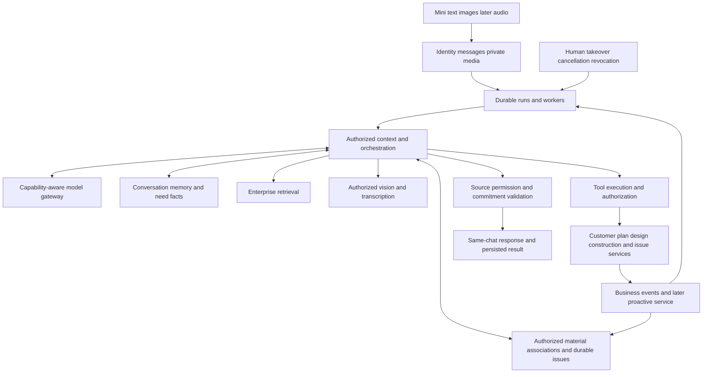

# XiaoK Assistant Roadmap

**PPT23 consented materials and same-issue result return: bounded loop Implemented; P5 overall Limited.** In the original C01 consultation the customer explicitly shares one room need excerpt or the immediately preceding uploaded point drawing. S01 reception consent does not grant project sharing. S04 resolves exact material IDs, source hashes and drawing originals by project/room; a designer/manager checks the association and replies on the same issue. Only an explicitly composed manager return is delivered to the original opted-in consultation. Human reception defers delivery; replacement/withdrawal, member/customer revocation and record/issue/material revisions fence reads, writes, receipts and delivery. Reuses transactions/outbox/Worker/original-key idempotency, with no table, migration or provider change; returned evidence joins the existing Agent construction-source chain under prompt v18; adds a granted-original GET under existing chat APIs. Existing C01/S04 text, original-photo grid and composer change only data/source-label variants, with no styling/art/navigation replacement. Customer originals and staff association checks are not formal drawing issuance, proposal differences, resolution, approval or acceptance. Explicit commands and the bounded scope remain Limited. Final checks/commands: [phase two](./xiaok-assistant-phase-2.md), evidence `tmp/xiaok-ppt23-batch/`. No production rollout.

**Current development order:** the user explicitly resumed continuous development and instructed material association first, sustained follow-up next, with the corresponding PPT scenarios as automated acceptance. This supersedes the old C05 pause and S07-first entry. Follow3.10,4.11,4.12 and section10; P4A/P5 point-drawing services/new UI, voice/external channels and production rollout retain their separate scope. Resuming does not rewrite historical results.

**P2M.3 material association and P3B sustained-follow-up foundation: bounded loop Implemented, overall Limited.** Existing `packages/assistant/chat/chat` uses `query_materials` to combine explicit own-home originals, a primary formal v4 plan and site versions published to this homeowner. Ambiguous homes/projects/repeated room names require clarification; names are not verified mappings and point drawings remain missing. Multiple projects or repeated room names currently stop for staff verification; this tool has no project/floor selector yet. `query_followups` reads the original stage question's stable issueId/revision/waiting state. Explicit sourced supplements append `construction.need.progress.v1`; S01's originally authorized designer review advances the same item. An acknowledgement/reply does not resolve or approve it. Unassigned remains explicit; stage/room/customer-scope changes invalidate old issues, derived answers and model memory. Reuses outbox/leases/idempotency/sources/usage, with no new table/migration/API, WXML/Less/art/navigation or private-chat/project grant. That materials/needs batch used prompt v17; current returned-evidence continuation uses v18 above. Original PPT15/16/23/35/37 were read. Final materials7/7, issues6/6 plus committed-write lease recovery1/1, native main9/9 plus final text4/4, related Agent12 passed/7 configured skips, construction 67 tests: 64 passed/3 configured skips/0 failures, Mini focused63/63 and Admin lint0 errors/30 warnings. One uncompleted construction attempt is recorded separately; the same files completed in sequential groups. Mini Phase0 baseline remains7 passed/1 existing failure; the full Mini suite was not rerun. Full tsc still reports293 diagnostics with an unchanged error set and none in touched paths. Production build and full visual/physical-device/real WeChat/BLE verification were not run. Full PPT23 shared cards/formal drawing issuance, own-consultation transfer/formal closure and unrestricted event routing remain later scope; consented same-issue return follows the current PPT23 record; shared-site claim/transfer/reply/cancellation follow the current P4A record; no production rollout. Contract/final checks: [phase two](./xiaok-assistant-phase-2.md).

Existing deliveries: P4B public browsing, exact-version homeowner consent, staff redaction and enterprise review form the bounded Implemented loop in3.7; overall remains Limited. C03 native browsing is verified in3.8 and C05 decision/receipt/source-revocation checks in3.9. P4A shared project chat and private consultations remain separate. Full visual/device and remaining Admin acceptance are unverified/non-blocking; no production rollout. Distance/live/video/external push/voice/formal changes remain unavailable.

Early-stage acceptance (user instruction,2026-10-16): use the PPT scenarios assigned to the current stage plus relevant engineering checks as the progression gate; proceed to the next authorized stage when they pass. Extra long-tail images, complex wording, broad quality benchmarks and comparisons with other products are follow-up improvements, not expanding gates. Retain authorization, tenant isolation and data-integrity checks; unperformed manual checks remain pending. P2A.3 scoped regressions pass; P2C foundations continue within existing design boundaries, with voice independent. This does not mark the whole PPT implemented or change new-design/production boundaries.

**P2M v9 baseline before P2A.3: Limited.** Development enterprise1454 at localhost:3006 / the remote development database uses official DeepSeek deepseek-flash, langgraph-v1, images/tools enabled, xiaok-renovation-v9 and policy_version=3. Readback matches, active runs0, Worker health200/fresh. Evidence:160/160 structural,16/16 synthetic semantic-image,44/44 extended trajectories (114/114 turns),19/19 isolated Worker and63/63 pure tests. Unresolved room references require clarification before memory writes; generic budget/image-evidence limits avoid unnecessary enterprise knowledge lookup. Samples include5 public CC0 photos from2 authors and3 deterministic degraded variants. Representative renovation quality and native manual acceptance remain pending. Existing routes/APIs/roles, C01/C02/S01/U01 UI and formal surveying writes are unchanged; no production rollout. This supersedes historical rule-only/no-vision descriptions below; non-opted-in tenants retain the legacy executor. See [phase two](./xiaok-assistant-phase-2.md) for method, evidence and limits.

Chinese mirror: [xiaok-assistant-roadmap.zh-CN.md](./xiaok-assistant-roadmap.zh-CN.md). **2026-10-16: first-batch C01/C02/S01/U01 implementation explicitly authorized for the bounded scope in [phase two](./xiaok-assistant-phase-2.md).** The user now requests an audit and rebuilding of existing UI that deviated from its source; results are in3.6. Code-Implemented labels/static checks do not establish visual acceptance. Capability status follows current deliveries; section4 distinguishes integrated Agent foundations from remaining service targets; undelivered scope is not automatically implemented. Native acceptance is pending/non-blocking; no production deployment or procurement.

Available: P1 Q&A/citations/history; P2S chat/photos/handoff/staff review; legacy P2A.1 summaries; P2A.2 media/formal snapshots; scoped P2A.3 references/preferences; P2C.1 Admin portfolios and P2C.2 Mini recommendations/studio/details/same-chat return/contact/sharing. AMap live integration, voice and later marketing expansion remain unavailable. P2C.1/P2C.2 manual acceptance is pending and does not block this development delivery.

## 0. Conversation-first product contract (first batch partially implemented)

This section and sections3/9/10 define the overall target. First-batch approved main designs/key variants/shared state rules now govern chat/handoff. Implemented scope and limitations are recorded in phase two; later new design directions retain their approval boundary. Summary confirmation and material administration are not customer prerequisites.

### 0.1 Customer primary journey

Enter chat → express an idea/send a photo → XiaoK addresses the immediate question and asks only necessary follow-ups → the system maintains working requirements → hand off within the same conversation when professional help is needed → bring the team's result back. The five topics—home, living needs, style, budget and timing—remain optional proactive guidance. When customers change topic, leave the guided question immediately, address their question and organize needs across topics; never automatically pull them back to unanswered prompts. No prerequisite questionnaire, summary generation/save, room tagging, plan binding or project creation. Optional quick replies reduce typing; they must not become mandatory multiselect forms.

- Ask one question that materially affects the next step. Allow no answer, uncertainty, topic changes and immediate human contact. Do not unlock service/summary by question count. Reuse known facts, leave gaps empty and do not optimize questioning for field completeness.
- Update the summary in the background and persist across reentry. Show a short natural-language recap only when requested or useful for handoff; an optional “what XiaoK remembers” entry stays secondary. No automatic summary modal, save/confirm requirement or completeness meter. Customers correct facts by speaking naturally.
- Selecting a picture leads directly to sending in chat, with preview/delete/retry. Remove the mandatory “current image materials” management modal before sending; authorized staff classify/link rooms/formal plans. Native photo/microphone permission remains contextual.
- When voice is available, use familiar recording/send/playback without mandatory transcript review. Ask briefly or let staff listen to the original when unclear. No ASR is configured yet; text/photos remain usable and voice is not misrepresented as implemented.
- Ask a minimal clarification only when multiple homes/projects or unclear photo intent affect handling. Otherwise leave association unresolved for staff. Viewing a case is not liking it; uploading a photo is not construction approval; never guess formal facts.
- Staff continue the same customer chat, without another handoff form or repeated account of needs. History/materials/progress are secondary views; keep frequent entrypoints few and stable.

### 0.2 Responsibilities

| Role | Required work | Work not imposed on customers |
| --- | --- | --- |
| XiaoK | Grounded answers, automatic wording/preferences/change organization, necessary clarification, internal drafts and fact-based updates | No customer field/packet/task/version administration; no autonomous price/time commitment or change approval |
| Designer/reception staff | Review needs, classify images, associate rooms/plans, inspect wording, accept handoff, answer professionally and prepare schemes/diffs | No summary form or image classification prerequisite; accepting a chat does not grant tenant-wide access |
| Project manager/concierge | Projects/members, stage employee assignments, confirmed actual progress, site tasks and public-material review; attendance coordinated by phone | Owners do not create projects, assign staff or maintain stages; no duplicate employee-phone entry or transferring all management work to designers |
| Site worker | Send photos/voice, verify facts and audience, publish records and report issues | Minimize input here too; human publication is a factual boundary, not a complex form requirement |
| Business owner/operations/service staff | Coordination, content review, hosting quotes, equipment handover, support and refund reconciliation within role permissions | Customers express intent, see results and make necessary decisions; the payer/acceptor is not automatically the homeowner |

### 0.3 Automatic organization and necessary decisions

Keep original wording, system inference, explicit customer statements, staff verification and formal approval distinct, with source/time/scope. Ordinary preferences can be remembered without a confirmation click. Uncertainty/conflicts remain internal and do not block chat. Later corrections update the working summary and supersede prior understanding while retaining quotes. Staff verification is not customer approval. Preserve existing confirmed records and historical links without mass downgrades or renewed popups; automatic summaries cannot overwrite approved schemes.

Explicit decisions are reserved for consequential actions: separately permitting phone contact, publishing specified materials, approving an exact scheme/version or cost/time change, and actual order/payment/refund decisions. Explain scope/recipient/impact, then use one compact card with accept/decline/later. Do not repeatedly request unchanged consent. Generic “okay”, silence and browsing do not approve formal actions. Bind decisions to exact objects/versions; refusal blocks only that action, not chat.

Human intervention may suggest help. Clicking Find designer or explicitly requesting a human directly submits the request without a separate sharing-consent prompt/card or missing-needs prerequisite. After takeover, assigned authorized staff can read this consultation's messages, summary and images; this is not enterprise-wide access, and end/revocation still removes service access. Stalled communication, complex judgment, formal pricing, project-specific schedule and booking intent may trigger suggestions; general budget/cycle knowledge remains answerable. Avoid repeated escalation prompts. Customer-facing quote and schedule scenarios both use “Let the designer continue”; they introduce no new responsible-person role, verification task or routing flow. Designers coordinate internally when needed. Never invent availability or response times.

While waiting, customers can keep adding information in the same chat. Pause proactive interviewing and free-form AI answers to avoid duplicate questioning. Show only factual progress and deterministic operation feedback, never as a human reply. Customers may cancel back to XiaoK; AI does not interject during human mode. Staff release returns to waiting; explicit end resumes AI. Current code already pauses AI on request; this plan does not introduce simultaneous waiting-period replies. Discuss ordinary communication times through messages only; remove intent cards, Confirm time buttons and pending/reschedule workflows. Formal surveying keeps its existing booking flow; construction attendance is coordinated by calling the current-stage worker; actual new services reuse existing business rules and contextual consent.

### 0.4 Completion means the PPT service outcome

PPT15/16/22–25/37/38 share a service goal: prior needs carry into later work, staff find relevant materials, open matters have an owner and follow-through, and results return to the original conversation. Separate pages, fields, notifications or model calls establish their respective foundations; the service also requires the association and continuation checks in section10.

- **Material association:** for a clear project, room and issue, find currently authorized need statements, site originals, formal plans/drawings and effective versions. State the association basis and disclose missing/conflicting evidence.
- **Sustained follow-up:** retain the object, unresolved question, responsible person and trigger behind a request or team matter. Continue the same issue across days, stage changes, reentry and reassignment, then return valid results.
- **Role collaboration:** customers use everyday language; XiaoK organizes, retrieves, asks necessary questions and coordinates existing processes; designers/managers/workers act within permissions. Business owners still confirm formal schemes, costs, schedules and acceptance.
- **Observable completion:** each phase checks reduced user effort, real outcomes and traceable evidence. A visible card, saved form or polished answer does not prove task completion. Existing bounded deliveries remain valid; remaining gaps belong to their original phases.

## 1. Complete page-by-page PPT audit

This table retains the original PPT/code gap audit. A PPT interaction is not a mandate to reproduce customer operations; sections0/3/9 govern the revised journey. New batches need their own acceptance; missing designs are not implemented features.

Canonical deck: [家客来小K装修服务功能方案.pptx](./装修施工标准手册制度规范/家客来小K装修服务功能方案.pptx). SHA-256: `9221a83057fb1b2aa691ecde6cf60a0aa2dfb0d352aad4b6eab2cb6f15209af4`.
The file contains **88 slides:39 main proposal pages and49 enlarged-detail appendix pages40–88**. Actual presentation order, every slide's text/media relationships and34 unique images were checked. Appendix images repeat main-page sources; mappings below include slide5's second handoff-consent image. Competitor screenshots on7–9/35–36 are comparisons, not all promised JiaKeLai controls. Notes describe proposal/presentation/authorization boundaries, not implementation.

Working evidence: `tmp/xiaok-ppt-audit/inventory.json`, `sheet-1.jpg` through `sheet-9.jpg`; regenerated by `tmp/xiaok-ppt-audit.py`. Durable findings live here, not in a competing plan. Each batch must inspect the corresponding main and enlarged images for actions/states/inputs/navigation, not merely colors/art.

Status: `Implemented` = executable loop; `Limited` = partial coverage/reusable foundation; `Placeholder` = no usable PPT business loop found, even if generic tables/internal hooks exist. This is source/design inspection, not new device acceptance.

| Main page | Appendix | PPT requirement including image interactions | Status | Gap/inconsistency | Evidence | Batch |
| --- | --- | --- | --- | --- | --- | --- |
| 1 | — | Two acquisition channels → consultation → transparent site | `Limited` | Consultation/portfolio recommendations/actual sites/stages/shared records/homeowner projections connected;public sites/voice/video/later business remain incomplete | E1–E8,E10 | 全部 |
| 2 | 40,41 | Designer/company landing pages, cases, booking, site entry | `Limited` | Designer studio/case→same chat and contact implemented; company landing, specific booking and site entries remain later batches | E3,E4 and P2C.2 designer/work runtime | P2B/P2C/P4B |
| 3 | 42 | Designer identity, city/specialty/works and studio sharing | `Limited` | Bounded studio/public works/safe sharing implemented; name initial without public portrait, no invented certification; dedicated knowledge configuration/native QA retain limits | E3,E4 and P2C.2 designer/work runtime | P2C |
| 4 | 43 | Content → reference case → consultation; AI copy/poster with review | `Limited` | Bounded case review/rights/source attribution/work-to-original-chat implemented;AI copy/posters/later marketing unavailable | E3,E4 | P2A.2/P2A.3/P2C |
| 5 | 44,45 | Atomic guidance/options/progress; references, media, designer and authorized booking | `Limited` | Chat/photos/licensed references/human handoff implemented;public sites follow3.7;voice later;ordinary needs no longer require atomic confirmations | E1,E2 | P2A.1/P2B/P2A.2/P2A.3/P4B |
| 6 | 46 | Five-group summary, original wording, reference direction, edit/confirm/designer | `Limited` | Quotes always visible, edits/confirmation feed chat, designer entry works; licensed reference directions implemented | E1,E2 | P2A.1/P2B/P2A.3 |
| 7 | 47,48 | Nearby public sites, region/distance/stage/update and browsing | `Limited` | Public consent/real regional list/bounded recommendations implemented;no distance without coordinates,native manual QA pending | E5,E7 | P3A/P4A/P4B |
| 8 | 49,50 | Progress/service-record tabs, owner-authorized redaction and revocation | `Limited` | Independent redacted excerpts/photos,complete-preview/exact-version consent,enterprise review,tabs/withdrawal implemented;human privacy inspection required | E1,E7 | P4B |
| 9 | 51,52,53 | Private chat while browsing, public citations and browsing-context handoff | `Limited` | Exact public context→own consultation/designer handoff,source chips/revocation implemented;native manual QA pending | E1,E3,E7 | P2B/P4B |
| 10 | 54 | Always-available designer entry, escalation and contact consent | `Limited` | Explicit customer consent/contact consent/wait/cancel/booking implemented; automatic escalation suggestions pending | E1,E3 | P2B |
| 11 | 55 | Staff pending/accept/same-chat replies/AI pause; unavailable and booking | `Implemented` | Text scope: staff Mini/Admin claim/reply, AI pause/resume, reentry/revocation and existing booking adapter; no external push | E1,E3 | P2B |
| 12 | 56 | Lead filters/summary and separate source/owner/commission | `Limited` | Packet retains source/summary/staff owner without referral/commission changes; dual-channel content filtering awaits P2C | E3,E4 | P2B/P2C |
| 13 | — | Consultation to file/project, then authorized delivered cases | `Limited` | Projects now bind owned leads; summaries remain in chat, with authorized needs/scheme linking and delivered-content reuse unavailable | E2,E4,E5,E7 | P2B/P2C/P3A/P5 |
| 14 | 57,58,59 | Own floor plan/change, contextual topics/media/needs/stage entry | `Limited` | Owned formal snapshots/photos/opt-in vision connected;stage context/bounded questions follow3.4;voice/general understanding retain limits | E1,E5 | P2A.2/P3A/P3B |
| 15 | 60,61 | Room preference/use/equipment, understanding confirmation and multiselect | `Limited` | Single room/space/use/frequency/equipment and confirmable multiselect implemented; independent multi-room versions/stage follow-up await P3B | E2 | P2A.1/P3B |
| 16 | 62 | Proactive pre-electrical needs with existing context/designer review | `Limited` | 3.4 asks missing needs from actual stages/existing context;authorized handoff designers review original text/photos;dedicated issues/materials/formal changes remain later | E2,E6,E7 | P3A/P3B |
| 17 | 63,64 | Stage explanation → project feed → attributed updates | `Limited` | Original chat reads actual stages/explicitly published records/photos/source versions;watched updates use outbox;dedicated feed/external push unavailable | E5,E6,E7,E10 | P3A/P3B/P4A |
| 18 | 65 | Waterproofing schedule, unknown dates, later reminder and concierge contact | `Limited` | Configured stage reminders/focus/live phones/authorized records available;no inferred appointments;WeChat subscription push unavailable | E5,E6,E7,E10 | P3A/P3B |
| 19 | 66 | Pre-tiling preferences/images/material choices and team review | `Placeholder` | Missing material selections/stage supplements/team tasks; not an automatic construction plan | E5,E7,E8 | P3B/P5 |
| 20 | 67,68 | Installation prep/confirmed attendance time/owner pending replies | `Placeholder` | No installation issue/time confirmation/digest source | E6,E7,E8 | P3B/P6 |
| 21 | 69 | Arrange site visit/protection guidance/view uploaded progress | `Limited` | Contact Keeper calls the current valid stage employee without visit intent/booking;explicitly published records/photos are readable in original chat | E5,E6,E7,E10 | P3A/P3B/P4A |
| 22 | 70,71 | Worker voice/photos → reviewed draft/publication → customer update | `Limited` | 3.5 connects text/photos→shared draft→in-chat review/audience/publication/correction/withdrawal→homeowner projection;voice/external WeChat push unavailable | E5,E7,E10 | P2A.2/P4A |
| 23 | 72,73,74 | Room/site/drawing/need linkage, worker response, exact-version customer confirmation | `Limited` | Consented need excerpts/customer drawing originals, same-issue check/reply and bounded original-consultation return verified; formal design-version differences/customer approval remain unimplemented | E5,E8 | P5 |
| 24 | 75,76 | Remember photo follow-up, original-thread update with attribution | `Limited` | Durable project/room watch/explicit cancel/exact-version publication/background deduplicated in-app delivery implemented;bounded language,no dedicated issue loop | E6,E7,E10 | P4A |
| 25 | 77,78,79 | Cross-project digest/pending replies/source tracing/follow-up | `Placeholder` | No construction-fact aggregation; design report is not an operating digest | E7,E8 | P6 |
| 26 | 80,81 | Owner site/stages/photos/history and manager multi-project/tasks | `Limited` | Shared three-role sites/stages/employee assignments/S04 shared records/history/homeowner projections connected;digests/video/full tasks unavailable | E5,E7,E10 | P3A/P4A/P6 |
| 27 | — | Managed five-point camera/4G kit, install/recovery/support | `Placeholder` | No kit/assets/orders/delivery; self-owned devices/network not assumed supported | E9 | P4C.1/P4C.2 |
| 28 | — | Room live/local-record remote replay, grants/repair/extension/exit | `Placeholder` | Missing provider adapter/device-project-room binding/service lifecycle | E9 | P4C.1/P4C.2/P4C.3 |
| 29 | — | 1199/90-day service,800 deposit, acceptance start and explicit extensions | `Placeholder` | No hosting quotes/orders/deposit ledger; deck prices are proposal baseline, not live billing | E9 | P4C.1/P4C.3 |
| 30 | — | Five points/two concurrent ≤1Mbps streams, roles/replay/retention/export | `Placeholder` | No concurrency/access enforcement/recording range/export; cloud recording/public live separate | E9 | P4C.2 |
| 31 | — | Project confirmation → acceptance → activation → recovery/revoke/clear/deposit | `Placeholder` | Missing order lifecycle/acceptance/device handover/exit evidence | E9 | P4C.1/P4C.3 |
| 32 | — | Fault/replacement/credits/site acceptance/damage evidence/deposit refund | `Placeholder` | No support/SLA/adjustment/refund; three-workday refund needs payment reconciliation | E9 | P4C.3 |
| 33 | — | Shared project view/records/support/issues with role scoping | `Limited` | Members share originals/record versions with exact homeowner projections;not formal-wall bindings;video/support/formal changes unavailable | E5,E7,E8,E9,E10 | P3A/P4A/P4C/P5 |
| 34 | — | Project/site/member intake, quote/install/acceptance/exit | `Placeholder` | Missing customer activation request/status and versioned service terms | E9 | P4C.1/P4C.3 |
| 35 | 82,83 | Prior-needs-aware equipment follow-up → draft → designer review | `Limited` | 3.4 stage questions/original-chat text/photos/authorized designer review implemented;material selection/dedicated issues/formal changes remain later | E2,E6,E7 | P3B |
| 36 | 84,85 | Cancelable room-progress watch and published-record follow-up | `Limited` | 3.5 bounded explicit watch/cancel and deduplicated published-record in-app follow-up implemented;external WeChat push/general semantics remain later | E6,E7,E10 | P4A |
| 37 | 86 | Manager-confirmed stage → contextual reminder → reschedule on change | `Limited` | Actual stages trigger configured reminders/missing-needs questions and invalidate old stage/config sources;no date-inferred progress | E6,E7 | P3A/P3B |
| 38 | 87,88 | Auto reminders/updates, human-reviewed drafts and authorized business decisions | `Limited` | Human-reviewed publication/correction/withdrawal/originals/versions/source revocation implemented;formal scheme/cost/schedule/acceptance decisions remain P5 | E1,E2,E7,E8,E10 | P3B/P4A/P5 |
| 39 | — | Confirm actual service package/team/pilot/scope/pricing/acceptance | `Limited` | Available scope must follow implementation, not the entire deck as a live product | E1–E9 | 全部 |

## 2. Code evidence and corrected inconsistencies

This table distinguishes reusable legacy foundations from delivered extensions in current phase records. See4.1 for remaining Agent gaps; limits of a compatibility path do not describe every tenant's current runtime.

| Evidence | Inspected code/entry | Reuse boundary |
| --- | --- | --- |
| E1 | `miniprogram/packages/assistant/{chat,requirements,handoff}/`; `admin/src/lib/assistant/application/http.ts`, `handoff/{http,service}.ts` | Customer chat/requirements and shared handoff use separate staff authentication; text Q&A, explicitly requested human continuation, private images/formal snapshots exist. Opted-in Agent tenants have bounded vision; public browsing is inE7/3.7; voice remains undelivered |
| E2 | `admin/src/lib/assistant/requirements/`; `admin/src/components/assistant/guidance-editor.tsx`; Mini requirements | schemaVersion3/13 questions and legacy room summaries are compatibility foundations. Current chat has sourced room+field needs, correction chains and scoped authorized references/explicit preferences without mandatory summary completion. Complex references/room migration/general semantics remain Limited; old forms do not establish complete understanding |
| E3 | `admin/src/lib/assistant/handoff/`, `core/conversation.ts`; `admin/drizzle/0066_assistant_handoff_guard.sql` | Customer consent/atomic staff acceptance/human messages/revocation/AI fencing implemented; stored source is not complete content attribution and does not change assignment/commission |
| E4 | `admin/src/lib/professional-profile.ts`, `postgres-promotion-workflow.ts`, `referrer-network-api.ts`; Mini `packages/business/staff-activity-code/staff-activity-code.js`, `lead-claim-pool/lead-claim-pool.js` | Reuse profile/codes/referral/booking/assignment/commission contracts. Dedicated studios/case publishing/recommendations follow actual3.1 delivery, not assumptions from profiles/sharing, and do not change attribution/commission |
| E5 | `admin/src/lib/customer-project.ts`, `lead-site-photos.ts`; `admin/src/app/api/miniprogram/customer-projects/[leadId]/service-needs/route.ts`; Mini customer-project | Existing lead/formal-plan/published-design aggregate, need options and site photos remain. Independent construction stages/shared records/publications are inE7/E10, not inferred from customer aggregates; device services remain undelivered |
| E6 | `admin/src/lib/wechat-notification.ts`, assistant extensions, `admin/src/lib/construction/service.ts`, subscription-template contract | Arrangement notices, stage questions and project/room watches return through their event consumers/deduplicated in-app delivery (3.4/3.5). Dedicated issues/persistent scheduling are planned in4.12. Subscription/templates/platform switches govern WeChat delivery; in-app writes are not external receipt |
| E7 | `admin/src/db/construction-schema.ts`, `admin/src/lib/construction/`, `admin/src/app/api/construction/`, Admin construction-projects, existing C01 chat | Projects/actual stages are independent facts;shared records/reviewed publication/room watches and independent public copies/consent/review follow3.5/3.7;digests unavailable |
| E8 | `admin/src/lib/design-reports/service.ts`, `customer-project.ts`; customer-project published-generations image API | Reuse design production/publication/report; not XiaoK field issues/exact-version customer confirmation/operating digest |
| E9 | Same E7 schema/API/Mini scope, camera/site/construction/hosting/deposit/support searches | No usable camera hosting/playback authorization/device order/deposit-refund loop found; generic media/AI billing are not video services/deposit accounting |
| E10 | `admin/src/lib/construction/site-{chat,worker,publications,watches}.ts`, `admin/drizzle/0083_construction_shared_chat.sql`, `miniprogram/packages/construction/chat/` |3.5 shared chat/originals/versions/publication/watch/background delivery;DB/client/configured-model checks in3.5 |

Corrections: stale “no UI/no real enterprise” statements contradicted current development code/records and are removed. Technical-module grouping omitted explicit sharing/public-browsing/hosting deliverables. Implemented basic P2A was incorrectly read as complete slides5/6. Treating cameras as a generic optional extension missed pages27–34 service-order/device/support lifecycle. P4B now explicitly reconnects public browsing to P2 acquisition. Every batch has Mini tests; screenshots do not gate progression.

## 3. Revised order and usable Mini loops

Keep P1–P6 identifiers; P2C still means acquisition/content reuse. P2S integrates the existing P2A.1/P2B/P2A.2 foundations. Its first-batch interaction paths are Implemented; bounded automatic understanding keeps P2S overall Limited. See phase two rather than treating all future targets as delivered.

P2M already supplies bounded understanding/execution;3.10 defines the remaining service improvements. Retain the original phase order: **P2M.0 → P2M.1 → P2M.2 → P2M.3 → P2A.3 → P2C → P3A → P3B → P4A → P4B → P5 → P6**. P2M.4 delivers P2A.2 voice when ASR is ready, without blocking text/vision. P2M.0 is internal selection preparation; P2M.1–.3 each deliver real Mini loops and together define core-assistant acceptance. Implementation, new-design, paid-service and production boundaries remain; hosting stays separate as P4C.1 → P4C.2 → P4C.3. Future deliveries must also satisfy3.10 and the corresponding phase checks in section10; this revision does not start the next implementation batch.

| Batch | PPT | Existing foundation | New target: minimal customer actions | Automation and professional delivery | Acceptance / design groups |
| --- | --- | --- | --- | --- | --- |
| P1 | 5,6 | `Limited`; Q&A/citations/history available | Ask directly, expand evidence only when wanted | Retain reviewed knowledge, withdrawal/permissions and recovery | No needs-form prerequisite; no invented unavailable evidence / C01,U01 |
| P2S | 5,6,10,11,14,15 | `Limited`; first-batch chat/handoff/staff paths Implemented, bounded extraction | Chat, send images, correct naturally and request people anytime; no summary/material-management gate | Automatic summary/correction provenance, direct photo send, unified authorized staff reception/review, in-chat continuation | Zero-information customer reaches staff without opening summary editor/material manager; reentry/revocation/concurrency remain reliable / C01,C02,S01,U01 |
| P2A.1 | 5,6,15 | Original summary/guidance `Implemented` | May ignore summary, editing and confirmation; say “change budget to200,000” | P2S replaces fixed interviewing; five groups/multiple rooms are internal/staff structures; conflicts await verification, not auto-approval | No confirmation gate; rooms do not overwrite each other; old summaries/confirmations compatible / C01,S01 |
| P2B | 5 second image,6,9–13 | Original text handoff `Implemented` | Direct request, wait/chat in one thread, discuss time by messages, cancel anytime | P2S adds natural suggestions, scoped service access and waiting feedback; staff reviews/claims/discusses communication times; real services retain existing contracts | No mandatory phone/file creation, fake presence or simultaneous AI/human replies; the reception designer continues concrete quote/schedule discussions / C02,S01 |
| P2A.2 | 4,5,10,14,22 | Images/plans `Implemented`; voice `Placeholder`; overall `Limited` | Select/send photo or speak; no mandatory category/room/plan version | P2S simplifies entry; staff classify/link, auto-association only with clear authorized context; preserve media security/snapshots; ASR independently added | No material manager before upload; wrong associations correctable; upload is not AI vision / C01,S01,U01  P2M.2 owns vision, P2M.4 ASR; this row owns media storage. |
| P2M.0 | Across5/6/14 | `Limited`; internal preparation | Not a user delivery | Same-case vision-language and LangGraph JS/lightweight SDK evaluation; gateway schemas, migrations, checkpoint/worker ownership, usage and numerical quality baselines | Real image/tool compatibility, restart/revocation/idempotency; a demo is not core completion |
| P2M.1 | 5,6,15 | `Limited` | Natural questions/topic changes/corrections; remember this home's needs | Orchestration, optional RAG, both-party history and sourced facts; retain extractive mode | General discussion without KB hits; preserve independent room facts; no invented enterprise facts / C01,S01,U01 |
| P2M.2 | 5,6,14 | `Limited` | First photo receives grounded observations and continuing conversation | Private vision input, image+text/multiple-image context, observations vs inference, withdrawal/recovery/usage | Follow-ups, honest blur handling, no formal graph writes / C01,S01,U01 |
| P2M.3 | 10–15 | `Limited` | Query real personal resources and request staff with real outcomes | Bounded tools using published schemes/formal plans/existing bookings/handoff; controlled need writes | Access/version/idempotency; no ordinary-correction approvals or fabricated missing domains / C01,C02,S01,U01 |
| P2M.4 | 5,14,22 | `Placeholder`; delivers P2A.2 voice | Record/send/replay without compulsory transcript review | ASR feeds the same core; original-audio access/retention/corrections; TTS later | Noise/accent/failure and provenance; no separate voice Agent / C01,U01 |
| P2A.3 | 4–6,14 | Implemented (scoped); native manual pending | View up to3 licensed references in chat and express preferences | Existing Admin curates source/rights/tags/image; current citation sheet and explicit correction chain; no bookmark gate | No-match/withdrawal/tenant/worker checks pass; not a construction scheme / C01,U01; S02 later |
| P2C | 2–4,12,13,39 | Limited overall; P2C.1 Admin and bounded P2C.2 customer journey Implemented, AMap live Limited | C01→PPT studio/works→same chat/preferences/contact/sharing implemented; native manual QA pending | Real publication/eligible reads, idempotent preferences/corrections, scoped handoff/signed sharing; source/owner/commission separate | Scope3.1; no Mini publishing/top-level directory / C01,S01,Admin S02,PPT2/3 |
| P3A | 13,16–21,26,33,34,37 | `Limited`; onboarding/employee assignments/shared three-role page/stages/reminders/live contacts Implemented within3.3 | Read actual stages/focus points, receive configured reminders and call the assigned current-stage employee | Real employee/project/stage relations and designer/construction/owner shared route; authorized needs/scheme links remain future work | See3.3; joining/assignment/stage changes/disable/revocation/idempotency/dial / C01,C02,U01,S03 |
| P3B | 14,16–21,35,37,38 | `Limited`; bounded3.4 questions/original-chat replies/designer review Implemented | Reply/send a photo at an actual stage, skip known/asked needs or change topic | Tenant-configured missing needs; sourced memory and existing reception review; revocation invalidates derived replies | No chasing/implicit approval; dedicated issues/formal changes remain future / reuse C01,C02,S01,U01; new C04,C05,S05 separately |
| P4A | 17,21,22,24–26,33,36,38 | `Limited`;3.5 shared chat/review/publication/watch loop Implemented | Private consultation views authorized records/photos and watches/cancels; members send/review in one project chat | Internal conversation/versions/originals/exact-homeowner publication/withdrawal/background deduplication;ASR/external push unavailable | See3.5;original PPT22/38 and C01/U01;native manual QA pending;no public-site or formal approval capability |
| P4B | 2,5,7–9,13 | `Limited`; bounded3.7 loop Implemented | C01 entry/regional recommendations, two-tab browsing→own consultation, exact preview/agree/decline/withdraw | Sourced excerpts/independent masked photos, homeowner consent then enterprise review; RLS/receipts/revocation/Agent references implemented | Region selection without location; no consent means private; approved C03/C05/S07 implemented; bounded C03/C05 native checks pass, remaining visual/device/Admin QA unverified |
| P5 | 13,15,19,23,33,38 | `Limited`; design publication exists | Give chat feedback; review concise differences and decide only on actual scheme/cost/time approval | Designer owns issues/rooms/source/drawings/versions/responsibility and formal changes; manager schedules execution | No customer version administration; V3 approval does not cover V4; “okay” is not implicit approval / C05,S05 |
| P6 | 20,25,26,39 | `Placeholder` | Receive only relevant results | Manager/business owner gets sourced digest/tasks/overdue work, asks/assigns/closes; missing statistics shown honestly | Internal coordination stays internal; trace sources/windows / C04,S06 |
| P4C.1 | 27–29,31,34 | `Placeholder` | Homeowner/company contact expresses activation intent; actual contracting/paying/acceptance roles make required decisions | Operations collects gaps, quotes, inventory/points/install schedule; service staff accept each point; no start before acceptance | No customer technical intake/device configuration; do not claim activation before quote/acceptance / C05,O01 |
| P4C.2 | 26–28,30,33 | `Placeholder` | Select room/live/replay and ask XiaoK on failure; no device configuration | Operations binds devices/members/retention/export; real provider integration, two-stream≤1Mbps and immediate revocation | Offline/no recordings/concurrency feedback; public live separately scoped / C06,O02,U01 |
| P4C.3 | 27–34 | `Placeholder` | Chat about repair/extension/exit, inspect status and approve new quotes/disputes when needed | Operations handles diagnosis/replacement/credits/recovery/refunds with evidence/reconciliation, no automatic renewal | No fault-code diagnosis form; requested refund is not settlement / C04,C05,O03 |

### 3.1 Current P2C scope and community search

This section owns the current publishing/portfolio scope and supersedes old S02 Mini publishing. The user authorized continuation on2026-10-17; P2C.1 Admin and bounded P2C.2 customer integration are implemented. Per the user-approved policy, a saved Key and explicit switch enable AMap queries; authorization notes are optional and development search is enabled. AMap/later content expansion keep overall P2C Limited; manual/visual acceptance remains pending/non-blocking, without procurement or production rollout. Current map configuration is `Platform management → Map service settings (/map-settings)`: encrypted credential import/edit/clear, explicit provider selection, business budget, enablement and separate saved-key test. AMap is Implemented; Tianditu is Limited: its server adapter and strict community/city mock regressions are implemented, while real-Key, entitlement and operating-city recall verification remain pending. Credentials, rights and test results are maintained separately from the default search provider, so a backup can be prepared without changing current searches. Explicit switching preserves each supplier configuration; old signed candidates cannot cross suppliers or configuration revisions. Daily counters/cooldowns are per provider and short-window rate limits remain shared. Saving takes effect immediately. Yichang connectivity returned10 candidates after fixing missing-adcode filtering; 0079 removes mandatory map authorization/expiry gates from enablement, binding and stored-community reads, while work/image publication rights and tenant/source-revocation checks remain. This does not verify a particular community or expand production authorization.

#### 3.1.1 Entry, content and roles

- **Maintain portfolios in Admin only for the first release.** Add an independent Case Publishing Management entry instead of making users discover Knowledge → New → Content type. Designers use their Admin staff identity and maintain only their own current-enterprise works; enterprise administrators review, return, publish and manage their enterprise's cases. Enforce menu grants separately from own/enterprise record scope; grant neither enterprise-wide knowledge management nor other designers' works. Do not add Mini creation, upload, editing, review or publishing screens.
- One work binds its actual author/collaborator role, one primary style and up to two secondary styles, cover, description and optional area/room counts. Multiple **renderings and real photographs** belong to the same work, grouped and ordered; real photos may be labeled showroom photography. Label AI renderings and never call them real photos. Initially show showrooms and consultation interest only, without available-date promises or repurposing surveying appointments.
- Distinguish Designer Works from Enterprise Licensed References in the same management entry. Third-party references retain original authors/rights and cannot become the designer's original portfolio or same-community service history. Existing `reference_case` records remain enterprise references until an authorized curator verifies authorship/ownership; never bulk-assign them to staff silently.
- Reuse verified staff identity, professional endorsement and field locks; allow approved self-description, service city/district, style and featured order. Never invent certifications, customer counts, ratings or performance. Source/rights evidence and owner-private information remain internally scoped, not customer-public DTO fields.
- Lifecycle: draft → enterprise review → return or publish → withdraw. Perform image processing/search preparation in the background with preparing/failure/retry feedback, without a manual index button. Keep one effective public version; edits create a draft while the previous approved version remains public. Revalidate publication/rights/staff eligibility in recommendations, detail, sharing and historical citations after withdrawal, expiry or staff deactivation; retain existing version/source-revocation authority.

#### 3.1.2 Customer entry and design sources

- Fix the primary customer path as **XiaoK chat recommendation card / View designer homepage button → designer homepage → work detail → original consultation or explicit contact request**. Add no top-level designer-discovery entry and require no bookmark, summary form or phone before exploring directions. Return preserves the original conversation; recommendation does not create a lead or authorize telephone contact.
- Reuse the original PPT slides2/3 (enlarged40/42): actual identity, city, featured cases, Chat with XiaoK about my home, Book designer and Share studio. Extend portfolio data and rendering/photo groups; discard the generic newly explored homepage. C01 recommendation cards/buttons use approved chat/shared-state rules; new or conflicting visual decisions retain design approval boundaries.
- Current implementation sources: [management](../design-references/designer-portfolio-publishing-v1/01-admin-case-management.png), [work editor](../design-references/designer-portfolio-publishing-v1/02-admin-work-editor.png). The [complete original PPT homepage](../design-references/designer-portfolio-publishing-v1/ppt-sources/slide02-01.png) is853×1844, width-mapped to390×844 with native capsule space. The Admin routes are now implemented from these sources; the PPT studio and grouped detail are implemented; independent assets/element targets are in phase two and native QA remains pending and no runtime visual acceptance is claimed. The old `xiaok-s02-proposal-v1` mobile publishing wireframe is no longer a first-release prerequisite.

#### 3.1.3 AMap first and the zero-fee boundary

**Selection: prioritize live AMap community lookup in release one: search, then explicitly select; do not scrape a nationwide community database or connect an external floor-plan image library.** This fits the interaction/integration scope; it is not a verified ranking of national community completeness. No live recall comparison in operating cities has been performed.

| Candidate | Verified public facts as of2026-10-17 | Decision |
| --- | --- | --- |
| AMap | City-restricted POI search, suggestions and ID lookup. Monthly base-search group quotas: individual5,000; enterprise50,000; enterprise with technical-service license500,000. Free individual/noncommercial-enterprise eligibility has purpose/time conditions; the group is shared across interfaces/platforms. Basic technical-service license CNY50,000/year. Chengfeng provides one year of free basic services to qualifying enterprises by invitation | Preferred adapter; verify this project's actual entity license/free-program rights first. Free calls are not commercial authorization. Old individual100/enterprise1000 daily announcements are not the current budget basis |
| Baidu | Certified place-search quotas; qualifying enterprises under the current Fuyao program may obtain180 days of free commercial permission, with post-expiry rights separately assessed | Time-limited free alternative for comparison, not automatic switching or permanent zero cost |
| Tianditu | Official place-searchV2 adapter implemented with queryType12, community category120201 and strict city/stable-ID checks. Binding reissues the signed original-name search and requires the original ID among the first10 results; no documented ID-detail API. An independent Key, actual commercial/retention rights, quota and operating-city recall remain unverified | Limited: mock regressions and explicit switching pass; real account/city acceptance pending. No claim of complete coverage or free commercial permission |
| Government open community lists | Some local datasets have explicit open licenses, e.g. Dazhou housing authority's462 community/property records; nationwide uniform completeness is unproven | If zero service fee is mandatory, use suitable operating-city open/independently verified enterprise lists, with explicit coverage limits. Import necessary community fields, not unrelated personal contacts |
| Public OSM Nominatim | Public policy prohibits autocomplete and systematic complete-POI downloads; self-hosting costs operations and Chinese community coverage is unverified | Not a free replacement for the current suggestion interaction |

- Current application policy approved by the user: a saved Key and explicit switch control lookup/binding. Commercial/binding confirmations, reference and expiry are optional notes; missing, unchecked or past notes do not stop queries or hide stored community matches. This setting does not assert vendor entitlements, purchase services or alter actual provider permission/quota errors.
- Read actual overage prices, account QPS and entitlement expiry from the official console during integration, without hard-coded old daily quotas. Disable automatic purchasing/top-ups; enforce application limits and usage notices. Exhausted quota/no permission/provider failure disables external lookup while preserving drafts and allowing unbound communities. If zero-fee licensing cannot be obtained, expose that constraint; do not rotate personal Keys/accounts/interfaces to bypass restrictions.

#### 3.1.4 Selection, persistence and recommendation

- Proxy AMap Web services server-side; keep Keys out of browser/Mini bundles/logs, restrict provider hosts and apply required signatures/IP restrictions. Select city first, require at least two characters and debounce approximately500ms. Empty input makes no request; cancel/ignore stale responses and rate-limit page/user/enterprise requests. Show canonical name, district, address and available phase. Accept real POI candidates only: missing IDs, roads, entrances or ambiguous phases require lookup/verification rather than persisting raw suggestion text as a canonical community.
- Prefer basic suggestion/text/detail interfaces already authorized for the account; a 2.0 label does not justify choosing an advanced endpoint requiring extra rights. Restrict residential categories and strictly limit the city rather than merely prioritizing it nationally. Validate types, fields and quota against the selected API version.
- Assign stable internal `communityId` with tenant/provider/providerPoiId identity; persist only the explicitly selected, revalidated minimal community snapshot, not candidates or a nationwide dictionary. Map-authorization notes/date are optional, with absent dates stored as NULL;0079 removes the former expiry gate from binding, drafts and public same-community matching. Preserve tenant/current-role, signed-selection, source-revocation and work/image publication-rights checks.
- Community is optional: change city, request verified supplementation, or save/publish unbound on no result. Unverified IDs cannot enter same-community matching. Equal names/nearby coordinates do not justify silent merges; verify phases/aliases. Preserve existing `leads.communityName`, which may contain a complete appointment address; supplement canonical IDs only after user/staff confirmation, without silent string migration or detailed-address replacement.
- Recommend eligible, serviceable designers within the current enterprise using their own published, rights-valid works. Rank same-community+style before service-city+style fallback; return at most1–3 distinct designers per turn. Explain only publicly supported matches. Third-party references cannot prove the designer's work; same community/room counts never prove an identical floor plan or wall graph.
- Explicit like/dislike retains source-backed preferences/corrections. Keep source channel, author, human receptionist, lead owner and commission beneficiary distinct. Clicks/views/preferences cannot change the first-effective attribution lock, existing claim/racing assignment or commissions. Contact/booking follows explicit existing authorization; an existing owner conflict requires authorized coordination, never silent reassignment.

#### 3.1.5 Sequence and scoped acceptance

| Sub-batch | Delivery | Focused acceptance |
| --- | --- | --- |
| P2C.1 (Implemented Admin / Limited AMap live) | Independent Admin management, own works/profiles, grouped images/rights, immutable reviewed publication/withdrawal and optional verified community binding | Real service/HTTP persistence, repeat/stale writes, tenant/author access, provider fixtures and enterprise reset/purge pass. Actual AMap rights/recall and authenticated Admin visual/manual QA pending |
| P2C.2 (bounded customer journey Implemented) | C01 cards/homepage buttons, PPT studio, render/photo detail, same-chat return, explicit preference/corrections, contact and7-day signed sharing | Real persistence/idempotent reentry, source/version/tenant/identity checks, forwarding privacy, owner conflicts and no lead/phone/commission side effects regressions pass; native visual/manual QA pending/non-blocking |
| Later extensions | AI marketing copy, further public distribution, floor-plan libraries or other providers | Schedule against separately authorized actual demand; none blocks release one or restores mandatory Mini publishing |

The authorized Admin-first P2C.1 and this bounded P2C.2 customer stage now have integrated code. Mini designer/work subpackage routes retain original chat context; real reads/writes, feedback, persistence and permission/error recovery are implemented. Both module inventories, phase-two contracts and all three affected restoration-ledger rows are current. Manual/visual acceptance remains pending/non-blocking. No Chrome/DevTools control, production rollout, procurement, new design direction or unauthorized later stage.

Sources: [AMap suggestions](https://lbs.amap.com/api/webservice/guide/api-advanced/inputtips), [POI search](https://lbs.amap.com/api/webservice/guide/api-advanced/search), [current quota/license/Chengfeng](https://lbs.amap.com/upgrade), [terms3.1–3.2 and data restrictions](https://lbs.amap.com/pages/terms/), [Baidu authorization/Fuyao](https://lbs.baidu.com/cashier/auth), [Tianditu searchV2.0](https://lbs.tianditu.gov.cn/server/search2.html), [local open-list example/license](https://www.dazhoudata.cn/oportal/catalog/f872437a63c145d4965af9351e1bca1f), [public Nominatim policy](https://operations.osmfoundation.org/policies/nominatim/). Quotas/prices are public values on the review date, not proof of this account's entitlements.

### 3.2 P3A configurable construction stages and phone contact (current bounded scope)

**Implemented bounded configuration, actual progress, in-chat attendance reminders and phone contact; overall P3A remains Limited.** The user's original PPT18/21 Contact Keeper means directly calling the current-stage worker and coordinating attendance by phone. The design is unchanged; this replaces the earlier booking interpretation.

This section records the stage/phone foundation. [Current3.3](#construction-staff-contract) replaces manual contacts with employee onboarding, live employee contacts and the shared three-role page. Historical checks below do not cover the new employee contract.

- **Configuration/actual progress:** ten editable defaults are preparation, design, demolition, utilities, masonry/carpentry, painting, installation, furnishing, completion and move-in. Owners add/remove/rename/reorder1–30 stages and configure attendance reminders/reasons/site focus points. Reminders start disabled and require content when enabled. Stage employee/primary-contact references now follow3.3; names/phones resolve from live profiles without duplicate manual stage phones. Managers mark actual site progress; dates/AI never infer advancement. A currently used stage cannot be removed.
- **API/access:** GET/PATCH /api/construction/stages; GET /options; GET/POST /projects; GET/PATCH /projects/:id; POST /projects/:id/{member,room,contact,progress}. Only platform/enterprise owners configure enterprise stages. Other staff need live role-menu grants/active membership; assigned managers manage, other members read only. Tenant/employment/password/menu/member checks remain. Projects bind existing same-tenant customer leads; room labels do not modify formal v4 graphs or grant customer-private-chat/customer-phone/attribution/commission access.
- **In-chat delivery:** actual-stage changes record a durable outbox event and atomically deliver to the latest eligible AI consultation. Without an open consultation, reentry delivers the latest valid reminder once per event/customer. Ordinary repeated saves do not resend; explicit resend uses a new progress revision and optimistic/idempotent writes. Human handoff suppresses insertion. Idle AI chat reads every7 seconds and stops when hidden. Settings changes invalidate old sources without implicit resend; operators may explicitly resend after review. No subscription/external push.
- **Phone coordination:** query_business(domain=construction) reads authorized current projects/stages/focus points/contact availability, excluding numbers from model results. Attendance/time-change/cancellation expressions use phone coordination; request_visit and former plan/visit mutation endpoints are retired, without site records or measurement-appointment changes. Server-projected actions contain identifiers only. GET /api/miniprogram/assistant/conversations/:id/construction-contact?projectId=...&messageId=... rechecks the source, current lead ownership/project/stage/phone before wx.makePhoneCall. Changed workers resolve new numbers; stage changes/pause/revocation/reassignment invalidate old actions, without claiming a completed call.
- **Data/reliability:**0077 adds forced-RLS construction_stage_settings and project current_stage_key/stage_contacts/progress_note/progress_revision. All eight construction tables participate in reset/purge. Applied0073–0075 and historical plan/visit tables remain as evidence with no executable retired workflow. Shared feedback, Idempotency-Key, expectedVersion and persisted account/tenant-scoped unknown-request reconciliation remain. Both development databases pass hash/RLS/column checks. Pre0077 backup tmp/xiaok-vector/phase2-pre-migration-2026-10-17T07-25-49-082Z.dump is6,466,224bytes and PGDMP/archive-validated; a full0077 restore drill is pending.
- **Design/elements:** existing Ant Design/Admin Pro and C01/C02/U01 remain. PPT18/21 design-references/construction-workflow/proactive-service/protection.png supports Contact Keeper; the user's ten-node example is retained as design-references/construction-workflow/stage-nodes-user-reference.jpg for configuration reference only. Reuse32rpx bubble text,72rpx avatars, independent art and green action color. Dial action28rpx/84rpx minimum height and16rpx message spacing, with shared missing-contact feedback. No new page/business card/artwork. Source853×1844 maps to390×844; the unique C01 primary ledger source remains. Native390×844/tall, Admin rendering and real dial acceptance pending/non-blocking. No Chrome/DevTools control.
- **Limits:** construction staff identity/onboarding, employee-linked contacts and construction Mini UI remain unavailable, as do authorized needs/scheme links, needs-aware follow-ups, photos/site dynamics/video and formal acceptance/change approval. Admin projects/lead options200, staff300, stages30; chat10 lead windows and30 projects/lead. No all-record pagination or implication of completion/acceptance. No production rollout.

| Trigger/state | Visible feedback/actions | Recovery/reentry and scope |
| --- | --- | --- |
| Enter an actual stage with enabled reminder | XiaoK explains the stage, attendance reason/focus points and Contact Keeper | Durable message; authorized own project only, once per event/customer |
| Attendance/time-change/cancellation expression | Current stage and phone coordination | No visit-intent/booking record or measurement-appointment change; projects identified separately |
| Missing stage/phone | Configuration unavailable, no dial button without a phone | Team supplies data, then requery; no guessed number |
| Tap Contact Keeper/network error | Read current authorized phone before dialing; shared error feedback | Retry a read, without booking writes/completed-call claims |
| Changed stage/config, pause/revocation | Old source/action unavailable through existing U01 feedback | Requery current stage; explicit resend if needed, never replay old content |
| Background/identity change/human handoff | Stop polling/discard delayed dial response; suppress reminder insertion during handoff | Reentry revalidates sources; another customer never inherits the action |

Checks: the current manual-contact path passes the complete15/15 suite, including three real DeepSeek turns for stage queries/attendance/cancellation, real Worker/database/HTTP, no booking writes, changed contacts/stale stages, idempotency/revocation/reentry and enterprise reset/purge. Logs:tmp/xiaok-vector/construction-acceptance.log (latest8 checks), miniprogram-full-construction.log and p3a-mini-compile.log. Mini60/60, assistant pure66/66 and dual-database migration checks pass. Current files have no type diagnostics;291 pre-existing full-project diagnostics remain. Webpack compiles in52 seconds; the full build is blocked by the existing AiDesignerLegacyPage export error in ai-studio/designer/page.tsx. Full Admin lint has0 errors/28 pre-existing warnings; focused lint and git diff --check pass; manual visual/dial acceptance and a full0077 restore drill remain pending. These results do not cover construction onboarding, employee resolution or the four-client acceptance in3.3.

Agent adoption: reviewed [LangGraph persistence](https://docs.langchain.com/oss/javascript/langgraph/persistence), [tool-node tests](https://github.com/langchain-ai/langgraph/blob/main/libs/prebuilt/tests/test_tool_node.py) and [DeepSeek reasoning_content issue10883](https://github.com/langchain-ai/langchainjs/issues/10883). Retain the bounded LangGraph loop, SQL authorization/source revocation/usage/outbox; no reminder Agent or booking system. Actual-stage reminders make no model call. Python tests are invariant references, provider issues are not generalized, and no new provider workaround is added.

Current-implementation manual QA (pending/non-blocking, not3.3 acceptance):1) At http://localhost:3006/construction-projects configure utilities attendance/focus points, reenter, create an existing-customer project and use existing utilities/painting contact data.2) Mark actual utilities progress: a reminder/Contact Keeper appears without a preceding question. Dial utilities, change contact/get the new number; after changing stages the old reminder cannot dial the old stage.3) Say “周六想去看看” and “取消到场安排”: return current stage/phone coordination without visit records/team-confirmation tasks or measurement-appointment changes.4) Check missing phones, pause/revocation, handoff, connection/retry, background/identity changes, reentry and duplicate saves.

### 3.3 Construction onboarding and the shared three-role cloud-site page (bounded foundation)

**Admin project entry:** “客户线索” (`/leads`, unchanged permission key) → customer detail → “建立工地” opens the existing `/construction-projects` create form with the customer locked and an editable suggested name. The independent entry remains. Shared isEnterpriseManagementRole includes owner/admin/super_admin; real platform-account regressions cover selected-tenant creation and manager appointment without project membership. Owners, administrators and super administrators use `GET /api/construction/leads/:id` within the selected enterprise; it resolves the exact tenant customer beyond the recent200 options; preview and idempotent creation reject foreign, archived/closed or unbound records. Save explicitly selects a manager, creates no customer/rebinding, and opens the new project. Pending writes reconcile before another form opens; consumed entry parameters do not reopen the form on refresh. Six focused database/HTTP/client-permission regressions, full lint and the isolated production build pass (Webpack72s; favicon tracing-copy warning). Authenticated manual rendering/reentry remains pending/non-blocking. Current checks/steps are in both Admin inventories.

On2026-10-17 the user clarified that **designers, construction employees and business owners all enter the same cloud-site page to monitor projects**. This is not an exclusive construction portal. Four business perspectives remain within one Mini Program; homeowners retain their own in-chat stage/contact experience. Employees join the enterprise before project allocation. Identity, skills and project responsibilities stay separate; measurers are not relabeled.

| Identity | Scope and actions on the shared page |
| --- | --- |
| Designer | Effective associated projects, assignments and actual stages; ordinary design collaboration is read-only without manager authority |
| Construction staff | Assigned projects only; project managers allocate ordinary members/stages and update actual progress; workers read this batch's facts |
| Business owner (enterprise_admin) | Own-enterprise sites; existing Admin controls maintain employees/templates, create projects and appoint/remove managers |
| Homeowner | Own-chat reminders/contact only; no employee roster, enterprise overview or other private chats |

**Implementation:** role construction_staff reuses ej_ codes, WeChat/phone authorization, single-enterprise conflict checks and signed reentry. Joining requires a name and1–10 skills/trades. Rejoining is idempotent and cannot overwrite an existing enterprise/base role. Construction staff receive no design/survey dispatch, claim-pool, referral-network or commission capabilities. The enterprise roster includes them; existing /staff forms maintain name/phone/skills/status. Membership independently stores manager/designer/worker/observer and a work label. Only owners appoint/remove managers; managers cannot promote themselves or others.

**Mini Program:** `packages/construction/projects/projects` is shared through Mine→Cloud site for all three roles. Construction identities land there after login; designer/owner home workbenches remain. List/detail/member/stage-assignment/progress operations use real services; no projects yields waiting-for-assignment. Managers add existing employees, allocate stages, designate primary contacts and update actual stages. Writes retain the body, expectedVersion and Idempotency-Key per enterprise/employee; unknown outcomes survive reentry and replay the original operation. Confirmed version conflicts preserve editor input and reload the latest version. Native pull-to-refresh updates lists/details, and list back returns to Mine. Hidden/switched sessions discard late reads and write receipts and do not inherit another employee's pending operation.

**Live contacts:** construction_stage_assignments references effective same-enterprise project members. A single assignee becomes primary automatically; several assignees need an explicit primary for dialing. Resolve current employee name/phone rather than persisting another stage copy. Disabled/departed/removed/unassigned staff, missing phones, paused/revoked projects and obsolete stage sources deny dialing. Legacy stage_contacts remains evidence only: no name/phone matching and no fallback for old messages. Attendance remains phone coordination with no construction/survey-booking writes.

**API/data/access:** GET /api/miniprogram/construction/projects, GET …/projects/:id, POST …/projects/:id/{member,contact,progress}; existing Admin /api/construction remains, and contact now accepts staffIds/primaryStaffId. Tenant transactions recheck live employee/enterprise/role menu/session version/membership. Phone-authorized WeChat entry works directly; password entry still requires initial-password change and Web protection remains. Proxy and live identity resolution prevent construction-role fallthrough into legacy customer/drawing/chat/finance/dispatch APIs. Construction identities retain self-profile, avatar upload/signed read and password APIs under their existing ownership/signature checks. Ordinary members receive no enterprise roster, leadId or legacy phone.0080–0082 add skills/work labels/stage relations and correct live identity/database role constraints. Nine construction tables force RLS; composite membership foreign keys, a unique primary contact, version/idempotency and enterprise reset/purge cover new data. Applied0080 retains its original SQL hash; corrections use additional migrations.

**Design/element ledger:** use the user's current PPT26 source `design-references/construction-workflow/cloud-site/manager.png`. Onboarding/identity/roster/Mine reuse their current approved sources and S01/U01 forms/feedback. PPT originals are853×1844; this manager image is935×1683, mapped by width to390 without stretching to853×1844. Preserve capsule clearance and intrinsic content height.390×844 targets:28rpx side margins;32rpx nav/section titles;36rpx page heading;32rpx project names;26rpx body/actions;22rpx helpers;28rpx CTA in88rpx height;60rpx brand mark;20rpx group/16rpx internal gaps. The three roles share structure, varying identity/scope/authorized actions. Missing photos show real stage facts instead of sample-site images. Future P6 digest/report, P4A record, voice and video actions remain hidden. A built-in ImageGen standalone transparent tool asset was optimized from `design-references/construction-workflow/staff-assets/construction-tools.png` to `miniprogram/packages/business/assets/identity-switch/role-cards/construction-tools.png` (PNG/RGBA,128×128,17,723bytes) for onboarding/identity cards; no composite slicing. Optical scale,390×844/tall-screen/native-capsule QA await manual runtime checks; Chrome/DevTools were not controlled.

| State/trigger | Feedback/recovery | Access boundary |
| --- | --- | --- |
| Scan/phone authorization/rejoining | Name/trades, real success and cloud-site entry; existing recovery for invalid codes/conflicts | One enterprise; no self-appointed manager |
| Unallocated/removed | Waiting or denied; refresh/switch identity | No other projects returned |
| Assignment/progress saves | Real feedback/reentry; original-key reconciliation for unknown outcomes | Assigned-project managers; owners appoint managers |
| Changed stage contacts | Resolve latest effective profile before dialing | Missing primary/revocation denies; no arbitrary replacement |
| Network/version/session changes | Preserve input, reload latest version on conflicts/pull-to-refresh; discard obsolete reads/write receipts | No pending writes shared across enterprises/employees |

Verification: full construction suite22/22 passes, including the configured real DeepSeek/Worker stage-query/attendance/cancellation turns, employee joining, three-role scope, no booking writes, live contact changes/revocation, idempotency/reentry, tenant isolation and reset/purge. After account-boundary fixes, construction-staff checks8/8 and identity/credential checks58/58 pass. Mini onboarding/navigation/account/site checks82/82 and offline WCC85 templates+2WXS,89 styles,232JS/91JSON pass. The full Mini suite is1920/1921; the sole failure is a pre-existing development API-address assertion conflicting with current user configuration, which is preserved. SQL hashes/role/session guards/nine-table RLS pass in both development databases. Full Admin lint:0 errors/28 existing warnings; no new type diagnostics in affected files,291 existing project diagnostics. The original foundation build compiled in78s then failed on the AiDesignerLegacyPage export type; the later customer-entry isolated production build now passes, as recorded above. Log:tmp/xiaok-vector/construction-acceptance.log. Manual/native/full0082 restore acceptance remains pending/non-blocking. Manual steps: (1) join through an employee code as construction staff, enter name/trades, reenter before/after assignment; (2) owner uses Admin to appoint a manager, manager assigns stage employees and changes actual stage, designer/owner/staff open the same Cloud site page through Mine; (3) homeowner receives the stage reminder and dials the live employee, then verify changed phone/disabled or removed employee/unassignment, unknown-result retry and cross-tenant denial. No Chrome/DevTools automation or production rollout.

### 3.4 P3B stage questions and review in the original chat (bounded loop)

This batch reuses approved C01/C02/S01/U01 and existing Ant Design/Admin Pro forms. It does not add a project-feed, decision-card or record-publication page. Customers remain in `packages/assistant/chat/chat`; designers review through the existing reception/needs/material tabs at `packages/assistant/handoff/handoff?staff=1`. Project membership alone never grants private-chat access.

**Configuration/trigger:** existing GET/PATCH `/api/construction/stages` accepts optional `followUps` per stage, up to3 ordered `{field,room,question}` candidates maintained by the owner. Fields reuse existing need types. Room needs require an explicit room mentioned in the question; whole-home housing/household/budget/timeline have no room. Defaults remain empty. A manager entering an **actual** stage through the existing Admin/shared Mini page creates the event independently of attendance reminders. Ordinary resave/config-save/reentry does not start another question round.

**Existing needs/no chasing:** send at most one missing need. Current conversation memory, whole-home draft excerpts and historical confirmed values suppress known content, including uncertainty/deferred topics. Room memory matches exact room+field, and the room must exist in this project. Generic chats require exactly one own active lead and one visible active project; ambiguous homes are not guessed, and a later lead-scoped chat can still receive the question. Delivery deduplication covers each customer/stage event and stable project+customer+field+room across stages/configuration/chats. Silence/topic changes/rewritten configuration do not cause chasing. Reentry revalidates current stage/configuration before delivering pending events.

**Replies/review:** original text/photo submission, idempotency/retry and private-media services persist replies. Supported explicit statements retain source message IDs and correction chains. A room mentioned only in the question, image observation, or “okay” never becomes customer approval; unclear rooms still require clarification. After the customer requests the existing human handoff, the authorized designer sees current excerpts/transcript/images and stores internal corrections in S01. Unrequested/ended/revoked handoffs cannot read them. No reply writes a formal plan, scheme, cost, schedule or approval; formal changes remain P5.

**Durability/security:** reuse JSONB stage settings, `domain_event_outbox`, `domain_event_deliveries`, system messages and existing needs/media storage; no new tables/migration. `construction.stage.updated.v1` records actual progress; `construction.need.asked.v1` stores the asked field/room/customer, stage/configuration versions and trigger event. `construction.followup` uses the existing text bubble. Existing tenant RLS/live roles/project membership/expectedVersion/Idempotency-Key apply. Existing tenant-wide outbox/message reset/purge includes these records. Pause/archive, customer revocation/reassignment, room rename, stage or configuration changes invalidate old questions and derived responses. Model calls, tool writes, recovery and final commits revalidate sources, fencing late output. Waiting/human mode is not interrupted; returning to AI may consume the still-current pending event.

**Design/state mapping:** customer bubbles/text/photos/handoff use `design-references/xiaok-assistant-chat-first-batch1-v1/single-screen/C01-01.png` and C02 shared states; staff review retains `S01-01.png` and S01 key variants. Phase-two390×844/capsule measurements remain. `constructionFollowUp` only selects the existing WXML XiaoK text-bubble/avatar state without the attendance-only missing-phone label; layout/Less/artwork remain. Admin adds candidates only inside the existing stage form; shared feedback/version-conflict/unknown-receipt recovery remains. Native/authenticated rendering is pending manual QA; no Chrome/DevTools control.

| Trigger/state | Visible feedback/recovery/actions | Permission/fact boundary |
| --- | --- | --- |
| Actual stage with an unknown candidate | One skippable chat question; text/photo/topic change; persisted reentry | Current visible own project only; no date-based progress inference |
| Known/asked/unconfigured/ambiguous homes | No added question; continue chatting | No cross-home needs or chasing |
| Reply/photo/network retry | Existing receipt/retry, excerpts/material for authorized review | Statement/working understanding/internal review/formal approval stay distinct |
| Waiting/human/end | No interruption; valid pending event can resume after return to AI | Workers/ordinary project members have no private-chat grant |
| Source change/revocation | Existing unavailable-source feedback; late run fails; ask again/request staff | Obsolete stages/rooms/configuration cannot drive changes |

Validation: P3B isolated13/13 passes (9 database/Worker scenarios including two configured real-DeepSeek turns;4 pure contracts), with29 existing construction/employee/project-entry/reset cases passing in a separate group. Agent pure20/20, Mini focused51/51 and full Admin lint pass (zero errors/28 existing warnings). Offline85 templates+2WXS/89 styles/232JS/91JSON pass. Webpack compilation succeeded in55s; full build remains blocked by the existing `/api/leads` `leadDtoForMini` route-export type error. Repository type checking still fails, with none in this batch's affected files; no claim of a globally passing build. Current13-case log:`tmp/xiaok-vector/construction-acceptance.log`. Pending/non-blocking manual steps:1 owner configures utilities→devices/study/explicit study question;2 manager marks actual utilities in the shared site page and the owner reads that home's chat/reenters without duplicates;3 reply with explicit study needs or a photo, request staff and review in the existing tabs;4 change stage/rename room/revoke access to invalidate old sources and verify waiting/human mode does not interrupt. No production rollout.

### 3.5 P4A shared project chat, publication and watches (bounded loop)

**Implemented bounded loop; P4A overall Limited.** This continuation implements the confirmed PPT22/38 and S04 contract. Designers, construction staff and owners enter `packages/construction/chat/chat?projectId=…` from the shared site's detail. Each project owns one conversation containing actual authors, original text/photos, shared review drafts and versions. The homeowner's `packages/assistant/chat/chat` remains private; project membership grants no consultation access. ASR, public sites, digests, video and formal changes remain outside this batch. This is neither the whole PPT nor production approval.

**Services and permissions:** GET `/api/miniprogram/construction/projects/:id/chat` defaults to30 source messages with beforeSeq/limit≤100. POST `…/chat/messages`, POST `…/chat/media`, GET `…/chat/media/:mediaId`, POST `…/chat/media/:mediaId/remove` (own unsent uploads only), POST `…/chat/records/:recordId/{edit,publish,withdraw,retry}`, GET `…/chat/records/:recordId/versions` (latest50), and GET `…/chat/operations/:key` revalidate enterprise, live staff/menu, signed identity version and project membership. Observers read only. Authors edit their own material; managers/owners can review others. Authors may publish internally; customer publication requires an explicit manager/owner selection. Admin/super_admin inherit selected-enterprise owner management without project membership. Names/phones confer no authority. The same operations are also available at existing `/api/construction/projects/:id/chat/*`, under cookie/selected-enterprise withTenantRoute and identical live authorization; no new Admin page.

**Source → draft → publication:** one message accepts0–4 own uploaded JPEG/PNG images, each≤4MB, decoded/re-encoded as JPEG with EXIF removed; up to500 active images per project. Unsent uploads are private to their uploader. Original message, attachments, draft, run and quota job commit atomically. Reuses assistant messages, Worker leases, provider attempts, usage and unknown-cost reconciliation. One structured extraction uses the enterprise's configured model (`xiaok-site-record-v1`); explicit source statements determine completed/pending/coordination fields and unclear rooms remain null. Only verified enabled image capability receives pixels; otherwise extraction uses text and retains photos without claiming perception. No model publication, progress updates, formal-wall writes or scheme/cost/schedule/acceptance approvals. Failed extraction preserves sources and permits authorized manual review. Only known failed calls without unresolved costs can be explicitly retried; unknown provider outcomes never redispatch automatically, and expired workers cannot commit.

Publication requires the current expectedVersion and defaults to project members. Customer publication binds that exact version to the current homeowner. Corrections revoke the old publication immediately and create a new review draft; new approval is required. Withdrawal requires a reason and retains originals/version audit. Live removal/disablement, identity changes, project/customer revocation, renamed rooms and stale versions constrain reads, media, model commits, citations and later delivery. Migration0083 adds six `construction_chats/site_media/site_records/site_record_versions/site_attachments/watches` tables plus shared-conversation database adapters. All15 construction tables force RLS, project/room/attachment FKs are composite and tenant reset/purge includes the new data. Separate `project_collaboration` purpose never relaxes existing consultation or knowledge-preview owner/handoff checks.

**Homeowner viewing and watches:** the existing private chat queries currently authorized recent records and photos; projections and photo GETs recheck exact publication versions. Explicit commands such as “书房有新照片告诉我” or “有进展告诉我” persist a watch; ambiguity receives a necessary clarification, without guessing homes/rooms. “不用再提醒” or the existing receipt's Cancel watch action stops later delivery and preserves the unsent composer draft, including during waiting/human mode. Existing Worker consumption of the publication outbox appends authorized in-app messages while Mini pages are closed, deduplicated per customer/publication event. Cancellation and delivery lock the same watch. Human/waiting mode receives no progress interjection; returning to AI may consume still-valid events. In-app storage is not WeChat subscription delivery; external push remains unavailable.

| Trigger/state | Visible feedback and recovery | Boundary |
| --- | --- | --- |
| Read/empty/send/photo | Same project chat, actual author and original material | Observers cannot send; unsent uploads stay private |
| Organizing/failed/unknown call | Original material retained; review or manual edit | Unknown provider outcomes do not auto-retry |
| Edit/version conflict | Sheet preserves input and displays latest fields;only explicit review adopts that version,with publication scope reset;unknown receipts reconcile inside the sheet | Original expectedVersion/key are never silently replaced;no inherited approval |
| Audience/unknown submission | Members by default; permitted customer option; reconcile original key | Exact record/version/homeowner, never the internal chat |
| Correction/withdrawal/source change | New draft or withdrawal with original versions | Old photos/text/citations/derived replies become unavailable |
| Watch/cancel/reentry | Real receipt and visible cancel action in original chat | Model text cannot forge a mutation; cancellation serializes delivery |
| Identity/background/revocation | Reject late receipts, clear protected rendering/images | Pending commands are scoped to enterprise/staff/project |

**Design, elements and assets:** original PPT22/38 is the single main source; the full `tmp/xiaok-ppt-audit/image26.png` is853×1844, width-mapped to390×844. Rejected S04 01/02/03/overview/design.html drafts are not implementation rulers. Ordinary states reuse this main source, C01/C02/S01/U01 and the S04 state specification; there is no separate record-form page. The following records reference observations and implementation targets; native optical QA remains pending.

| Element | Original PPT bounds (pixels, full-screen observation) | Native target |
| --- | --- | --- |
| Brand/navigation | x38–392,y106–184 | 64×70rpx mark;38rpx brand;≥96 logical px capsule clearance; project identity below |
| Project context | x40–813,y232–260 | 32rpx horizontal margins;24rpx text; natural wrapping |
| Original message/author | Bubble x305–741,y328–513 | 28rpx/1.6 text;22rpx author;64rpx generic avatar, no fake staff photo |
| Photos | x296–817,y560–763 | 34% left inset,two columns,10rpx gap,1.27 aspect; authenticated full-image preview |
| XiaoK reply | x30–823,y778–1649 | 26rpx outer/16rpx inner spacing;28rpx text;128rpx optical image within112rpx flow band |
| Visible XiaoK | x61–173,approximately y802–907 | Alpha≥64 bounds179×184/256;128rpx canvas gives approximately89.5×92rpx visible art |
| Record title/fields | Title nearx175/y1021;labelsx111/y1099;valuesx306 | 36rpx title;28rpx/1.4 fields;158rpx label+12rpx gap;42rpx card padding |
| Publish/edit | Approximatelyx82–775,y1529–1605 | 32rpx CTA;18rpx action gap;intrinsic content with scrolling |
| Composer | x29–824,y1655–1764 | 28rpx input;42rpx image boxes,50rpx send,36rpx back;keyboard/bottom safe area |
| Icon optical bounds | Actual alpha/stroke, not image boxes | Image35×35,Mic28×38.5,FileText37.5×45.8,send35.4×35.4,back24×24rpx |
| Helpers/sheets | Same main source and U01 rules | 22rpx helpers;240ms enter/260ms close;no separate ordinary-state screens |

Built-in ImageGen independently reconstructed the phone-holding site assistant: optimized source `design-references/xiaok-s04-site-records-v1/xiaok-site-assistant-source.png` (512×512), packaged `miniprogram/packages/construction/assets/xiaok-site-assistant.png` (256×256 alpha PNG,37,896bytes). No composite screenshot slicing; actual photos come only from protected services. Arrows/Image/Mic/generic-person reuse existing independent Lucide PNGs;the matching record glyph is an independently rendered green Lucide FileText (96×96,944bytes); mapping/license is in `docs/icon-sources/assistant/README.md`. Both restoration ledgers register the new route and original-chat/shared-site entry changes.

Validation:final S04 isolation15/15 passes,including configured real DeepSeek text/photo→Worker→draft,actual multipart upload/removal/invalid-input bounds,cookie API inheritance for owner/admin/super_admin,outbox delivery with pages closed,private-chat isolation/member revocation/unknown model outcomes. Legacy assistant/handoff/S04 regression47/47 passes. Full construction:55 cases,52 pass/3 configuration-dependent skips;real provider tested separately above. Final focused Mini assistant/construction77/77 and full1933/1934 pass;the sole existing failure compares the selected development API address with the user's current configuration,which is preserved. Offline86 templates+2WXS/90styles/235JS/92JSON pass. Admin ESLint:zero errors/28 existing warnings;standalone tsc retains292 existing repository diagnostics,none in affected modules. Isolated complete Webpack build passes (48s compilation;favicon tracing-copy warning),not deployment acceptance. Both development migration hashes/five-argument shared access/all15 forced-RLS construction tables pass. Design cleanup dry-run/--apply finds no unreferenced files older than30days;no assets moved/deleted. Evidence:`tmp/xiaok-vector/construction-site-chat.log`,`miniprogram-full-site-chat.log`,`site-chat-build.log`;from admin run`CONSTRUCTION_LIVE_MODEL=1 node scripts/construction-acceptance.mjs --site-only`,`--site-regression`,or the default full construction suite,without real-customer fixture writes/production access. Native390×844/tall/capsule/keyboard/actual multi-person usability/external WeChat delivery and the0083 full restore drill remain untested. No Chrome/DevTools control or production rollout.

Manual checks (pending/non-blocking):1 enter the same site as manager/worker/designer, send explicit completed/pending text and real photos, then reenter;2 publish internally as author and explicitly to the homeowner as manager;3 watch study photos in the original private chat, close the page, publish, reenter and cancel;4 verify concurrent versions, uncertain submissions, withdrawal/room rename/member removal/identity switching revoke old media/sources without cross-site input. P4B public/consent/review surfaces remain subject to C03/C05/S07 design approval.

### 3.6 Previous-plan and UI audit corrections

The user requested an audit for earlier S04-like design/conversation-scope mistakes and rebuilding affected UI. Source-restoration/planning-text issues were confirmed; fixes reuse approved designs rather than introduce a new visual system.

| Scope | Finding and current correction |
| --- | --- |
| P1/P2 customer chat | C01/C02 do not contain the added root-chat back arrow or permanent implementation disclaimer; removed, with the brand retaining navigation and a counter only near the limit. Image entry already sends directly; remove orphan classification markup without changing media/formal-snapshot APIs |
| P2S reception | Old UI omitted S01 brand/role and avatar/status/count hierarchy; same-chat reply used a generic textarea/button. Restore S01-01/02/B01 structure, per-tab empty states, authors/avatars, independent message scrolling and capsule composer; quote jumps target that message area. Pre-claim access remains metadata-only without fabricated names/portraits. Staff image action only reads authorized materials; no implied ASR/staff image sending |
| P3A site entry | Shared page compressed PPT26 branding/identity/sections/project actions into a generic list; restore original manager.png branding/role tag, light scene and in-card actions for actual stages/assignments and the current3.5 shared-chat entry, without sample photos or undelivered digest/video |
| P2C/legacy summary | Studio/work retain existing PPT2/3 and approved grouping/shared-state sources; summary is compatibility-only. Correct phase-one/two current sources/manual steps so old summary confirmation, sharing consent and image classification do not return as customer prerequisites |
| P3A/B versus P4A | Earlier site foundations/private-customer reminders alone did not deliver shared chat; current separate delivery is3.5. P4A retains one tenant/project conversation/record version shared by manager/workers/designers, separate from other sites/homeowner private consultations. Never relax private owner/handoff checks to implement it. S04 retains original PPT22/38 |

Routes/APIs/models/tenant-handoff-project authorization and formal v4 graphs remain unchanged by this UI correction. Byte-copy the original independent scene to `miniprogram/packages/construction/assets/xiaok-project-scene.png` (780×380,51,118bytes), avoiding cross-subpackage references; no new generation/screenshot slices.

Validation:72/72 relevant Mini checks and offline86WXML+2WXS/90styles/235JS/92JSON pass.24 actual-template/Less fixtures cover360×780,390×844 and390×1000 without overflow/missing images/branding entering the simulated capsule. `tmp/xiaok-vector/current-ui-audit/` is supplemental diagnosis, not design authority/WeChat acceptance. Native capsule/optical type/keyboard/real clicks remain pending/non-blocking; no DevTools/deployment. Bilingual restoration ledgers keep exactly one current source row per chat/handoff/projects.

Manual steps: customer chat/photo/history/direct designer request; staff waiting/my-reception tabs→select/claim/reply→quote jump/materials; site list→stage/assignment/save/reentry. Check revoked/disabled/unknown outcomes and390×844/tall native rendering; unperformed checks are not passes.

### 3.7 P4B public sites, exact consent and review (bounded loop)

**Bounded loop Implemented; overall P4B Limited.** The user's “确认” approved this batch's C03/C05/S07 proposal before implementation. C03 native browsing/recovery is verified in3.8; C05 bounded decisions/receipts are verified in3.9; full visual/device acceptance remains unverified/non-blocking; no production rollout. This is authorized text/photo browsing, without live/video, external WeChat push or precise distance. The [approved sources, states and element table](../design-references/xiaok-p4b-public-sites-v1/README.md) reuse complete PPT7/8/9 C03 designs, extend C01 with C05 and the existing Drawer with S07. No screenshot slicing.

| Entry | Runtime behavior |
| --- | --- |
| C01 `packages/assistant/chat/chat` | Public-site entry in the original consultation; up to3 actual published recommendations when current own messages/housing facts identify a city/district, without guessing ambiguous regions. The homeowner receives an exact-version card, expands all excerpts/photos before agreeing, and can decline/defer/withdraw/reconcile unknown receipts |
| C03 `packages/construction/public-sites/public-sites` | Anonymous list, actual city/district selection, empty/retry; no mandatory location or invented distance. Independent XiaoK map artwork plus actual public photos; return to own consultation |
| C03 `packages/construction/public-site/public-site` | Exact-version detail, photo/service-excerpt tabs, real roles/timestamps; ask XiaoK/contact designer attaches only public evidence to the visitor's own consultation. No homeowner/project-chat access; sharing excludes private conversation identifiers |
| S07 `/construction-projects` | Third “公开材料” tab in the existing960px Drawer: source selection, verbatim clipping/[已隐藏] masking, city/district/public name, up to4 photos and rectangular masks, complete preview, save/send preview/review-publish/reject/withdraw, shared Ant Design and operation feedback |

APIs and persistence:

- Staff cookie/selected enterprise `/api/construction/projects/:id/public-materials` GET/POST; POST `/submit|publish|reject|withdraw`; GET `/source-media/:recordId/:mediaId` and `/media/:mediaId?versionId=…` reauthorize live.
- Homeowner bearer/own conversation `/api/miniprogram/assistant/conversations/:cid/public-sites`: GET `/recommendations`, `/:siteId?versionId=…`, `/:siteId/media/:mediaId`; POST `/:siteId/preview|approve|decline|withdraw|context` and `/detach`. Decisions require exact version, expected revision and idempotency key; model prose never authorizes publication.
- Anonymous `/api/public/construction/:enterpriseId/areas|sites|sites/:siteId|sites/:siteId/media/:mediaId` exposes independent public DTOs/photos, excluding customer/project/private-chat IDs, original URLs and source hashes; no-store/live publication-source validation. Public company entry locates only the company. Known own conversations remain selected; without a conversation ID only the visitor's single open consultation is resumed automatically.
- `0084_construction_public_sites` adds five forced-RLS `construction_public_sites/versions/sources/media/audits` tables,20 construction tables total. Immutable content/pixels/hashes, exact original message or P4A published version, independent redacted JPEG and consent/review audit persist; tenant reset/deletion covers them. Saving a new version immediately removes old publication and consent.
- Up to8 sourced excerpts retain real roles/times; invented quotations are rejected. Sharp applies opaque masks and independently encodes photos without EXIF. Staff must still inspect names, people, documents and visual identifiers; format filtering is not automatic content redaction.

Permissions/revocation: effective authors prepare their own site records; managers/owners manage project materials. Private originals require current active human-reception access; neither membership nor management grants it. Unapproved private excerpts are hidden from managers without source access. After consent they review only the approved public copy. Publish/reject requires selected-enterprise enterprise_admin/admin/super_admin; platform managers need no employee/project membership. Actual current homeowner, source published version/media, project/customer access and retention are rechecked for catalog/detail/media/Agent/handoff/derived replies. Withdrawal/new versions/source invalidation revoke old links and source chips; already saved visitor screenshots/bytes cannot be recalled.

| Trigger | Feedback/actions | Reentry/boundary |
| --- | --- | --- |
| Save/change scope | Draft; send homeowner preview | New immutable version, no inherited consent; conflicts preserve input without automatic overwrite |
| Submit | Pending homeowner; inspect all public content first | Necessary in-app outbox cards survive closed pages/human mode, deduplicate and recheck homeowner; no model signature |
| Full preview/agreement | All excerpts/photos expand; agree to this version | Still needs enterprise review; decline/defer never approves |
| Review/reject/withdraw | Publish only after enterprise review; reason visible | Live sources; rejected material needs a newly saved version and fresh consent; homeowner can withdraw from the original card |
| Network/identity/expiry | Original key/action/body retained for reconciliation; retry/unavailable | Temp photos removed on hide, late receipts fenced by identity/conversation, foreground refresh and photo preview reauthorize |

The existing LangGraph/durable Worker/quota/accounting/lease architecture remains. No framework migration or publication write tools. Only explicitly selected current public copies enter the Agent as untrusted read-only evidence, without inferring the visitor's requirements, claiming unseen photo inspection or treating generic assent as consent. Step1003 `agent_public_context` persists precise dependency hashes for recovery/tool/final-commit/handoff/history checks; prompt `xiaok-renovation-v15`. The phase-two contract records maintained upstream sources and adoption decisions.

Validation:9/9 injected and9/9 configured real DeepSeek public tests pass;full construction64 tests:61 passed,3 skipped by existing configuration,0 failed. Mini Program full1943/1943 and final focused chat/public/packaging45/45 pass. Offline compilation:241 JS,94 JSON,88 templates,92 Less,successful wcc/wcsc. Full Admin lint:0 errors/30 warnings,including existing warnings and2 protected-img advisories;latest targeted lint has no errors,isolated production build passes. Independent source tsc still reports355 Buffer/legacy-module diagnostics,none in new runtime files;type checking is not recorded as passing. git diff --check/design cleanup dry-run/--apply pass,0 recycle candidates. C03 native browsing/recovery is verified in3.8; full optical/tall/keyboard and physical-device checks remain unverified/non-blocking,no production rollout.

Synthetic data/actual UI:the user requested fixtures whenever data is missing. New `admin/scripts/construction-public-fixture.ts` runs via `npm run test:construction:fixtures` from admin,strictly against approved localhost:5432/smart_floor_planner development. It creates/reuses clearly labelled synthetic enterprise2404“测试专用 · 小K公开工地”,fictional accounts,nine scenarios,actual records/independent photos/own consultations,without changing real customers. Scenarios cover draft,pending homeowner,pending review,published,declined,rejected,withdrawn,revoked source/text-only;states evolve during tests. IDs/current states:`tmp/xiaok-vector/p4b-development-fixture.json`;real HTTP results:`p4b-development-smoke.json`. Verified recommendations,owner/visitor isolation,cookie reads,own-entry/context,source/media revocation. Actual Chrome155 Admin verifies adding a mask→saving→closing/reentering with two masks retained,disabled publication before review checkbox→successful publication after checking,and the fixed visible footer. Evidence:`tmp/xiaok-vector/p4b-ui/admin-saved-1440.png`,`admin-reentry-1440.png`,`admin-mask-1440.png`,`admin-published-1440.png`(success feedback/refresh transition),not native WeChat captures. Sessions stay in memory;the fictional operator is disabled on completion. Reruns temporarily enable only the verified fixture operator;public copies remain. Optional --serve provides a temporary loopback test-account session,auto-closes after20 minutes/disables on exit,and adds no product login endpoint.

Optional repeat scenarios (C03 native browsing/recovery verified in3.8; C05 bounded checks are recorded in3.9; physical-device acceptance remains unverified/non-blocking):1 publish a reviewed site record to its homeowner, select excerpts/photos in Admin, mask/save/send preview;2 reenter the owner's original consultation, inspect all, agree/decline, then management reviews/publishes;3 browse by region from C01, ask whether the bottom boxes are fixed/contact designer and remain in the visitor's own consultation with public evidence;4 withdraw as homeowner or correct the source, verify catalog/old detail/photos/history evidence revoke, new versions need fresh consent, and retries/conflicts/identity switches retain the correct operation/input.

### 3.8 P4B client entry invalidation and verification handoff

**Bounded fix and C03 native browsing/recovery verified; P4B overall Limited.** Continue from the [XiaoK handoff](./xiaok-assistant-handoff.zh-CN.md). The existing repository is `G:\workspace\向总\Smart-Floor-Planner`, initial branch `main`; see the handoff for the later Git-save development branch. All481 pre-existing dirty/untracked files were preserved, without another checkout or a mixed commit.

- Reproduced: an earlier detail response could populate a later invalid-version entry, including after an identity change; cached photos remained and refresh could request the invalid entry. `public-sites-model.js` now invalidates the prior epoch on every show, records entry validity, clears media for invalid entries and prevents their load/poll requests. A subsequent valid entry recovers. The three new `miniprogram/test/public-sites-lifecycle.test.js` regressions failed before the fix and pass after it.
- Design authority remains the C03 sources in3.7 and the restored interface. No WXML/Less/assets/routes/APIs/permissions/database/Agent changes. The Admin runtime contract is unchanged; these Mini Program checks are not a backend rerun.
- Verification from `miniprogram`: `node --test test/public-sites-lifecycle.test.js test/assistant-public-sites.test.js test/assistant-chat.test.js test/project-packaging.test.js` passes48/48; `node --test --test-concurrency=4 test/*.test.js` passes1950/1950 in97.2s. The initial full run timed out at45s without totals and is not counted as passing; the complete rerun passed. Unaffected Admin lint/build and paid model evaluations were not rerun. No production rollout.
- Native follow-up (2026-10-17): the user explicitly released window contention after an inconclusive run. Fresh read-only discovery confirmed the same single secondary-monitor project, automator9424, Stable2.02.2608080, SDK0.13.0, base-library3.17.2 and390×844, without another active automator client. The final regression passes11/11: fresh compile/live SDK/data/elements, actual input/clear, card tap/both tabs, back, exact-version reentry, text-only detail, withdrawn404 with real retry and invalid-version refresh with no request increase (15→15). Reentry increases exact version4 reads from1 to2; native real HTTP/media returns13×200/2×404. Test-only enterprise2404 transport is restored, marker read back false, home restored. Focused48/48 and independent actual public HTTP8/8 pass; prior1950/1950 was not rerun. No runtime/API/permission/database/Agent changes or database writes. Route-verified simulator348×752 and host1700×960 captures including the capsule, final JSON/log and the earlier failed/inconclusive diagnostics are in `tmp/xiaok-vector/p4b-native-followup/`. The historical route-interference cause was not diagnosed as a product defect. This closes bounded C03 native browsing/recovery, not C05 authenticated writes, full optical/tall/keyboard, real-login/device acceptance or production approval. That earlier C03 run did not cover C05; its completed bounded follow-up and current pause are in3.9/the handoff.

### 3.9 C05 exact-version decisions, original receipts and source revocation (bounded follow-up)

**Bounded fixes Implemented; overall P4B Limited. The user requested pause after this batch; do not start another stage automatically.** The existing C01/C05 card and U01 rules in the approved P4B README remain authoritative; no WXML/Less/artwork/navigation, route/schema, Agent architecture, remote access or production change.

The client matches action/site/immutable version/revision+1/status to the original pending request and requires matching full preview material. Missing/mismatched receipts keep the original path/body/key. The service revalidates current material sources and project/customer access before returning preview/approve idempotency records; an old receipt cannot restore revoked text or access. Decline/withdraw can still reconcile when a source is unavailable. Reproduction:14 client cases failed before the first fix; one isolated regression showed both old preview/approve receipts incorrectly fulfilled after source withdrawal before the second fix. The final regression passes; source/access failure clears protected cards/expansion/media paths through existing U01.

Final checks: focused Mini63/63; real development HTTP7/7; native12/12; construction67 total,64 passed/3 configured skips/0 failed (399.0s), including revoked-source preview/approval and usable withdrawal retry; Admin ESLint0 errors/30 existing warnings. Native covers actual input/clear, inspect/defer/agree/decline/reentry, committed-response loss and same-key client recreation, cookie review/publication, owner withdrawal with old detail/media404, new-version noninheritance, visitor/late identity isolation, returning owner reconciliation and same-key preview409 after access revocation. Only labelled enterprise2404/sites1,2,5 were mutated on the approved development target; test identities/transport/storage and original project access were restored and the operator disabled.

Full Mini1967:1966 passed/1 existing surveying Phase0 audit failure (93.1s). The autosave test's createSurveyDraft caller is absent from expected-audit.json; both hashes match this batch's start. Preserve that unrelated work and do not report full-suite success. C05 simulator captures are route-verified348×752 at390×844 logical size; host capture ownership could not be confirmed, so full capsule/optical/tall/keyboard, real WeChat/device and production acceptance remain unverified. No build/tsc/paid-model rerun. Commands, evidence, Git scope and the resume-only S07 entry are in the [handoff](./xiaok-assistant-handoff.zh-CN.md).

### 3.10 Agent service improvements and phase deliveries (bounded foundation implemented, remaining targets)

Complete remaining Agent requirements without renumbering P1–P6, invalidating bounded deliveries or postponing all integration to P6. The user has resumed implementation. The P2M.3 materials/P3B stage-item foundation above comes first; P4A/P5/P6 then add shared collaboration, formal handling and operating services. The table lists remaining targets and does not upgrade a bounded verified path to full completion. Design/production boundaries remain; do not restart framework selection or unrelated broad evaluations.

Improvement dependencies: P2M.3 object resolution/evidence composition → P3B minimum reviewable issues for added needs → P4A shared collaboration/event feedback → P5 material review/formal changes/handling results → P6 summaries and coordination of those same real issues. Reuse delivered services first and add only dependencies necessary for the phase's main scenario.

| Phase / PPT | Remaining Agent delivery | Service assertion for that phase |
| --- | --- | --- |
| P2M.1–.3 / 5,6,14,15 | Authorized object resolution, sourced memory and responses using multiple sources; identity/object/effect-based tool availability with broader phase-specific language coverage than keyword gates | Prior needs for the same clear home support queries/questions; paraphrases select existing tools, ambiguity prompts clarification; knowledge/business/image evidence combine without formal commitments |
| P3A/P3B / 15,16,18–20,35,37 | Stable project/room mappings; identify gaps using known needs, actual stage and enterprise-enabled question scope, then phrase one relevant question; preserve additions as reviewable issues | Before electrical work, reuse two-person working/appliance needs; do not repeat questions or treat one known category as complete for the stage; topic changes/deferral do not trigger chasing; schedule changes invalidate old reminders and additions reach the original designer workflow |
| P4A / 17,21–24,33,36,38 | Distinguish material reports, queries and handling requests in shared chat; authorized members query project materials; reuse/extend reviewable issues, watches and event feedback | “The box position needs checking; find relevant materials” follows a query/issue path, not mandatory progress drafting; preserve originals and explicitly publish before homeowner projection; replies/cancellation/reentry continue the same issue |
| P5 / 13,19,23,33,38 | Associate room needs, site feedback, effective drawings and material selections; responsible-person review/reassignment/reply; exact differences and consequential decisions | Designers find supported materials from the original issue and return results there; only consequential changes show exact versions/impacts; old consent never covers a new version, and a reply alone does not resolve the issue |
| P6 / 20,25,26,39 | Summarize effective records/real issues across projects; support evidence follow-up, pending-reply reasons, authorized assignment/reassignment/closure and refresh | “What is waiting for whom, and why?” drills into the original issue; resolved work leaves pending lists; missing data/overdue work/site abnormalities stay distinct; homeowners receive only their own authorized results |
| P4B / 7–9,13 | Public material participates as strictly scoped reference context in association/follow-up queries | Visitors cite only current permitted copies, never owner-private chat or internal issues; withdrawal/replacement invalidates citations and derived answers |
| P2M.4 / 5,14,22; P4C / 27–34 | Audio joins the same material/issue chain; repair/extension/exit requests connect after real order/after-sales services exist | Trace audio/transcripts/photos, recover from failure/denied permission, verify playback/delivery/payment/refund separately. Unavailable channels/hardware never fabricate completion or block unrelated software phases |

Each scoped delivery includes the existing Mini entry, real reads/writes, visible feedback, reentry, role/source permissions and recovery. Missing business domains remain explicit gaps assigned to their phase, not fake tools. Configuration/forms/backend endpoints alone do not complete an Agent target. Technical/data contracts are in4.11/4.12; cases/evidence in10.2–10.4.

## 4. Renovation-company Agent architecture and service targets (current versus planned)

Retain the2026-10-16 direction and add service contracts on2026-10-18. Current code already has a bounded LangGraph loop, image observations, sourced need memory, business queries and human continuation; phase two records enabled enterprises/providers and historical evidence. This batch implements and verifies the bounded P2M.3/P3B foundation above; remaining service contracts still require their own stage deliveries. XiaoK understands expression, associates authorized materials, maintains issues, calls real tools and returns staff results to the original conversation. Knowledge retrieval is one capability.

### 4.1 Current evidence and gaps

This is a static inspection. Historical rule-only/retrieval-only descriptions no longer describe the current Agent. Table paths starting agent/ are relative to admin/src/lib/assistant/; construction/ paths are relative to admin/src/lib/.

| Current evidence | Existing foundation and actual limit | Remaining target |
| --- | --- | --- |
| `admin/src/lib/assistant/agent/runtime.ts`, `agent/worker.ts`, `agent/context.ts` | Bounded LangGraph/model-tool protocol exists; some tools use current-text keyword gates; responses branch into general/vision/business/knowledge/references | Preserve authorization/budgets/idempotency; support phase-specific natural expression and tasks with multiple sources, composing evidence-bound replies |
| `agent/business-tools.ts`, `agent/worker.ts` | Queries own bookings/published schemes/formal plans/construction; schemes mainly expose publication summaries, plans mainly room names, final business replies mainly displayText, knowledge selects excerpts | Read actual task structure/exact versions through business adapters; associate needs/site/drawings with separately evaluated evidence-bound explanation |
| `agent/memory.ts`, `agent/media-context.ts`, `agent/vision.ts` | Room+field correction chains, private-image observations/revocation exist; writes bind strictly to current wording, complex references/room migration remain bounded | Resolve authorized objects/context references first, preserving auditable associations; distinguish statements/inference/staff verification/formal approval |
| `admin/src/lib/construction/follow-ups.ts`, `stages.ts` | Actual-stage events, up to3 configured candidates, known/asked suppression; not full contextual question generation from everyday needs | Within enterprise-enabled scope, identify gaps from appliance/use facts, phrase questions and connect review issues; unenabled defaults stay silent |
| `construction/site-contract.ts`, `site-worker.ts` | Shared originals/drafts/publication versions persist; models mainly organize one submission without a full drawing/needs retrieval loop | Preserve drafting, add authorized queries/association/issue collaboration; queries need not create progress records |
| `construction/site-watches.ts`, `site-publications.ts` | Bounded watch commands, real publication events, deduplicated in-app delivery; no complete owner/waiting-party/result issue chain | Separate ordinary watches/actionable issues, continue across phases, follow effective facts and return reviewed results |
| Current P5/P6 states in section3 | No complete PPT loop for formal changes/cross-project service digests | Deliver task tools/cross-role feedback under3.10; existing scheme publishing/statistic lists do not substitute |

Retain conversations, tenant RLS, private media, worker leases, idempotency, usage, human continuation and formal business services. P1 extractive replies remain a conservative enterprise-policy mode; combined explanations require source/semantic regressions rather than unrestricted generation.

### 4.2 Runtime and responsibilities

Keep the Next.js/TypeScript + PostgreSQL modular monolith and workers. Start with one main conversational Agent, a bounded toolkit and deterministic state transitions; multiple autonomous agents debating one another are not a prerequisite.

Models handle understanding, clarification, available-tool selection and explanation; the server decides resource access, executable actions and valid versions. Formal quotations, scheme approval, schedules and surveying facts remain business-owned. Retrieval, perception and business queries can combine, not merely route to one mutually exclusive category. The same engine assembles authorized tools/context for private consultation, shared project collaboration and operating views without copying all private chats or expanding role permissions. Issue states, watches and individual run/job lifecycles remain distinct; framework checkpoints do not own issues or formal approval.

### 4.3 Response fact boundaries

| Content | Allowed behavior | Authority/boundary |
| --- | --- | --- |
| General renovation discussion, preferences and design ideas | Explain/compare naturally and ask a few relevant questions; knowledge misses do not force blanket refusal | General advice, not enterprise policy, inspected site conclusions or approved schemes |
| Enterprise policies, service scope and pricing rules | Retrieve published evidence with valid citations; disclose gaps and seek staff verification | Preserve versions/excerpts. Generative paraphrases need separate evaluation; a citation alone does not establish support |
| Visible image content | Describe observations in context and clarify image purpose when necessary | Bind media/version; acknowledge blur/occlusion; visual inference is not customer confirmation |
| This customer's scheme, booking or progress | Query authorized business tools | Resource version/query time; missing actual progress must not be filled from general knowledge |
| Explanation across sources (planned improvement) | Combine supported need/stage/site/drawing facts, explaining gaps and next reviewer | Bind every project claim to a valid sourceRef; separate general advice/uncertainty. Nearby presentation does not establish a relationship |
| Actions | Execute expressed intent through controlled tools and report real outcomes | Distinguish preparation, submission and completion; a timeout is not success |

A photo cannot establish load-bearing status, exact dimensions or concealed-work quality. Prefer structured read-only adapters for existing formal v4 wall graphs instead of asking vision to reconstruct dimensions from screenshots. Uploaded plan photos are references and never automatically write formal geometry. General advice must not impersonate verified construction-code conclusions.

### 4.4 Model and multimodal contract

Gateway targets include typed text/image/audio-ref/tool-call/tool-result inputs. Reuse delivered text/image/tool/usage capabilities under the P2M contract; add undelivered audio-ref and other capabilities by phase. The server resolves authorized references; clients/models cannot provide arbitrary URLs for backend fetching. Preserve text callers through adapters.

Capabilities include imageInput, toolCalling, structuredOutput, streaming, usageReporting, contextLimit and image count/size limits. Select primary/fallback models using live capability probes and renovation evaluations, not names or an “OpenAI-compatible” label. One vision-language model may serve text and images; ASR can be separate. Image generation remains the existing AI studio concern, distinct from image understanding.

Record provider/model/revision, prompt/policy versions, input resource references, latency, observed/estimated usage and failure category. Include image costs in quotas; unknown bills are not zero. Send only necessary data to configured providers permitted for that tenant. Image text, retrieved text and tool output are data, not instructions or grants. Logs do not copy raw images/audio/full private transcripts by default.

### 4.5 Context, memory and data

Build context from the current question/attachments, relevant recent messages from both parties, source-linked conversation summary/unresolved issues, applicable need facts, and selectively queried business facts/evidence. Neither a few customer snippets nor resending every historical image is sufficient. Budget tokens while retaining the current intent, object/room references, corrections, authorization and version boundaries.

Durable memory defaults to conversation scope. Cross-conversation reuse requires the same verified customer and authorized business object; neither tenants nor different homes of one customer share undifferentiated memory. Vector search is an optional index, not the fact store or permission check.

These are target logical contracts, partly carried by existing conversation memory, media and private_checkpoint. Design remaining records incrementally against implementation-time schemas; listing them here does not establish existing tables:
- Media understanding: tenant/conversation/mediaId, content hash, model/prompt revision, visible observations, uncertainties, provenance, status/error/invalidation time. Cache keys include scope/version; deletion/revocation invalidates derived references.
- Need facts: customer/conversation/business object/room, field/value, source message/media, provenance such as asserted/inferred/staff_verified, status, supersedes and timestamp. Model-reported confidence cannot promote an inference into a fact.
- “Make the study desk fit two people” updates that fact without discarding independent daylight preferences. “Not the study, the second bedroom” preserves a correction chain. Ambiguous conflicts receive a brief clarification rather than an invented room choice.
- Preserve original statements, model inferences, staff verification and formal approval separately. Models never overwrite historical confirmed records. Retention covers summaries, derived observations, framework checkpoints and debug copies.

### 4.6 Image-to-response lifecycle and recovery

1. Authorize, then atomically persist the image message and job event. Same-submission retries map to the original message/run. Explicitly bind image/text blocks to a turn; do not merge separate submissions by timing heuristics.
2. Worker revalidates access, mode and context_revision, then assembles the current image and relevant context. A first-message photo must trigger perception; when readable, provide useful observations and one relevant follow-up, otherwise explain the limitation and request clarification.
3. A bounded model/tool loop produces observations, optional evidence, response and fact deltas. Distinguish upload receipt, analysis progress, model failure and final analysis; the page need not stay open.
4. Before committing, recheck source availability, business versions, takeover and revision. Waiting/human mode starts no free-form AI reply; in-flight results cannot interject after takeover. Deleted sources cannot leave accessible derived analysis.
5. Model failure/quota exhaustion/unknown network outcomes have honest recoverable states. A fallback lacking vision must disclose the downgrade, never silently analyze an empty text representation.

Reuse run/job/step/outbox with orchestration stages and tool-call records rather than two authoritative job systems. Bound iterations, duration and budget. Stable operation IDs and business idempotency protect writes; framework checkpoints do not provide exactly-once external side effects. Streaming/progress can be added incrementally; server-persisted final messages remain authoritative after WeChat disconnects. Do not expose private reasoning.

### 4.7 Renovation business tools

Reuse current record_need, query_business, search_knowledge, request_designer, recommend_references, record_reference_preference and integrated construction-read/watch services; code defines names/scope. Add authorized object resolution, related-material retrieval/read, issue creation/update, responsible-person handling and operating-fact queries by phase. P5 drawings/materials/formal changes, P6 operating issue queries and P4C order/after-sales capabilities need real business services before controlled tools; generic text fields/fake success cannot fill gaps.

Tools declare name/version, input/output schemas, resource types, read/write effects, requiredCapability, timeout, idempotency and necessary-confirmation policy. Expose only tools available to this identity. Derive tenant/user/staff from trusted server context, never model-supplied tenant IDs. Revalidate access before/after execution and expectedVersion for writes. Return structured success/failure/pending-confirmation with sourceRef rather than invented success prose. Material tools also return objects/association bases, source versions/hashes, audience, query time and gaps; issue tools return issueId/revision, actual state and next waiting party. Combined replies validate each claim's sources/action receipts; authoritative approvals/amounts/times retain business projections. Support phase-specific paraphrases semantically while server-side authorization/effect checks remain authoritative.

Read-only queries and explicit ordinary-need corrections add no approval forms; “find a designer” remains a direct request. Exact scheme/cost/schedule approvals, publication and telephone-purpose decisions reuse existing consequential confirmations. Durable business approval is distinct from an internal Agent pause; the model cannot sign. An SDK's agent-to-agent handoff is not human reception: existing business mode transitions govern the latter.

### 4.8 Open-source reference and adoption boundary

The product already uses LangGraph JS; phase two records `@langchain/langgraph@1.5.0`, to be rechecked against the actual lockfile before future work. This revision does not repeat selection, install dependencies, migrate frameworks or introduce a second task/permission/business authority.

| Project | Reference/reuse | Decision for this plan |
| --- | --- | --- |
| [LangGraph JS](https://github.com/langchain-ai/langgraphjs) | Existing bounded tools, state/messages/recovery, queries/generation/deterministic steps | Continue reuse; PostgreSQL owns tasks, leases, usage, source/business versions, issues and permissions |
| [OpenAI Agents SDK TypeScript](https://github.com/openai/openai-agents-js) | Tool/result protocol and output validation; phase two used only a comparison POC | Reference only, no second production loop; validate protocol lessons with the configured provider |
| [Dify](https://github.com/langgenius/dify) | Knowledge operations, workflows and management experience | No default second backend or customer-data copy |

Reference [workflows and agents](https://docs.langchain.com/oss/javascript/langgraph/workflows-agents), [persistence](https://docs.langchain.com/oss/javascript/langgraph/persistence), [upstream message/tool tests](https://github.com/langchain-ai/langgraphjs/blob/main/libs/langgraph-core/src/tests/prebuilt.test.ts) and [trajectory matching](https://github.com/langchain-ai/agentevals/blob/main/js/src/trajectory/match.ts). Adopt bounded tool composition, sourced business context, recoverable execution and step-specific business assertions; do not copy coding-agent shell/browser/arbitrary-file permissions or require multi-agent discussion.

Reviewed [historical ToolMessage.status issue1440, closed](https://github.com/langchain-ai/langgraphjs/issues/1440); this does not establish a defect in the locked version. Tool-message status/model wording cannot replace business receipts. Phase-two DeepSeek perception/tool handling remains provider-specific, not a framework rule. This revision only reviewed sources, adding no provider probe/compatibility promise. Before implementation, recheck maintained source/tests and relevant provider issues, then run the corresponding section10 cases on the configured model; unrelated comprehensive framework comparisons are unnecessary.

### 4.9 Evaluation and migration

P2M completion requires more than a model name. The original core baseline designed80 versioned cases:20 free-form/topic changes,20 images,10 memory/multi-room corrections,10 factual-tool/controlled actions,10 permission/source withdrawal and10 interruption/reentry/unknown outcomes. Phase two retains actual execution/limits; this does not rewrite historical passes. Future work selects its phase's PPT cases under10.2, reuses existing regressions and adds affected association/issue assertions. Do not rebuild80 cases or require broad independent quality evaluation each batch. Record real configured-model outcomes, deterministic assertions and optional human semantic evaluations separately.

Measure task completion, grounded visual observations, source correctness, clarification quality, correction preservation, incorrect-tool rate, first-feedback/final-response P50/P95, cost per successful task and recovery. Test-set cross-tenant leakage, unauthorized side effects, duplicate business writes and fabricated formal commitments must be zero; this is not a real-world zero-risk guarantee. Version targets for added capabilities against the existing P2M baseline and measured phase outcomes, recording actual quality/latency/cost values and limits. Impressions or renewed model selection do not replace assigned PPT acceptance.

Enterprise flags select old/new executors while preserving IDs/history. Adapt old/new contexts and outputs; rollback explicitly reports unavailable vision when necessary. Evaluate in isolation before development-tenant validation. Third-party processing of real photos, paid models and production rollout retain existing authorization boundaries. Planning completion does not upgrade runtime inventories to Implemented.

### 4.10 References

Official patterns below inform the design; they do not select a provider:
- [Anthropic: Building effective agents](https://www.anthropic.com/engineering/building-effective-agents): retrieval/tools/memory and incremental complexity.
- [OpenAI: Images and vision](https://developers.openai.com/api/docs/guides/images-vision): image input and perception limits.
- [OpenAI: Function calling](https://developers.openai.com/api/docs/guides/function-calling): model proposals, application execution and result loop.
- [OpenAI: Conversation state](https://developers.openai.com/api/docs/guides/conversation-state): state and context budgets.
- [LangGraph: Persistence](https://docs.langchain.com/oss/javascript/langgraph/persistence), [Interrupts](https://docs.langchain.com/oss/javascript/langgraph/interrupts): checkpoints, durable stores and pause/resume; resumed nodes may rerun, so side effects remain idempotent.

### 4.11 Material association and evidence-bound replies (target, unimplemented)

1. **Resolve object and reader first.** Server identity and existing conversation/project relations scope enterprise/customer/project/room/issue. Clear prior context may resolve references with provenance. Multiple homes, same-name rooms/conflicting objects need only necessary clarification, never timestamp/name-based forced binding.
2. **Use actual business relationships.** Prefer project/room/issue IDs, effective versions and explicit links, then search semantically within authorized scope. Formal v4 walls/rooms/dimensions come only through read adapters where those data exist. Electrical point drawings, material choices and design versions belong to their own domains, never invented from wall graphs. Drawing images/PDFs can assist understanding, not write formal measurements/approvals.
3. **Keep associations reviewable.** Each item carries resource type/ID, exact version/hash, project/room mapping, original message/media source, audience, association basis, query time and validity. Explicit business links, staff verification and model candidates stay distinct. Similarity is not an established link; confidence is not a fact. When existing business IDs/versions uniquely verify a relationship, associate it automatically without item-by-item human approval. Only gaps, ambiguity or conflicts require minimal clarification/authorized review; unverified model candidates never become confirmed relations.
4. **Organize around the task.** “Study box position needs checking” locates authorized site originals, that room's needs, the effective point drawing and missing information. Explain evidence, gaps and next reviewer instead of only titles/room names/unrelated results. Customers need not assemble material packages.
5. **Combine within fact boundaries.** A reply may use multiple tools/sources, binding each project claim to sourceRef and separating explanation/general advice. Business services own amounts/times/approvals; disclose gaps/conflicts/inference. Authorized staff can open originals, without internal prompts/private reasoning/unauthorized content.
6. **Align the lifecycle.** Revalidate sources/access before/after retrieval, on cache hits/resume, before response commit and later reads. Withdrawal/replacement/revocation invalidates old links/caches/answers/digest claims. Rebuild from other independent sources only where access remains valid. Never promise recall of externally delivered/user-saved bytes.

Shared project chat grants no extra private-consultation access. Designer continuation uses existing service authorization; shared issues carry only necessary excerpts/materials already visible to their audience, not copied private transcripts. Owner/platform management does not grant customer-private-chat access; visitors use approved public copies only. Reuse/increment existing business entities for logical links, never a parallel Agent knowledge authority bypassing revocation.

### 4.12 Durable issues, event follow-up and result feedback (bounded foundation in phase two; remaining targets)

**Separate three state domains:** run/job describes one execution, a watch selects later publication notifications, and an issue records a business problem, responsible person and current dependency. An issue spans runs/messages/stages; a finished model call, reminder or “received” reply does not resolve it.

Minimum logical data: stable issueId/revision; enterprise/project/room/original consultation or shared chat; initiator/original wording; problem/gaps; authorized materials/versions; responsible person/waiting party; state; next trigger; last meaningful progress; result/evidence; cancellation/closure reason; event/delivery deduplication keys. Deadlines come only from confirmed team arrangements/configured rules; unknown stays empty, never a model-invented promise/SLA. Reuse/migrations are decided in the implementing phase; this revision creates no table/API.

| Internal state | Basis/progression | Feedback, recovery and boundary |
| --- | --- | --- |
| Awaiting review / information | An explicit request/valid team feedback identifies a problem; record gaps and minimally request text/photos | Discussion/hypotheticals/visual inference do not auto-create formal issues; clarify unclear sources while chat continues |
| Awaiting responsible person | Existing roles/assignments select an authorized person, or an authorized person accepts/reassigns | Truthfully report who is awaited; show unassigned, never fabricate notification/contact. Ordinary collaboration adds no customer approval |
| Awaiting customer decision | Responsible person submits an exact scheme version and cost/schedule impacts | Reuse consequential C05 decisions; decline/defer leaves other chat usable, new versions require new decisions |
| Resolved | Authorized closure with effective handling records, or a defined business completion condition | Preserve result/evidence and return it to the original issue; similar reply wording, photo publication or model judgment cannot perform acceptance |
| Cancelled / invalidated | Explicit watch/request cancellation or changed source/object/access/formal version | Stop stale actions; distinguish notification/business cancellation. Outstanding problems return to review with accessible audit evidence, without old decisions |

Process real stage/message/record-publication-or-correction/staff-reply/formal-decision events → locate the same valid issue → revalidate sources/audience → determine gap/next step → execute authorized tools/persist outcomes → deduplicate through existing outbox → recheck mode/access before feedback. Future rechecks require a real event or persisted scheduling condition, not a model silently waiting. Handle duplicate/out-of-order events, restarts and unknown outcomes separately; one source event cannot duplicate issues/assignments/notifications. Reconcile unknown writes against actual receipts.

- Within enterprise-enabled scope, stage questions use known appliances/uses and stage needs. A known dishwasher does not confirm all appliances; uncertain/deferred/already-asked information is not repeatedly chased. Address topic changes while retaining the old waiting state.
- New records trigger only related watches/issues; homeowner feedback uses explicitly published versions. Withdrawal/correction, rescheduling, removal or cancellation stop stale actions before execution/delivery. Corrections return to the original issue.
- Responsible people accept/reassign/reply/close within existing permissions. Missing authorized recipients remain traceable pending work. Models may suggest recipients/draft replies, not impersonate staff or assign beyond authority.
- Internal issues can advance while waiting/human modes prohibit free-form AI interjections. After AI resumes, return only still-valid authorized progress. Private consultation/shared project chat/owner digest use separate minimal projections.
- Workers persist follow-up/in-app results with the page closed. WeChat subscription delivery needs separate authorization/outcome evidence; denial leaves in-app continuation usable. Overdue status needs a valid deadline/rule; no reply is not a site abnormality, and no deadline means no automatic chasing.
- Watches remain lightweight; not every photo needs an issue. Actual problems use the issue chain. P4C repair/extension/refund requests connect to real business states: cancelling watches never cancels orders, and a refund request is not money received.

## 5. Cross-phase invariants

1. **One engine, isolated access.** Authorize conversation participants and business resources even inside one tenant. Project membership does not expose every conversation. Internal discussion and customer conversation use separate conversations.
2. **Conversations precede leads/projects.** Authorized bindings preserve history later. `leadId`, `projectId`, `workflowId`, and `adminId` are not mandatory conversation identities.
3. **Business domains own confirmed facts.** Keep original statements, AI summaries, drafts, confirmed needs, and published site records separate. Long-term memory cannot overwrite formal facts.
4. **Server-validated tenancy.** Entry provenance, authentication, and resource relations determine enterprise scope. Retrieval, caches, citations, tools, attachments, and workers enforce enterprise/audience constraints.
5. **Extensible messages.** Versioned blocks, origin, citations, and run status support later images, task cards, and system notices. Unknown blocks have text fallback; model-provided HTML/arbitrary navigation is not executable.
6. **Controlled writes.** Tools declare read/write effects, authorization, and confirmation policy. P1 enables knowledge reads only. Quotes, schedule commitments, design changes, and acceptance use authorized business workflows.
7. **Separate proactive entry.** Events drive rules/jobs that append messages; they neither impersonate user questions nor require an open client page.
8. **Retry without duplicate effects.** Persist facts and outbox events atomically. Consumers tolerate at-least-once delivery with idempotency; do not claim end-to-end exactly-once behavior for models or WeChat.
9. **No long network transactions.** Provider/storage I/O runs outside short DB transactions. Worker leases and completion predicates fence stale results.
10. **Existing product compatibility.** Preserve AI studio, billing, identity, and assignment behavior. Use additive migrations, enterprise feature flags, and disableable new entry points.

## 6. Integration contracts by phase

| Future capability | Integration point | Stable conversation core |
| --- | --- | --- |
| P2M Agent core | Multimodal gateway, authorized-object resolution, memory, multiple evidence sources and bounded tools | Conversation IDs, tenant/business access, formal facts, human modes/idempotency stay authoritative |
| P2 summaries/takeover | Need wording/corrections, association, participant grants and mode transitions | No customer re-entry; takeover never expands enterprise/project-member access to private chat |
| P2C works/designer recommendations | AMap candidates, permitted communities/works/designers and original consultation context | Source revocation, attribution/assignment/commission; browsing is neither preference nor approval |
| P3 stages/questions | Actual-stage events, need gaps, durable issues and message append | No fabricated user messages; enabled scope, minimal questions and deduplication remain |
| P4 cloud/public sites | Shared queries/records, publication/revocation, watches/issue projections, exact-version media | Internal/private/public scopes stay separate; associations cannot bypass source access |
| P5 design collaboration | Related-material reads, issue review/reassignment/reply, effective drawings/differences and formal decisions | Originals/formal versions remain authoritative; same issueId, no cross-version inherited approval |
| P6 operating services | Issue/operating queries, scheduled digests, drilldown and controlled coordination | Same engine/issue states, only facts authorized for the current role |
| P2M.4/P4C extensions | Audio/transcript sources; real order/video/after-sales/refund adapters | Same material/issue/result protocol; unconnected external channels stay Limited |

Names above are proposed capability/event contracts, not deployed HTTP routes. Business modules may add tables, APIs, and permissions but connect through registered interfaces. The application composition layer connects dependencies; the core must not import concrete construction/design implementations.

## 7. Delivery, permissions and testing discipline

- Every batch includes Mini entry, Admin configuration/staff actions, real reads/writes, feedback, history/reentry, role/tenant authorization, recovery and repeatable automated steps. Agent batches also deliver the matching3.10 service segment and10.2 association/follow-up assertions. Backend-only work is internal progress; no deferred final Mini integration.
- Map new states/actions to PPT business context, section9 design group, final approved source and test. Internal fields need not become customer controls. Do not invent product UI without an approved source; review planned designs before explicitly authorized implementation. Toasts/sample data do not implement unavailable functions.
- P2B requires explicit staff membership/ownership grants; do not remove customer-only guards or grant tenant-wide chat access. Separate origin/current owner/commission basis under existing referral/assignment rules; sharing alone does not award commission.
- P3A creates construction facts, not inferred lead/AI-workflow stages. Manager/worker/owner project roles do not implicitly grant system permissions.
- P4B uses independently authorized/redacted/reviewed public projections; visitors never join owner private chats. Revocation affects search/cache/citations/media. Public photo/text browsing is separate from public video streaming.
- P4C retains proposal baselines:5 cameras/one shared4G gateway/SIM,90 days,1199 service fee/800 refundable deposit, acceptance-based start,two streams≤1Mbps,no automatic renewal, contractual refund after dispute resolution. These are configurable quote/contract requirements, **not launched prices, payment authorization or delivered SLAs**. Before that batch, confirm provider/devices/API, recording retention/export,4G conditions,payment/refund channel,response times,extensions/damage rules. Real orders/manual delivery may ship first; unfinished playback/refunds remain Limited, never mocks-as-completion, and do not block earlier software batches.
- Persist wording, automatic understanding, explicit customer statements, staff verification, formal approvals and published records separately, preserving existing customer confirmations. Ordinary needs require no new confirmation action. AI organization never substitutes formal approval; conflicts await staff verification without blocking chat. Trace reminders to facts/versions/audience/delivery.
- While explicit development authorization is active and no user pause applies, continue the next authorized batch after its assigned PPT scenarios, engineering checks and documentation pass. Use verified stable DevTools automation without fresh routine approval or mandatory user screenshots/human A10. Record actual unverified native/device/real-WeChat/external-video/refund checks and impacts; simulator limits do not create required user hand-tests. Production requires separate authorization.
- Update route/API contracts, bilingual inventories and affected restoration ledgers only for actual delivery; planning never rewrites runtime inventories. Record implementation/native acceptance/production approval separately; verify bilingual parity, code paths and git diff --check. This revision only changes the bilingual plan; runtime/visual contracts did not change, so inventories/restoration ledgers need no update.

## 8. Implementation contracts and reusable foundations

- [Phase one](./xiaok-assistant-phase-1.md): preserve knowledge/tenant/reliable-job/usage/retention implementation; P1 exclusions are not permanent deletion of PPT requirements.
- [Phase two](./xiaok-assistant-phase-2.md): preserve existing implementation/test evidence; future P2S/P2A/P2B/P2C targets follow this roadmap without prematurely changing implemented API contracts.
- [Admin inventory](./admin-system-modules.md), [Mini inventory](./miniprogram-system-modules.md), [restoration ledger](./miniprogram-design-restoration-ledger.md).
- [Referral/appointment plan](./referrer-network-appointment-development-plan.md), [claim/racing contract](./lead-claim-racing.md): do not restore retired measurer acquisition workflows.
- [WeChat subscription contract](./miniprogram-subscription-notification-template-baseline.md), [remote development boundary](./remote-development.md).

## 9. Simplification and genuinely missing designs

### 9.1 Remove, demote, move and retain

| Feature | Decision | Customer experience / professional handling | Batch |
| --- | --- | --- | --- |
| Five-topic guidance, completeness progress, per-turn field confirmation | Keep interruptible guidance; remove mandatory answers/progress/confirmation | Follow topic changes and automatically organize needs; never pull users back to unanswered prompts | P2S/P2A.1 |
| Generate/edit/save/confirm summary | Optional recap, never a gate | Customers correct in speech; staff inspect structured summary/quotes/unresolved facts | P2S |
| Current-image modal, upload category/room tags | Remove from sending path | Select/send; history remains viewable/deletable; classification/linking moves to staff materials | P2S/P2A.2 |
| Formal-plan selection, multiple rooms/version administration | Move to professionals | Ask which home only if ambiguous; staff links, system preserves authorized snapshots | P2S/P3A/P5 |
| Bookmark reference into summary | Remove required action | Record expressed likes/dislikes, not browsing as selection | P2A.3 |
| Human request, handoff packet, waiting pages | Integrate into chat; prepare packet automatically | Direct request/status; staff continue same thread; no summary/phone/file prerequisite | P2S/P2B |
| Ordinary communication time / construction attendance | Chat for ordinary times; call the current-stage worker for construction attendance | No visit-intent/booking records or Confirm time buttons; formal surveying keeps its existing flow | P2B/P3A |
| Customer files, source selection, projects/members/tasks | Move to professionals | Staff deduplicates/links; manager organizes; customers need not understand internal structure | P2C/P3A/P6 |
| Watch settings and nested notification controls | Conversation plus visible cancel | “Tell me/stop reminding”; system maintains scope, contextual native WeChat subscription | P3B/P4A |
| Publication scope and redaction editing | Staff prepares; owner consent retained | Owner previews/accepts/declines/revokes actual material, no permission matrix | P4B |
| Construction-log editing, task association, version-diff creation | Consolidate professional work and minimize input | Worker reviews publication, designer handles differences; customers get results/decision cards | P4A/P5 |
| Device setup, technical orders, fault classification, refund reconciliation | Move to operations/service | Customers request/track; correct parties explicitly approve payment/acceptance | P4C |
| Scheme/cost/time, publication and contact consent | Retain explicit consequential decisions | One concise scope/impact card, decline/later allowed; no inferred approval | P2B/P4B/P5/P4C |

### 9.2 Design groups

First-batch approved sources use calibrated standalone screens: [design index and shared state rules](../design-references/xiaok-assistant-chat-first-batch1-v1/README.md), [same-width PPT comparison](../design-references/xiaok-assistant-chat-first-batch1-v1/single-screen/index.html). Primary views use853×1844; earlier boards are historical overviews, not measurement rulers. Project rules require main screens, material variants and shared state specifications, not a separate image or approval for every state; auxiliary examples are not development prerequisites. The user explicitly authorized implementation from these corrected designs. Code, bilingual runtime inventories and restoration ledgers are updated for C01/C02/S01/U01; native acceptance remains pending.

C01/C02/S01/U01 are approved first-batch groups. S02 now uses the Admin/PPT sources in3.1; bounded S03 now reuses Ant Design Admin and the user-confirmed PPT26 overview for the shared designer/construction/owner page in3.3. P4B C03/C05 publication decisions/S07 now have the **approved designs and bounded implementation** in3.7; bounded C03/C05 native checks are verified in3.8/3.9, remaining optical/device checks are unverified. Other new screens/variants remain **planned design tasks**, not approved designs or implemented routes. Each group needs main frames, significant variants and shared states; ordinary loading/network errors belong to U01. Retain PPT branding, restored UI and390×844 native-capsule safety. Replace a unique route source only after approval; historical transparent-site art becomes a source only when explicitly selected.

| ID | Design to add/revise | Required states and interaction | Business source / batch |
| --- | --- | --- | --- |
| C01 | Unified customer chat and optional recap (revise) | First chat, topic change/uncertainty, photos/retry, natural correction, optional short recap, reference/no match; voice available/unavailable; material forms must not dominate chat | PPT5/6/14/15; P1/P2S/P2A.2/.3 |
| C02 | In-chat human continuation (state expansion) | Shared structure for direct request, stalled chat, professional verification, formal quote/schedule and booking contexts; direct request/separate phone contact, real waiting/unavailable, active, cancel/end-to-AI; ordinary communication time discussed in messages without appointment cards | PPT5/10/11/18/21; P2S/P2B/P3A |
| C03 | Public sites and own consultation (complete original-PPT main screens and approved3.7 implementation) | Area/no location, empty results, public progress/service excerpts, revoked records; private chat retains public context without entering owner chat | PPT7–9; P4B |
| C04 | Customer project updates and service feedback (state expansion) | Milestone message, no new records/source, supplement recorded/team processing/result, reschedule, watch/cancel and repair status; optional feed | PPT16–26/35–38; P3/P4A/P6/P4C.3 |
| C05 | Necessary decision card/read-only detail (P4B publication-preview approved implementation in3.7) | Exact scheme/version/diff/cost/time impact, concrete publication preview, hosting quote/order; accept/decline/later, completed/stale; shared interaction without bundling unrelated consents; P5/P4C remain planned | PPT8/23/27–34/38; P4B/P5/P4C |
| C06 | Authorized room video and replay (new controls) | Room/time, online/offline, no/expired recording, concurrency limit, revoked/expired access, ask XiaoK; no device setup | PPT26/28/30/33; P4C.2 |
| S01 | Designer reception and materials workspace (revise/complete) | Waiting/my cases, same-thread reply, summary/quotes/conflict verification, image classification/room-plan linking, file association/deduplication, communication times in chat, release/end/no access; no parallel customer-management systems | PPT6/10–15; P2S/P2B/P2C |
| S02 | Admin case publishing/designer portfolios (Admin-only authoring initially) | Independent entry, own/enterprise scope, rendering/photo/showroom groups, styles/AMap candidates, rights, draft/review/return/publish/withdraw/preview; AI copy later, no required Mini publishing | PPT2–4/13; P2A.3/P2C; see3.1 |
| S03 | Construction onboarding, shared three-role cloud-site overview and employee stage contacts |3.3 implements identity/joining/project-member/stage assignments, real Mini reentry and live employee phone resolution; owner appoints managers, assigned managers handle ordinary members/stages. Authorized needs/schemes/follow-ups remain future work | PPT13/16–21/26/37; P3A bounded foundation Implemented, P3B Placeholder |
| S04 | Shared project XiaoK chat (bounded original-PPT implementation) |3.5 implements one manager/worker/designer conversation per project, originals/drafts/versions,in-chat review/edit/publication,temporary audience/withdrawal sheets and separate homeowner projections. [Current states/assets](../design-references/xiaok-s04-site-records-v1/README.md) excludes rejected intermediate mockups. Native visual QA pending;no production rollout | Original PPT22/38 is the sole main source;PPT24–26 downstream;853×1844→390×844 |
| S05 | Designer issues and formal changes (operation states) | Missing data/follow-up/wrong links, reply/transfer/resolve, diff creation, publish/customer pending/revision requested/approved/stale; manager/worker valid-version view | PPT19/23/33/38; P3B/P5 |
| S06 | Manager/business-owner digest and tasks (operation states) | Empty/incomplete, source trace, pending/overdue, assign/transfer/close and refreshed result; shared project context | PPT20/25/26; P6 |
| S07 | Public-site preparation/review (existing Admin Drawer approved implementation in3.7) | Excerpt redaction, owner preview/consent, review/return/publish, changed scope reconsent, revoke and invalid old references | PPT7–9/13; P4B |
| O01 | Hosting activation and delivery workspace (new) | Project/site gaps, quote version/paying party, scheduling, point/device handover, failed acceptance/recheck/start; decide payment method first | PPT27–29/31/34; P4C.1 |
| O02 | Devices and viewing access workspace (new) | Project/room binding, online/fault, grant/revoke, retention/export outcome; no unapproved public streaming | PPT28/30/33; P4C.2 |
| O03 | Hosting support and exit workspace (new) | Repair/replacement/recovery, credit, extension/move quote, return checklist/dispute, refund pending/failed/settled, revoke/clear | PPT27–34; P4C.3 |
| U01 | Shared feedback components/interaction rules (not a page) | Sending/failure/retry, expired login, no permission/feature disabled, stale citation, long text/keyboard/reentry, expired approval and unknown submission; retain inputs/avoid duplicate writes | All phases |

**First batch: C01, C02, S01 and U01 only**, addressing current chat friction. Add S02, C03–C05 and S03–S07 with their business phases. C05 is a decision template, not a separate confirmation center for every situation. Add C06/O01–O03 with hosting. Do not add customer requirement forms, room editors, material centers, handoff forms, notification centers, fault-diagnosis forms or refund-reconciliation pages.

### 9.3 Later PPT adjustments (PPT unchanged this turn)

Slides5/6/15: automatic organization, natural recap/correction. Slides10/11: distinct escalation contexts/continuation states and no competing replies while waiting. Slide14: demote plan management, direct photo send. Slides16–26/35–38: team action through customer result, avoiding customer task forms. Slides2–4/7–9/12–13: professional content/source/review ownership. Slides27–34: company/operations/homeowner responsibilities and correct decision parties. Slides1/39 retain the overall service value without treating the full deck as shipped capability.

## 10. PPT service outcomes and cross-phase acceptance (targets, executed by phase)

### 10.1 Conversation experience scenarios

These are cross-stage target scenarios; only the bounded subscenarios explicitly recorded in each current delivery have execution evidence. Remaining scenarios are not marked passed. Chat-only business scenarios must not force summary/material/task forms. Selecting/sending images and native permissions are not business forms. Track optional views and necessary explicit decisions separately; do not pursue “zero clicks” by concealing consent.

1. An untrained customer asks first, defers budget, changes topic and corrects information without completing five categories or saving/confirming a summary.
2. Send an unclassified, untagged photo and continue chatting. Uncertain association is not guessed. Staff reviews without reupload; network retry writes once.
3. “What do you remember?” reveals an optional recap; ignoring it does not block service. Reentry retains corrections and staff can trace quotes. Low-confidence/failed extraction does not block sending or human continuation.
4. A customer with no needs recorded requests a designer, directly enters waiting without a sharing-consent card. Declining phone still permits in-app chat. Waiting/active/cancel/release/end are consistent across clients; no late AI. Ordinary time negotiation has no appointment card; formal surveying reuses its existing service flow and construction attendance uses the current-stage worker's phone.
5. “Tell me when photos arrive” creates a watch for clear project/room context, with cancellation; rooms do not mix. Only team publication triggers updates. Schedule changes stop old reminders; declining subscription does not prevent in-app viewing.
6. Ordinary “okay” updates understanding only. Formal scheme approval references a precise version and impact. Refusing publication/change leaves other chat usable; old approval never silently covers a new version.
7. Designers/managers/workers/operations complete their respective workflows and return real results. Other customers/tenants/disabled staff cannot access materials or approve on another person's behalf.
8. Use stable DevTools automation to reproduce an untrained customer's path, recording forced page changes, repeated questions, return/cancel and recovery. Optional real-customer walkthroughs are separate evidence, not progression prerequisites. Record simulator gaps for real authorization/devices; static checks/basic smoke tests do not establish business acceptance.

P2S first-batch reception access, optional separate telephone consent, ordinary time discussion versus formal booking, internal staff verification and legacy confirmations are defined in phase two. Explicit correction/negation/uncertainty/multiple-room cases have automated coverage; general semantic understanding remains Limited. Only undelivered association, issue and formal-decision capabilities are added in their respective phases; new planning is not implementation.

### 10.2 Phase acceptance matrix (new cases, not executed)

XK identifiers below are planned scenarios, not existing test commands/pass records. Each phase runs only its implemented assigned segment, necessary dependency regressions and permission/data checks. Future segments stay explicitly unimplemented without blocking the current phase. New work touching completed segments adds boundary regressions; voice, external push and P4C hardware retain separate acceptance.

| Scenario | Phase / PPT | Observable Agent service result | Persistence, recovery and boundary assertions |
| --- | --- | --- | --- |
| XK-01 Need continuation | P2M→P3A / 5,6,13–15 | Statements, topic changes, images/corrections carry authorized needs into the correct home; staff trace originals without customer re-entry | Reenter on a later day with local cache cleared; independent needs survive; isolate other homes/customers, clarify ambiguity |
| XK-02 Stage questions | P3B / 16,19,35,37 | After actual-stage confirmation, reuse two-person working/selected appliances, ask only a necessary gap and send additions to designer review | No repeated known/deferred/already-asked questions or forced topic return; rescheduling/source changes invalidate old reminders |
| XK-03 Find materials for site problems | P4A→P5 / 22,23,33 | Text/photos plus “find the drawing and needs” return same-project/room authorized originals, sources/gaps | Queries do not create progress drafts; clarify/correct missing drawings, same-name rooms/wrong links; exclude obsolete/unauthorized/other-project materials |
| XK-04 Follow through one issue | P4A→P5 / 17,20,24,36,38 | Explicit requests/team problems retain one issue; replies/reassignment update waiting parties and return authorized results to the original chat | Same issueId across days/stages/restarts; no duplicate assignment/notification; truthful unassigned/pending/resolved states, evidence for closure |
| XK-05 Formal changes | P5 / 19,23,38 | Review site/needs/effective drawings, show differences, request only necessary scheme/cost/schedule decisions | Decline/defer leaves chat usable; V3 approval never covers V4; old drawings/revocation stop execution; distinguish submission, approval and implementation |
| XK-06 Digest and follow-up | P6 / 20,25,26 | At least two differently progressing projects show real records/issues; “what waits for whom?” traces originals and supports authorized coordination | Refresh after handling, remove resolved work; separate missing data/no deadline/overdue/site abnormalities; exclude unauthorized private chat |
| XK-07 Audience and withdrawal | P2M/P4A/P4B/P5/P6 / 7–9,23–25,33 | Customers/members/reception designers/owners/visitors get only lawful projections; withdrawn sources cannot support old conclusions | Cover same-enterprise other projects, cross-tenancy, removal/disable/revocation and public-version replacement; verify links/caches/history/derived replies/digests |
| XK-08 Failure/takeover recovery | Each phase / 5,10,11,22,24,38 | Model/tool failures or closed pages preserve originals; reconcile unknown writes, continue with the real mode after takeover/cancellation | Lost responses, duplicate/out-of-order events and worker restarts yield one effective write; no late AI in human mode, only valid work resumes |

### 10.3 Cross-phase service chain (final integrated acceptance using continuous business data)

Use one synthetic enterprise, homeowner, project and study; add another project/room/nonmember as isolation counterexamples. Continue the same originals/media/issues/formal versions by phase, rather than stitching unrelated single-page mocks.

1. Customer says “study by the window, occasionally two people working,” adds equipment/images and corrects one need. Reentry/designer continuation retain originals and other independent needs.
2. Authorized staff bind relevant needs to the correct project/room. A manager marks actual electrical preparation; XiaoK reuses known needs and asks one gap while allowing topic changes.
3. Worker posts “study box position needs checking” and photos in shared chat. Preserve originals/review content; only explicitly published parts enter homeowner scope.
4. In the same issue a designer asks for the drawing and needs. XiaoK associates the effective point drawing, statements and site photos, disclosing gaps. Designer reviews/replies/reassigns as needed; ownership/waiting party persist.
5. For necessary changes, a responsible person submits exact scheme versions/impacts for customer decisions. Replacement never inherits old consent; managers/workers use only the current effective permitted version.
6. Authorized staff verify/publish the actual result; feedback returns to the original issue. A separate new-photo watch can be cancelled without cancelling business handling.
7. Owner digest shows this and another project's distinct actual states. Follow-up questions trace pending reasons to the original issue; handling refreshes the digest.
8. Inject source withdrawal, member removal, takeover, lost responses and worker restart at corresponding steps. Objects/versions stay consistent across roles/phases without duplicate writes/unauthorized outcomes. External delivery/P4C retain real-channel acceptance.

### 10.4 Evidence, completion criteria and non-blocking boundaries

- **Data/execution:** create clearly labelled synthetic enterprises/users/projects/records/media only in approved development/isolated databases when fixtures are missing. Keep IDs/repeatable commands separate from customer data; cover real writes/reentry/permissions, never production seeding. Use phase Mini entries/stable DevTools automation plus real HTTP/worker/database readback. Tool fixtures/single model answers do not replace the service chain.
- **Step assertions:** record PPT pages, implemented scope, role/project/room, initial wording/source versions, actions/expected outcomes. Independently verify associations/source versions, issueId/revision/waiting party, tool receipts, formal decisions/delivery. Completion means the phase's defined business result; correct refusal/missing-data disclosure passes its negative case, not the normal positive chain.
- **Real-model quality:** run fixed core cases for added semantic capabilities at least twice on the configured model/prompt, preserving per-turn tools/sources/results. Distinguish one pass from repeated consistency; record completion, unsupported answers, repeated questions, needed clarification, full-response time and verifiable usage/cost, preserving unknown costs. Engineering assertions do not score prose; model self-evaluation/test counts do not establish outcomes. Extra paraphrases, long-tail images, broad benchmarks/product comparisons and optional human reviews remain follow-up work, not expanding phase gates.
- **Scoped completion:** assigned PPT business assertions/relevant regressions pass, with no test-set cross-tenant/unauthorized reads/effects, duplicate business writes, fabricated formal commitments or stale-version execution. Disclose ordinary gaps/unavailable channels and affected scope; one bounded pass cannot upgrade a whole phase/PPT.
- **Evidence/progression:** after implementation update existing phase contracts/bilingual inventories with commands, model/prompt/policy versions, data/source/issue evidence, outcomes/gaps. Visual changes also update the unique source/restoration ledger. This revision changes only the plan and executes none of these cases. While development authorization is active and no user pause applies, continue the next authorized phase after scoped checks/documentation without screenshots/human A10/confirmation replies. Device/real-WeChat/BLE/external-channel simulator limits stay honestly unverified; production still needs separate authorization.
