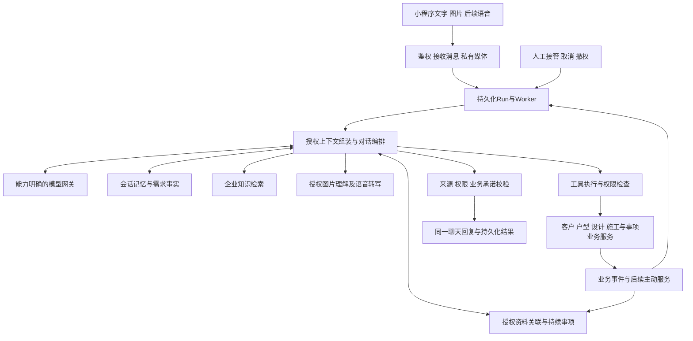

# 小K对话整体规划

**当前P5/PPT38现场落实、正式解决关闭与原咨询回传：限定闭环Implemented，整体Limited。** 原S04以当前获同意的精确方案，关联同房间已核对发布、有完成内容且无待处理缺项的现场记录及照片原件；负责人/管理者明确记录落实，管理者分别正式解决、关闭并选择回传节选和是否开放这些原件。客户同意、普通回复、照片发布不自动推进正式状态，关闭不代表工程验收或付款。独立处理修订、原键恢复、真人延后/乱序去重、重新处理及换版/撤回/撤权守卫沿原事务/outbox/Worker，原件仅以JWT回传原授权咨询；移出或所需角色降权后再授权不复活原正式依据，member审计保留服务读取的previousRole/previousActive。prompt v20的query_followups只读实际结果并继承原施工来源链；方案决定来源按业务修订优先，晚到的原发布通知不改变当前决定的来源ID。不增表、迁移、页面、菜单、WXML、Less、插画或导航；复用批准S04/C01/C05/U01。当前接口、角色、状态、设计映射、复跑命令和验证边界见[二期当前合同](./xiaok-assistant-phase-2.zh-CN.md#当前p5ppt38现场落实与正式解决关闭)，证据tmp/xiaok-p5-resolution/。既有构建/类型/独立Mini打包限制保留，不声明完整P5、可发布或干净克隆全通过；未合并main或部署。本段当前限定范围优先于下文旧阶段“正式决定/落实关闭未交付”的描述，旧批次测试及未测记录仍按原范围保留。

**前批P5：正式图纸/方案精确版本、差异与客户决定限定闭环Implemented；P5整体Limited。** 原S04有权人员附本人出图原件，明确发布同事项版本、前版、差异、费用/工期变化；原咨询C05完整查看后对精确版本作同意/拒绝/稍后/要求修改。普通确认、客户点位图、AI效果方案和员工回复不能代替正式决定。outbox不可变发布/独立状态、原键回执、真人延后、来源与成员撤权、换版/撤回及v19来源化追问接通，不增表/迁移/页面或改变既有Less/插画/导航。客户同意后仍待现场落实，事项未自动解决/关闭。现有设计与复用状态规则覆盖本批，不新增设计批准门槛。精确数据/API/权限/状态/测试及限制见[二期当前P5合同](./xiaok-assistant-phase-2.zh-CN.md#当前p5正式方案精确版本差异与客户决定)和[接力](./xiaok-assistant-handoff.zh-CN.md)。当前历史依赖审计/必要基础提交见二期及精确manifest；仍有既有打包/类型限制，不宣称干净克隆完整可运行。未生产发布。

**PPT23获权资料与同事项回传：限定闭环Implemented，P5整体Limited。** 客户在原C01咨询明确共享指定房间的需求节选，或紧接上传后明确共享点位图原件；S01接待同意不扩大为项目共享权。S04按项目/房间读取精确资料ID、原话hash与图纸原件，设计师/管理者在同一事项核对关联、回复，管理者明确编写的回传节选只投递原授权咨询。真人接待期间延后；资料替换/撤回、成员或客户撤权、记录/事项/资料版本变化约束读取、写入、回执和投递。沿用事务/outbox/Worker/原键幂等，无新表、迁移或供应商变更；团队回传接入原Agent施工来源链（prompt v18）；新增现有聊天API下的获权原件GET。既有C01/S04文字、原件网格和输入组件仅切换数据/资料标签，无样式、插画或导航更换。客户提供原件及员工关联核对不是正式出图、方案差异、已解决、批准或验收；显式命令及当前范围仍Limited。最终验收与命令见[二期合同](./xiaok-assistant-phase-2.zh-CN.md)，证据`tmp/xiaok-ppt23-batch/`；未生产发布。

**当前开发顺序**：用户已明确恢复持续开发，并要求“先补Agent的资料关联基础，再接持续跟进，用对应PPT场景做自动化验收”，覆盖C05后的旧暂停及S07优先入口。按3.10、4.11、4.12和第10节推进；P4A/P5点位图业务及新界面、语音/外部渠道、生产发布仍保持各自范围。历史结果不因恢复而改写。

**P2M.3资料关联与P3B持续接续基础：限定闭环Implemented，整体Limited。** 原`packages/assistant/chat/chat`使用`query_materials`组合明确本人房屋的原话、正式v4主户型及本人可见现场发布版本；多房屋/项目/重名房间先澄清，同名不冒充已核验映射，点位图保持缺项；同一房屋多项目或重名房间当前停在待员工核对，工具尚无项目/楼层选择器。`query_followups`读取原节点问题的稳定issueId/revision及等待状态；有效原话补充写`construction.need.progress.v1`，S01原授权设计师的明确核对推进同一事项，普通“收到”或回复不自动解决/批准。未分配如实显示；节点/房间/客户权限变化使旧事项、派生回答和模型记忆失效。沿用现有outbox、租约、幂等、来源和用量，不增表/迁移/API，不改WXML/Less/图片/导航或扩大私聊/项目权限；该批prompt v17（当前回传接续为v18，见上）。PPT15/16/23/35/37已实际读取；最终资料7/7、事项6/6加提交后租约恢复1/1、原生主链9/9加最终文字4/4、相关Agent12通过/7配置跳过、施工67项：64通过、3配置跳过、0失败、Mini定向63/63、Admin lint0错误/30警告。施工一次未完成记录保留，同一组文件已分组顺序跑完。量房Phase0既有基线仍7通过/1失败，小程序全量未重跑；tsc仍293条诊断，首尾错误集合一致且触及文件无诊断。生产构建、完整视觉/真机/真实微信/BLE未验证。完整PPT23共享资料卡/正式出图来源、原咨询事项转交/正式关闭及通用事件路由仍属后续，获权同事项回传见当前PPT23记录；共享现场事项接手/转交/回复/取消见本轮P4A记录，未生产发布。完整合同与最终检查见[二期当前记录](./xiaok-assistant-phase-2.zh-CN.md)。

既有交付：P4B公开工地、具体版本业主同意、员工脱敏与企业审核已形成3.7限定闭环（Implemented），整体仍Limited。C03原生围观见3.8，C05决定/原键回执/来源撤回验证见3.9。P4A共享对话与私人咨询保持独立。完整视觉/真机及后台剩余验收未验证、非阻塞，未生产发布；距离、直播/视频、外部推送、语音与正式变更仍未交付。

前期阶段验收口径（用户2026-10-16明确）：只以当前阶段对应的PPT场景及相关工程检查作为进入下一阶段的依据；通过后继续下一已授权阶段。额外长尾图片、复杂措辞、广泛质量基准及其他产品对比留作后续改进，不再持续扩大为推进门槛。权限、租户隔离及数据正确性检查保留；未做的手测仍记待测，不冒充通过。当前P2A.3范围内回归已通过，已继续P2C既有界面可复用的基础；语音按原计划独立推进。此口径不把整份PPT标成已实现，新界面设计和生产发布边界保持。

**P2A.3之前的P2M v9基线：Limited。** 开发环境localhost:3006／远端开发数据库的企业1454使用DeepSeek官方deepseek-flash，langgraph-v1、图片/工具启用，xiaok-renovation-v9、policy_version=3。回读一致、在途0、Worker健康200/fresh。证据：结构160/160、合成图片语义16/16、扩展会话44/44段（114/114轮）、隔离Worker19/19、纯测试63/63通过。未明确房间的指代先澄清再写记忆；通用预算/图片证据边界问答避免无谓转入企业知识检索。素材为2位作者的5张公开CC0照片及3种确定性降质变体，具有代表性的装修质量及原生人工验收仍待验证。现有路由/API/角色、C01/C02/S01/U01界面及正式量房写入保持，无生产发布。本段优先于下文历史仅规则/不能识图描述；未选择新Agent的企业仍走旧执行器。方法、证据及限制见[二期契约](./xiaok-assistant-phase-2.zh-CN.md)。

英文镜像：[xiaok-assistant-roadmap.md](./xiaok-assistant-roadmap.md)。**2026-10-16：用户已明确授权C01/C02/S01/U01第一批限定实施，详见[二期契约](./xiaok-assistant-phase-2.zh-CN.md)。** 本次用户要求回查并重做偏离源稿的既有UI，结果见3.6；此前“代码Implemented”和静态检查不能代替视觉验收。能力状态以各阶段当前交付为准，第4节区分已接入的Agent基础与剩余服务能力目标，未交付部分不自动视为实现。原生验收待测、非阻塞；未生产部署或采购。

当前可用：P1问答/引用/历史，P2S聊天/图片/接续与员工核对，P2A.1旧摘要，P2A.2媒体/正式快照，P2A.3范围内参考/偏好，P2C.1后台案例发布/本人作品集，以及P2C.2小程序推荐/设计室/详情/返回原咨询/联系/分享。高德实际联调、语音和后续营销扩展未交付；P2C.1/P2C.2手测待执行，不阻塞本期开发。

## 0. 对话优先的产品合同（第一批部分实现）

本节与第3、9、10节描述整体目标。第一批已批准的主稿/关键变体/共享状态规则现为聊天及接续的依据；准确实现范围和限制见二期契约。后续新设计方向保留批准边界；摘要确认和资料管理不再是客户前置条件。

### 0.1 客户主路径

客户进入聊天 → 说想法/发图 → 小K先回应当前问题、必要时自然补问 → 系统自动维护需求理解 → 需要专业帮助时在同一对话交接 → 团队处理后把结果带回。客户不必先完成问卷、生成/保存摘要、标注房间、绑定户型或建立项目。可选快捷回答只能减少输入，不能成为必须提交的多选表单。

- 保留房屋、居住、风格、预算、时间五类主动引导，作为可中断的内部框架；可选快捷回答不必逐项作答。用户转向其他问题时立即退出当前引导、先回应新问题，并跨话题自动整理；不自动拉回未答题，只有当前服务确实需要时才自然补问。一次只问一个确实影响下一步的问题。允许不回答、说不确定、换话题、先找真人；不按固定题数解锁摘要或服务。已知信息不重复问，缺项留空，不为了字段完整率持续追问。
- 摘要后台自动更新、退出重进仍保留。只有客户主动询问或交接确有需要时，展示短小自然语言回顾；“看看小K记了什么”是低频可选入口。默认不弹摘要、不要求确认或保存、不展示完成率。客户直接说更正即可。
- 选图后直接发送到聊天，保留预览、删除和失败重试。去掉发送前必经的“本次图片资料”管理弹窗；类别/房间/正式户型关联交给授权员工。必要的系统相册/录音权限仍按实际使用时申请。
- 语音可用时使用熟悉的录音/发送/回放，不要求客户先校对转写稿。识别不清时问一句或让真人听原音；ASR尚未配置时保留文字和图片可用，不伪装语音已实现。
- 有多个房屋/项目、图片用途不明且影响处理时，只提出最小澄清；没有可靠上下文就留待员工核实。浏览案例不等于喜欢，上传图片不等于同意施工，系统不猜写正式事实。
- 专业人员接手后仍在同一段客户聊天；不让客户另填交接表或重新描述。历史、资料和进度作为次级入口，常用入口保持少量且稳定。

### 0.2 谁负责处理

| 角色 | 必须承担的动作 | 不转嫁给客户的工作 |
| --- | --- | --- |
| 小K | 回答有依据的问题；自动整理原话、偏好和变化；提出必要澄清；生成内部草稿；据真实事件反馈 | 不让客户管理字段、资料包、任务编号或版本；不自行承诺报价/工期或批准变更 |
| 设计师/接待人员 | 核对需求、分类图片、关联房间/户型、查原话、接管、专业回复、整理方案与差异 | 不要求客户为方便内部管理先填摘要或给图片分类；接待不自动获得全部企业资料权 |
| 项目经理/管家 | 建项目和成员、分配阶段施工员工、确认实际节点、处理施工待办、核对公开材料；到场时间电话沟通 | 不让业主建项目、派单、维护施工阶段；不重复手填员工电话，不把这些工作全部推给设计师 |
| 施工人员 | 发照片/语音、核对事实与可见范围、发布记录、反馈问题 | 也以少录入为原则；人工发布是对外事实边界，不等于要求师傅维护复杂表单 |
| 老板/运营/服务人员 | 经营协调、内容审核、托管报价、设备交接、售后和退款对账，按各自权限执行 | 客户只表达诉求、查看结果及必要确认；实际付款方/验收方不默认就是业主 |

### 0.3 自动整理与必要确认

原话、系统推断、客户明确表达、员工核实、正式批准分别记录来源、时间及适用对象。普通偏好无需点击确认即可被记住；不确定/冲突项内部待核实，不阻塞聊天。后续更正更新工作摘要并标记旧内容被替代，保留原话；员工核实不伪装成客户批准。既有已确认记录不批量降级或重新弹窗，旧链接和历史可读；不得用自动摘要覆盖已批准方案。

必要确认仅针对有明确后果的事项：另行电话联系、对外公开具体资料、正式方案版本及费用/工期变更、实际订单/付款/退款决定。先说明对象、范围和影响，再用一张精简卡片供同意/拒绝/暂后处理；没有新范围不反复索要同意。普通“好”“可以”、沉默和浏览行为不触发正式批准。正式业务确认绑定精确对象与版本，拒绝只阻止该业务动作，不锁住聊天。

人工介入可以先建议；客户点击找设计师或明确提出找真人即提交接续，不再出现资料分享同意提示或授权卡，不先补需求。接管人员依本次服务角色查看本次聊天、自动摘要与图片；不扩大为全企业读取，结束/撤权按服务权限收回访问。卡住/复杂判断/正式报价/具体工期/预约意向均可触发建议，但一般预算知识与周期说明仍可回答。避免连续催转人工，客户侧统一为“请设计师接着聊”；报价和工期只是不同问题语境，不新增负责人角色、核实任务或分派流程，必要的团队协调由设计师内部处理；接待不可用时不虚构在线或回复时限。

等待期目标为同一聊天内可继续补充，由系统记入资料；暂停主动需求追问与自由AI回复，避免与即将接手的人重复沟通。仅显示真实进度和确定性操作反馈，不将其冒充真人回复。客户可随时取消回小K；真人接管后AI不自动插话；员工退出回等待，明确结束后恢复AI。现代码在申请时已停AI，本次不改为等待期双重答复。普通沟通时间直接在聊天中商量，去掉独立沟通意向卡、确认时间按钮及待确认/改约流程，不创建预约任务；正式量房保留既有服务流程，施工到场直接电话联系本阶段施工人员；真正新增服务需复用既有业务规则并适时确认。

### 0.4 PPT服务效果的完成口径

PPT15/16/22–25/37/38的共同目标是：客户说过的需求能被后续服务复用，团队能找到相关资料，待处理事项有负责人和下文，结果回到原对话。页面、字段、通知或模型调用各自存在，只能证明对应基础能力；完整服务还需按第10节验证关联与接续。

- **资料关联**：围绕明确的项目、房间和事项，找齐当前有权读取的需求原话、现场材料、正式户型/图纸与有效版本；说明关联依据，缺项或冲突明确待核对。
- **持续跟进**：记住用户交代和团队待办的具体对象、待解决问题、责任人及触发条件；跨天、换阶段、重进或人员转交仍接同一事项，收到有效结果后反馈。
- **角色协作**：客户表达生活语言；小K整理、查找、补问并协调已有流程；设计师/经理/师傅按权限处理。正式方案、费用、工期和验收仍由业务负责人确认。
- **可观察的完成**：每阶段同时验证用户操作减少、真实业务结果和来源可追溯；不以卡片出现、后台保存成功或回答文风作为Agent任务完成证据。已交付的限定闭环继续有效，剩余差距按原阶段补足。

## 1. 整份PPT逐页核对

本表保留对原PPT和现代码的差距审计；“PPT要求”不是要求逐字实现的客户操作。交互取舍以第0、3、9节为准，未来新批次另行验收，不把补图当作已开发。

唯一PPT：[家客来小K装修服务功能方案.pptx](./装修施工标准手册制度规范/家客来小K装修服务功能方案.pptx)。SHA-256：`9221a83057fb1b2aa691ecde6cf60a0aa2dfb0d352aad4b6eab2cb6f15209af4`。
文件实际有 **88页：1–39为主方案，40–88为49页界面放大附页**。已核对presentation实际顺序、所有页面文字/图片关系和34张不重复原始图片；附页复用主方案图片，映射见下表，不能漏掉第5页第二张授权交接图。第7–9、35–36页中的萤图截图只作对照，不把其控制能力全部算作家客来承诺。备注主要说明方案/放映与授权边界，不是运行能力证明。

核对产物在 `tmp/xiaok-ppt-audit/inventory.json` 和 `sheet-1.jpg` 至 `sheet-9.jpg`；可由 `tmp/xiaok-ppt-audit.py` 重新提取。持久核对结论维护在本文件，不另建一份平行开发计划。PPT里的图片必须看交互、入口、状态、输入和前后页衔接，不能只取颜色/插画。以后每批先核对对应主页面及附图。

状态口径：`Implemented`=有可执行闭环；`Limited`=只覆盖本行部分内容或只有可复用基础；`Placeholder`=未找到该PPT业务闭环，即使存在内部函数/通用表也不算实现。以下是静态代码与设计核对，不是新增真机验收。

| 主方案页 | 放大附页 | PPT要求（含图中交互） | 当前状态 | 当前遗漏/不一致 | 代码证据 | 归属批次 |
| --- | --- | --- | --- | --- | --- | --- |
| 1 | — | 双渠道获客→咨询→透明工地总链路 | `Limited` | 咨询/作品推荐、真实工地/节点/共享记录及业主私聊投影已接通；公开围观已形成3.7限定闭环；语音、视频及后续业务尚未完整交付 | E1–E8,E10 | 全部 |
| 2 | 40,41 | 设计师专属首页、公司渠道页、案例/预约/工地入口 | `Limited` | 设计师主页/案例→同一咨询及站内联系已接通；公司渠道专页、具体预约和工地入口仍按后续批次 | E3,E4及P2C.2 designer/work运行路由 | P2B/P2C/P4B |
| 3 | 42 | 真实设计师形象、城市/专长/作品、分享设计室 | `Limited` | 限定主页/公开作品/安全分享已实施；无公开肖像用姓名首字，不伪造认证；专属知识配置及原生手测另记限制 | E3,E4及P2C.2 designer/work运行路由 | P2C |
| 4 | 43 | 内容话题→参考案例→咨询；AI文案/海报、人工审核 | `Limited` | 限定案例审核/出处授权/作品到原咨询闭环已实施；AI文案、海报及后续营销扩展未交付 | E3,E4 | P2A.2/P2A.3/P2C |
| 5 | 44,45 | 逐项引导/快捷选项/进度；参考图、语音图片、找设计师及授权预约 | `Limited` | 聊天、图片、授权参考和真人接续已实现；公开工地按3.7交付，语音待后续，普通需求不再逐项强制确认 | E1,E2 | P2A.1/P2B/P2A.2/P2A.3/P4B |
| 6 | 46 | 五类摘要、原话、参考方向、修改确认、随时找设计师 | `Limited` | 原话常态可见，编辑确认反馈聊天，随时找设计师已接通；授权参考方向已实现 | E1,E2 | P2A.1/P2B/P2A.3 |
| 7 | 47,48 | 附近开放工地、片区切换、距离/阶段/更新时间、自主围观 | `Limited` | 公开授权/真实片区列表/少量推荐已接通；无有效坐标不显示距离，原生手测待测 | E5,E7 | P3A/P4A/P4B |
| 8 | 49,50 | 现场进展/小K服务记录切换、业主授权脱敏、调整和撤回公开范围 | `Limited` | 独立脱敏文字/照片、具体版本看全同意、企业审核、双Tab与撤回已接通；人工隐私核对仍必要 | E1,E7 | P4B |
| 9 | 51,52,53 | 围观中独立私聊、公开依据引用、记录随摘要交接 | `Limited` | 围观精确公开上下文→本人咨询/设计师接续，源芯片与撤回校验已接通；原生人工待测 | E1,E3,E7 | P2B/P4B |
| 10 | 54 | 随时找设计师、复杂问题/沟通卡住时建议接管、联系同意 | `Limited` | 客户主动授权、独立电话同意、等待/取消/预约已实现；自动识别沟通卡点并建议升级尚无 | E1,E3 | P2B |
| 11 | 55 | 员工待接管→接管同会话→AI暂停；无人接待/预约 | `Implemented` | 文字范围：员工小程序/后台接管与回复、AI暂停/恢复、重进/撤权及既有预约适配；无外部推送 | E1,E3 | P2B |
| 12 | 56 | 个人社交/公司渠道线索筛选、摘要、来源/负责人/分佣分离 | `Limited` | 接续包保存来源/摘要/接待人，推荐及分佣不改；双渠道获客内容筛选待P2C | E3,E4 | P2B/P2C |
| 13 | — | 咨询资料进档案→确认资料进项目→授权交付成果回流案例 | `Limited` | 项目已绑定本人lead；摘要仅会话内保存，需求/方案授权关联及交付成果回流未完成 | E2,E4,E5,E7 | P2B/P2C/P3A/P5 |
| 14 | 57,58,59 | 自家户型入口/更换、结合户型话题、文字语音图片、需求及节点入口 | `Limited` | 本人正式快照/图片及配置企业的视觉已接通；节点上下文和限定补问按3.4；语音、通用理解仍有界 | E1,E5 | P2A.2/P3A/P3B |
| 15 | 60,61 | 按房间整理空间/使用/设备、理解确认、定向补问与多选 | `Limited` | 单组房间/空间/用途/频率/设备及确认多选已实现；多房间独立版本与施工阶段跟进待P3B | E2 | P2A.1/P3B |
| 16 | 62 | 水电前主动补生活需求、查看已有需求、设计师核对 | `Limited` | 3.4已按实际节点和已有需求补问，原话/图片由获接续授权设计师核对；专用事项/材料及正式变更未交付 | E2,E6,E7 | P3A/P3B |
| 17 | 63,64 | 阶段说明→查看项目动态→新记录主动带回并可查原文 | `Limited` | 原咨询可查实际节点和明确发布记录/照片及来源版本，关注由outbox回传；独立动态页和站外推送未交付 | E5,E6,E7,E10 | P3A/P3B/P4A |
| 18 | 65 | 防水安排、待定时间不承诺、确定后提醒、联系管家 | `Limited` | 已接配置节点提醒/现场重点/实时电话及获准记录；不推断约定时间，微信订阅推送未交付 | E5,E6,E7,E10 | P3A/P3B |
| 19 | 66 | 铺砖前喜好补充、图片说明、承接已选材料、团队排版核对 | `Placeholder` | 无材料选择记录/节点补充/设计师与师傅待办；不是自动施工方案 | E5,E7,E8 | P3B/P5 |
| 20 | 67,68 | 安装准备、团队确认时间后到场提醒、老板看待回复 | `Placeholder` | 缺安装事项、确认时间和经营汇总来源 | E6,E7,E8 | P3B/P6 |
| 21 | 69 | 联系管家预约到场、现场保护提示、查看已上传动态 | `Limited` | 联系管家拨本阶段有效员工电话，不建到场预约/意向；明确发布的现场记录/照片可在原咨询查看 | E5,E6,E7,E10 | P3A/P3B/P4A |
| 22 | 70,71 | 师傅语音+照片→草稿→核对范围→发布→客户收到更新 | `Limited` | 3.5已完成文字/照片→共享草稿→对话内核对范围/发布/更正/撤回→业主投影；语音和外部微信推送未接通 | E5,E7,E10 | P2A.2/P4A |
| 23 | 72,73,74 | 房间现场/图纸/需求关联；师傅回复；具体方案版本差异与客户确认 | `Limited` | 获权需求/原件、同事项核对及限定回传已接通；正式原件精确版本、差异、费用工期与本版本客户决定限定闭环已实现；自动出图、CAD/PDF解析及完整S05未实现 | E5,E8 | P5 |
| 24 | 75,76 | 记住“有照片告诉我”、新记录触发原事项反馈、作者时间来源 | `Limited` | 已持久保存项目/房间关注、明确取消、精确发布版本和后台去重站内投递；口令语义有界，不替代专用事项闭环 | E6,E7,E10 | P4A |
| 25 | 77,78,79 | 多项目日报、待回复独立列出、原始资料追溯与追问 | `Placeholder` | 没有施工事实汇总；现有设计报告不是经营日报 | E7,E8 | P6 |
| 26 | 80,81 | 业主自家云工地、阶段/照片/历史；经理多项目/待办 | `Limited` | 三端共页/实际节点/员工分工和S04共享记录/历史/业主投影已接通；经营简报、视频及完整待办未交付 | E5,E7,E10 | P3A/P4A/P6 |
| 27 | — | 统一5点位套装：摄像头+4G网关+流量、安装/回收/售后 | `Placeholder` | 没有设备套装、资产库存、订单和交付服务；不默认支持自购设备/自有网络 | E9 | P4C.1/P4C.2 |
| 28 | — | 按房间直播/本地录像远程回放、成员权限、报修延期退场 | `Placeholder` | 缺视频提供方适配、设备项目房间绑定和服务生命周期 | E9 | P4C.1/P4C.2/P4C.3 |
| 29 | — | 1199元/90天、800押金、安装验收起算、额外报价不自动续扣 | `Placeholder` | 没有托管报价/订单/押金账本；PPT价格是方案基线，不是已开通收费 | E9 | P4C.1/P4C.3 |
| 30 | — | 5点轮换、最多2路≤1Mbps、按角色看直播回放、保留/导出 | `Placeholder` | 缺服务端并发与授权限制、录像范围/导出；全天云录像/公众直播需独立范围 | E9 | P4C.2 |
| 31 | — | 确认项目→安装验收→开通使用→回收撤权/清理/押金核对 | `Placeholder` | 缺订单状态机、现场验收清单、设备交接与退场证据 | E9 | P4C.1/P4C.3 |
| 32 | — | 故障/换机、不可用减免、供电信号验收、磨损/损坏证据、押金退款 | `Placeholder` | 无售后工单/SLA/费用调整/退款；3工作日退款需交易渠道与对账 | E9 | P4C.3 |
| 33 | — | 同项目画面/记录/报修/问题，业主/经理/设计师分权 | `Limited` | 项目成员共享原材料/记录版本及精确业主投影已接通；不等于正式墙图绑定，视频/报修/正式变更未交付 | E5,E7,E8,E9,E10 | P3A/P4A/P4C/P5 |
| 34 | — | 项目/现场/成员资料、报价确认、安装预约、验收和退出入口 | `Placeholder` | 缺客户可见的开通申请、进度及服务条款版本 | E9 | P4C.1/P4C.3 |
| 35 | 82,83 | 水电节点结合旧需求追问设备→补充草稿→转设计师核对 | `Limited` | 3.4节点缺项补问、原聊天补充/图片及授权设计师核对已实施；材料选择和专用事项/正式变更待后续 | E2,E6,E7 | P3B |
| 36 | 84,85 | 房间进展关注、可取消、已发布新记录主动回访 | `Limited` | 3.5已接通限定口令的持久关注/取消和发布事件去重站内回访；微信站外推送及通用语义扩展未交付 | E6,E7,E10 | P4A |
| 37 | 86 | 经理确认节点→结合既有需求提醒→变更计划后重算 | `Limited` | 实际节点触发配置提醒/已有需求缺项补问，旧节点/配置来源失效；不按日期推测施工状态 | E6,E7 | P3A/P3B |
| 38 | 87,88 | 自动提醒/反馈、草稿人工核对、方案费用工期验收负责人决定 | `Limited` | 人工核对/原件版本及来源撤权已接通；精确方案费用工期客户决定、现场落实证据及管理者分步解决/关闭/原咨询回传为本批限定范围；不含工程验收或付款结算 | E1,E2,E7,E8,E10 | P3B/P4A/P5 |
| 39 | — | 按实际能力确认服务组合、首个项目/团队、交付费用与验收 | `Limited` | 可交付范围需与真实实现对应，不能把整套PPT当已上线 | E1–E9 | 全部 |

## 2. 代码依据与本次确认的不一致

下表按当前阶段记录区分旧接口的可复用基础与已交付扩展；Agent的剩余能力差距见4.1，不能把兼容路径的限制泛化为所有企业的当前运行能力。

| 证据 | 已核对代码/入口 | 可以复用与不能推定的边界 |
| --- | --- | --- |
| E1 | `miniprogram/packages/assistant/{chat,requirements,handoff}/`；`admin/src/lib/assistant/application/http.ts`、`handoff/{http,service}.ts` | 客户chat/requirements与共享handoff路由，员工独立鉴权；文字问答、明确请求后的真人接续、私图及正式快照已实现；选择新Agent的企业已接入有限图片理解，公开围观见E7/3.7；语音仍未交付 |
| E2 | `admin/src/lib/assistant/requirements/`；`admin/src/components/assistant/guidance-editor.tsx`；Mini requirements | schemaVersion3/13题及旧房间摘要是兼容基础；当前聊天已接来源化room+field需求、更正链及范围内授权参考/明确偏好，不要求填完摘要。复杂指代、房间迁移与通用语义仍Limited，不能以旧表单能力代表完整理解 |
| E3 | `admin/src/lib/assistant/handoff/`、`core/conversation.ts`；`admin/drizzle/0066_assistant_handoff_guard.sql` | 客户授权/员工原子接管/真人消息/撤权与AI隔离已实现；来源保存不等于完整内容归因，不修改派单/分佣 |
| E4 | `admin/src/lib/professional-profile.ts`、`postgres-promotion-workflow.ts`、`referrer-network-api.ts`；`miniprogram/packages/business/staff-activity-code/staff-activity-code.js`、`lead-claim-pool/lead-claim-pool.js` | 职业资料、活动码、推荐人/预约/抢单/佣金沿用当前合同；专属设计室/案例发布与推荐按3.1实际交付，不从职业资料或分享链接推定，也不改变归属与分佣 |
| E5 | `admin/src/lib/customer-project.ts`、`lead-site-photos.ts`；`admin/src/app/api/miniprogram/customer-projects/[leadId]/service-needs/route.ts`；`miniprogram/packages/business/customer-project/customer-project.js` | 已有客户lead/正式户型/发布设计聚合、服务需求选项及现场照片；独立施工节点、共享记录和发布见E7/E10，不能从客户聚合直接推定。设备服务域仍未交付 |
| E6 | `admin/src/lib/wechat-notification.ts`、`admin/src/lib/assistant/core/extensions.ts`、`admin/src/lib/construction/service.ts`；订阅模板合同 | 施工安排、节点补问与项目/房间关注已通过对应事件消费者及去重站内投递接回原聊（3.4/3.5）；专用事项及持续调度按4.12补足。微信受订阅/模板/平台开关约束，站内写入不等于外部送达 |
| E7 | `admin/src/db/construction-schema.ts`、`admin/src/lib/construction/`、`admin/src/app/api/construction/`、后台`construction-projects`、既有C01聊天 | 项目/实际节点是独立事实；共享日志/核对发布/房间关注及独立公开副本/同意/审核已按3.5/3.7交付，日报仍未实现 |
| E8 | `admin/src/lib/design-reports/service.ts`、`admin/src/lib/customer-project.ts`、`admin/src/app/api/miniprogram/customer-projects/[leadId]/published-generations/[generationId]/image/route.ts` | 设计生产/发布/汇报可复用；未接小K现场事项、精确方案版本客户确认或经营日报 |
| E9 | 同E7目录范围，并检查API路径中的camera/site/construction、托管订单/押金/售后相关实现 | 未找到摄像头托管/播放授权/订单设备/押金退款的产品闭环；通用媒体存储/AI计费不是视频服务或设备押金账本 |
| E10 | `admin/src/lib/construction/site-{chat,worker,publications,watches}.ts`、`admin/drizzle/0083_construction_shared_chat.sql`及`miniprogram/packages/construction/chat/` | 3.5共享对话/原材料/版本/发布/关注及后台投递；数据库/客户端/真实模型检查见3.5 |

旧计划的关键问题已修正：①旧段落仍写“未接UI/未开真实企业”，与当前开发代码和既有开发环境记录冲突，已移除；②按技术模块划分导致分享/公开围观/托管服务没有明确归属；③“P2A基础闭环Implemented”被误读为PPT5/6完整覆盖；④P4摄像头被当成泛化可选附件，遗漏了27–34页完整服务订单/设备/售后链；⑤不能让“P3→P4”成为首咨永远看不到工地的理由，P4B现在有明确回接P2入口的任务；⑥每个分批都有小程序测试，不以人工截图结束与否决定是否继续开发。

## 3. 修订后的开发顺序与小程序测试闭环

保留P1–P6业务编号；P2C仍指获客入口与内容回流。P2S整合P2A.1/P2B/P2A.2基础，第一批交互主路径Implemented，自动理解有边界，整体Limited。交付事实见二期契约，不将后续所有目标视为已实现。

P2M已接入有限理解/执行基础，剩余服务能力按3.10补强；以下保留原阶段顺序： **P2M.0 → P2M.1 → P2M.2 → P2M.3 → P2A.3 → P2C → P3A → P3B → P4A → P4B → P5 → P6**。P2M.4承接P2A.2语音，ASR就绪后接入，不阻塞文字/视觉。P2M.0是内部选型准备；P2M.1–.3各自交付真实小程序闭环，共同构成核心助手验收。后续实施、新设计、付费服务和生产边界不变；托管仍为独立P4C.1 → P4C.2 → P4C.3。后续交付须同时落实3.10的Agent服务要求和第10节对应阶段的验收；本次修订不启动下一批实施。

| 批次 | PPT页 | 现有基础 | 新目标：客户最少操作 | 自动处理与专业端交付 | 验收重点 / 设计组 |
| --- | --- | --- | --- | --- | --- |
| P1 | 5,6 | `Limited`；问答/引用/历史已可用 | 直接提问，想看时再展开依据 | 知识后台保持审核、撤回与权限；失败可恢复 | 不强迫先填需求，引用失效不编造 / C01,U01 |
| P2S | 5,6,10,11,14,15 | `Limited`；第一批聊天/接续/员工路径Implemented，规则提取有边界 | 聊天、发图、自然更正、随时找真人；摘要/资料管理不作卡点 | 自动摘要与更正溯源、图片直发、授权员工统一接待/资料核对；接续在聊天内完成 | 从零信息到真人接续全程不打开摘要编辑/资料管理页；退出重进、撤权与并发仍可靠 / C01,C02,S01,U01 |
| P2A.1 | 5,6,15 | 原摘要/引导 `Implemented` | 摘要可不看、不改、不确认；“预算改成20万”直接更新理解 | P2S中替换固定问卷式引导；五类信息/多房间是员工视图和内部结构；冲突待核实，不自动批准 | 无确认不阻塞；不同房间不覆盖；旧摘要/确认记录兼容 / C01,S01 |
| P2B | 5第二图,6,9–13 | 原文字接续 `Implemented` | 直接请求后同聊等待/接管；普通沟通时间直接聊；可取消 | P2S补自然建议、服务访问范围和等待反馈；员工接单后核对资料；普通时间用聊天商量，实际服务沿用原业务合同 | 不强制电话或建档，不虚构在线；AI/真人不抢答；具体报价/工期统一交接待设计师继续沟通 / C02,S01 |
| P2A.2 | 4,5,10,14,22 | 图片/户型 `Implemented`；语音 `Placeholder`，整体 `Limited` | 选图即发、语音即说；不先分类/选房间/选户型版本 | P2S简化入口；员工分类/绑定，自动关联仅在权限和上下文明晰时；媒体安全、历史快照保持；ASR独立接入 | 图片发送无需资料管理；误关联可纠正；不能把传图当AI读图 / C01,S01,U01  P2M.2负责视觉，P2M.4负责ASR，本行仅媒体存取。 |
| P2M.0 | 跨5/6/14 | `Limited`；内部准备 | 不算用户功能交付 | 同样本评估视觉语言模型和LangGraph JS/轻量SDK；确定网关schema、增量迁移、checkpoint/Worker职责、用量及数值质量基线 | 真实图片/工具兼容、重启/撤权/幂等；演示不等于核心助手完成 |
| P2M.1 | 5,6,15 | `Limited` | 自然提问、换题、更正，记住同一房屋需求 | 对话编排、按需RAG、双方历史、来源化事实记忆，保留旧抽取模式 | 无知识命中可做一般讨论；多房间更正不丢独立事实；不编造企业事实 / C01,S01,U01 |
| P2M.2 | 5,6,14 | `Limited` | 首条发图即可得到有依据的观察并继续聊 | 私图送入视觉模型、图文/多图上下文、观察/推断分离、源撤回、失败恢复和用量 | 图后追问、模糊图不瞎猜、不写正式墙图 / C01,S01,U01 |
| P2M.3 | 10–15 | `Limited` | 查本人真实资料、找设计师并看到执行结果 | 有限工具循环，复用已发布方案/正式户型/已有预约查询及接续，受控需求写入 | 权限/版本/幂等；普通更正不变审批，未建业务域不伪造 / C01,C02,S01,U01 |
| P2M.4 | 5,14,22 | `Placeholder`；承接P2A.2语音 | 录音发送、必要时回放，不强制校对转写 | ASR进入同一核心，原音权限/保留期和纠错；TTS后续评估 | 噪音/口音/失败反馈，原音/转写可追溯，不另建语音Agent / C01,U01 |
| P2A.3 | 4–6、14 | Implemented（范围内）；原生手测待测 | 聊天看最多3个授权参考，直接表达偏好 | 既有Admin维护出处/授权/标签/独立图片，复用引用面板及明确偏好更正链，不要求收藏 | 无匹配/撤回/租户/Worker检查通过；不是施工方案 / C01、U01，S02另行 |
| P2C | 2–4、12、13、39 | Limited整体；P2C.1后台与P2C.2限定客户闭环Implemented，高德真实联调Limited | C01推荐→原PPT主页/作品→原咨询、明确偏好/联系/分享已接通；原生手测待测 | 真实发布/有效作品读取、幂等偏好/更正、本人站内接续及签名分享；来源/负责人/分佣分离 | 按3.1；无小程序发布或新获客一级入口 / C01、S01、后台S02及PPT2/3 |
| P3A | 13,16–21,26,33,34,37 | `Limited`；入驻/员工分工/三端共页/节点提醒及实时联系人在3.3范围Implemented | 查实际节点/现场重点，收提醒，联系当前阶段已分配员工 | 真实企业员工/工地/阶段关联，设计师/施工员工/老板共用路由；需求/方案授权关联后续 | 见3.3；入驻/分工/节点/停用/撤权/幂等/拨号 / C01,C02,U01、S03 |
| P3B | 14,16–21,35,37,38 | `Limited`；3.4限定补问/原聊天补充/设计师核对Implemented | 实际节点时回答一句或发图，已有或问过的需求不重问，可换话题 | 企业配置候选缺项；原话/工作记忆和原接待页核对，来源失效使派生回复不可用 | 无催表/自动批准；专用事项/正式变更仍待后续 / 复用C01,C02,S01,U01；C04,C05,S05新界面另行 |
| P4A | 17,21,22,24–26,33,36,38 | `Limited`；3.5共享对话/核对发布/关注限定闭环Implemented | 原咨询查获准记录/照片，明确关注/取消；成员在同一工地对话发文图并核对发布 | 独立内部会话/版本/原材料、精确业主发布、撤回及后台去重投递已接通；ASR/外部推送仍未交付 | 见3.5；原PPT22/38及C01/U01；原生人工待测，不扩大为公开工地/正式批准 |
| P4B | 2,5,7–9,13 | `Limited`；3.7限定闭环Implemented | C01入口/少量区域推荐、双Tab围观→本人私聊、具体版本预览/同意/拒绝/撤回 | 员工合法来源节选/独立遮挡照片；业主同意后企业审核；RLS/回执/撤回和Agent引用已接通 | 无定位可选片区，无授权不公开；C03/C05/S07已批准实施，C03/C05限定原生已测，其余视觉/真机/后台未验证 |
| P5 | 13,15,19,23,33,38 | `Limited`；同事项资料、精确版本决定及PPT38落实/解决关闭回传限定闭环Implemented | 聊天反馈；仅在具体方案/费用/工期需要批准时看简明差异并明确选择 | 设计师处理现场问题/房间/原图/版本/责任人，形成正式变更；经理安排执行 | 不强迫管理版本；V3批准不继承到V4；“好”不默认批准 / C05,S05 |
| P6 | 20,25,26,39 | `Placeholder` | 客户只收到与自己有关的处理结果 | 经理/老板看有来源简报、待办和逾期，追问、分派、关闭；统计缺失如实显示 | 内部协调不暴露给客户；来源与统计窗口可追溯 / C04,S06 |
| P4C.1 | 27–29,31,34 | `Placeholder` | 业主/装企联系人说开通意向；实际签约/付款/验收角色确认必要事项 | 运营采集缺项、报价、库存/点位、安装排期；服务人员逐点验收，未通过不起算 | 不让业主配设备或填技术表；未报价/验收不假报开通 / C05,O01 |
| P4C.2 | 26–28,30,33 | `Placeholder` | 点房间看直播/回放，异常可直接找小K；不配置设备 | 运营绑定设备、成员授权、录像保留/导出；真实服务商联调、2路≤1Mbps及即时撤权 | 断网/无录像/并发超限有反馈；公众直播另定范围 / C06,O02,U01 |
| P4C.3 | 27–34 | `Placeholder` | 聊天报修/申请延期或退场，查看状态；必要时确认新报价/争议 | 运营受理排障/换机/减免/回收/退款，保留证据与对账；不自动续扣 | 报修不要求诊断故障码；退款申请不等于到账 / C04,C05,O03 |

### 3.1 P2C 当前范围与小区检索

本节是案例发布与设计师作品集的当前范围，优先于旧S02小程序发布线框。用户2026-10-17授权继续开发；P2C.1后台维护/审核与P2C.2限定客户闭环已实施，按用户批准规则，已保存Key并显式开启即可业务查询，授权备注选填，开发搜索已开启。P2C整体保留高德及后续内容扩展限制；人工/视觉验收待测、非阻塞，不代表生产发布或新增采购。 地图配置现由「平台管理中心→地图服务配置（/map-settings）」统一维护，提供凭据加密导入/修改/清除、供应商选择、业务限额、启停及独立连接测试，保存即生效；高德Implemented；天地图Limited，服务端适配与严格小区/城市模拟回归已实现，真实Key、权益及运营城市召回待核验。默认检索供应商与凭据维护分开，备用供应商可先独立配置/测试；显式切换保留双方凭据、权益和测试结果，旧签名候选不能跨供应商/配置版本绑定。业务日计数/冷却分供应商，短窗限流继续共享。缺adcode误过滤已修正，宜昌连接诊断返回10条候选，0079移除启用、绑定和小区读取的强制地图授权/期限校验，作品/图片发布许可及租户/来源撤权保留；不视为具体小区或生产验收。

#### 3.1.1 入口、内容与角色

- **首版只在后台维护作品**：新增独立“案例发布管理”，不再要求用户从“小K知识库→新建知识→内容类型”寻找。设计师使用后台员工身份，只维护当前企业本人作品；企业管理员审核、退回、发布及管理本企业作品。菜单授权与本人/企业数据范围分别校验，不给设计师整店知识或其他员工作品权限。小程序不新增作品创建、上传、编辑、审核、发布页面。
- 一套作品绑定真实作者/合作角色、主风格（1个，辅助最多2个）、封面、说明和可选面积/室厅信息；同一作品包含多张**效果图与实拍图**，分组排序，实拍可标“样板间实拍”。AI生成效果图应标明，不能充当实拍；样板间首版只展示和咨询参观意向，不承诺可预约日期，不冒用量房预约。
- 同一管理入口区分“设计师作品”与“企业授权参考”。第三方参考保留原作者/许可，不归入本设计师原创作品或同小区服务业绩。旧`reference_case`默认保持企业参考，须有权人员确认主创与归属后才关联作品集，不静默批量绑定员工。
- 设计师职业资料沿用既有真实身份、专业背书及字段锁定；可维护自述、服务城市/区县、擅长风格与精选顺序。不得虚构认证、客户数、评价或业绩。出处、图片许可凭据和业主私人信息仅按内部权限读取，不下发客户公开页。
- 发布流为草稿→提交企业审核→退回修改或发布→下架；后台自动完成图片处理/检索准备，显示准备中、失败及重试，用户无需手动建立索引。有效公开版本保持唯一；已发布内容编辑生成新草稿，审核前保留旧公开版本。撤回、许可失效、员工停用在推荐、详情、分享和历史引用重新校验；不以新作品库绕开现有版本/来源撤销合同。

#### 3.1.2 客户入口与设计依据

- 客户主入口固定为**小K对话推送设计师卡片/“查看设计师主页”按钮→设计师主页→作品详情→继续原咨询或申请联系本人**；不新增客户找设计师一级入口，不要求先收藏、填摘要或交手机号才能看方向。返回保留原会话上下文；推荐不等于建立线索或同意电话联系。
- 主页沿用原PPT第2/3页（放大附页40/42）的真实身份、城市、精选案例、“和小K聊聊我家”“预约设计师”和分享设计室。只扩展作品集数据与效果图/实拍分组，通用新主页探索稿不采用。C01推荐卡和按钮沿用已批准聊天/共享状态规则，新增或冲突的视觉决定仍按设计批准规则处理。
- 当前实施设计源：[发布管理](../design-references/designer-portfolio-publishing-v1/01-admin-case-management.png)、[编辑作品](../design-references/designer-portfolio-publishing-v1/02-admin-work-editor.png)；[原PPT主页完整单屏](../design-references/designer-portfolio-publishing-v1/ppt-sources/slide02-01.png)为853×1844，按宽映射390×844并预留原生胶囊。后台路由现已按此设计源实施；PPT客户主页和分组作品详情已实施；独立素材与元素台账见二期，原生人工QA待测，不宣称运行视觉验收通过。旧`xiaok-s02-proposal-v1`手机发布线框不再是首版前置条件。

#### 3.1.3 高德优先与零费用边界

**选型决定：首版优先高德实时小区检索；先搜索、再明确点选，不先抓取全国小区库，不接入外部户型图库。** 这是针对当前交互与接入成本的选择，不是已验证“全国收录最全”的供应商排名；尚未做运营城市的实际召回对比。

| 候选 | 已核实事实（2026-10-17） | 当前决定 |
| --- | --- | --- |
| 高德 | 支持城市限定的POI检索、输入提示与ID查询。基础搜索组月配额为个人5,000、企业50,000、已购买技术服务许可企业500,000次；个人/非商业企业免费权益有非商业用途与期限条件，额度由该组多个接口及平台共享。价目基础技术服务许可50,000元/年；乘风计划为定向邀请、符合条件企业一年免费基础服务 | 首选适配；先核实本项目现有主体许可/免费计划实际权益，不把免费调用量等同商业授权。旧“个人100/企业1000次每天”的公告不作为现行预算 |
| 百度 | 地点检索有认证配额；现行扶摇计划为符合认定标准企业180天免费商用权限，期满权益另核实 | 可比较的限期免费备选，不因宣传免费就切换，也不承诺永久零成本 |
| 天地图 | 地名搜索V2适配已实现：queryType12、小区类别120201、严格城市/稳定ID校验；绑定按已签名原名复查，前10条须含原ID，官方未文档化按ID详情。独立Key、实际商用/留存权益、配额及运营城市召回未核验 | Limited：模拟回归及显式切换通过，真实账号/城市验收待测，不宣称全覆盖或免费商用 |
| 政府开放小区名录 | 存在有明确开放许可的地方数据，如达州住建局462条小区/物业信息；无全国统一完整覆盖证明 | 硬性零服务费时采用运营城市合适开放名录/企业自有核验名录，承认覆盖边界；只导入必要小区字段，不导入无关个人联系人资料 |
| OSM公共Nominatim | 公共接口明确禁止自动补全和系统性全量POI下载；自建有运维成本，国内小区覆盖未验证 | 不作为当前后台输入联想的免费替代 |

- 用户已批准当前应用规则：已保存Key并显式开启即可搜索/绑定，商业/绑定确认、依据和有效期仅选填备注；未填写、未勾选或已到期不拦截查询或隐藏已存小区匹配。这项软件设置不声称供应商权益、不采购服务，也不改变实际供应商权限/额度错误。
- 超额单价、实际账户QPS和权益期限在接入时回读官方控制台，不写死旧日配额。默认不自动购买、不自动充值；设置应用请求上限和用量提醒，超限/无权限/服务失败时停用外部查询，保留作品草稿并允许暂不绑定。若许可无法零费用满足，明确展示这一限制，而不是换个人Key、轮换账号或切接口绕过配额。

#### 3.1.4 小区选择、持久化与推荐规则

- 后台服务端代理高德Web服务，Key仅服务端保存，不进浏览器/小程序包或日志；使用固定供应商域名与账号所需签名/IP限制。先选择城市，至少输入2字、约500ms防抖；空输入不请求，取消/忽略过时响应，并限制页面/用户/企业请求速率。候选显示标准名称、区县、地址及可用分期信息；只接受真实POI候选，缺ID、道路、出入口或分期歧义须补查/人工确认，不把原始联想词直接保存为标准小区。
- 第一适配优先账号已获准的基础输入提示/POI文本及详情查询；不因“2.0”名称默认切到需要另开权限的高级接口。按住宅区类别与严格城市范围过滤，不能只填城市却允许全国结果混入。具体返回类型、字段和当前配额须按所用API版本验证。
- 为明确点选并复查的小区保留稳定内部`communityId`及租户/provider/providerPoiId身份，仅持久化最小绑定快照，不缓存检索候选或全量建设全国字典。地图授权备注/日期选填，缺日期存NULL；0079移除绑定、草稿和公开同小区匹配的旧期限门槛，保留租户/当前角色、签名点选、来源撤权及作品/图片发布许可检查。
- 小区可选填：查无结果时切换城市、申请核验补录，或暂不绑定继续保存/发布；没有核实小区ID的作品不参与同小区匹配。仅同名或地理接近不自动合并，分期/别名经核实再关联。已有`leads.communityName`可能含整段预约地址，应保留原文；用户/员工确认后再补标准ID，不按字符串静默迁移或覆盖详细地址。
- 推荐只选当前服务企业内有效、可服务设计师和本人已发布、许可有效作品；优先同小区+风格，再回退同城服务范围+风格，每轮最多1–3位设计师并去重。推荐理由必须有公开作品依据，不用第三方参考充当本人案例，不把同小区或同室厅当同户型，不推断相同墙图。
- 客户明确喜欢/不合适继续保存有来源的偏好与更正链；来源、作品作者、真人接待人、线索负责人和分佣受益人分开。点击/浏览/偏好不改首次有效归属锁、既有抢单/赛马规则或分佣；联系/预约走现有明确授权路径，已有负责人冲突交有权人员协调，不静默改派。

#### 3.1.5 实施次序与验收范围

| 子批次 | 交付范围 | 聚焦验收 |
| --- | --- | --- |
| P2C.1（后台Implemented / 高德真实联调Limited） | 独立后台案例/本人作品集、图片分组/许可、不可变审核发布下架、可选标准小区绑定 | 真实服务/HTTP重进、重复/旧版本、租户/本人权限、供应商模拟、企业重置/删除通过；实际高德权益/召回和后台登录态视觉/手测待执行 |
| P2C.2（限定客户闭环Implemented） | C01推荐卡/主页按钮、PPT设计室、效果/实拍作品详情、返回同一咨询、明确偏好/更正、站内联系和7天签名分享 | 真实读写/幂等重进、来源撤回/精确版本、租户/身份、分享不泄露原私聊、既有负责人冲突及无建档/电话/分佣副作用已回归；原生视觉/手测待执行、非阻塞 |
| 后续扩展 | AI营销文案、更多公开分发、户型图库或其他数据商 | 按独立授权与真实需求再排；不阻塞首版，不把小程序作品发布重新设为必做 |

用户选择的后台先行P2C.1和本轮P2C.2限定客户阶段均已完成代码集成。小程序新增designer/work两条分包路由，保留原聊天上下文；真实读写、可见反馈、持久化重进和权限/错误恢复已接通，双语模块、二期契约及三条受影响路由的还原台账同步。人工/视觉验收待测、非阻塞；本轮不操作Chrome/DevTools、不部署生产、不采购，不推进未经授权的新设计或后续阶段。

依据：[高德输入提示](https://lbs.amap.com/api/webservice/guide/api-advanced/inputtips)、[POI检索](https://lbs.amap.com/api/webservice/guide/api-advanced/search)、[现行配额/许可/乘风计划](https://lbs.amap.com/upgrade)、[服务协议3.1–3.2及数据限制](https://lbs.amap.com/pages/terms/)、[百度授权/扶摇计划](https://lbs.baidu.com/cashier/auth)、[天地图检索V2.0](https://lbs.tianditu.gov.cn/server/search2.html)、[地方开放名录示例及许可](https://www.dazhoudata.cn/oportal/catalog/f872437a63c145d4965af9351e1bca1f)、[Nominatim公共服务政策](https://operations.osmfoundation.org/policies/nominatim/)。配额与价格为核对日公开值，不证明本项目账号已经获得相应权益。

### 3.2 P3A 可配置施工节点与电话联系（当前限定范围）

**节点配置、实际进度、站内到场提醒与电话联系基础闭环Implemented，P3A整体Limited。** 用户明确纠正：PPT18/21页“联系管家”就是拨打当前阶段施工人员电话，到场时间在电话沟通。PPT原设计不改，本节替换先前的预约流程误读。

本节记录节点/电话基础合同；员工入驻、自动联系人及三端共用工地页已由[3.3当前合同](#construction-staff-contract)替换原手填联系人路径。以下历史验证不覆盖新增员工合同。

- **配置/实际进度**：默认前期、设计、拆改、水电、泥木、油漆、安装、软装、完工、入住，可按企业增删/命名/排序（1–30节点）。每节点可配置是否提醒到场、提醒内容及现场重点，默认关闭，开启须填写内容。阶段员工及主要联系人已按3.3关联，姓名/电话从员工当前资料读取，不再手填副本；经理据现场更新实际节点，不按日期或AI猜测推进。仍作为项目当前阶段的节点不能删除。
- **API/权限**：`GET/PATCH /api/construction/stages`；`GET /options`；`GET/POST /projects`；`GET/PATCH /projects/:id`；`POST /projects/:id/{member,room,contact,progress}`。仅平台/企业管理员配企业节点；其他员工须真实角色菜单及有效项目成员，经理仅管分配项目，其他成员只读。每次重验租户/在职/改密/菜单/成员。项目绑定本企业已有客户lead；房间只是工作标签，不写正式v4墙图，不扩大客户私聊、客户电话、归属/分佣权限。
- **站内提醒**：实际节点切换按配置写持久outbox，同事务投递最新可用AI咨询；无开放咨询时客户重进补投最新有效提醒。每事件/客户仅一次；普通重复保存不重发，明确重发用新进度修订、版本和幂等保护。人工接续期间不自动插入，正常AI聊天空闲7秒读新消息，隐藏停止。配置变更使旧来源失效，不隐式重发，可核对后明确重发当前节点。未接微信订阅/外部推送。
- **到场/拨号**：`query_business(domain=construction)`只读本人开放项目实际节点/现场重点/联系人提示，号码不进入模型结果。客户说想去现场、改时间或取消都只电话沟通；`request_visit`和原`plan/visit`写入端点已撤除，不写到场记录、不改量房预约。消息提供服务端操作标识；`GET /api/miniprogram/assistant/conversations/:id/construction-contact?projectId=...&messageId=...`先重验原消息、本人lead、项目/当前节点和电话，再`wx.makePhoneCall`。换施工人员读取新号码，节点/暂停/撤权/lead改绑使旧入口失效；不宣称已拨通。
- **数据/可靠性**：0077新增`construction_stage_settings`及项目`current_stage_key/stage_contacts/progress_note/progress_revision`，8张施工表强制RLS，企业重置/删除覆盖配置。0073–0075及历史计划/意向表保留，不再提供该运行功能，不删除历史证据。后台保留共享反馈、Idempotency-Key、expectedVersion及账号/企业隔离的未知回执原请求核对。开发主库/隔离库哈希/RLS/列核对通过；迁移前备份`tmp/xiaok-vector/phase2-pre-migration-2026-10-17T07-25-49-082Z.dump`（6,466,224字节）通过PGDMP/归档校验，0077完整恢复演练待执行。
- **设计/元素**：后台沿用双语Ant Design/Admin Pro，客户保留C01/C02/U01聊天。PPT18/21的`design-references/construction-workflow/proactive-service/protection.png`补充“联系管家”操作，用户10节点示例保存在`design-references/construction-workflow/stage-nodes-user-reference.jpg`，仅作节点配置参照。复用原气泡32rpx正文、72rpx头像、独立图片及绿色动作色；电话按钮28rpx/84rpx最小高度、16rpx消息间距，缺电话用共享说明，不新增页面/业务卡/素材。源853×1844→390×844；还原台账保留唯一C01主稿。390×844/高屏、后台渲染及真实拨号待人工验收，非阻塞；未控制Chrome/DevTools。
- **限制**：施工员工/入驻、三端共用工地及员工联系人已按3.3实施；需求/方案授权关联、结合已有需求的节点补问、照片/施工动态/视频、正式验收/变更未实现。后台工地/lead选项200、员工300、节点30；聊天10档案窗口、每档案最多30项目，无全量分页。当前节点不等于完工或验收通过，未生产发布。

| 触发/状态 | 可见反馈/可用操作 | 恢复/重进及权限 |
| --- | --- | --- |
| 进入开启提醒的实际节点 | 小K说明当前节点、到场原因和现场重点，配“联系管家” | 持久消息重进可读；仅本人开放项目，事件/客户去重 |
| 客户想去/改时间/取消到场 | 返回当前节点和电话沟通入口 | 不产生预约/意向记录，不改量房预约；多项目分别标识 |
| 缺少节点或电话 | 说明尚未配置，缺电话不显示拨号按钮 | 团队补充后重查；不猜号码 |
| 点联系管家/网络失败 | 拨号前读当前授权电话；错误复用共享提示 | 可重试读取；无预约写入或通话成功承诺 |
| 节点/配置变化、暂停或撤权 | 旧来源/入口失效，使用现有U01不可用反馈 | 重新查询当前节点；必要时经理明确重发，不自动重发旧内容 |
| 退后台/切身份/人工接续 | 隐藏停止轮询/不采用迟到拨号回执；接续期间不插入提醒 | 原身份重进复核当前来源；不同客户不继承操作 |

验证：现有手填联系人路径完整专项15/15通过，含真实DeepSeek三轮节点查询/到场表达/取消表达、真实Worker/数据库/HTTP、无预约写入、换联系人/旧节点失效、幂等/撤权/重进及企业重置/删除；日志`tmp/xiaok-vector/construction-acceptance.log`。小程序60/60、助手纯测66/66、双库迁移核对通过；本轮文件无类型诊断，全项目仍有291项既有TypeScript诊断。Webpack52秒编译成功，完整构建被既有`ai-studio/designer/page.tsx`的`AiDesignerLegacyPage`导出类型错误阻断。后台全量lint零错误/28项既有警告、本轮文件定向lint及git diff --check通过；人工视觉/拨号及0077恢复演练待执行。这些结果不覆盖第3.3节施工入驻、员工关联或四端验收。

Agent采用决定：核对[LangGraph持久化](https://docs.langchain.com/oss/javascript/langgraph/persistence)、[工具节点测试](https://github.com/langchain-ai/langgraph/blob/main/libs/prebuilt/tests/test_tool_node.py)和[DeepSeek reasoning_content问题10883](https://github.com/langchain-ai/langchainjs/issues/10883)。保留既有LangGraph有限工具循环、SQL权限/来源撤回/用量/outbox，不为节点提醒新建Agent或预约系统；真实节点提醒不调用模型。上游Python测试仅参考不变量，供应商问题不泛化，本轮未新增供应商补丁。

现有实现手测（待执行、非阻塞，非3.3验收）：①后台`http://localhost:3006/construction-projects`配置节点，给水电开启提醒并填现场重点，重进核对；建立已有客户项目，使用现有水电/油漆联系人数据。②标记实际水电节点，客户无需先问，聊天出现提醒和“联系管家”，点击应拨水电电话；更换联系人后读新号，换阶段后旧提醒不能再拨旧号。③说“周六想去看看”“取消到场安排”只回节点/电话沟通，不产生到场记录/确认任务，量房预约不变。④核对缺电话、暂停/撤权、人工接续、断网重试、隐藏/切身份、重进及重复保存不重复提醒。

### 3.3 施工员工入驻与三端共用云工地（限定基础闭环）

**后台建工地入口**：“客户线索”（`/leads`，权限键不变）→客户详情→“建立工地”，沿用`/construction-projects`创建表单，固定当前客户并建议可修改的项目名；独立入口保留。isEnterpriseManagementRole统一老板/admin/super_admin，真实回归验证平台账号无需绑定工地成员即可在所选企业创建并指定经理。负责人、管理员及超级管理员均可使用`GET /api/construction/leads/:id`按租户精确读取，较早客户不受最近200条候选限制；预读与幂等创建都重验跨企业、归档/结案及小程序客户关联。须明确选择经理并保存，不新建/改绑客户，成功后打开新工地；有旧待核对写入时先核对，带入参数消费后刷新不重开。6项数据库/HTTP/客户端权限专项、全量lint及隔离生产构建通过（Webpack72秒，有favicon追踪复制告警），认证视觉/重进手测待执行、非阻塞；当前检查和手测见双语后台清单。

2026-10-17用户明确：**设计师、施工员工、老板进入同一个云工地页面，均须随时查看工地**；它不是施工身份独占的页面。四端仍是同一小程序的四种业务视角，业主继续在本人聊天查看节点/联系施工人员。施工员工先入企再分配工地；身份、技能、项目职责分开保存，不把测量员改名为施工员工。

| 身份 | 同一云工地页的数据与动作 |
| --- | --- |
| 设计师 | 查看本人有效关联工地及分工/实际节点；普通设计协作成员只读，不自动获得经理权限 |
| 施工员工 | 仅本人分配工地；工地内manager可安排普通成员/阶段分工及更新实际节点，worker只读本批工地事实 |
| 老板（enterprise_admin） | 查看本企业工地，维护企业员工和节点模板，建立项目并指定/撤换经理；管理入口继续复用后台 |
| 业主 | 保留本人聊天中的节点提醒及“联系管家”；不开放员工名册、私聊或企业工地总览 |

**当前实现**：新增企业员工角色`construction_staff`，复用`ej_`码、微信/手机号授权、单企业冲突检查和签名身份恢复。入驻补姓名与1–10项工种/技能，重复入驻幂等，不覆盖已有企业/基础角色，不参与设计/测量派单、抢单、推荐网络或分佣。企业名册包含施工员工，后台`/staff`复用现有表单维护姓名/电话/工种及停用；项目成员另存`manager/designer/worker/observer`及工地分工标签。仅老板指定/移除经理；经理不能给自己或他人提升经理权限。

**小程序闭环**：`packages/construction/projects/projects`为三端共用路由；三端“我的→云工地”进入同页，施工身份首次登录直接进入。列表、详情、分工、成员及实际节点读写真实服务；无工地显示待分配。经理可更新节点、分配已入企员工到工地/阶段及明确主要联系人。写入按企业/员工保存原请求体、expectedVersion和Idempotency-Key；未知回执重进后核对同一次操作，明确版本冲突保留输入并读取最新版本，列表/详情支持原生下拉刷新，列表返回“我的”。隐藏/切身份丢弃迟到读取和写入回执，不继承另一身份的待核对操作。设计师/老板保留原工作台。

**联系人合同**：`construction_stage_assignments`关联同企业有效工地成员；单人自动为主要联系人，多人可明确选择一人，未指定时不猜选。展示/拨号从当前有效员工资料读取，不在阶段保存姓名/电话副本。停用、离企、移出工地、撤销分工、无有效号码、项目暂停/客户撤权或旧节点来源失效时拒绝拨号。历史`stage_contacts`保留审计证据，不按同名/同号自动绑定，也不作为旧消息拨号兜底。仍只电话协调到场，不写施工预约/量房预约。

**API、数据与安全**：新增GET `/api/miniprogram/construction/projects`、GET `…/projects/:id`及POST `…/projects/:id/{member,contact,progress}`，后台沿用`/api/construction`；contact改收`staffIds/primaryStaffId`。每次在租户事务内重验实际员工、企业、角色菜单、会话版本及项目成员。微信手机号入驻可直接使用，密码登录仍须改初始密码，Web改密保护保留。施工角色在proxy和实时身份解析双层拒绝旧员工接口的客户/户型/私聊/财务/派单越权路径；施工身份保留本人资料、头像上传/签名读取和密码接口，仍由原接口核验本人或签名。普通成员不下发企业名册、leadId或历史手填电话。0080–0082新增员工技能/成员分工/阶段关联，修正实时身份和数据库角色约束；9张施工表强制RLS，复合成员外键、主要联系人唯一索引、版本/幂等及企业重置/删除覆盖新数据。已应用的0080保持原SQL哈希，修复用追加迁移，不改迁移历史。

**设计源与元素台账**：共用页面沿用用户本次提供、对应PPT26的`design-references/construction-workflow/cloud-site/manager.png`，入驻/身份/名册/我的沿用各路由当前批准设计及S01/U01共用表单/反馈。PPT原屏853×1844；本manager单图实际935×1683，按宽映射390而不拉伸成853×1844，保持胶囊安全区与内容固有高度。基线390×844：左右28rpx、导航/章节32rpx、主标题36rpx、项目名32rpx、正文/操作26rpx、辅助22rpx、CTA28rpx/88rpx高、标志60rpx，组间20rpx/行内16rpx。三端仅身份标签/数据范围/获权操作不同；无照片就显示真实节点，不复用示例工地照片。P6整理/简报、语音和视频尚未接通；P4A现场记录按3.5接续，隐藏相应未实现动作，不能用空toast冒充。新增独立透明工具图由内置ImageGen生成并优化：`design-references/construction-workflow/staff-assets/construction-tools.png`→`miniprogram/packages/business/assets/identity-switch/role-cards/construction-tools.png`（PNG/RGBA、128×128、17,723字节），供施工入驻/身份卡使用；无整页切片。页面光学尺度、390×844/高屏及原生胶囊待用户手测，未控制Chrome/DevTools。

| 状态/触发 | 可见反馈与恢复 | 权限边界 |
| --- | --- | --- |
| 扫码/手机号授权/重复入驻 | 补姓名工种，成功后进入云工地；失效码/企业冲突复用恢复态 | 单一企业，不能扫码自授经理 |
| 入企未分配/被移出 | 待分配或无权；刷新/切身份恢复 | 不返回他人工地 |
| 分工/实际节点保存 | 真实保存反馈；重进读取，未知回执原键核对 | 经理只管分配工地；老板指定经理 |
| 当前阶段联系人变化 | 拨号时读最新有效资料；旧入口重验 | 无主要联系人/撤权即停，不随机替代 |
| 网络失败/版本冲突/切身份 | 保留输入，冲突后读取最新资料；下拉刷新，清除过期读取/写回执 | 不跨员工/企业复用待核对操作 |

验证：施工完整专项22/22通过，含配置中的真实DeepSeek/Worker三轮节点查询/到场/取消表达、员工入驻、三端范围、无预约写入、电话更新/撤权、幂等/重进、租户隔离及企业重置/删除。新增账号边界后施工员工专项8/8、身份/凭据纯测58/58通过；小程序入驻/导航/账号/工地82/82、离线WCC 85模板+2WXS、89样式、232JS/91JSON通过。全量小程序1920/1921，唯一失败是既有开发API地址断言与当前用户配置不一致（保留原配置）；双库SQL哈希、角色/会话约束及9表RLS通过。全量Admin lint零错误/28项既有警告；涉及文件无新增类型诊断，全仓291项既有诊断。原基础批次Webpack78秒编译成功后曾被AiDesignerLegacyPage导出类型阻断；后续客户入口的隔离生产构建已通过，见本节入口记录。日志tmp/xiaok-vector/construction-acceptance.log（最近8项专项）、miniprogram-full-construction.log及p3a-mini-compile.log；原生/人工及0082完整恢复验收待测、非阻塞。手测：①员工码选施工身份，补姓名/工种，分配前后退出重进；②老板后台指定经理，经理分配不同阶段员工并更新实际节点，设计师/老板/施工员工均由“我的→云工地”进入同页；③业主收节点提醒并拨当前员工电话，复核改号/停用/移出/撤销分工、断网核对与跨企业拒绝。未操作Chrome/DevTools或生产发布。

### 3.4 P3B 节点需求补问与原聊天核对（限定闭环）

本批复用已批准C01/C02/S01/U01及后台Ant Design/Admin Pro表单，不新增客户项目动态页、决策卡或施工记录发布页。客户继续使用`packages/assistant/chat/chat`，设计师通过`packages/assistant/handoff/handoff?staff=1`原接待/需求/资料页核对；工地成员身份本身不授予私聊读取。

**配置与触发**：现有GET/PATCH `/api/construction/stages`的每个节点可选`followUps`，最多3项`{field,room,question}`，由负责人按优先顺序维护。field复用既有需求字段；房间需求须明确room，且question包含该名称，全屋房屋/成员/预算/时间不挂房间。默认不配置。经理通过原后台或三端共用小程序更新**实际**节点，进入带补问的节点才产生事件；与到场提醒开关独立，重复保存/配置保存/普通重进不触发新一轮提问。

**已有需求与不催问**：最多发送一个当前缺项。当前会话的有来源工作记忆、全屋摘要及历史确认值用于跳过已知内容（包括“暂时没定”）；房间事实按准确room+field匹配，且须为本工地实际登记的房间，不跨房间套用。通用会话仅在本人恰有一个有效档案及一个可见活动工地时补问；多房屋不猜，进入明确lead咨询后仍可送达。去重同时覆盖同一节点事件的客户投递及跨阶段/配置/会话的project+customer+field+room；不因沉默、换题或配置改文案追问。未消费的旧节点在重进时按当前节点/配置重验。

**回答与核对**：文字/图片使用原发送、幂等、失败重试与私有媒体服务；支持的明确表达保存原话messageId与更正链，不自动把问题中的房间、图片观察或“好/可以”填成客户批准。缺乏明确房间时仍先澄清。客户请求原真人接续后，设计师在S01读取最新摘要/原话/图片并保留内部核对记录；未请求接续或已结束/撤权时不能读取。新需求不直接写正式户型、施工方案、费用、工期或审批记录；正式变更仍属P5。

**持久化与安全**：复用现有JSONB节点设置、`domain_event_outbox`、`domain_event_deliveries`、系统消息及原需求/媒体存储，无新增表/迁移。`construction.stage.updated.v1`记录实际节点，`construction.need.asked.v1`记录所问字段、房间、客户、节点/配置版本及触发事件；`construction.followup`为原聊天文字气泡。沿用租户RLS、实时角色、项目成员、expectedVersion/Idempotency-Key，企业重置/删除由既有全租户outbox/消息清理覆盖。暂停/归档、客户撤权/更换、房间更名、节点或配置变化使旧问题及其派生回答不可再引用；模型调用前后、工具写入、恢复和结果提交均重验，不能让迟到回答重新生效。等待/真人接管时不插入AI补问，结束回AI后可消费仍有效的最新事件。

**设计映射与状态**：客户气泡/文字图片/取消接续复用`design-references/xiaok-assistant-chat-first-batch1-v1/single-screen/C01-01.png`及C02共享状态；员工核对复用同目录`S01-01.png`与S01关键变体；尺寸沿用二期元素台账（390×844/原生胶囊）。`constructionFollowUp`仅切换原WXML的小K文字气泡/头像状态，不显示到场消息专用的缺号说明；布局、Less及图片不变。后台仅在原节点表单增加候选补问字段，反馈、版本冲突及未知回执仍复用原组件。原生/登录态渲染待手测，未操作DevTools或Chrome。

| 触发/状态 | 可见反馈、恢复与可用操作 | 权限/事实边界 |
| --- | --- | --- |
| 实际进入节点且有未知候选 | 原聊天一条可跳过补问，可直接文字/发图/换题；重进保留 | 仅本人的当前可见项目；不按日期猜进度 |
| 已知/已问/未配置/多房屋未明确 | 不追加问题；原聊天继续 | 不跨房屋填需求，不反复催问 |
| 回复/发图/网络重试 | 原消息回执和失败重试；摘要及资料供授权设计师核对 | 原话、工作理解、内部核对、正式批准分开 |
| 等待/人工接管/结束 | 不插话；结束后回原AI聊天，仍有效事件可恢复 | 施工员工/普通工地成员无私聊权限 |
| 来源变化/撤权 | 原来源失效反馈，迟到生成失败，可重新提问/接续 | 旧节点/房间/配置不继续驱动变更 |

验证：P3B隔离专项13/13通过（9项数据库/Worker场景，含配置中的真实DeepSeek两轮；4项纯合同），既有施工/员工/建项入口/重置兼容29项分组通过；Agent纯逻辑20/20、小程序专项51/51、全量Admin lint零错误/28项既有警告。离线编译85模板+2WXS、89样式、232JS/91JSON通过。Webpack55秒编译成功，完整构建被既有`/api/leads`的`leadDtoForMini`路由导出类型错误阻断；全仓类型检查仍失败，本批涉及文件无类型诊断，不宣称全仓通过。当前13项专项日志为`tmp/xiaok-vector/construction-acceptance.log`。手测（待执行、非阻塞）：①负责人在水电节点增加“房间设备/书房/书房需要预留哪些设备的插座？”并保存；②经理由原共用工地页更新实际水电节点，业主从该房屋咨询查看，重进不重问；③直接回复书房需求或发图，再请求设计师接续，设计师在原需求/资料页核对；④切换节点/房间更名/撤权后旧问题失效，等待与接管时不插话。未生产发布。

### 3.5 P4A 工地共享小K对话、记录发布与关注（限定闭环）

**本批限定闭环Implemented，P4A整体Limited。** 本次“继续开发”按已确认的PPT22/38及S04共享契约实施。设计师、施工员工、老板从共用云工地详情的“进入工地小K对话”进入 `packages/construction/chat/chat?projectId=…`；一个工地只有一份持续对话，真实作者、原话、照片、待核对草稿和版本由当前有效成员共享。业主仍在 `packages/assistant/chat/chat` 私人咨询，不能读取内部对话。ASR、公开工地、简报、视频和正式变更不在本批；不以本批代表完整PPT或生产批准。

**服务与权限**：GET `/api/miniprogram/construction/projects/:id/chat`（默认30条原始消息，支持beforeSeq及limit≤100）；POST `…/chat/messages`、POST `…/chat/media`、GET `…/chat/media/:mediaId`、POST `…/chat/media/:mediaId/remove`（只移除本人未发送附件）、POST `…/chat/records/:recordId/{edit,publish,withdraw,retry}`，GET `…/chat/records/:recordId/versions`（最近50版）及GET `…/chat/operations/:key`。每次重验企业、实时员工/菜单、签名身份版本和有效项目成员；observer只读，作者只能改自己的材料，经理/负责人可核对他人。作者可发布项目内部记录，向业主开放须经理或负责人明确选择；admin/super_admin继承负责人在所选企业内的管理权限，无须成为成员。姓名/电话不授予权限，项目成员身份不授予私聊访问。 小程序入口同上；同一操作也由既有`/api/construction/projects/:id/chat/*`提供受cookie/所选企业约束的管理接口，复用withTenantRoute和相同实时权限，不新增后台页面。

**原材料→草稿→发布**：一次原文可带0–4张本人已上传的JPEG/PNG，单张≤4MB，服务端解码/转JPEG并移除EXIF；每工地最多500张有效图片，未发送上传仅本人可读。发送将原消息、附件关联、草稿和真实运行/配额任务原子写入。原话不被整理覆盖。复用assistant消息、Worker租约、provider attempts、用量及未知费用核对；单步结构化整理使用本企业已配置模型（`xiaok-site-record-v1`），只依据明确原话区分完成/未完成/待沟通，房间不明留空。已启用且核验过的图片能力才传原始像素，否则按文字整理并保留照片，不声称识图。模型不能发布、改节点、写正式墙图或批准方案/费用/工期/验收；失败仍保留原材料，允许有权人员人工核对。已知失败且无待核对费用才可明确重试；未知provider结果不自动重调，过期Worker不能补写。

发布需当前expectedVersion；范围默认内部，明确向业主发布才绑定当时有效业主和精确版本。更正立即撤销旧发布并形成新草稿，重新核对后才能发布；撤回须原因，原话和版本审计仍保留。成员移出/停用、切身份、项目/客户撤权、房间更名及旧版本失效会收紧读取、媒体、生成提交、引用及后续投递。0083新增 `construction_chats/site_media/site_records/site_record_versions/site_attachments/watches` 六表及共享会话数据库权限适配；15张施工表强制RLS，项目/房间/附件采用复合外键，企业重置/删除覆盖新增数据。独立 `project_collaboration` 用途不放宽客户consultation或knowledge preview的既有owner/接管检查。

**业主查看与关注**：原咨询可查询本人获准的最近现场记录和关联照片；查询、来源投影及图片GET均重验具体发布版本。明确说“书房有新照片告诉我”或“有进展告诉我”保存真实关注，歧义只作必要澄清，不猜其他工地/房间；重复请求幂等。“不用再提醒”或原回执下“取消关注”停止当前范围的后续投递，保留未发送的聊天草稿；等待/人工接管中也可取消。记录发布后outbox由现有Worker消费，即使小程序已关闭也能写入有效业主咨询；每用户/发布事件去重。关注与投递锁定同一条关注记录，取消成功后不会继续消费旧事件。等待/人工模式不插入进展消息；结束后恢复仍有效事件。站内写入不是微信订阅送达；外部推送仍未接入。

| 状态/触发 | 可见反馈与恢复 | 权限/事实边界 |
| --- | --- | --- |
| 读取/无消息/发送/发图 | 原工地对话、真实作者、原资料；空态可直接发送 | 只读成员不能发送，未发送图片仅本人 |
| 整理中/失败/结果未知 | 保留原文照片；同一记录核对或人工修改 | 未知模型调用不自动重试，不伪造草稿完成 |
| 修改/并发冲突 | 编辑弹层保留输入，展示最新版字段；明确核对后才采用新版本，发布范围重新选择；未知回执在原弹层核对 | 原expectedVersion/操作键不自动改写，不沿用旧批准 |
| 发布范围/未知提交 | 默认成员，获权人员可加业主；原键核对 | 精确记录/版本/当前业主，不开放整段内部对话 |
| 更正/撤回/来源变化 | 新草稿或撤回状态、原记录/版本可查 | 旧照片/文本/引用及派生回答同步失效 |
| 关注/取消/重进 | 原聊天真实回执及取消动作，无设置表 | 模型文字不能伪造操作；取消与投递串行 |
| 切身份/后台/撤权 | 丢弃迟到回执，清理保护图片和展示数据 | 本地待核对操作按企业/员工/工地隔离 |

**唯一设计源、元素与素材台账**：原PPT22/38为主稿，完整单屏 `tmp/xiaok-ppt-audit/image26.png` 为853×1844，按宽映射390×844；S04目录中旧01/02/03/overview/design.html均为未采纳过程稿，不是实施标尺。普通状态复用同一主稿、C01/C02/S01/U01及S04状态规格；没有另建独立记录表单页。目标测量如下，原生渲染/光学尺度仍待手测，不以代码尺寸或离线编译冒充视觉验收。

| 元素 | 原PPT参考边界（像素，完整原屏观察） | 当前原生目标 |
| --- | --- | --- |
| 品牌/导航 | x38–392，y106–184 | 标志64×70rpx，品牌38rpx；胶囊右侧预留≥96逻辑px，项目名在下一行 |
| 项目上下文 | x40–813，y232–260 | 左右32rpx，24rpx字体，真实长名称可换行 |
| 原话/作者 | 气泡x305–741，y328–513 | 正文28rpx/1.6，作者22rpx；发送者64rpx通用头像，不伪造真人头像 |
| 现场照片 | x296–817，y560–763 | 34%左侧起点、两列、10rpx间隔、1.27宽高比；点按鉴权看原图 |
| 小K回复 | x30–823，y778–1649 | 外间距26rpx，内层16rpx，正文28rpx；112rpx布局带内光学校准的128rpx图片 |
| 小K可见主体 | 原角色位于x61–173，约y802–907 | PNG alpha≥64时179×184/256像素；128rpx画布可见约89.5×92rpx |
| 记录标题/字段 | 标题约x175,y1021；字段从x111/y1099，值列x306起 | 标题36rpx，字段28rpx/1.4，158rpx标签列、12rpx列距；卡片内边距42rpx |
| 发布/修改 | 约x82–775，y1529–1605 | 32rpx CTA，双列18rpx间隔，内容固有高度，动态内容可滚动 |
| 底部输入 | x29–824，y1655–1764 | 28rpx输入；图标42rpx、发送箭头50rpx、返回36rpx；独立键盘/底部安全区 |
| 图标可见边界 | 以实际alpha/stroke核对 | Image35×35rpx、Mic28×38.5rpx、FileText37.5×45.8rpx、发送35.4×35.4rpx、返回24×24rpx |
| 普通辅助/弹层 | 同一原稿及U01共享规则 | 辅助22rpx；240ms展开/260ms关闭，普通加载/错误不另画整屏 |

内置ImageGen独立重建小K持手机的现场整理角色，生成源经优化为 `design-references/xiaok-s04-site-records-v1/xiaok-site-assistant-source.png`（512×512）；包内 `miniprogram/packages/construction/assets/xiaok-site-assistant.png` 为256×256透明PNG、37,896字节。未裁切复合参考图；真实照片只由服务端授权提供。箭头/图片/麦克风/通用人员复制既有Lucide独立PNG，记录图标按原稿文件隐喻由同套Lucide FileText独立渲染为绿色PNG（96×96、944字节），许可证及映射见 `docs/icon-sources/assistant/README.md`。双语还原台账已登记新路由及C01/共用工地入口变更。

验证：最终S04隔离专项15/15通过，含配置中的真实DeepSeek图文→Worker→草稿、真实multipart上传/移除与异常边界、平台三角色cookie API继承、关闭页面后outbox投递、私聊隔离/成员撤权/未知模型调用恢复。既有助手/接续及S04兼容47/47通过；施工全组55项中52通过、3项按配置跳过，真实模型另由上述专项执行。最终小程序助手/施工聚焦77/77、全量1933/1934通过，唯一失败为既有开发API地址断言与当前用户配置不一致，保留原配置。离线86模板+2WXS、90样式、235JS/92JSON通过；Admin全量lint零错误/28项既有警告，独立tsc仍有292项既有诊断、涉及模块无诊断。隔离完整Webpack构建通过（48秒编译；favicon追踪复制告警），不冒充部署验收。两开发库迁移哈希、5参数共享权限适配及15表强制RLS通过；设计素材清理dry-run/--apply均无30天以上候选，未移动或删除素材。证据：`tmp/xiaok-vector/construction-site-chat.log`、`miniprogram-full-site-chat.log`、`site-chat-build.log`；命令分别为`CONSTRUCTION_LIVE_MODEL=1 node scripts/construction-acceptance.mjs --site-only`、`--site-regression`及默认施工全组（从admin运行），不需要真实用户数据或生产连接。原生390×844/高屏/胶囊/键盘、真实多人走查和微信外部投递未人工验收；0083完整恢复演练待执行，均不冒充通过。未操作Chrome/DevTools或生产发布。

手测（待执行、非阻塞）：①经理、工人、设计师从同一个工地进入小K，发“书房线管铺好，底盒未固定，等设计师核对”并选真实照片，重进核对同一作者/原文/草稿；②普通作者只发布内部记录，经理修改并明确向业主发布；③业主原咨询说“书房有新照片告诉我”，关闭页面后由团队发布，再重进查看照片及取消关注；④两人用同一版本修改、断网核对、撤回/房间更名/移出成员/切身份，核验旧图与旧引用失效、输入不串工地。P4B新增公开/授权/审核界面仍按C03/C05/S07设计批准边界推进。

### 3.6 既有计划与UI回查修正

用户要求回查此前是否也存在S04这类设计/对话归属误读，并重做受影响UI。确认存在界面还原及计划描述问题，本次直接复用已批准稿修复，不另造视觉系统。

| 范围 | 回查发现与当前修正 |
| --- | --- |
| P1/P2客户聊天 | C01/C02稿没有根聊天额外返回箭头或常驻实现说明；已移除，品牌自身保留返回动作，输入区仅临近字数上限显示计数。发图实际已是选图直发，本次清理无入口的旧资料分类表，不改媒体/正式快照API |
| P2S接待 | 旧UI缺S01品牌/角色、队列头像/状态/数量层级，同聊是普通textarea/发送按钮；按S01-01/02/B01恢复这些结构、分栏空态、作者/头像、独立消息滚动及胶囊输入，原话跳转定位消息区。接管前仍仅元数据，不伪造姓名/肖像；员工图片按钮只查授权资料，ASR/员工图片发送不冒充可用 |
| P3A工地入口 | 原共页把PPT26品牌/身份/章节和项目动作压成通用列表；现按原manager.png恢复品牌/角色标签、轻背景与项目卡内动作，只展示已实现节点/分工，保留当前3.5共享对话入口，不填示例现场照或开放未交付简报/视频 |
| P2C/旧摘要 | 设计室/作品已有PPT2/3及批准的分组/共享状态来源，保留；旧摘要只作兼容。修正一期/二期当前来源及手测中的强制摘要确认、分享同意和图片分类步骤，不让历史基线重新成为客户前置门槛 |
| P3A/B与P4A | 此前工地基础及客户提醒本身不等于共享聊；当前独立交付见3.5。P4A保持每个企业/工地一份经理/工人/设计师共享对话和记录版本；与其他工地及业主私人咨询隔离，不能放宽现有私聊owner/接管校验充当共享聊。S04保持原PPT22/38主稿 |

路由/API/模型/租户、接管与工地授权、正式v4图不因本次UI修正改变。独立场景PNG复用原生成源，按字节复制为`miniprogram/packages/construction/assets/xiaok-project-scene.png`（780×380、51,118字节），避免跨分包资源引用；无新生成图/截图切片。

验证：相关Mini72/72、离线86WXML+2WXS/90样式/235JS/92JSON通过；24个实际模板/Less辅助案例覆盖360×780、390×844和390×1000，无横向溢出、缺图或品牌侵入模拟胶囊。`tmp/xiaok-vector/current-ui-audit/`仅为辅助诊断，非新设计源/微信验收。原生胶囊、字体光学、键盘及实际点击待人工、非开发阻塞；未操作DevTools或部署。chat/handoff/projects在双语还原台账各保留唯一当前来源行。

手测：客户开聊/发图/历史/直接找设计师；员工切待接待/我的接待、选择/接管/回复、需求原话跳转及资料；工地列表查看节点/分工、保存/重进。另核对无权/停用/未知回执及390×844/高屏原生显示；未执行不记通过。

### 3.7 P4B 公开工地、具体授权与审核（限定闭环）

**限定闭环 Implemented，P4B 整体 Limited。** 用户以“确认”批准本批 C03/C05/S07 提案后实施。C03原生围观/恢复见3.8；C05限定决定/回执及本轮暂停见3.9，完整视觉/真机等仍未验证、非阻塞；未生产发布。当前功能是授权文字/照片围观，不含直播、视频、外部微信推送或精确距离。设计权威为[本批来源、状态与元素表](../design-references/xiaok-p4b-public-sites-v1/README.md)：C03 直接沿用 PPT7/8/9 的完整主稿，C05 扩展原 C01 消息卡，S07 扩展原后台 Drawer。无整页切片。

| 入口 | 实际运行行为 |
| --- | --- |
| C01 `packages/assistant/chat/chat` | 原咨询新增公开工地入口；当前本人消息/房屋事实命中已公开城市片区时最多推荐 3 项，不确定或重名不猜。业主收到具体版本的站内预览卡，展开全部节选/照片后才可同意；可暂不公开、稍后、撤回及核对未知回执 |
| C03 `packages/construction/public-sites/public-sites` | 匿名列表/真实城市片区选择/无结果/重试；不索取定位，不编距离。使用独立小K地图插画及真实公开照片，返回本人咨询 |
| C03 `packages/construction/public-site/public-site` | 精确版本详情、现场照片/服务节选双 Tab、真实角色与时间；问小K/找设计师只向本人咨询附加公开依据，不能进入业主或项目会话；分享不含私人咨询标识 |
| S07 `/construction-projects` | 原 960px Drawer 第三个“公开材料”页签：来源选择、原文截取或 [已隐藏] 脱敏、城市片区/公开名称、最多4张照片及矩形遮挡、完整预览、保存/送业主预览/审核公开/退回/下架，沿用 Ant Design 与共用成功失败通知 |

接口与持久化：

- 员工 cookie/所选企业 `/api/construction/projects/:id/public-materials` GET/POST，POST `/submit|publish|reject|withdraw`；GET `/source-media/:recordId/:mediaId`、`/media/:mediaId?versionId=…` 均实时鉴权。
- 业主 bearer 与本人会话 `/api/miniprogram/assistant/conversations/:cid/public-sites`：GET `/recommendations`、`/:siteId?versionId=…`、`/:siteId/media/:mediaId`；POST `/:siteId/preview|approve|decline|withdraw|context` 及 `/detach`。业务决定须精确版本、预期 revision 和幂等键，不解析模型自由文本为授权。
- 匿名 `/api/public/construction/:enterpriseId/areas|sites|sites/:siteId|sites/:siteId/media/:mediaId` 仅返回独立公开 DTO/照片，不含客户/项目/私聊 ID、原图 URL 或 source hash，响应 no-store；每次重验当前发布版本及来源。公开企业 entry 只定位服务企业，已知本人会话继续原会话；无会话标识时仅自动恢复本人唯一开放咨询，不加入他人会话。
- `0084_construction_public_sites` 新增 `construction_public_sites/versions/sources/media/audits` 5 张强制 RLS 表，施工域合计20表；不可变材料版本/像素与内容 hash、具体原文或 P4A 发布版本、独立脱敏 JPEG、决定与审核审计均真实保存，企业重置/删除覆盖。保存新版本立即撤销旧公开与同意。
- 文字最多8条合法来源节选，保留真实角色和时间，不得编造发言。照片由 sharp 执行不透明遮挡并独立编码去 EXIF；人工仍须核对姓名、人物、票据等画面信息，不能将格式过滤称为自动识别脱敏。

权限与撤销：普通有效作者只准备本人现场材料，经理/负责人可管理项目材料；私聊原文仅当前有效真人接待人员可读取，项目/管理角色均不额外获私聊权限。未同意的私人节选也不向无源权限的经理展示。业主同意后管理者只审这份公开副本；发布/退回限所选企业 enterprise_admin/admin/super_admin，平台管理员无需入职或加入项目。当前真实业主、源记录发布状态/版本/原媒体、项目/客户权限及保留期在列表、详情、媒体、Agent、交接读取和派生回答再次验证。撤回/新版本/来源失效时旧链接与来源芯片失效；不能收回访客已自行保存的截图/字节。

状态与恢复：

| 触发 | 可见反馈/动作 | 重进与边界 |
| --- | --- | --- |
| 保存/改范围 | 草稿；可送业主预览 | 新不可变版本，旧同意不继承；版本冲突保留当前输入，不自动覆盖 |
| 送业主预览 | 待业主决定；先“查看全部公开内容” | 必要服务 outbox 在页面关闭/真人接待时也可写站内决定卡；去重并重验当前业主，模型不代签 |
| 查看全部/同意 | 展开全部节选/照片；“同意公开这一版” | 只绑定这一版，仍待企业审核；暂不公开/稍后不批准 |
| 审核/退回/撤回 | 企业审核后公开；原因可见；可重新整理 | 每次源权限重验；退回后保存新版本再征求同意；业主可从原卡撤回 |
| 断网/切身份/失效 | 保留原键、动作、请求体以核对同次操作；显示失效/重试 | 临时图片离页删除；迟到回执不能回填其他身份/会话；前台刷新和点击图片都重验 |

Agent 沿用 LangGraph 和现有 durable Worker/配额/用量/租约；不迁移框架、不开放公开写工具。只把访客明确选中的当前公开副本作为不可信只读来源，不推断本人需求、不声称看过未传入照片、不把历史“好”当同意。step1003 `agent_public_context` 保存精确依赖 hash，恢复、工具和最终提交及后续交接/历史重验；prompt 为 `xiaok-renovation-v15`。参考实现与采用决定见二期合同。

验证：公开专项注入模型9/9及当前DeepSeek真实模型9/9通过；完整施工64项中61通过、3按原配置跳过、0失败。小程序全量1943/1943通过，最终聊天/公开/包装定向45/45复核通过；离线编译覆盖241份JS、94份JSON、88份模板、92份Less，wcc/wcsc均成功。Admin全量lint为0错误/30警告（含既有警告与2条受保护图片img提示），最新定向lint无错误，隔离生产构建成功。独立源码tsc仍报355处Buffer/旧模块等诊断，本批新增运行文件无诊断；未把类型检查记为通过。git diff --check及设计资产清理dry-run/--apply通过，0清理候选。C03原生围观/恢复见3.8；完整光学/高屏/键盘和真机未验证、非阻塞，无生产发布。

测试数据与实际页面：按用户“缺数据就造测试数据测试”要求新增`admin/scripts/construction-public-fixture.ts`，`cd admin`后运行`npm run test:construction:fixtures`。只允许已批准localhost:5432/smart_floor_planner开发目标，新建并复用明确标注的独立测试企业2404“测试专用 · 小K公开工地”、虚构账号、9个场景、真实记录/独立照片和本人咨询；不改真实客户资料。场景覆盖草稿、待业主、待审核、公开、拒绝、退回、撤回、源失效、无照片，状态会随测试操作变化。IDs和当前状态保存在`tmp/xiaok-vector/p4b-development-fixture.json`，真实HTTP结果为`p4b-development-smoke.json`。已验证区域推荐、业主/访客隔离、cookie读取、本人会话entry/context、源撤回及媒体撤回。Chrome155真实后台已完成照片新增遮挡→保存→关闭重进仍保留两处遮挡、审核勾选前禁用发布→勾选后真实发布；底部动作固定可见。证据`tmp/xiaok-vector/p4b-ui/admin-saved-1440.png`、`admin-reentry-1440.png`、`admin-mask-1440.png`、`admin-published-1440.png`（发布成功反馈/刷新过渡），不是微信原生截图。会话只在内存，结束时禁用虚构操作账号；重跑仅临时启用核对过的测试账号，公开测试材料保留。可选`--serve`仅提供本机临时测试账号会话，20分钟自动关闭，退出时禁用，不新增产品登录接口。

可选复测场景（C03原生围观/恢复见3.8；C05限定验证见3.9，真机等仍未验证、非阻塞）：①在工地对话核对并向当前业主发布记录，后台公开材料选择节选和照片、遮挡、保存、送预览；②业主原咨询重进，先查看全部，再同意/拒绝；同意后由企业审核公开，访客可从 C01 入口按片区围观；③访客问“这里底盒固定了吗”或找设计师，仍在本人咨询看到公开依据，原业主及内部聊天不可访问；④业主撤回或团队更正来源，列表、旧详情、照片、历史依据均失效；同时核对新版本不沿用同意、断网同次核对、双人冲突和切身份不串数据。

### 3.8 P4B客户端入口失效隔离与接力验证

**限定修复与C03原生围观/恢复已验证；P4B整体Limited。** 交接入口为[小K接力记录](./xiaok-assistant-handoff.zh-CN.md)。现有仓库为`G:\workspace\向总\Smart-Floor-Planner`，实现开始于`main`；后续Git保存分支见接力记录。保留原481个改动/未跟踪路径的文件内容，不创建新仓库、不提交混合改动。

- 已复现：有效详情请求未返回时再次进入无效版本，旧响应仍可回填；切身份后也可出现；旧照片未清理，无效入口刷新还会重试请求。`public-sites-model.js`现在每次show先使旧epoch失效，校验并保存入口有效性，失败清媒体并保留原U01反馈；load拒绝无效入口。再次进入合法入口可以恢复。新增`miniprogram/test/public-sites-lifecycle.test.js`三项回归，修复前3项失败，修复后通过。
- 设计依据继续为3.7中C03主稿和既有恢复界面；未改WXML/Less/图片/路由/API/权限/数据库/Agent。后台模块没有运行合同变化，不将本次小程序回归冒充后台重测。
- 验证：在`miniprogram`运行`node --test test/public-sites-lifecycle.test.js test/assistant-public-sites.test.js test/assistant-chat.test.js test/project-packaging.test.js`，48/48通过；`node --test --test-concurrency=4 test/*.test.js`，1950/1950通过、97.2秒。首次全量使用45秒超时未得到汇总，随后完整运行通过，前次不计为通过。未重跑未涉及的Admin lint/build及模型付费评测，未生产发布。
- 原生后续复核（2026-10-17）：一次不确定运行后用户明确解除窗口占用。重新只读确认同一副屏唯一项目、autoPort9424、Stable2.02.2608080、SDK0.13.0、基础库3.17.2、390×844，未发现其他活跃自动化连接。最终11/11通过：新鲜编译/SDK/数据/元素、实际输入/清空、点卡/双Tab、返回、精确版本重进、文字工地、撤回404及真实重试、无效版本刷新请求数不增加（15→15）。重进使版本4详情读取从1增至2；原生真实HTTP/媒体13次200、2次404。仅企业2404的测试传输已恢复，标记读回false并回首页。定向48/48及独立真实公开HTTP8/8通过，上批1950/1950未重跑。不改运行代码/API/权限/数据库/Agent、不写数据库。路由核对的模拟器348×752及含胶囊宿主1700×960截图、最终JSON/log和早期失败/不确定诊断见`tmp/xiaok-vector/p4b-native-followup/`；未将历史路由干扰归因于产品缺陷。本次完成C03限定原生围观/恢复，不代表C05认证写入、完整光学/高屏/键盘、真实授权/真机验收或生产批准。该次C03未覆盖的C05现按3.9完成限定后续，当前暂停及Git边界见交接。

### 3.9 C05具体版本决定、原键回执及来源撤回（限定后续）

**限定修复Implemented，P4B整体Limited。用户要求本轮结束后暂停，不自动开始下一阶段。** 设计权威仍为批准P4B README中的C01/C05同聊卡及U01规则，无WXML/Less/素材/导航、路由/数据库结构、Agent架构、远程访问或生产变更。

客户端核对原待处理动作/工地/不可变版本/revision+1/结果状态，preview须带匹配完整材料；异常回执保留原path/body/key。服务端在返回preview/approve幂等记录前重验当前材料来源及项目/客户访问，旧回执不能复活已撤回文字或访问；来源不可用时拒绝/撤回仍可核对。修复前14项客户端回归失败；隔离库新增回归还复现来源撤回后旧preview/approve均错误fulfilled。最终新回归通过，来源/访问失效沿用U01清除受保护卡、展开状态和媒体路径。

最终检查：定向小程序63/63、真实开发HTTP7/7、原生12/12、施工67项64通过/3配置跳过/0失败（399.0秒），包含来源撤回后的旧预览/同意及可用撤回核对；Admin全量ESLint0错误/30既有警告。原生实际覆盖输入/清空、查看/稍后/同意/拒绝/重进、已提交回包丢失与同键重建客户端、cookie审核发布、业主撤回后旧详情/媒体404、新版本不继承同意、访客/迟到身份隔离、原业主返回先核对原操作、访问撤销后同键preview实际409。开发目标只修改标注合成企业2404的工地1/2/5；原身份/传输/存储/项目访问均恢复、操作账号禁用。

小程序全量1967项1966通过/1既有量房Phase0审计失败（93.1秒）：autosave测试的createSurveyDraft调用未录入expected-audit.json，两文件哈希均与本批开始相同，保留无关修改、不记全量通过。C05模拟器图路由已核对，逻辑390×844、PNG348×752；宿主捕获不能确认前台归属，完整胶囊/光学/高屏/键盘、真实微信/真机及生产验收仍未验证。未重跑构建/tsc/付费模型。命令、证据、Git边界及仅用户通知后使用的S07入口见[交接](./xiaok-assistant-handoff.zh-CN.md)。

### 3.10 Agent服务能力补强与分期交付（限定基础已实施，其余为目标）

本节补足各阶段剩余Agent要求，不重置P1–P6编号、不撤销既有限定交付，也不把全部业务都推迟到P6。用户已恢复实施；当前先完成上方P2M.3资料与P3B节点事项限定基础，再由P4A/P5/P6补共享协作、正式处理与经营服务。下表列剩余目标，不把已验证的限定路径升级为全部完成；设计及生产边界保持，不重开框架选型或无关评测。

补强依赖顺序：P2M.3完成对象解析/证据组合 → P3B建立补充需求的最小待核对事项 → P4A扩展共享协作与事件回传 → P5完成资料核对/正式变更/处理结果闭环 → P6汇总并协调同一批真实事项。各阶段先复用已交付服务，只为本阶段主场景补必要依赖。

| 归属阶段 / PPT | 剩余Agent交付 | 对应阶段的贯通判据 |
| --- | --- | --- |
| P2M.1–.3 / 5,6,14,15 | 授权对象消歧、来源化记忆与多来源回复；工具可用性按身份/对象/副作用控制，逐步补足关键词门控的表达覆盖 | 同一明确房屋的前文需求可用于查询和必要补问；换说法仍能选对已有工具，歧义才澄清；知识/业务/图片证据可组合且不生成正式承诺 |
| P3A/P3B / 15,16,18–20,35,37 | 稳定项目/房间映射；结合已知需求、实际节点和企业启用的补问范围判断缺口并组织一句相关问题；补充形成可追溯的待核对事项 | 水电前复用双人办公/已提电器等已有信息；不重复问、不把整类“已知”误当该阶段全部已齐；换题/稍后不追问；计划变化停止旧提醒，补充进入原设计师处理链 |
| P4A / 17,21–24,33,36,38 | 共享工地对话区分上报材料、查询与处理请求；允许有权成员查同项目资料；复用并扩展待核对事项、关注与事件回传基础 | “底盒待核对，找下相关资料”按查询/事项处理，不一律整理成进度草稿；材料原件保留，明确发布后才向业主投影；同一事项回复/取消/重进可接续 |
| P5 / 13,19,23,33,38 | 关联房间需求、现场反馈、有效图纸及材料选择；负责人核对/转交/回复；明确版本差异与必要决定 | 设计师从原事项找到有依据的资料，处理结果回原事项；涉及变更才展示具体版本及影响；旧版同意不覆盖新版，收到回复不自动等于问题解决 |
| P6 / 20,25,26,39 | 基于有效记录及真实事项状态形成跨项目简报；支持追问依据、定位待回复原因、按权限分派/转交/关闭并刷新结果 | 老板问“哪件事在等谁、为什么还没回复”能下钻原事项；已解决不继续列待办；缺数据与逾期/现场异常分开，业主只收本人相关且已获准结果 |
| P4B / 7–9,13 | 公开材料作为严格限定的参考上下文参与资料关联与追问 | 访客咨询可引用当前获准副本，不能读取原业主私聊或内部事项；撤回/新版本后相关引用及派生回答失效 |
| P2M.4 / 5,14,22；P4C / 27–34 | 语音接入同一资料/事项链；托管报修、延期与退场在真实订单/售后服务建立后接入 | 原音/转写与图片能追溯，故障/拒权可恢复；播放、送达、付款与退款逐项有真实证据。尚未开通的渠道/硬件不伪造完成，也不阻塞无依赖的软件阶段 |

各行的范围内完成必须包含现有小程序入口、真实服务读写、可见反馈、重进、角色/来源权限和错误恢复。依赖业务域尚未存在时保留缺项及归属阶段，不注册假工具；仅完成配置、表单或后台接口不等于该行Agent目标完成。技术与数据合同见4.11/4.12，验收场景与证据见10.2–10.4。

## 4. 装修企业Agent架构与服务能力目标（现状与待实施范围分开）

本节沿用2026-10-16架构方向并在2026-10-18补足服务能力合同。现代码已具备LangGraph有限循环、图片观察、来源化需求记忆、业务查询和人工接续；具体启用企业、供应商和历史证据见二期契约。本批已实施并验证上方P2M.3/P3B限定基础；本节其余目标仍须逐阶段落地，不宣称整份能力合同通过。小K定位为装修企业的业务Agent：理解表达、关联授权资料、维护事项、使用真实工具，并把团队处理结果带回原对话。知识检索是其中一项能力。

### 4.1 当前代码与目标的差距

以下为本次静态核对，不能把最初仅规则/仅检索的历史描述继续当作当前Agent现状。表内agent/路径相对admin/src/lib/assistant/，construction/路径相对admin/src/lib/。

| 当前证据 | 已具备的基础与实际边界 | 剩余目标 |
| --- | --- | --- |
| `admin/src/lib/assistant/agent/runtime.ts`、`agent/worker.ts`、`agent/context.ts` | 已有LangGraph有限循环与模型工具协议；部分工具开放仍按当前文字关键词，回复按general/vision/business/knowledge/references分支 | 保留权限、预算和幂等；补足阶段内自然表达与多来源任务，按证据组合回复 |
| `agent/business-tools.ts`、`agent/worker.ts` | 可查本人预约/已发布方案/正式户型/施工信息；方案以发布摘要为主，正式户型主要返回房间名，业务最终主要展示displayText，知识选择摘录 | 通过只读业务适配器读取任务所需的实际结构和精确版本，关联需求/现场/图纸；新增受证据约束的解释，不放开无依据生成 |
| `agent/memory.ts`、`agent/media-context.ts`、`agent/vision.ts` | 已有room+field更正链、私图观察和撤权；记忆写入严格绑定当前原话，复杂指代/房间迁移仍有限 | 先解析已有授权对象及上下文指代，保存可审计关联依据；清楚区分客户明确表达、模型推断、员工核实和正式批准 |
| `admin/src/lib/construction/follow-ups.ts`、`stages.ts` | 实际节点驱动，最多3条预配候选，跳过已知/已问项；不是按具体生活需求动态组织的完整补问 | 在企业启用范围内结合设备/用途等具体事实识别必要缺口，生成相关补问并接入核对事项；默认未启用不擅自提醒 |
| `construction/site-contract.ts`、`site-worker.ts` | 共享会话保存原材料/草稿/发布版本；模型主要整理单条材料，无查图纸/需求的完整任务循环 | 保留记录整理，增加有权成员的查询、资料关联与事项协作；查询不强制生成进度记录 |
| `construction/site-watches.ts`、`site-publications.ts` | 有界关注口令、真实发布事件、去重站内投递；没有完整的责任人/等待对象/处理结果事项链 | 普通关注与需处理事项分开，事项跨阶段接续；按有效事实触发跟进、核对结果并反馈 |
| 第3节P5/P6当前状态 | 正式变更/跨项目简报尚无完整PPT服务闭环 | 依3.10补足任务级工具与跨角色结果回传，不能以现有设计发布/统计列表替代 |

会话、租户RLS、私有媒体、Worker租约、幂等、用量、人工接续和正式业务服务继续保留。P1抽取式回答仍可作为企业制度问答的保守模式；后续组合解释须另有来源/语义回归，不以放开自由生成替代事实校验。

### 4.2 运行结构与职责

采用现有Next.js/TypeScript + PostgreSQL模块化单体及Worker。先用一个主对话Agent配有限工具和确定性状态机；不以多个自主Agent互相讨论作为首期前提。

模型决定理解、澄清、调用哪个可用工具以及如何解释结果；服务端决定可访问资源、哪些操作允许执行、版本是否有效。正式报价、方案批准、工期与量房事实仍归业务服务。知识检索、视觉感知、业务查询可以组合，不做互斥的单一“问题分类”。同一引擎按客户咨询、项目共享协作、经营查看装配不同授权工具与上下文；不复制全部私聊或扩大角色权限。业务事项状态、关注关系与单次run/job生命周期分别管理，框架checkpoint不能充当事项或正式批准的权威。

### 4.3 回复的事实边界

| 内容 | 允许行为 | 来源/边界 |
| --- | --- | --- |
| 一般装修讨论、偏好、方案思路 | 自然解释、比较、提出少量相关问题；不因知识库无命中就统一拒答 | 明确为一般建议，不冒充本企业制度、现场结论或已确定方案 |
| 企业政策、服务范围、企业报价规则 | 检索发布知识，带有效引用；无依据就说明并转人核实 | 保留来源版本/摘录；生成式转述需单独验收，引用存在不等于结论受支持 |
| 图片可见内容 | 描述可观察内容、结合上下文讨论、必要时追问图的用途 | 绑定mediaId和图片版本；模糊/遮挡明确未知，视觉推断不是客户确认 |
| 本客户的实际方案、预约和进度 | 查询授权业务工具后回答 | 工具返回资源版本与查询时间；查不到不能用常识补“实际进度” |
| 跨来源解释（待补强） | 组合需求、节点、现场与图纸的有据内容，解释缺口及下一步核对对象 | 每条项目事实绑定有效sourceRef；一般建议和不确定推断单独表述，不把相邻展示当作已证实关系 |
| 业务动作 | 表达意图后由受控工具执行，按真实结果报告 | “准备提交”“提交成功”“办理完成”分开，不能把工具超时说成成功 |

视觉模型不能从一张图确立承重关系、精确尺寸或隐蔽工程质量。已有正式v4墙图优先使用结构化只读适配器，不能先截图再让模型猜回尺寸。上传户型照片属于参考，不自动写正式墙图。通用建议不得冒充经过规范核实的施工结论。

### 4.4 模型及多模态接入合同

网关目标支持类型化text/image/audio-ref/tool-call/tool-result内容；已交付文字、图片、工具与用量能力按当前P2M合同复用，未交付audio-ref等按对应阶段增量接入。资源引用由服务端解析为本次有权访问的输入，客户端/模型不能提供任意URL供后端抓取。现有文字接口通过适配保留。

模型能力清单至少包含imageInput、toolCalling、structuredOutput、streaming、usageReporting、contextLimit及图像数量/大小限制。以真实能力探测和装修评测选择主模型/后备模型，不能仅凭“OpenAI兼容”或模型名称判断。可以用同一视觉语言模型处理文字+图片；ASR可独立，图像生成另属原AI工作台，不与图片理解混淆。

每次调用记录provider/model及版本、prompt/policy版本、输入资源引用、耗时、用量/估算类别和错误类别；图片费用纳入配额，未知账单不填零。只向已配置且允许处理该租户数据的provider发送必要材料。图像文字、检索文本、工具输出都按数据处理，不能修改系统指令或授权；日志不默认复制原图/录音/完整客户对话。

### 4.5 上下文、记忆与数据

上下文构建器组合：当前问题及附件、相关近期双方消息、带来源的会话摘要/未解决事项、适用的需求事实、按需读取的业务事实和知识证据。不能只拼最近几条客户文字，也不把全部历史和图片每轮重发。按模型token预算裁剪，保留当前问题、对象/房间指代、纠正记录、授权和版本边界。

长期记忆默认限定当前会话；跨会话复用必须明确同一客户和授权业务对象，不能把同租户客户或同一客户不同房屋混为一份记忆。矢量检索只是可选索引，不能替代事实存储及权限校验。

以下为目标逻辑合同；部分已由现有会话工作记忆、媒体及private_checkpoint承载，剩余记录按实现时schema增量设计，不因本节列出就视为已建表：
- 媒体理解：tenant/conversation/mediaId、内容hash、模型/prompt版本、可见观察、待核实点、来源、状态/错误/失效时间。缓存键须包含权限范围和版本；源删除/撤权使相关派生结果不可再引用。
- 需求事实：所属客户/咨询/业务对象/房间、字段、值、来源message/media、asserted/inferred/staff_verified等来源类型、状态、supersedes、创建时间。模型自报置信度不自动升级为事实。
- 用户说“书房改成双人书桌”只更正对应事实，不能丢掉同房间独立的采光需求；说“不是书房，是次卧”保留更正链。冲突不清时简短澄清，不自行选房间。
- 原话、模型推断、员工核实和正式批准分别存储；旧confirmed记录不被模型覆盖。保留期清理须覆盖摘要、派生观察、框架checkpoint和调试副本。

### 4.6 图片到回复的闭环与恢复

1. 鉴权后原子保存图片消息和任务事件；同一用户提交重试映射原message/run。图文组合明确绑定同一turn；不同提交不靠时间猜测合并。
2. Worker重验权限、模式及context_revision，组装当前图与相关上下文。只发一张图也能启动理解，能辨认时提供相关观察，再问一个有用问题；无法辨认则说明并请求补充。
3. 有界模型/工具循环完成观察、必要检索、回复和事实增量。收图回执、分析中、模型失败与最终分析分开；用户无需保持页面打开。
4. 结果提交前再次重验源、业务版本、接管状态和revision。人工等待/接待时不启动自由AI回复；已在途结果不得在接管后突然插话。源删除不得保留可访问分析结论。
5. 模型失败/额度不足/网络未知显示真实状态，可安全重试或转人；无视觉能力的后备模型只能明确降级，不能把图片当空文本继续“分析”。

复用现有run/job/step/outbox：编排增加阶段元数据和工具调用记录，不并行维护两套“权威任务状态”。工具循环必须有最大轮数、超时和预算。重复业务写入用稳定operationId及业务幂等约束；框架checkpoint恢复不提供外部副作用exactly-once保证。状态提示/首字流式可逐步加入，微信断连仍以服务端持久化最终消息为准，不暴露内部推理过程。

### 4.7 装修业务工具

复用当前record_need、query_business、search_knowledge、request_designer、recommend_references、record_reference_preference及已接入的施工读取/关注服务；名称和范围以代码为准。后续按阶段补授权对象解析、相关资料检索/读取、事项建立与更新、负责人处理和经营事实查询。P5图纸/材料/正式变更、P6事项经营查询和P4C订单/售后必须先有真实业务服务，再注册受控工具；不以通用文本字段或假成功补足。

每个工具声明name/version、输入输出schema、资源类型、读写副作用、requiredCapability、超时、幂等策略、必要确认策略；模型只看到本身份可用工具。执行器从服务端身份派生tenant/user/staff，不能相信模型参数中的租户ID。执行前后校验授权，写入时校验expectedVersion；返回结构化成功/失败/待确认及sourceRef，不能自由拼造成功文字。资料工具还须返回对象/关联依据、来源版本/hash、受众、查询时间与缺项；事项工具返回issueId、revision、真实状态和下一等待对象。组合回复逐项校验来源与动作回执，正式批准/金额/时间等权威结果仍用业务投影；逐步以语义理解支持阶段内换说法，权限和副作用校验始终由服务端裁决。

只读查询及明确的普通需求更正不增加审批；“找设计师”沿用直接请求。涉及具体方案/费用/工期批准、公开资料、电话用途等才复用已有必要确认。持久化业务确认与Agent内部暂停分开，模型不能代签。框架中的Agent handoff不等于真人接管；真人接续由现有服务状态机裁决。

### 4.8 开源参考与采用边界

当前产品已采用LangGraph JS，二期记录锁定`@langchain/langgraph@1.5.0`；未来以仓库实际锁文件复核。本次不重新选型、不安装依赖、不迁移框架，也不引入第二套任务、权限或业务真相源。

| 项目 | 参考/复用点 | 本计划采用决定 |
| --- | --- | --- |
| [LangGraph JS](https://github.com/langchain-ai/langgraphjs) | 现有有限工具循环、状态/消息与恢复；查询、生成和确定性步骤组合 | 继续复用；PostgreSQL保持任务、租约、用量、来源/业务版本、事项与权限权威 |
| [OpenAI Agents SDK TypeScript](https://github.com/openai/openai-agents-js) | 工具/结果协议与输出校验；二期仅作比较POC | 保留参考，不叠加生产循环；协议经验须用当前供应商验证 |
| [Dify](https://github.com/langgenius/dify) | 知识运营、工作流和管理体验参考 | 不默认引入第二个后台或客户资料副本 |

本次补强参考[工作流与Agent](https://docs.langchain.com/oss/javascript/langgraph/workflows-agents)、[持久化](https://docs.langchain.com/oss/javascript/langgraph/persistence)、[上游消息/工具测试](https://github.com/langchain-ai/langgraphjs/blob/main/libs/langgraph-core/src/tests/prebuilt.test.ts)及[轨迹匹配实现](https://github.com/langchain-ai/agentevals/blob/main/js/src/trajectory/match.ts)。采用有界工具组合、来源化业务上下文、可恢复执行与逐步业务断言；不复制通用编码Agent的shell/浏览器/任意文件权限，也不要求多Agent互相讨论。

已核对[历史ToolMessage.status问题1440（已关闭）](https://github.com/langchain-ai/langgraphjs/issues/1440)：不据此认定当前锁定版本仍有缺陷；工具消息状态或模型文字均不能代替业务成功回执。二期记录的DeepSeek感知路径及工具兼容处理属于供应商适配，不泛化为框架规则。本次只查阅资料，未新增供应商实测或兼容承诺。后续实现前复核维护中的源码、测试与相关供应商问题，再用配置模型跑第10节对应场景；无需重复与任务无关的全面框架比较。

### 4.9 验收和迁移

P2M不是换模型名称就完成。原核心基线按80条版本化案例设计：20条自由对话/换题、20条图片、10条记忆/多房间更正、10条工具事实/受控操作、10条权限/源撤回、10条中断/重进/未知结果；实际历史执行及限制见二期契约，不在此重写通过结论。后续补强按10.2选取本阶段PPT场景，复用既有回归并增加涉及的关联/事项断言，不要求每批重建80例或先完成广泛独立质量评测。真实配置模型的任务结果、确定性工程断言和可选人工语义评价分别记录。

验收记录任务完成率、图片描述有据率、来源正确率、澄清质量、多房间更正保真、错误工具率、首反馈/完整回答P50/P95、每成功任务费用及失败恢复率。跨租户泄漏、未授权副作用、重复业务写入、虚构正式承诺在测试集中必须为零；这不宣称真实世界零风险。新增能力的质量/延迟/费用目标参照现有P2M基线，在所属阶段实测后版本化登记，报告实际数值和限制；不以“感觉聪明”或重开选型代替本阶段PPT场景验收。

灰度按enterprise配置选择旧/新执行器，保留已有会话ID和历史；新旧上下文/输出通过适配迁移，失败可回滚旧路径，但回滚必须明确无识图能力。先隔离评测再开发企业验证；真实图片发送第三方、收费模型及生产上线仍遵循已有授权边界。不会因架构计划完成就升级运行清单的Implemented标签。

### 4.10 参考依据

本设计借鉴官方资料中的模式，并按本项目数据/权限约束取舍；不代表已选定供应商：
- [Anthropic：Building effective agents](https://www.anthropic.com/engineering/building-effective-agents)：检索、工具、记忆增强模型，复杂度逐步增加。
- [OpenAI：Images and vision](https://developers.openai.com/api/docs/guides/images-vision)：图片输入和视觉局限。
- [OpenAI：Function calling](https://developers.openai.com/api/docs/guides/function-calling)：模型提议调用、应用执行、返回结果的循环。
- [OpenAI：Conversation state](https://developers.openai.com/api/docs/guides/conversation-state)：对话状态与上下文预算。
- [LangGraph：Persistence](https://docs.langchain.com/oss/javascript/langgraph/persistence)、[Interrupts](https://docs.langchain.com/oss/javascript/langgraph/interrupts)：checkpoint、跨轮存储及暂停恢复；恢复可能重跑节点，外部副作用仍须幂等。

### 4.11 资料关联与有据回复合同（目标，待实施）

1. **先确定对象和读者。** 由服务端身份与现有会话/项目关联限定企业、客户、项目、房间和事项；已明确上下文可用于指代解析并保留来源。多房屋、重名房间或相互冲突的对象只问必要澄清，不靠最近时间/同名强行绑定。
2. **按实际业务关系查找。** 优先项目/房间/事项ID、正式版本和显式关联，再在该授权范围内检索语义相关材料。正式量房v4只经只读适配器取任务需要的墙体/房间/尺寸等已存在数据；电气点位图、材料选择和设计版本归其各自业务域，不能从墙图中虚构。图纸图片/PDF可供辅助理解，但不能据此写回正式测量或批准。
3. **保留可核对的关联。** 每项至少带资源类型/ID、精确版本或hash、项目/房间映射、原始message/media来源、适用受众、关联依据、查询时间及有效状态。明确业务关联、员工核对和模型候选分别标注；相似度不等于已关联，模型置信度不等于事实。关系唯一且可由现有业务ID/版本验证时由服务自动关联，无需逐项人工批准；只有缺项、歧义或冲突才最小澄清/请有权人员核实。模型候选不得未经核实就升级为已确认关系。
4. **按任务组织资料。** “书房底盒待核对”应定位有权读取的现场原件、该房间客户需求、当前有效点位图及尚缺信息；能说明“依据是什么、缺什么、交给谁核对”，避免仅返回项目标题/房间名/无关搜索列表。查询与回复不强迫客户整理资料包。
5. **组合解释仍受事实约束。** 允许一个回答使用多个工具/来源；项目事实逐项绑定sourceRef，解释与一般建议分开。正式金额/时间/批准结果保持业务服务权威；缺资料、版本冲突或只有推断时明确待核对。保留原件/来源入口供有权人员查看，不暴露内部提示词、推理过程或无权内容。
6. **生命周期一致。** 查询前后、缓存命中、恢复、提交回复和后续查看都重验来源版本与访问权。撤回、替换或撤权使相关关系/缓存/回复/简报不能继续引用旧内容；仍允许访问的其他独立来源按当前权限重新组织。已发往外部或被用户自行保存的字节不能承诺收回。

同一工地的共享会话不增加对私人咨询的读取权。设计师接续仍按现有服务授权读取原咨询；写入共享事项仅携带目标受众有权看到的必要节选/资料，不复制整段私聊。老板和平台管理员的管理权限不自动变成客户私聊访问权；公开访客仅可使用获准的公开副本。逻辑关联记录复用或增量扩展现有业务实体，不另建一套可绕过撤权的“Agent知识真相源”。

### 4.12 持续事项、事件跟进与结果回传合同（当前限定基础见二期，其余为目标）

**三种状态分别管理**：run/job记录一次执行；关注记录后续哪些发布事件需要通知；事项记录一件业务问题正在等什么、由谁处理。事项可以跨多个run、消息和施工阶段，不能因单次模型结束/发出提醒/回复一句“收到”就算解决。

事项最小逻辑记录：稳定issueId及revision、企业/项目/房间/原咨询或共享会话、发起人和原话来源、问题与缺项、合法关联资料及版本、负责人/当前等待对象、状态、后续触发条件、最后有效进展、处理结果及证据、取消/关闭原因、事件与投递去重键。截止时间仅取团队已确认的安排或已配置业务规则；未知留空，不由模型生成承诺或SLA。字段复用与增量迁移在所属阶段实现时确定，本次不建表/API。

| 内部状态 | 进入/推进依据与可用动作 | 可见反馈、恢复及边界 |
| --- | --- | --- |
| 待核对 / 待补充 | 明确请求或有效团队反馈提出问题；记录缺项，最小补问/补图 | 一般讨论、假设和图片观察不自动建正式事项；来源不清先核实，聊天继续 |
| 待负责人处理 | 通过现有角色/分工选定有权人员，或由有权人员接单/转交 | 如实显示在等谁；未分配就显示未分配，不虚构已通知/已联系；普通协作不新增客户审批 |
| 待客户决定 | 负责人提交具体方案版本及费用/工期等影响 | 复用C05必要决定规则；拒绝/暂后不影响其他聊天，新版本必须重新决定 |
| 已记录落实 | 当前获同意精确方案、同房间核对发布记录及原件，由有权人员明确关联 | implemented仍待管理者核对；照片/回复不自动解决 |
| 已解决 | 管理者依据当前有效落实证据明确确认 | resolved尚未关闭；原咨询只收到明确回传的节选/原件 |
| 已关闭 | 管理者在resolved后另行确认关闭 | closed保留负责人/结果/来源；不等于工程验收、付款或结算，重新处理及来源失效均停止旧结论 |
| 已取消 / 已失效 | 明确取消关注/请求，或来源、对象、权限、正式版本变化 | 停止不再有效的后续动作；区分取消提醒与取消业务。仍需处理的问题转待核对并保留可访问审计，不沿用旧决定 |

事件处理顺序为：接收真实节点/消息/记录发布或更正/人员回复/正式决定事件 → 定位同一有效事项 → 重验来源和受众 → 计算缺项及下一步 → 执行获准工具并保存结果 → 通过现有outbox去重投递 → 再验当前模式/权限后反馈。必要的未来重查须有明确事件或持久化调度条件，不让模型靠记忆自行“等待”。重复/乱序事件、进程重启和未知工具结果分别处理；同一源事件不重复建事项/分派/通知，未知写入先核对真实回执。

- 节点补问在企业启用范围内结合已有设备、用途与阶段需要；已有“洗碗机”不等于所有电器都已确认，暂未确定/已问未答也不反复追问。客户换题立即先处理新问题，旧事项保留原等待状态。
- 新记录只触发相关关注/事项，且对业主仅使用明确发布版本。源撤回/更正、阶段改期、成员移出或取消应在执行和投递前阻止旧动作；更正返回原事项，避免另起一件无关联问题。
- 负责人通过既有权限接单/转交/回复/关闭；没有有权接收人时保留待处理和可追溯原因。模型可建议处理人或草拟回复，不能冒充他人回复或越权指派。
- 内部事项可继续推进，客户等待/真人接管时仍遵守不插入自由AI回复的规则；恢复AI后仅反馈仍有效且获准的进展。客户私聊、项目共享会话与老板简报分别生成最小授权投影。
- 页面关闭后服务端仍可持久化跟进与站内结果；微信订阅送达须单独实测并记录渠道授权/结果，拒绝订阅不影响站内接续。逾期仅依据有效截止时间/规则判断；“未回复”不等于“施工异常”，没有期限不自动催办。
- 原关注可保持轻量订阅，不强迫为每张照片建事项；真正要处理的问题复用事项链。报修/延期/退款等P4C请求须接真实业务状态，取消关注不能取消订单，申请退款不能标记到账。

## 5. 跨期不变量

1. **同一引擎，权限隔离。** 一个企业内也按会话参与者和业务对象授权；同一项目不等于所有人共享全部对话。内部讨论与客户会话分别建会话。
2. **会话可以先于线索和项目存在。** 后续通过受控关联延续历史，不能强制以 `leadId`、`projectId`、`workflowId` 或 `adminId` 作为会话身份。
3. **正式事实归业务域。** 客户原话、AI摘要、待确认草稿、已确认需求和现场记录分开保存；长期记忆不能覆盖正式事实。
4. **租户来自服务端验证。** 入口来源、登录身份与资源关系共同确定企业；所有检索、缓存、引用、工具、附件和后台任务均带企业与受众约束。
5. **消息协议可扩展。** 版本化内容块、来源、引用和运行状态支持后续图片、任务卡及系统提醒；未知块有文字回退，不执行模型返回的HTML或任意路由。
6. **写操作显式受控。** 工具声明读/写、副作用、权限及确认规则。第一期只开放知识查询；后续报价、工期承诺、方案变更和验收由授权业务流程确认。
7. **主动消息有独立入口。** 业务事件驱动规则和任务，经消息追加服务写入会话；不伪造用户提问，不依赖用户保持页面打开。
8. **重试不等于重复执行。** 数据库内写入事实及outbox事件；消费者按至少一次交付设计，保证幂等，不宣称外部模型/微信可做到全链路exactly-once。
9. **无长期网络事务。** provider和对象存储调用在短数据库事务外进行；Worker租约与完成条件阻止过期任务覆盖新状态。
10. **兼容现有产品。** 保留现有AI工作台、计费、身份与派单行为；采用增量迁移、企业功能开关和可关闭的新入口。

## 6. 分期接入合同

| 后续能力 | 接入点 | 对话核心保持稳定的内容 |
| --- | --- | --- |
| P2M助手核心 | 多模态网关、授权对象解析、记忆、多来源证据与有限工具编排 | 会话ID、租户/业务权限、正式事实、人工模式及业务幂等保持权威 |
| P2需求摘要/接管 | 需求原话/更正链、关联服务、参与者授权、模式转换 | 客户无需重填；接管不扩大企业资料或项目成员的私聊权限 |
| P2C作品与设计师推荐 | 高德候选适配、获准小区/作品/设计师查询、原咨询上下文 | 来源撤回、归属/派单/分佣合同；浏览不等于偏好或批准 |
| P3节点与补问 | 实际节点事件、需求缺口判断、持续事项及消息追加 | 不伪造用户提问；保持启用范围、单次最小补问与去重 |
| P4云工地与围观 | 共享查询/记录、发布/撤回事件、关注与事项投影、精确版本媒体 | 内部会话/私人咨询/公开副本分开，资料关系不能绕过源权限 |
| P5设计协作 | 资料关联读取、事项核对/转交/回复、有效图纸与方案差异、正式决定 | 原始资料和正式版本权威；同一issueId接续，批准不跨版本继承 |
| P6经营服务 | 事项/经营事实查询、定时简报、追问下钻和受控协调 | 复用同一对话引擎与事项状态；只汇总当前角色有权读取的事实 |
| P2M.4/P4C扩展 | 原音/转写来源；真实订单/视频/售后/退款适配器 | 同一资料/事项/结果协议；外部渠道未通如实标记Limited |

以上名称为拟定的能力/事件契约，不是已存在的HTTP接口。每个业务模块可以新增表、路由和权限，但必须通过注册接口接入。跨模块依赖由应用装配层连接；核心不得反向导入具体施工/设计实现。

## 7. 每批交付、权限和测试纪律

- 每批必须同时完成小程序入口、后台配置/人员动作、真实服务读写、状态反馈、历史重进、跨角色/企业授权、异常恢复及可重复自动化步骤；Agent阶段同时交付3.10中对应的服务片段和10.2的关联/跟进断言。仅API/数据库交付不算用户阶段完成；不存在“最后统一接小程序”阶段。
- 每个新增状态/动作登记PPT业务出处、第9节设计组、最终批准设计源及测试场景；内部字段无需逐个变成客户控件。无确认设计源时不自行补产品UI；先完成本计划的设计审核，再按明确授权实施。未实现入口不能用成功toast/示例数据冒充功能。
- P2B员工访问必须新增显式成员/负责关系授权，不能放开现有customer-only接口或全企业读取。来源、当前负责人、分佣依据保持分离，沿用当前推荐人网络与抢单合同；设计师分享不直接产生佣金。
- P3A先建立正式施工事实，不能把lead状态、AI workflow阶段或推断当施工进度。施工经理/师傅/老板是项目角色映射，不因UI称呼自动获得系统角色权限。
- P4B公开范围是业主明确授权、脱敏审核后的独立投影；访客不能加入原业主私聊。撤回必须影响搜索/缓存/引用/媒体链接；公开照片/文字围观与公众视频直播分开。
- P4C保留PPT方案基线：5摄像头/1共享4G网关与流量卡、90天、1199元服务费/800元可退押金、验收通过起算、最多2路≤1Mbps、无自动续费、争议解决后按约退款。它们是可配置报价/合同版本要求，**不是本次上线价格、支付授权或已交付SLA**。供应商/设备型号/API、录像保留/导出、4G现场条件、收款退款渠道、故障响应时效、超期/损坏规则须在该批实现前确定。可先做真实订单/人工交付流程，但设备播放、实际退款未通时对应子批仍Limited，不用mock算完成；不阻塞前面软件批次。
- 原话、自动理解、客户明确表达、员工核实、正式批准、已发布记录分别持久化，既有客户确认记录保留；普通需求不要求新增确认动作。模型整理不代替正式批准，冲突留给团队核实且不阻塞聊天。每个提醒可追溯触发事实、版本、受众和投递结果。
- 在明确开发授权有效且没有用户暂停要求时，每批范围内PPT场景与相关工程检查通过、文档更新后继续下一已授权批次；使用已验证稳定DevTools自动化工作流，不要求用户重新授权常规自动化或提供手工截图/A10验收。尚未执行的原生/真机/真实微信/外部视频退款检查按实际记录未验证及影响，不把模拟器能力限制变成人工推进门槛；生产切换另授权。
- 每个阶段只按实际交付更新路由/API合同、双语模块清单及受影响还原台账；计划目标不改写运行清单。实现、原生验收和生产批准分别记录，检查双语一致、代码路径及git diff --check。本次仅改双语计划，现有模块清单/还原台账无运行或视觉合同变化，无需更新。

## 8. 实施合同与复用依据

- [一期现有合同](./xiaok-assistant-phase-1.zh-CN.md)：保留知识/租户/可靠任务/计费/保留期实现；一期范围排除项不能永久删除PPT需求。
- [二期当前实现与后续闭环](./xiaok-assistant-phase-2.zh-CN.md)：原实现/测试记录保持事实口径；未来P2S及P2A/P2B/P2C目标以本计划为准，不提前改写已实现接口合同。
- [后台清单](./admin-system-modules.zh-CN.md)、[小程序清单](./miniprogram-system-modules.zh-CN.md)、[还原台账](./miniprogram-design-restoration-ledger.zh-CN.md)。
- [推荐人网络与预约](./referrer-network-appointment-development-plan.zh-CN.md)、[抢单与赛马](./lead-claim-racing.zh-CN.md)：不恢复已退役的旧测量员获客任务。
- [微信订阅模板合同](./miniprogram-subscription-notification-template-baseline.zh-CN.md)、[远端开发边界](./remote-development.zh-CN.md)。

## 9. 简化清单与真正需要补的设计

### 9.1 删除、降级、迁移与保留

| 功能 | 取舍 | 客户体验 / 专业端承接 | 对应批次 |
| --- | --- | --- | --- |
| 五类主动引导、完成进度、每轮字段确认 | 保留可中断引导，移除必答/进度/字段确认 | 房屋、居住、风格、预算、时间可自然起话题；用户转向就跟随，自动整理，不拉回未答题 | P2S/P2A.1 |
| 摘要生成、逐项编辑、保存、确认 | 降为可选回顾，不作为卡点 | 客户用一句话更正；员工看结构化摘要/原话/待核实项 | P2S |
| 本次图片资料弹窗、上传分类与房间标签 | 从发图主路径移除 | 选图直发；历史图可查看/删除，分类绑定移到员工资料区 | P2S/P2A.2 |
| 正式户型选择、多房间与版本管理 | 迁到专业端 | 有歧义才问客户是哪套房；员工管理关联，系统维护授权快照 | P2S/P3A/P5 |
| 参考方向收藏入摘要 | 取消必需操作 | 客户说喜欢或不喜欢，系统记录明确表达；不把浏览计为选择 | P2A.3 |
| 找真人、交接资料、等待页面 | 融入聊天，资料准备自动化 | 直接提交+接待状态；员工同会话接续；无摘要/电话/建档前置 | P2S/P2B |
| 普通沟通时间、施工到场联系 | 普通沟通直接聊，施工到场电话联系本阶段施工人员 | 不建到场意向/预约或确认时间任务；正式量房保留既有流程 | P2B/P3A |
| 客户建档、来源选择、项目/成员/任务管理 | 迁到专业端 | 员工去重关联、经理安排；客户不理解内部组织结构也能使用 | P2C/P3A/P6 |
| 关注设置、多级通知配置 | 对话操作+可见取消入口 | “有进展告诉我/不用提醒”；系统维护范围，必要的微信订阅按场景申请 | P3B/P4A |
| 工地公开范围与脱敏编辑 | 员工准备，业主必要授权保留 | 业主看具体预览并同意/拒绝/撤回，不操作复杂权限矩阵 | P4B |
| 施工日志编辑、任务关联、版本对比制作 | 专业端集中处理且减少录入 | 师傅核对发布、设计师处理差异；客户收到结果与必要决策卡 | P4A/P5 |
| 配设备、订单技术参数、故障分类与退款对账 | 迁到运营/服务端 | 客户只提诉求、看状态；付款/验收由正确主体明确确认 | P4C |
| 正式方案、费用/工期、公开和联系授权 | 保留必要明确动作 | 单次精简卡片说明对象/影响，可拒绝或稍后；不可用聊天推断替代 | P2B/P4B/P5/P4C |

### 9.2 设计组清单

第一批已批准设计已完成单屏尺寸校正：[设计索引与共用状态说明](../design-references/xiaok-assistant-chat-first-batch1-v1/README.md)、[与PPT同宽对照](../design-references/xiaok-assistant-chat-first-batch1-v1/single-screen/index.html)。当前主稿统一853×1844，旧拼板仅作回顾，不作尺寸标尺。按项目规则，主界面、关键差异与共用状态说明足以支撑设计，不要求所有状态逐张出图或逐张批准；辅助示例不构成开发前置条件。用户已明确授权按校正版实施；C01/C02/S01/U01代码、双语运行清单与还原台账已更新，原生验收待测。

C01/C02/S01/U01为已批准第一批设计组；S02已按3.1实施后台及PPT主页，S03已按3.3用共用Ant Design后台及用户确认的PPT26总览，承接设计师/施工员工/老板共用工地限定范围。P4B的C03/C05公开决定/S07现有3.7所列**已批准且按3.7完成限定实施的设计组**，C03/C05限定原生见3.8/3.9，完整光学/真机仍未验证；其余新页面/变体仍是**规划中的设计任务**，不代表已批准稿或已实现路由。每组只需主框架、关键变体及共用状态，普通加载/网络错误归U01。沿用PPT品牌语言、既有恢复界面和390×844原生胶囊安全区；新稿获准后才替换唯一设计源。旧透明工地素材仅在明确选中后成为依据。

| 编号 | 真正需要补/修订的设计 | 必须表达的状态和交互 | 业务出处 / 批次 |
| --- | --- | --- | --- |
| C01 | 客户统一聊天框架及轻量回顾（修订） | 首次开聊、自由换话题/不确定、发图与失败重试、自然更正、可选短回顾、参考卡/无匹配；语音控件可用/不可用，不能用资料表抢占聊天 | PPT5/6/14/15；P1/P2S/P2A.2/.3 |
| C02 | 聊天内人工接续（补状态） | 主动找人、沟通卡住、专业核实、正式报价/工期、预约五类语境变体共用结构；直接请求接续、另行电话联系、真实等待/不可用、接管中、取消/结束回AI；普通沟通时间用消息商量，无预约卡 | PPT5/10/11/18/21；P2S/P2B/P3A |
| C03 | 公开工地浏览与返回自己的咨询（原PPT完整主稿及3.7已批准实施） | 片区/无定位、无结果、现场/公开服务记录、记录撤回；带公开上下文返回私聊，明确不加入原业主会话 | PPT7–9；P4B |
| C04 | 客户项目动态与服务反馈（补状态） | 节点消息、无新记录/原记录、补充已记录/团队处理中/处理结果、计划改期、关注/取消、报修进度；动态页为可选查看入口 | PPT16–26/35–38；P3/P4A/P6/P4C.3 |
| C05 | 必要决策卡与只读详情（P4B具体公开预览见3.7，已批准实施） | 具体方案版本/差异/费用工期影响，具体公开内容预览，托管报价/订单；同意/拒绝/稍后、已处理、版本失效；不同业务复用交互但不捆绑授权，P5/P4C仍为规划 | PPT8/23/27–34/38；P4B/P5/P4C |
| C06 | 已授权房间视频与回放（补操作界面） | 房间/时间选择、在线、离线、无录像/过期、并发受限、撤权/到期、找小K；不露设备技术配置 | PPT26/28/30/33；P4C.2 |
| S01 | 设计师接待与资料工作区（修订/补齐） | 待接待/我的接待、同聊回复、自动摘要/原话/冲突核实、图片分类/房间户型关联、档案关联/去重、聊天商量时间、退出/结束/无权；无需另造多个客户管理系统 | PPT6/10–15；P2S/P2B/P2C |
| S02 | 后台案例发布与设计师作品集（首版仅后台） | 独立菜单、本人/企业权限、效果/实拍/样板间、标准风格/高德小区候选、出处许可、草稿/审核退回/发布/下架、公开预览；AI文案后续，不要求小程序发布 | PPT2–4/13；P2A.3/P2C；见3.1 |
| S03 | 施工员工入驻、三端共用云工地及员工阶段联系 |3.3已实施施工身份/入驻/工地成员/阶段分工、小程序真实重进与员工电话实时读取；负责人指定经理，经理安排已分配工地普通成员/节点。授权需求/方案及补问后续 | PPT13/16–21/26/37；P3A限定基础Implemented，P3B Placeholder |
| S04 | 工地共享小K对话（原PPT主稿限定实施） | 3.5已接通每工地一份经理/工人/设计师共享对话，真实原话/照片/整理草稿/版本、同聊核对/修改/发布、临时范围/撤回弹层及业主独立咨询投影。[当前状态与素材映射](../design-references/xiaok-s04-site-records-v1/README.md)保留未采纳过程稿的排除说明；原生视觉待测、未生产发布 | 原PPT22/38为唯一主稿，PPT24–26为下游场景；853×1844→390×844 |
| S05 | 设计师问题处理与正式变更（补操作状态） | 缺资料、补问、关联错误、回复/转交/解决、版本差异制作、发布/待客户决定/要求修改/批准/旧版失效；经理/师傅查看有效版本 | PPT19/23/33/38；P3B/P5 |
| S06 | 经理/老板简报与待办（补操作状态） | 无数据/不完整、原记录追溯、待办/逾期、分派/转交/关闭及处理后更新；复用项目上下文 | PPT20/25/26；P6 |
| S07 | 公开工地材料准备与审核（现有后台Drawer见3.7，已批准实施） | 节选脱敏、业主预览授权、待审核/退回/发布、范围变化重新授权、撤回及旧引用失效 | PPT7–9/13；P4B |
| O01 | 托管开通与交付工作区（新增） | 项目缺项/现场条件、报价版本/付款主体、排期、点位设备交接、验收不通过/复验/正式起算；具体付款方式先定规则 | PPT27–29/31/34；P4C.1 |
| O02 | 设备与查看权限工作区（新增） | 项目房间绑定、在线/故障、授权/撤权、录像保留/导出结果；不包含未批准的公众直播 | PPT28/30/33；P4C.2 |
| O03 | 托管售后与退场工作区（新增） | 报修/换机/恢复、减免、延期/转场报价、回收清单/争议、退款待处理/失败/到账、撤权清理 | PPT27–34；P4C.3 |
| U01 | 共用反馈组件与交互规范（非独立页面） | 发送中/失败/重试、登录失效、无权/功能关闭、引用过期、长文字/键盘/重进、正式确认过期和未知提交结果；保留输入，避免重复写入 | 全阶段 |

**第一批只补 C01、C02、S01、U01**，先解决当前聊天负担。第二批随各业务阶段补S02、C03–C05、S03–S07；C05是必要决策模板，不能把每种情况都变成独立确认中心。设备线再补C06、O01–O03。无需另补客户需求表、多房间编辑器、资料管理中心、交接表、通知配置中心、故障诊断表或退款对账页。

### 9.3 对PPT的后续调整建议（本次不修改PPT）

第5/6/15页改为自动整理、自然回顾和更正；第10/11页区分触发语境与接续状态，明确等待期不双重答复；第14页弱化客户户型管理，选图直发；第16–26/35–38页补团队处理到客户结果的衔接，避免客户任务表；第2–4/7–9/12–13页把内容、来源、审核放到专业端；第27–34页明确装企/运营/业主分工与必要确认主体。第1/39页保留整体服务价值，但不以完整PPT代表已上线能力。

## 10. PPT服务效果与跨阶段验收（目标，按阶段执行）

### 10.1 对话体验场景

以下为跨阶段目标用例；仅各阶段当前交付记录明确列出的子场景已有执行证据，其余不标通过。业务场景只需聊天时，不强迫打开任何摘要、资料管理或任务表；选图/发送和系统权限不计为业务表单。可选查看和必要明确确认另记，不追求掩盖授权的“零点击”。

1. 客户不培训，先问问题、说预算未定、换话题、再更正，仍能得到服务；不强迫答完五类需求，无摘要保存/确认前置。
2. 发一张未标分类/房间的图后能继续聊；系统不确定归属时不猜写。员工核对，客户无需重传；网络失败可重试且不重复写入。
3. “看看你记住了什么”才展示可选回顾；客户不操作回顾也能继续。重进保留更正，员工能追溯原话；自动提取低置信度/失败时不阻塞发送和真人接续。
4. 零需求客户说“找设计师”，直接进入等待，无资料分享确认；拒绝电话仍可站内沟通。等待、真人接管、取消、退出、结束状态跨两端一致，旧AI回复不可迟到；普通时间协商没有预约卡，正式量房复用既有流程，施工到场直接电话联系本阶段施工人员。
5. 客户说“有照片告诉我”，在已明确项目/房间下记录关注并可取消；多个房间不串线。只有团队发布后才反馈，计划变化不继续发旧提醒，订阅拒绝不影响站内查看。
6. 对普通偏好说“可以”只更新理解；正式方案批准必须对应具体版本和影响。拒绝公开或变更不阻塞其他聊天；旧版本批准不能误用到新版本。
7. 设计师/经理/施工人员/运营分别走完自己的处理链，客户能收到真实结果；授权之外的客户、其他企业、停用员工不得读取资料或代替确认。
8. 使用稳定DevTools自动化复现未受培训客户的操作路径，记录被迫跳页、重复问题、返回/取消和错误后续聊；可选真实客户走查单列证据，不成为开发推进前置条件。模拟器未覆盖真实授权/真机体验的部分如实记录，不能以静态测试或基础冒烟代替业务验收。

P2S第一批接待范围、独立可选电话同意、普通聊天时间与正式预约、员工内部核实和旧确认兼容已在二期契约明确。明确更正/否定/不确定/多房间有自动回归，通用语义理解仍Limited。后续只补各阶段尚未交付的关联、事项和正式决策能力，不把新增计划标为实现。

### 10.2 分期验收矩阵（新增用例，未执行）

以下XK编号为计划中的验收场景，不是现有测试命令/通过记录。每期仅执行已实现且属于本阶段的片段、必要依赖回归及权限/数据检查；未来阶段片段单列待实现，不阻塞当前阶段。新交付涉及已完成片段时补交界回归；语音、外部推送和P4C硬件各自验收。

| 场景 | 归属阶段 / PPT | 必须观察到的Agent服务结果 | 持久化与恢复/边界断言 |
| --- | --- | --- | --- |
| XK-01 需求接续 | P2M→P3A / 5,6,13–15 | 自然表达、换题、图片及更正后，已有授权需求带入正确房屋；员工可追原话而无需客户重填 | 跨天/清空会话缓存后重进，独立需求不丢；另一个房屋/客户不串线，模糊归属先澄清 |
| XK-02 节点补问 | P3B / 16,19,35,37 | 经理确认实际节点后，小K利用双人办公/已选设备等已知信息，仅补当前必要缺口；回答可供设计师核对 | 已知、暂未确定、已问未答不反复问；换题不拉回；节点改期/来源变化使旧提醒失效 |
| XK-03 找资料处理现场问题 | P4A→P5 / 22,23,33 | 师傅发原文/照片，设计师问“找对应图纸和需求”，返回同项目同房间有效原件、来源与缺项 | 查询不误建进度草稿；无图纸/同名房间/错误关联可澄清更正；旧版、无权原件和他项目不混入 |
| XK-04 一件事有下文 | P4A→P5 / 17,20,24,36,38 | 明确请求/团队问题形成同一事项，负责人回复/转交后更新等待对象，把获准结果带回原对话 | 跨天/换阶段/重启仍同一issueId；不重复分派或通知；未分配/未回复/已解决准确，关闭须有结果依据 |
| XK-05 正式变更 | P5 / 19,23,38 | 核对现场/需求/有效图纸后提供具体差异，客户仅对必要方案/费用/工期版本作决定 | 拒绝/稍后可续聊；V3同意不覆盖V4，旧图/撤权不能执行；发出方案、获批、落实分别记录 |
| XK-06 简报与追问 | P6 / 20,25,26 | 至少两个不同进展项目汇总真实记录及待办；问“哪件事在等谁”可追溯原件并由有权人员协调 | 处理后刷新，已解决移出待办；缺数据/无期限/逾期/施工异常分开，老板无权私聊不进简报 |
| XK-07 受众与撤回 | P2M/P4A/P4B/P5/P6 / 7–9,23–25,33 | 客户、项目成员、接续设计师、老板和访客只得到各自合法投影；来源撤回后不能继续用旧结论 | 同企业不同项目、跨企业、移出/停用/撤权、公开版本替换均覆盖；直接链接、缓存、历史、派生回复/简报同验 |
| XK-08 失败与接管恢复 | 各阶段 / 5,10,11,22,24,38 | 模型/工具失败或页面关闭不丢原话和材料；未知写入先查回执；接管/取消后按真实模式继续 | 回包丢失、重复/乱序事件、Worker重启仅一次有效写入；真人模式无迟到AI，结束后只恢复有效待办 |

### 10.3 跨阶段主链（最终整体验收，同一业务数据连续执行）

采用同一合成企业、业主、项目与书房；另建项目/房间/非成员作为隔离反例。按阶段逐步续用同一批原话、媒体、事项和正式版本，不用互不相干的单页mock拼接成功。

1. 客户说“书房靠窗、偶尔两人办公”，补设备/图片后更正其中一项；退出重进，设计师接续时能追原话，其他独立需求仍保留。
2. 授权员工将相关需求与正确项目/房间受控关联。经理标记实际水电准备，小K承接已知需求，问一个当前尚缺的问题；客户换题也能继续。
3. 师傅在共享对话发“书房底盒位置待核对”和照片。小K保留原件并形成待核对内容，明确发布的部分才进入业主可见范围。
4. 设计师在同一事项问“帮我找下对应图纸和需求”。小K关联有效点位图、原话及现场照片，说明缺项；设计师核对后回复/必要时转交，事项保留处理人及等待对象。
5. 涉及调整时，由负责人提交具体方案版本与影响；客户只作必要决定。期间换版，旧决定不继承，经理/师傅只能按当前有效且获准版本处理。
6. 有权人员核对实际处理结果并发布，客户在原事项收到反馈；单独“有新照片告诉我”的关注也可独立取消，不取消业务处理。
7. 老板简报展示本项目及另一项目的不同真实状态；追问待回复原因可回到原事项，处理后简报更新。
8. 在对应步骤分别注入源撤回、成员移出、接管、回包丢失及Worker重启，验证跨角色/阶段仍保留一致对象与版本、无重复写入和越权结果。站外送达与P4C另有真实渠道验收。

### 10.4 执行证据、完成判据与非阻塞边界

- **数据与执行**：缺测试数据时，在已批准开发或隔离库创建清楚标记的合成企业/用户/项目/记录/媒体，保存fixture IDs和可重复命令，与客户数据分开；真实写入、重进和权限态均需覆盖，禁止生产造数。使用阶段已有小程序入口与稳定DevTools自动化，结合真实HTTP/Worker/数据库回读；纯工具夹具或单模型回答不能替代整条服务链。
- **逐步断言**：每个场景登记PPT页、当前实现范围、角色/项目/房间、初始原话/资料版本、动作及预期结果；关联对象/源版本、issueId/revision/等待对象、真实工具回执、正式决定与投递结果须可独立核验。主链任务完成指达到该阶段预设业务结果，正确拒绝越权/说明缺资料则按对应异常场景判断，不算完成正常主链。
- **真实模型质量**：涉及新增语义能力的固定核心场景在当前配置模型/提示版本上至少执行2次并保留逐轮工具、来源和结果；区分一次通过与重复一致，记录完成情况、无依据回答、重复追问、必要澄清、完整回答耗时及可核验用量/费用，未知费用留未知。工程断言不评文风；模型自评和测试数量不能代替业务结果。扩展措辞、长尾图片、广泛质量基准/产品对比及可选人工评价列后续改进，不持续扩大阶段门槛。
- **范围内完成**：本期指定PPT场景的关键业务断言及相关回归通过，且测试集中无跨租户/未授权读取或副作用、重复业务写入、虚构正式承诺、过期版本生效。普通缺项/外部渠道未开通如实反馈并记录受影响范围；不得以一个限定路径通过升级整个阶段或整份PPT状态。
- **记录与推进**：实现后在既有阶段合同及双语模块清单登记执行命令、模型/prompt/policy版本、数据/来源与事项证据、结果和未覆盖项；视觉变更再更新唯一设计源/还原台账。当前仅各阶段交付记录中明确列出的限定子场景已执行，不据此标完整PPT通过。明确开发授权有效且没有用户暂停要求时，范围内检查及文档完成后继续下一已授权阶段，不等待手工截图、人工A10或确认回复；模拟器外的真机/微信/BLE及实际外部渠道限制如实未验证，生产发布仍需独立授权。
