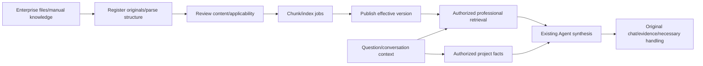

# XiaoK Enterprise Knowledge Plan

**2026-10-19 | Implementation is underway: KB-1 through KB-4 each have a bounded implementation; overall status remains Limited.** This document owns enterprise knowledge organization, ingestion, versions, indexing, retrieval, original evidence/locations and quality operations. The [overall XiaoK roadmap](./xiaok-assistant-roadmap.md) owns service goals, priorities and delivery rules. Knowledge supplies existing KnowledgeRetriever/Evidence contracts; Agent owns generative replies, model catalogs and actual-business orchestration, while existing job/permission foundations remain. Model-catalog/synthesis descriptions below retain historical joint evidence without expanding future knowledge ownership. KB-2 now includes explicit dates and 1900/1904 provenance plus bounded 24-hour clocks/date-times, conservative PDF flow-paragraph grouping and single-manual original-file/natural-synthesis tests with synthetic project records; v71 retains trusted model-view rules/numeric repair and adds explicit full-source selection; KB-3 retains model-context deduplication and full-workbook verification. It reuses existing number displays, KB-4 bounded batches and actual-branch fusion. The model projection retains complete originals, conditions and server revocation checks; larger contexts and professional semantics remain Limited. Code, the [phase-two contract](./xiaok-assistant-phase-2.md), [Admin inventory](./admin-system-modules.md) and [Mini Program inventory](./miniprogram-system-modules.md) remain authoritative for implementation and acceptance. No production deployment; release still requires separate authorization.

See the [four-screen enterprise knowledge Admin design proposal V1](../design-references/xiaok-enterprise-knowledge-admin-v1/): library, document detail, retrieval test and knowledge gaps. It is a design-only proposal pending review; it does not replace the current runtime UI or approved design source, or change this plan's implementation status and permission contract.

## Mandatory new-chat continuation near the context limit (2026-10-21, explicit user instruction)

- **Enforce on every continuation.** At signs of insufficient context headroom or an approaching compaction, prepare a sequential handoff immediately, reserving enough context to finish it. Do not keep developing indefinitely in one chat through repeated automatic compaction.
- Finish an already completed stage with code, relevant tests, bilingual documentation and a local commit limited to that stage. Preserve unrelated dirty changes. If a stage is incomplete, save the minimum recoverable state, actual passed/failed/unexecuted checks, uncommitted changes and reasons; hand it off without declaring completion or committing unrelated work.
- Create a continuation chat in the same project/workspace. It becomes the sole owner of both Agent and enterprise-knowledge plans; the old chat stops product edits, acceptance and dispatch when ownership transfers. The user has explicitly authorized these continuation chats, without repeated confirmation.
- Include branch/commits, each plan's current position and next bounded task, source/test/configuration versions and evidence paths, original failures/unknown outcomes, unverified scope, dirty-change ownership, running services/ports/databases, native-window and lock ownership/release state, reusable commands and design/deployment boundaries. Keep only necessary information, without full historical logs or credentials; never replay unknown outcomes or pool results across versions.
- The new chat first reads AGENTS.md, both plans' current records, working-tree state and relevant evidence, then checks resource/source drift and continues the next authorized task without repeating completed stages. This context-triggered **sequential rotation of one owner** overrides older routine wording against another development chat. It does not create independent testing chats, parallel work or user-approved freezes/cross-chat lock handoff gates. Native serialization, tenant/revocation checks, design approval and production authorization still apply.

## 1. Current assessment and reusable foundations

**Current v108 acceptance record: original F-02 missing-dimension followup passes twice; overall Limited.** Product source and prompt remain xiaok-renovation-v107, including its current-original numeric recovery. Fresh free Qwen/Stable1321/1324 each answer the exact original question after two study questions with one model call: positions cannot be determined directly without site dimensions; no invented point/acceptance or need write. Original KA/KB bodies and v4 graph are reproduced in new synthetic enterprises2684/2685, not a replay of the entire old fixture. Historical GLM1242 failure/1243 pass remain separate; the old scope-rejection branch is not triggered or regraded. All6 scheduled native turns/reentry,2 HTTP U01 reconnects, owner/other-customer/cross-enterprise isolation and actual knowledge retirement pass; all11 captures inspected at logical390x844/PNG348x752.10 accepted Qwen attempts3663–3672,10 observed token plus4 observed query_embedding answer-run records, all costs null; index-job usage is outside these totals. Source digest0a954f285087bb47140b44e86f0d5069ebed6a52a8d94a2c5ee322969cb06c54/2,264 entries is unchanged, so352 units/27 services/8 compatibility/98 Mini/lint are explicitly reused v107 checks, not rerun; full tsc remains failed292/scoped0. KnowledgeRetriever/Evidence, routes/APIs/roles/schema and approved C01/U01 markup/styles/assets/fixed copy/navigation/geometry remain; no restoration-ledger impact. Fixtures AI off/context-revoked, queues0/owned lock released. No new product function, full F-02/F-04/PPT/professional/device/production completion, push or deployment. Next F-06 original budget/width-and-acceptance/named-file questions, then F-07. See [phase two](./xiaok-assistant-phase-2.md), `tmp/xiaok-missing-dimensions-v108/`.

KB-1 through KB-4 have extended phase-one text/FAQs, permissions, versions, jobs and citations with professional entries/diagnostics, file ingestion, actual-context retrieval and core knowledge operations. Code and bounded acceptance records exist for each. The table separates delivered scope from remaining gaps: reaching the KB-4 work package does not complete the knowledge platform. Current XLSX-display, file-context and user-selected PDF-original checks are in the phase-two KB-2 contract, without upgrading other historical acceptance conclusions.

| Capability | Current scope | Evidence and remaining gap |
| --- | --- | --- |
| Content entry | Limited: manual_text, faq, reference_case and DOCX/text-PDF/bounded XLSX files | [Editor](../admin/src/components/assistant/knowledge-editor.tsx), [service](../admin/src/lib/assistant/knowledge/service.ts), [file service](../admin/src/lib/assistant/knowledge/file-service.ts); private original upload, durable parsing, review, indexing, publication and authorized download exist, defaulting to internal audience. PDFs conservatively group adjacent text/complete clauses with actual pages, without higher budgets or claimed column/table understanding; the selected nine-page manual remains an internal test reference. Bounded XLSX fixed decimals, grouping, percentages, explicit units and explicit full-year dates and bounded 24-hour clocks are supported, retaining the 1900/1904 date system; elapsed durations/locale short dates, formulas, conditional/multisection/locale numeric formats and hidden/complex structures, legacy files, scanned OCR and PDF tables/figures remain unsupported |
| Versions/validity/publication/withdrawal | Implemented as a bounded foundation, including professional/file versions | [Knowledge schema](../admin/src/db/assistant-knowledge-schema.ts) and service; professional metadata, file provenance and review enter immutable versions/hashes, preserving effective old versions and future-replacement guards. Scheduled activation remains undelivered |
| Professional applicability/review | Limited: structured professional entries, conditions and server provenance | [Professional contract](../admin/src/lib/assistant/knowledge/professional.ts); types, topics, prerequisites/exceptions, source kind/version/section and reviewer/time exist. Only the actual stage of the bound home's sole authorized active project is automatically checked; room/material/model/city remain unknown, without automatic condition extraction or free-text conflict resolution |
| Chunking/vector indexing | Implemented as a bounded foundation, including supported-file locators | [Chunk gateway](../admin/src/lib/assistant/knowledge/chunk-gateway.ts), [index Worker](../admin/src/lib/assistant/knowledge/index-worker.ts); profiles/hashes/leases/attempts/unknown-outcome guards remain, with necessary same-version sections/headers/footnotes in file chunks. General parent-child expansion and shadow-profile rebuild/activation remain undelivered |
| Chinese hybrid retrieval | Limited: professional-hybrid-v5 | [Shared retrieval](../admin/src/lib/assistant/knowledge/retrieval.ts), [context selection](../admin/src/lib/assistant/knowledge/context-selection.ts); vector/lexical RRF followed by server applicability/document coverage selects at most five chunks, with separate fusion/selection ranks. Agent queries retain the current question and model terms. No BM25, external reranker or general terminology service  Query-side additions cover four spelling groups and spaced complete designations, preserving indexes and the original question. The database preserves each branch's actual top-30 membership/ranks; absent branch ranks contribute no RRF vote, and diagnostics use those same ranks. |
| Citations/revocation | Implemented as a bounded foundation, including DOCX/text-PDF/bounded XLSX originals | [Sources](../admin/src/lib/assistant/knowledge/sources.ts), [file provenance](../admin/src/lib/assistant/knowledge/source-file.ts); version/hash/audience/epoch rechecks, DOCX sections/paragraphs/table rows/columns, actual PDF pages, XLSX sheets/rows/cell ranges and Unicode quote ranges/duplicate ambiguity exist. XLSX invents no print pages; complex tables/figures, OCR and arbitrary-passage semantic attribution remain limited |
| Professional synthesis | Limited: enterprise knowledge and authorized project context in one answer | [Synthesis](../admin/src/lib/assistant/agent/synthesis.ts), [tests](../admin/src/db/__tests__/assistant-synthesis.test.ts); original customer statements, formal v4 plans, published records, actual stages and authorized team-review/formal-version sources combine with rechecks at recovery, commit and reentry. The phase-two contract preserves bounded configured-model/Stable-native checks; complete professional support, drawing understanding and long-tail semantics remain unfinished |
| Quality operations | Limited: diagnostics, question/gap catalog, same-question regression and health | [Diagnostics](../admin/src/lib/assistant/knowledge/diagnostics.ts), [operations](../admin/src/lib/assistant/knowledge/operations.ts), [operations tests](../admin/src/db/__tests__/assistant-knowledge-operations.test.ts); enterprise-shared questions/gaps with private executions/previews, separate recall/selection/actual citations and semantic review, stale-result suppression/recheck after changes. Bounded batches now reuse the original Worker/previews; user-defined schedules, scale and shadow rebuilds remain; health counts are not live provider probes |

Rendered text/FAQs and files remain limited to 16,000 characters and 48,000 UTF-8 bytes, at most 128 chunks/≤512 tokens each, with 1024-dimensional vectors. Current files are ≤4MB, PDFs ≤50 pages, XLSX ≤8 sheets within A1:L64 each and enterprise originals ≤100 files/100MB; an original passage/table row plus required context that exceeds the chunk budget fails explicitly without dropping conditions/exceptions. Initial operations allow ≤100 questions/2,000 regressions per enterprise and show at most 200 selectable sources; these are implementation limits, not measured production capacity. The mixed development corpus also contains internal forms/product/UI proposals. Supporting some formats does not authorize whole-directory ingestion or external processing of real customer data.

### 1.1 Independent knowledge-service development scope

The user authorizes this chat to continuously implement both plans and own shared interfaces, integration and acceptance. The following split describes domains under one owner, without two chats waiting on each other. Interleave complete business batches by dependency, retaining separate fixtures, source hashes and evidence; continue after implementation, necessary clients, automation and bilingual documentation. New design directions and production rollout retain their existing authorization boundaries.

Current integration uses Agent v106/need-batch-input-v1 with confirmed-free Qwen3.5-4B. The complete-batch schema is Agent-owned; KnowledgeRetriever/Evidence, parsing/chunking/retrieval, original conditions/version/epoch/audience/publication/revocation and APIs are unchanged. All8 compatibility services are rerun on the new stable source. Two native batches save both needs; final-answer numeric-citation recovery remains Agent-owned and Limited. Preserve original failures/unknown fees and approved C01/U01; no second Agent/facts/citation authority. See phase two and tmp/xiaok-atomic-envelope-v106/.

This plan owns enterprise knowledge acquisition/licensing/entry/originals, parsing/chunking/indexing, publication/version/epoch/audience, retrieval/ranking/applicability, original locators/evidence revalidation, knowledge Admin UI and operations. `KnowledgeService` and pure knowledge Providers are its deliverables. Generative replies/conversation memory/project-fact composition/tool loops/recovery/model budgets/H/B/K catalogs/final citation validation belong to the [Agent plan](./xiaok-agent-engineering-plan.md); knowledge-test failures do not authorize direct `agent/*` edits.

Reuse existing `KnowledgeRetriever`/`Evidence` and source revalidation, with one [phase-two ownership/interface authority](./xiaok-assistant-phase-2.md#agent-and-knowledge-development-ownership). Knowledge returns complete authorized evidence with locations/versions/conditions, without final customer prose, inferred project stages or automatic private-chat/project ingestion. Search terms cannot override the caller's server authorization scope.

KB-3 remaining work is knowledge retrieval/applicability/evidence context; current-question anchoring, actual site snapshots and knowledge-plus-site explanation belong to Agent adapters. KB-4 owns cases/knowledge gaps/retrieval regression and may retain existing Agent integration results/defect categories. Correct-Evidence generation/citation/memory defects go to Agent; original/parsing/recall/version defects remain here. Existing synthesis/catalog/C01/Stable records remain historical integration facts without expanding future KB-1–4 ownership into Agent work.

First validate original/structural fidelity, required evidence/locations, versions/permissions/revocation, jobs/usage and knowledge Admin operations against fixed Provider contracts. K-09/K-12 and K-08 composite-answer/chat projection checks are Agent-owned joint acceptance: knowledge supplies real Evidence/revocation events, without taking chat-source ownership or making full Agent business reruns a new gate for every parser change. User-facing stages retain the roadmap's real client/service-chain requirements; component passes are not whole-stage delivery.

Legacy mixed adapters such as `knowledge/sources.ts` remain physically coupled. Assign one writer and extract incrementally when touched, retaining compatible exports. Keep the existing repository/mainline/database/authentication/job infrastructure. Separate development responsibilities do not claim zero runtime dependency, new service deployment or production authorization.

## 2. Knowledge scope, structure and permissions

| Knowledge type | Required information | Use |
| --- | --- | --- |
| Construction/quality checks | Procedure, prerequisites, object/location, method, values/units, exceptions and source version | Explain why/how/what to verify, without replacing formal site acceptance |
| Materials/equipment | Brand/model, values/units, applications, compatibility/limits, origin/update date | Professional comparisons/conditions, without inferring another model's parameters |
| Enterprise services/policies | Scope, conditions, validity, cities/businesses, approver and rule version | Explain enterprise commitments from effective rules; exact quotes/schedules still come from business systems |
| Customer FAQs/explanations | Questions/synonyms, key explanations, evidence and applicability | FAQ is not the sole entry; generated rewrites/summaries are not independent authority |
| Internal training/workflows | Roles/audiences, workflow boundaries, internal information and versions | Authorized staff use, without exposing content to customers through topical similarity |
| Design references/portfolios | Original author, rights, render/photo distinctions and public version | Existing P2A.3/P2C contracts apply; do not use design examples as construction standards |

- Collections/categories organize content and retrieval, not new tenant/access authority. Retain existing management permissions by default; separately scope future editing/review/publication grants and preserve admin/super_admin enterprise-management inheritance.
- Enterprise knowledge provides reusable professional evidence. Actual project progress/photos/customer needs/formal drawings/proposals/issues stay in authorized business adapters instead of bulk copying into general knowledge. Public enterprise knowledge is usable in authorized consultations without first creating leads/projects; project documents inherit their original project/participant/source permissions.
- Resolved cases may propose reviewed experience/FAQ drafts. Verify origin, redaction and rights before authorized publication; private chats, site judgments or one result never automatically become enterprise rules. Trace withdrawal effects on derivatives.
- Upload, parsing, external OCR/Embedding, previews and downloads recheck enterprise, actor and audience. Customers read effective customer_public only; staff_internal follows current role/knowledge access, with original participant/source boundaries added for project/service materials. Categories/model-generated filters cannot widen server authorization.

## 3. Current architecture and remaining extensions

### 3.1 Two data paths meet at answer generation

This diagram shows runtime collaboration, not broader knowledge implementation ownership. Knowledge owns enterprise originals through authorized retrieval; Agent owns questions/originals/actual project facts, knowledge tool calls and final explanation. Providers return Evidence for Agent consumption; Agent implements one model-catalog/citation format.

KB-1 through KB-4 already extend Next.js, current PostgreSQL/pgvector, KnowledgeService, Worker/outbox and LangGraph along this flow; file ingestion currently uses bounded local DOCX/text-PDF/XLSX parsing. Future complex parsing adds controlled adapters as needed, retaining publication, jobs, usage and permissions without another knowledge/project-fact authority.

### 3.2 Logical data contracts

The table separates existing data contracts from extensions, without requiring one table per logical object. Migration 0085 extends professional versions, 0086 adds original files/provenance and 0087 adds question/regression records. Further changes still use minimal incremental migrations of the existing schema.

| Object | Current implementation | Remaining extension |
| --- | --- | --- |
| KnowledgeDocument / Version | Reused enterprise/ID, text, audience, validity and immutable version/hash; professional stores types, topics, conditions, prerequisites/exceptions, source kind/version/section and server review provenance, with versioned file structure/review | Automatic condition extraction, free-text semantic conflicts and scheduled replacement; source kind does not automatically rank authority |
| SourceAsset | Forced-RLS assistant_knowledge_assets, tenant/document composite foreign keys, private immutable original/hash/actual format/rights/uploader, reauthorized downloads without raw storage URLs | XLSX/legacy adapters as needed under original authorization/resource limits |
| ParsedBlock | source_file stores parser,DOCX section/paragraph/table rows/columns/spans/headers/footnotes,actual PDF page/text or XLSX sheet/row/cell range/merge anchors/original headers/notes,warnings and review/excluded blockIds;decimal-v1/date-v1/time-v1 preserve bounded numeric, explicit full-year date and 24-hour clock displays,with raw/id/code and optional dateSystem in numberFormat for review | PDF tables/figures,OCR,XLSX elapsed durations/locale short dates/formulas,conditional/multisection/locale numeric formats and hidden/complex structures and quality evidence;no arbitrary parsed-text editor currently |
| Chunk / Locator | Same-version blockId, section/page/table rows/columns, original hash/parser and Unicode ranges; required original context stays in chunks, with actual quote ranges/duplicate ambiguity on reads | General parent-child expansion, available bbox and complex locators, preserving conditions/exceptions |
| IndexProfile / Build | Existing profiles, model/dimensions, hashes, knowledge_parse/index jobs and attempts/leases/cancellation/unknown-outcome guards | Dictionaries, shadow rebuilds, target-set readiness and profile activation/rollback remain undelivered |
| RetrievalRun | Existing assistant_run_steps knowledge.search.v1 stores question/configuration, authorized candidates/branch/fusion/selection ranks, context and known latency/usage; private-preview diagnostics revalidate every read | Optional reranking and broader diagnostic evaluation, without another run table or unauthorized candidate cache |
| EvaluationSet / Gap | assistant_knowledge_cases/evaluations persist enterprise-shared questions/gaps,revisions,current required/forbidden source versions/epoch,private original preview/run and review;assistant_knowledge_batches/batch_items only group owner-private bounded evaluations,freeze profile/model configuration and reuse original Worker/cancellation/accounting;changes hide stale results and require rechecks | User-defined schedules,greater capacity and broader professional sets;structural checks do not replace semantic review or construction issues |

Keep existing Unicode code-point offsets instead of UTF-16. Use available PDF pages, DOCX sections/paragraphs or table rows/columns; never fabricate DOCX page numbers without a fixed renderer/version. Figure descriptions are observations, not substitutes for the image or invented numeric facts.

### 3.3 Ingestion, structural parsing and publication

1. Existing Admin `/assistant-knowledge` supports DOCX/extractable-text PDF and bounded text/numeric/explicit full-year date/clock XLSX import under Ant Design/Admin Pro/shared feedback, retaining manual text/FAQs. Files default to internal audience, unpublished/pending review. XLSX allows up to eight worksheets within A1:L64 each, retaining whole-file 128-block/16,000-character/48,000-byte and 512-token-per-chunk bounds. Formulas/cached results, elapsed durations/locale short dates, unsupported numeric formats, hidden content, comments and complex tables fail explicitly. date-v1 converts only explicit full-year patterns and valid whole-day serials; time-v1 supports h:mm/hh:mm whole-minute clocks, h:mm:ss/hh:mm:ss and a full date followed by a clock, retaining raw serial/format provenance. Seconds use decimal rounding; pure clocks stay within one day, midnight carry fails, and no timezone is inferred; invalid dates including 1900 serial60 fail, and sample dates never establish project schedules. Scans/OCR and legacy XLS/PPT remain future extensions, not prerequisites for professional answers.
2. Private originals/hashes/rights and actual-format validation exist. Parsing uses original knowledge_parse jobs and a local subprocess without inherited credentials, with a 192MB V8 heap/20-second limit and bounded input/output; ZIP/XML have path, decompression, entity and other resource guards. Failures preserve originals/jobs. No arbitrary URL fetching or external OCR/parser service exists; future external adapters still require enterprise data authorization.
3. DOCX preserves headings, paragraphs, table rows/columns/spans, headers and neighboring notes/footnotes; PDF supplies actual pages/extracted text without claiming table/figure understanding. Bounded XLSX retains sheets/sparse coordinates/merge anchors/original headers/units/same-sheet notes/exceptions without print pages; unsupported SpreadsheetML escaped text fails explicitly. Images, headers/footers, tracked changes/external links require review of actual warnings; scans require OCR. Admin shows originals/structure/warnings/indexed text. Review acknowledges warnings/excludes blocks; original changes require a new sourced file, not arbitrary parsed/published-text rewriting.
4. Draft→parse/review→index ready→authorized publication is implemented; neither parsing nor indexing implies publication. Pending/internal material cannot enter ordinary customer retrieval. Retrieval enforces validity, future replacements do not hide effective old versions early, and replacement readiness uses database time. Scheduled activation remains undelivered.
5. Original keys/draft hashes reuse parse jobs/results; edits, withdrawal, cancellation, actor revocation and lease changes fence late commits. Known local failures/cancellations allow explicit retry, at most three attempts. Original jobs/concurrency/quotas and external Embedding unknown-outcome protocols remain authoritative, without separate job truth or unknown costs represented as zero.

### 3.4 Professional retrieval and context assembly

1. **Hard authorization first:** existing server/database gates retain enterprise, participants/service scope, effective publication, audience, versions, profiles and revocation. Clients/models cannot supply arbitrary filters, tenant or internal draft scope; future adapters cannot override hard authorization either.
2. **Retain the question and actual context:** the Agent combines the server's current question with model retrieval terms into one bounded query, preserving explicit objects. Bound-home knowledge queries refresh authorized material/construction snapshots in the same turn, including actual stages for short follow-ups. Room/material/city conditions are not guessed from questions/models; unknown remains unknown with minimal clarification when needed.
3. **Current hybrid configuration:** professional-hybrid-v5 retains 1024 dimensions, at most 30 candidates per branch, RRF k60, minimum similarity 0.3 and at most five final chunks. Selection defers explicitly incompatible stages and prefers document coverage, retaining fusion/selection ranks. BM25, general terminology services, parent-child expansion and external reranking are not integrated; add them only from measured gaps without default vector-store replacement. Query-only `renovation-terms-v1` now covers four explicit spelling groups, the existing signing intent and spaced complete C1/C2 designations, bounded to eight rules/64 added terms. It retains the original question, weighting original terms at 3, ordinary additions at 1 and the prior signing intent at 3. Existing indexes/profiles/hashes and model-call counts stay unchanged; the actual trace records rules/additions/weights. Materials, stages and authorization remain server facts. General terminology, automatic conditions and semantic conflicts remain incomplete. The database preserves each branch's actual top-30 membership/ranks; absent branch ranks contribute no RRF vote, and diagnostics use those same ranks.
4. **Existing context versus future expansion:** file chunks already retain necessary same-version sections/headers/footnotes; this is not general parent-child expansion. Future gap-driven additions use authorized same-version parents or bounded rewriting/decomposition, limiting tokens/rounds/time/cost and deduplicating. Missing evidence stays explicit without endless retrieval or automatic construction issues.
5. **Conflicts/optional reranking:** overlapping registered mutually exclusive topics/claims retain both sources and explain the need for verification first. Effective versions/applicability govern use; upload dates/scores do not establish authority. Free-text semantic conflict detection remains undelivered. Reranking is still none; future integration needs current-case evidence and an accepted fallback path, without claiming a complete existing reranker.
6. **Existing diagnostics/generation boundary:** private preview diagnostics expose actual configuration, lawful exclusion counts, authorized candidates/ranks, selected context and missing conditions, revalidating sources/epoch on reopening. Agent, Admin preview and diagnostics share retrieval code/configuration with separate draft scope. Admin preview remains conservative excerpts, while C01 generates explanations; structural diagnostics/operations regressions do not replace real customer-Agent semantic acceptance.

### 3.5 Evidence, synthesis and change invalidation

Originals/versions/locators/epoch/knowledge-source revalidation belong to knowledge; model catalogs/synthesis/citation selection/derived-answer invalidation belong to Agent. Existing integration facts below remain, with future work assigned by1.1 rather than continued knowledge-side Agent edits.

- Current `source-catalog-v1` catalogs complete authorized original spans server-side; the model selects citationId and the server assembles canonical sourceId/exact quote and revalidates provenance. Short/long sources share one protocol; complete originals remain and long-source hints only identify entries. Trusted named editions are separate from engineering numbers; measurement/money/calculation/formal commitments and revocation retain existing guards. v73/trusted-synthesis-v4, independent two-enterprise/same-PDF first-draft/quality/isolation results and failures are in the [phase-two contract](./xiaok-assistant-phase-2.md). Public DTO/API/database and existing C01 source components are unchanged.
- Agent, the conservative `KnowledgeRetriever.retrieve(actor, query, epoch)` wrapper and Admin preview/diagnostics already share retrieveKnowledge and provide sourceRef, version/hash, passages, file locators and professional conditions through Evidence. Future parent-context extensions still locate the supporting original passage/table and preserve the Agent protocol.
- Current synthesis distinguishes evidence/advice/uncertainty across multiple knowledge sources and authorized business snapshots. Actual stages, customer materials, explicitly returned team review and exact formal versions remain in original business adapters, not copied into enterprise rules. Exact quotes are only a structural minimum: semantic support still needs review. Separate policies/general advice/site facts; formal costs/decisions/execution/acceptance require real receipts.
- Versions/audiences/withdrawal advance and validate knowledge_epoch/exact sources at retrieval, model commit, history projection, media and later delivery, alongside project versions. Deleting vectors alone cannot leave caches/citations/summaries/synthesis exposing invalid content.
- Published versions are immutable; failed drafts/parsing/indexing preserve effective old versions, and publication pointer/epoch changes atomically after review/index readiness. Shadow-profile rebuild/activation/rollback remains undelivered. Future Embedding/dimension changes need a new profile and validated target set; 1024-dimensional storage cannot silently mix dimensions, and rollback must enforce current authorization/validity.
- In KB-4, managers curate enterprise-shared questions/gaps through private original preview/runs and original-key recovery, separating recall, selection, actual citations and explicit semantic review. Knowledge/question changes suppress stale results and require rechecking verified gaps. Bounded batches support 1–20 questions, concurrency 1–3, the owner's latest 20 batches, original Worker continuation without a page and cancellation, within the original 2,000 enterprise evaluation cap. Health reports actual queues/profiles, known token subtotals and unknown counts/costs; chat usage remains separately authorized. User-defined schedules/scale follow actual needs, without automatic private-chat copying or construction issues.

## 4. Open-source references and adoption decisions

This shared citation fix reviews [LlamaIndex CitationQueryEngine source](https://github.com/run-llama/llama_index/blob/main/llama-index-core/llama_index/core/query_engine/citation_query_engine.py) and [numbered-source/metadata tests](https://github.com/run-llama/llama_index/blob/main/llama-index-core/tests/query_engine/test_citation_query_engine.py), adopting source identifiers, original spans and provenance links. [LangChain structured output](https://docs.langchain.com/oss/javascript/langchain/structured-output) guides constrained selection and existing single-repair recovery. Existing LangGraph/PostgreSQL jobs, tenant/revocation/usage/handoff remain; no whole platform is installed. [DeepSeek strict](https://api-docs.deepseek.com/guides/tool_calls/) Beta/required constraints and adoption decisions are recorded in phase two; provider schema replaces neither authorization nor semantic review.

Retain the open-source platform documentation/main-branch references recorded on 2026-10-18. This XLSX extension separately checks Microsoft's official SpreadsheetML package/shared-string/formula-cache contracts on 2026-10-19; links/adoption boundaries are in phase-two KB-2. No full knowledge platform was installed/run. Referenced parent-child context/OCR/external reranking are not thereby delivered. Future dependencies still require maintenance,pinned-version/license,data-transfer and cost checks.

| Project and evidence | Reference practice | Boundary and validation |
| --- | --- | --- |
| Dify: [chunking](https://docs.dify.ai/en/use-dify/knowledge/create-knowledge/chunking-and-cleaning-text), [retrieval node](https://docs.dify.ai/en/use-dify/nodes/knowledge-retrieval), [retrieval tests](https://github.com/langgenius/dify/blob/main/api/tests/unit_tests/core/workflow/nodes/knowledge_retrieval/test_knowledge_retrieval_node.py) | Parent-child context, retrieval into LLM context and layered metadata/rerank checks; inspected metadata normalization, condition propagation and rerank branches | Reuse storage/Agent/server authorization; K-01/03/04/07/11, without copying Dify conversations/tenancy |
| RAGFlow: [document management](https://ragflow.io/docs/v1.0.0-rc1/files_dataset_document_management), [retrieval testing](https://ragflow.io/docs/v1.0.0-rc1/retrieval_testing), [PDF integration tests](https://github.com/infiniflow/ragflow/blob/main/internal/deepdoc/parser/pdf/parser_pipeline_integration_test.go) | Original→structured parsing→chunk review→retrieval validation, plus TableStructure/Idempotency test patterns | Consider parser component/service POCs only when samples establish structural fidelity, licensing/resource/operations benefits; K-02/03/05/10, without default full-platform deployment |
| Haystack: [hybrid retrieval](https://docs.haystack.deepset.ai/docs/opensearchhybridretriever), [filters](https://docs.haystack.deepset.ai/docs/retrievers), [evaluation](https://docs.haystack.deepset.ai/docs/evaluation), [filter tests](https://github.com/deepset-ai/haystack/blob/main/test/components/retrievers/test_filter_retriever.py) | Separate indexing/retrieval/generation pipelines, filtering and component/end-to-end evaluation | Adopt design/evaluation without Python/OpenSearch prerequisites; runtime filters cannot replace tenant constraints; K-01/07/11 |

Implementation already extends existing PostgreSQL/pgvector/knowledge services: KB-2 uses bounded local parsing, KB-3 retains hybrid retrieval and KB-4 reuses original previews/jobs. Further parsing/reranking adapters follow actual gaps. Full Dify/RAGFlow replacement still needs evidence that tenancy, withdrawal, durable jobs, accounting and human continuation integrate equivalently, followed by a separate concrete selection decision.

## 5. Delivery batches and XiaoK integration

The compact stage-commit index retains scope/results while phase two holds detailed evidence. This checkpoint also saves existing Agent/knowledge dependencies without treating prior KB capabilities as new delivery.

| Stage | Actual result | Git commit |
| --- | --- | --- |
| AG-04/05 v107 current-original numeric recovery (internal; Limited) |352 units/27 services/8 compatibility/98 Mini/lint; free Qwen1314–1318 native5/5 and2 U01 reconnects; withdrawal raw error uses existing partial view; numeric repair natural branch untriggered | `e1c8ff1de79a77800356575a4ae098ab80f9d77e` |
| AG-04/05 v106 explicit atomic envelopes (internal; native partial failure) |347 units/26 services/8 compatibility/98 Mini/lint; free Qwen1311/1312 save both needs,1311 numeric final fails,1312/1313 and one U01 recovery pass; F-04 pending | `75538c72f2733125faaf363294f31dc45fe57069` |
| AG-04/05 v105 free-Qwen continuation (internal; native failed) | Unchanged core source; confirmed-free Qwen3.5-4B1309/1310 select exact quotes but omit complete atomic batch,0writes; F-04 pending | `7955d14346e6b2badb669b63232391551b1b05b2` |
| AG-04/05 v105 original quote choices (internal; provider rejected) | Stable344 units/25 services/8 compatibility/98 Mini/scoped lint;1307/1308 rejected by HTTP402 before generation, F-04 pending | `188933b86015c2ff3ff5ca85b36ff4ad24f81ff5` |
| AG-04/05 v104 authorized current recap (internal; native failed) | Stable341 units/24 services/8 compatibility/98 Mini/lint; GLM9/Stable1305/1306 save nothing and false completions are blocked; F-04 pending | `0fd7d2254825e9eae632cedbcde977818f31bacc` |
| AG-04/05 v103 mixed-reply checkpoint (F-04 unfinished) | Stable338 units/22 services/8 compatibility/98 Mini; separate test-narrowing1/lint/scoped types0; read-only recap/native pending | `0028465062cc7603637bf6b1976141757663f403` |
| AG-04/05 v102 atomic mixed corrections (internal; native failed) | 330 units/17 services/8 compatibility/98 Mini/lint; current recap/withdrawal pass, mixed answers fail | `de1a0df8d96fe87260d5fae8c98dc6f0ee5f4929` |
| AG-04/08 v101 empty citation catalog (bounded internal fix) | 325 units/13 services/8 compatibility/98 Mini/lint; native 3/3, sources/withdrawal/empty-catalog reentry pass, overall Limited | `c75863f08fbb299f1dbc32ae8e48b5330ed15874` |
| AG-04/08 v100 knowledge final schema (bounded internal fix) | 323 units/12 services/8 compatibility/98 Mini/lint; native PDF2 pass,source/withdrawal pass,empty evidence1 citation failure,overall Limited | `229a090fb8d41ddf6df9f61b748fe40f6ea1b65f` |
| AG-08 / KB-2 v99 trusted PDF page validation (bounded internal fix) | 320 units/9 file services/8 compatibility/98 Mini/lint; native2 format failures,0 need writes,source sheet unexecuted,overall Limited | `34d6d55570dbab0eb9280d50d3c1306a8d8d3c90` |
| AG-04/05 v98 inquiry/write completeness compatibility (bounded internal fix) | 317 units/5 targeted services/8 compatibility/98 Mini/lint; native4 reads0 writes,3 deliveries1 citation failure, overall Limited | `48d81c465cf35e61bb85077665d628446ab776ca` |
| AG-02/05 v95 chat recap/legacy correction view (development stopped, Limited) | Final275 units/98 Mini/lint pass, types0/292; final service/compat/native cancelled before start; earlier1149/1150 succeed but1151 fails, no batch pass | `740f955d0e4f050f1eddcb04d2524fa12cbf0ac9` |
| AG-02/05 v94 authoritative pure-record receipts (bounded internal fix) | 266 units/18 services+7 skips/4 compatibility/98 Mini/lint; two native GLM9 runs, one call each, truthful partial receipt and complete batch/reentry; F-04/overall Limited | `f56789df195334396574cba3a6d04019697d181a` |
| AG-05 v93 pending-human-review completion entry (internal fix) | 262 units/12 construction services/8 Agent compatibility/98 Mini/lint; GLM9 run1144/record205 native draft, review/edit, internal publication/reentry; overall Limited | `efe0e34a89daa3673564c308768d08365ed2d7fe` |
| AG-02/05 v92 conditional recording clarification (internal fix) | 262 units/8 targeted services/73 Mini/lint; fresh GLM9 C01 run1143 delivered/reentered, no need write; original failures retained; overall Limited | `77892bbeaa6c6c1e65d40b0871bbc4df7ef7762b` |
| AG-05/09 v91 explicit denials and free text baseline (internal substage) | 259 units/13 services/73 Mini/lint; GLM9 four reviewed-correct questions across two fixtures, separate setup window and originals retained; overall Limited | `3182ee5c817092e03d19d1477927e85d0fbb2067` |
| v90 free-model tariff verification | Official tariffs override conflicting zero prices; 257 units/12 targeted services/73 Mini/lint; screens and original failures recorded separately | `7b6068654abd10ad1f01c560bd48cbd695f408c5` |
| AG-05/09 v89 conversation-bound identity (internal substage) | 235 units/12 targeted services/73 Mini/lint; first GLM request429/no draft, unknown retained; exact restoration and supplemental cleanup verified | `951bac67a053323e747fddbd1f94ec2ff8d52d94` |
| AG-05/09 v87 read-input recovery (internal substage) |231 units/55 services/73 Mini/lint;one controlled live call repeats numeric ID and fails,delivery0/unknown0;exact config restored,old1073 retained | `5e85e14582150ddf34092ae0e5e1117c9b07e440` |
| AG-08 v86 cited filename metadata (internal substage) | 221 units/4 services/73 Mini/lint;offline validation2/3 passes with real quantity failures retained;new live0,prior0/5 and unknown1 unchanged | `4e4f37f021895db0c07f91defbb7b6bb50fb63e1` |
| AG-05/08/09 v85 bound repair task (internal substage) | 217 units/4 services/73 Mini/lint;5/8 live questions,delivery0/5,complete conditions0/3 drafts;3 questions/9 checks unexecuted;unknown1 retained | `d849d722f79796609bfcea090858b258d9a9b858` |
| AG-05/08/09 v84 source final kinds/question fixtures (internal substage) | 214 units/3 services/73 Mini/lint;4 staff records;8 synthesis drafts,delivery/semantics0/8;1 setup check/8 unexecuted;cleanup/configuration preserved | `712bb59e697a062a3eaa13487ede1a8893fb48c3` |
| AG-05/09 v83 knowledge compatibility (no new KB capability) | 211 units/3 targeted isolated services/73 Mini/lint pass; scoped types 0/whole 292; three offline traces fit 16000; new model acceptance unexecuted | `911414332078fbef564e08b3faebc7407331ed66` |
| v82 Qwen3-8B separate validation (source unchanged) | Two original indexes/4 drafts pass; customer delivery 0/8, 9 live isolation checks unexecuted; 1 unknown job quarantined, original 4B configuration restored exactly | `7108d40547fb9b0943dcef7f65ac15ccc92c8bee` |
| KB-2/AG v82 original checks (internal technical substage) |198 units/23 services/73 Mini/lint pass; two74-passage indexes succeed;0/8 customer questions; broader KB remains Limited | `a88ed26d8969f4bb76d252b0b5128bcf3731dbff` |
| AG-08 v81 interface continuity (internal substage; no new KB capability) |138 units/8 services/50 knowledge units/73 Mini/lint pass; original indexing/site-draft setup fails,0/8 customer questions, business not passed | `0ff9f22961e8d887e0e92887f0e43d350555b157` |

On 2026-10-20 the user explicitly authorized automatic local Git commits for every completed development stage across both plans, recording scope, executed validation and the commit ID here and in the Agent plan without repeated confirmation. Stage only the related recoverable dependency set, preserve unrelated dirty changes, and use English Conventional Commits; do not automatically push or deploy. Internal technical substages must retain unverified model/native checks and overall Limited status. A commit is not business acceptance; a following documentation commit records the actual stage commit ID.

KB-* identifies knowledge work packages, not replacement XiaoK phases or another business service line. KB-1 through KB-4 have delivered the bounded subsets below; the complete platform remains Limited. Reuse these foundations and follow roadmap 3.1: professional support → actual-context answers/follow-up → formal handling/operations. Every batch retains tenancy/source/idempotency from the start; this batch uses clearly synthetic fixtures only in approved development/isolated databases, with production authorization unchanged.

| Package | Current status/delivery | Remaining scope | Acceptance mapping / main service line |
| --- | --- | --- | --- |
| KB-0 Baseline audit (internal) | Maintain schema/profile/configuration, core synthetic materials/questions and actual usage alongside each batch; not standalone user-stage completion | Recheck necessary samples/baselines as they change, without a broad platform comparison gate | Reuse current knowledge/Agent regressions; actual results live in the phase-two contract |
| KB-1 Professional knowledge/diagnostics first | Limited, with a bounded implementation: original Admin maintains/publishes professional types/conditions/prerequisites/exceptions/sources/review; original preview exposes lawful diagnostics and C01 explains/follows up/cites/reenters, with bounded spelling/designation expansion and actual diagnostics | Automatic conditions, free-text conflicts, general terminology/long-tail semantics and complete professional support; do not rebuild text/FAQs | K-01/04/06/07/08/09/11 plus QA-01/02/05/06/07/08; P2M.1–.3 |
| KB-2 Ingestion/structural citations | Limited: DOCX/text-PDF/bounded XLSX, original Admin upload/parse/review/index/publish/download including explicit full-year dates, 1900/1904 provenance and bounded 24-hour clocks; C01 passages/table rows/columns, sheet/cell ranges or pages, failure recovery and withdrawal | XLSX elapsed durations/locale short dates/formulas, conditional/multisection/locale numeric formats and hidden/complex structures, legacy formats, PDF tables/figures/OCR, larger model contexts and production compatibility/full restore verification; supported formats are no longer unstarted | K-02/03/05/06/08/10 by format; P2M/P3 material foundation, without claiming OCR passed K-05 |
| KB-3 Actual-context retrieval | Limited, with a bounded implementation: shared hybrid retrieval, applicability/document coverage, same-turn stage/material snapshots, original question/model terms, stage-dependent explanations and source rechecks | Gap-driven evaluation of general parent context/terminology/reranking/follow-up retrieval, full drawing understanding and broader actual-context semantics; no separate project-fact store | K-01/03/04/07/08/09/11 plus QA-03/04, XK-03/07/08; continue the P3B/P4A service line |
| KB-4 Operations/scale | Limited, with core operations and bounded batches implemented: shared questions/gaps, private same-question regression/original-key recovery, revision invalidation/rechecks and actual queue/profile/known-usage health | User-defined schedules, greater capacity, scans/complex tables/legacy formats and shadow-profile rebuild/activation/rollback; unknown fees are not reconciled costs | K-05/06/10/11 and affected regressions; earlier defined stages continue, with measured capacity/latency |

The roadmap's KB-1-first and service-driven KB-2/KB-3 integration still applies, reusing delivered foundations. Full-format support, broad long-tail evaluation and scale do not add prerequisites to professional answers or later authorized business work. Every user stage still needs Admin actions, real writes, original Mini entry/feedback, reentry, permission/error recovery and automation. New/conflicting visuals follow approved-design rules; backend completion or a basic smoke test does not establish whole-batch acceptance.

## 6. Acceptance matrix and completion criteria

K-* below retain full acceptance targets, not an assertion that every row has passed. KB-1 through KB-4 have bounded isolated-service, configured-model and Stable-native records; actual successes/failures/skips, fixtures, commands and gaps remain in the phase-two contract/existing evidence. This increment covers KB-2 clock displays and their original citation/validation contract without upgrading historical conclusions. K-02/03 cover supported DOCX/text-PDF/bounded XLSX subsets; K-05 has no OCR integration and K-06 shadow profiles/scheduled activation remain undelivered. K-11 now includes diagnostics and individual/bounded-batch regression, without establishing user-defined schedules or production scale. Separate authenticated synthetic Chrome evidence covers displayed/raw values, batch creation/reentry/original results/cancellation/revision invalidation; browser file selection retains the prior extension-permission limit, and this original file was imported through real HTTP. Other Admin visuals, full host/tall-screen/keyboard checks, physical devices/real WeChat/BLE and production compatibility/full restore retain their prior unverified status. Reuse existing evidence and add current assertions alongside roadmap QA/XK without duplicate gates. Use clearly synthetic enterprises/materials in approved development/isolated databases; real documents require existing sampling authorization and preserved rights/origin.

| Case | Required evidence |
| --- | --- |
| K-01 Professional recall | Synonyms/ellipsis/model queries retrieve applicable evidence without “your company”; record expected versions, branch candidates and final context, without scores-as-answer-quality |
| K-02 Ingestion/review | Read back hashes, parsing, correction sources, indexes/publication for scoped formats; corrupt/oversized/unsupported content fails truthfully with reentry/retry and no false success |
| K-03 Tables/conditions | Preserve headers, values/units, footnotes/exceptions; material/condition variants yield appropriate explanations with correct rows/columns/passages |
| K-04 Multiple sources/conflicts | Retrieve both required sources; effective supersession/applicability wins. Unresolved conflicts do not select highest-score/latest-upload authority; explanations create no construction issues |
| K-05 OCR/uncertainty | OCR-enabled batches cover scans/orientation/tables against originals; blur/missing text remains reviewable without invented values. Unintegrated OCR is not claimed |
| K-06 Versions/validity/profiles | Failed drafts preserve effective old versions; replacement/expiry/future activation work correctly. Shadow builds never mix models/dimensions; activation/rollback never revives revoked access |
| K-07 Tenant/audience | Validate tenants, customer_public/staff_internal and draft/production separately. Exclude unauthorized same-enterprise participants from project/private-chat material without imposing project membership for public knowledge; filters/source instructions cannot expand authorization |
| K-08 Withdrawal/in-flight changes | Withdrawal/audience/access/version changes after retrieval/before generation invalidate replies, citations/media, reentry, summaries/synthesis and later delivery, without cache bypass |
| K-09 Knowledge plus actual site | Same question across two stage fixtures uses professional evidence/correct snapshots, separating facts/advice/unknowns. Missing project facts never invent progress/approval |
| K-10 Durable jobs/costs | Duplicate uploads/indexing, closed pages, expired leases, unknown dispatch and late results do not duplicate effects/overwrite versions; originals/publications remain, unknown usage is not zero |
| K-11 Diagnostics/regression | Locate parsing/candidate/filter/rerank/context/generation faults. Preview/production share configuration with separate draft scope; rerun corrected gap questions with evidence |
| K-12 UI fidelity/service chain | Real shared Admin feedback, C01 citations/errors/reentry/permissions. Visible Mini changes follow roadmap4.3 native automation, element comparison, correction/rerun |

Record parsing fidelity, required-source Hit@5/multiple-source coverage, ranking/citation support, professional points/unsupported answers, authorization/withdrawal, service outcomes, latency and verifiable cost separately. Predefine required/forbidden sources and applicability for the batch's must-answer core cases. Positive answers require critical evidence; expected missing-data cases pass separately. Test-set cross-tenant/unauthorized evidence, stale versions, duplicate writes and fabricated commitments must be zero. Existing citations do not establish semantic support; model self-grading is never sufficient alone.

Run new semantic core cases at least twice under the overall roadmap with per-turn results; small samples do not justify invented P50/P95 or quality percentages. Update existing phase contracts/bilingual inventories with actual commands, data/sources/configuration/results/gaps, and restoration ledgers with design/visual evidence. This plan owns current scope, remaining work and acceptance targets, without batch execution logs. Incremental bounded XLSX results are in the phase-two KB-2 contract, without expanding bounded Implemented into full-platform acceptance; overall Limited and pending/unreleased boundaries remain.
