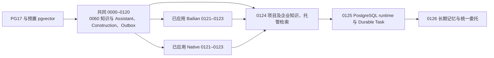

# 小K三线集成审查

## 2026-11-13 只读审查

| 引用 | Fetch 后提交 |
| --- | --- |
| Bailian `codex/xiaok-bailian-responses-api` | `113043445e0675bbc4e05d92fe4a338c8b6262fa` |
| Native `codex/xiaok-native-workflow` | `e3b9a2df6d012dfdda92d2bd3fb95bcb4a3b8c86` |
| Public `codex/xiaok-public-site-lifecycle` | `44ea5f4434213d6fd7b802cbfa6626602653d034` |
| `origin/main` | `f273b57171d6dab5c3b8beef1fe124e634d51864` |

三线共同祖先是 `c190fd3fe7339b4914f9f9f7ea5b4e963b56a745`。Bailian 与 Native 还共享 `11ac22ddcea422d3d69358b7a2fe221c13487dd7`。`main` 是三线的祖先，相对各线的独有提交均为 0，各线超前 469 / 466 / 460 个提交。以三线共同祖先创建 `codex/xiaok-integration`，按 I1 Bailian、I2 Native、I3 Public 合并并保留父提交。初查本地及远端均无同名分支。原 Public 工作树的 `admin/src/lib/survey-runtime/source-manifest.json` 有未提交修改，集成使用独立工作树。

### 文件与合同冲突

- 以两线对应共同祖先比较。Bailian/Native 交叉修改 21 个路径，Bailian/Public 24 个，Native/Public 38 个，三线同时修改 16 个。只读 `git merge-tree` 分别预报 14、8、26 个文本冲突。三线同时修改的代码包括 Assistant `synthesis.ts`、`worker.ts`、`conversation.ts`、`knowledge/sources.ts`，Construction `report-body-worker.ts`、`service.ts`、`site-chat.ts`、`site-queries.ts`、`site-results.ts`，以及小程序 `assistant/lib/chat.js` 与对应测试。另有四份模块清单与唯一计划。
- I1 以 `AgentModelGateway` / `ModelTurnInput` / `ModelTurnOutput` 承载双协议。配置默认走现有 Chat Completions。Responses 和原生工具依模型能力显式启用，名称冲突、用量和中断状态须有回归。Public 的原生执行器涉及对话运行、回调串行化及引用复核，合入时核对模型派发与恢复的真实调用点。
- I2 两线在 `delegation-state.ts`、`delegation-store.ts`、`delegation-worker.ts`、`delegation-chat.ts` 为新增/新增冲突。Bailian `delegation-sources.ts`、`delegation-knowledge.ts` 提供可撤回的材料与工艺证据。Native 持有房间任务、定时唤醒、租约、报告状态及工具持久化。Construction 的记录、事项、图纸与角色权限仍是业务事实。统一调度需兼容两种委托来源与原会话回执。
- I3 冲突集中在 Assistant 的请求上下文和 Worker、Construction 的设计需求/计划/事项/整改投影、小程序项目与会话。保留 Public 的已批准设计及公开来源失效合同，与 Native 的四端同源数据和 durable receipts 对齐。核查两份还原台账的当前路由行。
- Bailian、Native 在分叉后没有改动 `admin/package.json` 与 `admin/package-lock.json`。Public 成对升级 Next.js `16.2.3 → 16.4.6`、sharp `^0.34.5 → 0.35.5`，并变更 `tsconfig.json`。I3 统一使用 Public 锁文件和独立安装，构建与类型检查分别记录。

### PostgreSQL 迁移

共同 Journal 共 120 条（idx 0–119），尾项是 `0120_construction_camera_sd_identity_version`。此前已有 `0115 → 0114` 的历史依赖顺序，按 Journal 时间戳保留。

| idx | 时间戳 | Bailian | Native |
| --- | --- | --- | --- |
| 120 | 1795075200000 | `0121_assistant_rag_scope` | `0121_native_workflow_delegations` |
| 121 | 1795161600000 | `0122_assistant_managed_knowledge` | `0122_native_workflow_runtime` |
| 122 | 1795248000000 | `0123_assistant_long_term_delegation` | `0123_native_workflow_durable_tasks` |

- 依赖。共同 `0060` 的知识 chunks → 项目/企业作用域 → 托管库及文档导入。共同 Assistant 会话消息、Construction、Outbox → 长期记忆和委托。Native runtime stores 与 durable tasks 还依赖租户和 outbox delivery。两份委托 DDL 创建同名委托、事件表、索引、RLS 与投递触发器。Bailian 按 `owner_id/current_status/evidence`，Native 按 `requester_id/state/tasks`，历史数据要保留业务意图、原消息、审计以及未知副作用。
- 历史 `0060_assistant_knowledge.sql` 在 Bailian 被改成 pgvector 可选，另有无向量初始化通过记录。集成以共同已用 SQL 为正本，历史 Bailian 变体保留作核查。已安装 Drizzle 按账本最大 `created_at` 选择待执行迁移，直接拼接 Journal 会漏掉同时间戳条目。I2 要把历史分支文件及校验保留并采用严格在冲突尾部之后的兼容迁移，以实际 SQL 执行记录生成新账本条目。
- 经现有回环转发只读核对，开发主库有 119 条，隔离评估库有 118 条，两者最新为 `0119`，未见分支委托、Native runtime 或托管知识表。两库的 `0021`、`0051` 历史 hash 与当前仓库不同，保持原样。两库尚未迁移。
- 本机 Native 隔离实例实查到共同基线 120 条、应用原始 Native 委托 121 条，以及应用三个 Native SQL 的 123 条账本。另有保留失败/中间库在两个 runtime 时间戳写有不同 hash（`6c42ecee7bca…`、`b323e1d7b876…`），不可按时间戳判定已应用新版。Bailian R6 已停止实例的隔离副本实查原 123 条迁移、2 条委托和 27 条事件。保留原始 `tmp/r6` 证据与无向量初始化记录。
- 升级验证需覆盖全新 PG17/pgvector、已应用 Native 和已应用 Bailian 的隔离库，校验原账本不变、DDL/RLS/触发器、业务数据以及重跑。任何未知 schema 或账本差异先归因，再决定能否升级。生产和共有开发库的实际应用不在本次授权内。

### 验收记录

历史各分支报告只覆盖各自的快照。保留 Bailian `docs/evidence/bailian-responses-*.json` 及原本地 R4–R6 证据、Native [B5.10 部署审查](native-workflow-b510-deployment-review.zh-CN.md) 及 B5.11 记录、Public 四端与 Markdown 证据。历史模型失败、unknown、实际用量与环境限制继续在原记录查询。集成当前待验证范围包括双协议真实调用及原生工具、企业引用撤权、项目切换与重进、四端日周报和周槽、设计/整改/关闭、PostgreSQL 多实例与副作用幂等、Stable 原生端与完整构建。生产发布维持独立授权。

| 阶段 | 当前状态 | 核对依据 |
| --- | --- | --- |
| I1 Bailian | 已集成，验收 Limited | 提交 `67443d856fc9acfb361d05b8b1ecf9957c396a62`。127/127 定向单元、85/85 客户端，238 个目标文件 ESLint 零错误。PG17 从空库迁移 123 条，托管知识、长期记忆、委托五张表的强制 RLS 已核。实模 Chat Completions 与 Responses 基础请求通过，联网集成请求超时 unknown。 |
| I2 Native | 已集成，隔离服务验证通过，整体验收 Limited | 提交 `35e34127d532c4ed615a0473b4d35b798e8b5da5`。571/571 单元、7/7 Native 实库和 10/10 R6 合成业务。覆盖双 Admin/Worker、租约接管、四角色同周投递、回执重进、跨租户和故障回滚。 |
| I3 Public | 已合流，整体验收 Limited | 提交 `ad527d465425f79b08b5bdc9128dc3b153cf1556`，父提交为 I2 和 Public。本节后列出集成基线、历史复用和剩余限制。 |

I1 源码索引 `f256cebc1fd57531191a687e67e357e0689acb2f`。完整 `tsc` 的 290 条诊断与 Bailian R6 的 `type-final.log` 逐条一致，其中应用源码两处位于 `report-context.ts`、`period-report-status.ts`。首次 ESLint 命令因相对路径为空实际扫描全项目，保留其中一条基线错误的日志。改为定向路径后通过。首次空库迁移因 migrator 无权安装 vector 失败，由隔离库 owner 显式预置扩展后通过，共同 `0060` 保持原字节。原始测试日志在集成工作树 `tmp/i1-*.log`。

实模固定 `qwen3.7-flash`。本机独立库使用留存的北京百炼开发凭据，首个配置脚本缺历史 catalog 文件，在发请求前停止。复用现有凭据加载器和官方域名校验后配置成功。两次已知成功共 87 输入、453 输出 tokens，实际账单未返回。第三次 `PROVIDER_TIMEOUT` 用量未知且未重放，网页提取与代码解释器后续用例未执行。原请求及结果见工作树 `tmp/bailian-responses/`。托管知识仍缺 R6 专用工作空间配置。

### I2 迁移与运行验证

- 活动依赖图。旧分支路径只用于识别已应用的原始记录，所有升级收敛到同一活动尾部。

- 以活动 Journal 的 `0124` 知识 → `0125` Native 存储及 Durable Tasks → `0126` 长期记忆与委托合流为唯一顺序。活动时间戳为 `1795334400000`、`1795420800000`、`1795507200000`。分叉 SQL 与原条目保存在 `admin/drizzle/legacy/`，保留原 tag、时间戳和字节。兼容迁移核对已知原 hash 与表/约束，发现两类原账本混用或未知分叉 hash 时拒绝。原 `0060` 在新库要求预置 pgvector，托管检索本身沿原可选配置。
- 隔离 PG17 全新库 123 条，Bailian、Native 原序列各从 123 到 126 条，相关 11 张表全部强制 RLS。对停止的 R6 原卷取只读副本，确认原 Bailian 三条 hash；实际升级两次，旧账本 123 行、2 条委托和 27 条事件的逐行摘要相同。完成和取消状态映射保持。Native 升级库以原 Native 三条迁移初始化后完成实库写入与双实例测试。历史不匹配的 runtime 变体保留在旧证据库，尚未核准升级。
- Native 使用同一租户锁、Outbox 投递、状态与身份边界。R6 的工艺读取和施工复核接入该消费者，原始副作用回执与重进沿 Construction 和 Assistant。详见[统一模块合同](xiaok-integration-contract.md)。
- 测试索引 `5224f11330621383e9af4249159a74b5434de2b8`。97 个目标文件 ESLint 零错误。首次类型检查发现新增 `safeText` 未导入，已修正；顺带处理两条继承的应用源码类型错误。全量类型与构建随 I3 锁文件一并复验。证据为集成工作树 `tmp/i2-*.log` 与 `admin/tmp/r6/integration-i2-service-01/`。R6 使用测试托管替身和隔离服务，真实模型调用 0，保留 I1 的超时结果。

### I3 业务合流

- Public 的公开版本、历史消息投影与原生执行器沿同一模型网关和权限边界，保留 Bailian 工具、检索与托管资源清理。来源变化触发读回重验，重进及增量读回使用原消息序号和稳定请求键。小程序沿用两份还原台账所列 C01 和工地设计，使用存量方案与关闭回执组件。Markdown 从助手正文生成渲染节点，原消息事实留在服务端。实际冲突清单在集成工作树 `tmp/i3-conflict-hunks.json`。
- 设计核对、精确版本方案、施工回传、整改、复核与关闭从同一 Construction 事件投影读取。房间委托优先绑定已确定的唯一现场事项，仍待确认的设计需求保留独立状态。委托查询重读原指令和当前有权访问的事项。项目更新事务写入同一版本的 Outbox，后置触发器沿同一键去重并保留系统更新能力，原迁移 SQL 与 Journal 未改。

### 集成验收范围

I3 最终运行代码在文档更新前的树为 `6f7a1f035b976d98448dd41ee7fc9bf4029b722e`。受测源码、驱动和配置文件的暂存清单摘要为 `26a6409c738cea305f4916f7539697dd10e170acbec03e7aa18e201955536df0`，最终构建及隔离服务在固定源码下执行。早期测试保留各自的快照和结果。

| 层 | 集成结果 | 本地证据 |
| --- | --- | --- |
| 单元与客户端 | I3 定向单元 235/235，涉及网关、Assistant、Construction 和委托。定向小程序 85/85。全量小程序 2243/2244，唯一失败为测量 Phase 0 facade 的冻结调用清单。原 Public 基线复现同一遗漏 `surveying-editor-autosave.test.js`。 | `tmp/i3-units.log`、`tmp/i3-mini-*.log` |
| 服务与隔离 PG17 | Public/Construction 44/44，覆盖公开与本人项目切换、多轮和历史、撤回、原请求失败恢复、批准方案、整改和关闭。B5.9/B5.10 9/9，包括真实照片与语音回传、四角色状态、两 Admin HTTP 实例、角色及跨租户拒绝、原回执和撤权。R6 11/11，覆盖 PPT 授权工艺及撤回、私有偏好、委托、同源施工原件、Outbox 重试和查询回执重投影。R6 使用模型与托管替身。 | `tmp/i3-services-verified.log`、`tmp/i3-b59-verified.log`、`admin/tmp/r6/integration-i3-verified/report.json` |
| 持久化与日周报 | Native runtime 7/7。双 Admin revision、双 Worker 租约接管、事务失败回滚及运行存储从文件切换至 PG 并回退通过。两进程争用同一周槽只生成四个持久报告任务。另一隔离库用一条现场记录生成四种角色的日报及周报事实，每周期五份（两个企业管理者）。原跟进详情和历史可读，同周期重复投递为 0。 | `tmp/i3-runtime-verified.log`、`tmp/i3-report-delivery.log` |
| Stable DevTools | 官方 Stable 与 `miniprogram-automator 0.13.0`，390×844、基础库 3.17.2，单控制器在独立集成项目次屏。原咨询的授权照片、实际发送委托状态、即时读回与重进通过。已同意图纸及关闭回执原件通过。同版本的单独咨询验证 Markdown 标题、列表、原始正文和重进，模型替身。未完成范围包括四端完整界面、公开直播和真机。 | `tmp/i3-stable/r6-native-verified/verification.json`、`tmp/i3-stable/native-markdown/verification.json` 及同目录截图 |
| 配置模型 | I1 真实 Chat Completions 和 Responses 基础调用各通过一次。Responses 联网超时 unknown，未重放。原生联网、提取、代码执行和真实托管 RAG 缺本轮成功证据。I2、I3 实库及 Stable 使用替身或确定性流程。 | `tmp/i1-live-*.log`、`tmp/bailian-responses/` |
| 构建与部署 | Next.js 16.4.6 Webpack 生产构建与独立 TypeScript 通过。153 文件 ESLint 0 错误、25 警告。本地 standalone 连接隔离 PG 并返回健康状态，未认证请求返回 401。生产环境尚未发布或验收。 | `tmp/i3-webpack-verified.log`、`tmp/i3-type-verified.log`、`tmp/i3-lint-verified.log`、`tmp/i3-standalone-verification.json` |

早期 Stable 保留了实库写入成功而回执被旧权限投影隐藏的记录。补齐真实读取后，撤销与恢复项目授权通过；此前同一项目更新触发器与应用发出重复键的原失败保留。带图纸和关闭回执的 Stable 批次中 Markdown Worker 前置状态失败，后用与 R6 一致的配置和独立合成咨询完成渲染及重进。重复使用同一个已领周槽的 Native fixture 曾被前置校验拒绝，旧库保留，新隔离库重新执行通过。

交付检查确认 I3 合并提交的 Admin 和 Mini Program 源码与最终受测源码一致，迁移文件与 I2 一致。原 Public 工作树的未提交修改保留。测试结束后释放 Stable 控制器和集成窗口，清除本轮隔离库中的临时百炼配置并停止两台集成测试容器。测试卷和原始证据保留。

上线前需在获准环境核对实际迁移账本、配置和备份恢复，补足联网与托管实调及目标设备验收。生产发布仍需独立授权。

## I4 数据库兼容性

起点为 `5881f89f8c7205c593b8755aaa4252f56d73c8ab`。Fetch 后三条原始分支各有 0 条 Integration 之外的提交。独立 Integration 工作树起点干净，原 Public 工作树的测量清单改动保留。

隔离库复现两个基线失败。同一原消息含不同操作键的两条 Bailian 委托时，`0126` 在全表来源唯一约束处返回 `23505`。未知新时间戳的真实 DDL 及其 hash 让旧迁移命令跳过集成并报告成功。普通 Bailian 原库升级缺两个水电查询索引。原始日志在 `tmp/i4-i5-20261113/i4-baseline*.log`。

`0127` 兼容原 Bailian 同源委托，补足索引和统一触发器。空库及 Native 原库继续执行原 `0126`。完整 Bailian 原库走 `0127` 的兼容升级，已执行 `0126` 的库直接前进。原 SQL、已执行账本及委托的身份、来源、原事件、投递和未知状态保留。迁移入口锁定并检查完整账本及委托表形态；历史 hash 的差异必须在隔离快照中核对后才能升级。实际测试使用 PG17.10 的专用环回容器和合成数据，`sfp_migrator` 执行 DDL，`sfp_app` 执行读写和跨租户拒绝。执行入口、限制和回退见[集成合同](xiaok-integration-contract.md#数据迁移与回退)。

在 `b612ea0692acc5fac62ca8487029196bec7809cb` 执行 `admin/scripts/__tests__/xiaok-integration-migrations.test.mjs`，6/6 通过。三条路径分别用全新 PG17、原 Native SQL、原 Bailian SQL 初始化。附加用例包含没有 vector 扩展的 Bailian 同源记录、已执行 `0126` 的库及未知 hash 拒绝。逐字段核对 Native 10 种和 Bailian 11 种旧状态、原事件和原投递状态。核对 11 张表的强制 RLS 与应用角色权限、10 个索引及 4 个触发器。Native 升级后的快照恢复到同容器独立库，127 条账本、13 条委托、11 条事件、13 条投递和 1 条持久任务摘要全部匹配，跨租户读回 0 条。证据见 `tmp/i4-i5-20261113/i4-final.log`、`i4-binding.txt` 和 `i4-restore.json`。

## I5 业主原咨询与持久执行

Agent 在原咨询读取当前获权项目、阶段和房间，通过 `start_delegation` 登记跟进。登记在原咨询去重，整条指令只触发单项登记时可以采用已保存的登记回执。Native 使用同一委托主记录、Outbox 消费者和 PostgreSQL Durable Task 租约。Construction 沿正式业务服务处理设计师核对、施工原件、事项版本与管理者复核。Conversation 保存结果及原件授权，C01 重进重新投影。

I5 验收以 `b612ea0692acc5fac62ca8487029196bec7809cb` 为基线，测试前后应用源码、测试、迁移和小程序的 3502 个文件内容摘要均为 `41235c05009a6fff358cc6fbeee51056fd9bd48cb987b9f605b153e10f45840d`。定向后台测试及构建的工作树差异指纹为 `7237c324b59abd8eab1311e87e8bd89a9e590810`，新增 `delegation-execution.ts` 的 SHA-256 为 `4cf03a8c890f4fdac6dbb178ff635bc3942fd3d3dae9e5d73732f11dbef595b`。服务、模拟器和模型固定用例使用同一专用 PG17.10 容器的隔离合成库。`*.binding` 及原始报告在 `tmp/i4-i5-20261113/`。

提交可按 Git 子树核对。`admin/src` 为 `0391f1e082252bc20112b32463b1fe356ca5031d`，`admin/scripts` 为 `85d0bd17cd52a731594fd356fde28dbe9a4750cf`，`admin/drizzle` 为 `397b0b05e3e3409d407bdf454ea95425e849593e`，`miniprogram` 为 `21dad1fdd62127d9f91ccf976159ea6e0da2c850`。

| 层 | 状态与本轮证据 |
| --- | --- |
| 定向单元、客户端 | 通过。Native 和 Assistant 109/109，Construction 13/13，小程序 Chat、跟进与 Markdown 84/84。 |
| PostgreSQL 与多进程 | B5.9/B5.10 10/10，两个独立 Admin HTTP 进程、两个 Worker、进程被终止、已过期租约拒绝及重复事件均通过。重领后的尝试为 `timed_out → succeeded`，同一事件链接及消息各写入一次。B5.11 在新隔离库 7/7，先前复用已领取的周槽导致的失败保留。B5.8 水电及事件重试 9/9，历史实模续轮用例未运行。 |
| Agent、Construction 与权限 | 通过。`xiaok_r6_acceptance_i5delivery` R6 14/14，签名会话和真实 PostgreSQL 写入。同键重发、独立咨询、原项目/房间/阶段、团队角色和跨企业权限、设计师和工人撤权、事项旧版本及原咨询回传通过。原咨询 2 收到消息 43，关联事项 46、方案 52 和现场记录 3。语言模型、托管检索和图片整理使用替身，施工结论由获权角色经正式服务写入。证据 `admin/tmp/r6/integration-i5-delivery/`。 |
| Stable C01 | 通过。Stable 2.02.2608080、基础库 3.17.2、逻辑 390×844。从 C01 输入原业主需求，消息 7 发起 run 4，同键重发沿用原请求。使用相同的 14 项服务断言执行至获权团队回传，退到首页重进后读取原咨询 2 的结果 43 和原图。证据 `admin/tmp/r6/integration-i5-native-c01/native-owner-journey.json`。独立批 `stable-delivery/verification.json` 的查看委托、退出重进及撤回后回执失效 5/5。两批截图均为 363×785。 |
| 配置模型 | 百炼 Responses `qwen3.7-flash` 首批第 1 条在选中正确工具和房间后因跨咨询复用与终稿形态失败（run 11，`invalid_model_answer`），第 2 条未执行。两次已接受调用共输入 11040、输出 6436 token，其中缓存输入 5120。修复后固定卫生间和厨房两条用例 2/2（run 12、13），各 1 次调用，共输入 10743、输出 1882 token。两批货币用量均未知，分别保留 `i5-configured-model.json`、`i5-configured-model-verified.json` 和对应日志、绑定。 |
| 质量 | TypeScript、受影响 ESLint 和生产 Webpack 构建通过。完整 `postgresql-integration.test.ts` 61/62，唯一失败是继承的索引检查。相同 SQL 在升级前后均得到同一组 151 个缺索引列，见 `i5-postgresql-final.log` 与 `pg-index-baseline.json`。 |

原 R6 失败和环境前置结果保留在 `tmp/i4-i5-20261113/i5-r6-*.log`。合成 unknown 留在 `indeterminate`、预约待对账和零新增委托，原请求重发仍沿原 run。Stable 的输入时机、失效页面引用、项目路径和测试驱动失败保留在同目录 `stable-*.log`。模拟器使用临时签名及传输覆盖连接隔离服务，运行后恢复覆盖和项目配置原字节。地图服务缺配置使隔离环境定位支线返回 503。真机、BLE、真实微信登录、真实托管和联网以及生产环境未执行。历史 I1 unknown 请求保持原记录。

## I6 真实模型与获权知识验收（Limited）

起点为 fetch 后的 `origin/codex/xiaok-integration@accc750093973a8c79f799a2bd9cdb8c6f9e4794`。集成工作树独立，原 Public 工作树未提交修改保留。隔离 PG17.10/pgvector 使用 `sfp_app` 和合成微云 1454。独立 OpenSERP 0.8.17/Baidu 及配置模型使用开发凭据。托管预检在请求前返回 `bailian_knowledge_not_configured`，缺专用工作空间和 API Key。

### I6.1 联网与引用

| 检查 | 结果与证据 |
| --- | --- |
| 百炼原生工具 | `qwen3.7-flash` 的 Responses 同请求观察到搜索及提取，另一次真实代码解释器返回 1728。历史 I1 `PROVIDER_TIMEOUT` 仍为 unknown，未重放。提取回执中两个段落的来源顺序与 URL 列表相反，现按段内来源绑定，歧义段计为未归属。百炼工具输出为摘要，C01 引用使用应用读页原文。 |
| 应用搜索、读页及保存 | 在 `current-first` 和 `current-repair` 实际搜索并读到住建部公告。run 2 以同一会话打开持久引用，已核实来源网址、标题、读取时间及公告原句。首次业务失败 `unsupported_model_commitment`；修复版虽然保存，仍把旧公告的条文当作今天有效。run 3 追问时模型请求未开放工具，`assistant_capability_forbidden`，未执行该工具。 |
| 防水规范 | `workmanship-first` run 4 真实搜索。候选页未能读取，模型首稿在无来源时给出具体水深、时间及工序，终稿守卫拒绝。后续管根问题未执行。本批没有把第二次搜索命中或任何摘要计为条款证据。 |
| 重开及变更 | C01 完整历史及点开引用用原 reader 检查正文版本、撤除和网络故障，在 I/O 前后验证会话及快照。隔离数据库 7/7，含改页、其他客户和跨租户、历史清理及失败反馈。快速 Responses/网页测试 67/67。 |

原始首稿、唯一修复批和实际请求回执保存在集成工作树 `tmp/i6-20261113/web/`、`tmp/bailian-responses/report-i6-native-tools.json` 及对应 `raw/`。旧公告与后续废止公告的差异由人工对照确认，事后对照没有补入原运行 Evidence。停止对首问重复取样。现行性仍需能读到正式状态或更新文件，历史公告的上线日期和当时条文只能支持历史陈述。[GB 55032-2022 公告](https://www.mohurd.gov.cn/gongkai/zc/wjk/art/2024/art_17339_767714.html) · [GB 55038-2025 公告](https://www.mohurd.gov.cn/gongkai/zc/wjk/art/2025/art_66adac27fa2144bb86f98fe4c297efd6.html)

应用批次 15 次已完成供应商调用，共 52,273 输入、3,776 输出 tokens，其中缓存输入 8,832。原生提取请求 `5d30658a-debe-9aef-9fb2-a80be46d25b2` 计 7,285/2,264 tokens，含缓存输入 1,920，报告 1 次搜索和 1 次提取。代码解释器 `d71cca44-25f2-9291-843a-498d7f117206` 计 824/166 tokens，执行 1 次。实际结算金额未返回。

### I6.2 本地企业知识与持续委托

- `integration-i6-local-final` 使用真实本地 Embedding/pgvector、同一 KnowledgeRetriever 和 PostgreSQL Durable Task。业主召回 PPT 第 18 页第 3、5 行，保留项目、版本、片段 hash 和定位。业主、设计师、工人、老板的实库查询各报告 28 输入 tokens。对照项目不返回此资料；跨租户和撤销成员权限受原服务约束。对话模型与故障注入是替身。
- 正式版本替换后旧引用和旧委托核对结果失效。下一个项目事件走原 Dispatcher 重新检索新版本，撤回后重新核对为 `no_match`。工人原图不使事项自动完成。授权人员核对后，正式结论和获准原图回原咨询。原请求重发、租约接管与故障恢复沿同一业务键。
- 企业知识关闭在检索前拒绝。开启而托管缺配置时返回 `retrieval_unavailable`，保留 `bailian_knowledge_not_configured` 且无请求 ID。配置缺口与有权限但查无结果有各自状态。托管请求为 0，仍为 Limited。
- 原始回执在 `admin/tmp/r6/integration-i6-local-final/`，含 `retrieval-scopes.json`、`version-recovery.json`、`formal-result.json`、`durable-steps.json` 和注入 unknown。PPT 仅写明项目团队安排防水施工和后续检查。材料、管根做法、验收阈值和铺砖放行条件没有获准企业原文，不能由相似检索或模型补成企业条款。

### I6.3–I6.5 固定自然对话

以 C01 的签名 HTTP 请求、原 Worker 和北京配置模型执行。公开资料用应用工具，企业资料用真实 Embedding/pgvector。首次测试把 PPT 片段绑在合成项目。B 首轮的模型显式选 `scope=enterprise`，按约定排除了项目文档。修复批按原题将同一已核 PPT 内容作为企业通用资料发布到新隔离库，项目范围仍由 I6.2 的独立对照保留。当前工具说明明确了省略范围的语义。C 修复只开放原业务查询的施工域，并将指定房间限制到唯一在施工项目及向业主发布的原记录。两批请求绑定无源码漂移。

| 固定场景 | 首批 | 一次定向复验 |
| --- | --- | --- |
| A 管根、防水、铺砖 | run 2–4。前两轮未查依据且把施工做法说得过于确定。第三轮引用了确实支持团队安排检查的 PPT 原文，但未给出可核查的铺砖放行条件。 | 未执行。企业资料没有这些条件。公开防水原文测试见 I6.1。 |
| B 企业做法与国家通用要求 | run 5 查询范围为空，首稿及唯一修复仍补了无据高度和闭水时长，拒绝保存。第二问未执行。 | run 3 引用 PPT 第 18 页，保留具体参数缺项。run 4 仅检索企业来源，未完成公开标准原文核读，首稿及修复仍被拦截。 |
| C 真实水电和主卧进度 | run 6–7 返回固定现场引导，未使用已发布事实。 | run 5–6 读取项目实际水电节点与主卧待核对记录，排除厨房完工对照。两条首稿后的结构/来源修复均保留。房间记录撤回后旧派生答复不可用在隔离服务复核。 |
| D 插座设计协作 | run 8 使用现场团队引导；没有根据该咨询的正式图纸版本给出解释。run 9 按业主明确请求创建主卧插座委托，返回登记回执并等候获权协作。 | 未追加实模。真实 Construction 精确版本与原咨询回传单独通过。 |
| E 房间更正 | run 10 的无据工艺答复被拦，纠正问未执行。 | run 7 保存一般建议；run 8 的查询已转为卫生间，首稿仍重问且补无据高度，唯一修复仍补无据高度，终稿失败。该更正轮没有写长期记忆。 |
| 私有偏好 | run 11–12 保存本人沟通偏好，新咨询正确读回“先告诉我结论，再说细节”。 | 复用首批证据。 |

首批 18 次供应商调用，84,349 输入、16,168 输出、8,960 缓存输入 tokens，检索 Embedding 105 输入 tokens。修复批 19 次供应商调用，93,564 输入、12,974 输出、0 缓存输入 tokens，检索 Embedding 164 输入 tokens。实际结算金额不可得。源首稿、每轮唯一修复、请求 ID、工具输入和实测用量分别保存在 `admin/tmp/r6/integration-i6-live-configured/` 和 `admin/tmp/r6/integration-i6-live-repair/` 的 `turn-*.json`。早期配置试跑本地密钥不可解密，未发供应商请求。B 对比及 E 缺少支持工艺量数的适用原文，停止重复采样。模型能力和代表请求见[模型矩阵](bailian-responses-adapter.md#14-i6-模型能力矩阵)。

### I6.6 业务回传与工程检查

- 通过。最终隔离 R6 批 `integration-i6-project-status-final` 16/16，含真实 Embedding、房间记录过滤、撤回后历史隐藏、阶段记录与房间记录独立、四角色及原咨询正式回传。业务链使用替身模型。受影响 Assistant、Responses、RAG 与 Native 快速测试 219/219，小程序最终定向 341/341，Construction 设计核对及施工计划/整改 13/13，网页实库 7/7。TypeScript、受影响 ESLint 与生产 Webpack 构建通过。
- 失败。较广 Assistant 批 1033/1034，失败的「书桌收纳」测试及其实现与基线相同。原资料兼容批开启其明确需要的知识后为 9 通过、1 失败、1 跳过。混合现场旧测试仍假定只有 `search_knowledge`，当前路由另有 RAG 工具，原失败保留。直接施工正式方案测试固定旧数据库端口，I6 未接入该实例；独立 Construction 与 R6 正式方案版本测试覆盖相关写入。
- Stable C01。逻辑 390×844，截图 363×785，已通过实际点击打开配置模型保存的 PPT 引用。另在同一获权咨询实际发送两条项目进度追问，并退出后读到同两条答复；此批 Worker 使用替身模型和真实 Construction 读取。原咨询 2 中的真实复核结果 43、授权原图和实际发送的委托状态回执 64 均在重进后可读。原生公网引用和固定 A–E 的实模连续界面未执行。前序夹具、输入和轮询驱动失败原样保留。证据 `tmp/i6-20261113/{stable-citations-final,stable-delegation-final}/verification.json`。
- unknown。I1 供应商超时原回执保持待对账。R6 故障注入的未知状态单列，未重放原请求，也未当作真实供应商调用。
- 环境阻塞。百炼托管库缺专用配置。未执行真机、真实微信登录、BLE 或生产部署。
